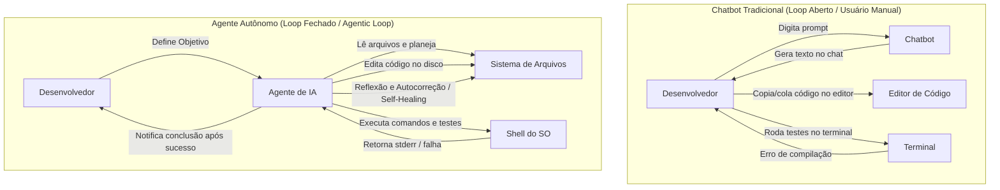
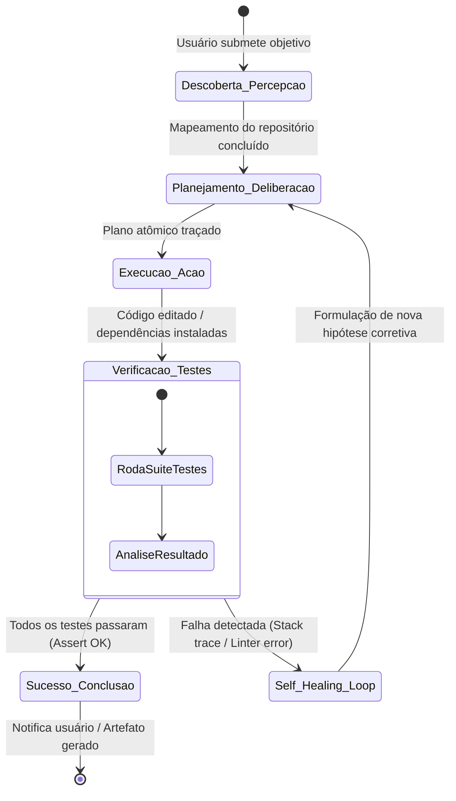
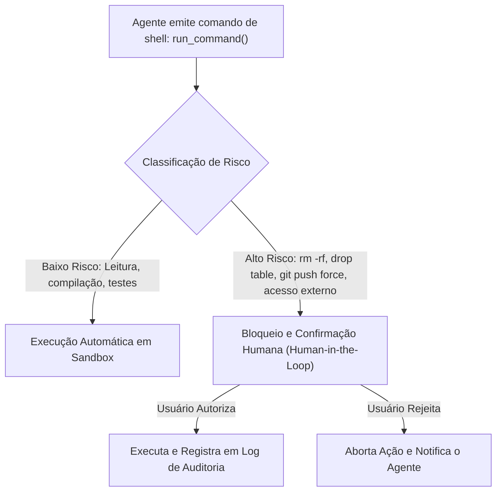

# 02 - Sistemas Agentivos de Desenvolvimento (CLI e IDE)

> **Matéria:** Engenharia de Software Assistida por IA e Sistemas Agentivos  
> **Cargo:** B02 – Técnico de Controle Externo – Especialidade: Tecnologia da Informação  
> **Arquivo:** `02_arquitetura_de_sistemas_agentivos_e_ferramentas_cli_ide.md`  

---

## 📌 Ementa / Itens do Edital
- Sistemas agentivos de desenvolvimento: arquitetura e funcionamento
- Assistentes de codificação em interfaces de terminal (CLI) e integradas a IDE (ex.: Claude Code, Antigravity CLI e equivalentes)
- Ciclo agentivo de desenvolvimento: descoberta, planejamento, execução, verificação e autocorreção (*self-healing*)
- Ações em sistema de arquivos e comandos de shell

---

## 🌳 Classificação Hierárquica

```text
2. Arquitetura Agentiva, Ferramentas Autônomas e Loops de Execução
├── 2.1 Arquitetura dos Agentes de Codificação
│   ├── 2.1.1 De Chatbots Passivos a Agentes Autônomos: Diferença entre autocompletar simples e agentes orientados a objetivos (Goal-Driven Agents)
│   ├── 2.1.2 Componentes Centrais de um Agente:
│   │   ├── Cérebro / Modelo de Raciocínio (LLM de alta capacidade lógica)
│   │   ├── Memória (Memória de curto prazo / histórico do diálogo + memória de longo prazo / indexação de código)
│   │   ├── Percepção / Sensores (leitura de arquivos, árvores de diretórios, stdout/stderr de comandos)
│   │   └── Atuadores / Ferramentas (escrita/edição de arquivos, execução de scripts, chamadas de rede via MCP)
│   └── 2.1.3 Padrões de Interfaces:
│       ├── Interfaces de Linha de Comando (CLI): Ferramentas executadas diretamente no terminal (Claude Code, Antigravity CLI, Aider)
│       └── Ambientes Integrados (IDE Native): Extensões e IDEs agentivas completas (Cursor, Windsurf, Copilot Workspace)
├── 2.2 O Ciclo Agentivo de Desenvolvimento (The Agentic Loop)
│   ├── 2.2.1 Fase 1: Descoberta e Coleta de Contexto (Percepção)
│   │   ├── Inspeção de estrutura de diretórios e arquivos de configuração (`package.json`, `pom.xml`, etc.)
│   │   ├── Varredura semântica e busca por palavras-chave em arquivos de código
│   │   └── Leitura seletiva de arquivos relevantes para evitar sobrecarga de contexto
│   ├── 2.2.2 Fase 2: Planejamento e Tomada de Decisão (Reasoning & Planning)
│   │   ├── Formulação de plano estruturado com passos atômicos
│   │   ├── Antecipação de dependências e possíveis pontos de falha
│   │   └── Solicitação de esclarecimento ao usuário em caso de ambiguidade (Human-in-the-Loop)
│   ├── 2.2.3 Fase 3: Execução de Ações no Ambiente (Action)
│   │   ├── Modificação atômica de código via ferramentas de edição de arquivos (`replace_content`, `write_file`)
│   │   ├── Execução de comandos no shell do sistema operacional (instalação de dependências, compilação)
│   │   └── Gestão de processos assíncronos e processos em background (daemons)
│   └── 2.2.4 Fase 4: Verificação Autônoma e Autocorreção (Verification & Self-Healing)
│       ├── Execução automatizada de suites de testes (JUnit, Jest, Pytest) e linter
│       ├── Captura e interpretação do stack trace de erros ocorridos durante a execução
│       ├── Loop de reflexão e autocorreção (*Self-Healing*): O agente analisa o erro, ajusta o código e reexecuta os testes de forma autônoma sem intervenção humana
│       └── Critério de parada (Stop condition): Sucesso verificado ou esgotamento de tentativas
└── 2.3 Ferramentas de Referência e Paralelos Funcionais
    ├── 2.3.1 Claude Code: Filosofia CLI de terminal, integração nativa com ferramentas UNIX, busca em repositório e edição precisa
    ├── 2.3.2 Antigravity CLI: Orquestração de subagentes especializados, gestão de artefatos estruturados e automação integrada de desenvolvimento
    └── 2.3.3 Mecanismos de Segurança e Permissões do Usuário (Sandboxing, confirmação de comandos destrutivos)
```

---

## 📖 Teoria Aprofundada & Fundamentos Técnicos

### 2.1 Arquitetura dos Agentes de Codificação

A transição dos assistentes de programação tradicionais para sistemas agentivos autônomos representa o salto de um mecanismo reativo de completamento de texto para um sistema cibernético de ciclo fechado (*Closed-Loop System*), capaz de perceber o ambiente, deliberar, agir e corrigir seu próprio comportamento.

#### 2.1.1 De Chatbots Passivos a Agentes Orientados a Objetivos (*Goal-Driven*)
- **Chatbots e Completadores Passivos (Autocompletion):** Modelos como a primeira geração de extensões de código operavam apenas por predição de texto fantasma (*ghost text*). O desenvolvedor digitava o código, e o modelo sugeria a próxima linha. Caso o código sugerido quebrasse a compilação, o usuário precisava manualmente diagnosticar o erro, copiar a mensagem, colar em um chat e solicitar uma nova tentativa.
- **Agentes Autônomos Orientados a Objetivos (*Goal-Driven Agents*):** O usuário fornece um objetivo de alto nível (*"Implemente a validação da certidão negativa de débitos com tratamento de timeout e testes unitários"*). O agente assume o controle do fluxo de trabalho: ele localiza os arquivos no disco, cria branches, executa comandos de shell, compila, analisa os logs de falha e aplica correções sucessivas até atingir a meta pré-determinada.



#### 2.1.2 Componentes Centrais de um Agente de Software
Segundo a taxonomia clássica de IA (formalizada por Lilian Weng, 2023), um agente de codificação moderno é estruturado em quatro módulos integrados:

1. **Cérebro / Modelo de Raciocínio (LLM Core):** O modelo fundacional de ponta (ex.: Claude 3.5 Sonnet, GPT-4o) responsável pela decomposição de problemas, tomada de decisões lógicas e geração de chamadas estruturadas de ferramentas (*tool calling*).
2. **Sistema de Memória:**
   - **Memória de Curto Prazo (Working Memory):** Mantida dentro da janela de contexto. Armazena o objetivo da tarefa, histórico de comandos executados, saídas recentes de ferramentas e estado atual do plano de ação.
   - **Memória de Longo Prazo:** Bases vetoriais locais ou bancos de dados relacionais que mantêm indexação semântica do repositório, histórico de commits, decisões arquiteturais consolidadas e regras corporativas persistentes.
3. **Módulo de Percepção / Sensores:** Permite ao agente observar o estado do projeto:
   - Inspeção de árvores de diretórios (`list_dir`, `glob`);
   - Leitura seletiva de arquivos de código (`view_file`, `grep`);
   - Captura de streams de saída padrão (`stdout`) e de erro (`stderr`) dos comandos de shell;
   - Monitoramento do status do controle de versão (`git status`, `git diff`).
4. **Módulo de Atuadores / Ferramentas (*Tool Use*):** Interfaces determinísticas expostas pelo host para que o agente exerça mudanças no ambiente:
   - Ferramentas de escrita e substituição pontual de arquivos (`write_file`, `replace_file_content`);
   - Execução de comandos no sistema operacional (`run_command`);
   - Invocação de serviços remotos e ferramentas de dados via protocolo MCP (*Model Context Protocol*).

#### 2.1.3 Padrões de Interfaces: CLI vs. IDE Integrada

| Dimensão de Comparação | Agentes de Linha de Comando (CLI) | Agentes Integrados à IDE (IDE Native) |
| :--- | :--- | :--- |
| **Exemplos Canônicos** | Claude Code, Antigravity CLI, Aider, Mentat | Cursor, Windsurf, Copilot Workspace, Continue.dev |
| **Ambiente de Execução** | Terminal do Sistema Operacional (Bash, Zsh, PowerShell) | Janelas e painéis internos do ambiente gráfico (VS Code fork, JetBrains) |
| **Integração com Ferramentas** | Acesso nativo direto a comandos UNIX/Windows (`grep`, `find`, `git`, `docker`, scripts bash). | Acesso via APIs de extensão da IDE (LSP - Language Server Protocol, painéis gráficos). |
| **Controle de Contexto** | Focado em leitura dinâmica e concisa orientada a pipes e ferramentas de terminal. | Focado em arquivos abertos no editor, cursores ativos e árvore de projeto gráfica. |
| **Consumo de Recursos** | Mínimo overhead de interface gráfica; ideal para servidores remotos e pipelines de CI/CD. | Maior consumo de memória e CPU devido à renderização gráfica e servidores de linguagem em background. |
| **Perfil de Uso** | Engenheiros sêniores, automações pesadas de terminal, refatorações multi-repositório. | Desenvolvimento iterativo do dia a dia com edição visual lado a lado. |

---

### 2.2 O Ciclo Agentivo de Desenvolvimento (*The Agentic Loop*)

O núcleo do comportamento autônomo é o ciclo de execução contínuo, fortemente inspirado no paradigma **ReAct** (Yao et al., 2023) e no ciclo **OODA** (*Observe, Orient, Decide, Act*), estruturado em quatro fases ordenadas:



#### 2.2.1 Fase 1: Descoberta e Coleta de Contexto (Percepção)
Antes de produzir qualquer linha de código, um agente de engenharia de software eficiente deve inspecionar o ambiente para ancorar seu raciocínio:
1. **Mapeamento Estrutural:** Identificação da tecnologia através de manifestos de projeto (`pom.xml` para Maven/Java, `package.json` para Node/TypeScript, `pyproject.toml` ou `requirements.txt` para Python).
2. **Localização Cirúrgica:** Uso de ferramentas de busca por padrões de texto e símbolos para encontrar declarações exatas de métodos, evitando carregar o repositório inteiro na janela de contexto (prevenindo saturação de tokens e dispersão de atenção).
3. **Leitura de Contratos:** Análise de interfaces, entidades de banco de dados e arquivos de configuração existentes para absorver o padrão de nomenclatura da organização.

#### 2.2.2 Fase 2: Planejamento e Tomada de Decisão (Reasoning & Planning)
Nesta fase, o modelo formula uma estratégia de execução:
- **Decomposição em Tarefas Atômicas:** Em vez de tentar resolver tudo em uma única etapa, o agente quebra a tarefa em submetas: (1) Adicionar campo na entidade; (2) Criar migration no banco; (3) Implementar regra de negócio no service; (4) Atualizar controller; (5) Executar testes.
- **Identificação de Riscos e Pontos Críticos:** Avaliação de impactos em partes adjacentes do software.
- **Interação *Human-in-the-Loop*:** Se o requisito for ambíguo ou contraditório, o agente suspende a execução e solicita clarificação ao desenvolvedor humano.

#### 2.2.3 Fase 3: Execução de Ações no Ambiente (Action)
O agente invoca ferramentas para alterar o estado do sistema:
- **Edição Atômica de Arquivos:** Substituição cirúrgica de blocos de texto (`replace_file_content`) utilizando correspondência exata, evitando reescrever arquivos de milhares de linhas na íntegra (o que geraria alto custo e risco de truncamento).
- **Comandos de Terminal:** Compilação (`mvn compile`, `npm run build`), instalação de pacotes e inicialização de processos em segundo plano (*daemons*).

#### 2.2.4 Fase 4: Verificação Autônoma e Autocorreção (*Self-Healing*)
Esta é a fase que verdadeiramente diferencia um agente autônomo de um gerador estático de código:
1. **Execução de Verificadores:** O agente roda suítes automatizadas de testes (`pytest`, `jest`, `mvn test`) e ferramentas de análise estática (*linters*).
2. **Captura do Feedback do Ambiente:** O agente recebe o código de saída (*exit code*), o log de erro e o *stack trace* gerados pelo compilador ou framework de testes.
3. **O Loop de Autocorreção (*Self-Healing Loop*):**
   - Caso o teste falhe com uma asserção incorreta ou um `NullPointerException`, o agente não encerra o processo nem devolve a tarefa como terminada.
   - O agente analisa a linha exata apontada pelo *stack trace*, formula uma hipótese de correção, edita o arquivo de código e dispara novamente a suíte de testes.
4. **Critérios de Parada (*Stop Conditions*):**
   - **Critério de Sucesso:** Passagem de 100% dos testes e conformidade com o linter.
   - **Critério de Proteção (Circuit Breaker):** Esgotamento do limite máximo de tentativas estipulado (ex.: 5 iterações sem progresso), momento em que o agente interrompe o ciclo e solicita intervenção humana para evitar loops infinitos de consumo de API.

---

### 2.3 Ferramentas de Referência e Práticas de Segurança

#### 2.3.1 Claude Code e Filosofia Unix-First
O **Claude Code** (desenvolvido pela Anthropic) consolidou o padrão de agente CLI projetado especificamente para terminal:
- Opera diretamente sobre a árvore git do repositório local;
- Utiliza ferramentas integradas como `Bash`, `Glob`, `Grep`, `FileEdit` e `FileRead`;
- Utiliza raciocínio avançado para compreender dependências em código legado e executar refatorações completas com comandos de terminal controlados.

#### 2.3.2 Antigravity CLI e Sistemas Multiagente
O **Antigravity CLI** destaca-se pela orquestração hierárquica e gestão estruturada de artefatos:
- **Separação de Papéis:** Capacidade de despachar tarefas especializadas para subagentes paralelos (ex.: um subagente focado em documentação, outro em testes unitários e outro em análise de segurança);
- **Artefatos Estruturados:** Emissão de planos executáveis e relatórios consolidados que podem ser inspecionados visualmente pelo usuário antes ou durante a execução.

#### 2.3.3 Mecanismos de Segurança, Isolamento e Governança
A autonomia de um agente para rodar comandos de terminal exige controles rigorosos de segurança da informação:



> ⭐ **IMPORTANTE / REGRA DE OURO:**  
> Princípio do **Privilégio Mínimo** para Agentes: Um agente de desenvolvimento NUNCA deve ser executado sob permissões de superusuário (`root` ou `Administrator`) em máquinas com acesso a ambientes de produção ou bancos de dados reais. Devem operar em containers isolados (*Docker/Podman*) ou ambientes de *sandbox*, com confirmação manual explícita (*Human-in-the-Loop*) para comandos destrutivos.

> 🚨 **ALERTA DE PROVA / PEGADINHA FCC:**  
> A FCC adora cobrar a distinção entre a autonomia do agente no ciclo de **Self-Healing** e a governança em **Comandos Críticos**:  
> - No *Self-Healing*, o agente tem autonomia para **corrigir seu próprio código e reexecutar testes** em loop fechado sem pedir permissão a cada linha alterada.  
> - Em ações com efeitos colaterais severos e irreversíveis (como deleção de arquivos fora do escopo, chamadas a endpoints desconhecidos de rede ou execução com credenciais elevadas), o sistema **deve obrigatoriamente exigir aprovação humana**. Não confunda autocorreção de código com autonomia irrestrita de sistema operacional!

---

## 🌐 Fontes Recomendadas na Internet

### 1. Pesquisas Seminais e Artigos de Arquitetura Agentiva
- [ReAct: Synergizing Reasoning and Acting in Language Models (Yao et al., ICLR 2023 - arXiv:2210.03629)](https://arxiv.org/abs/2210.03629): Artigo pioneiro que estabeleceu o ciclo ReAct (*Thought -> Action -> Observation*), base teórica de todos os agentes de engenharia de software modernos.
- [LLM Powered Autonomous Agents (Lilian Weng - OpenAI Blog)](https://lilianweng.github.io/posts/2023-06-23-agent/): Guia de engenharia conceitual consagrado que disseca o Cérebro, Planejamento, Memória (curto/longo prazo) e Ferramentas.
- [Building Effective Agents (Anthropic Research)](https://www.anthropic.com/research/building-effective-agents): Publicação seminal que analisa padrões arquiteturais agentivos: *Workflows*, *Orchestrator-Workers*, *Routing* e loops de avaliação contínua.

### 2. Documentação Oficial de Ferramentas Agentivas
- [Claude Code Official Documentation (Anthropic)](https://docs.anthropic.com/en/docs/agents-and-tools/claude-code/overview): Especificação completa do fluxo de trabalho em CLI, ferramentas padrão de terminal e políticas de aprovação de segurança para comandos shell.
- [Aider: AI Pair Programming in Your Terminal](https://aider.chat/docs/): Documentação de uma das principais referências de código aberto em pair programming agentivo via terminal com commits atômicos automáticos em Git.

---

## 📝 Questões Comentadas & Prática Padrão FCC

### Questão 1 (FCC - Adaptada / TI - Sistemas Agentivos e Ciclo ReAct)
Diferente dos chatbots passivos baseados em LLMs tradicionais, os sistemas agentivos modernos de desenvolvimento de software (como agentes de codificação em terminal e IDEs inteligentes) operam com base em ciclos autônomos orientados a objetivos (*Goal-Driven Agents*).

A respeito da dinâmica de funcionamento e das propriedades de um ciclo agentivo de desenvolvimento, assinale a afirmativa correta:
A) O mecanismo de *Self-Healing* (autocorreção) exige que o desenvolvedor humano interrompa o agente a cada falha de compilação para reescrever manualmente os arquivos antes que o agente possa continuar.  
B) No paradigma ReAct (*Reasoning + Acting*), o ciclo operacional do agente envolve os passos ordenados de pensamento/raciocínio (*Thought*), execução de uma ferramenta no ambiente (*Action*), coleta e assimilação do resultado obtido (*Observation*) e reavaliação (*Reflection*) até atingir o critério de parada.  
C) Os agentes de software em linha de comando (CLI) são conceituados como modelos puramente estáticos que não possuem capacidade de invocar ferramentas do sistema operacional ou inspecionar o sistema de arquivos local.  
D) O uso de memória de curto prazo em sistemas agentivos substitui a necessidade de manter janelas de contexto ativas, operando sem consumir tokens de inferência do modelo de linguagem.  
E) Caso um teste unitário falhe durante a execução de uma tarefa de codificação pelo agente, o ciclo agentivo é imediatamente abortado por razões de conformidade, sendo proibido ao agente rodar suites de teste subsequentes.

> **Gabarito: B**  
> **Comentário Analítico Passo a Passo:**  
> - **A está INCORRETA:** A propriedade definidora do **Self-Healing** é justamente a autonomia com que o agente intercepta o erro gerado pelo ambiente, elabora uma nova hipótese de solução e edita novamente o arquivo para nova verificação sem depender de intervenção humana em cada iteração intermediária.  
> - **B está CORRETA:** O paradigma **ReAct** (Yao et al., 2023) sincroniza deliberadamente o raciocínio (*Thought*) e a ação externa (*Action*). Ao receber o retorno do ambiente (*Observation*), o agente reflete (*Reflection*) sobre o impacto daquela ação no progresso em direção ao objetivo final.  
> - **C está INCORRETA:** Agentes de linha de comando (como Claude Code e similares) baseiam sua operação na invocação de ferramentas do SO: executam comandos de shell, leem e editam arquivos locais e consultam árvores de diretórios.  
> - **D está INCORRETA:** A memória de curto prazo (histórico da sessão, planos e resultados de comandos) reside integralmente dentro da janela de contexto do LLM e consome tokens de entrada a cada nova iteração do ciclo.  
> - **E está INCORRETA:** A falha de um teste unitário é exatamente o sinal de retroalimentação que deflagra o loop de *Self-Healing*, permitindo ao agente diagnosticar o erro e ajustar o código para que o teste passe.

---

### Questão 2 (FCC - Adaptada / TI - Governança e Segurança em Agentes Autônomos)
Ao adotar ferramentas de engenharia de software assistidas por IA com execução de comandos no terminal (CLI) e no sistema de arquivos, uma organização pública de controle externo deve mitigar riscos cibernéticos decorrentes de ações potencialmente destrutivas ou não autorizadas no ambiente de infraestrutura.

Para equilibrar produtividade e governança corporativa na operação desses agentes autônomos, a melhor prática arquitetural consiste em:
A) Conceder ao processo do agente privilégios de superusuário (*root* ou *Administrator*) com bypass irrestrito de confirmação para todas as chamadas de sistema, a fim de garantir autonomia total.  
B) Impedir qualquer leitura de arquivos do repositório pelo agente, restringindo sua atuação exclusivamente à emissão de trechos de código em formato texto no chat da interface gráfica.  
C) Implementar políticas de isolamento em ambiente de desenvolvimento controlado (*sandboxing* / containers) e mecanismos de aprovação humana (*Human-in-the-Loop*) para comandos de alto impacto ou potencialmente destrutivos (como remoção recursiva de diretórios, formatação de volumes ou operações com dados produtivos).  
D) Desativar a coleta de logs e telemetria das ações tomadas pelo agente, pois registros de comandos executados no shell expõem os pesos internos do modelo de linguagem.  
E) Bloquear a integração do agente com o sistema de controle de versão (Git), evitando que o histórico registre commits assistidos por ferramentas autônomas.

> **Gabarito: C**  
> **Comentário Analítico Passo a Passo:**  
> - **A está INCORRETA:** Conceder acesso `root` sem confirmação viola o princípio do privilégio mínimo e expõe a infraestrutura a desastres irreparáveis, seja por alucinação na emissão de comandos de terminal, seja por ataques de injeção de prompt indireta.  
> - **B está INCORRETA:** Proibir a leitura de arquivos impede o agente de compreender o contexto do repositório, rebaixando a ferramenta a um chatbot ineficaz e incapaz de gerar código contextualizado.  
> - **C está CORRETA:** A governança moderna de sistemas agentivos preconiza a execução em caixas de areia seguras (*sandboxes* ou containers efêmeros) e a imposição estrita de *Human-in-the-Loop* (solicitação explícita de confirmação ao operador humano) sempre que a ferramenta tentar executar comandos potencialmente perigosos ou irreversíveis.  
> - **D está INCORRETA:** A auditoria minuciosa de comandos e logs de execução é essencial para conformidade, segurança da informação e rastreabilidade em órgãos públicos. Comandos no shell não expõem pesos internos do modelo.  
> - **E está INCORRETA:** A integração com o Git é altamente desejada para permitir *diffs* visíveis, revisão por pares (*code review*) e reversão (*rollback*) rápida caso uma alteração do agente seja inadequada.

---

### Questão 3 (FCC - Padrão Concursos TI / Mecânica do Self-Healing Loop)
Em um fluxo de integração contínua (CI), um agente autônomo foi configurado para resolver chamados de correção de defeitos em microsserviços legados em Java. Durante o processamento de um chamado, o agente realizou a modificação do arquivo `CalculadoraAliquotaService.java`, mas o comando de compilação disparado pelo próprio agente retornou o erro: `error: cannot find symbol: class BigDecimalUtils`.

Diante dessa situação em um ciclo agentivo dotado de *Self-Healing*, a ação esperada do agente é:
A) Encerrar a execução imediatamente e desinstalar o JDK da máquina hospedeira para prevenir danos sistêmicos.  
B) Capturar a mensagem de erro da saída do compilador (`stderr`), interpretar que a dependência ou classe auxiliar não foi importada ou não existe, buscar referências similares no repositório, realizar o ajuste atômico do código e reexecutar o comando de compilação.  
C) Ignorar a mensagem de erro e realizar o merge forçado da alteração no branch principal do repositório de produção.  
D) Reescrever todo o sistema operacional da máquina servidora em linguagem Rust para contornar o erro de compilação do Java.  
E) Solicitar que o usuário humano reescreva todo o método do zero, pois agentes são formalmente incapazes de ler mensagens de erro de compiladores.

> **Gabarito: B**  
> **Comentário Analítico Passo a Passo:**  
> - **A está INCORRETA:** A falha de compilação é um evento rotineiro no desenvolvimento de software; abortar e desinstalar o compilador representaria uma falha arquitetural grotesca.  
> - **B está CORRETA:** O ciclo de *Self-Healing* consiste exatamente nesta cadeia: a percepção do erro no `stderr` (símbolo não encontrado), a formulação de um plano de reparo (localizar o import correto ou implementar a utilidade faltante), a aplicação da alteração no arquivo e o reteste automático.  
> - **C está INCORRETA:** Fazer merge de código com falha de compilação em produção viola todos os princípios de qualidade de software e quebra o pipeline de CI/CD.  
> - **D está INCORRETA:** Ação desproporcional, fictícia e completamente descabida.  
> - **E está INCORRETA:** A interpretação de stack traces e saídas de compilador é uma das capacidades mais maduras e comprovadas dos LLMs em sistemas agentivos.

---

### Questão 4 (FCC - Padrão Concursos TI / Comparação CLI vs IDE Agentiva)
Analise as afirmativas abaixo a respeito das diferenças operacionais e arquiteturais entre assistentes agentivos de linha de comando (CLI) e extensões integradas a Ambientes de Desenvolvimento Integrados (IDEs):

I. Agentes em CLI (como Claude Code ou Aider) possuem integração direta com o ambiente de terminal do sistema operacional, permitindo encadear ferramentas nativas de busca textual (como `grep`), comandos de compilação e automação de scripts bash sem a necessidade de uma interface gráfica ativa.  
II. Assistentes nativos em IDE dependem exclusivamente de protocolos de completamento sintático local e são tecnicamente impedidos de utilizar modelos de linguagem em nuvem.  
III. O uso de agentes em CLI é especialmente vantajoso em ambientes de servidores remotos (acessados via SSH) e pipelines automatizados de esteiras DevOps, onde interfaces gráficas pesadas de IDEs não estão disponíveis.

Está correto o que se afirma em:
A) I e II, apenas.  
B) I e III, apenas.  
C) II e III, apenas.  
D) I, apenas.  
E) I, II e III.

> **Gabarito: B**  
> **Comentário Analítico Passo a Passo:**  
> - **Item I (Correto):** Agentes de terminal operam nativamente sobre o shell, tirando proveito de utilitários UNIX/Windows e comandos git para manipular o projeto com agilidade.  
> - **Item II (Incorreto):** As IDEs agentivas (como Cursor, Windsurf e extensões de VS Code) utilizam intensamente modelos de ponta hospedados em nuvem (ou modelos locais avançados), comunicando-se via APIs REST e websockets.  
> - **Item III (Correto):** Em servidores de teste, instâncias em nuvem sem ambiente desktop gráfico (*headless*) e nós de execução em esteiras CI/CD, as ferramentas CLI são ideais por não dependerem de servidores gráficos ou janelas de IDE.

---

### Questão 5 (FCC - Padrão Concursos TI / Critérios de Parada e Circuit Breakers em Agentes)
Em arquiteturas de agentes de software autônomos, o conceito de Critério de Parada (*Stop Condition*) ou Disjuntor (*Circuit Breaker*) é essencial para garantir a estabilidade e a viabilidade econômica do sistema.

A função primária desse mecanismo é:
A) Impedir que o agente consuma energia elétrica nas placas de vídeo durante a noite.  
B) Evitar que o agente entre em loops infinitos de autocorreção não convergente, interrompendo a execução caso o número máximo de iterações configurado seja atingido sem que os testes passem.  
C) Bloquear o acesso do desenvolvedor humano aos logs de execução após o término da primeira iteração.  
D) Assegurar que nenhum código seja compilado caso o sistema identifique mais de três variáveis locais no método.  
E) Desconectar a máquina da rede local toda vez que uma requisição de ferramenta for concluída com êxito.

> **Gabarito: B**  
> **Comentário Analítico Passo a Passo:**  
> - **A está INCORRETA:** Circuit breakers em agentes são controles de lógica de software e governança de processos, não sistemas de gestão de energia predial.  
> - **B está CORRETA:** Se um agente tentar consertar um bug de forma cíclica e falhar repetidamente (ex.: alterando A que quebra B, e ao consertar B quebra A novamente), o *Circuit Breaker* (critério de parada por esgotamento de iterações ou cota de tokens) encerra o loop, emite o relatório dos erros persistentes e convoca a intervenção do desenvolvedor humano.  
> - **C está INCORRETA:** Os logs devem ser preservados para análise humana, especialmente em casos de falha.  
> - **D está INCORRETA:** O número de variáveis locais não é critério de interrupção arquitetural de agentes.  
> - **E está INCORRETA:** Desconectar a rede após ações bem-sucedidas inviabilizaria a operação normal do sistema.
