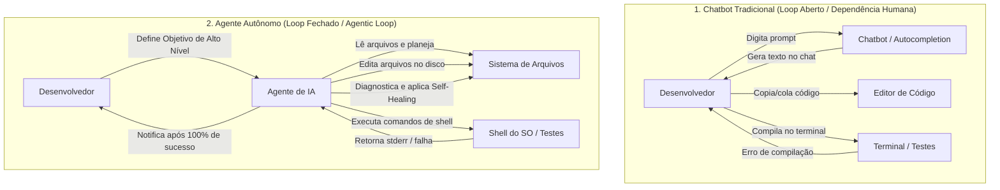
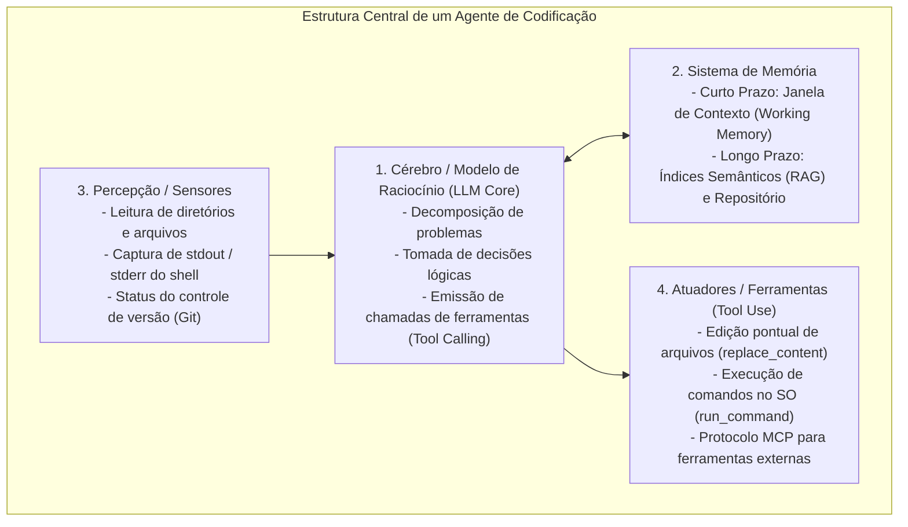
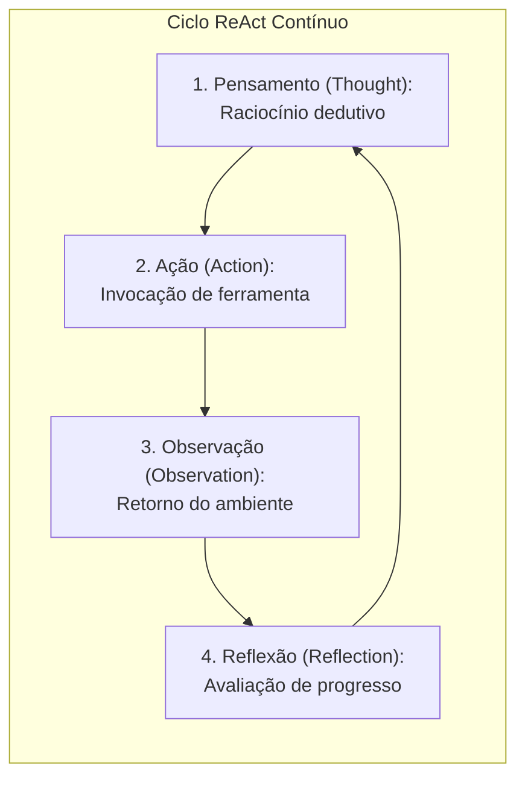
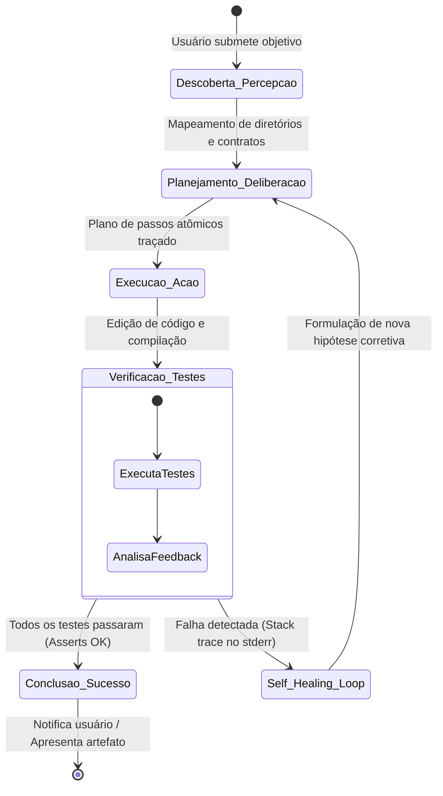
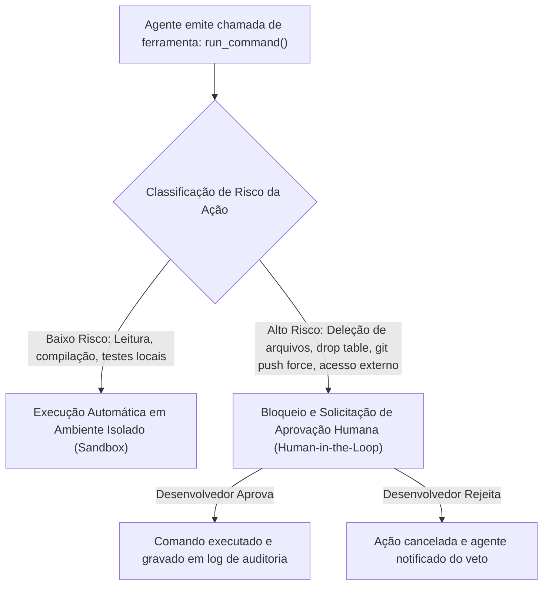

# 02 - Sistemas Agentivos de Desenvolvimento (CLI e IDE)

> **Matéria:** Engenharia de Software Assistida por IA e Sistemas Agentivos  
> **Cargo:** B02 – Técnico de Controle Externo – Especialidade: Tecnologia da Informação  
> **Arquivo:** `02_arquitetura_de_sistemas_agentivos_e_ferramentas_cli_ide.md`  

---

## 📌 Ementa / Itens do Edital
- Sistemas agentivos de desenvolvimento: arquitetura e funcionamento
- Assistentes de codificação em interfaces de terminal (CLI) e integradas a IDE (ex.: Claude Code, Antigravity CLI e equivalentes)
- Ciclo agentivo de desenvolvimento: descoberta, planejamento, execução, verificação e autocorreção (*self-healing*)
- Ações em sistema de arquivos e comandos de shell

---

## 🧭 Sumário
- [1. Arquitetura dos Agentes de Codificação](#1-arquitetura-dos-agentes-de-codificação)
  - [1.1 A Evolução: De Chatbots Passivos a Agentes Orientados a Objetivos (Goal-Driven)](#11-a-evolução-de-chatbots-passivos-a-agentes-orientados-a-objetivos-goal-driven)
  - [1.2 Os Quatro Componentes Estruturais de um Agente de Software](#12-os-quatro-componentes-estruturais-de-um-agente-de-software)
  - [1.3 Padrões de Interface: Agentes de Linha de Comando (CLI) vs. Agentes Nativos em IDE](#13-padrões-de-interface-agentes-de-linha-de-comando-cli-vs-agentes-nativos-em-ide)
- [2. O Ciclo Agentivo de Desenvolvimento (The Agentic Loop)](#2-o-ciclo-agentivo-de-desenvolvimento-the-agentic-loop)
  - [2.1 Fundamentos do Paradigma ReAct e Ciclo OODA](#21-fundamentos-do-paradigma-react-e-ciclo-ooda)
  - [2.2 Fase 1: Descoberta e Coleta de Contexto (Percepção)](#22-fase-1-descoberta-e-coleta-de-contexto-percepção)
  - [2.3 Fase 2: Planejamento, Decomposição e Deliberação (Reasoning & Planning)](#23-fase-2-planejamento-decomposição-e-deliberação-reasoning--planning)
  - [2.4 Fase 3: Execução de Ações no Ambiente (Action)](#24-fase-3-execução-de-ações-no-ambiente-action)
  - [2.5 Fase 4: Verificação Autônoma e o Loop de Autocorreção (Self-Healing)](#25-fase-4-verificação-autônoma-e-o-loop-de-autocorreção-self-healing)
  - [2.6 Critérios de Parada (Stop Conditions) e Disjuntores (Circuit Breakers)](#26-critérios-de-parada-stop-conditions-e-disjuntores-circuit-breakers)
- [3. Ferramentas de Referência e Governança de Segurança](#3-ferramentas-de-referência-e-governança-de-segurança)
  - [3.1 Claude Code e a Filosofia Unix-First de Terminal](#31-claude-code-e-a-filosofia-unix-first-de-terminal)
  - [3.2 Antigravity CLI e a Orquestração Hierárquica Multiagente](#32-antigravity-cli-e-a-orquestração-hierárquica-multiagente)
  - [3.3 Segurança Cibernética, Privilégio Mínimo e Human-in-the-Loop](#33-segurança-cibernética-privilégio-mínimo-e-human-in-the-loop)
- [4. Fontes Recomendadas na Internet](#4-fontes-recomendadas-na-internet)
- [5. Questões Comentadas & Prática Padrão FCC](#5-questões-comentadas--prática-padrão-fcc)

---

## 1. Arquitetura dos Agentes de Codificação

### 1.1 A Evolução: De Chatbots Passivos a Agentes Orientados a Objetivos (Goal-Driven)
A evolução da inteligência artificial aplicada ao desenvolvimento de software pode ser compreendida pela transição entre sistemas de loop aberto (*Open-Loop*) e sistemas cibernéticos autônomos de loop fechado (*Closed-Loop*):



- **Chatbots e Completadores Passivos (Autocompletion):** Modelos reativos baseados em sugestão de texto fantasma (*ghost text*). O desenvolvedor programa manualmente e o modelo prevê a próxima linha. Diante de erros sintáticos ou falhas em testes, o desenvolvedor precisa copiar o log, colar na caixa de diálogo e pedir uma nova versão, aplicando o código manualmente no editor.
- **Agentes Autônomos Orientados a Objetivos (*Goal-Driven Agents*):** O usuário define a meta macro em linguagem natural (ex.: *"Implemente a emissão de certidão de débitos tributários com tratamento de concorrência e testes unitários"*). O agente assume a condução do fluxo: descobre a estrutura do projeto, inspeciona dependências, cria ou modifica arquivos no disco rígido, executa o compilador no shell, analisa as saídas de erro e realiza ciclos contínuos de autocorreção até que todas as condições de sucesso sejam satisfeitas.

---

### 1.2 Os Quatro Componentes Estruturais de um Agente de Software
Segundo a taxonomia clássica de agentes autônomos baseados em LLMs (formalizada por Lilian Weng, 2023), um agente de engenharia de software estrutura-se em quatro pilares articulados:



1. **Cérebro / Modelo de Raciocínio (LLM Core):** O modelo fundacional de ponta (ex.: Claude 3.5 Sonnet, GPT-4o) responsável pelo raciocínio lógico, interpretação de regras de negócio, planejamento em etapas e decisão de qual ferramenta acionar a cada instante.
2. **Sistema de Memória:**
   - **Memória de Curto Prazo (*Working Memory*):** Reside na janela de contexto da sessão ativa. Retém o objetivo da tarefa, o plano de trabalho corrente, o histórico recente de ações executadas e os logs parciais retornados pelo terminal.
   - **Memória de Longo Prazo:** Bases vetoriais locais ou grafos de código que mantêm o repositório indexado semanticamente, além de documentações e diretrizes institucionais persistentes entre sessões.
3. **Módulo de Percepção / Sensores:** Permite ao agente observar o ambiente de software:
   - Inspeção estrutural de diretórios (`list_dir`, `glob`);
   - Leitura pontual de arquivos de código (`view_file`, `grep`);
   - Captura dos fluxos padrão de saída (`stdout`) e de erro (`stderr`) emitidos pelo sistema operacional;
   - Monitoramento do status do controle de versão (`git status`, `git diff`).
4. **Módulo de Atuadores / Ferramentas (*Tool Use*):** Mecanismos determinísticos fornecidos pela aplicação hospedeira para que o agente altere o ambiente:
   - Manipulação de arquivos (`write_to_file`, `replace_file_content`);
   - Execução de processos e comandos de shell (`run_command`);
   - Invocação de ferramentas e serviços externos padronizados via protocolo MCP (*Model Context Protocol*).

---

### 1.3 Padrões de Interface: Agentes de Linha de Comando (CLI) vs. Agentes Nativos em IDE

| Dimensão Técnica | Agentes de Linha de Comando (CLI) | Agentes Integrados à IDE (IDE Native) |
|---|---|---|
| **Exemplos de Referência** | Claude Code, Antigravity CLI, Aider, Mentat. | Cursor, Windsurf, Copilot Workspace, Continue.dev. |
| **Ambiente de Hospedagem** | Terminal do Sistema Operacional (Bash, Zsh, PowerShell). | Painéis internos de Ambientes de Desenvolvimento Integrados (forks do VS Code, plugins JetBrains). |
| **Acesso a Ferramentas** | Acesso nativo direto a comandos do SO (`git`, `grep`, `find`, `docker`, scripts shell compilados). | Acesso intermediado por APIs da IDE e protocolos de linguagem (LSP - *Language Server Protocol*). |
| **Consumo de Recursos** | Mínimo overhead de memória e CPU; dispensa renderização de interfaces gráficas pesadas. | Elevado consumo de memória RAM devido aos processos gráficos e servidores de linguagem paralelos. |
| **Cenário de Uso Ideal** | Servidores remotos via SSH, máquinas virtuais sem interface gráfica (*headless*), automações de esteiras CI/CD e refatorações multi-repositório. | Programação interativa do dia a dia com edição visual lado a lado e navegação gráfica do código. |

---

## 2. O Ciclo Agentivo de Desenvolvimento (The Agentic Loop)

### 2.1 Fundamentos do Paradigma ReAct e Ciclo OODA
O núcleo operacional que rege o comportamento autônomo apoia-se no paradigma **ReAct** (*Reasoning + Acting*, Yao et al., 2023), integrando raciocínio reflexivo e ação no mundo físico:



O ciclo opera em quatro fases sequenciais estruturadas:



---

### 2.2 Fase 1: Descoberta e Coleta de Contexto (Percepção)
Antes de redigir qualquer instrução de código, o agente inspeciona o ambiente para ancorar seu raciocínio em dados concretos:
1. **Identificação da Pilha Tecnológica:** Localização e leitura de manifestos de dependências (`pom.xml` para Java, `package.json` para TypeScript/Node, `pyproject.toml` para Python).
2. **Localização Cirúrgica de Símbolos:** Utilização de ferramentas de busca rápida (como `grep` ou comandos de busca semântica) para encontrar declarações exatas de métodos, evitando a leitura indiscriminada de pastas inteiras (o que provocaria esgotamento prematuro da janela de contexto).
3. **Mapeamento de Contratos e DDLs:** Identificação das interfaces, entidades e modelos já consolidados na base de código institucional.

---

### 2.3 Fase 2: Planejamento, Decomposição e Deliberação (Reasoning & Planning)
Nesta fase, o modelo formula uma estratégia de execução transparente:
- **Decomposição em Subtarefas Atômicas:** Em vez de tentar resolver um requisito complexo de uma só vez, o agente divide o problema em passos incrementais (ex.: 1. Criar migration no banco; 2. Implementar repositório; 3. Escrever regras de negócio no serviço; 4. Expor endpoint no controller; 5. Criar testes unitários).
- **Antecipação de Efeitos Colaterais:** Análise prévia de como a alteração impactará módulos interdependentes.
- **Mecanismo *Human-in-the-Loop* para Ambiguidade:** Caso o requisito de negócio contenha contradições ou indefinições, o agente pausa a execução e questiona o usuário de forma estruturada antes de tomar decisões arbitrárias.

---

### 2.4 Fase 3: Execução de Ações no Ambiente (Action)
O agente invoca as ferramentas disponibilizadas para alterar o estado do sistema:
- **Edição Atômica de Arquivos:** Aplicação de modificações cirúrgicas por correspondência de texto exato (`replace_file_content`), evitando a reescrita desnecessária de arquivos extensos de milhares de linhas (o que geraria alto custo e risco de truncamento acidental de código pré-existente).
- **Comandos de Terminal:** Compilação de código (`mvn compile`, `npm run build`), instalação de dependências e gerenciamento de processos em background.

---

### 2.5 Fase 4: Verificação Autônoma e o Loop de Autocorreção (Self-Healing)
É a fase que separa definitivamente um gerador estático de código de um sistema agentivo autônomo:

```mermaid
flowchart TD
    Exec["1. Execução de Testes Automatizados (pytest / mvn test / jest)"] --> Res{"Resultado da Execução"}
    Res -->|Sucesso Total (Exit Code 0)| Term["Conclui Tarefa com Sucesso"]
    Res -->|Falha ou Erro de Compilação (Exit Code != 0)| Cap["2. Captura do Stack Trace no stderr"]
    Cap --> Diag["3. Diagnóstico e Formulação de Nova Hipótese"]
    Diag --> Edit["4. Aplicação de Ajuste Cirúrgico no Código"]
    Edit --> Exec
```

1. **Disparo de Verificadores:** O agente roda suítes automatizadas de testes unitários e de integração (`pytest`, `jest`, `mvn test`), bem como linters e analisadores estáticos.
2. **Captura do Feedback do Ambiente:** O agente intercepta o código de retorno do processo (*exit code*) e os logs detalhados de erro emitidos no canal `stderr`.
3. **Mecânica do *Self-Healing*:** Ao se deparar com uma falha (como um `NullPointerException` ou uma asserção de teste frustrada), o agente **não desiste nem repassa o problema ao usuário imediatamente**. Ele lê a linha exata apontada pelo stack trace, diagnostica a causa-raiz, elabora uma correção no código e dispara os testes novamente de forma totalmente autônoma.

---

### 2.6 Critérios de Parada (Stop Conditions) e Disjuntores (Circuit Breakers)
Para evitar que o agente entre em ciclos infinitos de tentativa e erro que consumam excessivamente a cota de tokens e recursos de máquina, arquiteturas agentivas incorporam critérios rígidos de parada:
- **Critério de Sucesso:** Aprovação integral de 100% dos testes e ausência de violações no linter.
- **Disjuntor (*Circuit Breaker*):** Limite máximo parametrizado de iterações consecutivas sem progresso (tipicamente entre 3 e 5 iterações de *Self-Healing*). Ao atingir o limite, o disjuntor interrompe o loop, reverte alterações defeituosas via Git e convoca a intervenção do desenvolvedor humano com um relatório detalhado das falhas persistentes.

---

## 3. Ferramentas de Referência e Governança de Segurança

### 3.1 Claude Code e a Filosofia Unix-First de Terminal
Desenvolvido pela Anthropic, o **Claude Code** tornou-se a referência contemporânea de assistente agentivo operado diretamente no terminal:
- **Integração com Ferramental Nativo:** Opera sobre o repositório git local utilizando ferramentas integradas como `Bash`, `Glob`, `Grep`, `FileEdit` e `FileRead`.
- **Raciocínio Contextual em Larga Escala:** Capacidade de analisar o grafo de arquivos do projeto para propor refatorações complexas mantendo compatibilidade com código legado.

---

### 3.2 Antigravity CLI e a Orquestração Hierárquica Multiagente
O **Antigravity CLI** destaca-se pela sua arquitetura modular voltada para governança e execução de tarefas concorrentes:
- **Delegação a Subagentes Especializados:** Capacidade de criar e despachar agentes filhos isolados (*subagents*) para atuar em tarefas complementares (ex.: um subagente encarregado de pesquisar documentações, outro focado em testes unitários e um terceiro dedicado à auditoria de vulnerabilidades de segurança).
- **Emissão Estruturada de Artefatos:** Geração de relatórios, memoriais de cálculo e planos de execução em arquivos Markdown estruturados, facilitando a inspeção e conferência humana antes e durante a execução.

---

### 3.3 Segurança Cibernética, Privilégio Mínimo e Human-in-the-Loop
A concessão de autonomia para que uma IA execute comandos de terminal exige controles de segurança e governança corporativa:



> 🚨 **ALERTA DE PROVA / FCC:**  
> A banca explora com rigor a fronteira entre a autonomia do **Self-Healing** e o controle de **Comandos Críticos**:  
> - No *Self-Healing*, o agente possui autonomia plena para **editar o código e reexecutar testes locais em loop fechado** sem requerer confirmação humana a cada linha alterada.  
> - Em contrapartida, para ações potencialmente destrutivas ou com efeitos colaterais irreversíveis (ex.: exclusão de arquivos, comandos com privilégios de superusuário `sudo`, alterações de banco de dados ou operações forçadas de rede), o sistema **deve obrigatoriamente impor confirmação humana explícita (*Human-in-the-Loop*)**.
> - **Princípio do Menor Privilégio (*Least Privilege*):** Agentes de desenvolvimento devem operar em ambientes isolados (*sandboxes* ou containers Docker/Podman) e nunca com privilégios de administrador/root da infraestrutura.

---

## 4. Fontes Recomendadas na Internet

- [ReAct: Synergizing Reasoning and Acting in Language Models (Yao et al., ICLR 2023)](https://arxiv.org/abs/2210.03629): Artigo pioneiro que estabeleceu o ciclo ReAct (*Thought -> Action -> Observation*), fundamento conceitual dos agentes modernos de codificação.
- [LLM Powered Autonomous Agents (Lilian Weng - OpenAI)](https://lilianweng.github.io/posts/2023-06-23-agent/): Publicação de referência sobre a taxonomia estrutural de agentes: Cérebro, Planejamento, Memória e Ferramentas.
- [Building Effective Agents (Anthropic Research)](https://www.anthropic.com/research/building-effective-agents): Análise detalhada dos padrões arquiteturais agentivos (Orquestrador-Trabalhadores, Avaliador-Otimizador e loops de feedback contínuo).
- [Claude Code Overview & Official CLI Guide](https://docs.anthropic.com/en/docs/agents-and-tools/claude-code/overview): Documentação técnica sobre agentes em linha de comando, permissões de segurança e execução de comandos shell.

---

## 5. Questões Comentadas & Prática Padrão FCC

### Questão 1 (FCC - Adaptada / TI - Sistemas Agentivos e Ciclo ReAct)
Diferente dos chatbots passivos baseados em LLMs tradicionais, os sistemas agentivos modernos de desenvolvimento de software (como agentes de codificação em terminal e IDEs inteligentes) operam com base em ciclos autônomos orientados a objetivos (*Goal-Driven Agents*).

A respeito da dinâmica de funcionamento e das propriedades de um ciclo agentivo de desenvolvimento, assinale a afirmativa correta:  
A) O mecanismo de *Self-Healing* (autocorreção) exige que o desenvolvedor humano interrompa o agente a cada falha de compilação para reescrever manualmente os arquivos antes que o agente possa continuar.  
B) No paradigma ReAct (*Reasoning + Acting*), o ciclo operacional do agente envolve os passos ordenados de pensamento/raciocínio (*Thought*), execução de uma ferramenta no ambiente (*Action*), coleta e assimilação do resultado obtido (*Observation*) e reavaliação (*Reflection*) até atingir o critério de parada.  
C) Os agentes de software em linha de comando (CLI) são conceituados como modelos puramente estáticos que não possuem capacidade de invocar ferramentas do sistema operacional ou inspecionar o sistema de arquivos local.  
D) O uso de memória de curto prazo em sistemas agentivos substitui a necessidade de manter janelas de contexto ativas, operando sem consumir tokens de inferência do modelo de linguagem.  
E) Caso um teste unitário falhe durante a execução de uma tarefa de codificação pelo agente, o ciclo agentivo é imediatamente abortado por razões de conformidade, sendo proibido ao agente rodar suites de teste subsequentes.  

> **Comentário Detalhado:**
> - **A)** Incorreta. O propósito primordial do mecanismo de *Self-Healing* é viabilizar a autonomia do agente para diagnosticar falhas de compilação ou testes e aplicar correções no código sem requerer intervenção humana em cada ciclo intermediário.
> - **B)** **CORRETA.** O paradigma **ReAct** (Yao et al., 2023) estabelece a sincronização de quatro etapas essenciais: o raciocínio preliminar (*Thought*), a emissão de chamada de ferramenta no ambiente (*Action*), a recepção do feedback do sistema (*Observation*) e a reflexão avaliativa (*Reflection*) para direcionar o próximo passo até a meta.
> - **C)** Incorreta. Agentes CLI interagem diretamente com o sistema operacional por meio de comandos shell, manipulando arquivos e diretórios locais.
> - **D)** Incorreta. A memória de curto prazo de um agente reside precisamente na janela de contexto ativa e consome tokens de entrada a cada iteração do ciclo.
> - **E)** Incorreta. A falha de um teste unitário é exatamente o estímulo de retroalimentação que deflagra o loop de *Self-Healing*, permitindo que o agente ajuste o código para fazer o teste passar.
> 
> **Gabarito: B**

---

### Questão 2 (FCC - Adaptada / TI - Governança e Segurança em Agentes Autônomos)
Ao adotar ferramentas de engenharia de software assistidas por IA com execução de comandos no terminal (CLI) e no sistema de arquivos, uma organização pública de controle externo deve mitigar riscos cibernéticos decorrentes de ações potencialmente destrutivas ou não autorizadas no ambiente de infraestrutura.

Para equilibrar produtividade e governança corporativa na operação desses agentes autônomos, a melhor prática arquitetural consiste em:  
A) Conceder ao processo do agente privilégios de superusuário (*root* ou *Administrator*) com bypass irrestrito de confirmação para todas as chamadas de sistema, a fim de garantir autonomia total.  
B) Impedir qualquer leitura de arquivos do repositório pelo agente, restringindo sua atuação exclusivamente à emissão de trechos de código em formato texto no chat da interface gráfica.  
C) Implementar políticas de isolamento em ambiente de desenvolvimento controlado (*sandboxing* / containers) e mecanismos de aprovação humana (*Human-in-the-Loop*) para comandos de alto impacto ou potencialmente destrutivos (como remoção recursiva de diretórios, formatação de volumes ou operações com dados produtivos).  
D) Desativar a coleta de logs e telemetria das ações tomadas pelo agente, pois registros de comandos executados no shell expõem os pesos internos do modelo de linguagem.  
E) Bloquear a integração do agente com o sistema de controle de versão (Git), evitando que o histórico registre commits assistidos por ferramentas autônomas.  

> **Comentário Detalhado:**
> - **A)** Incorreta. Conceder permissões de superusuário irrestritas viola o princípio do privilégio mínimo e expõe o ambiente a catástrofes decorrentes de alucinações ou comandos indevidos.
> - **B)** Incorreta. Proibir a leitura de arquivos descaracteriza a arquitetura agentiva, rebaixando a ferramenta a um chatbot desconectado do repositório de código.
> - **C)** **CORRETA.** A governança em sistemas agentivos estabelece a execução em caixas de areia seguras (*sandboxes* ou containers) combinada com a imposição obrigatória de **Human-in-the-Loop** (aprovação explícita do operador humano) para comandos de alto risco ou ações com potencial destrutivo irreversível.
> - **D)** Incorreta. A coleta de logs de auditoria é mandatória para conformidade e rastreabilidade em órgãos públicos, e comandos de shell não revelam os pesos do modelo.
> - **E)** Incorreta. A integração com o Git é essencial para garantir rastreabilidade, auditoria e facilidade de reversão (*rollback*) de alterações.
> 
> **Gabarito: C**

---

### Questão 3 (FCC - Padrão Concursos TI / Mecânica do Self-Healing Loop)
Em um fluxo de integração contínua (CI), um agente autônomo foi configurado para resolver chamados de correção de defeitos em microsserviços legados em Java. Durante o processamento de um chamado, o agente realizou a modificação do arquivo `CalculadoraAliquotaService.java`, mas o comando de compilação disparado pelo próprio agente retornou o erro: `error: cannot find symbol: class BigDecimalUtils`.

Diante dessa situação em um ciclo agentivo dotado de *Self-Healing*, a ação esperada do agente é:  
A) Encerrar a execução imediatamente e desinstalar o JDK da máquina hospedeira para prevenir danos sistêmicos.  
B) Capturar a mensagem de erro da saída do compilador (`stderr`), interpretar que a dependência ou classe auxiliar não foi importada ou não existe, buscar referências similares no repositório, realizar o ajuste atômico do código e reexecutar o comando de compilação.  
C) Ignorar a mensagem de erro e realizar o merge forçado da alteração no branch principal do repositório de produção.  
D) Reescrever todo o sistema operacional da máquina servidora em linguagem Rust para contornar o erro de compilação do Java.  
E) Solicitar que o usuário humano reescreva todo o método do zero, pois agentes são formalmente incapazes de ler mensagens de erro de compiladores.  

> **Comentário Detalhado:**
> - **A)** Incorreta. Erros de compilação são ocorrências ordinárias; desinstalar ferramentas de desenvolvimento é uma ação absurda.
> - **B)** **CORRETA.** A dinâmica do **Self-Healing** apoia-se precisamente nessa sequência: captura da saída de erro (`stderr`), diagnóstico da ausência de importação ou símbolo, localização da referência correta no projeto, aplicação da correção no arquivo e nova compilação automatizada.
> - **C)** Incorreta. Fazer merge de código com erro de compilação viola preceitos básicos de integração contínua e quebra o sistema.
> - **D)** Incorreta. Proposição inverossímil e sem sentido técnico.
> - **E)** Incorreta. A leitura e interpretação de stack traces de compiladores constitui uma das competências centrais dos modelos em sistemas agentivos.
> 
> **Gabarito: B**

---

### Questão 4 (FCC - Padrão Concursos TI / Comparação CLI vs IDE Agentiva)
Analise as afirmativas abaixo a respeito das diferenças operacionais e arquiteturais entre assistentes agentivos de linha de comando (CLI) e extensões integradas a Ambientes de Desenvolvimento Integrados (IDEs):

I. Agentes em CLI (como Claude Code ou Aider) possuem integração direta com o ambiente de terminal do sistema operacional, permitindo encadear ferramentas nativas de busca textual (como `grep`), comandos de compilação e automação de scripts bash sem a necessidade de uma interface gráfica ativa.  
II. Assistentes nativos em IDE dependem exclusivamente de protocolos de completamento sintático local e são tecnicamente impedidos de utilizar modelos de linguagem em nuvem.  
III. O uso de agentes em CLI é especialmente vantajoso em ambientes de servidores remotos (acessados via SSH) e pipelines automatizados de esteiras DevOps, onde interfaces gráficas pesadas de IDEs não estão disponíveis.  

Está correto o que se afirma em:  
A) I e II, apenas.  
B) I e III, apenas.  
C) II e III, apenas.  
D) I, apenas.  
E) I, II e III.  

> **Comentário Detalhado:**
> - **A)** Incorreta. O item II está incorreto porque IDEs agentivas utilizam amplamente modelos em nuvem.
> - **B)** **CORRETA.** Análise detalhada dos itens:
>   - **Item I (Correto):** Agentes CLI operam nativamente sobre o shell, alavancando utilitários UNIX e comandos de sistema sem demandar interface gráfica.
>   - **Item II (Incorreto):** IDEs agentivas (como Cursor e extensões de VS Code) utilizam intensamente modelos de última geração hospedados em nuvem via requisições de API.
>   - **Item III (Correto):** Em servidores de teste remotos via SSH e runners de esteiras de CI/CD sem ambiente gráfico (*headless*), agentes CLI são a solução ideal devido à leveza operacional.
> - **C)** Incorreta. O item II é falso.
> - **D)** Incorreta. O item III também está plenamente correto.
> - **E)** Incorreta. O item II é falso.
> 
> **Gabarito: B**

---

### Questão 5 (FCC - Padrão Concursos TI / Critérios de Parada e Circuit Breakers em Agentes)
Em arquiteturas de agentes de software autônomos, o conceito de Critério de Parada (*Stop Condition*) ou Disjuntor (*Circuit Breaker*) é essencial para garantir a estabilidade e a viabilidade econômica do sistema.

A função primária desse mecanismo é:  
A) Impedir que o agente consuma energia elétrica nas placas de vídeo durante a noite.  
B) Evitar que o agente entre em loops infinitos de autocorreção não convergente, interrompendo a execução caso o número máximo de iterações configurado seja atingido sem que os testes passem.  
C) Bloquear o acesso do desenvolvedor humano aos logs de execução após o término da primeira iteração.  
D) Assegurar que nenhum código seja compilado caso o sistema identifique mais de três variáveis locais no método.  
E) Desconectar a máquina da rede local toda vez que uma requisição de ferramenta for concluída com êxito.  

> **Comentário Detalhado:**
> - **A)** Incorreta. Disjuntores em sistemas de software controlam fluxo de execução e consumo de cotas de computação lógica, não energia elétrica predial.
> - **B)** **CORRETA.** Caso o agente caia em um ciclo de autocorreção não convergente (onde a correção de um erro desencadeia um novo erro ciclicamente), o **Circuit Breaker** (critério de parada por esgotamento de tentativas) interrompe a execução, preserva o repositório e notifica o desenvolvedor humano, prevenindo custos descontrolados de API e congelamento de recursos.
> - **C)** Incorreta. Os logs devem ser preservados para viabilizar auditoria e depuração pelo desenvolvedor humano.
> - **D)** Incorreta. A quantidade de variáveis locais não é critério arquitetural de interrupção de agentes.
> - **E)** Incorreta. Desconectar a rede após ações bem-sucedidas impediria o funcionamento contínuo do sistema.
> 
> **Gabarito: B**
