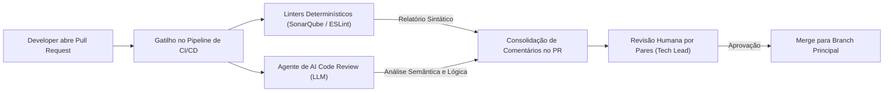
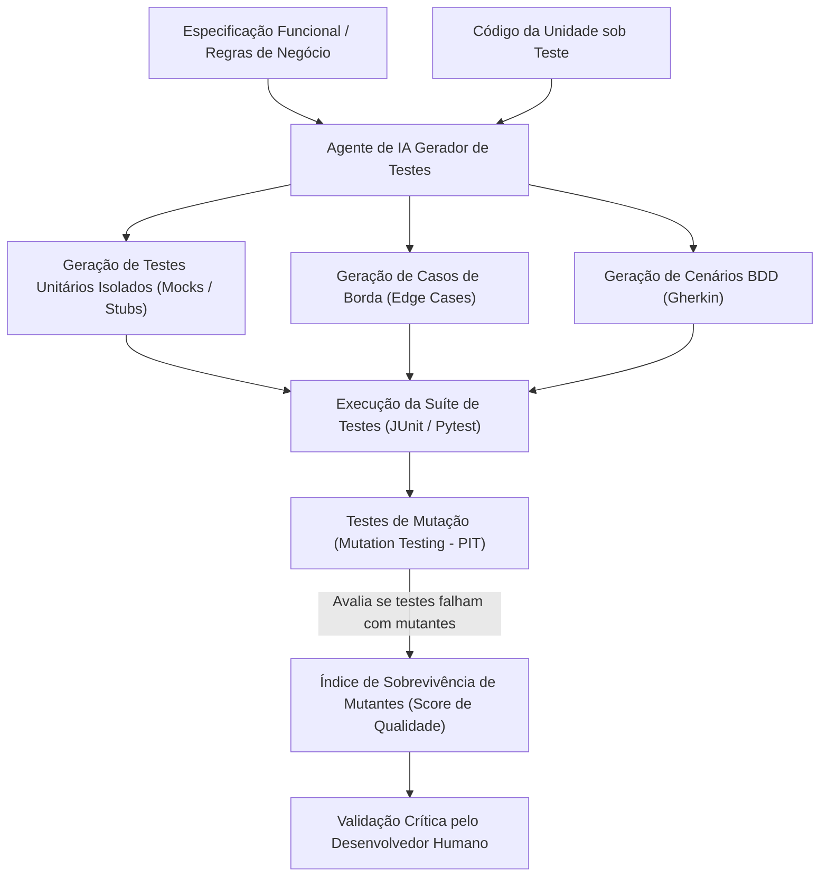

# 03 - Ciclo de Vida Assistido: Geração, Testes e Depuração

> **Matéria:** Engenharia de Software Assistida por IA e Sistemas Agentivos  
> **Cargo:** B02 – Técnico de Controle Externo – Especialidade: Tecnologia da Informação  
> **Arquivo:** `03_ciclo_de_vida_assistido_geracao_testes_e_depuracao.md`  

---

## 📌 Ementa / Itens do Edital
- Geração de código assistida por IA
- Revisão automatizada de código (AI Code Review)
- Documentação técnica e geração de contratos assistidos por IA
- Depuração (debugging) assistida por IA
- Geração automatizada de testes de software

---

## 🌳 Classificação Hierárquica

```text
3. Práticas do Ciclo de Vida do Software Assistidas por Inteligência Artificial
├── 3.1 Geração de Código Assistida por IA
│   ├── 3.1.1 Geração de Boilerplate e Estruturas Iniciais (scaffolding de projetos, CRUDs, entidades e DTOs)
│   ├── 3.1.2 Implementação de Algoritmos a partir de Especificações Funcionais em Linguagem Natural
│   ├── 3.1.3 Tradução / Migração entre Linguagens (ex.: legado Cobol/Java 7 para Java 21 moderno ou Python)
│   └── 3.1.4 Completamento Inteligente de Código (Ghost text, contexto de linhas adjacentes e AST local)
├── 3.2 Revisão de Código Assistida (AI Code Review)
│   ├── 3.2.1 Análise Estática Aumentada por IA: Detecção de falhas lógicas sutis não detectadas por linters tradicionais
│   ├── 3.2.2 Identificação de Más Práticas (Code Smells), código duplicado e violações de SOLID
│   ├── 3.2.3 Varredura Automática de Vulnerabilidades de Segurança (ex.: SQL Injection, hardcoded secrets, XSS)
│   └── 3.2.4 Geração de Resumos de Pull Requests / Merge Requests e notas de versão automáticas
├── 3.3 Documentação e Especificação Automatizadas
│   ├── 3.3.1 Geração de Comentários e Docstrings (Javadoc, JSDoc, Python docstrings PEP 257)
│   ├── 3.3.2 Geração Reversa de Especificações de API (contratos OpenAPI/Swagger a partir de código backend)
│   ├── 3.3.3 Documentação de Arquitetura e Diagramas (geração de Mermaid.js e PlantUML via IA a partir da base)
│   └── 3.3.4 Manutenção e Sincronização Contínua entre Código e Documentação
├── 3.4 Depuração (Debugging) e Diagnóstico de Erros
│   ├── 3.4.1 Interpretação e Explicação de Mensagens de Erro e Stack Traces Criptográficos
│   ├── 3.4.2 Análise Forense de Logs de Produção e Rastreamento de Erros Intermitentes (Race Conditions)
│   ├── 3.4.3 Formulação de Hipóteses de Causa-Raiz (Root Cause Analysis - RCA)
│   └── 3.4.4 Proposição e Aplicação de Patches Corretivos Mínimos
└── 3.5 Geração Automatizada de Testes de Software
    ├── 3.5.1 Criação de Testes Unitários: Geração de suites de teste baseadas em isolamento com mocks e stubs
    ├── 3.5.2 Identificação e Cobertura de Casos de Borda (Edge Cases): Entradas nulas, limites numéricos, arrays vazios
    ├── 3.5.3 Geração de Cenários BDD: Criação de especificações executáveis em sintaxe Gherkin
    ├── 3.5.4 Testes de Mutação Assistidos por IA para Avaliar a Eficácia da Suite de Testes
    └── 3.5.5 Geração de Dados Sintéticos e Fixtures para Testes de Carga e Integração
```

---

## 📖 Teoria Aprofundada & Fundamentos Técnicos

### 3.1 Geração de Código Assistida por IA

A geração de código via modelos de linguagem transformou as etapas iniciais e repetitivas do ciclo de vida de desenvolvimento de software, acelerando entregas e padronizando arquiteturas corporativas.

#### 3.1.1 Scaffolding, Boilerplate e Código Repetitivo
Grande parte do esforço de desenvolvimento convencional é dedicada à escrita de código repetitivo (*boilerplate*):
- Criação de entidades de persistência (*JPA/Hibernate*), objetos de transferência de dados (*DTOs*), *mappers*, *controllers* REST e *repositories*;
- Validações de entrada sintáticas e anotações de validação (`@NotNull`, `@Size`, `@Pattern`);
- Modelos generativos sintetizam essas estruturas em segundos a partir de especificações declarativas de entidades ou esquemas DDL relacionais, liberando o desenvolvedor para focar nas regras de negócio fiscais e de controle.

#### 3.1.2 Síntese de Algoritmos Complexos
A partir de especificações funcionais ricas em linguagem natural, os LLMs conseguem deduzir algoritmos matemáticos e estruturais (ex.: cálculos tributários progressivos, algoritmos de partição de dados, grafos de dependência). Contudo, a precisão depende diretamente do detalhamento de pré-condições, pós-condições e invariantes no prompt.

#### 3.1.3 Tradução e Migração de Sistemas Legados
Uma das aplicações de maior valor econômico para o setor público (especialmente Tribunais de Contas e Secretarias de Fazenda) é a **modernização de sistemas legados**:
- **Casos de Uso:** Conversão de rotinas massivas em COBOL ou PL/SQL para microsserviços modernos em Java 21, Kotlin ou Python;
- **Desafios e Riscos Críticos:**
  - **Paridade Semântica e Aritmética:** O COBOL utiliza aritmética decimal exata de ponto fixo (`COMP-3` / Packed Decimal). Modelos de IA podem inadvertidamente sugerir tipos primitivos de ponto flutuante binário (`float` ou `double` em Java/Python), introduzindo erros acumulativos de arredondamento em cálculos financeiros e tributários. Em código financeiro governamental, é mandatório impor o uso de classes de precisão arbitrária (como `BigDecimal` em Java ou o módulo `decimal` em Python).
  - **Efeitos Colaterais Implícitos:** Variáveis globais compartilhadas de sistemas legados exigem encapsulamento rigoroso em classes e injeção de dependências.

#### 3.1.4 Completamento Inteligente (*Ghost Text* vs. AST Local)
Assistentes de IDE combinam o preenchimento preditivo clássico com análise local da Árvore de Sintaxe Abstrata (AST) do projeto. Quando o desenvolvedor abre um parêntese ou digita uma assinatura, o modelo utiliza o contexto do arquivo aberto, das abas adjacentes e dos imports para sugerir o bloco lógico completo com tipagem consistente.

---

### 3.2 Revisão de Código Assistida (AI Code Review)

A automação do *Code Review* por meio de modelos generativos atua como um filtro preventivo de primeira linha antes da revisão humana por pares em esteiras de Integração Contínua (CI/CD).



#### Comparação: Linters Estáticos Tradicionais vs. Revisão de Código por IA

| Característica | Analisadores Estáticos Tradicionais (AST Linters / SAST) | Agentes de AI Code Review (LLMs) |
| :--- | :--- | :--- |
| **Exemplos** | SonarQube, Checkstyle, ESLint, FindBugs | PR-Agent, CodeRabbit, GitHub Copilot PR Reviewer |
| **Mecanismo de Análise** | Regras determinísticas baseadas em padrões de AST, expressões regulares e grafos de fluxo de dados. | Compreensão semântica probabilística e raciocínio contextual sobre a intenção do desenvolvedor. |
| **Custo Computacional** | Extremamente baixo, execução instantânea e local. | Moderado a alto (requer inferência em GPUs em nuvem ou modelos dedicados). |
| **Falsos Positivos** | Rígidos e previsíveis; regras que podem ser desativadas individualmente. | Podem gerar alucinações se o contexto não for fornecido adequadamente. |
| **Capacidade Lógica** | Incapazes de entender se a regra de negócio fiscal foi invertida (ex.: aplicar desconto em vez de acréscimo). | Capazes de detectar inconsistências entre o texto da issue e a implementação no código. |
| **Papel na Engenharia** | Validação sintática, métricas de cobertura e regras formais de estilo. | Análise holística, refatorações conceituais e síntese de resumos para os revisores humanos. |

#### Vulnerabilidades Comuns Rastreadas por IA no PR
- **SQL Injection:** Detecção de concatenação direta de strings em consultas em vez do uso de parâmetros tipados (*Prepared Statements* / JPA Criteria).
- **Vazamento de Segredos (*Hardcoded Secrets*):** Identificação de tokens de autenticação, senhas de banco ou chaves privadas inseridas em código ou arquivos de configuração.
- **Violação de Princípios SOLID e Code Smells:** Identificação de métodos com alta complexidade ciclomática, classes gigantes (*God Classes*) e acoplamento desnecessário.

---

### 3.3 Documentação e Especificação Automatizadas

A defasagem entre o código-fonte em produção e a documentação técnica é uma das maiores fontes de débito técnico nas organizações públicas. A IA generativa atua na engenharia reversa e na manutenção dessa sincronia.

#### 3.3.1 Geração de Contratos de API (OpenAPI / Swagger)
Modelos de IA analisam as classes controladoras (*controllers*) e seus modelos de entrada e saída para sintetizar esquemas OpenAPI 3.0 estruturados em YAML/JSON, contendo códigos de retorno HTTP (200, 201, 400, 404, 500), parâmetros de cabeçalho e exemplos de payloads válidos.

#### 3.3.2 Diagramação Arquitetural com Mermaid.js e PlantUML
Em vez de depender de diagramas visuais estáticos desenhados manualmente (que se tornam obsoletos após poucas semanas), assistentes agentivos inspecionam o repositório e geram diagramas declarativos baseados em texto diretamente nas especificações do projeto:
- Diagramas de Classes UML mapeando os relacionamentos de herança e composição;
- Diagramas de Sequência retratando o fluxo assíncrono entre microsserviços via mensageria (Kafka/RabbitMQ);
- Diagramas de Arquitetura em blocos representando a infraestrutura de dados e camadas de segurança.

---

### 3.4 Depuração (Debugging) e Diagnóstico de Erros

A depuração assistida por IA reduz dramaticamente o MTTR (*Mean Time To Resolution* - Tempo Médio de Resolução) em incidentes operacionais.

#### 3.4.1 Análise de Stack Traces e Erros Criptográficos
Muitos frameworks modernos emitem mensagens de erro volumosas (com centenas de linhas de rastreamento de pilha em frameworks como Spring Boot, Hibernate ou React). O modelo atua como um decodificador contextual:
- Filtra o ruído das camadas internas do framework;
- Identifica a linha exata no código corporativo onde a exceção originou-se;
- Explica em linguagem natural a condição que disparou a falha (ex.: tentativa de leitura de propriedade nula em objeto não inicializado).

#### 3.4.2 Formulação de Causa-Raiz (Root Cause Analysis - RCA) e Patches Mínimos
Ao correlacionar trechos de código, logs de execução e alterações recentes de commits, o agente é capaz de formular hipóteses sobre a causa-raiz (como condições de corrida - *race conditions*, contenção de conexões no pool do banco de dados ou problemas de serialização) e propor **patches mínimos** (alterações cirúrgicas restritas ao estritamente necessário para sanar a falha, evitando efeitos colaterais indesejados).

---

### 3.5 Geração Automatizada de Testes de Software

A síntese automática de suites de teste é uma das tarefas em que a IA apresenta maior retorno sobre o investimento, desde que executada sob estrita governança metodológica.



#### 3.5.1 A Grande Armadilha: Testar a Implementação vs. Testar o Comportamento
O risco primário no uso de IA para testes unitários é o **viés de ancoragem no código defeituoso**:
- Se o desenvolvedor submeter um método que contém um erro de cálculo e solicitar *"gere testes unitários para o método acima"*, o modelo analisará a lógica implementada e gerará asserções (`assert`) que **validam o resultado errado como sendo o correto**!
- Exemplo prático: se o código calcula uma alíquota com $10\%$ em vez dos $15\%$ legais, o teste gerado pela IA conterá `assertEquals(10.0, calculaAliquota())`. O teste passará com 100% de sucesso no pipeline de CI/CD, conferindo uma falsa sensação de segurança a um software incorreto.

> ⭐ **IMPORTANTE / REGRA DE OURO:**  
> Ao gerar testes com IA, forneça sempre a **especificação da regra de negócio independente do código**, ou instrua o modelo a adotar o fluxo TDD: sintetizar os casos de teste a partir dos requisitos e somente depois confrontá-los com o código implementado.

#### 3.5.2 Cobertura de Casos de Borda (*Edge Cases*)
Enquanto desenvolvedores humanos frequentemente sofrem de viés de confirmação e testam apenas o caminho feliz (*happy path*), os modelos de IA são sistemáticos para explorar condições limites:
- Valores nulos (`null`/`None`), cadeias vazias (`""`) e strings com caracteres especiais/Unicode;
- Limites matemáticos de tipos inteiros (`Integer.MAX_VALUE`, `Integer.MIN_VALUE`, divisão por zero);
- Coleções vazias, coleções com um único elemento e coleções excessivamente volumosas;
- Datas de anos bissextos, viradas de fuso horário e valores monetários negativos.

#### 3.5.3 Testes de Mutação (*Mutation Testing*)
Para avaliar a real eficácia dos testes sintetizados por IA, a engenharia de software adota ferramentas de teste de mutação (como PIT/Pitest em Java):
- O sistema de teste insere pequenas mutações deliberadas no código-fonte sob teste (ex.: altera um operador `>` para `>=`, troca um `+` por `-`, inverte um booleano);
- Se a suíte de testes rodar e **falhar**, diz-se que o mutante foi **morto** (o teste é eficaz na detecção de alterações sutis);
- Se os testes continuarem **passando**, o mutante **sobreviveu** (indício de que a suíte possui asserções vazias ou testes superficiais que apenas consom linhas sem verificar a lógica).

> 🚨 **ALERTA DE PROVA / PEGADINHA FCC:**  
> A FCC adora afirmar em questões de concurso que *"uma suíte de testes com 100% de cobertura de linhas gerada por IA garante a ausência total de defeitos lógicos"*.  
> **Isso é FALSO!** Cobertura de código mede apenas se as instruções foram executadas (*code coverage*), mas não garante que as asserções (`assert`) estejam validando o comportamento de negócio pretendido, nem protege contra a validação cega de implementações defeituosas.

---

## 🌐 Fontes Recomendadas na Internet

### 1. Pesquisas Científicas e Artigos Seminais
- [The Impact of AI on Developer Productivity: Evidence from GitHub Copilot (Peng et al., 2023 - arXiv:2302.06590)](https://arxiv.org/abs/2302.06590): Estudo experimental rigoroso analisando ganhos de velocidade e qualidade de código em desenvolvedores assistidos por IA.
- [Large Language Models for Software Engineering: Survey and The Road Ahead (Fan et al., 2023 - arXiv:2308.10620)](https://arxiv.org/abs/2308.10620): Visão abrangente do estado da arte em síntese de código, reparo automático de programas (*automated program repair*) e geração de testes.
- [Resolving Code Review Comments with Machine Learning (Tufano et al. / Google Research)](https://arxiv.org/abs/2103.04134): Investigação empírica sobre automação de comentários de revisão e resolução colaborativa em pull requests industriais.

### 2. Guias e Padrões da Indústria
- [OWASP AI Security and Privacy Guide](https://owasp.org/www-project-ai-security-and-privacy-guide/): Recomendações de salvaguardas para o ciclo de vida assistido, contemplando testes automatizados de segurança e revisão de vulnerabilidades em modelos de IA.
- [State of DevOps Report - DORA (Google Cloud)](https://cloud.google.com/devops/state-of-devops): Métricas de entrega, estabilidade de software e práticas de revisão contínua integradas a ferramentas modernas.

---

## 📝 Questões Comentadas & Prática Padrão FCC

### Questão 1 (FCC - Adaptada / TI - Geração de Testes com IA e Armadilhas)
Durante a fase de homologação de um módulo contábil no TCE-GO, um programador utilizou uma ferramenta de inteligência artificial generativa para gerar automaticamente uma suíte de testes unitários em JUnit a partir do código-fonte recém-escrito de uma classe de cálculo de multas.

Ao analisar as práticas recomendadas e os riscos associados à geração de testes automatizados assistidos por IA, assinale a afirmativa correta:
A) O uso de IA para testes dispensa totalmente a verificação humana das asserções (`assert`), já que modelos de linguagem possuem prova formal matemática de corretude lógica.  
B) A ferramenta de IA é incapaz de testar casos de borda (*edge cases*), limitando-se unicamente ao caminho feliz (*happy path*) pré-definido pelo framework de teste.  
C) Um dos principais riscos da geração de testes com base apenas no código existente é o teste da implementação em vez do comportamento pretendido: se o código possuir um bug na fórmula matemática, a IA pode gerar testes que asseveram o resultado incorreto como sendo o esperado, perpetuando o defeito.  
D) Testes unitários gerados por IA tornam desnecessárias as etapas subsequentes de testes de integração, testes de carga e testes de segurança da aplicação.  
E) A IA é legalmente responsável por falhas funcionais que passem despercebidas para o ambiente de produção após a execução da suíte de testes sintetizada.

> **Gabarito: C**  
> **Comentário Analítico Passo a Passo:**  
> - **A está INCORRETA:** LLMs operam por inferência probabilística e aproximação de padrões textuais; eles não realizam verificação formal dedutiva nem emitem provas matemáticas de corretude, sendo indispensável a validação criteriosa das asserções por engenheiros de software humanos.  
> - **B está INCORRETA:** Um dos maiores pontos fortes dos modelos de IA na etapa de qualidade é a capacidade de gerar listas exaustivas de casos de borda (*edge cases*: valores nulos, inteiros extremos, arrays vazios, strings malformadas), que muitas vezes escapam ao programador humano.  
> - **C está CORRETA:** Ao ler unicamente um código com defeito sem ter conhecimento da especificação de negócio formal, a IA infere que o comportamento codificado é a verdade esperada. Ela então formula asserções que validam o valor incorreto, gerando testes que passam com sucesso, mas mascaram o bug em produção.  
> - **D está INCORRETA:** Testes unitários validam métodos em isolamento estrito com o uso de objetos dublês (*mocks*); eles não atestam a comunicação entre subsistemas em testes de integração nem a robustez sob estresse em testes de carga.  
> - **E está INCORRETA:** A responsabilidade funcional, jurídica e disciplinar recai exclusivamente sobre a equipe técnica e os gestores públicos que homologam o software.

---

### Questão 2 (FCC - Adaptada / TI - Revisão de Código Assistida por IA em CI/CD)
Uma equipe de desenvolvimento governamental decidiu integrar um agente de IA generativa ao fluxo de Integração Contínua (CI/CD) para realizar a revisão automática inicial (*automated code review*) de todos os *Pull Requests* antes da avaliação pelos pares técnicos.

Considerando os benefícios e os cuidados dessa prática, é correto afirmar:
A) A ferramenta de IA deve receber credenciais irrestritas de administrador do repositório para realizar o merge automático em produção sem necessidade de aprovação humana.  
B) A IA atua com alta eficácia na detecção precoce de más práticas de formatação (*code smells*), violações óbvias de princípios SOLID e potenciais credenciais ou chaves expostas (*hardcoded secrets*), mas a análise humana é indispensável para validação arquitetural e conformidade com regras de negócio.  
C) Para submeter os trechos de código do tribunal à API pública de revisão da IA, é dispensável qualquer verificação contratual sobre a política de privacidade e uso dos dados pelo provedor da ferramenta.  
D) A revisão de código por IA torna obsoletos os linters estáticos tradicionais (como SonarQube ou ESLint), pois LLMs executam compilação binária determinística com menor custo computacional.  
E) A IA deve ser configurada para rejeitar sumariamente qualquer *Pull Request* que contenha comentários explicativos ou docstrings, priorizando código não documentado.

> **Gabarito: B**  
> **Comentário Analítico Passo a Passo:**  
> - **A está INCORRETA:** Conceder permissão de merge irrestrito e automático para IA em produção viola a segregação de funções, auditoria e controles fundamentais de qualidade do ciclo DevOps.  
> - **B está CORRETA:** O agente de IA serve como excelente filtro preliminar nos Pull Requests: identifica variáveis sensíveis vazadas, padrões antiquados de código, violação de convenções de nomes e complexidade excessiva. A validação do desenho arquitetural e das nuances funcionais do negócio exige a homologação de revisores humanos experientes.  
> - **C está INCORRETA:** Submeter código governamental ou de arrecadação fiscal a modelos públicos de IA sem garantias contratuais de sigilo (*Zero Data Retention* e proibição de uso para retreino) viola normas de segurança da informação e a LGPD.  
> - **D está INCORRETA:** Analisadores estáticos tradicionais baseados em AST (como SonarQube ou ESLint) são ultra-rápidos, determinísticos e executam localmente a custo financeiro zero, servindo de base complementar indispensável que a IA não elimina.  
> - **E está INCORRETA:** A documentação e os comentários de código são elementos essenciais de manutenibilidade e devem ser incentivados e validados, não descartados.

---

### Questão 3 (FCC - Padrão Concursos TI / Migração de Legado e Riscos Numéricos)
Ao utilizar um assistente de inteligência artificial para traduzir uma rotina crítica de apuração de tributos escrita em COBOL para a linguagem Java, a equipe de engenharia de software de uma Secretaria de Fazenda deve prestar atenção especial a qual das seguintes armadilhas de código frequentemente induzidas pelo modelo?
A) O modelo recusar-se a criar métodos públicos por limitações de licença de software livre.  
B) A substituição de variáveis com precisão decimal exata (`COMP-3` do COBOL) por tipos de ponto flutuante primitivos como `double` ou `float` em Java, causando erros cumulativos de arredondamento em cálculos de centavos e multas.  
C) A conversão forçada de todo o código em scripts de inicialização de BIOS de hardware.  
D) A exigência obrigatória de compilar o novo código Java utilizando exclusivamente placas aceleradoras de inteligência artificial na nuvem.  
E) O bloqueio automático de conexões com bancos de dados relacionais padrão SQL.

> **Gabarito: B**  
> **Comentário Analítico Passo a Passo:**  
> - **A está INCORRETA:** O modelo não impõe restrições de visibilidade de métodos com base em licenças de software livre.  
> - **B está CORRETA:** Sistemas legados financeiros e tributários em COBOL utilizam representação numérica decimal de ponto fixo exata. Linguagens modernas como Java possuem tipos primitivos de ponto flutuante (`float`/`double`) que seguem a norma IEEE 754 e introduzem imprecisões binárias de arredondamento. Em sistemas tributários e contábeis, a substituição correta deve obrigatoriamente empregar `BigDecimal` com modos de arredondamento explícitos. Modelos de IA frequentemente sugerem `double` por ser mais conciso, introduzindo bugs silenciosos graves.  
> - **C está INCORRETA:** A migração de código corporativo não tem relação com bios de máquinas.  
> - **D está INCORRETA:** Código Java gerado compila perfeitamente em compiladores javac convencionais em qualquer CPU x86/ARM padrão.  
> - **E está INCORRETA:** Java integra-se perfeitamente a bancos relacionais através de JDBC/JPA.

---

### Questão 4 (FCC - Padrão Concursos TI / Depuração e Root Cause Analysis com IA)
Em um incidente de produção no qual um microsserviço de emissão de guias de recolhimento apresenta travamento intermitente por esgotamento de conexões com o banco de dados (*connection pool exhaustion*), a equipe recorreu a um modelo de IA para auxiliar na depuração através da análise dos logs de eventos e do código da aplicação.

A respeito da atuação da IA no processo de depuração (*debugging*), assinale a afirmativa correta:
A) O modelo é capaz de interpretar o stack trace e identificar que certos blocos de transação de banco de dados não estão liberando conexões em blocos `finally` ou que falta o fechamento automático via blocos `try-with-resources`.  
B) A IA altera os servidores físicos da infraestrutura em tempo real sem emitir registros nos logs de auditoria.  
C) Ferramentas de IA são incapazes de analisar arquivos de log em formato texto estruturado como JSON ou Logstash.  
D) O uso de IA para diagnóstico exime a necessidade de a equipe reproduzir o problema em ambientes de homologação.  
E) Modelos de linguagem conseguem interceptar o fluxo elétrico das fontes de alimentação dos servidores para eliminar deadlocks.

> **Gabarito: A**  
> **Comentário Analítico Passo a Passo:**  
> - **A está CORRETA:** Modelos de linguagem são altamente eficazes no reconhecimento de padrões de vazamento de recursos (*resource leaks*), apontando com precisão a ausência de fechamento seguro de conexões (`AutoCloseable` / `try-with-resources` no Java, ou context managers `with` no Python) que leva ao esgotamento do pool.  
> - **B está INCORRETA:** LLMs atuam sobre dados e representações de código, não alteram fisicamente servidores e devem sempre ter todas as suas sugestões auditadas.  
> - **C está INCORRETA:** LLMs processam logs em formatos textuais estruturados (JSON, padrão Apache, Log4j, Logstash) com excepcional capacidade de síntese e filtragem de ruído.  
> - **D está INCORRETA:** A reprodução do incidente e a validação do patch corretivo em ambiente de homologação continuam sendo etapas obrigatórias de engenharia de software antes da subida em produção.  
> - **E está INCORRETA:** Deadlocks são problemas lógicos de sincronização de threads e transações de banco de dados, sem relação com controle de eletricidade física em fontes.

---

### Questão 5 (FCC - Padrão Concursos TI / Avaliação de Qualidade com Testes de Mutação)
Para aferir a real qualidade de uma suite de testes unitários sintetizada por uma ferramenta de IA generativa, um arquiteto de software sugeriu a aplicação de Testes de Mutação (*Mutation Testing*).

O princípio básico dos Testes de Mutação para validar a eficácia da suíte de testes gerada pela IA consiste em:
A) Modificar os testes até que a taxa de cobertura de código atinja exatamente 200%.  
B) Introduzir modificações sintáticas pontuais e deliberadas no código-fonte sob teste (mutantes), verificando se a suíte de testes é capaz de falhar ao executá-los; caso os testes continuem passando mesmo com as alterações defeituosas no código, evidencia-se a ineficácia das asserções dos testes gerados.  
C) Treinar um novo modelo de IA que substitui todo o código da aplicação por scripts em shell script.  
D) Validar unicamente a velocidade de inicialização do sistema operacional da máquina onde o teste é executado.  
E) Comparar a quantidade de caracteres do código com o tamanho do disco rígido da estação de trabalho.

> **Gabarito: B**  
> **Comentário Analítico Passo a Passo:**  
> - **A está INCORRETA:** Cobertura de código varia entre 0% e 100%; não existe percentual de cobertura superior a 100%.  
> - **B está CORRETA:** O Teste de Mutação (*Mutation Testing*) introduz falhas artificiais intencionais no código (mutantes). Se a suíte de testes gerada pela IA falhar com a alteração, o mutante foi "morto", atestando a sensibilidade das asserções (`assert`). Se o teste continuar passando com o mutante no código, o mutante "sobreviveu", comprovando que a suíte gerada pela IA é superficial e ineficaz para capturar bugs reais.  
> - **C está INCORRETA:** Não há re-treinamento de modelo nem substituição de código por scripts de shell no conceito de testes de mutação.  
> - **D está INCORRETA:** O teste de mutação avalia a robustez lógica das asserções de teste, não o tempo de boot do sistema operacional.  
> - **E está INCORRETA:** Medição absurda sem relevância para testes de software.
