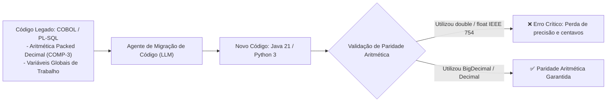
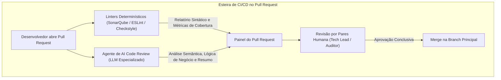
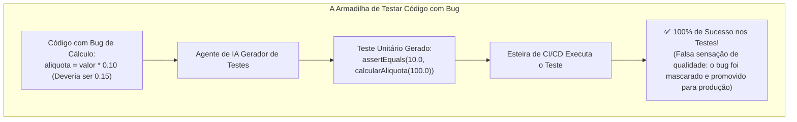
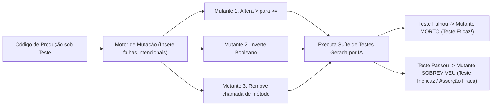

# 03 - Ciclo de Vida Assistido: Geração, Testes e Depuração

> **Matéria:** Engenharia de Software Assistida por IA e Sistemas Agentivos  
> **Cargo:** B02 – Técnico de Controle Externo – Especialidade: Tecnologia da Informação  
> **Arquivo:** `03_ciclo_de_vida_assistido_geracao_testes_e_depuracao.md`  


---


## 📌 Ementa / Itens do Edital
- Geração de código assistida por IA
- Revisão automatizada de código (AI Code Review)
- Documentação técnica e geração de contratos assistidos por IA
- Depuração (debugging) assistida por IA
- Geração automatizada de testes de software

---

## 🧭 Sumário

1. [Geração de Código Assistida por Inteligência Artificial](#1-geracao-de-codigo-assistida-por-inteligencia-artificial)
    1. [Scaffolding, Código Repetitivo (Boilerplate) e CRUDs Estruturais](#11-scaffolding-codigo-repetitivo-boilerplate-e-cruds-estruturais)
    2. [Síntese de Algoritmos Complexos e Regras de Negócio](#12-sintese-de-algoritmos-complexos-e-regras-de-negocio)
    3. [Modernização e Tradução de Sistemas Legados: Riscos Aritméticos](#13-modernizacao-e-traducao-de-sistemas-legados-riscos-aritmeticos)
    4. [Completamento Inteligente de Código: Ghost Text e AST Local](#14-completamento-inteligente-de-codigo-ghost-text-e-ast-local)
    5. [Teste 139](#Teste-139)
    6. [Teste 140](#Teste-140)
2. [Revisão Automatizada de Código (AI Code Review)](#2-revisao-automatizada-de-codigo-ai-code-review)
    1. [Linters Estáticos Tradicionais (AST/SAST) vs. Agentes de AI Code Review](#21-linters-estaticos-tradicionais-astsast-vs-agentes-de-ai-code-review)
    2. [Identificação de Code Smells, Débito Técnico e Violações de SOLID](#22-identificacao-de-code-smells-debito-tecnico-e-violacoes-de-solid)
    3. [Varredura Automática de Vulnerabilidades e Vazamento de Segredos](#23-varredura-automatica-de-vulnerabilidades-e-vazamento-de-segredos)
    4. [Síntese de Pull Requests e Notas de Lançamento (Release Notes)](#24-sintese-de-pull-requests-e-notas-de-lancamento-release-notes)
    5. [Teste 141](#Teste-141)
    6. [Teste 142](#Teste-142)
    7. [Teste 143](#Teste-143)
3. [Documentação Técnica e Geração de Contratos](#3-documentacao-tecnica-e-geracao-de-contratos)
    1. [Docstrings, Javadoc e Comentários Semânticos](#31-docstrings-javadoc-e-comentarios-semanticos)
    2. [Engenharia Reversa de Contratos de API (OpenAPI 3.0 / Swagger)](#32-engenharia-reversa-de-contratos-de-api-openapi-30-swagger)
    3. [Diagramação Arquitetural Declarativa com Mermaid.js e PlantUML](#33-diagramacao-arquitetural-declarativa-com-mermaidjs-e-plantuml)
    4. [Teste 144](#Teste-144)
4. [Depuração (Debugging) e Diagnóstico de Erros Assistidos por IA](#4-depuracao-debugging-e-diagnostico-de-erros-assistidos-por-ia)
    1. [Análise de Stack Traces e Decodificação de Erros Críticos](#41-analise-de-stack-traces-e-decodificacao-de-erros-criticos)
    2. [Análise Forense de Logs de Produção e Vazamentos de Recursos](#42-analise-forense-de-logs-de-producao-e-vazamentos-de-recursos)
    3. [Análise de Causa-Raiz (Root Cause Analysis - RCA) e Patches Mínimos](#43-analise-de-causa-raiz-root-cause-analysis-rca-e-patches-minimos)
    4. [Teste 145](#Teste-145)
    5. [Teste 146](#Teste-146)
5. [Geração Automatizada de Testes de Software](#5-geracao-automatizada-de-testes-de-software)
    1. [A Grande Armadilha: Testar a Implementação Defeituosa vs. o Comportamento](#51-a-grande-armadilha-testar-a-implementacao-defeituosa-vs-o-comportamento)
    2. [Cobertura Sistemática de Casos de Borda (Edge Cases)](#52-cobertura-sistematica-de-casos-de-borda-edge-cases)
    3. [Geração de Cenários BDD Executáveis (Gherkin)](#53-geracao-de-cenarios-bdd-executaveis-gherkin)
    4. [Testes de Mutação (Mutation Testing): Avaliando a Real Eficácia dos Testes](#54-testes-de-mutacao-mutation-testing-avaliando-a-real-eficacia-dos-testes)
    5. [Teste 147](#Teste-147)
    6. [Teste 148](#Teste-148)
    7. [Teste 149](#Teste-149)
6. [Fontes Recomendadas na Internet](#6-fontes-recomendadas-na-internet)

---

## 1. Geração de Código Assistida por Inteligência Artificial

### 1.1 Scaffolding, Código Repetitivo (Boilerplate) e CRUDs Estruturais
A automação de código por meio de modelos generativos impacta profundamente a velocidade de entrega nas fases inaugurais de projetos:

- **Redução do Esforço em Boilerplate:** Tarefas repetitivas e mecânicas — como a criação de classes de entidade (*JPA/Hibernate*), objetos de transferência de dados (*DTOs*), mapeadores (*Mappers/MapStruct*), repositórios (*Spring Data JPA*) e controladores REST — são geradas em segundos a partir de especificações de esquema relacional (DDL) ou contratos de interface.
- **Anotações de Validação:** A IA infere e aplica automaticamente regras de validação padronizadas (`@NotNull`, `@Size`, `@NotBlank`, `@Email`, `@PositiveOrZero`), diminuindo falhas de integridade na camada de borda da API.
- **Foco no Domínio:** Ao transferir a codificação mecânica de infraestrutura para a IA, os engenheiros de software concentram-se no núcleo das regras de negócio fiscais, auditoria orçamentária e conformidade jurídica.

### 1.2 Síntese de Algoritmos Complexos e Regras de Negócio
A partir de especificações funcionais ricas redigidas em linguagem natural, modelos de linguagem avançados deduzem a lógica algorítmica imperativa correspondente:

- **Cálculos Fiscais e Previdenciários:** Implementação de tabelas progressivas de alíquotas, regras de transição de benefícios e apuração de juros moratórios.
- **Algoritmos em Grafos e Otimização:** Algoritmos de ordenação topológica para detecção de dependências cíclicas em fluxos de processos administrativos.
- **Pré-requisito Vital:** A qualidade e corretude do algoritmo gerado dependem estritamente da clareza com que o desenvolvedor estabelece as **pré-condições, pós-condições e invariantes lógicas** na especificação enviada.

### 1.3 Modernização e Tradução de Sistemas Legados: Riscos Aritméticos
A migração de sistemas governamentais legados (especialmente rotinas tributárias e de arrecadação em COBOL ou PL/SQL para microsserviços modernos em Java 21, Kotlin ou Python) é uma das aplicações mais estratégicas de IA no setor público.



> 🚨 **ALERTA DE PROVA / FCC:**  
> **A Armadilha do Ponto Flutuante Binário:**  
>
> - Em sistemas contábeis e fiscais legados (COBOL), a representação numérica decimal de ponto fixo (`COMP-3`) assegura precisão absoluta de centavos.  
> - Ao traduzir esse código para Java ou Python, modelos de IA frequentemente sugerem tipos primitivos de ponto flutuante binário (`float` ou `double`), por serem mais concisos.  
> - Contudo, os tipos `float` e `double` (norma IEEE 754) introduzem **imprecisões binárias de arredondamento cumulativo** em cálculos de moedas e alíquotas (ex.: `0.1 + 0.2 != 0.3`).  
> - Em código fiscal de órgãos de controle externo, é **mandatório o uso de classes de precisão arbitrária exata (`java.math.BigDecimal` em Java ou o módulo `decimal` em Python)** com estratégias explícitas de arredondamento (`RoundingMode.HALF_EVEN`).

### 1.4 Completamento Inteligente de Código: Ghost Text e AST Local
Assistentes de desenvolvimento integrados à IDE operam combinando predição estatística de tokens com inspeção estrutural estática:

- **Ghost Text:** Exibição em cinza de blocos inteiros de código sugerido antes da digitação.
- **Contexto da AST (Abstract Syntax Tree):** O assistente inspeciona a árvore sintática do arquivo em edição, classes importadas, tipos retornados por métodos e abas adjacentes recentemente abertas, assegurando coerência tipográfica e semântica com o restante da solução.

---

### Teste 139
**(FGV – TRT-1 – Analista Judiciário - Tecnologia da Informação – 2024)**
Ao final de uma exposição sobre medicamentos, o conferencista 
declara: “O melhor de todos os analgésicos é, sem dúvida, o 
NANDORE, pois foi o único a acabar com a minha dor”. 
Sobre a argumentação desse segmento, é correto afirmar que os 
argumentos apresentados:

* **A)** se fundamentam em bases científicas;
* **B)** são sólidos, já que fundamentados em vivências pessoais;
* **C)** procuram universalizar uma experiência individual;
* **D)** se apoiam em dados estatísticos;
* **E)** carecem de ética.

---

> **Comentário Detalhado:**
>
> - **A)** Incorreta. Discrepa das diretrizes normativas e jurisprudenciais aplicáveis ao tema objeto do item.
> - **B)** Incorreta. Discrepa das diretrizes normativas e jurisprudenciais aplicáveis ao tema objeto do item.
> - **C)** Correta. Representa com precisão a disciplina do tema e o entendimento pacificado adotado pela banca (FGV).
> - **D)** Incorreta. Discrepa das diretrizes normativas e jurisprudenciais aplicáveis ao tema objeto do item.
> - **E)** Incorreta. Discrepa das diretrizes normativas e jurisprudenciais aplicáveis ao tema objeto do item.
>
> **Gabarito: C**

---
### Teste 140
**(FGV – TRT-16 – Analista Judiciário - Tecnologia da Informação – 2022)**
O RPM Package Manager é um sistema executado em várias 
distribuições Linux e UNIX. 
O conjunto completo de modos básicos de operação do RPM é

* **A)** consulta, atualização e instalação de pacotes.
* **B)** instalação, atualização, criação e depuração de pacotes.
* **C)** valoração, reinstalação, consulta e desinstalação de pacotes.
* **D)** instalação, desinstalação, valoração, consulta, 
monitoramento e depuração de pacotes.
* **E)** criação, instalação, desinstalação, atualização, consulta e 
verificação de pacotes.

---

> **Comentário Detalhado:**
>
> - **A)** Incorreta. Discrepa das diretrizes normativas e jurisprudenciais aplicáveis ao tema objeto do item.
> - **B)** Incorreta. Discrepa das diretrizes normativas e jurisprudenciais aplicáveis ao tema objeto do item.
> - **C)** Incorreta. Discrepa das diretrizes normativas e jurisprudenciais aplicáveis ao tema objeto do item.
> - **D)** Incorreta. Discrepa das diretrizes normativas e jurisprudenciais aplicáveis ao tema objeto do item.
> - **E)** Correta. Representa com precisão a disciplina do tema e o entendimento pacificado adotado pela banca (FGV).
>
> **Gabarito: E**

---
## 2. Revisão Automatizada de Código (AI Code Review)

### 2.1 Linters Estáticos Tradicionais (AST/SAST) vs. Agentes de AI Code Review
A integração de agentes de IA generativa em esteiras de CI/CD para inspeção de *Pull Requests* não substitui, mas complementa as ferramentas de análise estática convencionais:



| Critério de Comparação | Analisadores Estáticos Determinísticos (Linters / SAST) | Agentes de AI Code Review (Baseados em LLMs) |
|---|---|---|
| **Exemplos de Mercado** | SonarQube, Checkstyle, ESLint, FindBugs. | CodeRabbit, PR-Agent, GitHub Copilot PR Reviewer. |
| **Mecanismo Operacional** | Regras determinísticas imutáveis sobre AST, expressões regulares e grafos formais de fluxo de controle. | Inferência semântica probabilística e contextual sobre a intenção do desenvolvedor e o domínio do problema. |
| **Custo Computacional** | Praticamente nulo; execução local instantânea sem dependência de internet ou APIs externas. | Moderado a alto; demanda chamadas de rede para inferência em aceleradores (GPUs/TPUs). |
| **Compreensão de Negócio** | **Nula**. Incapaz de identificar se um cálculo tributário inverteu uma regra fiscal (ex.: aplicou desconto no lugar de acréscimo legal). | **Alta**. Consegue correlacionar a descrição textual da *issue* com o código implementado, detectando desvios semânticos. |
| **Papel na Governança** | Base obrigatória e inegociável de conformidade de estilo, cobertura e padrões de código. | Camada inteligente de triagem, síntese de alterações e detecção de falhas lógicas sutis para apoiar a revisão humana. |

### 2.2 Identificação de Code Smells, Débito Técnico e Violações de SOLID
Os modelos de revisão atuam ativamente na prevenção de débito técnico em PRs:

- **Classes Deus (*God Classes*):** Alerta quando uma classe acumula dezenas de responsabilidades distintas, violando o Princípio da Responsabilidade Única (SRP).
- **Complexidade Ciclomática Excessiva:** Identificação de encadeamentos profundos de estruturas condicionais (`if`/`else` aninhados) e proposição de refatoração para o padrão *Strategy* ou *Polimorfismo*.
- **Código Duplicado e Obsolescência:** Identificação de reimplementações de funções utilitárias que já existem no ecossistema da biblioteca padrão.

### 2.3 Varredura Automática de Vulnerabilidades e Vazamento de Segredos
Durante o ciclo de revisão, os agentes aplicam filtros baseados nas diretrizes OWASP Top 10 e CWE:

- **Injeção de SQL (SQL Injection):** Identificação de interpolação direta de parâmetros de usuário em consultas HQL/JPQL ou SQL puro, recomendando consultas parametrizadas (*Prepared Statements*).
- **Vazamento de Credenciais (*Hardcoded Secrets*):** Detecção de chaves privadas, senhas de banco de dados, tokens de APIs e certificados digitais inseridos inadvertidamente em arquivos rastreados pelo Git.
- **Cross-Site Scripting (XSS) e Desserialização Insegura:** Alerta sobre a renderização direta de payloads HTML sem sanitização prévia.

### 2.4 Síntese de Pull Requests e Notas de Lançamento (Release Notes)
A IA lê o conjunto completo de alterações (*diffs*) entre branches e sintetiza automaticamente:

- Um resumo executivo claro das mudanças para os revisores humanos;
- Lista de arquivos alterados agrupados por domínio de impacto;
- Minuta preliminar das notas de versão (*Release Notes*) em conformidade com o padrão *Keep a Changelog*.

---

### Teste 141
**(FGV – TRT-16 – Analista Judiciário - Tecnologia da Informação – 2022)**
No contexto do Angular, considere o script a seguir. 
<body> 
<p style="font-size:40px" ng-app="xpto" 
   ng-controller="temp"> 
ATENÇÃO: {{ param1 + " " + param2 }} 
</p> 
<script> 
var app = angular.module("xpto", []); 
app.controller("temp", function($scope) { 
    $scope.param1 = "Temperatura"; 
    $scope.param2 = "30"; 
}); 
</script> 
</body> 
Analise o texto que é exibido no parágrafo quando esse script é 
executado.

* **A)** undefined
* **B)** ATENÇÃO:
* **C)** ATENÇÃO: Temperatura 30
* **D)** param1:Temperatura param2:30
* **E)** Temperatura 30

---

> **Comentário Detalhado:**
>
> - **A)** Incorreta. Discrepa das diretrizes normativas e jurisprudenciais aplicáveis ao tema objeto do item.
> - **B)** Incorreta. Discrepa das diretrizes normativas e jurisprudenciais aplicáveis ao tema objeto do item.
> - **C)** Incorreta. Discrepa das diretrizes normativas e jurisprudenciais aplicáveis ao tema objeto do item.
> - **D)** Correta. Representa com precisão a disciplina do tema e o entendimento pacificado adotado pela banca (FGV).
> - **E)** Incorreta. Discrepa das diretrizes normativas e jurisprudenciais aplicáveis ao tema objeto do item.
>
> **Gabarito: D**

---
### Teste 142
**(FGV – TRT-DA 24-REGIÃO – Analista Judiciário - Tecnologia da Informação – 2025)**
Os achocolatados são misturas compostas por leite desidratado, 
chocolate em pó, açúcar e aditivos. 
Em sua composição, o achocolatado X tem 76 gramas de chocolate 
em pó e 12 gramas de açúcar, que correspondem a 6% da massa 
total de X. 
O fabricante do achocolatado X pretende aumentar a massa total 
do produto acrescentando 50 gramas de leite desidratado e nada 
mais. 
Essa modificação na composição do produto fará com que a 
porcentagem de chocolate em pó, com relação à massa total de X, 
sofra redução de

* **A)** 7,4%.
* **B)** 7,5%.
* **C)** 7,6%.
* **D)** 7,8%.
* **E)** 8,0%.

---

> **Comentário Detalhado:**
>
> - **A)** Incorreta. Discrepa das diretrizes normativas e jurisprudenciais aplicáveis ao tema objeto do item.
> - **B)** Incorreta. Discrepa das diretrizes normativas e jurisprudenciais aplicáveis ao tema objeto do item.
> - **C)** Incorreta. Discrepa das diretrizes normativas e jurisprudenciais aplicáveis ao tema objeto do item.
> - **D)** Incorreta. Discrepa das diretrizes normativas e jurisprudenciais aplicáveis ao tema objeto do item.
> - **E)** Correta. Representa com precisão a disciplina do tema e o entendimento pacificado adotado pela banca (FGV).
>
> **Gabarito: E**

---
### Teste 143
**(FGV – TRT-DA 24-REGIÃO – Analista Judiciário - Tecnologia da Informação – 2025)**
Os achocolatados são misturas compostas por leite desidratado, 
chocolate em pó, açúcar e aditivos. 
Em sua composição, o achocolatado X tem 76 gramas de chocolate 
em pó e 12 gramas de açúcar, que correspondem a 6% da massa 
total de X. 
O fabricante do achocolatado X pretende aumentar a massa total 
do produto acrescentando 50 gramas de leite desidratado e nada 
mais. 
Essa modificação na composição do produto fará com que a 
porcentagem de chocolate em pó, com relação à massa total de X, 
sofra redução de

* **A)** 7,4%.
* **B)** 7,5%.
* **C)** 7,6%.
* **D)** 7,8%.
* **E)** 8,0%. 
TRIBUNAL REGIONAL DO TRABALHO DA 24ª REGIÃO (TRT-24) – REAPLICAÇÃO FGV CONHECIMENTO

---

> **Comentário Detalhado:**
>
> - **A)** Incorreta. Discrepa das diretrizes normativas e jurisprudenciais aplicáveis ao tema objeto do item.
> - **B)** Incorreta. Discrepa das diretrizes normativas e jurisprudenciais aplicáveis ao tema objeto do item.
> - **C)** Incorreta. Discrepa das diretrizes normativas e jurisprudenciais aplicáveis ao tema objeto do item.
> - **D)** Incorreta. Discrepa das diretrizes normativas e jurisprudenciais aplicáveis ao tema objeto do item.
> - **E)** Correta. Representa com precisão a disciplina do tema e o entendimento pacificado adotado pela banca (FGV).
>
> **Gabarito: E**

---
## 3. Documentação Técnica e Geração de Contratos

### 3.1 Docstrings, Javadoc e Comentários Semânticos
A documentação no nível do código-fonte é sintetizada de acordo com os padrões da linguagem:

- **Java (Javadoc):** Descrição formal de classes, métodos, parâmetros (`@param`), valores de retorno (`@return`) e exceções disparadas (`@throws`).
- **Python (PEP 257):** Docstrings estruturadas explicando o comportamento de funções, tipos de argumentos e invariantes de execução.
- **Regra de Ouro:** A documentação gerada deve focar no **"PORQUÊ"** daquela decisão arquitetural, e não apenas na descrição óbvia do código que qualquer programador conseguiria ler diretamente.

### 3.2 Engenharia Reversa de Contratos de API (OpenAPI 3.0 / Swagger)
Ao inspecionar classes controladoras (*controllers*) e modelos de dados DTO, a IA é capaz de gerar o contrato formal de API em sintaxe YAML/JSON:

- Mapeamento de rotas, verbos HTTP e códigos de resposta (`200 OK`, `201 Created`, `400 Bad Request`, `404 Not Found`);
- Descrição de esquemas de segurança no bloco `components/securitySchemes` (Bearer JWT, OAuth2);
- Exemplos de payloads válidos de requisição e resposta.

### 3.3 Diagramação Arquitetural Declarativa com Mermaid.js e PlantUML
Em vez de diagramas estáticos desenhados em ferramentas gráficas externas (que ficam rapidamente desatualizados), o agente de IA sintetiza diagramas baseados em texto dentro da própria documentação Markdown:

- **Diagramas de Classes e Entidade-Relacionamento:** Representação visual do modelo relacional a partir do código das entidades;
- **Diagramas de Sequência:** Mapeamento visual das trocas de mensagens assíncronas entre microsserviços via filas Kafka ou chamadas HTTP REST.

---

### Teste 144
**(FCC – TRT-23 – Analista Judiciário - Tecnologia da Informação – 2016)**
Considere o texto a seguir: 

 Em computadores baseados na arquitetura de Von Neumann , assim que a instrução que vai ser executada é buscada da 
memória principal para a CPU, o sistema efetiva automaticamente a modificação do conteúdo desse registrador de modo que 
ele passe a armazenar o endereço da próxima instrução na sequência, sendo crucial para o processo de controle e de 
sequenciamento da execução dos programas. 

 O texto se refere ao registrador conhecido como

* **A)** Registrador de Dados de Memória − RDM.
* **B)** Registrador de Decodificação de Instruções − RDI.
* **C)** Contador de Instruções − CI.
* **D)** Registrador de Endereçamento de Instruções − REI.
* **E)** Registrador de Instruções − RI.

---

> **Comentário Detalhado:**
>
> - **A)** Incorreta. Discrepa das diretrizes normativas e jurisprudenciais aplicáveis ao tema objeto do item.
> - **B)** Correta. Representa com precisão a disciplina do tema e o entendimento pacificado adotado pela banca (FCC).
> - **C)** Incorreta. Discrepa das diretrizes normativas e jurisprudenciais aplicáveis ao tema objeto do item.
> - **D)** Incorreta. Discrepa das diretrizes normativas e jurisprudenciais aplicáveis ao tema objeto do item.
> - **E)** Incorreta. Discrepa das diretrizes normativas e jurisprudenciais aplicáveis ao tema objeto do item.
>
> **Gabarito: B**

---
## 4. Depuração (Debugging) e Diagnóstico de Erros Assistidos por IA

### 4.1 Análise de Stack Traces e Decodificação de Erros Críticos
Frameworks corporativos modernos emitem rastreamentos de pilha (*stack traces*) extensos contendo centenas de linhas de chamadas internas da infraestrutura (Spring, Tomcat, Hibernate).

- O agente atua filtrando o ruído de bibliotecas de terceiros;
- Localiza cirurgicamente o método corporativo na linha exata onde a exceção foi lançada;
- Traduz mensagens herméticas para linguagem natural, explicando a condição de contorno que causou a falha (ex.: violação de chave estrangeira por registro órfão ou valor nulo não tratado).

### 4.2 Análise Forense de Logs de Produção e Vazamentos de Recursos
Ao processar logs em formato estruturado (JSON, Logstash, Log4j), a IA correlaciona eventos dispersos temporalmente:

- **Esgotamento de Pool de Conexões (*Connection Pool Exhaustion*):** Detecta que determinados endpoints demoram para liberar conexões com o banco de dados por ausência de blocos `try-with-resources` (`AutoCloseable`), culminando no travamento do serviço.
- **Condições de Corrida (*Race Conditions*):** Identifica acessos concorrentes desprotegidos a variáveis compartilhadas em memória entre múltiplas threads.

### 4.3 Análise de Causa-Raiz (Root Cause Analysis - RCA) e Patches Mínimos
Ao identificar a causa-raiz de um incidente, a boa prática da engenharia de software assistida por IA recomenda a formulação de **Patches Mínimos**:

- O modelo deve propor **alterações cirúrgicas restritas ao estritamente necessário** para neutralizar o defeito;
- Devem-se evitar refatorações cosméticas em massa durante a aplicação de correções críticas (*hotfixes*), minimizando o risco de efeitos colaterais indesejados no ambiente de produção.

---

### Teste 145
**(FGV – TJ-AP – Analista Judiciário - Tecnologia da Informação – 2023)**
A Seção de Tecnologia da Informação (STI) de uma 
determinada empresa está instalando novos ramais 
analógicos de uma central telefônica em uma nova área 
física. O almoxarifado da STI possui em seu inventário 
diversos conectores e tomadas, conforme descri to na tabela 
a seguir.  
Item Quantidade 
Conector RJ-9 5 
Tomada para conector RJ-9 3 
Conector RJ-11 15 
Tomada para conector RJ-11 30 
Conector RJ-45 22 
Tomada para conector RJ-45 0 
Com base nos dados da tabela, o número máximo de novos 
ramais analógicos que podem ser instalados é igual a:

* **A)** 3;
* **B)** 5;
* **C)** 6;
* **D)** 22;
* **E)** 30.

---

> **Comentário Detalhado:**
>
> - **A)** Correta. Representa com precisão a disciplina do tema e o entendimento pacificado adotado pela banca (FGV).
> - **B)** Incorreta. Discrepa das diretrizes normativas e jurisprudenciais aplicáveis ao tema objeto do item.
> - **C)** Incorreta. Discrepa das diretrizes normativas e jurisprudenciais aplicáveis ao tema objeto do item.
> - **D)** Incorreta. Discrepa das diretrizes normativas e jurisprudenciais aplicáveis ao tema objeto do item.
> - **E)** Incorreta. Discrepa das diretrizes normativas e jurisprudenciais aplicáveis ao tema objeto do item.
>
> **Gabarito: A**

---
### Teste 146
**(FGV – TRT – Analista Judiciário - Tecnologia da Informação – 2024)**
Com relação às tábuas biométricas e às funções de comutação 
atuarial, é correto afirmar que

* **A)** a função l x é derivada da tábua biométrica e representa o 
número esperado de sobreviventes de uma população, 
preservando uma relação de monotonicidade não -
decrescente.
* **B)** as comutações derivam das tábuas biométricas e fornecem 
uma estimativa do valor esperado para a inflação futura, 
embutida na taxa de juros utilizada.
* **C)** as comutações podem embutir taxas de juros reais variáveis 
por uma estrutura a termo da taxa de juros.
* **D)** as comutações são usadas para simplificar os cálculos 
atuariais, permitindo a derivação de valores presentes de 
benefícios futuros e prêmios, baseando -se em tábuas de 
mortalidade e taxas de juros.
* **E)** com as tábuas biométricas e taxa de juros eleitas, mas sem a 
utilização das funções de comutação, não é possível o Atuário 
realizar os cálculos atuariais.

---

> **Comentário Detalhado:**
>
> - **A)** Correta. Representa com precisão a disciplina do tema e o entendimento pacificado adotado pela banca (FGV).
> - **B)** Incorreta. Discrepa das diretrizes normativas e jurisprudenciais aplicáveis ao tema objeto do item.
> - **C)** Incorreta. Discrepa das diretrizes normativas e jurisprudenciais aplicáveis ao tema objeto do item.
> - **D)** Incorreta. Discrepa das diretrizes normativas e jurisprudenciais aplicáveis ao tema objeto do item.
> - **E)** Incorreta. Discrepa das diretrizes normativas e jurisprudenciais aplicáveis ao tema objeto do item.
>
> **Gabarito: A**

---
## 5. Geração Automatizada de Testes de Software

### 5.1 A Grande Armadilha: Testar a Implementação Defeituosa vs. o Comportamento



O risco mais crítico na geração de testes por modelos de IA é o **viés de ancoragem no código implementado**:

- Se o desenvolvedor fornecer um método que contém um bug e solicitar *"gere testes unitários para a função acima"*, a IA inferirá que o código fornecido representa o comportamento correto pretendido!
- Ela formulará asserções (`assert`) que confirmam o valor errado gerado pelo código. O teste passará com sucesso na esteira de CI/CD, conferindo uma falsa sensação de blindagem contra falhas.

> ⭐ **IMPORTANTE / REGRA DE OURO:**  
> Ao solicitar a geração de testes para IA, **forneça sempre a especificação funcional ou regra de negócio independente do código**, ou adote a abordagem TDD (*Test-Driven Development*): gere os testes a partir dos requisitos e somente depois confronte os testes com o código desenvolvido.

### 5.2 Cobertura Sistemática de Casos de Borda (Edge Cases)
Enquanto desenvolvedores humanos frequentemente testam apenas o caminho feliz (*happy path*), modelos de linguagem são excelentes na exploração exaustiva de condições limites:

- **Nulidade e Strings:** Valores `null`, strings vazias (`""`), strings contendo apenas espaços em branco e caracteres especiais de injeção;
- **Limites Numéricos:** Limites extremos de tipos inteiros (`Integer.MAX_VALUE`, `Integer.MIN_VALUE`), números negativos em grandezas financeiras e divisão por zero;
- **Coleções:** Listas vazias, coleções com um único elemento e arrays com volumes massivos de dados;
- **Temporalidade:** Anos bissextos, viradas de século e discrepâncias de fusos horários (UTC vs. horário local).

### 5.3 Geração de Cenários BDD Executáveis (Gherkin)
Modelos de IA sintetizam com facilidade especificações executáveis em conformidade com o padrão BDD:

```gherkin
Funcionalidade: Validação de Prestação de Contas Municipal
  Cenário: Rejeição de despesa sem prévio empenho
    Dado que existe uma despesa protocolada no valor de R$ 45.000,00
    E não consta nota de empenho vinculada no sistema contábil
    Quando o auditor executar a validação de conformidade da despesa
    Então o sistema deve bloquear a liquidação do pagamento
    E emitir o alerta "IRREGULARIDADE_AUSENCIA_DE_EMPENHO_PREVIO"
```

### 5.4 Testes de Mutação (Mutation Testing): Avaliando a Real Eficácia dos Testes
Para auditar a qualidade técnica real de uma suíte de testes gerada por IA, aplica-se o **Teste de Mutação (*Mutation Testing*)** através de ferramentas como o Pitest (PIT) em Java:



- **Mecânica dos Mutantes:** O motor de mutação introduz pequenas alterações deliberadas no código compilado (troca operadores relacionais, inverte expressões booleanas, altera valores de retorno).
- **Mutante Morto (*Killed Mutant*):** A suíte de testes detectou a anomalia e falhou. É o resultado esperado para testes robustos.
- **Mutante Sobrevivente (*Survived Mutant*):** O código foi sabotado pelo motor de mutação, mas a suíte de testes continuou passando com sucesso! Isso comprova que a suíte gerada pela IA possui asserções fracas ou testes superficiais que apenas percorrem as linhas sem checar a lógica do negócio.

> 🚨 **ALERTA DE PROVA / PEGADINHA FCC:**  
> A afirmação de que *"uma suíte de testes com 100% de cobertura de código (code coverage) garante que o sistema está livre de erros"* é uma das pegadinhas clássicas mais cobradas pela Fundação Carlos Chagas!  
>
> - **Cobertura de código mede apenas quais linhas foram executadas**, não avaliando se as asserções (`assert`) são corretas ou completas.  
> - É perfeitamente possível ter 100% de cobertura de código com testes que não possuem nenhuma asserção ou com testes que validam valores incorretos. A métrica definitiva de qualidade da suíte é o **Escore de Mutação (*Mutation Score*)**.

---

### Teste 147
**(FCC – TRT-11 – Analista Judiciário - Tecnologia da Informação – 2017)**
Uma aplicação Java EE utiliza JPA em conjunto com o provedor de persistência Hibernate. Esta aplicação estabelece conexão 
com um banco de dados chamado empresa que possui uma tabela departamento. O banco de dados é acessado por meio do 
usuário root, cuja senha é pC43Ab. Nestas condições, uma instrução correta que pode estar no arquivo persistence.xml é

* **A)** <provider name="org.hibernate.ejb.HibernatePersistence" value="Hibernate"/>
* **B)** <persistence-database name="hibernate.connection.databasename" value="empresa"/>
* **C)** <property name="hibernate.connection.username" value="root"/>
* **D)** <table name="hibernate.connection.tablename" value="departamento"/>
* **E)** <persistence name="persistence.createEntityManagerFactory" value="PersistenceUnit"/>

---

> **Comentário Detalhado:**
>
> - **A)** Incorreta. Discrepa das diretrizes normativas e jurisprudenciais aplicáveis ao tema objeto do item.
> - **B)** Incorreta. Discrepa das diretrizes normativas e jurisprudenciais aplicáveis ao tema objeto do item.
> - **C)** Correta. Representa com precisão a disciplina do tema e o entendimento pacificado adotado pela banca (FCC).
> - **D)** Incorreta. Discrepa das diretrizes normativas e jurisprudenciais aplicáveis ao tema objeto do item.
> - **E)** Incorreta. Discrepa das diretrizes normativas e jurisprudenciais aplicáveis ao tema objeto do item.
>
> **Gabarito: C**

---
### Teste 148
**(FGV – TRT-DA 24-REGIÃO – Analista Judiciário - Tecnologia da Informação – 2025)**
Hibernate 7.0 representa um marco significativo na evolução do 
Hibernate ORM com foco especial na sua nova especificação para 
repositórios. 
O Hibernate Data Repositories é uma implementação baseado no

* **A)** Java EE8.
* **B)** JBoss 3.0.
* **C)** JQuery Data.
* **D)** Jakarta Data.
* **E)** Jakarta API 2.0.

---

> **Comentário Detalhado:**
>
> - **A)** Incorreta. Discrepa das diretrizes normativas e jurisprudenciais aplicáveis ao tema objeto do item.
> - **B)** Incorreta. Discrepa das diretrizes normativas e jurisprudenciais aplicáveis ao tema objeto do item.
> - **C)** Incorreta. Discrepa das diretrizes normativas e jurisprudenciais aplicáveis ao tema objeto do item.
> - **D)** Correta. Representa com precisão a disciplina do tema e o entendimento pacificado adotado pela banca (FGV).
> - **E)** Incorreta. Discrepa das diretrizes normativas e jurisprudenciais aplicáveis ao tema objeto do item.
>
> **Gabarito: D**

---
### Teste 149
**(FCC – TRT-23 – Analista Judiciário - Tecnologia da Informação – 2016)**
Para utilizar o OpenSource Selenium, um Analista deve conhecer suas atuais e principais ferramentas. Uma delas é a que 
permite distribuir os testes em múltiplas máquinas, reduzindo assim o tempo gasto na execução de uma suíte de testes. É ideal 
para escalonar suítes de testes grandes ou que devem ser executadas em múltiplos ambientes. Essa ferramenta é o Selenium

* **A)** SELECT.
* **B)** RC.
* **C)** IDE.
* **D)** TYPE.
* **E)** GRID.

---

> **Comentário Detalhado:**
>
> - **A)** Correta. Representa com precisão a disciplina do tema e o entendimento pacificado adotado pela banca (FCC).
> - **B)** Incorreta. Discrepa das diretrizes normativas e jurisprudenciais aplicáveis ao tema objeto do item.
> - **C)** Incorreta. Discrepa das diretrizes normativas e jurisprudenciais aplicáveis ao tema objeto do item.
> - **D)** Incorreta. Discrepa das diretrizes normativas e jurisprudenciais aplicáveis ao tema objeto do item.
> - **E)** Incorreta. Discrepa das diretrizes normativas e jurisprudenciais aplicáveis ao tema objeto do item.
>
> **Gabarito: A**

---
## 6. Fontes Recomendadas na Internet

* [ArXiv - Evaluating Large Language Models Trained on Code / Codex & Pass@k (Chen et al.)](https://arxiv.org/abs/2107.03374) - Criação do benchmark HumanEval, definição formal da métrica pass@k e síntese funcional de código.
* [ArXiv - SWE-bench: Can Language Models Resolve Real-World GitHub Issues? (Jimenez et al.)](https://arxiv.org/abs/2310.06770) - Avaliação automatizada de agentes de software resolvendo bugs em repositórios reais.
* [Anthropic Documentation - Code Generation and Test Synthesis](https://docs.anthropic.com/en/docs/build-with-claude/prompt-engineering/overview) - Melhores práticas para síntese de testes unitários, testes de mutação e análise de cobertura assistida.
* [Martin Fowler - Self-Testing Code and Continuous Delivery](https://martinfowler.com/bliki/SelfTestingCode.html) - Princípios fundamentais de código auto-testável e automação de testes em engenharia.
* SOMMERVILLE, Ian. **Engenharia de Software**. 10. ed. São Paulo: Pearson, 2019. (Cap. 8 - Teste de Software e Automação).
* PRESSMAN, Roger S.; MAXIM, Bruce R. **Engenharia de Software: Uma Abordagem Profissional**. 9. ed. Porto Alegre: AMGH, 2021. (Cap. 20 - Estratégias de Teste de Software).
* BECK, Kent. **Desenvolvimento Guiado por Testes (TDD)**. Porto Alegre: Bookman, 2010. (Cap. 1 a 3 - Ciclo Red-Green-Refactor).
