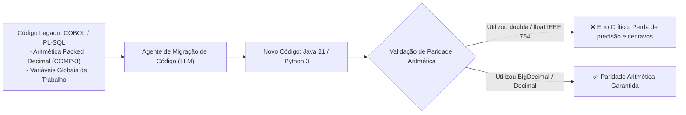
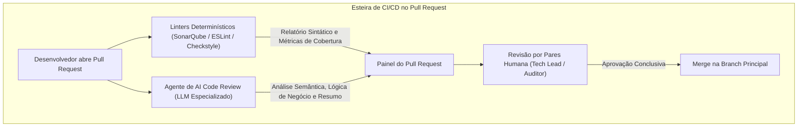
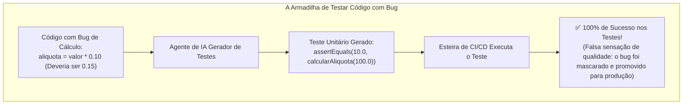
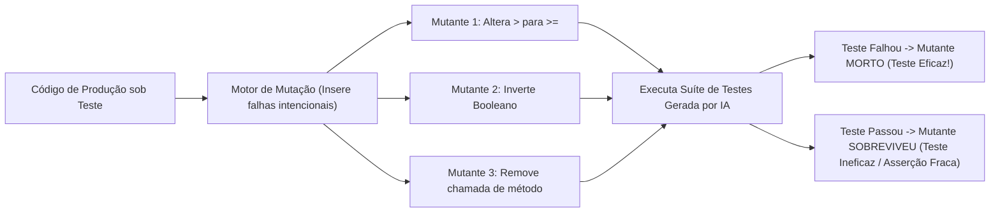

# 03 - Ciclo de Vida Assistido: Geração, Testes e Depuração

> **Matéria:** Engenharia de Software Assistida por IA e Sistemas Agentivos  
> **Cargo:** B02 – Técnico de Controle Externo – Especialidade: Tecnologia da Informação  
> **Arquivo:** `03_ciclo_de_vida_assistido_geracao_testes_e_depuracao.md`  

---

## 📌 Ementa / Itens do Edital
- Geração de código assistida por IA
- Revisão automatizada de código (AI Code Review)
- Documentação técnica e geração de contratos assistidos por IA
- Depuração (debugging) assistida por IA
- Geração automatizada de testes de software

---

## 🧭 Sumário
- [1. Geração de Código Assistida por Inteligência Artificial](#1-geracao-de-codigo-assistida-por-inteligencia-artificial)
    - [1.1 Scaffolding, Código Repetitivo (Boilerplate) e CRUDs Estruturais](#11-scaffolding-codigo-repetitivo-boilerplate-e-cruds-estruturais)
    - [1.2 Síntese de Algoritmos Complexos e Regras de Negócio](#12-sintese-de-algoritmos-complexos-e-regras-de-negocio)
    - [1.3 Modernização e Tradução de Sistemas Legados: Riscos Aritméticos](#13-modernizacao-e-traducao-de-sistemas-legados-riscos-aritmeticos)
    - [1.4 Completamento Inteligente de Código: Ghost Text e AST Local](#14-completamento-inteligente-de-codigo-ghost-text-e-ast-local)
- [2. Revisão Automatizada de Código (AI Code Review)](#2-revisao-automatizada-de-codigo-ai-code-review)
    - [2.1 Linters Estáticos Tradicionais (AST/SAST) vs. Agentes de AI Code Review](#21-linters-estaticos-tradicionais-astsast-vs-agentes-de-ai-code-review)
    - [2.2 Identificação de Code Smells, Débito Técnico e Violações de SOLID](#22-identificacao-de-code-smells-debito-tecnico-e-violacoes-de-solid)
    - [2.3 Varredura Automática de Vulnerabilidades e Vazamento de Segredos](#23-varredura-automatica-de-vulnerabilidades-e-vazamento-de-segredos)
    - [2.4 Síntese de Pull Requests e Notas de Lançamento (Release Notes)](#24-sintese-de-pull-requests-e-notas-de-lancamento-release-notes)
- [3. Documentação Técnica e Geração de Contratos](#3-documentacao-tecnica-e-geracao-de-contratos)
    - [3.1 Docstrings, Javadoc e Comentários Semânticos](#31-docstrings-javadoc-e-comentarios-semanticos)
    - [3.2 Engenharia Reversa de Contratos de API (OpenAPI 3.0 / Swagger)](#32-engenharia-reversa-de-contratos-de-api-openapi-30-swagger)
    - [3.3 Diagramação Arquitetural Declarativa com Mermaid.js e PlantUML](#33-diagramacao-arquitetural-declarativa-com-mermaidjs-e-plantuml)
- [4. Depuração (Debugging) e Diagnóstico de Erros Assistidos por IA](#4-depuracao-debugging-e-diagnostico-de-erros-assistidos-por-ia)
    - [4.1 Análise de Stack Traces e Decodificação de Erros Críticos](#41-analise-de-stack-traces-e-decodificacao-de-erros-criticos)
    - [4.2 Análise Forense de Logs de Produção e Vazamentos de Recursos](#42-analise-forense-de-logs-de-producao-e-vazamentos-de-recursos)
    - [4.3 Análise de Causa-Raiz (Root Cause Analysis - RCA) e Patches Mínimos](#43-analise-de-causa-raiz-root-cause-analysis-rca-e-patches-minimos)
- [5. Geração Automatizada de Testes de Software](#5-geracao-automatizada-de-testes-de-software)
    - [5.1 A Grande Armadilha: Testar a Implementação Defeituosa vs. o Comportamento](#51-a-grande-armadilha-testar-a-implementacao-defeituosa-vs-o-comportamento)
    - [5.2 Cobertura Sistemática de Casos de Borda (Edge Cases)](#52-cobertura-sistematica-de-casos-de-borda-edge-cases)
    - [5.3 Geração de Cenários BDD Executáveis (Gherkin)](#53-geracao-de-cenarios-bdd-executaveis-gherkin)
    - [5.4 Testes de Mutação (Mutation Testing): Avaliando a Real Eficácia dos Testes](#54-testes-de-mutacao-mutation-testing-avaliando-a-real-eficacia-dos-testes)
- [6. Fontes Recomendadas na Internet](#6-fontes-recomendadas-na-internet)

---

## 1. Geração de Código Assistida por Inteligência Artificial

### 1.1 Scaffolding, Código Repetitivo (Boilerplate) e CRUDs Estruturais
A automação de código por meio de modelos generativos impacta profundamente a velocidade de entrega nas fases inaugurais de projetos:

- **Redução do Esforço em Boilerplate:** Tarefas repetitivas e mecânicas — como a criação de classes de entidade (*JPA/Hibernate*), objetos de transferência de dados (*DTOs*), mapeadores (*Mappers/MapStruct*), repositórios (*Spring Data JPA*) e controladores REST — são geradas em segundos a partir de especificações de esquema relacional (DDL) ou contratos de interface.
- **Anotações de Validação:** A IA infere e aplica automaticamente regras de validação padronizadas (`@NotNull`, `@Size`, `@NotBlank`, `@Email`, `@PositiveOrZero`), diminuindo falhas de integridade na camada de borda da API.
- **Foco no Domínio:** Ao transferir a codificação mecânica de infraestrutura para a IA, os engenheiros de software concentram-se no núcleo das regras de negócio fiscais, auditoria orçamentária e conformidade jurídica.

---

### 1.2 Síntese de Algoritmos Complexos e Regras de Negócio
A partir de especificações funcionais ricas redigidas em linguagem natural, modelos de linguagem avançados deduzem a lógica algorítmica imperativa correspondente:

- **Cálculos Fiscais e Previdenciários:** Implementação de tabelas progressivas de alíquotas, regras de transição de benefícios e apuração de juros moratórios.
- **Algoritmos em Grafos e Otimização:** Algoritmos de ordenação topológica para detecção de dependências cíclicas em fluxos de processos administrativos.
- **Pré-requisito Vital:** A qualidade e corretude do algoritmo gerado dependem estritamente da clareza com que o desenvolvedor estabelece as **pré-condições, pós-condições e invariantes lógicas** na especificação enviada.

---

### 1.3 Modernização e Tradução de Sistemas Legados: Riscos Aritméticos
A migração de sistemas governamentais legados (especialmente rotinas tributárias e de arrecadação em COBOL ou PL/SQL para microsserviços modernos em Java 21, Kotlin ou Python) é uma das aplicações mais estratégicas de IA no setor público.



> 🚨 **ALERTA DE PROVA / FCC:**  
> **A Armadilha do Ponto Flutuante Binário:**  
>
> - Em sistemas contábeis e fiscais legados (COBOL), a representação numérica decimal de ponto fixo (`COMP-3`) assegura precisão absoluta de centavos.  
> - Ao traduzir esse código para Java ou Python, modelos de IA frequentemente sugerem tipos primitivos de ponto flutuante binário (`float` ou `double`), por serem mais concisos.  
> - Contudo, os tipos `float` e `double` (norma IEEE 754) introduzem **imprecisões binárias de arredondamento cumulativo** em cálculos de moedas e alíquotas (ex.: `0.1 + 0.2 != 0.3`).  
> - Em código fiscal de órgãos de controle externo, é **mandatório o uso de classes de precisão arbitrária exata (`java.math.BigDecimal` em Java ou o módulo `decimal` em Python)** com estratégias explícitas de arredondamento (`RoundingMode.HALF_EVEN`).

---

### Questão 01 (FCC - Padrão Concursos TI / Migração de Legado e Riscos Numéricos)
Ao utilizar um assistente de inteligência artificial para traduzir uma rotina crítica de apuração de tributos escrita em COBOL para a linguagem Java, a equipe de engenharia de software de uma Secretaria de Fazenda deve prestar atenção especial a qual das seguintes armadilhas de código frequentemente induzidas pelo modelo?  

* **A)** O modelo recusar-se a criar métodos públicos por limitações de licença de software livre.
* **B)** A substituição de variáveis com precisão decimal exata (`COMP-3` do COBOL) por tipos de ponto flutuante primitivos como `double` ou `float` em Java, causando erros cumulativos de arredondamento em cálculos de centavos e multas.
* **C)** A conversão forçada de todo o código em scripts de inicialização de BIOS de hardware.
* **D)** A exigência obrigatória de compilar o novo código Java utilizando exclusivamente placas aceleradoras de inteligência artificial na nuvem.
* **E)** O bloqueio automático de conexões com bancos de dados relacionais padrão SQL.

> **Comentário Detalhado:**
>
> - **A)** Incorreta. Modelos de IA não impõem restrições de visibilidade de métodos baseadas em licenças de código aberto.
> - **B)** **CORRETA.** Sistemas legados em COBOL apoiam-se na representação decimal de ponto fixo exata (`COMP-3`). Linguagens modernas como Java possuem tipos primitivos de ponto flutuante binário (`float` e `double`) que seguem a norma IEEE 754 e introduzem pequenas imprecisões de conversão binária. Em cálculos de tributos e multas fiscais, isso gera erros cumulativos de centavos. A tradução correta exige o uso de classes de precisão arbitrária exata (`java.math.BigDecimal`).
> - **C)** Incorreta. Migrações de código de sistemas de gestão não interagem com firmware de BIOS.
> - **D)** Incorreta. Código Java gerado por IA roda em qualquer JVM padrão sobre CPUs convencionais.
> - **E)** Incorreta. Java integra-se nativamente a bancos SQL por meio de JDBC e JPA.
> 
> **Gabarito: B**

---


### 1.4 Completamento Inteligente de Código: Ghost Text e AST Local
Assistentes de desenvolvimento integrados à IDE operam combinando predição estatística de tokens com inspeção estrutural estática:

- **Ghost Text:** Exibição em cinza de blocos inteiros de código sugerido antes da digitação.
- **Contexto da AST (Abstract Syntax Tree):** O assistente inspeciona a árvore sintática do arquivo em edição, classes importadas, tipos retornados por métodos e abas adjacentes recentemente abertas, assegurando coerência tipográfica e semântica com o restante da solução.

---

## 2. Revisão Automatizada de Código (AI Code Review)

### 2.1 Linters Estáticos Tradicionais (AST/SAST) vs. Agentes de AI Code Review
A integração de agentes de IA generativa em esteiras de CI/CD para inspeção de *Pull Requests* não substitui, mas complementa as ferramentas de análise estática convencionais:



| Critério de Comparação | Analisadores Estáticos Determinísticos (Linters / SAST) | Agentes de AI Code Review (Baseados em LLMs) |
|---|---|---|
| **Exemplos de Mercado** | SonarQube, Checkstyle, ESLint, FindBugs. | CodeRabbit, PR-Agent, GitHub Copilot PR Reviewer. |
| **Mecanismo Operacional** | Regras determinísticas imutáveis sobre AST, expressões regulares e grafos formais de fluxo de controle. | Inferência semântica probabilística e contextual sobre a intenção do desenvolvedor e o domínio do problema. |
| **Custo Computacional** | Praticamente nulo; execução local instantânea sem dependência de internet ou APIs externas. | Moderado a alto; demanda chamadas de rede para inferência em aceleradores (GPUs/TPUs). |
| **Compreensão de Negócio** | **Nula**. Incapaz de identificar se um cálculo tributário inverteu uma regra fiscal (ex.: aplicou desconto no lugar de acréscimo legal). | **Alta**. Consegue correlacionar a descrição textual da *issue* com o código implementado, detectando desvios semânticos. |
| **Papel na Governança** | Base obrigatória e inegociável de conformidade de estilo, cobertura e padrões de código. | Camada inteligente de triagem, síntese de alterações e detecção de falhas lógicas sutis para apoiar a revisão humana. |

---

### Questão 02 (FCC - Adaptada / TI - Revisão de Código Assistida por IA em CI/CD)
Uma equipe de desenvolvimento governamental decidiu integrar um agente de IA generativa ao fluxo de Integração Contínua (CI/CD) para realizar a revisão automática inicial (*automated code review*) de todos os *Pull Requests* antes da avaliação pelos pares técnicos.

Considerando os benefícios e os cuidados dessa prática, é correto afirmar:  

* **A)** A ferramenta de IA deve receber credenciais irrestritas de administrador do repositório para realizar o merge automático em produção sem necessidade de aprovação humana.
* **B)** A IA atua com alta eficácia na detecção precoce de más práticas de formatação (*code smells*), violações óbvias de princípios SOLID e potenciais credenciais ou chaves expostas (*hardcoded secrets*), mas a análise humana é indispensável para validação arquitetural e conformidade com regras de negócio.
* **C)** Para submeter os trechos de código do tribunal à API pública de revisão da IA, é dispensável qualquer verificação contratual sobre a política de privacidade e uso dos dados pelo provedor da ferramenta.
* **D)** A revisão de código por IA torna obsoletos os linters estáticos tradicionais (como SonarQube ou ESLint), pois LLMs executam compilação binária determinística com menor custo computacional.
* **E)** A IA deve ser configurada para rejeitar sumariamente qualquer *Pull Request* que contenha comentários explicativos ou docstrings, priorizando código não documentado.

> **Comentário Detalhado:**
>
> - **A)** Incorreta. A concessão de merge automático para IA em produção viola a segregação de funções e os princípios básicos de governança e controle de mudanças.
> - **B)** **CORRETA.** Agentes de revisão de código por IA oferecem excelente suporte na triagem preliminar de Pull Requests: detectam segredos vazados no código, métodos excessivamente longos, duplicações e violações de SOLID. A avaliação arquitetural de alto nível e a conformidade legal continuam exigindo o julgamento de revisores humanos.
> - **C)** Incorreta. A transferência de código governamental para serviços em nuvem exige salvaguardas contratuais estritas de sigilo e não retenção de dados (*Zero Data Retention*) em conformidade com as normas de segurança e LGPD.
> - **D)** Incorreta. Linters determinísticos tradicionais (SonarQube, ESLint) são rápidos, locais e gratuitos, servindo como primeira barreira que a IA complementa, mas não substitui.
> - **E)** Incorreta. Documentação técnica e docstrings são fundamentais para a manutenibilidade do software e devem ser incentivadas.
> 
> **Gabarito: B**

---


### 2.2 Identificação de Code Smells, Débito Técnico e Violações de SOLID
Os modelos de revisão atuam ativamente na prevenção de débito técnico em PRs:

- **Classes Deus (*God Classes*):** Alerta quando uma classe acumula dezenas de responsabilidades distintas, violando o Princípio da Responsabilidade Única (SRP).
- **Complexidade Ciclomática Excessiva:** Identificação de encadeamentos profundos de estruturas condicionais (`if`/`else` aninhados) e proposição de refatoração para o padrão *Strategy* ou *Polimorfismo*.
- **Código Duplicado e Obsolescência:** Identificação de reimplementações de funções utilitárias que já existem no ecossistema da biblioteca padrão.

---

### 2.3 Varredura Automática de Vulnerabilidades e Vazamento de Segredos
Durante o ciclo de revisão, os agentes aplicam filtros baseados nas diretrizes OWASP Top 10 e CWE:

- **Injeção de SQL (SQL Injection):** Identificação de interpolação direta de parâmetros de usuário em consultas HQL/JPQL ou SQL puro, recomendando consultas parametrizadas (*Prepared Statements*).
- **Vazamento de Credenciais (*Hardcoded Secrets*):** Detecção de chaves privadas, senhas de banco de dados, tokens de APIs e certificados digitais inseridos inadvertidamente em arquivos rastreados pelo Git.
- **Cross-Site Scripting (XSS) e Desserialização Insegura:** Alerta sobre a renderização direta de payloads HTML sem sanitização prévia.

---

### 2.4 Síntese de Pull Requests e Notas de Lançamento (Release Notes)
A IA lê o conjunto completo de alterações (*diffs*) entre branches e sintetiza automaticamente:

- Um resumo executivo claro das mudanças para os revisores humanos;
- Lista de arquivos alterados agrupados por domínio de impacto;
- Minuta preliminar das notas de versão (*Release Notes*) em conformidade com o padrão *Keep a Changelog*.

---

## 3. Documentação Técnica e Geração de Contratos

### 3.1 Docstrings, Javadoc e Comentários Semânticos
A documentação no nível do código-fonte é sintetizada de acordo com os padrões da linguagem:

- **Java (Javadoc):** Descrição formal de classes, métodos, parâmetros (`@param`), valores de retorno (`@return`) e exceções disparadas (`@throws`).
- **Python (PEP 257):** Docstrings estruturadas explicando o comportamento de funções, tipos de argumentos e invariantes de execução.
- **Regra de Ouro:** A documentação gerada deve focar no **"PORQUÊ"** daquela decisão arquitetural, e não apenas na descrição óbvia do código que qualquer programador conseguiria ler diretamente.

---

### 3.2 Engenharia Reversa de Contratos de API (OpenAPI 3.0 / Swagger)
Ao inspecionar classes controladoras (*controllers*) e modelos de dados DTO, a IA é capaz de gerar o contrato formal de API em sintaxe YAML/JSON:

- Mapeamento de rotas, verbos HTTP e códigos de resposta (`200 OK`, `201 Created`, `400 Bad Request`, `404 Not Found`);
- Descrição de esquemas de segurança no bloco `components/securitySchemes` (Bearer JWT, OAuth2);
- Exemplos de payloads válidos de requisição e resposta.

---

### 3.3 Diagramação Arquitetural Declarativa com Mermaid.js e PlantUML
Em vez de diagramas estáticos desenhados em ferramentas gráficas externas (que ficam rapidamente desatualizados), o agente de IA sintetiza diagramas baseados em texto dentro da própria documentação Markdown:

- **Diagramas de Classes e Entidade-Relacionamento:** Representação visual do modelo relacional a partir do código das entidades;
- **Diagramas de Sequência:** Mapeamento visual das trocas de mensagens assíncronas entre microsserviços via filas Kafka ou chamadas HTTP REST.

---

## 4. Depuração (Debugging) e Diagnóstico de Erros Assistidos por IA

### 4.1 Análise de Stack Traces e Decodificação de Erros Críticos
Frameworks corporativos modernos emitem rastreamentos de pilha (*stack traces*) extensos contendo centenas de linhas de chamadas internas da infraestrutura (Spring, Tomcat, Hibernate).

- O agente atua filtrando o ruído de bibliotecas de terceiros;
- Localiza cirurgicamente o método corporativo na linha exata onde a exceção foi lançada;
- Traduz mensagens herméticas para linguagem natural, explicando a condição de contorno que causou a falha (ex.: violação de chave estrangeira por registro órfão ou valor nulo não tratado).

---

### 4.2 Análise Forense de Logs de Produção e Vazamentos de Recursos
Ao processar logs em formato estruturado (JSON, Logstash, Log4j), a IA correlaciona eventos dispersos temporalmente:

- **Esgotamento de Pool de Conexões (*Connection Pool Exhaustion*):** Detecta que determinados endpoints demoram para liberar conexões com o banco de dados por ausência de blocos `try-with-resources` (`AutoCloseable`), culminando no travamento do serviço.
- **Condições de Corrida (*Race Conditions*):** Identifica acessos concorrentes desprotegidos a variáveis compartilhadas em memória entre múltiplas threads.

---

### Questão 03 (FCC - Padrão Concursos TI / Depuração e Root Cause Analysis com IA)
Em um incidente de produção no qual um microsserviço de emissão de guias de recolhimento apresenta travamento intermitente por esgotamento de conexões com o banco de dados (*connection pool exhaustion*), a equipe recorreu a um modelo de IA para auxiliar na depuração através da análise dos logs de eventos e do código da aplicação.

A respeito da atuação da IA no processo de depuração (*debugging*), assinale a afirmativa correta:  

* **A)** O modelo é capaz de interpretar o stack trace e identificar que certos blocos de transação de banco de dados não estão liberando conexões em blocos `finally` ou que falta o fechamento automático via blocos `try-with-resources`.
* **B)** A IA altera os servidores físicos da infraestrutura em tempo real sem emitir registros nos logs de auditoria.
* **C)** Ferramentas de IA são incapazes de analisar arquivos de log em formato texto estruturado como JSON ou Logstash.
* **D)** O uso de IA para diagnóstico exime a necessidade de a equipe reproduzir o problema em ambientes de homologação.
* **E)** Modelos de linguagem conseguem interceptar o fluxo elétrico das fontes de alimentação dos servidores para eliminar deadlocks.

> **Comentário Detalhado:**
>
> - **A)** **CORRETA.** Modelos de linguagem são altamente eficazes no reconhecimento de padrões de vazamento de recursos (*resource leaks*), apontando com exatidão métodos onde objetos de conexão JDBC não foram encapsulados em blocos `try-with-resources` (`AutoCloseable`), provocando a retenção indevida de conexões que esgota o pool sob carga.
> - **B)** Incorreta. LLMs operam sobre código e textos, não exercendo controle físico sobre hardwares sem auditoria.
> - **C)** Incorreta. A interpretação de logs estruturados em JSON, Log4j ou Logstash é uma das tarefas mais maduras de assistentes generativos.
> - **D)** Incorreta. A reprodução da falha e a validação do patch corretivo em ambiente de testes antes da ida para produção permanecem mandatórias.
> - **E)** Incorreta. Deadlocks são conflitos lógicos de concorrência de software, não tendo qualquer relação com controle elétrico de fontes de alimentação.
> 
> **Gabarito: A**

---


### 4.3 Análise de Causa-Raiz (Root Cause Analysis - RCA) e Patches Mínimos
Ao identificar a causa-raiz de um incidente, a boa prática da engenharia de software assistida por IA recomenda a formulação de **Patches Mínimos**:

- O modelo deve propor **alterações cirúrgicas restritas ao estritamente necessário** para neutralizar o defeito;
- Devem-se evitar refatorações cosméticas em massa durante a aplicação de correções críticas (*hotfixes*), minimizando o risco de efeitos colaterais indesejados no ambiente de produção.

---

## 5. Geração Automatizada de Testes de Software

### 5.1 A Grande Armadilha: Testar a Implementação Defeituosa vs. o Comportamento



O risco mais crítico na geração de testes por modelos de IA é o **viés de ancoragem no código implementado**:

- Se o desenvolvedor fornecer um método que contém um bug e solicitar *"gere testes unitários para a função acima"*, a IA inferirá que o código fornecido representa o comportamento correto pretendido!
- Ela formulará asserções (`assert`) que confirmam o valor errado gerado pelo código. O teste passará com sucesso na esteira de CI/CD, conferindo uma falsa sensação de blindagem contra falhas.

> ⭐ **IMPORTANTE / REGRA DE OURO:**  
> Ao solicitar a geração de testes para IA, **forneça sempre a especificação funcional ou regra de negócio independente do código**, ou adote a abordagem TDD (*Test-Driven Development*): gere os testes a partir dos requisitos e somente depois confronte os testes com o código desenvolvido.

---

### 5.2 Cobertura Sistemática de Casos de Borda (Edge Cases)
Enquanto desenvolvedores humanos frequentemente testam apenas o caminho feliz (*happy path*), modelos de linguagem são excelentes na exploração exaustiva de condições limites:

- **Nulidade e Strings:** Valores `null`, strings vazias (`""`), strings contendo apenas espaços em branco e caracteres especiais de injeção;
- **Limites Numéricos:** Limites extremos de tipos inteiros (`Integer.MAX_VALUE`, `Integer.MIN_VALUE`), números negativos em grandezas financeiras e divisão por zero;
- **Coleções:** Listas vazias, coleções com um único elemento e arrays com volumes massivos de dados;
- **Temporalidade:** Anos bissextos, viradas de século e discrepâncias de fusos horários (UTC vs. horário local).

---

### 5.3 Geração de Cenários BDD Executáveis (Gherkin)
Modelos de IA sintetizam com facilidade especificações executáveis em conformidade com o padrão BDD:

```gherkin
Funcionalidade: Validação de Prestação de Contas Municipal
  Cenário: Rejeição de despesa sem prévio empenho
    Dado que existe uma despesa protocolada no valor de R$ 45.000,00
    E não consta nota de empenho vinculada no sistema contábil
    Quando o auditor executar a validação de conformidade da despesa
    Então o sistema deve bloquear a liquidação do pagamento
    E emitir o alerta "IRREGULARIDADE_AUSENCIA_DE_EMPENHO_PREVIO"
```

---

### 5.4 Testes de Mutação (Mutation Testing): Avaliando a Real Eficácia dos Testes
Para auditar a qualidade técnica real de uma suíte de testes gerada por IA, aplica-se o **Teste de Mutação (*Mutation Testing*)** através de ferramentas como o Pitest (PIT) em Java:



- **Mecânica dos Mutantes:** O motor de mutação introduz pequenas alterações deliberadas no código compilado (troca operadores relacionais, inverte expressões booleanas, altera valores de retorno).
- **Mutante Morto (*Killed Mutant*):** A suíte de testes detectou a anomalia e falhou. É o resultado esperado para testes robustos.
- **Mutante Sobrevivente (*Survived Mutant*):** O código foi sabotado pelo motor de mutação, mas a suíte de testes continuou passando com sucesso! Isso comprova que a suíte gerada pela IA possui asserções fracas ou testes superficiais que apenas percorrem as linhas sem checar a lógica do negócio.

> 🚨 **ALERTA DE PROVA / PEGADINHA FCC:**  
> A afirmação de que *"uma suíte de testes com 100% de cobertura de código (code coverage) garante que o sistema está livre de erros"* é uma das pegadinhas clássicas mais cobradas pela Fundação Carlos Chagas!  
>
> - **Cobertura de código mede apenas quais linhas foram executadas**, não avaliando se as asserções (`assert`) são corretas ou completas.  
> - É perfeitamente possível ter 100% de cobertura de código com testes que não possuem nenhuma asserção ou com testes que validam valores incorretos. A métrica definitiva de qualidade da suíte é o **Escore de Mutação (*Mutation Score*)**.

---

### Questão 04 (FCC - Adaptada / TI - Geração de Testes com IA e Armadilhas)
Durante a fase de homologação de um módulo contábil no TCE-GO, um programador utilizou uma ferramenta de inteligência artificial generativa para gerar automaticamente uma suíte de testes unitários em JUnit a partir do código-fonte recém-escrito de uma classe de cálculo de multas.

Ao analisar as práticas recomendadas e os riscos associados à geração de testes automatizados assistidos por IA, assinale a afirmativa correta:  

* **A)** O uso de IA para testes dispensa totalmente a verificação humana das asserções (`assert`), já que modelos de linguagem possuem prova formal matemática de corretude lógica.
* **B)** A ferramenta de IA é incapaz de testar casos de borda (*edge cases*), limitando-se unicamente ao caminho feliz (*happy path*) pré-definido pelo framework de teste.
* **C)** Um dos principais riscos da geração de testes com base apenas no código existente é o teste da implementação em vez do comportamento pretendido: se o código possuir um bug na fórmula matemática, a IA pode gerar testes que asseveram o resultado incorreto como sendo o esperado, perpetuando o defeito.
* **D)** Testes unitários gerados por IA tornam desnecessárias as etapas subsequentes de testes de integração, testes de carga e testes de segurança da aplicação.
* **E)** A IA é legalmente responsável por falhas funcionais que passem despercebidas para o ambiente de produção após a execução da suíte de testes sintetizada.

> **Comentário Detalhado:**
>
> - **A)** Incorreta. Modelos de IA operam por aproximação estatística probabilística e não fornecem provas formais matemáticas de corretude, sendo indispensável a validação das asserções por desenvolvedores humanos.
> - **B)** Incorreta. A geração automática de casos de borda (*edge cases*: entradas nulas, números negativos, limites extremos de tipos inteiros) é exatamente um dos pontos fortes dos modelos de IA.
> - **C)** **CORRETA.** Se o código-fonte fornecido contiver um erro conceitual de negócio e o prompt não trouxer a especificação independente, a IA tomará a implementação com defeito como referência de verdade. Suas asserções validarão o cálculo errado, gerando testes que passarão com 100% de sucesso na esteira de CI/CD, mascarando o defeito.
> - **D)** Incorreta. Testes unitários cobrem métodos isolados em memória; eles não atestam o comportamento integrado com banco de dados, filas ou desempenho sob carga.
> - **E)** Incorreta. A responsabilidade técnica e civil recai sempre sobre os servidores e a equipe de engenharia do órgão público.
> 
> **Gabarito: C**

---

### Questão 05 (FCC - Padrão Concursos TI / Avaliação de Qualidade com Testes de Mutação)
Para aferir a real qualidade de uma suite de testes unitários sintetizada por uma ferramenta de IA generativa, um arquiteto de software sugeriu a aplicação de Testes de Mutação (*Mutation Testing*).

O princípio básico dos Testes de Mutação para validar a eficácia da suíte de testes gerada pela IA consiste em:  

* **A)** Modificar os testes até que a taxa de cobertura de código atinja exatamente 200%.
* **B)** Introduzir modificações sintáticas pontuais e deliberadas no código-fonte sob teste (mutantes), verificando se a suíte de testes é capaz de falhar ao executá-los; caso os testes continuem passando mesmo com as alterações defeituosas no código, evidencia-se a ineficácia das asserções dos testes gerados.
* **C)** Treinar um novo modelo de IA que substitui todo o código da aplicação por scripts em shell script.
* **D)** Validar unicamente a velocidade de inicialização do sistema operacional da máquina onde o teste é executado.
* **E)** Comparar a quantidade de caracteres do código com o tamanho do disco rígido da estação de trabalho.

> **Comentário Detalhado:**
>
> - **A)** Incorreta. Cobertura de código é uma porcentagem estritamente limitada ao intervalo de 0% a 100%.
> - **B)** **CORRETA.** O Teste de Mutação (*Mutation Testing*) introduz falhas artificiais intencionais no código compilado sob teste (mutantes). Se a suíte de testes falhar, o mutante foi "morto", comprovando que as asserções (`assert`) são sensíveis e eficazes. Se os testes continuarem passando mesmo com o código adulterado, o mutante "sobreviveu", revelando que os testes gerados pela IA são superficiais e incapazes de capturar defeitos reais.
> - **C)** Incorreta. Testes de mutação não envolvem retreinamento de modelos nem conversão de linguagens para shell script.
> - **D)** Incorreta. A técnica afere a robustez lógica das asserções, não o tempo de boot do sistema operacional.
> - **E)** Incorreta. Comparação esdrúxula e sem fundamentação na engenharia de testes de software.
> 
> **Gabarito: B**

---


## 6. Fontes Recomendadas na Internet

* [ArXiv - Evaluating Large Language Models Trained on Code / Codex & Pass@k (Chen et al.)](https://arxiv.org/abs/2107.03374) - Criação do benchmark HumanEval, definição formal da métrica pass@k e síntese funcional de código.
* [ArXiv - SWE-bench: Can Language Models Resolve Real-World GitHub Issues? (Jimenez et al.)](https://arxiv.org/abs/2310.06770) - Avaliação automatizada de agentes de software resolvendo bugs em repositórios reais.
* [Anthropic Documentation - Code Generation and Test Synthesis](https://docs.anthropic.com/en/docs/build-with-claude/prompt-engineering/overview) - Melhores práticas para síntese de testes unitários, testes de mutação e análise de cobertura assistida.
* [Martin Fowler - Self-Testing Code and Continuous Delivery](https://martinfowler.com/bliki/SelfTestingCode.html) - Princípios fundamentais de código auto-testável e automação de testes em engenharia.
* SOMMERVILLE, Ian. **Engenharia de Software**. 10. ed. São Paulo: Pearson, 2019. (Cap. 8 - Teste de Software e Automação).
* PRESSMAN, Roger S.; MAXIM, Bruce R. **Engenharia de Software: Uma Abordagem Profissional**. 9. ed. Porto Alegre: AMGH, 2021. (Cap. 20 - Estratégias de Teste de Software).
* BECK, Kent. **Desenvolvimento Guiado por Testes (TDD)**. Porto Alegre: Bookman, 2010. (Cap. 1 a 3 - Ciclo Red-Green-Refactor).
