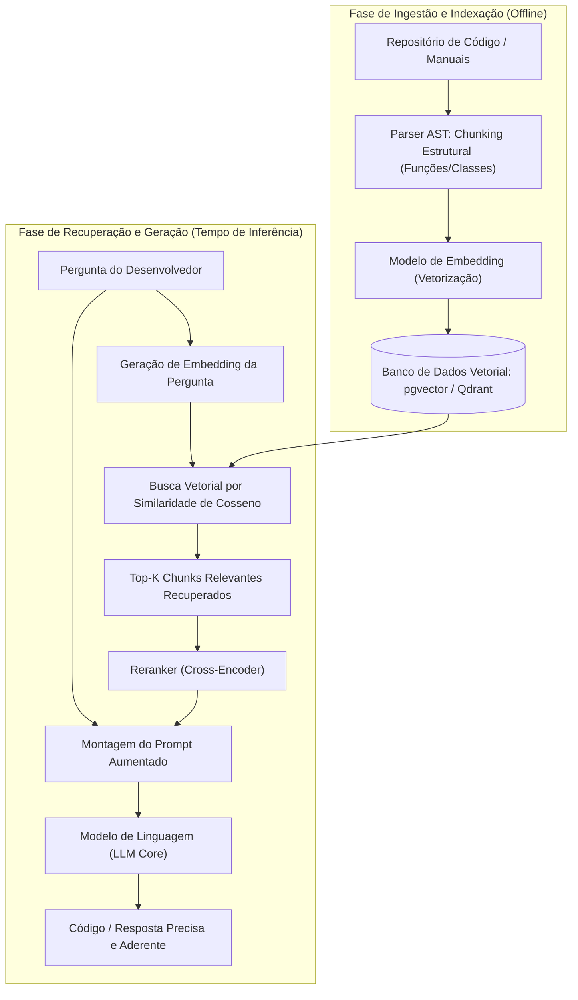
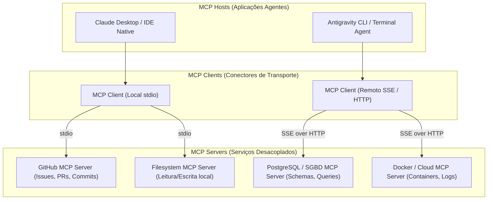

# 04 - RAG, Protocolo MCP, Skills e Ferramental de Agentes

> **Matéria:** Engenharia de Software Assistida por IA e Sistemas Agentivos  
> **Cargo:** B02 – Técnico de Controle Externo – Especialidade: Tecnologia da Informação  
> **Arquivo:** `04_rag_protocolo_mcp_skills_e_ferramental.md`  

---

## 📌 Ementa / Itens do Edital
- Gestão de contexto e memória em sistemas agentivos
- Recuperação Aumentada por Geração (Retrieval-Augmented Generation – RAG) e bancos de dados vetoriais
- Protocolos de interoperabilidade entre agentes e ferramentas: Model Context Protocol (MCP)
- Extensibilidade e automação de fluxos de trabalho especializados: Skills e Tool Use (Function Calling)

---

## 🌳 Classificação Hierárquica

```text
4. Contexto, RAG, Protocolo MCP e Interoperabilidade de Agentes
├── 4.1 Gestão de Contexto e Memória em Agentes de IA
│   ├── 4.1.1 Janela de Contexto e Desafios: Limite de tokens, degradação de atenção e compressão de contexto
│   ├── 4.1.2 Memória de Curto Prazo (Working Memory): Histórico da conversa, estado da sessão e pilha de tarefas ativas
│   ├── 4.1.3 Memória de Longo Prazo (Episódica e Semântica): Armazenamento persistente de decisões anteriores, preferências de arquitetura e histórico de projetos
│   └── 4.1.4 Estratégias de Gerenciamento: Sumarização progressiva, podagem de mensagens antigas e cache de prompts (Prompt Caching)
├── 4.2 Retrieval-Augmented Generation (RAG) Aplicado a Bases de Código
│   ├── 4.2.1 Conceito e Arquitetura do RAG: Busca de conhecimento externo indexado para enriquecer o prompt em tempo real
│   ├── 4.2.2 Pipeline de Ingestão de Código:
│   │   ├── Chunking de Código: Divisão consciente da sintaxe (por funções, classes, módulos ou AST - Abstract Syntax Tree)
│   │   ├── Modelos de Embeddings: Conversão de trechos de código e documentação em vetores multidimensionais densos
│   │   └── Armazenamento em Bancos Vetoriais (Vector Databases: pgvector, Pinecone, Milvus, Chroma, Qdrant)
│   ├── 4.2.3 Busca e Recuperação Semântica:
│   │   ├── Métricas de similaridade: Similaridade de Cosseno, Distância Euclidiana e Produto Escalar
│   │   ├── Busca Híbrida: Combinação de busca vetorial densa com busca textual tradicional (BM25 / Full-Text Search)
│   │   └── Reranking: Reordenação dos resultados mais relevantes antes do envio ao modelo
│   └── 4.2.4 RAG vs. Fine-Tuning: Quando usar busca dinâmica de contexto vs. quando especializar os pesos do modelo
├── 4.3 O Protocolo Model Context Protocol (MCP)
│   ├── 4.3.1 Origem e Motivação: Padrão aberto introduzido para resolver o problema de integrações ponto-a-ponto N x M entre modelos de IA e fontes de dados
│   ├── 4.3.2 Arquitetura Cliente-Servidor do MCP:
│   │   ├── MCP Host (A aplicação que executa o agente, ex.: Claude Desktop, IDE, Antigravity)
│   │   ├── MCP Client (O cliente que mantém a conexão 1:1 com os servidores)
│   │   └── MCP Server (Serviço leve que expõe recursos específicos: GitHub, PostgreSQL, Docker, Filesystem, Slack)
│   ├── 4.3.3 Primitivas Fundamentais do MCP:
│   │   ├── Resources (Recursos): Dados passivos semelhantes a arquivos que o cliente pode ler (logs, tabelas, arquivos)
│   │   ├── Prompts: Modelos de prompts pré-definidos e parametrizados expostos pelo servidor
│   │   └── Tools (Ferramentas): Funções executáveis que o modelo pode chamar para realizar ações com efeitos colaterais
│   └── 4.3.4 Mecanismos de Transporte no MCP: stdio (comunicação via entrada/saída padrão de processos locais) e SSE (Server-Sent Events sobre HTTP para servidores remotos)
└── 4.4 Extensibilidade, Tool Use e Skills Especializadas
    ├── 4.4.1 Tool Use / Function Calling:
    │   ├── Declaração de esquemas de ferramentas via JSON Schema (nome, descrição, parâmetros obrigatórios e tipos)
    │   ├── Resolução e chamada determinística de ferramentas pela aplicação hospedeira
    │   └── Retorno de respostas estruturadas ao modelo para continuidade do raciocínio
    └── 4.4.2 Skills e Fluxos de Trabalho Especializados:
        ├── Definição de Skill: Pacote modular contendo instruções especializadas, scripts utilitários e recursos para domínios específicos
        ├── Orquestração Multiagente: Agente planejador coordenando subagentes especialistas com ferramentas dedicadas
        └── Automação de Workflows Repetitivos: Pipelines de migração de código, auditorias de segurança e geração de documentação regulamentar
```

---

## 📖 Teoria Aprofundada & Fundamentos Técnicos

### 4.1 Gestão de Contexto e Memória em Agentes de IA

Sistemas de desenvolvimento autônomo operam sob o desafio de manter a continuidade do raciocínio ao longo de sessões prolongadas de trabalho sem exceder a janela de contexto ou degradar a atenção.

#### 4.1.1 Memória de Curto Prazo vs. Memória de Longo Prazo
- **Memória de Curto Prazo (Working Memory):** Reside diretamente na **janela de contexto** ativa da inferência. Armazena as instruções do usuário, as mensagens trocadas, os resultados de comandos recentes e a pilha de tarefas em andamento. É rápida e acessível diretamente pela autoatenção do Transformer, porém efêmera e delimitada pela cota de tokens.
- **Memória de Longo Prazo (Episódica e Semântica):** Persiste fora da janela de contexto em bancos de dados relacionais ou vetoriais. Armazena:
  - *Memória Semântica:* O conhecimento estrutural do repositório (mapa de dependências de código, esquemas de tabelas, padrões corporativos de arquitetura);
  - *Memória Episódica:* O histórico de execuções passadas (quais correções deram certo em bugs anteriores, decisões tomadas em sessões de refatoração prévias).

#### 4.1.2 Estratégias de Gerenciamento e Prompt Caching
Para viabilizar tarefas em grandes bases de código sem estourar orçamentos ou limites de contexto:
1. **Sumarização Progressiva:** Conforme o histórico de comandos e conversação atinge determinado limiar, uma rotina de fundo gera um resumo conciso das decisões e substitui as mensagens antigas por essa síntese.
2. **Podagem de Contexto (*Context Pruning*):** Remoção de saídas de ferramentas que se tornaram irrelevantes (como o stdout volumoso de um comando de build bem-sucedido após a verificação ter sido confirmada).
3. **Prompt Caching:** Mecanismo disponibilizado por provedores modernos (como Anthropic Claude) que cria um cache dos prefixos estáticos da janela de contexto (como a leitura inicial de todo o código-fonte ou diretrizes institucionais). O *Prompt Caching* reduz drasticamente a latência de resposta e corta em até 90% o custo de tokens de entrada em iterações consecutivas.

---

### 4.2 Retrieval-Augmented Generation (RAG) Aplicado a Bases de Código

O **RAG (Recuperação Aumentada por Geração)** é o padrão arquitetural que conecta o poder de raciocínio de um LLM generalista a uma base factual dinâmica e proprietária de código-fonte sem a necessidade de re-treinamento de parâmetros neurais.



#### 4.2.1 Pipeline de Ingestão e o Desafio do Chunking de Código
A fragmentação (*chunking*) ingênua de texto (baseada em contagem arbitrária de caracteres ou linhas) é desastrosa para código-fonte: pode quebrar a assinatura de uma função, fatiar um loop no meio ou desconectar uma anotação `@Transactional` do método correspondente.
- **Chunking Consciente de Sintaxe (AST-based Chunking):** Utiliza ferramentas de análise sintática (como *Tree-sitter*) para gerar fragmentos que respeitam as fronteiras naturais da linguagem:
  - Cada chunk representa uma função completa, um método com suas anotações, uma classe inteira ou um bloco de interface;
  - Preserva os nós de imports e o namespace no cabeçalho do chunk para manter o contexto semântico inteligível para o modelo de embedding.

#### 4.2.2 Bancos de Dados Vetoriais e Métricas de Similaridade
Os chunks são convertidos em vetores densos (arrays de floats com 768 a 3072 dimensões) e indexados em bancos vetoriais especializados (*pgvector* para PostgreSQL, Pinecone, Qdrant, Milvus, Chroma) usando algoritmos de busca de vizinhos mais próximos aproximados (*HNSW - Hierarchical Navigable Small World*).

A proximidade semântica entre a dúvida do desenvolvedor e os trechos de código é comumente calculada via **Similaridade de Cosseno**:

$$\cos(\theta) = \frac{A \cdot B}{\|A\| \|B\|} = \frac{\sum_{i=1}^n A_i B_i}{\sqrt{\sum_{i=1}^n A_i^2} \sqrt{\sum_{i=1}^n B_i^2}}$$

Se os vetores forem previamente normalizados ($\|A\| = \|B\| = 1$), a similaridade de cosseno equivale diretamente ao produto escalar (*dot product*).

#### 4.2.3 Busca Híbrida (*Hybrid Search*) e Reranking
Bases de código frequentemente contêm termos léxicos literais exatos (como o nome de uma classe `RelatorioAuditoriaTceDTO` ou uma constante `HTTP_404_NOT_FOUND`). A busca vetorial pura pode perder a correspondência literal exata.
- **Busca Híbrida:** Combina busca semântica densa (vetores de embeddings) com busca léxica esparsa tradicional (**BM25** ou Full-Text Search do PostgreSQL);
- **Reciprocal Rank Fusion (RRF):** Algoritmo que funde as duas listas ordenadas de resultados;
- **Reranker (Cross-Encoder):** Modelo especializado que analisa os pares `(pergunta, trecho de código)` nos top-20 resultados para reordená-los com extrema precisão antes de injetar os top-5 na janela de contexto.

#### 4.2.4 RAG vs. Fine-Tuning: Decisão Arquitetural

| Dimensão de Comparação | RAG (Retrieval-Augmented Generation) | Fine-Tuning (Ajuste Fino Supervisionado) |
| :--- | :--- | :--- |
| **Objetivo Primário** | Fornecer **conhecimento factual dinâmico e atualizado** (código recente, documentação, regras de negócio). | Ensinar **estilo, sintaxe especializada, tom de voz** e aderência estrita a DSLs proprietárias. |
| **Atualização do Conhecimento** | Instantânea: basta reindexar ou adicionar um chunk no banco vetorial. | Lenta e cara: exige novo pipeline de treinamento e reavaliação de checkpoints. |
| **Custo Computacional** | Baixo a moderado: apenas geração de embeddings e busca vetorial. | Alto: horas ou dias de computação em clusters de GPUs dedicadas. |
| **Rastreabilidade e Fontes** | Total: o modelo cita os arquivos e linhas exatas de onde extraiu o contexto. | Nula: o conhecimento fica disperso nos pesos probabilísticos dos neurônios (caixa-preta). |
| **Mitigação de Alucinações** | Altamente eficaz: ancora a resposta em trechos reais fornecidos no prompt. | Moderada: pode continuar alucinando fatos se os pesos entrarem em conflito. |

---

### 4.3 O Protocolo Model Context Protocol (MCP)

O **Model Context Protocol (MCP)** é uma especificação aberta desenvolvida para resolver a fragmentação do ecossistema de ferramentas de IA. Antes do MCP, se existissem $N$ modelos/aplicações e $M$ fontes de dados/ferramentas corporativas, eram necessárias $N \times M$ integrações sob medida. O MCP estabelece um padrão universal onde qualquer aplicação (*Host*) conecta-se a qualquer servidor de ferramentas (*Server*).



#### 4.3.1 As Três Primitivas Centrais do MCP

| Primitiva | Natureza Operacional | Descrição e Caso de Uso na Prática de TI | Efeito Colateral? |
| :--- | :--- | :--- | :--- |
| **Resources (Recursos)** | Passiva / Somente Leitura | Dados contextuais expostos pelo servidor como arquivos virtuais ou URIs (ex.: `postgres://schema/tce_contratos`, `file:///logs/app.log`). O agente consome o conteúdo para obter contexto sem disparar mutações. | **Não** (Operação idempotente de leitura). |
| **Tools (Ferramentas)** | Ativa / Executável | Funções invocáveis com parâmetros validados por esquemas rígidos (JSON Schema). O modelo decide quando invocá-las para produzir efeitos reais no ambiente (ex.: `criar_tabela_sql`, `enviar_mensagem_slack`, `executar_build_maven`). | **Sim** (Pode alterar estado, bancos ou arquivos). |
| **Prompts** | Parametrizável / Guiada | Modelos pré-configurados de interação expostos pelo servidor para guiar o usuário em tarefas rotineiras (ex.: template de "Auditoria de Contrato Administrativo", template de "Revisão de Segurança de Endpoint"). | **Não** (Gera mensagens estruturadas para o modelo). |

#### 4.3.2 Mecanismos de Transporte no MCP
A especificação do MCP define dois canais de comunicação padronizados:
1. **`stdio` (Standard Input / Output):** Padrão para comunicação entre processos que rodam localmente na mesma máquina. O host instancia o servidor MCP como um subprocesso filho e troca mensagens no formato JSON-RPC 2.0 através da entrada e saída padrão do sistema operacional. É seguro, extremamente rápido e não expõe portas de rede locais.
2. **`SSE` (Server-Sent Events sobre HTTP):** Padrão para comunicação com servidores MCP distribuídos ou hospedados remotamente em nuvem privada. O cliente estabelece uma conexão HTTP com suporte a streaming de eventos enviados pelo servidor, complementada por requisições POST para emissão de comandos.

---

### 4.4 Extensibilidade, Tool Use e Skills Especializadas

#### 4.4.1 Tool Use / Function Calling
O mecanismo de uso de ferramentas transforma o modelo de linguagem de um sistema puramente textual em uma unidade de controle programática:
1. **Declaração via JSON Schema:** A aplicação cliente informa ao LLM quais ferramentas estão disponíveis, fornecendo seus nomes, descrições em linguagem natural e esquemas estritos de parâmetros tipados.
2. **Decisão Autônoma de Invocação:** O LLM avalia a demanda do usuário e, ao invés de responder diretamente em texto livre, emite um bloco estruturado contendo a ferramenta selecionada e o objeto JSON com os argumentos.
3. **Execução Determinística pelo Host:** A aplicação hospedeira intercepta o bloco, executa a função real no sistema (ex.: consulta no banco de dados) e devolve a resposta observada (*Observation*) para o LLM continuar o raciocínio.

```json
{
  "name": "consultar_receita_tributaria",
  "description": "Consulta o montante de arrecadação de ICMS por município e exercício fiscal no banco da SEFAZ.",
  "parameters": {
    "type": "object",
    "properties": {
      "municipio": { "type": "string", "description": "Nome do município" },
      "exercicio": { "type": "integer", "description": "Ano fiscal (ex: 2025)" }
    },
    "required": ["municipio", "exercicio"]
  }
}
```

#### 4.4.2 Skills e Orquestração Multiagente
Uma **Skill** é um conjunto coeso de capacidades modulares combinando:
- *Instruções de Sistema Especializadas* (diretrizes de domínio);
- *Ferramentas Específicas* (funções mapeadas via MCP ou código local);
- *Artefatos de Conhecimento* (manuais técnicos e scripts utilitários).

Na orquestração **Multiagente**, um Agente Orquestrador (*Planner*) divide a tarefa corporativa e coordena agentes especialistas subordinados dotados de *Skills* distintas (ex.: Agente Revisor de Código, Agente DBA de Migrações e Agente de Segurança Cibernética), consolidando o resultado final com segregação de responsabilidades.

> ⭐ **IMPORTANTE / REGRA DE OURO:**  
> A garantia da segurança e integridade no uso de *Tools* reside na **validação rigorosa de esquemas**: o LLM nunca executa a ferramenta diretamente dentro dos seus pesos neurais; ele apenas emite um pedido JSON. É dever irrenunciável da **aplicação hospedeira (Host)** validar permissões, sanitizar entradas contra injeção de comandos e submeter ações de risco à aprovação do operador humano (*Human-in-the-Loop*).

> 🚨 **ALERTA DE PROVA / PEGADINHA FCC:**  
> A FCC adora trocar os conceitos das primitivas do MCP em enunciados técnicos:  
> - **Resources** NÃO executam ações! São recursos passivos de leitura de dados (read-only).  
> - **Tools** são as primitivas que possuem **capacidade executável e efeitos colaterais**.  
> - Se a questão disser que *"a primitiva Resource do MCP é utilizada para disparar exclusão de tabelas e mutações de banco de dados"*, o item está **INCORRETO**! Isso é função estrita de uma *Tool*!

---

## 🌐 Fontes Recomendadas na Internet

### 1. Documentação Oficial do Padrão MCP e Ferramentas
- [Model Context Protocol (MCP) Official Documentation & Specification](https://modelcontextprotocol.io/): Portal canônico mantido pela comunidade e Anthropic contendo a especificação formal completa do protocolo aberto, arquitetura cliente-servidor, primitivas e transportes.
- [Anthropic MCP Architectural Announcement](https://www.anthropic.com/news/model-context-protocol): Artigo institucional detalhando o problema de integração $N \times M$ e a visão do protocolo como padrão universal aberto da indústria.
- [Anthropic Tool Use (Function Calling) Implementation Guide](https://docs.anthropic.com/en/docs/build-with-claude/tool-use): Guia técnico cobrindo declaração de esquemas JSON Schema, parsing de chamadas de funções e integração com agentes.

### 2. Pesquisas Seminais de RAG e Bancos Vetoriais
- [Retrieval-Augmented Generation for Knowledge-Intensive NLP Tasks (Lewis et al., 2020 - arXiv:2005.11401)](https://arxiv.org/abs/2005.11401): Artigo seminal de pesquisadores do Facebook AI Research que estabeleceu as bases do RAG moderno combinando recuperação densa e geração probabilística.
- [Pinecone Vector Search & Embeddings Architecture Guide](https://www.pinecone.io/learn/vector-search-basics/): Guia de referência técnica abordando matemática vetorial multidimensional, métricas de distância de cosseno e indexação aproximada (HNSW).

---

## 📝 Questões Comentadas & Prática Padrão FCC

### Questão 1 (FCC - Adaptada / TI - Model Context Protocol e Interoperabilidade)
No desenvolvimento de ecossistemas corporativos baseados em inteligência artificial, a proliferação de integrações proprietárias ponto-a-ponto entre assistentes inteligentes e sistemas legados motivou a criação do protocolo aberto *Model Context Protocol* (MCP).

A respeito da arquitetura, primitivas e funcionamento do protocolo MCP, assinale a afirmativa correta:
A) O MCP é um protocolo proprietário e fechado cujo funcionamento restringe-se exclusivamente à execução de scripts Python em ambientes isolados na nuvem.  
B) Na arquitetura do MCP, o *MCP Host* conecta-se a múltiplos *MCP Servers*, que expõem padronizadamente três primitivas essenciais: *Resources* (dados passivos que podem ser lidos), *Tools* (funções executáveis que realizam ações ou consultas) e *Prompts* (templates de mensagens pré-configurados).  
C) As primitivas denominadas *Tools* no MCP servem exclusivamente para exibir documentação estática ao usuário final, sendo vedada a chamada a APIs de backend ou operações com efeitos colaterais.  
D) O transporte padrão para comunicação entre clientes e servidores locais no MCP utiliza exclusivamente websockets não autenticados, sendo proibida a comunicação via `stdio` (entrada/saída padrão de processos).  
E) A utilização do MCP dispensa o modelo de IA de interpretar parâmetros em esquemas JSON Schema, delegando a tipagem de dados integralmente ao sistema operacional hospedeiro.

> **Gabarito: B**  
> **Comentário Analítico Passo a Passo:**  
> - **A está INCORRETA:** O MCP é um padrão aberto (*open standard*), mantido com código aberto pela comunidade e com SDKs para TypeScript, Python, Kotlin e outras linguagens, permitindo arquiteturas heterogêneas sem aprisionamento tecnológico (*vendor lock-in*).  
> - **B está CORRETA:** A arquitetura do MCP divide-se claramente em Host (aplicação consumidora), Client (camada de transporte) e Server (provedor de dados e recursos). Os servidores expõem padronizadamente: (1) *Resources* (conteúdo somente leitura), (2) *Tools* (funções acionáveis com efeitos colaterais) e (3) *Prompts* (templates de prompt estruturados e parametrizáveis).  
> - **C está INCORRETA:** *Tools* são precisamente os mecanismos executáveis com parâmetros que permitem ao agente executar operações ativas com efeitos colaterais (consultas, mutações em bancos de dados, alterações de arquivos). Dados passivos de leitura são expostos como *Resources*.  
> - **D está INCORRETA:** Para comunicação com servidores que rodam no mesmo ambiente local da máquina do usuário, o transporte oficial recomendado e padrão do MCP é o **`stdio`** (standard input/output de subprocessos). Para conexões remotas em rede, utiliza-se **`SSE`** (*Server-Sent Events*) sobre HTTP.  
> - **E está INCORRETA:** O protocolo MCP depende fundamentalmente da definição e validação formal de tipos e parâmetros estruturados com **JSON Schema** para todas as ferramentas declaradas.

---

### Questão 2 (FCC - Adaptada / TI - RAG e Bancos de Dados Vetoriais)
Uma instituição pública precisa capacitar um agente de IA para analisar e auditar a conformidade de novos softwares em relação a um gigantesco repositório corporativo que contém milhões de linhas de código e dezenas de manuais técnicos que sofrem atualizações diárias.

Para permitir que a IA consulte essas informações atualizadas com alta precisão e custo sustentável, mantendo a integridade semântica do código, a equipe deve adotar:
A) O retreinamento completo (*Full Pre-training*) dos pesos de um modelo fundacional a cada nova alteração de commit no repositório Git.  
B) Uma arquitetura de RAG (*Retrieval-Augmented Generation*), realizando o fracionamento (*chunking*) do código com base na Árvore de Sintaxe Abstrata (AST) para preservar blocos lógicos inteiros (como classes e funções), gerando embeddings armazenados em um banco vetorial para busca semântica em tempo de inferência.  
C) A conversão de todos os arquivos de código-fonte em um único prompt contínuo de texto sem chunking, submetendo-o a modelos sem janela de contexto delimitada.  
D) O particionamento arbitrário de código em blocos fixos de 10 linhas de texto, ignorando a estrutura sintática de métodos e classes, para maximizar o índice de acerto da busca léxica.  
E) A técnica de *Fine-Tuning* supervisionado com exclusão de qualquer banco de dados vetorial, visto que embeddings numéricos são incapazes de representar proximidade semântica entre termos técnicos.

> **Gabarito: B**  
> **Comentário Analítico Passo a Passo:**  
> - **A está INCORRETA:** O pré-treinamento integral (*Full Pre-training*) de um modelo fundacional consome milhões de dólares em poder computacional de clusters de supercomputadores e dura semanas, sendo completamente inviável para acompanhar o dinamismo de commits diários de software.  
> - **B está CORRETA:** A arquitetura RAG possibilita a indexação contínua de bases de conhecimento externas em bancos vetoriais sem re-treinar o modelo. Ao utilizar o *chunking* estruturado baseado na Árvore de Sintaxe Abstrata (AST), o sistema preserva os blocos conceituais completos (funções, métodos e classes inteiras), viabilizando embeddings precisos e busca semântica em tempo real via similaridade de cosseno.  
> - **C está INCORRETA:** Concatenar milhões de linhas em um único prompt supera até as maiores janelas de contexto comerciais, acarreta custos financeiros proibitivos e sofre severa degradação posicional de atenção (*Lost in the Middle*).  
> - **D está INCORRETA:** Fatiar código em blocos cegos de 10 linhas quebra métodos pela metade, desconecta parâmetros das assinaturas e inutiliza a representação vetorial semântica.  
> - **E está INCORRETA:** Embeddings vetoriais são a base comprovada do processamento de linguagem natural contemporâneo para medição de similaridade semântica. O *Fine-Tuning* adapta estilo e gramática, mas é ineficiente para bases de conhecimento factual em constante mudança diária.

---

### Questão 3 (FCC - Padrão Concursos TI / RAG vs Fine-Tuning em Engenharia de Software)
Em um projeto de automação fiscal na Secretaria da Fazenda, a equipe técnica precisa decidir entre a adoção de uma arquitetura de RAG (Geração Aumentada por Recuperação) e o processo de Fine-Tuning supervisionado de um modelo de linguagem aberto.

Sobre os critérios comparativos que orientam essa escolha técnica, assinale a afirmativa correta:
A) O Fine-Tuning é a melhor escolha para dados factuais altamente voláteis, pois a atualização de tabelas de alíquotas diárias no modelo dispensa custos computacionais de treino.  
B) O RAG possui total auditabilidade e rastreabilidade, permitindo indicar com precisão cirúrgica quais arquivos de código e trechos normativos foram recuperados e inseridos no contexto para fundamentar a resposta gerada.  
C) O Fine-Tuning elimina completamente a ocorrência de alucinações, enquanto o RAG necessariamente multiplica as alucinações ao introduzir textos externos.  
D) Modelos submetidos a RAG perdem permanentemente a capacidade de gerar código sintaticamente válido na linguagem Python.  
E) O RAG exige a alteração dos pesos sinápticos do modelo em cada requisição de busca vetorial efetuada pelo usuário.

> **Gabarito: B**  
> **Comentário Analítico Passo a Passo:**  
> - **A está INCORRETA:** O Fine-Tuning é péssimo para informações voláteis e dinâmicas, pois exige reprocessamento supervisionado com backpropagation a cada alteração de dado. Informações mutáveis devem ser tratadas via RAG.  
> - **B está CORRETA:** No RAG, a recuperação é determinística e auditável: os chunks de texto retornados pelo banco vetorial são explicitamente inseridos no prompt, permitindo rastrear a fonte original, arquivo, autor e linha que embasaram o resultado, atendendo aos princípios de transparência pública.  
> - **C está INCORRETA:** O Fine-Tuning não garante eliminação de alucinações e pode sofrer com esquecimento catastrófico (*catastrophic forgetting*). O RAG atua justamente como a principal técnica de redução de alucinações por fornecer os fatos reais como contexto imediato.  
> - **D está INCORRETA:** O RAG apenas complementa a janela de contexto com informações úteis, preservando integralmente a fluência sintática do modelo fundacional.  
> - **E está INCORRETA:** O RAG opera inteiramente em tempo de inferência (*runtime*), sem alterar os pesos do modelo neural.

---

### Questão 4 (FCC - Padrão Concursos TI / Busca Híbrida e Similaridade de Cosseno)
Em um sistema de busca semântica de código para auditoria governamental baseado em banco de dados vetorial, um arquiteto implementou uma estratégia de Busca Híbrida (*Hybrid Search*).

A justificativa técnica para a adoção da Busca Híbrida em vez da busca vetorial pura em repositórios de software é:
A) A busca vetorial pura é incapaz de processar vetores com mais de três dimensões matemáticas.  
B) A busca híbrida combina a recuperação semântica densa (baseada em embeddings e similaridade de cosseno) com a busca textual esparsa tradicional (como BM25 ou busca full-text), garantindo tanto a compreensão conceitual quanto o casamento exato de identificadores literais, nomes de tabelas e códigos de erro específicos.  
C) A busca híbrida substitui os bancos de dados vetoriais por fitas magnéticas analógicas para reduzir o consumo de energia.  
D) O uso de busca esparsa impede qualquer tentativa de injeção de prompt por parte de usuários maliciosos.  
E) A similaridade de cosseno mede exclusivamente o número de caracteres coincidentes entre duas strings semânticas em ordem alfabética.

> **Gabarito: B**  
> **Comentário Analítico Passo a Passo:**  
> - **A está INCORRETA:** Modelos de embeddings operam rotineiramente em centenas ou milhares de dimensões (ex.: 768, 1536 ou 3072 dimensões).  
> - **B está CORRETA:** Código-fonte possui termos técnicos muito específicos (ex.: `SIGAF_VALOR_TOTAL_CONTRIB`, `CVE-2024-38819`, `NullPointerException`). Modelos de embeddings semânticos densos capturam conceitos similares, mas podem ranquear mal um identificador literal único. A **Busca Híbrida** combina o melhor dos dois mundos: busca léxica exata (BM25) com busca semântica conceitual (vetorial densa), usando algoritmos como Reciprocal Rank Fusion (RRF).  
> - **C está INCORRETA:** Afirmativa absurda sem fundamento computacional.  
> - **D está INCORRETA:** A busca esparsa não é um mecanismo de segurança contra *prompt injection*; são conceitos de camadas distintas.  
> - **E está INCORRETA:** A similaridade de cosseno calcula o cosseno do ângulo entre dois vetores densos multidimensionais no espaço geométrico ($\cos(\theta) = \frac{A \cdot B}{\|A\| \|B\|}$), não uma comparação alfabética de caracteres.

---

### Questão 5 (FCC - Padrão Concursos TI / Primitivas e Segurança no Model Context Protocol)
Em uma auditoria de segurança da informação sobre uma solução corporativa que utiliza o *Model Context Protocol* (MCP) para conectar agentes de IA ao banco de dados PostgreSQL e ao repositório Git institucional, foi avaliado o risco de execução indevida de comandos de alteração estrutural.

Considerando o funcionamento das primitivas e a governança do MCP, a equipe de auditoria deve verificar se:
A) As operações com potencial de alteração ou exclusão de dados e código foram implementadas exclusivamente através da primitiva *Resources*, sem permissões de rede.  
B) O agente de IA tem autorização para invocar primitivas *Tools* com ações destrutivas (como drops de tabelas ou commits forçados) de maneira autônoma e irrestrita, sem validação de parâmetros ou supervisão humana (*Human-in-the-Loop*).  
C) As operações de leitura de esquemas e documentação utilizam a primitiva *Resources* (somente-leitura), enquanto operações de mutação utilizam primitivas *Tools* com esquemas JSON Schema rígidos e controle de privilégios de acesso que exigem confirmação explícita de operador autorizado.  
D) O protocolo MCP foi configurado para converter todos os dados confidenciais do banco de dados em imagens bitmap públicas antes do envio ao modelo.  
E) As conexões locais via transporte `stdio` foram substituídas por conexões telnet sem criptografia na rede pública.

> **Gabarito: C**  
> **Comentário Analítico Passo a Passo:**  
> - **A está INCORRETA:** A primitiva *Resources* do MCP é estritamente passiva e somente leitura. Operações que executam mutações ou alterações devem ser estruturadas como *Tools*.  
> - **B está INCORRETA:** Conceder autonomia irrestrita para comandos destrutivos viola as diretrizes basilares de segurança da informação e governança em TI pública.  
> - **C está CORRETA:** A segregação correta preconiza que leitura de dados (esquemas de tabelas, logs, documentação) seja tratada como *Resources* (idempotentes e seguros). Ações que alteram estado (*Tools*) devem validar esquemas JSON Schema e aplicar o princípio do privilégio mínimo com barreiras de consentimento humano (*Human-in-the-Loop*) para comandos críticos.  
> - **D está INCORRETA:** Afirmativa fictícia; dados confidenciais devem ser protegidos com controles de acesso e mascaramento (*data masking*), nunca convertidos em imagens públicas.  
> - **E está INCORRETA:** O transporte via `stdio` é local, seguro e eficiente. Telnet não autenticado na rede pública seria uma aberração de segurança.
