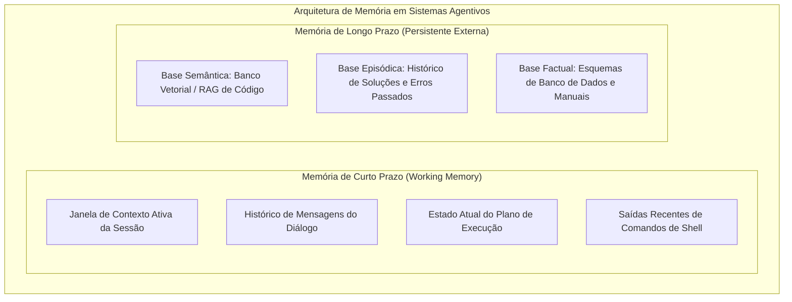
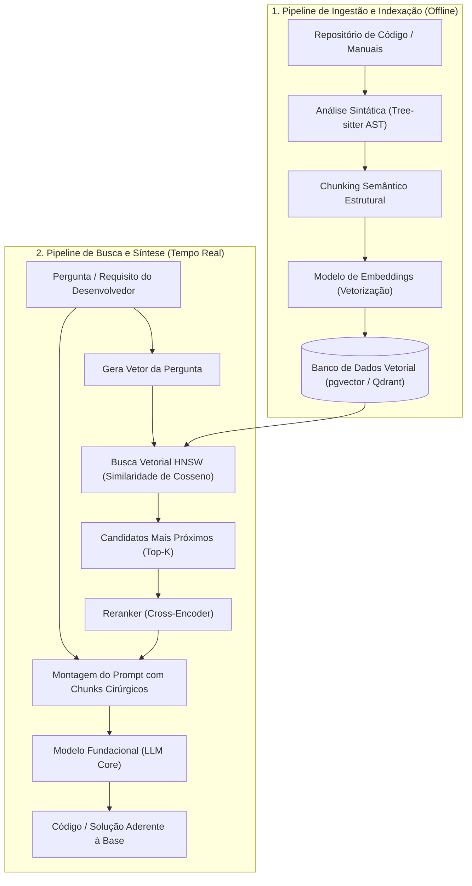
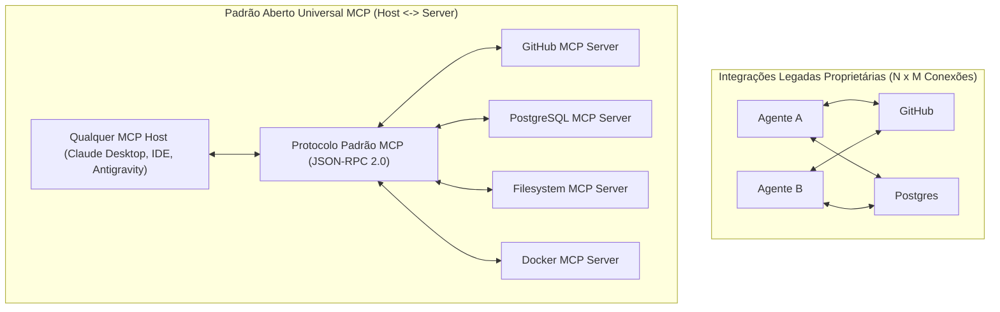
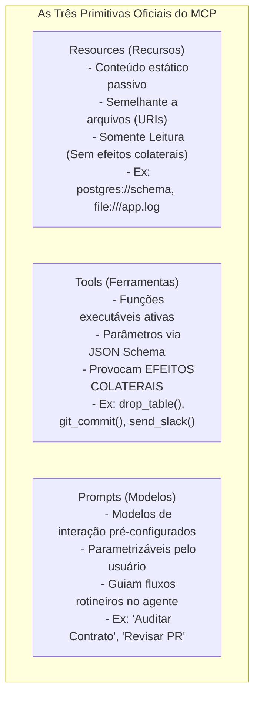
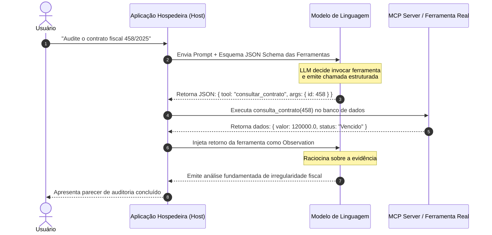

# 04 - RAG, Protocolo MCP, Skills e Ferramental de Agentes

> **Matéria:** Engenharia de Software Assistida por IA e Sistemas Agentivos  
> **Cargo:** B02 – Técnico de Controle Externo – Especialidade: Tecnologia da Informação  
> **Arquivo:** `04_rag_protocolo_mcp_skills_e_ferramental.md`  

---

## 📌 Ementa / Itens do Edital
- Gestão de contexto e memória em sistemas agentivos
- Recuperação Aumentada por Geração (Retrieval-Augmented Generation – RAG) e bancos de dados vetoriais
- Protocolos de interoperabilidade entre agentes e ferramentas: Model Context Protocol (MCP)
- Extensibilidade e automação de fluxos de trabalho especializados: Skills e Tool Use (Function Calling)

---

## 🧭 Sumário

1. [Gestão de Contexto e Memória em Sistemas Agentivos](#1-gestao-de-contexto-e-memoria-em-sistemas-agentivos)
    1. [Desafios da Janela de Contexto e a Degradação de Atenção](#11-desafios-da-janela-de-contexto-e-a-degradacao-de-atencao)
    2. [Memória de Curto Prazo (Working Memory) vs. Memória de Longo Prazo](#12-memoria-de-curto-prazo-working-memory-vs-memoria-de-longo-prazo)
    3. [Estratégias de Gestão: Sumarização Progressiva, Podagem e Prompt Caching](#13-estrategias-de-gestao-sumarizacao-progressiva-podagem-e-prompt-caching)
    4. [Teste 150](#Teste-150)
    5. [Teste 151](#Teste-151)
2. [Retrieval-Augmented Generation (RAG) Aplicado a Bases de Código](#2-retrieval-augmented-generation-rag-aplicado-a-bases-de-codigo)
    1. [Arquitetura e Pipeline de Ingestão de Código](#21-arquitetura-e-pipeline-de-ingestao-de-codigo)
    2. [O Desafio do Chunking Consciente de Sintaxe (AST-Based Chunking)](#22-o-desafio-do-chunking-consciente-de-sintaxe-ast-based-chunking)
    3. [Modelos de Embeddings e Bancos de Dados Vetoriais](#23-modelos-de-embeddings-e-bancos-de-dados-vetoriais)
    4. [Métricas de Proximidade Semântica e Similaridade de Cosseno](#24-metricas-de-proximidade-semantica-e-similaridade-de-cosseno)
    5. [Busca Híbrida (Dense + Sparse) e Técnicas de Reranking](#25-busca-hibrida-dense-sparse-e-tecnicas-de-reranking)
    6. [Matriz de Decisão Arquitetural: RAG vs. Fine-Tuning](#26-matriz-de-decisao-arquitetural-rag-vs-fine-tuning)
    7. [Teste 152](#Teste-152)
    8. [Teste 153](#Teste-153)
    9. [Teste 154](#Teste-154)
    10. [Teste 155](#Teste-155)
3. [O Protocolo Model Context Protocol (MCP)](#3-o-protocolo-model-context-protocol-mcp)
    1. [Motivação e Resolução do Problema de Integração N x M](#31-motivacao-e-resolucao-do-problema-de-integracao-n-x-m)
    2. [A Arquitetura Cliente-Servidor do MCP (Host, Client e Server)](#32-a-arquitetura-cliente-servidor-do-mcp-host-client-e-server)
    3. [As Três Primitivas Centrais: Resources, Tools e Prompts](#33-as-tres-primitivas-centrais-resources-tools-e-prompts)
    4. [Mecanismos de Transporte Padronizados: `stdio` e `SSE`](#34-mecanismos-de-transporte-padronizados-stdio-e-sse)
    5. [Teste 156](#Teste-156)
    6. [Teste 157](#Teste-157)
    7. [Teste 158](#Teste-158)
    8. [Teste 159](#Teste-159)
4. [Extensibilidade, Tool Use e Skills Especializadas](#4-extensibilidade-tool-use-e-skills-especializadas)
    1. [Funcionamento do Tool Use / Function Calling via JSON Schema](#41-funcionamento-do-tool-use-function-calling-via-json-schema)
    2. [Definição e Estrutura de Skills Modulares](#42-definicao-e-estrutura-de-skills-modulares)
    3. [Orquestração Multiagente e Segregação de Responsabilidades](#43-orquestracao-multiagente-e-segregacao-de-responsabilidades)
    4. [Teste 160](#Teste-160)
5. [Fontes Recomendadas na Internet](#5-fontes-recomendadas-na-internet)

---

## 1. Gestão de Contexto e Memória em Sistemas Agentivos

### 1.1 Desafios da Janela de Contexto e a Degradação de Atenção
A operação contínua de agentes de engenharia de software enfrenta restrições físicas e cognitivas no uso de Modelos de Linguagem de Grande Porte (LLMs):

- **Saturação de Tokens:** A cada comando executado, leitura de arquivo e retorno de teste, a janela de contexto acumula tokens de entrada (*input tokens*), elevando os custos financeiros da inferência e a latência de processamento.
- **Degradação de Atenção e Ruído:** Contextos excessivamente longos e desordenados dispersam a atenção dos mecanismos de autoatenção (*Self-Attention*), aumentando a probabilidade de esquecimento de restrições arquiteturais e ocorrência de alucinações.

### 1.2 Memória de Curto Prazo (Working Memory) vs. Memória de Longo Prazo

- **Memória de Curto Prazo (*Working Memory*):** Armazenada diretamente dentro da janela de contexto da chamada do LLM. É ultra-rápida e acessível diretamente pelos pesos de atenção, mas finita e descartada ao término da sessão de execução.
- **Memória de Longo Prazo (*Episódica e Semântica*):** Armazenada fora do modelo em bancos de dados relacionais, grafos de conhecimento ou bancos vetoriais especializados. Persiste indefinidamente entre diferentes sessões e dias de desenvolvimento, retendo decisões consolidadas de arquitetura e padrões corporativos.

### 1.3 Estratégias de Gestão: Sumarização Progressiva, Podagem e Prompt Caching
Para viabilizar fluxos agentivos em bases de código de milhões de linhas:

1. **Sumarização Progressiva (*Rolling Summarization*):** Conforme o diálogo avança, um subagente em segundo plano gera uma síntese executiva das decisões já tomadas e substitui dezenas de mensagens históricas anteriores por esse resumo conciso.
2. **Podagem de Contexto (*Context Pruning*):** Descarte cirúrgico de retornos de ferramentas que já cumpriram seu papel (ex.: expurgar os 500 kilobytes de log de um build bem-sucedido após a confirmação de sucesso).
3. **Prompt Caching:** Recurso disponibilizado pelos principais provedores de modelos (como Anthropic Claude), permitindo gravar em memória cache os prefixos estáticos da janela de contexto (como a leitura do código-fonte ou diretrizes institucionais). O *Prompt Caching* reduz o tempo de resposta em até 80% e corta em até 90% os custos de tokens de entrada em requisições consecutivas.

---

### Teste 150
**(FCC – TRT – Analista Judiciário - Tecnologia da Informação – 2024)**
O RPM Package Manager é um sistema executado em várias 
distribuições Linux e UNIX. 
O conjunto completo de modos básicos de operação do RPM é

* **A)** consulta, atualização e instalação de pacotes.
* **B)** instalação, atualização, criação e depuração de pacotes.
* **C)** valoração, reinstalação, consulta e desinstalação de pacotes.
* **D)** instalação, desinstalação, valoração, consulta, 
monitoramento e depuração de pacotes.
* **E)** criação, instalação, desinstalação, atualização, consulta e 
verificação de pacotes.

---

> **Comentário Detalhado:**
>
> - **A)** Incorreta. Discrepa das diretrizes normativas e jurisprudenciais aplicáveis ao tema objeto do item.
> - **B)** Incorreta. Discrepa das diretrizes normativas e jurisprudenciais aplicáveis ao tema objeto do item.
> - **C)** Incorreta. Discrepa das diretrizes normativas e jurisprudenciais aplicáveis ao tema objeto do item.
> - **D)** Incorreta. Discrepa das diretrizes normativas e jurisprudenciais aplicáveis ao tema objeto do item.
> - **E)** Correta. Representa com precisão a disciplina do tema e o entendimento pacificado adotado pela banca (FCC).
>
> **Gabarito: E**

---
### Teste 151
**(FCC – TRT-3 – Analista Judiciário - Tecnologia da Informação – 2015)**
Uma das inovações introduzidas na distribuição Linux Red Hat é a disponibilização de aplicativos e programas em formato de 
pacotes, o que facilita a instalação, se comparada ao processo original. Dentre os pacotes disponibilizados, o que fornece 
recursos para o esquema de autenticação unificada é o

* **A)** SSL.
* **B)** PAM.
* **C)** AES.
* **D)** PKI.
* **E)** Crypt.

---

> **Comentário Detalhado:**
>
> - **A)** Correta. Representa com precisão a disciplina do tema e o entendimento pacificado adotado pela banca (FCC).
> - **B)** Incorreta. Discrepa das diretrizes normativas e jurisprudenciais aplicáveis ao tema objeto do item.
> - **C)** Incorreta. Discrepa das diretrizes normativas e jurisprudenciais aplicáveis ao tema objeto do item.
> - **D)** Incorreta. Discrepa das diretrizes normativas e jurisprudenciais aplicáveis ao tema objeto do item.
> - **E)** Incorreta. Discrepa das diretrizes normativas e jurisprudenciais aplicáveis ao tema objeto do item.
>
> **Gabarito: A**

---
## 2. Retrieval-Augmented Generation (RAG) Aplicado a Bases de Código

### 2.1 Arquitetura e Pipeline de Ingestão de Código
O **RAG (Recuperação Aumentada por Geração)** conecta a inteligência de raciocínio de um LLM generalista a uma base proprietária, dinâmica e atualizada de código-fonte e manuais, sem demandar o re-treinamento dos parâmetros da rede neural.

### 2.2 O Desafio do Chunking Consciente de Sintaxe (AST-Based Chunking)
Dividir código-fonte através de fatiamento ingênuo por contagem fixa de caracteres ou linhas é um erro grave na engenharia de software: pode cortar uma função no meio, separar anotações de transação do método ou quebrar laços de repetição.

- **Chunking Baseado em AST (*Abstract Syntax Tree*):** Utiliza parsers gramaticais (como *Tree-sitter*) para recortar o arquivo respeitando suas fronteiras sintáticas reais:
    - Cada chunk encapsula um método completo, uma classe autocontida ou um bloco de interface com seus respectivos comentários;
    - Preserva no topo do chunk o caminho do arquivo, imports e declaração de pacote (*namespace*), assegurando contexto para o modelo de embeddings.

### 2.3 Modelos de Embeddings e Bancos de Dados Vetoriais
- **Embeddings:** Modelos neurais especializados que convertem fragmentos de texto ou código em vetores densos (arrays unidimensionais de números reais com 768 a 3072 dimensões). Trechos com semântica semelhante ficam espacialmente próximos no hiperplano vetorial.
- **Bancos de Dados Vetoriais:** Motores de persistência que organizam esses vetores com algoritmos de grafos de vizinhos mais próximos aproximados (**HNSW - *Hierarchical Navigable Small World***). Exemplos proeminentes:
    - **`pgvector`:** Extensão oficial que habilita busca vetorial nativa dentro do SGBD PostgreSQL relacional;
    - **Bancos Especializados:** Qdrant, Pinecone, Milvus, Chroma.

### 2.4 Métricas de Proximidade Semântica e Similaridade de Cosseno
A métrica canônica para avaliar a afinidade entre o vetor da consulta do desenvolvedor ($A$) e o vetor do trecho de código ($B$) é a **Similaridade de Cosseno**, que mede o cosseno do ângulo formado entre os dois vetores no espaço multidimensional:

$$\cos(\theta) = \frac{A \cdot B}{\|A\| \|B\|} = \frac{\sum_{i=1}^n A_i B_i}{\sqrt{\sum_{i=1}^n A_i^2} \sqrt{\sum_{i=1}^n B_i^2}}$$

- Varia entre $-1$ e $1$ (ou entre $0$ e $1$ para vetores não negativos);
- Avalia estritamente a orientação dos vetores, sendo imune a variações no tamanho do texto original;
- Se os vetores forem pré-normalizados na ingestão ($\|A\| = \|B\| = 1$), a similaridade equivale diretamente ao **produto escalar (*dot product*)**, reduzindo o custo computacional da consulta.

### 2.5 Busca Híbrida (Dense + Sparse) e Técnicas de Reranking
Bases de código dependem criticamente de nomes literais exatos (como o nome de uma constante `MAX_RETRY_TIMEOUT` ou a classe `AcordaoAuditoriaService`). A busca puramente semântica pode falhar ao identificar o identificador exato.

- **Busca Híbrida (*Hybrid Search*):** Combina em uma única operação a busca vetorial densa (conceitual) com a busca léxica tradicional baseada em frequência de termos (**BM25** ou Full-Text Search).
- **Reciprocal Rank Fusion (RRF):** Algoritmo matemático que mescla e equaliza as posições das duas listas de resultados.
- **Reranker (Cross-Encoder):** Modelo neural especializado que inspeciona detalhadamente os 20 melhores resultados preliminares, reordenando-os para selecionar os 3 a 5 chunks com mais alto grau de relevância antes da injeção no prompt final.

### 2.6 Matriz de Decisão Arquitetural: RAG vs. Fine-Tuning

| Critério de Decisão | Retrieval-Augmented Generation (RAG) | Fine-Tuning (Ajuste Fino Supervisionado) |
|---|---|---|
| **Natureza do Conhecimento** | **Factual, Dinâmico e Mutável:** Regras fiscais recentes, APIs internas, documentações de projeto. | **Estilo, Sintaxe e Forma:** Adaptação a DSLs proprietárias da empresa, formatos de resposta fixos. |
| **Frequência de Atualização** | Instantânea: basta gravar ou apagar o chunk no banco vetorial. | Lenta: requer curadoria de dataset, retreino supervisionado e validação de checkpoints. |
| **Auditabilidade e Fontes** | **Total:** Permite indicar o arquivo, autor e linha exata de onde a resposta foi extraída. | **Nula:** O conhecimento funde-se nos pesos probabilísticos dos parâmetros neurais (caixa-preta). |
| **Mitigação de Alucinações** | Altamente eficaz por ancorar a resposta em evidências concretas. | Moderada: pode alucinar se houver conflito entre dados antigos pré-treinados e novos dados. |
| **Custo Computacional** | Baixo a moderado (operações de embedding e banco vetorial). | Elevado (horas de treinamento em clusters de GPUs dedicadas). |

---

### Teste 152
**(FCC – TRT-1 – Analista Judiciário - Tecnologia da Informação – 2014)**
Na Arquitetura de Harvard a leitura de instruções e de alguns tipos de operandos pode ser realizada simultaneamente à 
execução das instruções. Assim, enquanto uma instrução é executada, a instrução seguinte é lida. Esse processo é conhecido 
como

* **A)** bufering
.
* **B)** dataflow
.
* **C)** pipelining
.
* **D)** processamento distribuído.
* **E)** processamento vetorial.

---

> **Comentário Detalhado:**
>
> - **A)** Correta. Representa com precisão a disciplina do tema e o entendimento pacificado adotado pela banca (FCC).
> - **B)** Incorreta. Discrepa das diretrizes normativas e jurisprudenciais aplicáveis ao tema objeto do item.
> - **C)** Incorreta. Discrepa das diretrizes normativas e jurisprudenciais aplicáveis ao tema objeto do item.
> - **D)** Incorreta. Discrepa das diretrizes normativas e jurisprudenciais aplicáveis ao tema objeto do item.
> - **E)** Incorreta. Discrepa das diretrizes normativas e jurisprudenciais aplicáveis ao tema objeto do item.
>
> **Gabarito: A**

---
### Teste 153
**(FGV – TRT – Analista Judiciário - Suporte e Infraestrutura de TI – 2022)**
A Lei Geral de Proteção de Dados Pessoais (LGPD) tem entre seus 
objetivos a proteção dos direitos fundamentais de liberdade e de 
privacidade da pessoa natural. A LGPD define o que são dados 
pessoais, classificando alguns como sensíveis, além de definir 
responsabilidades entre os manipuladores desses dados, 
obrigando os órgãos públicos e empresas privadas a adequarem 
seus processos para operarem em conformidade com a nova Lei.  
De acordo com o Art. 4º da LGPD, uma das exceções para o 
tratamento de dados pessoais é:

* **A)** que a atividade de tratamento tenha por objetivo a oferta ou 
o fornecimento de bens ou serviços ou o tratamento de 
dados de indivíduos localizados no território nacional;
* **B)** que os dados pessoais objeto do tratamento tenham sido 
coletados no território nacional com o consentimento do 
titular;
* **C)** que se destine à realização de estudos por órgão de pesquisa, 
garantida, sempre que possível, a anonimização dos dados 
pessoais;
* **D)** que seja realizado para fins exclusivos de atividades de 
investigação e repressão de infrações penais;
* **E)** que seja realizado para o exercício regular de direitos em 
processo judicial, administrativo ou arbitral  (nos termos da 
Lei nº 9.307/1996). 

Tribunal de Justiça do Distrito Federal e dos Territórios   FGV Conhecimento 

DISCURSIVAS

---

> **Comentário Detalhado:**
>
> - **A)** Incorreta. Discrepa das diretrizes normativas e jurisprudenciais aplicáveis ao tema objeto do item.
> - **B)** Correta. Representa com precisão a disciplina do tema e o entendimento pacificado adotado pela banca (FGV).
> - **C)** Incorreta. Discrepa das diretrizes normativas e jurisprudenciais aplicáveis ao tema objeto do item.
> - **D)** Incorreta. Discrepa das diretrizes normativas e jurisprudenciais aplicáveis ao tema objeto do item.
> - **E)** Incorreta. Discrepa das diretrizes normativas e jurisprudenciais aplicáveis ao tema objeto do item.
>
> **Gabarito: B**

---
### Teste 154
**(FGV – TJ-RR – Analista Judiciário - Governança e Gestão de TI – 2024)**
A computação em nuvem permite armazenamento, processamento 
e acesso flexível a dados e aplicações remotamente.  
Sobre os conceitos envolvidos na computação em nuvem, é correto 
afirmar que

* **A)** em nuvens públicas, os recursos de computação são hospedados 
em provedores externos, enquanto em nuvens privadas estes 
recursos devem ser hospedados localmente.
* **B)** modelos PaaS (Plataform as a Service) e IaaS (Infrastructure as a 
Service) só podem ser empregados em nuvens públicas.
* **C)** nuvens públicas permitem maior personalização graças ao 
acesso compartilhado da plataforma, ao contrário de nuvens 
privadas.
* **D)** modelos SaaS na nuvem privada são mais caros que na nuvem 
pública, porém modelos IaaS e PaaS apresentam custos 
semelhantes em ambos os tipos de nuvem.
* **E)** nuvens privadas minimizam ou eliminam o multitenancy, 
enquanto nas nuvens públicas o multitenancy é um conceito 
central.

---

> **Comentário Detalhado:**
>
> - **A)** Incorreta. Discrepa das diretrizes normativas e jurisprudenciais aplicáveis ao tema objeto do item.
> - **B)** Correta. Representa com precisão a disciplina do tema e o entendimento pacificado adotado pela banca (FGV).
> - **C)** Incorreta. Discrepa das diretrizes normativas e jurisprudenciais aplicáveis ao tema objeto do item.
> - **D)** Incorreta. Discrepa das diretrizes normativas e jurisprudenciais aplicáveis ao tema objeto do item.
> - **E)** Incorreta. Discrepa das diretrizes normativas e jurisprudenciais aplicáveis ao tema objeto do item.
>
> **Gabarito: B**

---
### Teste 155
**(FGV – TRT-DA 24-REGIÃO – Analista Judiciário - Tecnologia da Informação – 2025)**
Gisele, uma analista do judiciário, necessita alterar os scripts de 
inicialização e shutdown de um servidor de aplicação Tomcat. 
Sabe-se que a configuração do Tomcat versão 11 usou os 
diretórios padrão indicados pelo programa instalador. 
O diretório que contém esses scripts é o

* **A)** /bin.
* **B)** /init.
* **C)** /config.
* **D)** /scripts.
* **E)** /webapps.

---

> **Comentário Detalhado:**
>
> - **A)** Incorreta. Discrepa das diretrizes normativas e jurisprudenciais aplicáveis ao tema objeto do item.
> - **B)** Incorreta. Discrepa das diretrizes normativas e jurisprudenciais aplicáveis ao tema objeto do item.
> - **C)** Correta. Representa com precisão a disciplina do tema e o entendimento pacificado adotado pela banca (FGV).
> - **D)** Incorreta. Discrepa das diretrizes normativas e jurisprudenciais aplicáveis ao tema objeto do item.
> - **E)** Incorreta. Discrepa das diretrizes normativas e jurisprudenciais aplicáveis ao tema objeto do item.
>
> **Gabarito: C**

---
## 3. O Protocolo Model Context Protocol (MCP)

### 3.1 Motivação e Resolução do Problema de Integração N x M
Antes do surgimento do **Model Context Protocol (MCP)**, anunciado no final de 2024 pela Anthropic como um padrão aberto da indústria, o ecossistema de IA sofria com a proliferação caótica de integrações proprietárias: para cada nova aplicação de IA ($N$) conectar-se a cada fonte corporativa de dados ($M$), exigia-se um conector proprietário sob medida ($N \times M$ integrações).

### 3.2 A Arquitetura Cliente-Servidor do MCP (Host, Client e Server)
A especificação MCP é dividida em três papéis complementares:

1. **MCP Host:** A aplicação central que executa a interface e orquestra o LLM (ex.: Claude Desktop, Cursor, Antigravity CLI).
2. **MCP Client:** Módulo interno do host que estabelece e gerencia conexões 1:1 seguras e isoladas com os servidores.
3. **MCP Server:** Serviço leve e desacoplado que expõe dados locais ou remotos e encapsula as ferramentas de um domínio específico (ex.: servidor MCP do PostgreSQL, servidor MCP do Git).

### 3.3 As Três Primitivas Centrais: Resources, Tools e Prompts
O contrato funcional do MCP estabelece exatamente três entidades padronizadas:

| Primitiva | Comportamento Operacional | Finalidade no Desenvolvimento | Gera Efeitos Colaterais? |
|---|---|---|:---:|
| **`Resources`** | **Passivo / Somente Leitura** | Expor dados e documentos como arquivos virtuais (`file://`, `postgres://`) para leitura de contexto. | **Não** (Leitura idempotente). |
| **`Tools`** | **Ativo / Executável** | Funções com esquemas tipados que realizam ações reais no ambiente (gravar arquivos, rodar queries, disparar builds). | **Sim** (Pode alterar estado). |
| **`Prompts`** | **Modelos Parametrizados** | Roteiros pré-configurados pelo servidor para orientar a interação do usuário em rotinas especializadas. | **Não** (Template estruturado). |

> 🚨 **ALERTA DE PROVA / PEGADINHA FCC:**  
> A banca frequentemente inverte os papéis de **Resources** e **Tools**:  
>
> - **Resources NÃO EXECUTAM comandos nem alteram dados**! São exclusivamente fontes passivas de consulta e leitura de contexto.  
> - Toda e qualquer operação de modificação, exclusão de dados ou execução de comandos é de competência estrita das **Tools**!

### 3.4 Mecanismos de Transporte Padronizados: `stdio` e `SSE`
A especificação do MCP padroniza dois canais de comunicação utilizando mensagens serializadas em **JSON-RPC 2.0**:

- **`stdio` (Standard Input / Output):** Padrão oficial para servidores locais que rodam na mesma máquina do Host. O Host instancia o processo do servidor MCP como um subprocesso filho e comunica-se pelas vias de entrada e saída padrão do SO. É extremamente seguro, não abre portas de rede e é isolado pelo sistema de processos do computador.
- **`SSE` (*Server-Sent Events* sobre HTTP):** Padrão adotado para servidores remotos distribuídos em nuvem. Utiliza uma conexão HTTP persistente unidirecional para o streaming de eventos do servidor para o cliente, acompanhada por requisições HTTP POST para o envio de comandos do cliente para o servidor.

---

### Teste 156
**(FGV – TRT-DA 24-REGIÃO – Analista Judiciário - Tecnologia da Informação – 2025)**
Os achocolatados são misturas compostas por leite desidratado, 
chocolate em pó, açúcar e aditivos. 
Em sua composição, o achocolatado X tem 76 gramas de chocolate 
em pó e 12 gramas de açúcar, que correspondem a 6% da massa 
total de X. 
O fabricante do achocolatado X pretende aumentar a massa total 
do produto acrescentando 50 gramas de leite desidratado e nada 
mais. 
Essa modificação na composição do produto fará com que a 
porcentagem de chocolate em pó, com relação à massa total de X, 
sofra redução de

* **A)** 7,4%.
* **B)** 7,5%.
* **C)** 7,6%.
* **D)** 7,8%.
* **E)** 8,0%. 
TRIBUNAL REGIONAL DO TRABALHO DA 24ª REGIÃO (TRT-24) – REAPLICAÇÃO FGV CONHECIMENTO

---

> **Comentário Detalhado:**
>
> - **A)** Incorreta. Discrepa das diretrizes normativas e jurisprudenciais aplicáveis ao tema objeto do item.
> - **B)** Incorreta. Discrepa das diretrizes normativas e jurisprudenciais aplicáveis ao tema objeto do item.
> - **C)** Incorreta. Discrepa das diretrizes normativas e jurisprudenciais aplicáveis ao tema objeto do item.
> - **D)** Incorreta. Discrepa das diretrizes normativas e jurisprudenciais aplicáveis ao tema objeto do item.
> - **E)** Correta. Representa com precisão a disciplina do tema e o entendimento pacificado adotado pela banca (FGV).
>
> **Gabarito: E**

---
### Teste 157
**(FGV – TRF-1 – Analista Judiciário - Tecnologia da Informação – 2024)**
Ao final de uma exposição sobre medicamentos, o conferencista 
declara: “O melhor de todos os analgésicos é, sem dúvida, o 
NANDORE, pois foi o único a acabar com a minha dor”. 
Sobre a argumentação desse segmento, é correto afirmar que os 
argumentos apresentados:

* **A)** se fundamentam em bases científicas;
* **B)** são sólidos, já que fundamentados em vivências pessoais;
* **C)** procuram universalizar uma experiência individual;
* **D)** se apoiam em dados estatísticos;
* **E)** carecem de ética.

---

> **Comentário Detalhado:**
>
> - **A)** Incorreta. Discrepa das diretrizes normativas e jurisprudenciais aplicáveis ao tema objeto do item.
> - **B)** Incorreta. Discrepa das diretrizes normativas e jurisprudenciais aplicáveis ao tema objeto do item.
> - **C)** Correta. Representa com precisão a disciplina do tema e o entendimento pacificado adotado pela banca (FGV).
> - **D)** Incorreta. Discrepa das diretrizes normativas e jurisprudenciais aplicáveis ao tema objeto do item.
> - **E)** Incorreta. Discrepa das diretrizes normativas e jurisprudenciais aplicáveis ao tema objeto do item.
>
> **Gabarito: C**

---
### Teste 158
**(FGV – TRT – Analista Judiciário - Tecnologia da Informação – 2024)**
Alguns dos primeiros modelos de linguagem de larga escala 
desenvolvidos tendiam a gerar resultados incorretos com excesso 
de confiança, caracterizando o que se convencionou chamar de 
alucinações dos modelos. Uma estratégia de mitigação das 
alucinações é o uso da técnica de Geração Aumentada por 
Recuperação, ou Retrieval-Augmented Generation (RAG). 
A respeito da RAG, avalie as afirmativas a seguir. 
I. Baseia-se na combinação de sistemas de recuperação de 
informações e de modelos generativos capazes de produzir 
novos textos. 
II. Permite aos modelos buscarem informações relevantes em 
bases de dados mais confiáveis durante o processamento das 
consultas dos usuários ( user queries ), viabilizando melhor 
adequação a contextos e melhor qualidade das respostas. 
III. Não altera os parâmetros dos modelos generativos, e, 
portanto, não influencia o treinamento das redes neurais com 
informações recuperadas de bases de dados externas. 
Está correto o que se afirma em

* **A)** I, apenas.
* **B)** II, apenas.
* **C)** III, apenas.
* **D)** I e II, apenas.
* **E)** I, II e III.

---

> **Comentário Detalhado:**
>
> - **A)** Incorreta. Discrepa das diretrizes normativas e jurisprudenciais aplicáveis ao tema objeto do item.
> - **B)** Correta. Representa com precisão a disciplina do tema e o entendimento pacificado adotado pela banca (FGV).
> - **C)** Incorreta. Discrepa das diretrizes normativas e jurisprudenciais aplicáveis ao tema objeto do item.
> - **D)** Incorreta. Discrepa das diretrizes normativas e jurisprudenciais aplicáveis ao tema objeto do item.
> - **E)** Incorreta. Discrepa das diretrizes normativas e jurisprudenciais aplicáveis ao tema objeto do item.
>
> **Gabarito: B**

---
### Teste 159
**(FGV – TRT – Analista Judiciário - Tecnologia da Informação – 2024)**
Com o aumento do volume e da complexidade dos dados gerados 
em sistemas de informação atuais, cresce a necessidade de 
eficiência no armazenamento, segurança, recuperação de dados 
e disponibilidade. 
Nesse contexto, o algoritmo HNSW ( Hierarchical Navigable Small 
World) busca, ao ser aplicado em bases de dados de vetores,

* **A)** compactar dados para economizar espaço de 
armazenamento.
* **B)** buscar vetores semelhantes para acelerar a recuperação de 
informações.
* **C)** criptografar dados garantindo a segurança das informações.
* **D)** organizar dados em uma hierarquia de diretórios para 
facilitar o acesso.
* **E)** replicar dados em diferentes locais para alta disponibilidade.

---

> **Comentário Detalhado:**
>
> - **A)** Incorreta. Discrepa das diretrizes normativas e jurisprudenciais aplicáveis ao tema objeto do item.
> - **B)** Incorreta. Discrepa das diretrizes normativas e jurisprudenciais aplicáveis ao tema objeto do item.
> - **C)** Correta. Representa com precisão a disciplina do tema e o entendimento pacificado adotado pela banca (FGV).
> - **D)** Incorreta. Discrepa das diretrizes normativas e jurisprudenciais aplicáveis ao tema objeto do item.
> - **E)** Incorreta. Discrepa das diretrizes normativas e jurisprudenciais aplicáveis ao tema objeto do item.
>
> **Gabarito: C**

---
## 4. Extensibilidade, Tool Use e Skills Especializadas

### 4.1 Funcionamento do Tool Use / Function Calling via JSON Schema
O mecanismo de uso de ferramentas permite que um LLM transcenda o processamento puramente textual para orquestrar sistemas reais:

### 4.2 Definição e Estrutura de Skills Modulares
Uma **Skill** é um pacote autocontido de capacidades especializadas composto por:

- **Instruções de Domínio:** Diretrizes heurísticas de especialistas que ensinam o agente a pensar naquele contexto (ex.: normas regimentais do TCE-GO, critérios de auditoria contábil);
- **Ferramentas Dedicadas:** Mapeamento de funções executáveis expostas por servidores MCP ou scripts utilitários;
- **Recursos e Exemplos:** Manuais técnicos, modelos de documentos e casos de referência que orientam a qualidade final.

### 4.3 Orquestração Multiagente e Segregação de Responsabilidades
Em arquiteturas corporativas avançadas, a complexidade de um sistema de software não deve ser atribuída a um único agente sobrecarregado:

- **Agente Orquestrador (*Planner*):** Recebe o objetivo, divide o trabalho em etapas e delega subtarefas;
- **Subagentes Especialistas:** Operam em paralelo com ferramentas e permissões segregadas (ex.: um agente focado em pesquisa e documentação que só tem acesso de leitura via *Resources*, e outro agente de execução que possui permissão de escrita monitorada por *Human-in-the-Loop*).

---

### Teste 160
**(FCC – TRT – Analista Judiciário - Tecnologia da Informação – 2024)**
No contexto do Angular, considere o script a seguir. 
<body> 

 
ATENÇÃO: {{ param1 + " " + param2 }} 

 
 
</body> 
Analise o texto que é exibido no parágrafo quando esse script é 
executado.

* **A)** undefined
* **B)** ATENÇÃO:
* **C)** ATENÇÃO: Temperatura 30
* **D)** param1:Temperatura param2:30
* **E)** Temperatura 30

---

> **Comentário Detalhado:**
>
> - **A)** Incorreta. Discrepa das diretrizes normativas e jurisprudenciais aplicáveis ao tema objeto do item.
> - **B)** Incorreta. Discrepa das diretrizes normativas e jurisprudenciais aplicáveis ao tema objeto do item.
> - **C)** Incorreta. Discrepa das diretrizes normativas e jurisprudenciais aplicáveis ao tema objeto do item.
> - **D)** Correta. Representa com precisão a disciplina do tema e o entendimento pacificado adotado pela banca (FCC).
> - **E)** Incorreta. Discrepa das diretrizes normativas e jurisprudenciais aplicáveis ao tema objeto do item.
>
> **Gabarito: D**

---
## 5. Fontes Recomendadas na Internet

* [ArXiv - Retrieval-Augmented Generation for Knowledge-Intensive NLP Tasks (Lewis et al.)](https://arxiv.org/abs/2005.11401) - Artigo seminal da arquitetura RAG combinando recuperação vetorial densa e modelos neurais geradores.
* [Model Context Protocol (MCP) - Core Architecture & Specification](https://modelcontextprotocol.io/introduction) - Especificação formal de Resources, Prompts e Tools para sistemas agentivos.
* [OpenAI Platform - Embeddings Guide and Semantic Search](https://platform.openai.com/docs/guides/prompt-engineering) - Geração de representações vetoriais densas e busca semântica por similaridade de cosseno.
* [NIST AI Risk Management Framework (AI RMF 1.0)](https://www.nist.gov/itl/ai-risk-management-framework) - Validação de fontes de dados e ancoragem factual (*grounding*) contra alucinações.
* MANNING, Christopher D.; RAGHAVAN, Prabhakar; SCHÜTZE, Hinrich. **Introdução à Recuperação de Informação**. Cambridge: Cambridge University Press, 2008. (Cap. 6 - Pontuação de Similaridade e Espaços Vetoriais).
* HUYEN, Chip. **AI Engineering: Building Applications with Foundation Models**. Sebastopol: O'Reilly Media, 2025. (Cap. 4 - Retrieval-Augmented Generation and Vector Databases).
* JURAFSKY, Daniel; MARTIN, James H. **Speech and Language Processing**. 3. ed. Stanford University, 2024. (Cap. 14 - Vector Semantics and Embeddings).
