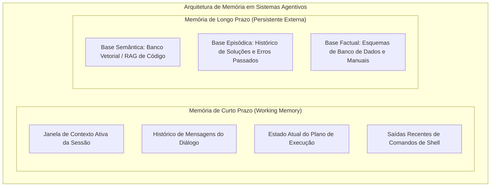
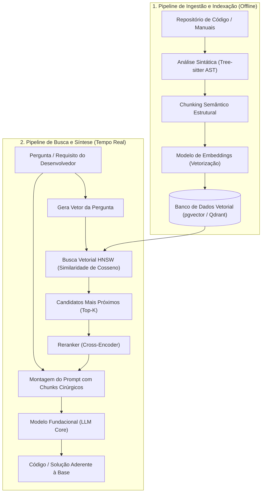
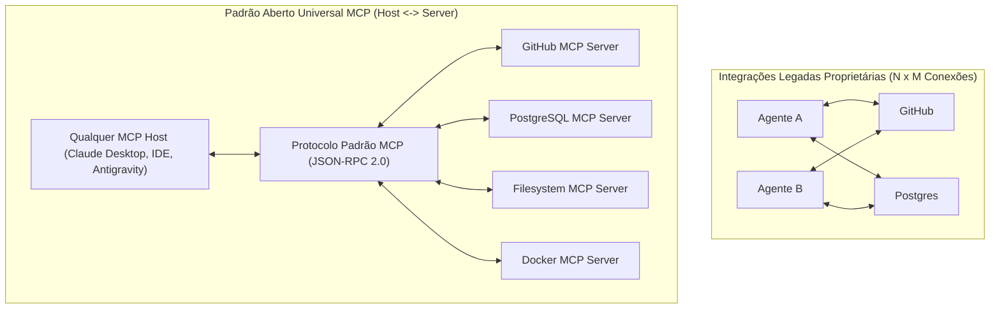
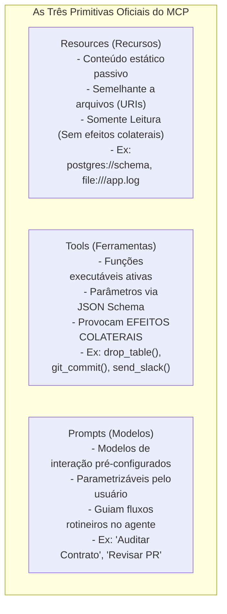
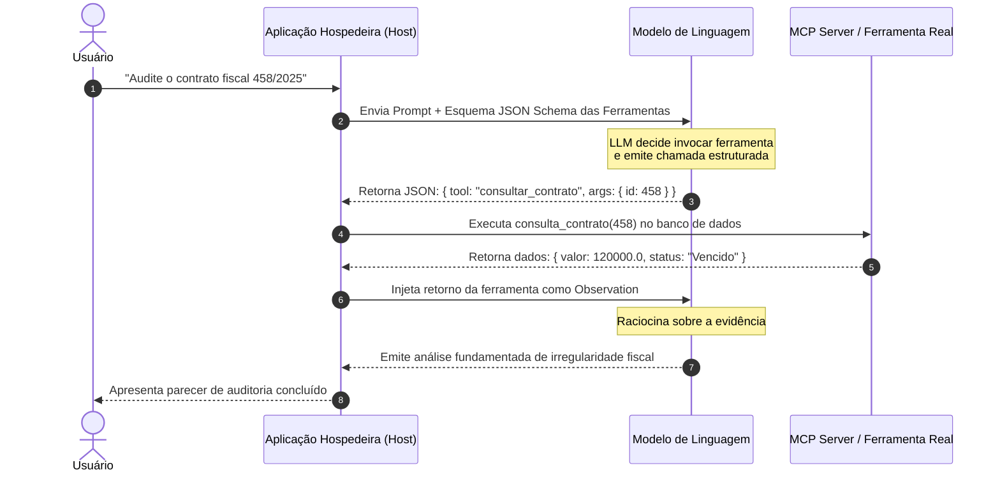

# 04 - RAG, Protocolo MCP, Skills e Ferramental de Agentes

> **Matéria:** Engenharia de Software Assistida por IA e Sistemas Agentivos  
> **Cargo:** B02 – Técnico de Controle Externo – Especialidade: Tecnologia da Informação  
> **Arquivo:** `04_rag_protocolo_mcp_skills_e_ferramental.md`  

---

## 📌 Ementa / Itens do Edital
- Gestão de contexto e memória em sistemas agentivos
- Recuperação Aumentada por Geração (Retrieval-Augmented Generation – RAG) e bancos de dados vetoriais
- Protocolos de interoperabilidade entre agentes e ferramentas: Model Context Protocol (MCP)
- Extensibilidade e automação de fluxos de trabalho especializados: Skills e Tool Use (Function Calling)

---

## 🧭 Sumário
- [1. Gestão de Contexto e Memória em Sistemas Agentivos](#1-gestao-de-contexto-e-memoria-em-sistemas-agentivos)
    - [1.1 Desafios da Janela de Contexto e a Degradação de Atenção](#11-desafios-da-janela-de-contexto-e-a-degradacao-de-atencao)
    - [1.2 Memória de Curto Prazo (Working Memory) vs. Memória de Longo Prazo](#12-memoria-de-curto-prazo-working-memory-vs-memoria-de-longo-prazo)
    - [1.3 Estratégias de Gestão: Sumarização Progressiva, Podagem e Prompt Caching](#13-estrategias-de-gestao-sumarizacao-progressiva-podagem-e-prompt-caching)
- [2. Retrieval-Augmented Generation (RAG) Aplicado a Bases de Código](#2-retrieval-augmented-generation-rag-aplicado-a-bases-de-codigo)
    - [2.1 Arquitetura e Pipeline de Ingestão de Código](#21-arquitetura-e-pipeline-de-ingestao-de-codigo)
    - [2.2 O Desafio do Chunking Consciente de Sintaxe (AST-Based Chunking)](#22-o-desafio-do-chunking-consciente-de-sintaxe-ast-based-chunking)
    - [2.3 Modelos de Embeddings e Bancos de Dados Vetoriais](#23-modelos-de-embeddings-e-bancos-de-dados-vetoriais)
    - [2.4 Métricas de Proximidade Semântica e Similaridade de Cosseno](#24-metricas-de-proximidade-semantica-e-similaridade-de-cosseno)
    - [2.5 Busca Híbrida (Dense + Sparse) e Técnicas de Reranking](#25-busca-hibrida-dense-sparse-e-tecnicas-de-reranking)
    - [2.6 Matriz de Decisão Arquitetural: RAG vs. Fine-Tuning](#26-matriz-de-decisao-arquitetural-rag-vs-fine-tuning)
- [3. O Protocolo Model Context Protocol (MCP)](#3-o-protocolo-model-context-protocol-mcp)
    - [3.1 Motivação e Resolução do Problema de Integração N x M](#31-motivacao-e-resolucao-do-problema-de-integracao-n-x-m)
    - [3.2 A Arquitetura Cliente-Servidor do MCP (Host, Client e Server)](#32-a-arquitetura-cliente-servidor-do-mcp-host-client-e-server)
    - [3.3 As Três Primitivas Centrais: Resources, Tools e Prompts](#33-as-tres-primitivas-centrais-resources-tools-e-prompts)
    - [3.4 Mecanismos de Transporte Padronizados: `stdio` e `SSE`](#34-mecanismos-de-transporte-padronizados-stdio-e-sse)
- [4. Extensibilidade, Tool Use e Skills Especializadas](#4-extensibilidade-tool-use-e-skills-especializadas)
    - [4.1 Funcionamento do Tool Use / Function Calling via JSON Schema](#41-funcionamento-do-tool-use-function-calling-via-json-schema)
    - [4.2 Definição e Estrutura de Skills Modulares](#42-definicao-e-estrutura-de-skills-modulares)
    - [4.3 Orquestração Multiagente e Segregação de Responsabilidades](#43-orquestracao-multiagente-e-segregacao-de-responsabilidades)
- [5. Fontes Recomendadas na Internet](#5-fontes-recomendadas-na-internet)

---

## 1. Gestão de Contexto e Memória em Sistemas Agentivos

### 1.1 Desafios da Janela de Contexto e a Degradação de Atenção
A operação contínua de agentes de engenharia de software enfrenta restrições físicas e cognitivas no uso de Modelos de Linguagem de Grande Porte (LLMs):

- **Saturação de Tokens:** A cada comando executado, leitura de arquivo e retorno de teste, a janela de contexto acumula tokens de entrada (*input tokens*), elevando os custos financeiros da inferência e a latência de processamento.
- **Degradação de Atenção e Ruído:** Contextos excessivamente longos e desordenados dispersam a atenção dos mecanismos de autoatenção (*Self-Attention*), aumentando a probabilidade de esquecimento de restrições arquiteturais e ocorrência de alucinações.

---

### Questão 01
**(FCC – Inédita – Padrão TCE-GO)**  
O mecanismo de autoatenção (*Self-Attention*) canônico da arquitetura Transformer calcula a relação entre todos os pares de tokens da sequência de entrada. Esse mecanismo acarreta, em termos de complexidade computacional teórica de tempo e memória em relação ao comprimento da sequência ($N$), uma taxa de crescimento:

* **A)** Linear: $O(N)$
* **B)** Logarítmica: $O(\log N)$
* **C)** Quadrática: $O(N^2)$
* **D)** Constante: $O(1)$
* **E)** Exponencial: $O(2^N)$

> **Comentário Detalhado:**
>
> - **A) Incorreta.** A atenção padrão não é linear em relação ao tamanho da sequência.
> - **B) Incorreta.** A complexidade logarítmica é típica de buscas em árvores balanceadas.
> - **C) Correta.** A matriz de atenção tradicional $QK^T$ compara cada um dos $N$ tokens contra todos os outros $N$ tokens da sequência, resultando em complexidade de tempo e memória estritamente quadrática $O(N^2)$. Esse crescimento exponencial impõe desafios severos de custo e latência para o processamento de repositórios massivos de código, motivando o uso de RAG e Prompt Caching.
> - **D) Incorreta.** Atenção não pode ser calculada em tempo constante.
> - **E) Incorreta.** O crescimento é polinomial de grau 2 ($N^2$), não exponencial.
>
> **Gabarito: C**

---

### 1.2 Memória de Curto Prazo (Working Memory) vs. Memória de Longo Prazo

- **Memória de Curto Prazo (*Working Memory*):** Armazenada diretamente dentro da janela de contexto da chamada do LLM. É ultra-rápida e acessível diretamente pelos pesos de atenção, mas finita e descartada ao término da sessão de execução.
- **Memória de Longo Prazo (*Episódica e Semântica*):** Armazenada fora do modelo em bancos de dados relacionais, grafos de conhecimento ou bancos vetoriais especializados. Persiste indefinidamente entre diferentes sessões e dias de desenvolvimento, retendo decisões consolidadas de arquitetura e padrões corporativos.

---

### 1.3 Estratégias de Gestão: Sumarização Progressiva, Podagem e Prompt Caching
Para viabilizar fluxos agentivos em bases de código de milhões de linhas:

1. **Sumarização Progressiva (*Rolling Summarization*):** Conforme o diálogo avança, um subagente em segundo plano gera uma síntese executiva das decisões já tomadas e substitui dezenas de mensagens históricas anteriores por esse resumo conciso.
2. **Podagem de Contexto (*Context Pruning*):** Descarte cirúrgico de retornos de ferramentas que já cumpriram seu papel (ex.: expurgar os 500 kilobytes de log de um build bem-sucedido após a confirmação de sucesso).
3. **Prompt Caching:** Recurso disponibilizado pelos principais provedores de modelos (como Anthropic Claude), permitindo gravar em memória cache os prefixos estáticos da janela de contexto (como a leitura do código-fonte ou diretrizes institucionais). O *Prompt Caching* reduz o tempo de resposta em até 80% e corta em até 90% os custos de tokens de entrada em requisições consecutivas.

---

### Questão 02
**(Cebraspe – TRF/STJ – 2024/2025 – Adaptada para o padrão FCC)**  
No desenvolvimento assistido por agentes em repositórios corporativos de grande porte, a técnica de *Prompt Caching* (disponibilizada por provedores de LLMs avançados) proporciona economia expressiva de tempo e custo financeiro. O funcionamento e benefício central do *Prompt Caching* reside no fato de que:

* **A)** O modelo de linguagem armazena em disco o código-fonte gerado em linguagem binária pura.
* **B)** Prefixos idênticos de prompts longos (como documentações do sistema, esquemas de bancos de dados e instruções de agentes) são mantidos em cache na memória de aceleração das GPUs dos servidores de inferência, permitindo processar requisições subsequentes com até 90% de desconto no custo de tokens e latência drasticamente reduzida.
* **C)** O agente é proibido de realizar novas consultas de código durante 24 horas consecutivas.
* **D)** Todos os tokens em cache são permanentemente destruídos caso o usuário feche a IDE.
* **E)** O sistema passa a funcionar em modo offline sem consumo de memória primária.

> **Comentário Detalhado:**
>
> - **A) Incorreta.** O cache de prompt armazena as chaves e valores (*KV Cache*) das camadas de atenção dos tokens previamente processados.
> - **B) Correta.** O *Prompt Caching* evita o recálculo redundante dos estados de atenção para trechos de contexto fixos compartilhados entre múltiplas interações, barateando custos em até 90% e reduzindo o tempo até o primeiro token (*Time To First Token* - TTFT).
> - **C) Incorreta.** O cache é revalidado e reutilizado continuamente em tempo real.
> - **D) Incorreta.** O cache do servidor é mantido por tempo determinado (TTL) independentemente do cliente local.
> - **E) Incorreta.** Modelos de ponta em nuvem continuam operando online.
>
> **Gabarito: B**

---

## 2. Retrieval-Augmented Generation (RAG) Aplicado a Bases de Código

### 2.1 Arquitetura e Pipeline de Ingestão de Código
O **RAG (Recuperação Aumentada por Geração)** conecta a inteligência de raciocínio de um LLM generalista a uma base proprietária, dinâmica e atualizada de código-fonte e manuais, sem demandar o re-treinamento dos parâmetros da rede neural.

---

### Questão 03 (FCC - Adaptada / TI - RAG e Bancos de Dados Vetoriais)
Uma instituição pública precisa capacitar um agente de IA para analisar e auditar a conformidade de novos softwares em relação a um gigantesco repositório corporativo que contém milhões de linhas de código e dezenas de manuais técnicos que sofrem atualizações diárias.

Para permitir que a IA consulte essas informações atualizadas com alta precisão e custo sustentável, mantendo a integridade semântica do código, a equipe deve adotar:  

* **A)** O retreinamento completo (*Full Pre-training*) dos pesos de um modelo fundacional a cada nova alteração de commit no repositório Git.
* **B)** Uma arquitetura de RAG (*Retrieval-Augmented Generation*), realizando o fracionamento (*chunking*) do código com base na Árvore de Sintaxe Abstrata (AST) para preservar blocos lógicos inteiros (como classes e funções), gerando embeddings armazenados em um banco vetorial para busca semântica em tempo de inferência.
* **C)** A conversão de todos os arquivos de código-fonte em um único prompt contínuo de texto sem chunking, submetendo-o a modelos sem janela de contexto delimitada.
* **D)** O particionamento arbitrário de código em blocos fixos de 10 linhas de texto, ignorando a estrutura sintática de métodos e classes, para maximizar o índice de acerto da busca léxica.
* **E)** A técnica de *Fine-Tuning* supervisionado com exclusão de qualquer banco de dados vetorial, visto que embeddings numéricos são incapazes de representar proximidade semântica entre termos técnicos.

> **Comentário Detalhado:**
>
> - **A)** Incorreta. O pré-treinamento completo de um modelo fundacional consome milhões de dólares e semanas de processamento em supercomputadores, sendo totalmente inviável para acomodar atualizações diárias de código.
> - **B)** **CORRETA.** A arquitetura RAG viabiliza a atualização dinâmica e contínua do conhecimento factual sem retreino de pesos. O fatiamento estruturado com base na Árvore de Sintaxe Abstrata (AST) garante que classes e funções sejam preservadas em blocos lógicos coesos, produzindo embeddings representativos indexados em bancos vetoriais para busca por similaridade de cosseno.
> - **C)** Incorreta. Submeter milhões de linhas em um único prompt ultrapassa a capacidade prática das janelas de contexto, gera custos financeiros inviáveis e sofre severa degradação posicional de atenção (*Lost in the Middle*).
> - **D)** Incorreta. O fatiamento arbitrário por contagem de linhas quebra funções ao meio e desassocia assinaturas de parâmetros, destruindo a semântica do código nos embeddings.
> - **E)** Incorreta. Embeddings numéricos são o fundamento matemático consagrado da representação semântica vetorial, e o Fine-Tuning é inadequado para bases de conhecimento factual em constante atualização.
> 
> **Gabarito: B**

---

### 2.2 O Desafio do Chunking Consciente de Sintaxe (AST-Based Chunking)
Dividir código-fonte através de fatiamento ingênuo por contagem fixa de caracteres ou linhas é um erro grave na engenharia de software: pode cortar uma função no meio, separar anotações de transação do método ou quebrar laços de repetição.

- **Chunking Baseado em AST (*Abstract Syntax Tree*):** Utiliza parsers gramaticais (como *Tree-sitter*) para recortar o arquivo respeitando suas fronteiras sintáticas reais:
    - Cada chunk encapsula um método completo, uma classe autocontida ou um bloco de interface com seus respectivos comentários;
    - Preserva no topo do chunk o caminho do arquivo, imports e declaração de pacote (*namespace*), assegurando contexto para o modelo de embeddings.

---

### Questão 04
**(FCC – Inédita – Padrão TCE-GO)**  
Na preparação de uma base de código-fonte para indexação e recuperação semântica em pipelines de RAG (*Retrieval-Augmented Generation*), a técnica de divisão de texto (*chunking*) baseada em Árvore Sintática Abstrata (*AST-Based Chunking*) apresenta superioridade técnica sobre a divisão ingênua por quantidade fixa de caracteres porque:

* **A)** Converte todo o código para linguagem natural antes da criação dos vetores de embeddings.
* **B)** Respeita os limites gramaticais e estruturais da linguagem de programação, garantindo que funções inteiras, métodos de classes e blocos lógicos coesos não sejam truncados arbitrariamente no meio de expressões, preservando o contexto semântico e as assinaturas completas.
* **C)** Exige que cada arquivo do projeto contenha no máximo 10 linhas de código.
* **D)** Desconsidera a sintaxe da linguagem para unificar códigos Python e Java na mesma tabela relacional.
* **E)** Aumenta o tamanho dos arquivos em 1000% para ocupar todo o espaço do banco de dados vetorial.

> **Comentário Detalhado:**
>
> - **A) Incorreta.** O código é indexado em sua estrutura de linguagem de programação nativa.
> - **B) Correta.** O particionamento ingênuo por tamanho fixo (ex: 500 caracteres) costuma cortar métodos ao meio, separando a assinatura dos tipos ou isolando o corpo da função. O chunking baseado em AST usa o parser da linguagem (ex: Tree-sitter) para segmentar o código exatamente nas fronteiras naturais de nós sintáticos (classes, funções, interfaces), preservando integridade semântica para os modelos de embedding.
> - **C) Incorreta.** Não há imposição de tamanho máximo de arquivo no código original.
> - **D) Incorreta.** Respeita a sintaxe formal de cada linguagem.
> - **E) Incorreta.** Afirmação sem lógica técnica.
>
> **Gabarito: B**

---

### 2.3 Modelos de Embeddings e Bancos de Dados Vetoriais
- **Embeddings:** Modelos neurais especializados que convertem fragmentos de texto ou código em vetores densos (arrays unidimensionais de números reais com 768 a 3072 dimensões). Trechos com semântica semelhante ficam espacialmente próximos no hiperplano vetorial.
- **Bancos de Dados Vetoriais:** Motores de persistência que organizam esses vetores com algoritmos de grafos de vizinhos mais próximos aproximados (**HNSW - *Hierarchical Navigable Small World***). Exemplos proeminentes:
    - **`pgvector`:** Extensão oficial que habilita busca vetorial nativa dentro do SGBD PostgreSQL relacional;
    - **Bancos Especializados:** Qdrant, Pinecone, Milvus, Chroma.

---

### 2.4 Métricas de Proximidade Semântica e Similaridade de Cosseno
A métrica canônica para avaliar a afinidade entre o vetor da consulta do desenvolvedor ($A$) e o vetor do trecho de código ($B$) é a **Similaridade de Cosseno**, que mede o cosseno do ângulo formado entre os dois vetores no espaço multidimensional:

$$\cos(\theta) = \frac{A \cdot B}{\|A\| \|B\|} = \frac{\sum_{i=1}^n A_i B_i}{\sqrt{\sum_{i=1}^n A_i^2} \sqrt{\sum_{i=1}^n B_i^2}}$$

- Varia entre $-1$ e $1$ (ou entre $0$ e $1$ para vetores não negativos);
- Avalia estritamente a orientação dos vetores, sendo imune a variações no tamanho do texto original;
- Se os vetores forem pré-normalizados na ingestão ($\|A\| = \|B\| = 1$), a similaridade equivale diretamente ao **produto escalar (*dot product*)**, reduzindo o custo computacional da consulta.

---

### 2.5 Busca Híbrida (Dense + Sparse) e Técnicas de Reranking
Bases de código dependem criticamente de nomes literais exatos (como o nome de uma constante `MAX_RETRY_TIMEOUT` ou a classe `AcordaoAuditoriaService`). A busca puramente semântica pode falhar ao identificar o identificador exato.

- **Busca Híbrida (*Hybrid Search*):** Combina em uma única operação a busca vetorial densa (conceitual) com a busca léxica tradicional baseada em frequência de termos (**BM25** ou Full-Text Search).
- **Reciprocal Rank Fusion (RRF):** Algoritmo matemático que mescla e equaliza as posições das duas listas de resultados.
- **Reranker (Cross-Encoder):** Modelo neural especializado que inspeciona detalhadamente os 20 melhores resultados preliminares, reordenando-os para selecionar os 3 a 5 chunks com mais alto grau de relevância antes da injeção no prompt final.

---

### Questão 05 (FCC - Padrão Concursos TI / Busca Híbrida e Similaridade de Cosseno)
Em um sistema de busca semântica de código para auditoria governamental baseado em banco de dados vetorial, um arquiteto implementou uma estratégia de Busca Híbrida (*Hybrid Search*).

A justificativa técnica para a adoção da Busca Híbrida em vez da busca vetorial pura em repositórios de software é:  

* **A)** A busca vetorial pura é incapaz de processar vetores com mais de três dimensões matemáticas.
* **B)** A busca híbrida combina a recuperação semântica densa (baseada em embeddings e similaridade de cosseno) com a busca textual esparsa tradicional (como BM25 ou busca full-text), garantindo tanto a compreensão conceitual quanto o casamento exato de identificadores literais, nomes de tabelas e códigos de erro específicos.
* **C)** A busca híbrida substitui os bancos de dados vetoriais por fitas magnéticas analógicas para reduzir o consumo de energia.
* **D)** O uso de busca esparsa impede qualquer tentativa de injeção de prompt por parte de usuários maliciosos.
* **E)** A similaridade de cosseno mede exclusivamente o número de caracteres coincidentes entre duas strings semânticas em ordem alfabética.

> **Comentário Detalhado:**
>
> - **A)** Incorreta. Modelos modernos de embeddings operam em hiperplanos vetoriais com milhares de dimensões (ex.: 768, 1536 ou 3072 floats).
> - **B)** **CORRETA.** Repositórios de código contêm identificadores literais rígidos (como nomes de classes `ProcessoTceDTO`, constantes e códigos de erro) que podem ter baixa representatividade semântica vetorial pura. A **Busca Híbrida** integra a busca semântica densa (compreensão de conceitos afins via similaridade de cosseno) com a busca esparsa tradicional (BM25 / Full-Text Search para casamento literal exato), fundindo os rankings com máxima precisão.
> - **C)** Incorreta. Proposição fantasiosa sem respaldo computacional.
> - **D)** Incorreta. A busca esparsa é um método de indexação e recuperação léxica, não uma ferramenta de segurança contra injeção de prompt.
> - **E)** Incorreta. A similaridade de cosseno calcula o cosseno do ângulo formado entre dois vetores numéricos multidimensionais, não uma contagem de caracteres alfabéticos.
> 
> **Gabarito: B**

---

### 2.6 Matriz de Decisão Arquitetural: RAG vs. Fine-Tuning

| Critério de Decisão | Retrieval-Augmented Generation (RAG) | Fine-Tuning (Ajuste Fino Supervisionado) |
|---|---|---|
| **Natureza do Conhecimento** | **Factual, Dinâmico e Mutável:** Regras fiscais recentes, APIs internas, documentações de projeto. | **Estilo, Sintaxe e Forma:** Adaptação a DSLs proprietárias da empresa, formatos de resposta fixos. |
| **Frequência de Atualização** | Instantânea: basta gravar ou apagar o chunk no banco vetorial. | Lenta: requer curadoria de dataset, retreino supervisionado e validação de checkpoints. |
| **Auditabilidade e Fontes** | **Total:** Permite indicar o arquivo, autor e linha exata de onde a resposta foi extraída. | **Nula:** O conhecimento funde-se nos pesos probabilísticos dos parâmetros neurais (caixa-preta). |
| **Mitigação de Alucinações** | Altamente eficaz por ancorar a resposta em evidências concretas. | Moderada: pode alucinar se houver conflito entre dados antigos pré-treinados e novos dados. |
| **Custo Computacional** | Baixo a moderado (operações de embedding e banco vetorial). | Elevado (horas de treinamento em clusters de GPUs dedicadas). |

---

### Questão 06 (FCC - Padrão Concursos TI / RAG vs Fine-Tuning em Engenharia de Software)
Em um projeto de automação fiscal na Secretaria da Fazenda, a equipe técnica precisa decidir entre a adoção de uma arquitetura de RAG (Geração Aumentada por Recuperação) e o processo de Fine-Tuning supervisionado de um modelo de linguagem aberto.

Sobre os critérios comparativos que orientam essa escolha técnica, assinale a afirmativa correta:  

* **A)** O Fine-Tuning é a melhor escolha para dados factuais altamente voláteis, pois a atualização de tabelas de alíquotas diárias no modelo dispensa custos computacionais de treino.
* **B)** O RAG possui total auditabilidade e rastreabilidade, permitindo indicar com precisão cirúrgica quais arquivos de código e trechos normativos foram recuperados e inseridos no contexto para fundamentar a resposta gerada.
* **C)** O Fine-Tuning elimina completamente a ocorrência de alucinações, enquanto o RAG necessariamente multiplica as alucinações ao introduzir textos externos.
* **D)** Modelos submetidos a RAG perdem permanentemente a capacidade de gerar código sintaticamente válido na linguagem Python.
* **E)** O RAG exige a alteração dos pesos sinápticos do modelo em cada requisição de busca vetorial efetuada pelo usuário.

> **Comentário Detalhado:**
>
> - **A)** Incorreta. O Fine-Tuning é desaconselhado para dados factuais voláteis, pois exige pipeline custoso de re-treinamento com retropropagação a cada atualização de dado. Dados dinâmicos devem ser mantidos via RAG.
> - **B)** **CORRETA.** No RAG, a recuperação de evidências é auditável e explícita: os trechos extraídos do banco vetorial são inseridos de forma visível no prompt de contexto, permitindo citar e auditar o arquivo, linha e documento normativo que respaldaram a resposta gerada.
> - **C)** Incorreta. O Fine-Tuning não impede alucinações e pode sofrer com esquecimento catastrófico; o RAG é a técnica primordial para mitigação de alucinações por ancorar a resposta em contexto factual verificado.
> - **D)** Incorreta. O RAG opera apenas enriquecendo o contexto, mantendo intactas as capacidades de programação e fluência sintática do modelo fundacional.
> - **E)** Incorreta. O RAG opera exclusivamente em tempo de inferência (*runtime*), sem alterar nenhum peso neural do modelo.
> 
> **Gabarito: B**

---

## 3. O Protocolo Model Context Protocol (MCP)

### 3.1 Motivação e Resolução do Problema de Integração N x M
Antes do surgimento do **Model Context Protocol (MCP)**, anunciado no final de 2024 pela Anthropic como um padrão aberto da indústria, o ecossistema de IA sofria com a proliferação caótica de integrações proprietárias: para cada nova aplicação de IA ($N$) conectar-se a cada fonte corporativa de dados ($M$), exigia-se um conector proprietário sob medida ($N \times M$ integrações).

---

### 3.2 A Arquitetura Cliente-Servidor do MCP (Host, Client e Server)
A especificação MCP é dividida em três papéis complementares:

1. **MCP Host:** A aplicação central que executa a interface e orquestra o LLM (ex.: Claude Desktop, Cursor, Antigravity CLI).
2. **MCP Client:** Módulo interno do host que estabelece e gerencia conexões 1:1 seguras e isoladas com os servidores.
3. **MCP Server:** Serviço leve e desacoplado que expõe dados locais ou remotos e encapsula as ferramentas de um domínio específico (ex.: servidor MCP do PostgreSQL, servidor MCP do Git).

---

### Questão 07
**(Cebraspe – TRF/STJ – 2024/2025 – Adaptada para o padrão FCC)**  
O Model Context Protocol (MCP), padrão aberto introduzido para estabelecer interoperabilidade universal entre assistentes de IA e fontes de dados/ferramentas externas, estrutura-se em uma arquitetura cliente-servidor clara. Em relação às responsabilidades de cada entidade no ecossistema MCP, é correto afirmar:

* **A)** O MCP Server é a IDE ou interface de chat que exibe a tela para o usuário final.
* **B)** O MCP Host é a aplicação que coordena a interação (como o Antigravity ou Claude Desktop), que contém clientes MCP (*MCP Clients*) responsáveis por estabelecer conexões 1:1 seguras com múltiplos servidores MCP (*MCP Servers*), os quais expõem recursos de dados (*Resources*), ferramentas executáveis (*Tools*) e instruções (*Prompts*).
* **C)** O protocolo MCP só permite conexão com um único servidor externo por computador.
* **D)** O MCP Client executa todo o código-fonte em linguagem COBOL no servidor do provedor da nuvem.
* **E)** O MCP Server não pode se comunicar com bancos de dados relacionais como PostgreSQL ou MySQL.

> **Comentário Detalhado:**
>
> - **A) Incorreta.** A aplicação que interage com o usuário final é o MCP Host.
> - **B) Correta.** A arquitetura oficial do MCP define:
>   - **MCP Host:** a aplicação central de IA (IDE, agente, interface de chat);
>   - **MCP Client:** cliente interno que mantém conexões com os servidores MCP respeitando limites de permissão;
>   - **MCP Server:** serviço leve que expõe ferramentas (*Tools*), dados contextuais (*Resources*) e modelos de mensagens (*Prompts*).
> - **C) Incorreta.** Uma das grandes soluções do MCP é justamente resolver o problema $N \times M$, conectando múltiplos servidores simultaneamente.
> - **D) Incorreta.** Agnosticismo absoluto de linguagens.
> - **E) Incorreta.** Servidores MCP de bancos de dados relacionais (Postgres, SQLite, BigQuery) são dos mais utilizados.
>
> **Gabarito: B**

---

### 3.3 As Três Primitivas Centrais: Resources, Tools e Prompts
O contrato funcional do MCP estabelece exatamente três entidades padronizadas:

| Primitiva | Comportamento Operacional | Finalidade no Desenvolvimento | Gera Efeitos Colaterais? |
|---|---|---|:---:|
| **`Resources`** | **Passivo / Somente Leitura** | Expor dados e documentos como arquivos virtuais (`file://`, `postgres://`) para leitura de contexto. | **Não** (Leitura idempotente). |
| **`Tools`** | **Ativo / Executável** | Funções com esquemas tipados que realizam ações reais no ambiente (gravar arquivos, rodar queries, disparar builds). | **Sim** (Pode alterar estado). |
| **`Prompts`** | **Modelos Parametrizados** | Roteiros pré-configurados pelo servidor para orientar a interação do usuário em rotinas especializadas. | **Não** (Template estruturado). |

> 🚨 **ALERTA DE PROVA / PEGADINHA FCC:**  
> A banca frequentemente inverte os papéis de **Resources** e **Tools**:  
>
> - **Resources NÃO EXECUTAM comandos nem alteram dados**! São exclusivamente fontes passivas de consulta e leitura de contexto.  
> - Toda e qualquer operação de modificação, exclusão de dados ou execução de comandos é de competência estrita das **Tools**!

---

### Questão 08 (FCC - Adaptada / TI - Model Context Protocol e Interoperabilidade)
No desenvolvimento de ecossistemas corporativos baseados em inteligência artificial, a proliferação de integrações proprietárias ponto-a-ponto entre assistentes inteligentes e sistemas legados motivou a criação do protocolo aberto *Model Context Protocol* (MCP).

A respeito da arquitetura, primitivas e funcionamento do protocolo MCP, assinale a afirmativa correta:  

* **A)** O MCP é um protocolo proprietário e fechado cujo funcionamento restringe-se exclusivamente à execução de scripts Python em ambientes isolados na nuvem.
* **B)** Na arquitetura do MCP, o *MCP Host* conecta-se a múltiplos *MCP Servers*, que expõem padronizadamente três primitivas essenciais: *Resources* (dados passivos que podem ser lidos), *Tools* (funções executáveis que realizam ações ou consultas) e *Prompts* (templates de mensagens pré-configurados).
* **C)** As primitivas denominadas *Tools* no MCP servem exclusivamente para exibir documentação estática ao usuário final, sendo vedada a chamada a APIs de backend ou operações com efeitos colaterais.
* **D)** O transporte padrão para comunicação entre clientes e servidores locais no MCP utiliza exclusivamente websockets não autenticados, sendo proibida a comunicação via `stdio` (entrada/saída padrão de processos).
* **E)** A utilização do MCP dispensa o modelo de IA de interpretar parâmetros em esquemas JSON Schema, delegando a tipagem de dados integralmente ao sistema operacional hospedeiro.

> **Comentário Detalhado:**
>
> - **A)** Incorreta. O MCP é um padrão aberto (*open standard*) multiplataforma e neutro, com SDKs oficiais para TypeScript, Python, Kotlin e suporte comunitário para diversas outras linguagens.
> - **B)** **CORRETA.** A arquitetura do MCP estrutura-se em Host (aplicação consumidora), Client (camada de transporte) e Server (provedor de dados e serviços). Os servidores expõem formalmente três primitivas canônicas:
>     1. **Resources** (dados somente-leitura)
>     2. **Tools** (funções executáveis ativas que produzem efeitos colaterais)
>     3. **Prompts** (templates de mensagens parametrizáveis).
>
> - **C)** Incorreta. *Tools* são precisamente os recursos executáveis com parâmetros validados por esquema que permitem disparar ações ativas (gravar dados, executar comandos no shell, interagir com APIs externas). Dados passivos de leitura são mapeados como *Resources*.
> - **D)** Incorreta. Para servidores que operam localmente na mesma máquina, o transporte padrão e prioritário do MCP é o **`stdio`** (Standard Input/Output). Para servidores remotos em rede, adota-se **`SSE`** (*Server-Sent Events*) sobre HTTP.
> - **E)** Incorreta. O MCP depende fundamentalmente da validação rigorosa de tipos e parâmetros estruturados através de contratos em **JSON Schema**.
> 
> **Gabarito: B**

---

### Questão 09 (FCC - Padrão Concursos TI / Primitivas e Segurança no Model Context Protocol)
Em uma auditoria de segurança da informação sobre uma solução corporativa que utiliza o *Model Context Protocol* (MCP) para conectar agentes de IA ao banco de dados PostgreSQL e ao repositório Git institucional, foi avaliado o risco de execução indevida de comandos de alteração estrutural.

Considerando o funcionamento das primitivas e a governança do MCP, a equipe de auditoria deve verificar se:  

* **A)** As operações com potencial de alteração ou exclusão de dados e código foram implementadas exclusivamente através da primitiva *Resources*, sem permissões de rede.
* **B)** O agente de IA tem autorização para invocar primitivas *Tools* com ações destrutivas (como drops de tabelas ou commits forçados) de maneira autônoma e irrestrita, sem validação de parâmetros ou supervisão humana (*Human-in-the-Loop*).
* **C)** As operações de leitura de esquemas e documentação utilizam a primitiva *Resources* (somente-leitura), enquanto operações de mutação utilizam primitivas *Tools* com esquemas JSON Schema rígidos e controle de privilégios de acesso que exigem confirmação explícita de operador autorizado.
* **D)** O protocolo MCP foi configurado para converter todos os dados confidenciais do banco de dados em imagens bitmap públicas antes do envio ao modelo.
* **E)** As conexões locais via transporte `stdio` foram substituídas por conexões telnet sem criptografia na rede pública.

> **Comentário Detalhado:**
>
> - **A)** Incorreta. A primitiva *Resources* do MCP é estritamente passiva e somente-leitura; mutações de dados exigem o uso da primitiva *Tools*.
> - **B)** Incorreta. Conceder autonomia irrestrita para comandos destrutivos viola frontalmente o princípio do privilégio mínimo e as políticas de segurança corporativa.
> - **C)** **CORRETA.** A segregação arquitetural recomendada no MCP determina que consultas informativas (esquemas de tabelas, logs, manuais) sejam expostas como *Resources* (idempotentes e somente-leitura). Ações ativas que modificam bancos ou arquivos (*Tools*) devem validar contratos estritos em JSON Schema e implementar barreiras de autorização humana explícita (*Human-in-the-Loop*) para comandos de risco elevado.
> - **D)** Incorreta. Proposição fictícia; informações sigilosas devem receber controle de acesso e mascaramento de dados, nunca conversão em imagens públicas.
> - **E)** Incorreta. O transporte `stdio` é local, seguro e eficiente; o uso de telnet não criptografado constituiria uma vulnerabilidade crítica grave.
> 
> **Gabarito: C**

---

### 3.4 Mecanismos de Transporte Padronizados: `stdio` e `SSE`
A especificação do MCP padroniza dois canais de comunicação utilizando mensagens serializadas em **JSON-RPC 2.0**:

- **`stdio` (Standard Input / Output):** Padrão oficial para servidores locais que rodam na mesma máquina do Host. O Host instancia o processo do servidor MCP como um subprocesso filho e comunica-se pelas vias de entrada e saída padrão do SO. É extremamente seguro, não abre portas de rede e é isolado pelo sistema de processos do computador.
- **`SSE` (*Server-Sent Events* sobre HTTP):** Padrão adotado para servidores remotos distribuídos em nuvem. Utiliza uma conexão HTTP persistente unidirecional para o streaming de eventos do servidor para o cliente, acompanhada por requisições HTTP POST para o envio de comandos do cliente para o servidor.

---

### Questão 10
**(FCC – Inédita – Padrão TCE-GO)**  
A especificação oficial do Model Context Protocol (MCP) padroniza dois mecanismos fundamentais de transporte de dados para a troca de mensagens formatadas em JSON-RPC entre clientes e servidores MCP:

* **A)** `FTP` e `Telnet`
* **B)** `stdio` (entrada e saída padrão do processo local) e `SSE` (*Server-Sent Events* sobre HTTP com requisições POST para mensagens do cliente)
* **C)** `SMTP` e `POP3`
* **D)** `Bluetooth` e `NFC`
* **E)** Cabos coaxiais e sinais de rádio AM/FM

> **Comentário Detalhado:**
>
> - **A) Incorreta.** Protocolos legados sem segurança nem suporte à especificação MCP.
> - **B) Correta.** Os dois transportes canônicos da especificação MCP são:
>   1. **`stdio`:** ideal para servidores executando localmente na mesma máquina que o Host, trocando mensagens JSON-RPC através da entrada (`stdin`) e saída (`stdout`) padrão do processo;
>   2. **`SSE` (Server-Sent Events) sobre HTTP:** ideal para servidores MCP remotos distribuídos na rede corporativa ou em nuvem.
> - **C) Incorreta.** Protocolos de correio eletrônico.
> - **D) Incorreta.** Protocolos sem fio de curta distância.
> - **E) Incorreta.** Meios físicos de transmissão.
>
> **Gabarito: B**

---

## 4. Extensibilidade, Tool Use e Skills Especializadas

### 4.1 Funcionamento do Tool Use / Function Calling via JSON Schema
O mecanismo de uso de ferramentas permite que um LLM transcenda o processamento puramente textual para orquestrar sistemas reais:

---

### Questão 11
**(Cebraspe – TRF/STJ – 2024/2025 – Adaptada para o padrão FCC)**  
No mecanismo de *Tool Use* (ou *Function Calling*) utilizado por modelos de linguagem avançados para interagir com o ambiente de desenvolvimento, o papel formal do modelo de linguagem (LLM) e do cliente da aplicação estrutura-se da seguinte maneira:

* **A)** O LLM executa diretamente comandos de baixo nível no processador do servidor de banco de dados sem passar por qualquer software intermediário.
* **B)** O LLM recebe a descrição das ferramentas disponíveis formatada em JSON Schema; quando decide que uma ferramenta é necessária, o modelo interrompe a geração e emite uma estrutura JSON com o nome da função e os argumentos requeridos; cabe ao cliente local executar o código real da ferramenta e devolver os dados resultantes para que o LLM continue o raciocínio.
* **C)** O cliente local não tem permissão para auditar ou barrar os comandos emitidos pelo LLM.
* **D)** A especificação das ferramentas deve ser escrita obrigatoriamente em código binário hexadecimal de 32 bits.
* **E)** As ferramentas só podem retornar dados no formato de arquivos de áudio MP3.

> **Comentário Detalhado:**
>
> - **A) Incorreta.** Modelos de linguagem não executam código nativo diretamente; são motores puramente geradores de texto/tokens.
> - **B) Correta.** A dinâmica canônica de *Function Calling*: o cliente envia ao LLM as ferramentas descritas em JSON Schema. O LLM decide invocar a ferramenta e emite um JSON estruturado com os parâmetros. O ambiente de execução (cliente/agente) intercepta esse JSON, valida a segurança, executa o comando real (ex: consulta SQL, leitura de arquivo) e devolve a saída no prompt para que o modelo processe a resposta final.
> - **C) Incorreta.** O cliente retém total controle e autoridade sobre a execução (*Human-in-the-Loop* e políticas de segurança).
> - **D) Incorreta.** A especificação usa JSON Schema (padrão web legível).
> - **E) Incorreta.** Retornam texto estruturado, JSON ou dados suportados pela aplicação.
>
> **Gabarito: B**

---

### 4.2 Definição e Estrutura de Skills Modulares
Uma **Skill** é um pacote autocontido de capacidades especializadas composto por:

- **Instruções de Domínio:** Diretrizes heurísticas de especialistas que ensinam o agente a pensar naquele contexto (ex.: normas regimentais do TCE-GO, critérios de auditoria contábil);
- **Ferramentas Dedicadas:** Mapeamento de funções executáveis expostas por servidores MCP ou scripts utilitários;
- **Recursos e Exemplos:** Manuais técnicos, modelos de documentos e casos de referência que orientam a qualidade final.

---

### 4.3 Orquestração Multiagente e Segregação de Responsabilidades
Em arquiteturas corporativas avançadas, a complexidade de um sistema de software não deve ser atribuída a um único agente sobrecarregado:

- **Agente Orquestrador (*Planner*):** Recebe o objetivo, divide o trabalho em etapas e delega subtarefas;
- **Subagentes Especialistas:** Operam em paralelo com ferramentas e permissões segregadas (ex.: um agente focado em pesquisa e documentação que só tem acesso de leitura via *Resources*, e outro agente de execução que possui permissão de escrita monitorada por *Human-in-the-Loop*).

---

## 5. Fontes Recomendadas na Internet

* [ArXiv - Retrieval-Augmented Generation for Knowledge-Intensive NLP Tasks (Lewis et al.)](https://arxiv.org/abs/2005.11401) - Artigo seminal da arquitetura RAG combinando recuperação vetorial densa e modelos neurais geradores.
* [Model Context Protocol (MCP) - Core Architecture & Specification](https://modelcontextprotocol.io/introduction) - Especificação formal de Resources, Prompts e Tools para sistemas agentivos.
* [OpenAI Platform - Embeddings Guide and Semantic Search](https://platform.openai.com/docs/guides/prompt-engineering) - Geração de representações vetoriais densas e busca semântica por similaridade de cosseno.
* [NIST AI Risk Management Framework (AI RMF 1.0)](https://www.nist.gov/itl/ai-risk-management-framework) - Validação de fontes de dados e ancoragem factual (*grounding*) contra alucinações.
* MANNING, Christopher D.; RAGHAVAN, Prabhakar; SCHÜTZE, Hinrich. **Introdução à Recuperação de Informação**. Cambridge: Cambridge University Press, 2008. (Cap. 6 - Pontuação de Similaridade e Espaços Vetoriais).
* HUYEN, Chip. **AI Engineering: Building Applications with Foundation Models**. Sebastopol: O'Reilly Media, 2025. (Cap. 4 - Retrieval-Augmented Generation and Vector Databases).
* JURAFSKY, Daniel; MARTIN, James H. **Speech and Language Processing**. 3. ed. Stanford University, 2024. (Cap. 14 - Vector Semantics and Embeddings).
