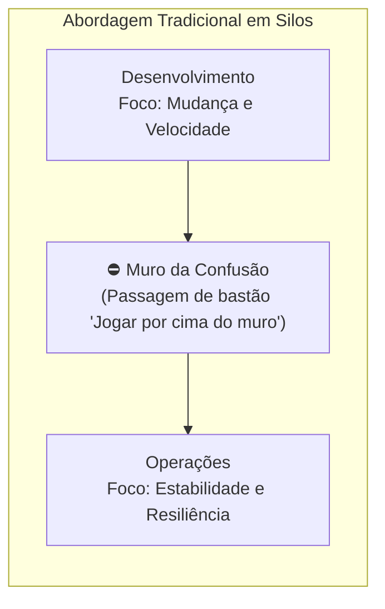
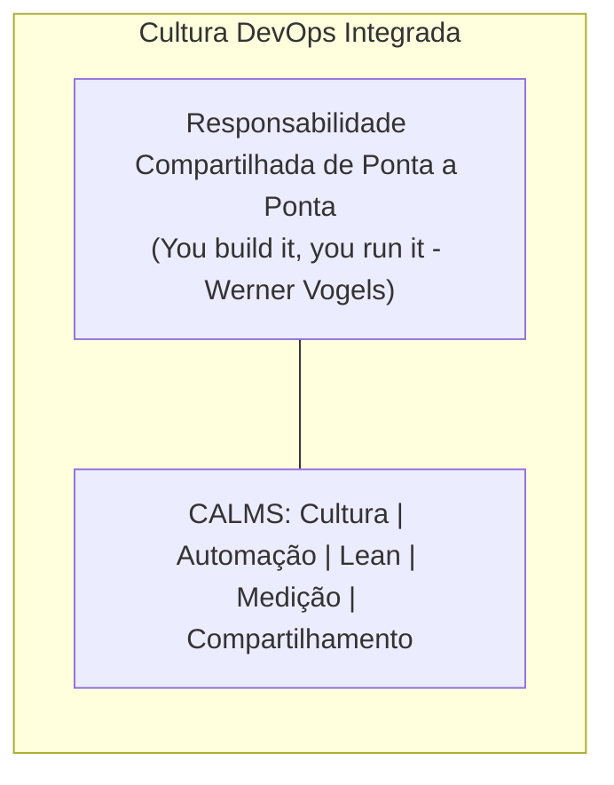
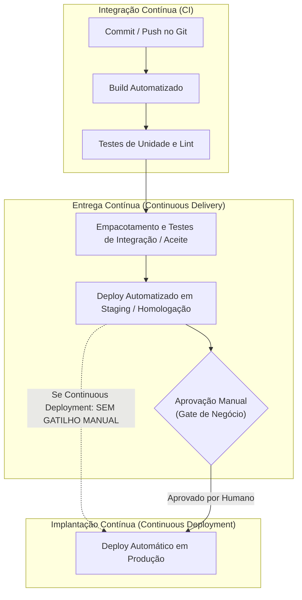
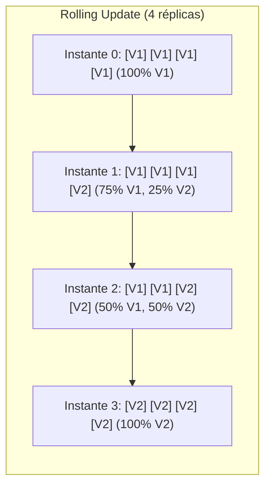
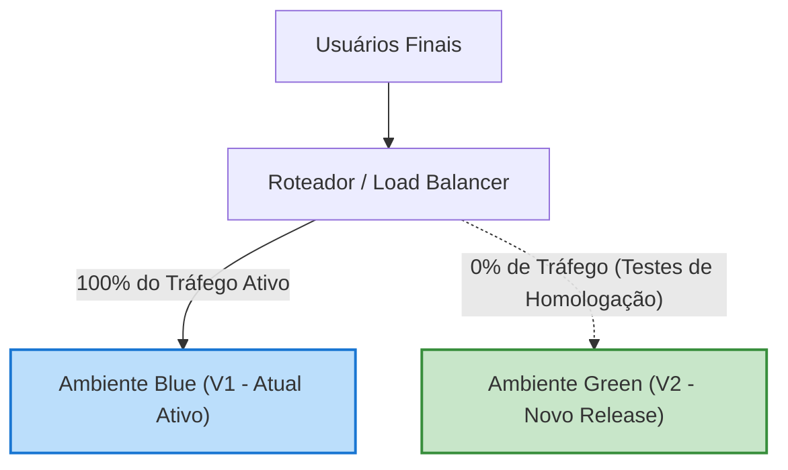
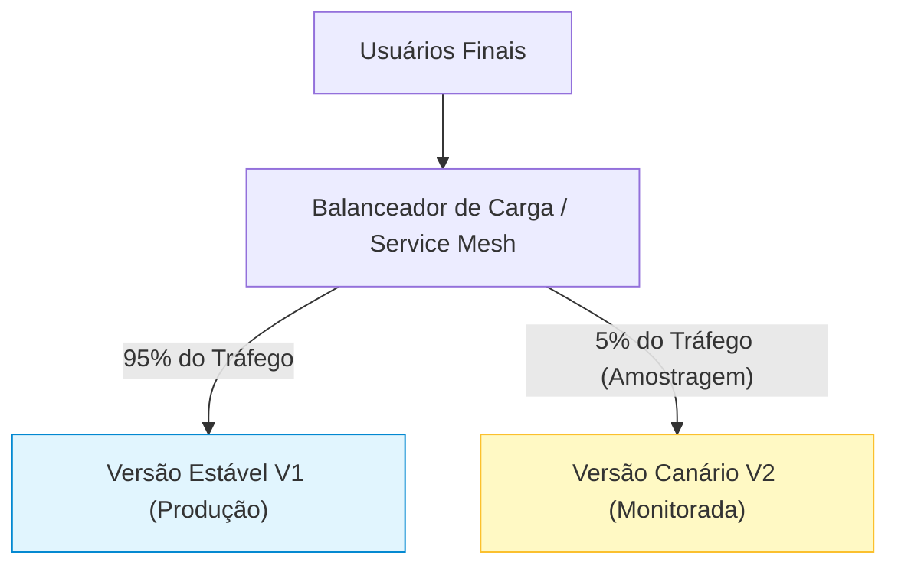

# 01 - CI/CD, Pipelines e Automação de Entrega

> **Matéria:** DevOps, Plataforma de Desenvolvimento e Engenharia de Entrega  
> **Cargo:** B02 – Técnico de Controle Externo – Especialidade: Tecnologia da Informação  
> **Arquivo:** `01_cultura_devops_ci_cd_e_automacao_de_pipelines.md`  

---

## 📌 Ementa / Itens do Edital
- Conceitos e fundamentos da cultura DevOps
- Integração Contínua (CI - Continuous Integration)
- Entrega Contínua (Continuous Delivery) vs. Implantação Contínua (Continuous Deployment)
- Estrutura e estágios de pipelines de desenvolvimento
- Automação de compilação (build) e de testes
- Estratégias modernas de publicação (Blue-Green, Canary, Rolling Update)
- Ferramentas de automação: GitHub Actions, GitLab CI/CD e Jenkins

---

## 🌳 Classificação Hierárquica

```text
1. Cultura DevOps, Ciclo de CI/CD e Automação de Pipelines
├── 1.1 Fundamentos da Cultura DevOps
│   ├── 1.1.1 Definição: Quebra de silos entre Desenvolvimento (Dev), Operações (Ops) e Qualidade (QA)
│   ├── 1.1.2 Framework CALMS: Culture (Cultura), Automation (Automação), Lean (Enxuto), Measurement (Medição), Sharing (Compartilhamento)
│   ├── 1.1.3 As Três Vias do DevOps (Gene Kim / The Phoenix Project):
│   │   ├── 1ª Via: Fluxo Rápido da Esquerda para a Direita (Systems Thinking / Redução de Lead Time)
│   │   ├── 2ª Via: Amplificação dos Ciclos de Feedback (Encurtamento do tempo de resposta a falhas)
│   │   └── 3ª Via: Cultura de Experimentação Contínua e Aprendizado Organizacional
│   └── 1.1.4 Métricas DORA (DevOps Research and Assessment):
│       ├── Deployment Frequency (Frequência de Deploy)
│       ├── Lead Time for Changes (Tempo de Lead para Mudanças)
│       ├── Change Failure Rate (Taxa de Falha em Mudanças)
│       └── Time to Restore Service / MTTR (Tempo Médio de Recuperação)
├── 1.2 O Espectro de Automação: CI vs. CD (Delivery vs. Deployment)
│   ├── 1.2.1 Integração Contínua (CI):
│   │   ├── Commits frequentes no branch principal (Trunk-Based / branches de vida curta)
│   │   ├── Automação compulsória de compilação (build) e suítes de testes unitários
│   │   └── Princípio "Stop the Line" (Andon Cord): build quebrado paralisa novos merges
│   ├── 1.2.2 Entrega Contínua (Continuous Delivery - CD):
│   │   ├── Software permanentemente pronto para produção (Release Candidate contínuo)
│   │   ├── Ambientes de homologação/staging automatizados com testes de carga e integração
│   │   └── Gatilho Manual (Manual Gate / Aprovação de Negócio) para entrada em produção
│   └── 1.2.3 Implantação Contínua (Continuous Deployment - CD):
│       └── Promoção automática para o ambiente produtivo sem intervenção humana após passar por todos os gates automatizados
├── 1.3 Estratégias Modernas de Liberação (Deploy Strategies)
│   ├── 1.3.1 Recreate (Downtime total durante atualização)
│   ├── 1.3.2 Rolling Update (Atualização progressiva de nós/instâncias sem indisponibilidade)
│   ├── 1.3.3 Blue-Green Deployment (Ambientes idênticos paralelos com chaveamento de roteador/balanceador)
│   ├── 1.3.4 Canary Deployment (Roteamento de pequena fração percentual de tráfego para a versão nova)
│   └── 1.3.5 Feature Toggles / Feature Flags e Dark Launching
├── 1.4 Anatomia e Estágios de um Pipeline de CI/CD (DevSecOps)
│   ├── 1.4.1 Linting, Formatação e Análise Estática de Código
│   ├── 1.4.2 Análise de Segurança de Aplicações: SAST, DAST e SCA (Software Composition Analysis)
│   ├── 1.4.3 Compilação e Build de Binários / Imagens de Contêineres
│   ├── 1.4.4 Testes Automatizados (Pirâmide de Testes: Unitários, Integração, Contrato, E2E)
│   ├── 1.4.5 Publicação de Artefatos em Registry Seguro (Docker Registry, Nexus, Artifactory)
│   └── 1.4.6 Implantação e Smoke Tests pós-deploy
└── 1.5 Plataformas e Ferramentas de Automação
    ├── 1.5.1 GitHub Actions (Workflows, Events, Jobs, Steps, Runners, Secrets, Matrix)
    ├── 1.5.2 GitLab CI/CD (Manifesto `.gitlab-ci.yml`, stages, artifacts, cache, rules, GitLab Runners)
    └── 1.5.3 Jenkins (Arquitetura Controller-Agent, Jenkinsfile Declarativo vs. Scripted, Groovy DSL)
```

---

## 📖 Resumo Teórico & Pontos-Chave Aprofundados

### 1. Cultura DevOps, Princípios e Métricas DORA

A cultura DevOps surge da necessidade de eliminar o conflito de interesses histórico existente na Tecnologia da Informação tradicional: enquanto a equipe de **Desenvolvimento** busca *velocidade de entrega e mudança frequente*, a equipe de **Operações** busca *estabilidade, controle e previsibilidade*, gerando o clássico "Muro da Confusão" (*Wall of Confusion*).





#### O Framework C.A.L.M.S.
Sistematizado por Damon Edwards e John Willis, resume os pilares de avaliação da maturidade DevOps:
- **C (Culture):** Foco nas pessoas, colaboração mútua, eliminação de culpa (*blameless post-mortems*).
- **A (Automation):** Automação de pipelines de integração, testes, provisionamento de infraestrutura e deploys para eliminar erros humanos e tarefas repetitivas (*toil*).
- **L (Lean):** Princípios da manufatura enxuta: redução de desperdício, trabalho em lotes pequenos (*small batch sizes*) e limitação do trabalho em progresso (*WIP - Work in Progress*).
- **M (Measurement):** Telemetria contínua, visibilidade de métricas técnicas e de negócio.
- **S (Sharing):** Compartilhamento de conhecimento, boas práticas, ferramentas e lições aprendidas entre todos os times.

#### As Três Vias do DevOps (Gene Kim et al., *The Phoenix Project* e *The DevOps Handbook*)
1. **Primeira Via (O Princípio do Fluxo):** Acelerar o fluxo de valor do Desenvolvimento (esquerda) para a Operação e Produção (direita). Requer tornar o trabalho visível, reduzir o tamanho dos lotes de entrega e evitar que defeitos sejam propagados downstream.
2. **Segunda Via (O Princípio do Feedback):** Encurtar e amplificar os ciclos de feedback da direita (Operações/Produção) para a esquerda (Desenvolvimento). Se um erro ocorre em produção ou no pipeline, o time é notificado instantaneamente para corrigir a causa raiz.
3. **Terceira Via (O Princípio do Aprendizado Contínuo e Experimentação):** Criar uma cultura de alta confiança que encoraje a experimentação, tomada de riscos calculados e aprendizado a partir de falhas, transformando o conhecimento local em melhoria global da organização.

#### As Quatro Métricas DORA (*DevOps Research and Assessment*)
A FCC frequentemente cobra as métricas científicas que diferenciam organizações de alta e baixa performance:

| Métrica DORA | Dimensão | Definição | Organizações de Alta Performance |
| :--- | :--- | :--- | :--- |
| **Deployment Frequency (DF)** | Velocidade | Com que frequência o código é implantado com sucesso em produção | Múltiplos deploys por dia (sob demanda) |
| **Lead Time for Changes (LTTC)** | Velocidade | Tempo decorrido desde o primeiro commit até o código estar em produção | Menos de 1 hora |
| **Change Failure Rate (CFR)** | Estabilidade | Percentual de implantações que resultam em falha/degradação exigindo rollback, hotfix ou patch | 0% a 15% |
| **Time to Restore Service (MTTR)** | Estabilidade | Tempo decorrido para restabelecer o serviço em caso de incidente ou indisponibilidade em produção | Menos de 1 hora |

> 🚨 **ALERTA DE PROVA / PEGADINHA FCC:**  
> A FCC adora tentar classificar as métricas DORA trocando seus eixos: *Lead Time for Changes* e *Deployment Frequency* medem **Taxa de Transferência / Velocidade (Throughput)**. Já *Change Failure Rate* e *Time to Restore Service* medem **Estabilidade / Confiabilidade**. Times de alta performance otimizam velocidade e estabilidade simultaneamente, quebrando o falso mito de que "implantar rápido aumenta as falhas".

---

### 2. O Espectro de Automação: CI vs. CD (Delivery vs. Deployment)

A evolução da automação de software divide-se em três etapas progressivas. Compreender a fronteira exata entre cada uma é questão recorrente em certas provas da FCC.



#### Tabela Comparativa Detalhada: CI vs. Continuous Delivery vs. Continuous Deployment

| Característica | Integração Contínua (CI) | Entrega Contínua (Continuous Delivery) | Implantação Contínua (Continuous Deployment) |
| :--- | :--- | :--- | :--- |
| **Objetivo Principal** | Validar que o código de diferentes autores se integra sem conflitos ou erros de compilação. | Garantir que o software está **sempre em estado pronto para ser implantado** em produção a qualquer momento. | Colocar as alterações em produção nas mãos dos usuários finais de forma automatizada e contínua. |
| **Frequência de Integração** | Diária ou várias vezes ao dia no branch principal (`main`/`trunk`). | Contínua (cada alteração gera um candidato a release). | Contínua (cada alteração aprovada em testes vai para produção). |
| **Escopo dos Testes** | Testes de unidade, sintaxe, linters e testes de integração rápidos. | Testes de carga, contratos, ponta a ponta (E2E), segurança e regressão. | Idem ao Delivery, com monitoramento ativo e canary/health checks em produção. |
| **Ambientes Envolvidos** | Servidor de CI/Runner temporário. | Runner de CI + Ambientes de Teste, QA e Homologação (Staging). | Todos os ambientes até a Produção real. |
| **Gatilho de Produção** | Não contempla deploy em produção. | **MANUAL** (decisão humana, botão de deploy, janela de release de negócio). | **AUTOMÁTICO** (nenhuma intervenção humana; se os testes passaram, vai para produção). |
| **Requisito Crítico** | Cultura de trunk-based ou feature branches muito curtas; testes rápidos (< 10 min). | Ambiente de staging estritamente idêntico à produção; automação total do processo de release. | Suíte de testes extremamente madura, telemetria em tempo real, capacidade de *rollback* automático. |

> ⭐ **IMPORTANTE / REGRA DE OURO:**  
> A diferença entre **Entrega Contínua (*Continuous Delivery*)** e **Implantação Contínua (*Continuous Deployment*)** resume-se ao **gatilho de ida para o ambiente de Produção**:  
> - **Continuous Delivery:** A publicação em produção é acionada por uma **decisão humana (manual approval)**.  
> - **Continuous Deployment:** A publicação em produção ocorre **100% via código e automação**, sem qualquer intervenção humana.

---

### 3. Estratégias Modernas de Implantação (Deployment Strategies)

Em arquiteturas modernas de microsserviços e contêineres, atualizar uma aplicação sem causar indisponibilidade (*zero downtime*) exige estratégias estruturadas:

#### A. Recreate (Recriação)
- Encerra completamente a versão antiga ($V1$) antes de iniciar a nova versão ($V2$).
- **Vantagem:** Muito simples de implementar; sem incompatibilidade de esquemas de banco de dados concorrentes.
- **Desvantagem:** Há **downtime** (indisponibilidade) perceptível para o usuário final durante a transição.

#### B. Rolling Update (Atualização Progressiva)
- Atualiza instâncias/pods de forma gradual. Por exemplo, de 4 réplicas, substitui 1 réplica por vez.
- **Vantagem:** Sem downtime; não requer o dobro de capacidade de infraestrutura.
- **Desvantagem:** Durante o rollout, coexistem versões diferentes ($V1$ e $V2$) atendendo tráfego simultaneamente, exigindo retrocompatibilidade estrita com a API e o banco de dados.



#### C. Blue-Green Deployment (Azul-Verde)
- Mantém dois ambientes idênticos em produção: um ativo recebendo todo o tráfego do usuário (**Blue**) e outro inativo (**Green**).
- A nova versão é implantada e exaustivamente testada no ambiente **Green**.
- Quando validado, o roteador/balanceador de carga (*Load Balancer* ou *Ingress Controller*) chaveia 100% do tráfego para **Green**.
- Se houver qualquer anomalia crítica, o **rollback é quase instantâneo**, bastando comutar o balanceador de volta para **Blue**.
- **Desvantagem:** Requer duplicidade de infraestrutura física/computacional (custo mais elevado).



#### D. Canary Deployment (Canário)
- A nova versão ($V2$) é colocada no ar ao lado da versão atual ($V1$), mas recebe apenas uma fração diminuta do tráfego real (ex.: 2% a 5%), direcionada via regras de roteamento (por cabeçalho HTTP, cookies ou porcentagem randômica).
- O comportamento do canário é monitorado em tempo real por métricas de erro (HTTP 5xx), latência e uso de CPU.
- Se as métricas forem saudáveis, a proporção é aumentada gradativamente (10%, 25%, 50%, 100%). Em caso de anomalia, o tráfego do canário é cancelado imediatamente, impactando o menor número possível de usuários.



#### E. Feature Toggles / Feature Flags e Dark Launching
- Mecanismo em nível de código-fonte que permite ativar ou desativar funcionalidades em tempo de execução sem realizar novo deploy.
- **Dark Launching:** O código novo é executado em produção de forma invisível ao usuário (ex.: o backend chama o novo serviço em paralelo e descarta o retorno apenas para medir performance sob carga real).

---

### 4. Ferramentas de CI/CD: Sintaxe e Componentes Chave

As bancas de concurso cobram cada vez mais a estrutura sintática das três ferramentas predominantes:

#### 4.1 GitHub Actions
- **Arquivo de Configuração:** Arquivos YAML dentro de `.github/workflows/*.yml`.
- **Hierarquia:**
  - **Workflow:** Procedimento automatizado de alto nível.
  - **Events (`on:`):** Gatilhos que disparam o workflow (`push`, `pull_request`, `schedule`, `workflow_dispatch`).
  - **Jobs:** Conjunto de passos que rodam em um mesmo runner. Por padrão, **jobs diferentes rodam em paralelo**. Para criar dependência sequencial, usa-se a diretiva `needs: [job_anterior]`.
  - **Steps:** Tarefas sequenciais executadas dentro do job (podem rodar comandos de shell com `run:` ou invocar ações com `uses:`).
  - **Runners (`runs-on:`):** Servidores de execução gerenciados (`ubuntu-latest`, `windows-latest`) ou auto-hospedados (*self-hosted*).
  - **Secrets:** Gerenciados via `${{ secrets.NOME_DO_SEGREDO }}` (criptografia em repouso).

Exemplo completo de workflow com dependência e testes:
```yaml
name: Backend CI-CD Pipeline
on:
  push:
    branches: [ "main" ]
  pull_request:
    branches: [ "main" ]

jobs:
  lint-and-test:
    runs-on: ubuntu-latest
    steps:
      - name: Baixar código
        uses: actions/checkout@v4
      - name: Instalar Node.js
        uses: actions/setup-node@v4
        with:
          node-version: '20'
      - name: Instalar dependências
        run: npm ci
      - name: Executar testes
        run: npm test

  deploy:
    needs: [lint-and-test] # Depende da conclusão com sucesso do job anterior
    runs-on: ubuntu-latest
    if: github.ref == 'refs/heads/main'
    steps:
      - name: Deploy em Produção
        env:
          PROD_KEY: ${{ secrets.PROD_API_KEY }}
        run: ./scripts/deploy.sh
```

#### 4.2 GitLab CI/CD
- **Arquivo de Configuração:** `.gitlab-ci.yml` na raiz do repositório.
- **Hierarquia:**
  - **Stages:** Define a ordem lógica das fases do pipeline (ex.: `stages: [build, test, deploy]`). Jobs do mesmo stage rodam em **paralelo**; o próximo stage só inicia se todos os jobs do stage anterior tiverem sucesso.
  - **Jobs:** Especificam a imagem Docker (`image:`), o estágio (`stage:`), os comandos (`script:`, `before_script:`, `after_script:`).
  - **Artifacts:** Arquivos gerados por um job (como binários compilados ou relatórios de cobertura) salvos no GitLab e repassados automaticamente aos estágios seguintes.
  - **Cache:** Mecanismo de persistência entre diferentes execuções de pipelines para acelerar o download de dependências (ex.: diretório `.m2` ou `node_modules`). Não deve ser confundido com *artifacts*.
  - **Rules:** Condições avançadas para inclusão/exclusão de jobs com base em branches, tags, variáveis ou status de merge requests.

Exemplo de `.gitlab-ci.yml`:
```yaml
stages:
  - build
  - test
  - release

build_app:
  stage: build
  image: maven:3.9-eclipse-temurin-17
  script:
    - mvn clean package -DskipTests
  artifacts:
    paths:
      - target/*.jar
    expire_in: 1 week

run_tests:
  stage: test
  image: maven:3.9-eclipse-temurin-17
  script:
    - mvn test

deploy_staging:
  stage: release
  script:
    - ./deploy.sh staging
  rules:
    - if: '$CI_COMMIT_BRANCH == "main"'
```

#### 4.3 Jenkins
- **Arquitetura Controller-Agent:** O nó central (*Controller*, antigamente chamado de *Master*) gerencia as filas, agenda os builds e serve a interface Web. Os nós executores (*Agents*, antigamente chamados de *Slaves*) executam os trabalhos reais em contêineres ou VMs separadas.
- **Jenkinsfile:** Arquivo versionado que define o pipeline como código. Suporta dois estilos:
  1. **Declarative Pipeline (Recomendado):** Estrutura padronizada, sintaxe rígida e clara, bloco raiz `pipeline { agent any; stages { stage('...') { steps { ... } } } }`.
  2. **Scripted Pipeline:** Sintaxe mais antiga baseada diretamente em Groovy puro, com blocos `node { stage('...') { ... } }`, permitindo lógica de controle complexa, porém com menor legibilidade e menor facilidade de manutenção.

---

## 🌐 Fontes Recomendadas na Internet

### 1. Documentação Oficial das Plataformas de CI/CD
- [GitHub Actions Documentation (pt-BR)](https://docs.github.com/pt/actions/writing-workflows/quickstart): Guia oficial completo cobrindo a sintaxe de workflows em YAML (`.github/workflows/`), eventos gatilhos (`on: [push, pull_request]`), jobs paralelos/dependentes, matrizes de build e segredos criptografados (*GitHub Secrets*).
- [GitLab CI/CD Official Documentation & Reference](https://docs.gitlab.com/ee/ci/yaml/): Manual de referência da sintaxe do `.gitlab-ci.yml`, detalhando diretivas `stages`, `script`, `artifacts`, `cache`, `rules` e configuração de executores (*GitLab Runners*).
- [Jenkins User Handbook - Pipeline](https://www.jenkins.io/doc/book/pipeline/): Documentação oficial do Jenkins descrevendo a estrutura de pipelines declarativos (`pipeline { agent any; stages { ... } }`) e scriptados em Groovy via `Jenkinsfile`.

### 2. Artigos Canônicos e Fundamentos
- [Continuous Integration (Martin Fowler)](https://martinfowler.com/articles/continuousIntegration.html): Artigo clássico fundamental que estabeleceu as boas práticas da Integração Contínua: repositório único compartilhado, automação de build, testes em ambiente idêntico a produção e commits diários ao branch principal.
- [Google Cloud Architecture Center - DORA Metrics](https://cloud.google.com/devops): Pesquisa oficial do grupo DORA sobre as quatro métricas chave de entrega de software e cultura de alta performance.

---

## 📝 Questões Comentadas & Exemplos (Padrão FCC)

### Questão 1 (FCC - Adaptada / TI - Práticas de CI/CD e Espectro de Automação)
No contexto da cultura DevOps e das práticas modernas de engenharia de software, considere as seguintes afirmativas sobre Integração Contínua (CI), Entrega Contínua (*Continuous Delivery*) e Implantação Contínua (*Continuous Deployment*):

I. Na Integração Contínua (*Continuous Integration*), desenvolvedores integram código ao ramo principal com alta frequência, disparando compilações e execuções de testes automatizados a cada *commit*, de modo a identificar falhas de integração precocemente.  
II. Na Entrega Contínua (*Continuous Delivery*), todo o pipeline de automação (da compilação até os testes em ambientes similares ao de produção) é executado, deixando a aplicação em estado permanente de prontidão para implantação (*release candidate*), dependendo, contudo, de uma aprovação/gatilho manual por decisão de negócio para o deploy em produção.  
III. Na Implantação Contínua (*Continuous Deployment*), não há intervenção humana no fluxo: toda alteração aprovada em todos os testes e estágios automatizados do pipeline é promovida automaticamente para o ambiente produtivo.

Está correto o que se afirma em:  
A) I, apenas.  
B) I e II, apenas.  
C) II e III, apenas.  
D) I e III, apenas.  
E) I, II e III.

> **Gabarito: E**  
> **Comentário Analítico Passo a Passo:**  
> - **Item I está CORRETO:** Martin Fowler define a Integração Contínua exatamente como a prática em que membros da equipe integram seu trabalho frequentemente (ao menos diariamente), e cada integração é verificada por um build e testes automatizados imediatos para detectar erros o mais rápido possível.  
> - **Item II está CORRETO:** A Entrega Contínua (*Continuous Delivery*) assegura que o software pode ser liberado para produção a qualquer momento, tendo sido testado em staging de forma automatizada, mantendo um *release candidate* sempre disponível. O deploy efetivo em produção requer uma decisão/acionamento humano explícito (ex.: botão de aprovação ou janela programada).  
> - **Item III está CORRETO:** Na Implantação Contínua (*Continuous Deployment*), o processo é automatizado de ponta a ponta sem qualquer gatilho ou aprovação manual. Se o commit passa em todas as suítes de testes e verificações de segurança do pipeline, ele vai direto para os servidores de produção.  
> - **Análise das Alternativas:**  
>   - **A está incorreta** porque os itens II e III também são verdadeiros.  
>   - **B está incorreta** porque o item III é verdadeiro.  
>   - **C está incorreta** porque o item I é verdadeiro.  
>   - **D está incorreta** porque o item II é verdadeiro.  
>   - **E está CORRETA**, pois as três assertivas conceituam de forma impecável as fases de maturidade de CI/CD.

---

### Questão 2 (FCC - Adaptada / TI - Estratégias Modernas de Implantação / Deployment)
Um Tribunal de Contas está modernizando a infraestrutura do seu sistema de auditoria eletrônica para permitir atualizações frequentes sem causar indisponibilidade aos auditores e aos cidadãos. A equipe de arquitetura necessita adotar uma estratégia de implantação que atenda aos seguintes requisitos:
- Permitir testar a nova versão do sistema em um ambiente produtivo idêntico ao atual antes de liberar o acesso geral;
- Garantir que a comutação de tráfego seja praticamente instantânea;
- Proporcionar capacidade de reversão (*rollback*) imediata caso anomalias severas sejam detectadas logo após a liberação.

A estratégia de implantação que atende perfeitamente a esses requisitos é:  
A) *Recreate Deployment*.  
B) *Rolling Update*.  
C) *Blue-Green Deployment*.  
D) *Big Bang Release*.  
E) *In-Place Deployment*.

> **Gabarito: C**  
> **Comentário Analítico Passo a Passo:**  
> - **A está INCORRETA:** O *Recreate Deployment* derruba intencionalmente as instâncias antigas antes de subir as novas, causando indisponibilidade (*downtime*) obrigatória durante o intervalo de subida da nova versão, violando o requisito de zero downtime e reversão imediata.  
> - **B está INCORRETA:** O *Rolling Update* substitui pods ou nós gradualmente (ex.: um a um). Embora garanta zero downtime, durante o processo coexistem instâncias antigas e novas respondendo ao tráfego, o rollback não é instantâneo (exige novo rollout reverso) e não há um ambiente completo idêntico e isolado pré-testado antes de iniciar a migração.  
> - **C está CORRETA:** No *Blue-Green Deployment*, mantêm-se dois ambientes de produção idênticos (Blue e Green). Enquanto o ambiente Blue atende 100% dos usuários, o novo software é instalado e testado com carga no ambiente Green. Quando tudo é validado, altera-se o roteamento no balanceador de carga para direcionar o tráfego a Green. Caso ocorra um problema, o balanceador é chaveado de volta para Blue em segundos, realizando o rollback quase instantaneamente.  
> - **D está INCORRETA:** O *Big Bang Release* é a abordagem tradicional monolítica onde todo o sistema é desligado durante a madrugada ou fim de semana para substituição total em lote único, com alto risco de falha e downtime prolongado.  
> - **E está INCORRETA:** O *In-Place Deployment* substitui os arquivos da aplicação diretamente nos servidores existentes em execução, o que interrompe o serviço temporariamente e torna o rollback complexo e demorado caso a compilação falhe no local.

---

### Questão 3 (FCC - Adaptada / TI - Métricas DORA e Desempenho em Engenharia de Software)
A equipe de liderança técnica de uma Secretaria de Fazenda Estadual realizou uma avaliação de maturidade de seus processos de entrega contínua com base no framework DORA (*DevOps Research and Assessment*). De acordo com os relatórios consolidados do State of DevOps Report da DORA, as organizações classificadas como de alta performance técnica (*high performers*) são caracterizadas por:  
A) Alto *Lead Time for Changes* (superior a um mês) para assegurar rigorosas revisões manuais por comitês de governança (CAB) antes de qualquer implantação.  
B) Alta frequência de implantação (*Deployment Frequency*) combinada simultaneamente com baixo tempo de recuperação de serviços (*Time to Restore Service*) e baixa taxa de falha em mudanças (*Change Failure Rate*).  
C) Baixa frequência de implantação (deploys semestrais em lotes grandes), priorizando a estabilidade através do congelamento de código (*code freeze*).  
D) Alta taxa de falha em mudanças (*Change Failure Rate* acima de 50%), justificada pela necessidade de aprendizado rápido na Terceira Via do DevOps, desconsiderando a perda de disponibilidade.  
E) Foco exclusivo no custo financeiro da computação em nuvem, ignorando métricas de velocidade de entrega e estabilidade operacional.

> **Gabarito: B**  
> **Comentário Analítico Passo a Passo:**  
> - **A está INCORRETA:** Um *Lead Time for Changes* longo (superior a um mês) e a exigência de aprovações burocráticas centralizadas por CAB (*Change Advisory Board*) são sintomas clássicos de organizações de **baixa performance**. Times de alta performance possuem *Lead Time* inferior a uma hora.  
> - **B está CORRETA:** A descoberta empírica mais relevante do DORA é que **velocidade e estabilidade não são opostos**. Times de elite conseguem implantar com alta frequência (múltiplas vezes ao dia sob demanda) e ciclo de entrega curto, ao mesmo tempo em que apresentam baixíssima taxa de falha nas mudanças (0% a 15%) e tempo de restauração do serviço (*Time to Restore*) inferior a uma hora.  
> - **C está INCORRETA:** Deploys esporádicos em lotes gigantescos e políticas de *code freeze* geram acúmulo de risco, integração dolorosa (*merge hell*) e maior propensão a falhas catastróficas, caracterizando baixa performance.  
> - **D está INCORRETA:** A cultura de experimentação da Terceira Via estimula a tomada de riscos calculados e testes de hipóteses com resiliência arquitetural, mas nunca aceita deploys descuidados em produção com 50% de falha sistemática.  
> - **E está INCORRETA:** As métricas DORA são estritamente centradas em quatro dimensões técnicas fundamentais de throughput e estabilidade (Deployment Frequency, Lead Time, MTTR e Change Failure Rate), e não no custo de faturamento de provedores em nuvem.

---

### Questão 4 (FCC - Adaptada / TI - Ferramentas de CI/CD: GitHub Actions)
Considere o seguinte trecho de manifesto de automação do GitHub Actions definido no caminho `.github/workflows/pipeline.yml`:

```yaml
name: Build and Deploy Service
on:
  push:
    branches: [ "main" ]

jobs:
  test:
    runs-on: ubuntu-latest
    steps:
      - uses: actions/checkout@v4
      - run: npm test

  security-scan:
    runs-on: ubuntu-latest
    steps:
      - uses: actions/checkout@v4
      - run: npm audit

  deploy:
    runs-on: ubuntu-latest
    needs: [test, security-scan]
    steps:
      - name: Deploy Step
        run: ./deploy-prod.sh
```

A respeito da execução desse pipeline, assinale a afirmativa correta:  
A) Os jobs `test` e `security-scan` serão executados sequencialmente, iniciando `security-scan` apenas após o término bem-sucedido de `test`.  
B) O job `deploy` iniciará imediatamente e executará em paralelo aos jobs `test` e `security-scan`.  
C) O job `deploy` só iniciará sua execução se ambos os jobs `test` e `security-scan` forem concluídos com sucesso. Caso qualquer um deles falhe, o job `deploy` será ignorado (*skipped*).  
D) O atributo `runs-on: ubuntu-latest` faz com que os três jobs compartilhem a mesma memória RAM e o mesmo sistema de arquivos local sem isolamento.  
E) O gatilho `on: push: branches: [ "main" ]` indica que o pipeline será executado apenas quando uma nova *Pull Request* for aberta por qualquer desenvolvedor, mas nunca quando um commit direto for enviado ao branch `main`.

> **Gabarito: C**  
> **Comentário Analítico Passo a Passo:**  
> - **A está INCORRETA:** No GitHub Actions, por padrão, jobs definidos no mesmo nível sem a declaração da diretiva `needs` são executados em **paralelo**. Como nem `test` nem `security-scan` possuem `needs`, eles iniciam simultaneamente em runners distintos.  
> - **B está INCORRETA:** O job `deploy` possui a diretiva explícita `needs: [test, security-scan]`. Isso impõe uma relação de precedência (grafo direcionado acíclico - DAG), impedindo que ele execute em paralelo a eles.  
> - **C está CORRETA:** A diretiva `needs: [test, security-scan]` instrui o runner a aguardar a conclusão satisfatória (status de sucesso) de **ambos** os jobs anteriores listados. Se `test` ou `security-scan` falharem (código de retorno diferente de zero), o job `deploy` é automaticamente cancelado/pulado (*skipped*), protegendo o ambiente produtivo.  
> - **D está INCORRETA:** Cada job no GitHub Actions é executado em uma máquina virtual (ou contêiner) isolada e independente. Mudanças no disco ou memória do job `test` não são vistas no job `security-scan` nem no job `deploy`, a menos que sejam explicitamente transferidas via artefatos (`upload-artifact` / `download-artifact`).  
> - **E está INCORRETA:** O gatilho especificado é `push` no branch `main`. Portanto, ele dispara precisamente ao ocorrer um envio de commits (*push*) direto ou merge concluído para a branch `main`. Para escutar abertura de PRs, o evento exigido seria `pull_request`.

---

### Questão 5 (FCC - Adaptada / TI - GitLab CI/CD e Jenkins: Estrutura e Diretivas)
Em relação aos arquivos de manifesto e à estrutura operacional das ferramentas de integração contínua GitLab CI/CD e Jenkins, assinale a opção correta:  
A) No GitLab CI/CD, a diretiva `artifacts` serve unicamente para reaproveitar arquivos temporários como dependências de compiladores entre pipelines distintos, tendo a mesma função semântica de `cache`.  
B) No GitLab CI/CD, se os estágios forem definidos como `stages: [build, test, deploy]`, todos os jobs vinculados ao estágio `build` são executados sequencialmente em um único runner, bloqueando qualquer concorrência interna.  
C) No Jenkins, a arquitetura moderna prevê o nó *Controller* (antigo Master) como o responsável por gerenciar o agendamento de tarefas e configurações, delegando a execução física dos passos do pipeline para nós *Agents* (antigos Slaves).  
D) Um pipeline declarativo do Jenkins (*Declarative Pipeline*) é codificado livremente sem qualquer estrutura de blocos obrigatória, usando comandos Groovy imperativos sem a necessidade da diretiva `pipeline`.  
E) No arquivo `.gitlab-ci.yml`, a palavra-chave `image:` é obrigatória para cada job individual, sendo proibido definir uma imagem Docker global compartilhada no nível raiz do arquivo.

> **Gabarito: C**  
> **Comentário Analítico Passo a Passo:**  
> - **A está INCORRETA:** No GitLab CI/CD, há distinção conceitual crítica entre `artifacts` e `cache`. **Artifacts** são saídas formais geradas por um job (ex.: binários `.jar`, relatórios de testes) salvas no GitLab e transmitidas aos estágios seguintes do **mesmo pipeline** para serem consumidas. **Cache** é destinado a acelerar a execução armazenando dependências de bibliotecas de terceiros (como pacotes Maven ou npm) compartilhadas entre **diferentes execuções de pipelines**.  
> - **B está INCORRETA:** Jobs que pertencem ao mesmo estágio (*stage*) rodam em **paralelo**, caso haja múltiplos runners disponíveis no GitLab, promovendo celeridade no build e execução de testes.  
> - **C está CORRETA:** A arquitetura padrão e recomendada do Jenkins é distribuída (*Controller-Agent*). O nó Controller armazena a configuração dos jobs, processa as regras de negócio do pipeline e despacha as cargas de trabalho para os nós Agents, que realizam a compilação, testes e deploys de forma isolada.  
> - **D está INCORRETA:** Essa descrição refere-se ao *Scripted Pipeline* (baseado em Groovy puro). O *Declarative Pipeline* possui sintaxe estrita e estruturada obrigatória, iniciando imperativamente pelo bloco delimitador `pipeline { agent ... stages { stage('...') { steps { ... } } } }`.  
> - **E está INCORRETA:** No GitLab CI/CD, é perfeitamente válido (e muito comum) declarar a diretiva `image:` no nível global (raiz) do arquivo `.gitlab-ci.yml`, tornando aquela imagem Docker o padrão para todos os jobs que não definirem sua própria imagem de forma personalizada.
