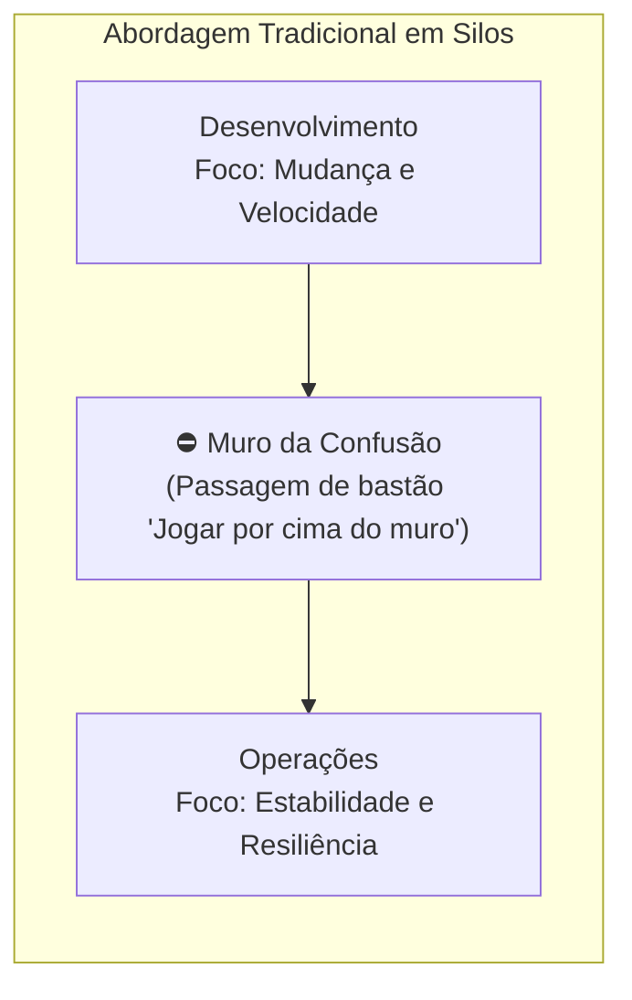
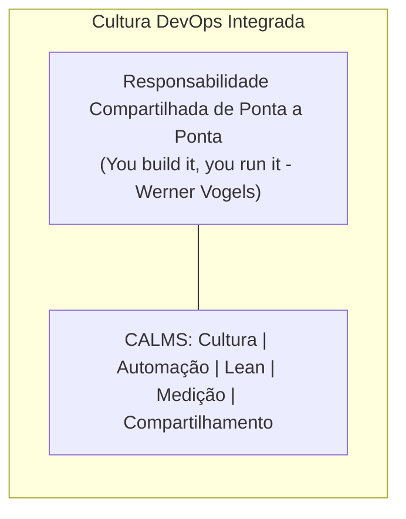
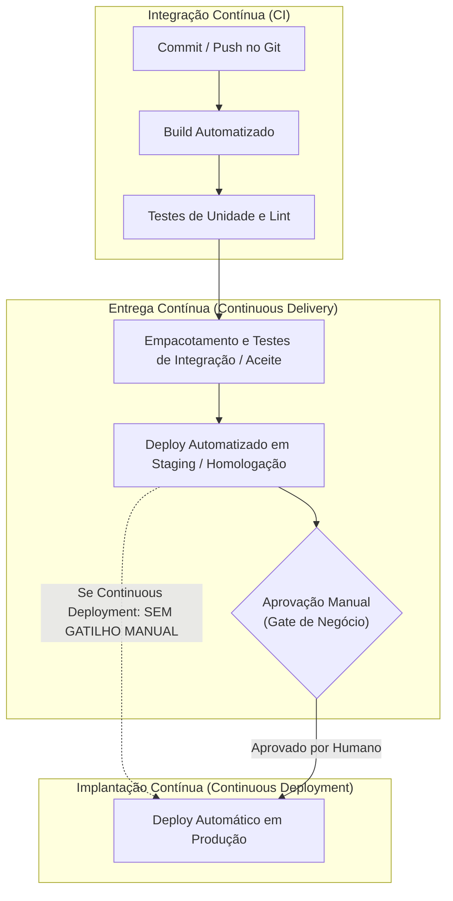
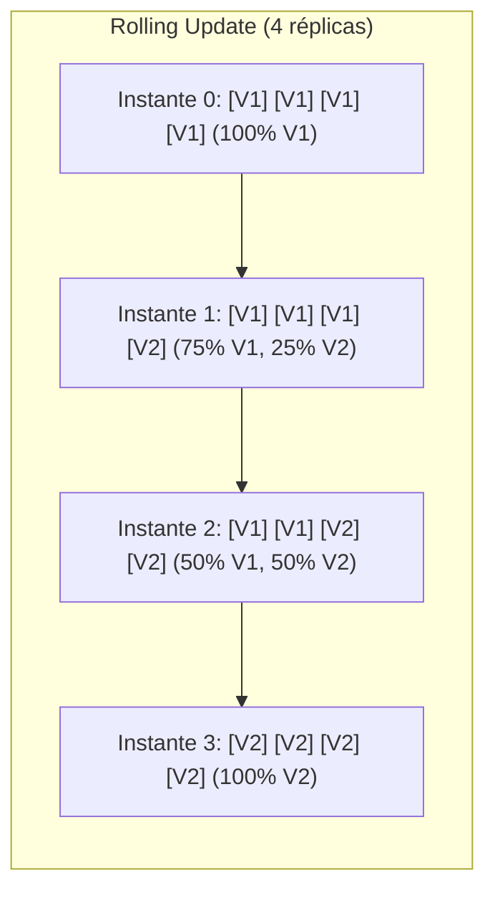
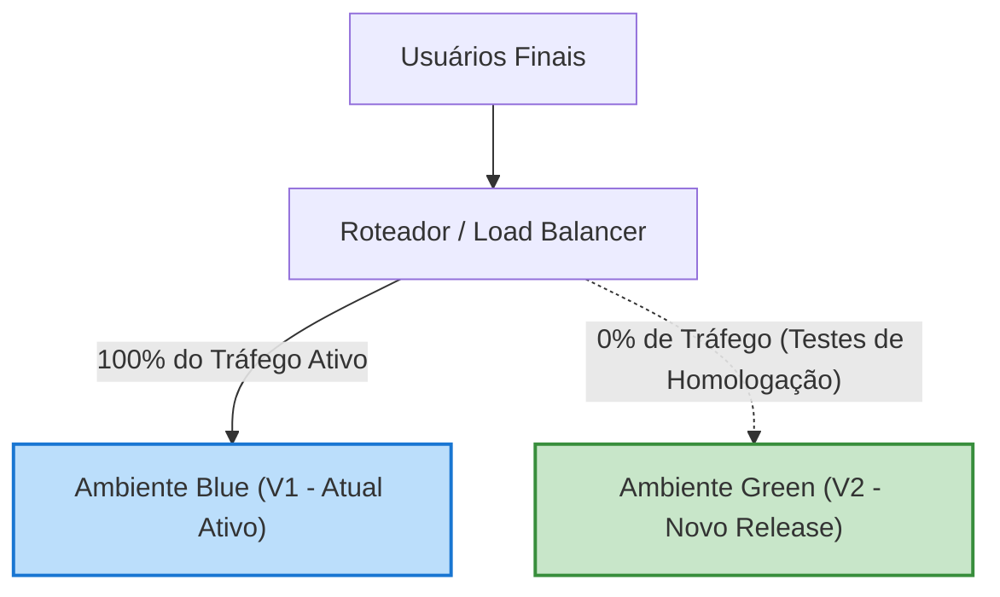
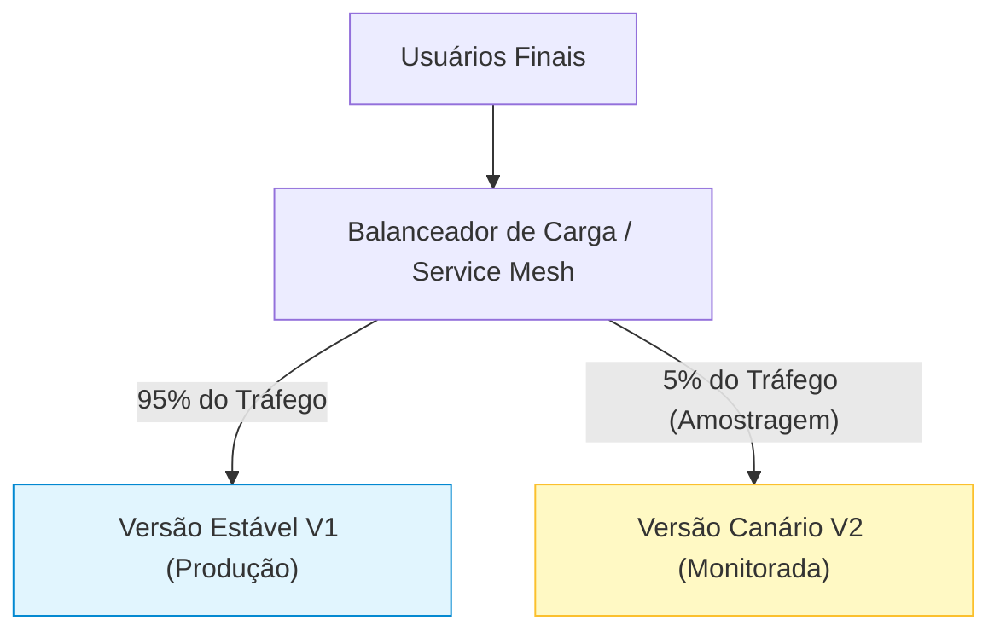
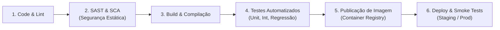

# 01 - CI/CD, Pipelines e Automação de Entrega

> **Matéria:** DevOps, Plataforma de Desenvolvimento e Engenharia de Entrega  
> **Cargo:** B02 – Técnico de Controle Externo – Especialidade: Tecnologia da Informação  
> **Arquivo:** `01_cultura_devops_ci_cd_e_automacao_de_pipelines.md`  

---

## 📌 Ementa / Itens do Edital
- Conceitos e fundamentos da cultura DevOps
- Integração Contínua (CI - Continuous Integration)
- Entrega Contínua (Continuous Delivery) vs. Implantação Contínua (Continuous Deployment)
- Estrutura e estágios de pipelines de desenvolvimento
- Automação de compilação (build) e de testes
- Estratégias modernas de publicação (Blue-Green, Canary, Rolling Update)
- Ferramentas de automação: GitHub Actions, GitLab CI/CD e Jenkins

---

## 🧭 Sumário
- [1. Fundamentos da Cultura DevOps](#1-fundamentos-da-cultura-devops)
    - [1.1 Eliminação do Muro da Confusão e Responsabilidade Compartilhada](#11-eliminacao-do-muro-da-confusao-e-responsabilidade-compartilhada)
    - [1.2 O Framework C.A.L.M.S.](#12-o-framework-calms)
    - [1.3 As Três Vias do DevOps](#13-as-tres-vias-do-devops)
    - [1.4 As Quatro Métricas DORA (DevOps Research and Assessment)](#14-as-quatro-metricas-dora-devops-research-and-assessment)
- [2. O Espectro de Automação: CI vs. CD (Delivery vs. Deployment)](#2-o-espectro-de-automacao-ci-vs-cd-delivery-vs-deployment)
    - [2.1 Integração Contínua (CI): Boas Práticas, Trunk-Based e Princípio Stop the Line](#21-integracao-continua-ci-boas-praticas-trunk-based-e-principio-stop-the-line)
    - [2.2 Entrega Contínua (Continuous Delivery): O Release Candidate Permanente](#22-entrega-continua-continuous-delivery-o-release-candidate-permanente)
    - [2.3 Implantação Contínua (Continuous Deployment): Promoção Automática para Produção](#23-implantacao-continua-continuous-deployment-promocao-automatica-para-producao)
    - [2.4 Tabela Comparativa Detalhada: CI vs. Continuous Delivery vs. Continuous Deployment](#24-tabela-comparativa-detalhada-ci-vs-continuous-delivery-vs-continuous-deployment)
- [3. Estratégias Modernas de Publicação (Deployment Strategies)](#3-estrategias-modernas-de-publicacao-deployment-strategies)
    - [3.1 Recreate (Recriação)](#31-recreate-recriacao)
    - [3.2 Rolling Update (Atualização Progressiva)](#32-rolling-update-atualizacao-progressiva)
    - [3.3 Blue-Green Deployment (Azul-Verde)](#33-blue-green-deployment-azul-verde)
    - [3.4 Canary Deployment (Canário)](#34-canary-deployment-canario)
    - [3.5 Feature Flags / Feature Toggles e Dark Launching](#35-feature-flags-feature-toggles-e-dark-launching)
- [4. Estrutura, Estágios e Segurança de Pipelines (DevSecOps)](#4-estrutura-estagios-e-seguranca-de-pipelines-devsecops)
    - [4.1 Estágios Canônicos: Lint, Análise Estática (SAST/SCA), Build, Testes e Registry](#41-estagios-canonicos-lint-analise-estatica-sastsca-build-testes-e-registry)
    - [4.2 Pirâmide de Testes Automatizados no Pipeline](#42-piramide-de-testes-automatizados-no-pipeline)
- [5. Ferramentas de Automação: Sintaxe, Arquitetura e Manifestos](#5-ferramentas-de-automacao-sintaxe-arquitetura-e-manifestos)
    - [5.1 GitHub Actions: Workflows, Events, Jobs, Steps, Runners e Secrets](#51-github-actions-workflows-events-jobs-steps-runners-e-secrets)
    - [5.2 GitLab CI/CD: Stages, Jobs, Artifacts, Cache, Rules e Runners](#52-gitlab-cicd-stages-jobs-artifacts-cache-rules-e-runners)
    - [5.3 Jenkins: Arquitetura Controller-Agent, Declarative Pipeline e Scripted Pipeline](#53-jenkins-arquitetura-controller-agent-declarative-pipeline-e-scripted-pipeline)
- [Fontes Oficiais e Referências Bibliográficas](#fontes-oficiais-e-referencias-bibliograficas)
- [6. Questões Comentadas & Prática Padrão FCC](#6-questoes-comentadas-pratica-padrao-fcc)

---

## 1. Fundamentos da Cultura DevOps

A cultura DevOps surgiu como uma resposta essencial à ineficiência e aos conflitos crônicos entre os modelos tradicionais de desenvolvimento de software e de operação de infraestrutura. Em organizações convencionais com silos funcionais estanques, as equipes operam com incentivos conflitantes:

- A equipe de **Desenvolvimento (Dev)** é cobrada por velocidade de entrega, lançamento contínuo de novas funcionalidades e mudanças dinâmicas no sistema.
- A equipe de **Operações (Ops)** é cobrada por estabilidade operacional, resiliência, disponibilidade ininterrupta (uptime) e contenção de riscos, vendo qualquer alteração no ambiente produtivo como uma ameaça potencial à estabilidade.

Esse choque histórico consolidou o chamado **"Muro da Confusão" (*Wall of Confusion*)**: desenvolvedores empacotavam binários em suas máquinas locais e os "jogavam por cima do muro" para que a equipe de infraestrutura os instalasse manualmente em produção, gerando o clássico empasse *"Na minha máquina funciona, o problema é na infraestrutura"*.





### 1.1 Eliminação do Muro da Confusão e Responsabilidade Compartilhada

O DevOps quebra essa barreira através da fusão de processos, práticas colaborativas e ferramentas automatizadas, estabelecendo o princípio da **responsabilidade compartilhada de ponta a ponta** (*"You build it, you run it"*, sintetizado por Werner Vogels, CTO da Amazon). Sob essa ótica:

- Desenvolvedores assumem a corresponsabilidade pelo comportamento da aplicação em produção, projetando sistemas já preparados para observabilidade, diagnóstico e tolerância a falhas.
- Engenheiros de operações e infraestrutura fornecem plataformas automatizadas (*Platform Engineering*) como autosserviço (*Self-Service*), permitindo que os desenvolvedores criem ambientes, executem pipelines e realizem deploys seguros de forma autônoma.
- Adota-se a cultura de post-mortems isentos de culpa (*Blameless Post-Mortems*), tratando falhas de produção não como erros individuais de programadores, mas como deficiências no sistema e nos processos que exigem automação de barreiras de proteção (*guardrails*).

### 1.2 O Framework C.A.L.M.S.

Sistematizado pioneiramente por Damon Edwards e John Willis (e posteriormente complementado por Jez Humble), o modelo conceitual **CALMS** define os cinco pilares essenciais para avaliar e evoluir a maturidade DevOps:

1. **C (Culture - Cultura):** Transformação comportamental centrada em pessoas, confiança mútua, colaboração multidisciplinar e eliminação de silos. Prioriza a segurança psicológica da equipe para experimentar e inovar.
2. **A (Automation - Automação):** Substituição de intervenções manuais propensas a erros por pipelines automatizados de build, testes, segurança, provisionamento de infraestrutura (IaC) e deploy. A automação elimina o trabalho repetitivo e sem valor agregado (*toil*).
3. **L (Lean - Princípios Enxutos):** Aplicação dos princípios da manufatura enxuta (Sistema Toyota de Produção) ao ciclo de software: redução drástica de desperdícios, entregas frequentes em lotes pequenos (*small batch sizes*), redução do tempo de fila e limitação estrita do trabalho em progresso (*WIP - Work in Progress*).
4. **M (Measurement - Medição):** Coleta contínua e visibilidade de telemetria, abrangendo métricas de negócio (conversões, faturamento), métricas técnicas de estabilidade (tempo de resposta, taxa de erros) e métricas de processo de entrega (como o framework DORA).
5. **S (Sharing - Compartilhamento):** Disseminação aberta de conhecimento, ferramentas, erros, padrões arquiteturais e vitórias entre todos os setores da instituição, prevenindo a criação de novos "feudos" tecnológicos.

### 1.3 As Três Vias do DevOps

Formalizadas por Gene Kim, Kevin Behr e George Spafford nas obras seminais *The Phoenix Project* e *The DevOps Handbook*, as Três Vias estruturam as práticas dinâmicas da entrega contínua:

1. **A Primeira Via (O Princípio do Fluxo):** Tem por objetivo acelerar a velocidade com que o valor transita da esquerda (Desenvolvimento e Requisitos) para a direita (Operações e Produção). Exige tornar o fluxo de trabalho visível (via quadros Kanban), limitar o trabalho em andamento (WIP), reduzir o tamanho dos lotes e criar barreiras que impeçam terminantemente a propagação de defeitos para etapas posteriores (*downstream*).
2. **A Segunda Via (O Princípio do Feedback):** Busca encurtar e amplificar continuamente os ciclos de retorno da direita (Operações e Clientes em Produção) para a esquerda (Desenvolvimento). Isso significa que, se um bug surge em produção ou um teste falha no pipeline, os desenvolvedores recebem alarmes e telemetria em tempo real, permitindo identificar a causa raiz e corrigir o problema imediatamente antes que ele escale.
3. **A Terceira Via (O Princípio do Aprendizado Contínuo e Experimentação):** Fomenta uma cultura organizacional de alta confiança que estimula a experimentação deliberada, a tomada de riscos calculados e o domínio da resiliência através da repetição e da prática. O conhecimento gerado a partir de sucessos e falhas locais é sistematicamente compartilhado e incorporado às práticas institucionais de toda a organização.

### 1.4 As Quatro Métricas DORA (DevOps Research and Assessment)

As métricas DORA resultam de quase uma década de pesquisas empíricas e rigor estatístico conduzidas pelo grupo fundado por Nicole Forsgren, Jez Humble e Gene Kim (posteriormente incorporado ao Google Cloud). A FCC cobra sistematicamente a classificação e os impactos dessas métricas:

| Métrica DORA | Dimensão Operacional | Definição Precisa | Nível de Elite / Alta Performance | Nível Baixo |
| :--- | :--- | :--- | :--- | :--- |
| **Deployment Frequency (DF)** | **Throughput (Velocidade)** | Frequência com que a organização implanta com sucesso código no ambiente de produção. | **Múltiplos deploys por dia** (sob demanda contínua). | Menos de 1 deploy a cada 6 meses. |
| **Lead Time for Changes (LTTC)** | **Throughput (Velocidade)** | Intervalo de tempo transcorrido desde o primeiro commit no controle de versão até a entrada efetiva em produção. | **Menos de 1 hora** (do commit ao deploy produtivo). | Entre 1 mês e 6 meses. |
| **Change Failure Rate (CFR)** | **Stability (Estabilidade)** | Percentual de alterações enviadas para produção que resultam em falha operacional imediata (exigindo rollback, hotfix ou intervenção emergencial). | **0% a 15%** de taxa de falhas. | Mais de 45% a 60% de falhas. |
| **Time to Restore Service (MTTR)** | **Stability (Estabilidade)** | Tempo médio necessário para restabelecer a operação normal do serviço quando ocorre um incidente de indisponibilidade em produção. | **Menos de 1 hora** (recuperação ágil via rollback ou fix-forward). | Mais de 1 semana a 1 mês. |

> 🚨 **ALERTA DE PROVA / PEGADINHA FCC:**  
> A FCC adora elaborar afirmativas que tentam classificar incorretamente as dimensões das métricas DORA:
>
> - **Throughput / Velocidade de Entrega:** *Deployment Frequency (DF)* e *Lead Time for Changes (LTTC)*.
> - **Estabilidade / Confiabilidade do Sistema:** *Change Failure Rate (CFR)* e *Time to Restore Service (MTTR)*.
> - **A GRANDE CONCLUSÃO CIENTÍFICA DORA:** Empresas de alta performance **NÃO sacrificam estabilidade em troca de velocidade**. Elas atingem alto throughput E alta estabilidade simultaneamente, quebrando o mito antiquado de que "entregar mais rápido produz mais erros".

---

## 2. O Espectro de Automação: CI vs. CD (Delivery vs. Deployment)

A automação da esteira de publicação de software é composta por três patamares progressivos de maturidade. Compreender o limite exato de escopo e responsabilidade entre eles é matéria clássica em provas da FCC.



### 2.1 Integração Contínua (CI): Boas Práticas, Trunk-Based e Princípio Stop the Line

Conforme consagrado por Martin Fowler, a **Integração Contínua (*Continuous Integration*)** é a prática de engenharia na qual os membros de um time integram suas alterações de código-fonte ao branch principal do repositório com alta frequência — preferencialmente **ao menos uma vez por dia**.

**Práticas Fundamentais de CI:**

1. **Repositório Central Único:** Todo o código, configurações e scripts de build residem em um repositório centralizado versionado.
2. **Desenvolvimento em Tronco (*Trunk-Based Development*) ou Feature Branches Curtas:** Evita-se a criação de branches de desenvolvimento isoladas de longa duração. Branches que duram semanas acumulam conflitos de mesclagem complexos (*merge hell*). No modelo trunk-based, merges acontecem em ciclos diários.
3. **Build Automatizado Autocontido:** A compilação da aplicação deve ser disparada automaticamente a cada push ou commit, operando a partir de um único comando de script (ex.: `mvn clean package`, `npm run build`), sem intervenção manual de ambiente.
4. **Execução Obrigatória de Testes de Unidade e Linting:** A esteira de CI roda linters de código e baterias de testes unitários rápidos. A meta é que a validação de CI execute em menos de 10 minutos para não bloquear o fluxo do desenvolvedor.
5. **O Princípio *Stop the Line* (Corda de Andon):** Inspirado no modelo de produção enxuta, se um commit quebra o build no branch principal, a equipe inteira deve suspender novas tarefas e priorizar a resolução imediata da quebra antes de efetuar novos merges. Manter o branch principal permanentemente verde (*always green*) é mandatório.

### 2.2 Entrega Contínua (Continuous Delivery): O Release Candidate Permanente

A **Entrega Contínua (*Continuous Delivery*)** expande o escopo da Integração Contínua para além dos testes unitários e da compilação:

- Ela automatiza toda a preparação da aplicação até o limiar de produção. Cada alteração que passa pelos testes é empacotada em uma imagem ou binário e implantada automaticamente em ambientes de homologação (*staging*, *pre-prod*) estritamente idênticos à produção.
- Nesse ambiente, o sistema é submetido a baterias automatizadas de testes de integração, testes de aceitação de negócio, testes de segurança estática e dinâmica, e testes de estresse/carga.
- **Característica Definitiva:** O software é mantido em um estado **permanentemente pronto para entrar em produção (*deployable at any time*)**. Contudo, a efetiva promoção para o ambiente produtivo real depende de um **gatilho manual** (*Manual Gate* / decisão de negócio, liberação por diretoria ou janela de release programada).

### 2.3 Implantação Contínua (Continuous Deployment): Promoção Automática para Produção

A **Implantação Contínua (*Continuous Deployment*)** representa o nível máximo de maturidade na automação da esteira de entrega:

- Elimina-se completamente qualquer intervenção humana, aprovação de comitê ou gatilho manual.
- Toda modificação que passa com sucesso em 100% dos estágios automatizados do pipeline (CI + Staging + Gates de Segurança e Qualidade) é **promovida de forma instantânea e automática para os servidores de produção**.
- **Pré-requisitos Mandatórios:** Exige cobertura massiva de testes automatizados, esteiras de análise estática sem falso-positivo, arquitetura resiliente com rollback automático disparado por telemetria e estratégias avançadas de liberação (como Canary ou Blue-Green).

### 2.4 Tabela Comparativa Detalhada: CI vs. Continuous Delivery vs. Continuous Deployment

| Característica | Integração Contínua (CI) | Entrega Contínua (Continuous Delivery) | Implantação Contínua (Continuous Deployment) |
| :--- | :--- | :--- | :--- |
| **Objetivo Primário** | Validar que o código de múltiplos desenvolvedores compila e se integra sem quebrar funcionalidades existentes. | Assegurar que o software está em **estado permanente de prontidão para deploy produtivo** a qualquer momento. | Disponibilizar novas alterações para os usuários finais em produção de maneira imediata e ininterrupta. |
| **Frequência de Integração** | Diária ou múltiplas vezes ao dia no branch principal (`main`/`trunk`). | Contínua (cada lote de commits aprovados gera um novo *release candidate*). | Contínua (fluxo contínuo do commit até o servidor de produção). |
| **Escopo dos Testes** | Análise sintática (linters), tipos estáticos e testes de unidade rápidos. | Testes de integração, de contrato, ponta a ponta (E2E), segurança (SAST/DAST) e carga. | Idem ao Delivery, acrescido de monitoramento ativo de telemetria e testes de saúde em produção. |
| **Ambientes Envolvidos** | Runners de CI efêmeros (contêineres de build). | Runners de CI + Ambientes de Teste, QA e Staging/Homologação idênticos à produção. | Toda a cadeia de ambientes estendendo-se até o cluster de **Produção Real**. |
| **Gatilho de Produção** | Não contempla publicação em produção. | **GATILHO MANUAL** (Decisão humana, clique em painel, aprovação de negócio). | **100% AUTOMÁTICO** (Nenhuma intervenção humana; commit aprovado nos testes vai direto para produção). |
| **Fator Crítico de Sucesso** | Testes rápidos (< 10 min); disciplina estrita de resolução imediata de builds quebrados. | Automação total de provisionamento de staging; paridade estrita de infraestrutura dev/prod. | Monitoramento e observabilidade em tempo real com mecanismo de **rollback automatizado** sem intervenção humana. |

> ⭐ **IMPORTANTE / REGRA DE OURO:**  
> A fronteira conceitual cobrada em concursos entre **Continuous Delivery** e **Continuous Deployment** reside **exclusivamente no gatilho para o ambiente de Produção**:
>
> - **Continuous Delivery:** A publicação em produção requer acionamento por **aprovação manual humana**.
> - **Continuous Deployment:** A publicação em produção é **totalmente automatizada via software**, sem cliques ou autorizações manuais.

---

## 3. Estratégias Modernas de Publicação (Deployment Strategies)

Em infraestruturas modernas baseadas em contêineres e microsserviços, a substituição de versões deve buscar a eliminação de indisponibilidade (*zero downtime*), a mitigação do raio de impacto (*blast radius*) e a rapidez de reversão (*rollback*).

### 3.1 Recreate (Recriação)

- **Mecanismo:** Todas as instâncias da versão antiga ($V1$) são terminadas simultaneamente antes que qualquer instância da nova versão ($V2$) seja inicializada.
- **Vantagens:** É a abordagem mais simples de configurar; não exige retrocompatibilidade de banco de dados, pois nunca coexistem versões diferentes executando simultaneamente.
- **Desvantagens:** Gera **indisponibilidade obrigatória (*downtime*)** para os usuários durante o intervalo de desligamento da $V1$ e inicialização completa da $V2$. Inadmissível para sistemas críticos de fiscalização e arrecadação fiscal.

### 3.2 Rolling Update (Atualização Progressiva)

- **Mecanismo:** A substituição ocorre de forma gradual e incremental. Em um cluster com 4 réplicas de contêineres, uma instância antiga é terminada e substituída por uma nova réplica $V2$. Uma vez que a $V2$ passa nos testes de integridade (*readiness probes*), a próxima instância antiga é substituída, até que 100% dos nós estejam executando a versão $V2$.
- **Vantagens:** Garante **zero downtime** sem a necessidade de alocar o dobro de recursos de infraestrutura. É a estratégia nativa padrão em orquestradores como o Kubernetes (`strategy: RollingUpdate`).
- **Desvantagens:** Durante o processo de transição, instâncias da $V1$ e da $V2$ respondem concomitantemente às requisições dos usuários, exigindo que o banco de dados e as APIs sejam rigorosamente retrocompatíveis. Em caso de falha no meio do processo, o rollback demanda tempo para reverter progressivamente os nós alterados.



### 3.3 Blue-Green Deployment (Azul-Verde)

- **Mecanismo:** Mantêm-se dois ambientes de produção fisicamente idênticos e isolados: o ambiente **Blue** (que está ativo atendendo 100% das requisições reais dos usuários) e o ambiente **Green** (que permanece ocioso em modo de espera).
- **Fluxo Operacional:** A nova versão do software ($V2$) é instalada no ambiente Green. Nesse ambiente isolado, a equipe executa testes de fumaça (*smoke tests*), testes de carga e validações funcionais completas sem impactar os usuários reais.
- **Comutação e Rollback:** Quando a versão Green é plenamente aprovada, o balanceador de carga (*Load Balancer*) ou controlador de entrada (*Ingress*) chaveia 100% do tráfego para Green, tornando-o o ambiente ativo. O ambiente Blue passa a ser o novo ambiente inativo. Caso surja uma falha catastrófica imprevista, o **rollback é instantâneo**: basta reverter a rota do balanceador de carga de volta para Blue em questão de milissegundos.
- **Desvantagens:** Exige infraestrutura computacional duplicada, elevando os custos de nuvem ou de servidores locais.



### 3.4 Canary Deployment (Canário)

- **Origem do Termo:** Alusão histórica aos canários utilizados nas minas de carvão britânicas para detectar vazamentos de gases tóxicos antes que afetassem os operários.
- **Mecanismo:** A nova versão ($V2$) é colocada no ar paralelamente à versão estável ($V1$), mas recebe apenas uma fração diminuta do tráfego real dos usuários (tipicamente entre 1% e 5%), enquanto a $V1$ continua atendendo os 95% restantes. O tráfego do canário pode ser roteado por amostragem percentual randômica, por localização geográfica ou por grupos de usuários específicos (ex.: servidores internos).
- **Monitoramento e Expansão:** Durante a exposição do canário, sistemas de telemetria analisam ativamente métricas como taxa de erros HTTP 5xx, consumo de memória e latência de resposta. Se o canário mantiver estabilidade perfeita, a proporção de tráfego é ampliada de forma progressiva (ex.: 5% $\rightarrow$ 25% $\rightarrow$ 50% $\rightarrow$ 100%).
- **Mitigação do Raio de Impacto (*Blast Radius*):** Se o canário apresentar anomalias ou falhas, o roteamento para ele é imediatamente interrompido, afetando apenas uma fração insignificante de requisições.



### 3.5 Feature Flags / Feature Toggles e Dark Launching

- **Feature Flags (ou Toggles):** Mecanismo de controle em nível de código-fonte que permite encapsular novas funcionalidades em blocos condicionais (`if (featureManager.isEnabled("NOVO_MODULO_FISCAL")) { ... }`). Permite desacoplar a implantação do código (*deployment*) da ativação comercial do recurso (*release*). Um código pode estar rodando em produção com a funcionalidade desligada no servidor de configuração remota, sendo ativada sob demanda sem a necessidade de novo pipeline de deploy.
- **Dark Launching:** O código novo é implantado em produção e passa a ser executado em segundo plano de forma invisível aos usuários (ex.: para cada requisição recebida, o sistema envia uma chamada assíncrona ao novo algoritmo fiscal em paralelo, comparando os resultados e medindo o impacto em banco de dados sem exibir as saídas na interface do usuário).

> 🚨 **ALERTA DE PROVA / PEGADINHA FCC:**  
> A FCC adora comparar as características de risco e infraestrutura:
>
> - **Blue-Green:** Comutação total de 100% de uma vez; rollback **instantâneo** via balanceador; exige **duplicação integral de infraestrutura**.
> - **Canary:** Comutação **fracionada/percentual** (ex.: 5% inicial); focado em **reduzir o blast radius** e validar métricas de saúde com tráfego real.
> - **Rolling Update:** Substituição progressiva de instâncias/pods; **zero downtime** sem duplicação de infraestrutura, mas exige convivência temporária de versões.

---

## 4. Estrutura, Estágios e Segurança de Pipelines (DevSecOps)

A construção de um pipeline de entrega contínua robusto organiza as atividades em estágios lógicos estritamente encadeados, impedindo o avanço de artefatos defeituosos ou inseguros.

### 4.1 Estágios Canônicos: Lint, Análise Estática (SAST/SCA), Build, Testes e Registry



1. **Linting e Verificação de Estilo:** Análise léxica rápida para garantir uniformidade e detectar erros sintáticos elementares sem compilar o código (ex.: ESLint, SonarLint, flake8).
2. **DevSecOps - SAST (*Static Application Security Testing*) e SCA (*Software Composition Analysis*):**
    - **SAST:** Varredura estática no código-fonte em busca de falhas de segurança conhecidas (como SQL Injection, Cross-Site Scripting - XSS, uso de funções obsoletas). Ex.: SonarQube, Checkmarx.
    - **SCA:** Inspeção do grafo de dependências e bibliotecas externas de terceiros em busca de vulnerabilidades catalogadas na base CVE (*Common Vulnerabilities and Exposures*). Ex.: OWASP Dependency-Check, Snyk, Trivy.

3. **Build e Compilação:** Compilação do código-fonte em artefatos binários executáveis (`.jar`, `.war`, binários Go) ou construção de imagens de contêiner imutáveis via Dockerfile.
4. **Testes Automatizados:** Execução encadeada de suítes de testes automatizados organizados conforme a pirâmide de testes.
5. **Armazenamento em *Registry* de Artefatos:** Publicação segura do artefato aprovado em repositório centralizado de binários (como Docker Hub corporativo, GitHub Container Registry, Harbor ou Nexus).
6. **Deploy e *Smoke Tests*:** Implantação nos servidores de destino e disparo de testes de fumaça rápidos para verificar a disponibilidade de portas de rede e rotas de saúde (`/healthz`).

### 4.2 Pirâmide de Testes Automatizados no Pipeline

Proposta por Mike Cohn, a pirâmide de testes orienta a distribuição ótima dos testes automatizados na esteira de integração contínua:

1. **Base da Pirâmide - Testes de Unidade (Unitários):** Representam a esmagadora maioria dos testes (cerca de 70%). Testam classes e funções isoladas com uso de *mocks* e *stubs*. São extremamente rápidos de executar (milissegundos) e possuem baixo custo de manutenção.
2. **Meio da Pirâmide - Testes de Integração e de Contrato:** Testam a comunicação entre componentes integrados (como a camada de persistência com o banco de dados em contêiner de teste ou contratos de API REST via Pact). Mais lentos que os testes unitários, demandam inicialização de serviços.
3. **Topo da Pirâmide - Testes de Ponta a Ponta (E2E / Interface do Usuário):** Simulam a jornada completa do usuário final em navegadores ou clientes de API. São testes lentos, caros de manter e sujeitos a falhas intermitentes (*flaky tests*), devendo representar a menor fatia da suíte de automação (cerca de 10%).

---

## 5. Ferramentas de Automação: Sintaxe, Arquitetura e Manifestos

As bancas examinadoras de concursos de Tecnologia da Informação cobram com frequência a sintaxe de manifestos e os componentes arquiteturais das principais ferramentas de orquestração de CI/CD do mercado.

### 5.1 GitHub Actions: Workflows, Events, Jobs, Steps, Runners e Secrets

O GitHub Actions é uma plataforma de automação e orquestração de pipelines integrada nativamente ao GitHub.

- **Localização dos Arquivos:** Os manifestos são codificados no formato YAML e devem residir estritamente no diretório `.github/workflows/` na raiz do repositório.
- **Estrutura Hierárquica:**
    - **Workflows:** Processos automatizados configuráveis definidos por um arquivo YAML.
    - **Events (`on:`):** Eventos específicos que disparam o workflow. Exemplos: `push` em branches específicas, abertura de `pull_request`, execuções agendadas via cron (`schedule`) ou disparos manuais via interface web (`workflow_dispatch`).
    - **Jobs:** Conjunto de passos executados em um mesmo ambiente de runner. **Por padrão, múltiplos jobs definidos no mesmo workflow executam em paralelo**. Para criar dependência sequencial ou construir um grafo acíclico direcionado (DAG), utiliza-se a palavra-chave `needs: [nome_do_job]`.
    - **Steps:** Tarefas sequenciais executadas dentro de um job. Um step pode executar comandos de shell direto via `run:` ou invocar ações modulares reutilizáveis via `uses:` (como `uses: actions/checkout@v4`).
    - **Runners (`runs-on:`):** Máquinas virtuais ou contêineres que executam os jobs. Podem ser hospedados pela nuvem do GitHub (`ubuntu-latest`, `windows-latest`) ou auto-hospedados pela instituição (*self-hosted runners*). Cada job roda em uma instância de runner limpa e isolada.
    - **Secrets e Variáveis de Ambiente:** Credenciais e tokens sensíveis são armazenados criptografados e acessados nos workflows pela sintaxe `${{ secrets.NOME_DO_SEGREDO }}`.

Exemplo de manifesto completo do GitHub Actions:

```yaml
name: Pipeline CI-CD Institucional
on:
  push:
    branches: [ "main" ]
  pull_request:
    branches: [ "main" ]

jobs:
  test:
    runs-on: ubuntu-latest
    steps:
      - name: Baixar Código-Fonte
        uses: actions/checkout@v4
      - name: Configurar Node.js
        uses: actions/setup-node@v4
        with:
          node-version: '20'
      - name: Instalar Dependências
        run: npm ci
      - name: Executar Bateria de Testes
        run: npm test

  security-scan:
    runs-on: ubuntu-latest
    steps:
      - name: Baixar Código-Fonte
        uses: actions/checkout@v4
      - name: Auditoria de Vulnerabilidades
        run: npm audit --audit-level=high

  deploy:
    needs: [test, security-scan] # Só roda se test E security-scan concluírem com sucesso
    runs-on: ubuntu-latest
    if: github.ref == 'refs/heads/main' # Só executa em pushes diretos ou merges na main
    steps:
      - name: Baixar Código-Fonte
        uses: actions/checkout@v4
      - name: Deploy em Produção
        env:
          CHAVE_PRODUCAO: ${{ secrets.PROD_API_KEY }}
        run: ./scripts/deploy-prod.sh
```

### 5.2 GitLab CI/CD: Stages, Jobs, Artifacts, Cache, Rules e Runners

O GitLab CI/CD baseia-se em um único arquivo de manifesto denominado obrigatoriamente `.gitlab-ci.yml`, posicionado na raiz do repositório.

- **Conceito de Stages:** A diretiva global `stages` define a ordem cronológica de execução das etapas do pipeline (ex.: `stages: [build, test, security, deploy]`). Todos os jobs associados ao mesmo stage executam **em paralelo**. O pipeline só avança para o stage subsequente se **todos os jobs do stage corrente** forem concluídos com êxito.
- **Artifacts vs. Cache (Diferença Crucial em Provas):**
    - **Artifacts:** São artefatos gerados pela execução de um job (como binários compilados `.jar`, pacotes `.zip` ou relatórios de cobertura) que são transferidos para os servidores do GitLab e repassados automaticamente aos estágios posteriores do **mesmo pipeline**.
    - **Cache:** Mecanismo de armazenamento temporário destinado unicamente a acelerar execuções futuras do pipeline, persistindo diretórios de bibliotecas externas (como `node_modules` ou `.m2/repository`) entre **diferentes execuções de pipelines**. O cache não deve ser utilizado para repassar binários finais.
- **GitLab Runners e Tags:** Os *runners* são os agentes que processam os trabalhos. Um job pode especificar quais runners têm permissão para executá-lo através de rótulos de identificação (*tags*).

Exemplo de manifesto `.gitlab-ci.yml`:

```yaml
stages:
  - build
  - test
  - deploy

variables:
  MAVEN_OPTS: "-Dmaven.repo.local=.m2/repository"

cache:
  paths:
    - .m2/repository/

build_job:
  stage: build
  image: maven:3.9-eclipse-temurin-17
  script:
    - mvn clean compile
  artifacts:
    paths:
      - target/classes/
    expire_in: 1 day

test_job:
  stage: test
  image: maven:3.9-eclipse-temurin-17
  script:
    - mvn test

deploy_staging:
  stage: deploy
  script:
    - ./scripts/deploy-staging.sh
  rules:
    - if: '$CI_COMMIT_BRANCH == "main"'
```

### 5.3 Jenkins: Arquitetura Controller-Agent, Declarative Pipeline e Scripted Pipeline

O Jenkins é um dos servidores de automação de código aberto mais tradicionais e disseminados na administração pública.

- **Arquitetura Controller-Agent:**
    - **Controller (antigo Master):** Servidor central que hospeda a interface web, gerencia as configurações dos projetos, agenda a fila de execução e supervisiona a distribuição de cargas de trabalho. O Controller **não deve executar compilações ou testes pesados diretamente**, a fim de preservar sua estabilidade.
    - **Agents (antigos Slaves):** Instâncias de computação (máquinas virtuais, nós físicos ou contêineres Docker efêmeros) que recebem comandos do Controller para executar fisicamente as etapas do pipeline.
- **Jenkinsfile e Estilos de Pipeline:** O pipeline é versionado dentro do projeto em um arquivo chamado `Jenkinsfile`:
    1. **Declarative Pipeline (Estilo Moderno e Padronizado):** Utiliza uma sintaxe declarativa estrita e de fácil leitura, iniciando obrigatoriamente pelo bloco raiz `pipeline { ... }`. Possui seções estruturadas para `agent`, `stages`, `stage`, `steps` e blocos de encerramento `post { success { ... } failure { ... } }`.
    2. **Scripted Pipeline (Estilo Tradicional em Groovy):** Sintaxe imperativa legada baseada diretamente na linguagem Groovy, iniciando por blocos `node { ... }`. Permite construções lógicas complexas e laços imperativos, mas apresenta curva de aprendizado mais íngreme e menor facilidade de manutenção.

Exemplo de Jenkinsfile Declarativo:

```groovy
pipeline {
    agent any
    stages {
        stage('Compilação e Lint') {
            steps {
                echo 'Compilando a aplicação...'
                sh 'mvn clean compile'
            }
        }
        stage('Testes Automatizados') {
            steps {
                echo 'Executando testes de unidade...'
                sh 'mvn test'
            }
        }
        stage('Homologação e Deploy') {
            steps {
                echo 'Implantando no cluster corporativo...'
                sh './scripts/deploy.sh'
            }
        }
    }
    post {
        always {
            echo 'Encerrando execução do pipeline e limpando workspace.'
            cleanWs()
        }
        failure {
            echo 'Alerta: Falha no pipeline. Notificando equipe de TI.'
        }
    }
}
```

> 🚨 **ALERTA DE PROVA / PEGADINHA FCC:**  
> A FCC adora cobrar as diferenças entre ferramentas de CI/CD:
>
> - **GitHub Actions:** Configurado em `.github/workflows/*.yml`; usa `needs:` para dependência de jobs (que rodam em paralelo por padrão); usa `runs-on:` para runners.
> - **GitLab CI/CD:** Arquivo `.gitlab-ci.yml`; organiza por `stages` (jobs de um mesmo stage rodam em paralelo; stages rodam em sequência); distingue `artifacts` (transferência no mesmo pipeline) de `cache` (reaproveitamento entre pipelines).
> - **Jenkins:** Arquitetura `Controller-Agent` (o Controller gerencia; os Agents executam); pipelines declarativos iniciam com `pipeline { agent any; stages { ... } }`.

---

## 🌐 Fontes Oficiais e Referências Bibliográficas

* [DORA (DevOps Research and Assessment) - The Four Keys Metrics](https://dora.dev/guides/dora-metrics-four-keys/) - Deployment Frequency, Lead Time for Changes, Time to Restore Service e Change Failure Rate.
* [Martin Fowler - Continuous Integration Guide](https://martinfowler.com/articles/continuousIntegration.html) - Fundamentos da integração frequente, build automatizado e práticas de branch principal.
* [Martin Fowler - Blue-Green Deployment](https://martinfowler.com/bliki/BlueGreenDeployment.html) - Estratégia de publicação com dois ambientes idênticos, comutação de tráfego e rollback instantâneo.
* [Martin Fowler - Canary Release Pattern](https://martinfowler.com/bliki/CanaryRelease.html) - Redução do raio de explosão (blast radius) através de rollout percentual progressivo.
* [GitHub Actions Official Documentation - Workflows and Triggers](https://docs.github.com/pt/actions/writing-workflows/about-workflows) - Sintaxe de manifestos YAML, eventos, jobs concorrentes, runners e secrets.
* [GitLab CI/CD Official Documentation - Keyword Reference](https://docs.gitlab.com/ci/yaml/) - Diretivas de pipeline: stages, jobs paralelos, artifacts e políticas de cache.
* KIM, Gene et al. **Manual de DevOps: Como Obter Agilidade, Confiabilidade e Segurança em Organizações Tecnológicas**. São Paulo: Alta Books, 2018. (Cap. 4 a 6 - As Três Vias e Práticas de Integração Contínua).
* HUMBLE, Jez; FARLEY, David. **Entrega Contínua: Como Entregar Software de Forma Rápida e Confiável**. Porto Alegre: Bookman, 2014. (Cap. 3 - Anatomia da Esteira de Implantação; Cap. 10 - Estratégias de Deploy).
* FORSGREN, Nicole; HUMBLE, Jez; KIM, Gene. **Accelerate: The Science of Lean Software and DevOps**. Portland: IT Revolution Press, 2018. (Cap. 2 - Mensurando Desempenho Organizacional com Métricas DORA).

---

## 6. Questões Comentadas & Prática Padrão FCC

### Questão 1 (FCC - Adaptada / TI - Práticas de CI/CD e Espectro de Automação)
No contexto da cultura DevOps e das práticas modernas de engenharia de software, considere as seguintes afirmativas sobre Integração Contínua (CI), Entrega Contínua (*Continuous Delivery*) e Implantação Contínua (*Continuous Deployment*):

I. Na Integração Contínua (*Continuous Integration*), desenvolvedores integram código ao ramo principal com alta frequência, disparando compilações e execuções de testes automatizados a cada *commit*, de modo a identificar falhas de integração precocemente.  

II. Na Entrega Contínua (*Continuous Delivery*), todo o pipeline de automação (da compilação até os testes em ambientes similares ao de produção) é executado, deixando a aplicação em estado permanente de prontidão para implantação (*release candidate*), dependendo, contudo, de uma aprovação/gatilho manual por decisão de negócio para o deploy em produção.  

III. Na Implantação Contínua (*Continuous Deployment*), não há intervenção humana no fluxo: toda alteração aprovada em todos os testes e estágios automatizados do pipeline é promovida automaticamente para o ambiente produtivo.  

Está correto o que se afirma em:  

* **A)** I, apenas.
* **B)** I e II, apenas.
* **C)** II e III, apenas.
* **D)** I e III, apenas.
* **E)** I, II e III.

> **Comentário Detalhado:**
>
> - **A)** Incorreta. Os itens II e III também são verdadeiros e conceituam com rigor técnico as práticas de automação.
> - **B)** Incorreta. O item III está correto, pois na Implantação Contínua a passagem para produção ocorre sem intervenção humana.
> - **C)** Incorreta. O item I também está correto ao definir a Integração Contínua.
> - **D)** Incorreta. O item II também é verdadeiro ao definir o gate manual de negócio na Entrega Contínua.
> - **E)** Correta. Todas as três assertivas estão rigorosamente exatas: (I) a Integração Contínua foca na integração frequente ao branch principal com compilação e testes unitários imediatos; (II) a Entrega Contínua (*Continuous Delivery*) mantém o software em estado permanente de liberação (*deployable*), mas aguarda uma aprovação manual de negócio para o deploy em produção; (III) a Implantação Contínua (*Continuous Deployment*) automatiza o ciclo completo, promovendo a versão para produção sem qualquer intervenção humana.
> 
> **Gabarito: E**

---

### Questão 2 (FCC - Adaptada / TI - Estratégias Modernas de Implantação / Deployment)
Um Tribunal de Contas está modernizando a infraestrutura do seu sistema de auditoria eletrônica para permitir atualizações frequentes sem causar indisponibilidade aos auditores e aos cidadãos. A equipe de arquitetura necessita adotar uma estratégia de implantação que atenda aos seguintes requisitos:

- Permitir testar a nova versão do sistema em um ambiente produtivo idêntico ao atual antes de liberar o acesso geral;
- Garantir que a comutação de tráfego seja praticamente instantânea;
- Proporcionar capacidade de reversão (*rollback*) imediata caso anomalias severas sejam detectadas logo após a liberação.

A estratégia de implantação que atende perfeitamente a esses requisitos é:  

* **A)** *Recreate Deployment*.
* **B)** *Rolling Update*.
* **C)** *Blue-Green Deployment*.
* **D)** *Big Bang Release*.
* **E)** *In-Place Deployment*.

> **Comentário Detalhado:**
>
> - **A)** Incorreta. O modelo *Recreate* desliga todas as instâncias antigas antes de iniciar as novas, gerando período de indisponibilidade obrigatória (*downtime*) e inviabilizando testes em paralelo e rollback imediato.
> - **B)** Incorreta. O *Rolling Update* atualiza instâncias progressivamente sem downtime, mas durante o processo há convivência temporária de versões antigas e novas atendendo requisições, não há um ambiente idêntico pré-testado na íntegra e o rollback não é instantâneo (exige um novo rollout reverso).
> - **C)** Correta. No *Blue-Green Deployment*, mantêm-se dois ambientes de produção idênticos. O ambiente inativo (Green) recebe a nova versão e pode ser exaustivamente testado com tráfego simulado. Quando aprovado, comuta-se o balanceador de carga para Green quase instantaneamente. Se surgir uma falha, o balanceador é chaveado de volta para Blue em segundos, realizando o rollback de forma imediata.
> - **D)** Incorreta. O *Big Bang Release* é a abordagem tradicional monolítica em que o sistema é totalmente paralisado para substituição de arquivos em lote único durante janelas de manutenção, com elevado risco de falha.
> - **E)** Incorreta. O *In-Place Deployment* sobrescreve os artefatos diretamente nas máquinas em execução, causando indisponibilidade temporária e tornando o rollback lento e complexo caso haja falha de compilação ou compatibilidade.
> 
> **Gabarito: C**

---

### Questão 3 (FCC - Adaptada / TI - Métricas DORA e Desempenho em Engenharia de Software)
A equipe de liderança técnica de uma Secretaria de Fazenda Estadual realizou uma avaliação de maturidade de seus processos de entrega contínua com base no framework DORA (*DevOps Research and Assessment*). De acordo com os relatórios consolidados do State of DevOps Report da DORA, as organizações classificadas como de alta performance técnica (*high performers*) são caracterizadas por:  

* **A)** Alto *Lead Time for Changes* (superior a um mês) para assegurar rigorosas revisões manuais por comitês de governança (CAB) antes de qualquer implantação.
* **B)** Alta frequência de implantação (*Deployment Frequency*) combinada simultaneamente com baixo tempo de recuperação de serviços (*Time to Restore Service*) e baixa taxa de falha em mudanças (*Change Failure Rate*).
* **C)** Baixa frequência de implantação (deploys semestrais em lotes grandes), priorizando a estabilidade através do congelamento de código (*code freeze*).
* **D)** Alta taxa de falha em mudanças (*Change Failure Rate* acima de 50%), justificada pela necessidade de aprendizado rápido na Terceira Via do DevOps, desconsiderando a perda de disponibilidade.
* **E)** Foco exclusivo no custo financeiro da computação em nuvem, ignorando métricas de velocidade de entrega e estabilidade operacional.

> **Comentário Detalhado:**
>
> - **A)** Incorreta. Um *Lead Time for Changes* elevado (meses) e a dependência de comitês centralizados manuais (CAB) são marcas registradas de organizações de baixa performance. Times de elite possuem Lead Time inferior a 1 hora.
> - **B)** Correta. A principal descoberta científica do DORA é que velocidade (*throughput*) e estabilidade não são excludentes: organizações de alta performance possuem altíssima frequência de deploy e ciclo ágil de entrega, acompanhados de baixíssima taxa de falha nas mudanças (0% a 15%) e recuperação de falhas (*Time to Restore*) em menos de 1 hora.
> - **C)** Incorreta. Deploys semestrais em lotes gigantescos e políticas de congelamento de código geram acúmulo de risco, integração traumática (*merge hell*) e falhas graves de sistema, caracterizando organizações de baixa maturidade.
> - **D)** Incorreta. A Terceira Via do DevOps estimula experimentação e aprendizado a partir de falhas em ambientes seguros, mas nunca aceita uma taxa de 50% de quebra em produção com prejuízo aos usuários.
> - **E)** Incorreta. As métricas DORA são estritamente centradas nas quatro dimensões técnicas fundamentais de throughput e estabilidade operacional, e não no custo financeiro da fatura de nuvem.
> 
> **Gabarito: B**

---

### Questão 4 (FCC - Adaptada / TI - Ferramentas de CI/CD: GitHub Actions)
Considere o seguinte trecho de manifesto de automação do GitHub Actions definido no caminho `.github/workflows/pipeline.yml`:

```yaml
name: Build and Deploy Service
on:
  push:
    branches: [ "main" ]

jobs:
  test:
    runs-on: ubuntu-latest
    steps:
      - uses: actions/checkout@v4
      - run: npm test

  security-scan:
    runs-on: ubuntu-latest
    steps:
      - uses: actions/checkout@v4
      - run: npm audit

  deploy:
    runs-on: ubuntu-latest
    needs: [test, security-scan]
    steps:
      - name: Deploy Step
        run: ./deploy-prod.sh
```

A respeito da execução desse pipeline, assinale a afirmativa correta:  

* **A)** Os jobs `test` e `security-scan` serão executados sequencialmente, iniciando `security-scan` apenas após o término bem-sucedido de `test`.
* **B)** O job `deploy` iniciará imediatamente e executará em paralelo aos jobs `test` e `security-scan`.
* **C)** O job `deploy` só iniciará sua execução se ambos os jobs `test` e `security-scan` forem concluídos com sucesso. Caso qualquer um deles falhe, o job `deploy` será ignorado (*skipped*).
* **D)** O atributo `runs-on: ubuntu-latest` faz com que os três jobs compartilhem a mesma memória RAM e o mesmo sistema de arquivos local sem isolamento.
* **E)** O gatilho `on: push: branches: [ "main" ]` indica que o pipeline será executado apenas quando uma nova *Pull Request* for aberta por qualquer desenvolvedor, mas nunca quando um commit direto for enviado ao branch `main`.

> **Comentário Detalhado:**
>
> - **A)** Incorreta. No GitHub Actions, jobs declarados no mesmo nível sem a cláusula `needs:` são disparados **em paralelo**. Como `test` e `security-scan` não dependem um do outro, eles executam concomitantemente em runners independentes.
> - **B)** Incorreta. O job `deploy` possui a diretiva explícita `needs: [test, security-scan]`, o que cria uma dependência estrita e impede sua execução paralela aos demais.
> - **C)** Correta. A diretiva `needs: [test, security-scan]` instrui o orquestrador a aguardar a conclusão bem-sucedida (código de saída zero) de **ambos** os jobs anteriores. Caso `test` ou `security-scan` falhem, o job `deploy` é automaticamente ignorado (*skipped*), impedindo que código quebrado ou inseguro seja promovido.
> - **D)** Incorreta. Cada job no GitHub Actions executa em uma máquina virtual (ou contêiner) limpa, efêmera e totalmente isolada. Não há compartilhamento nativo de memória ou disco local entre jobs distintos.
> - **E)** Incorreta. O gatilho especificado é `push` no branch `main`. Portanto, ele dispara com commits enviados diretamente ou resultantes de um merge concluído na branch `main`. Para escutar abertura de Pull Requests, o evento exigido seria `pull_request`.
> 
> **Gabarito: C**

---

### Questão 5 (FCC - Adaptada / TI - GitLab CI/CD e Jenkins: Estrutura e Diretivas)
Em relação aos arquivos de manifesto e à estrutura operacional das ferramentas de integração contínua GitLab CI/CD e Jenkins, assinale a opção correta:  

* **A)** No GitLab CI/CD, a diretiva `artifacts` serve unicamente para reaproveitar arquivos temporários como dependências de compiladores entre pipelines distintos, tendo a mesma função semântica de `cache`.
* **B)** No GitLab CI/CD, se os estágios forem definidos como `stages: [build, test, deploy]`, todos os jobs vinculados ao estágio `build` são executados sequencialmente em um único runner, bloqueando qualquer concorrência interna.
* **C)** No Jenkins, a arquitetura moderna prevê o nó *Controller* (antigo Master) como o responsável por gerenciar o agendamento de tarefas e configurações, delegando a execução física dos passos do pipeline para nós *Agents* (antigos Slaves).
* **D)** Um pipeline declarativo do Jenkins (*Declarative Pipeline*) é codificado livremente sem qualquer estrutura de blocos obrigatória, usando comandos Groovy imperativos sem a necessidade da diretiva `pipeline`.
* **E)** No arquivo `.gitlab-ci.yml`, a palavra-chave `image:` é obrigatória para cada job individual, sendo proibido definir uma imagem Docker global compartilhada no nível raiz do arquivo.

> **Comentário Detalhado:**
>
> - **A)** Incorreta. No GitLab CI/CD existe distinção conceitual nítida entre `artifacts` e `cache`. **Artifacts** são saídas formais geradas por um job (como binários compilados `.jar` ou relatórios de testes) salvas no GitLab e transmitidas aos estágios posteriores do **mesmo pipeline**. **Cache** serve para acelerar builds armazenando dependências de bibliotecas de terceiros (como `.m2` ou `node_modules`) compartilhadas entre **diferentes execuções de pipelines**.
> - **B)** Incorreta. Jobs associados ao mesmo estágio (*stage*) executam **em paralelo** caso existam múltiplos runners disponíveis no GitLab, acelerando o tempo de processamento.
> - **C)** Correta. A arquitetura padrão do Jenkins é distribuída (*Controller-Agent*). O nó Controller gerencia os jobs, agenda filas e hospeda a interface gráfica, delegando a execução física das compilações, testes e comandos de shell para os nós Agents.
> - **D)** Incorreta. Essa descrição aplica-se ao *Scripted Pipeline* (baseado em Groovy imperativo puro iniciado por blocos `node { ... }`). O *Declarative Pipeline* possui sintaxe estrita obrigatória, iniciando sempre pelo bloco estruturado `pipeline { agent any; stages { ... } }`.
> - **E)** Incorreta. No GitLab CI/CD, é perfeitamente válido declarar a diretiva `image:` no nível global (raiz) do arquivo `.gitlab-ci.yml`, tornando aquela imagem Docker o padrão compartilhado para todos os jobs que não definirem sua própria imagem específica.
> 
> **Gabarito: C**
