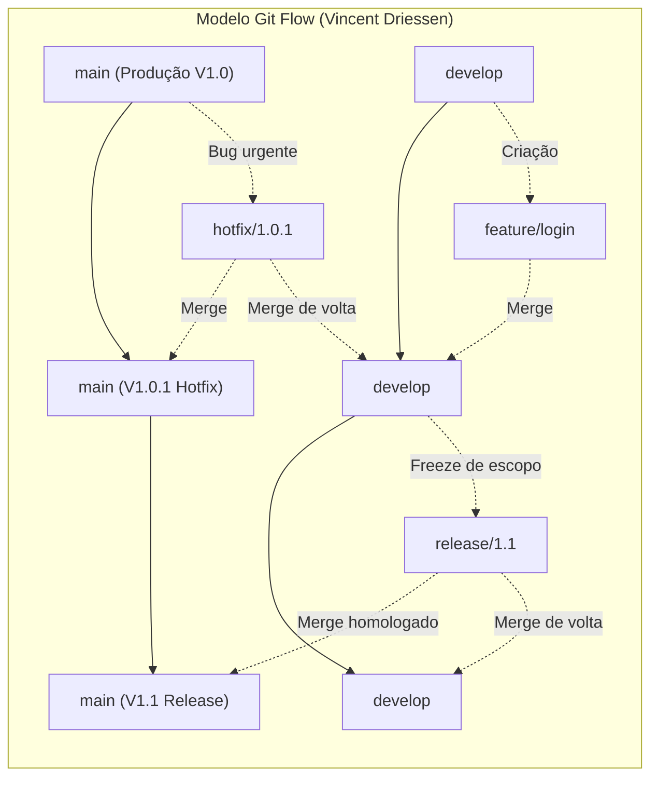
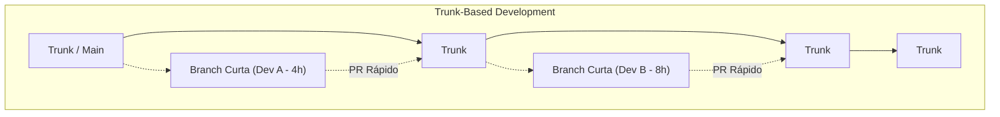
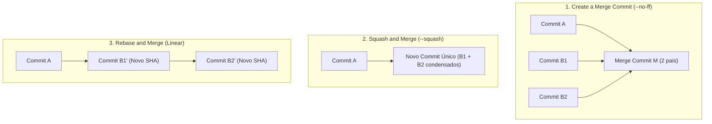

# 02 - Estratégias de Branching e Plataformas Git Colaborativas

> **Matéria:** DevOps, Plataforma de Desenvolvimento e Engenharia de Entrega  
> **Cargo:** B02 – Técnico de Controle Externo – Especialidade: Tecnologia da Informação  
> **Arquivo:** `02_git_estrategias_de_branching_e_plataformas_colaborativas.md`  

---

## 📌 Ementa / Itens do Edital
- Plataformas de hospedagem, colaboração e automação baseadas em Git: GitHub e GitLab
- Estratégias de branching (fluxos de ramificação): Git Flow, Trunk-Based Development, GitHub Flow e GitLab Flow
- Fluxo de trabalho com Pull Requests (GitHub) e Merge Requests (GitLab)
- Estratégias de mesclagem (Merge Commit, Squash and Merge, Rebase and Merge)
- Políticas de proteção de branches, governança de código e arquivos de configuração (`CODEOWNERS`)

---

## 🌳 Classificação Hierárquica

```text
2. Estratégias de Branching e Colaboração em Plataformas Git
├── 2.1 Modelos e Estratégias de Branching
│   ├── 2.1.1 Modelo Git Flow (Vincent Driessen):
│   │   ├── Ramos Permanentes (Long-Lived): `main` (código de produção estável) e `develop` (integração contínua de funcionalidades)
│   │   ├── Ramos Temporários / Suporte (Short-Lived):
│   │   │   ├── `feature/*`: Nascem de `develop` e são integrados de volta em `develop`
│   │   │   ├── `release/*`: Nascem de `develop` (quando o escopo está fechado), recebem correções de homologação e são mesclados em `main` (com tag semântica) E em `develop`
│   │   │   └── `hotfix/*`: Nascem diretamente de `main` (correção crítica urgente em produção) e são mesclados em `main` (com tag) E em `develop`
│   │   └── Aplicabilidade: Softwares com ciclos de lançamento formalizados por versão e empacotamento tradicional; menos indicado para CI/CD de múltiplos deploys diários
│   ├── 2.1.2 Trunk-Based Development (TBD):
│   │   ├── Filosofia Central: Todos os membros da equipe integram alterações com alta frequência (ao menos diariamente) no ramo principal (`trunk` / `main`)
│   │   ├── Ramos de Vida Curtíssima (*Short-Lived Feature Branches* - poucas horas a 1 ou 2 dias) ou commits diretos no trunk
│   │   ├── Prática de Desacoplamento: Feature Flags / Feature Toggles (código em produção desabilitado via configuração lógica)
│   │   ├── Prática Arquitetural: Branch by Abstraction para refatorações profundas no trunk
│   │   └── Benefícios: Eliminação do "Merge Hell", suporte pleno à Integração Contínua (CI) e métricas DORA de alta performance
│   ├── 2.1.3 Modelo GitHub Flow:
│   │   ├── Princípio: A branch `main` é permanentemente implantável e pronta para produção
│   │   └── Ciclo: Cria-se branch descritiva a partir de `main` -> Commits frequentes -> Pull Request -> Revisão e testes -> Deploy -> Merge em `main`
│   └── 2.1.4 Modelo GitLab Flow:
│       ├── GitLab Flow com Branches de Ambiente (ex.: `main` -> `pre-production` -> `production`)
│       └── GitLab Flow com Branches de Versão / Release (para suporte a versões retroativas com backport de patches)
├── 2.2 Estratégias de Integração no Botão de Merge (PR / MR)
│   ├── 2.2.1 Merge Commit (`git merge --no-ff`): Preserva todos os commits da branch e cria um nó explícito de junção com dois commits pais
│   ├── 2.2.2 Squash and Merge (`git merge --squash`): Condensa todos os commits intermediários em um único commit atômico no branch de destino
│   └── 2.2.3 Rebase and Merge (`git rebase`): Reaplica linearmente os commits sobre a ponta do branch de destino sem criar nó de merge (histórico estritamente linear)
└── 2.3 Governança, Políticas de Proteção e Revisão Colaborativa
    ├── 2.3.1 Regras de Proteção de Branches (Branch Protection Rules):
    │   ├── Bloqueio de *Push Direto* e de *Force Push* (`git push --force`) na branch `main`
    │   ├── Bloqueio de exclusão da branch principal
    │   ├── Exigência de Aprovação por Pares (mínimo de revisores antes do merge)
    │   └── Exigência de Aprovação em Verificações de Status do CI (*Required Status Checks*)
    ├── 2.3.2 Arquivo `CODEOWNERS`: Atribuição mandatória de revisões de código baseada em diretórios ou extensões
    └── 2.3.3 Diferenças Terminológicas entre Plataformas: GitHub (Pull Request, Actions) vs. GitLab (Merge Request, GitLab CI)
```

---

## 📖 Resumo Teórico & Pontos-Chave Aprofundados

### 1. Modelos de Branching: Git Flow vs. Trunk-Based Development vs. GitHub Flow

A estratégia de ramificação define como os desenvolvedores colaboram e como o código flui desde o rascunho local até a implantação em produção. Escolher o modelo inadequado é a principal causa do chamado *"Merge Hell"* (conflitos massivos e dolorosos ao tentar juntar branches que divergiram por semanas).



#### A. Detalhamento do Git Flow
Criado em 2010 por Vincent Driessen, foi projetado para softwares que seguem lançamentos tradicionais com versionamento semântico rígido (ex.: aplicativos móveis, pacotes de desktop, sistemas com cronograma de entrega fixo).

1. **Ramos Perenes (Long-Lived Branches):**
   - `main` (ou `master`): Contém estritamente o código que está rodando em produção. Cada commit na `main` representa uma nova versão e deve ser anotado com uma *Git Tag* (ex.: `v1.0.0`).
   - `develop`: Contém o código integrado com as funcionalidades mais recentes já aprovadas para o próximo lançamento planejado.
2. **Ramos Temporários (Supporting / Short-Lived Branches):**
   - `feature/*`: Nascem **a partir de `develop`** e retornam obrigatoriamente para **`develop`**. Servem para desenvolver novas funcionalidades.
   - `release/*`: Nascem **a partir de `develop`** quando todas as funcionalidades planejadas estão concluídas. Durante a existência da branch de release, apenas correções de bugs de homologação, ajustes de documentação e geração de metadados de versão são permitidos. Quando finalizada, é mesclada na **`main`** (com tag) E de volta na **`develop`**.
   - `hotfix/*`: Nascem **diretamente de `main`** para solucionar incidentes críticos que não podem esperar o próximo ciclo de release. Ao ser concluída, é mesclada na **`main`** E também na **`develop`** (para garantir que o próximo release não reintroduza o bug corrigido).

> 🚨 **ALERTA DE PROVA / PEGADINHA FCC:**  
> A FCC adora cobrar para onde deve ser feito o merge de uma branch de **`hotfix`** ou de **`release`** no Git Flow. Memorize:  
> - **`hotfix`:** Nasce de `main` $\rightarrow$ Faz merge em **`main` E `develop`**!  
> - **`release`:** Nasce de `develop` $\rightarrow$ Faz merge em **`main` E `develop`**!  
> Se o candidato responder que o hotfix só faz merge na `main`, errará a questão!

---

#### B. Trunk-Based Development (TBD)
O Trunk-Based Development é o modelo adotado por empresas como Google, Meta e pelas organizações com alta maturidade em DevOps e práticas de Entrega Contínua (apontado com destaque pelos relatórios DORA).



- **Premissa:** Existe apenas um ramo principal (`trunk` ou `main`).
- Todos os desenvolvedores integram seu trabalho ao `trunk` com altíssima frequência (múltiplas vezes ao dia).
- Se branches secundárias forem utilizadas, elas devem ser **de curtíssima duração (*short-lived feature branches*)**, durando poucas horas ou no máximo 1 a 2 dias.
- **Como gerenciar tarefas complexas sem quebrar o trunk?**
  1. **Feature Flags / Feature Toggles:** O código de uma funcionalidade ainda incompleta é mesclado no trunk e até mesmo implantado em produção, mas protegido por uma condicional booleana que mantém o recurso invisível aos usuários até que esteja concluído e testado.
  2. **Branch by Abstraction:** Cria-se uma camada de abstração (interface) para substituir gradualmente um componente legado por um novo no trunk, sem interromper o funcionamento do sistema existente.

#### C. Comparativo Síntese entre Modelos de Ramificação

| Característica | Git Flow | Trunk-Based Development (TBD) | GitHub Flow | GitLab Flow (Environment) |
| :--- | :--- | :--- | :--- | :--- |
| **Complexidade** | Alta (múltiplos ramos com regras estritas) | Muito Baixa | Mínima | Moderada |
| **Ramos Principais** | 2 (`main` e `develop`) | 1 (`trunk` / `main`) | 1 (`main`) | 1 principal + ramos por ambiente |
| **Vida Útil das Branches** | Longa (dias, semanas ou meses) | Curtíssima (horas a no máximo 1-2 dias) | Curta (enquanto dura a tarefa) | Curta para features; perenes para ambientes |
| **Frequência de Deploys** | Baixa a Média (ciclos de release agendados) | Contínua (várias vezes ao dia sob demanda) | Contínua (a cada PR aprovado) | Progressiva por ambiente (homolog $\rightarrow$ prod) |
| **Resolução de Conflitos** | Frequente e complexa (*merge hell*) | Precoce e trivial (poucas linhas alteradas) | Simples | Simples |
| **Dependência de Feature Flags** | Rara / Opcional | **Crítica / Essencial** | Opcional | Opcional |
| **Aderência a CI/CD Moderno** | Baixa (cria silos em branches paralelas) | **Máxima (recomendado pelo DORA)** | Alta para microsserviços/web | Alta para pipelines corporativos com governança |

---

### 2. Estratégias de Integração no Botão de Merge (PR / MR)

Quando uma *Pull Request* (GitHub) ou *Merge Request* (GitLab) é aprovada, a plataforma oferece três estratégias distintas para integrar os commits no ramo alvo:



#### 2.1 Create a Merge Commit (`git merge --no-ff`)
- Cria um novo commit especial que possui **dois commits pais**: a ponta da branch principal e a ponta da branch que está sendo integrada.
- **Vantagem:** Preserva rigorosamente o histórico original, o contexto de cada commit individual e a informação exata de que uma ramificação ocorreu.
- **Desvantagem:** Pode poluir visualmente a árvore do repositório com grafos complexos e múltiplos commits desnecessários do tipo *"wip", "fix typo", "ajustando teste"*.

#### 2.2 Squash and Merge (`git merge --squash`)
- Pega todos os commits da branch de funcionalidade, une suas alterações em um único bloco e cria **apenas um commit novo** na branch de destino com uma mensagem de resumo descritiva.
- **Vantagem:** Mantém o histórico da branch principal extremamente limpo, legível e linear. Cada commit no trunk representa uma entrega atômica e coesa. Facilita o comando `git bisect` e o `git revert`.
- **Desvantagem:** Perde o histórico granular detalhado dos passos intermediários realizados pelo desenvolvedor.

#### 2.3 Rebase and Merge (`git rebase`)
- Reaplica os commits individuais da branch de trabalho sequencialmente sobre a ponta atual da branch principal.
- Não cria commit de merge intermediário. O histórico torna-se uma linha reta perfeitamente linear.
- **Ponto de atenção:** Os hashes SHA-1 dos commits originais são reescritos, gerando novos identificadores de commit.

---

### 3. Governança, Regras de Proteção de Branches e `CODEOWNERS`

Em órgãos públicos como Tribunais de Contas e Secretarias de Fazenda, o repositório de código é um ativo de segurança nacional sujeito a auditorias de integridade. A governança das plataformas Git é implementada através de:

#### 3.1 Regras de Proteção de Branch (*Branch Protection Rules*)
- **Bloqueio de Push Direto:** Desenvolvedores são impedidos de executar `git push origin main`. Qualquer alteração precisa obrigatoriamente tramitar via *Pull Request*.
- **Bloqueio de *Force Push* (`--force`):** Impede a reescrita maliciosa ou acidental do histórico da branch protegida.
- **Bloqueio de Exclusão:** Impede que comandos como `git push origin --delete main` destruam o ramo principal.
- **Revisão Obrigatória por Pares (*Required Pull Request Reviews*):** Exige a aprovação explícita de ao menos um (ou mais) revisores antes que o botão de merge seja liberado.
- **Status Checks Mandatórios (*Require Status Checks to Pass*):** Exige que suítes de testes, linters e scanners de segurança executados pelos runners de CI terminem com sucesso (código de saída 0).
- **Assinatura de Commits Obrigatória (*Require Signed Commits*):** Exige chaves GPG ou SSH para comprovar criptograficamente a autoria de quem comitou.

#### 3.2 O Arquivo `CODEOWNERS`
O arquivo `CODEOWNERS` (alocado na raiz, em `.github/` ou em `.gitlab/`) define formalmente quais equipes ou indivíduos são proprietários e responsáveis por partes específicas da base de código. Quando uma PR altera um arquivo mapeado, os proprietários correspondentes são atribuídos compulsoriamente como revisores bloqueantes.

Sintaxe típica:
```text
# O time core é dono de tudo por padrão:
*       @orgao/time-arquitetura

# O time de segurança deve aprovar compulsoriamente mudanças em autenticação:
/src/auth/      @orgao/time-seguranca-app
/config/jwt/    @orgao/time-seguranca-app

# Especialistas em banco de dados para migrações SQL:
*.sql           @orgao/time-dbas
/database/      @orgao/time-dbas
```

---

## 🌐 Fontes Recomendadas na Internet

### 1. Referências Oficiais de Estratégias de Branching
- [Trunk Based Development Official Reference](https://trunkbaseddevelopment.com/): Portal canônico de referência sobre Trunk-Based Development (TBD), cobrindo ramificações de vida curta (*short-lived feature branches*), integração direta com CI e estratégias de *branch by abstraction*.
- [A Successful Git Branching Model (Vincent Driessen)](https://nvie.com/posts/a-successful-git-branching-model/): Artigo original histórico que formalizou o modelo Git Flow, detalhando a mecânica dos ramos perenes (`main`, `develop`) e transitórios (`feature`, `release`, `hotfix`).
- [Feature Toggles / Feature Flags (Martin Fowler)](https://martinfowler.com/articles/feature-toggles.html): Artigo clássico indispensável que detalha como desacoplar o deploy do código da liberação de funcionalidades de negócio em produção.

### 2. Documentação Oficial das Plataformas Colaborativas
- [GitHub Docs - Regras de Proteção de Branches (pt-BR)](https://docs.github.com/pt/repositories/configuring-branches-and-merges-in-your-repository/managing-protected-branches/about-protected-branches): Guia oficial sobre imposição de revisões de código obrigatórias, bloqueio de *force push*, restrições via `CODEOWNERS` e exigência de checks de CI aprovados.
- [GitLab Flow Documentation](https://docs.gitlab.com/ee/topics/gitlab_flow.html): Comparativo oficial do GitLab entre Git Flow, GitHub Flow e GitLab Flow com branches baseadas em ambientes.

---

## 📝 Questões Comentadas & Exemplos (Padrão FCC)

### Questão 1 (FCC - Adaptada / TI - Modelos de Branching: Git Flow)
No modelo de desenvolvimento e controle de versões conhecido como **Git Flow**, concebido por Vincent Driessen, há ramos com tempos de vida diferentes que atendem a papéis bem definidos no ciclo de lançamento de um software. Considere uma situação em que uma falha de segurança gravíssima é detectada na versão que se encontra atualmente em execução no ambiente de produção de uma Secretaria Estadual.

De acordo com as convenções formais do Git Flow, a equipe de sustentação deve:  
A) Criar um branch de `hotfix` derivado da branch `develop`, implementar a correção, testar e realizar o merge exclusivamente na branch `feature`, descartando o branch `main`.  
B) Criar um branch de `hotfix` derivado diretamente da branch `main`, implementar a correção necessária e, após os testes, realizar o merge dessa correção tanto na branch `main` quanto na branch `develop`.  
C) Criar um branch temporário de `release` derivado de `main` e, após a aplicação do patch, fundi-lo apenas na branch `release` anterior sem interagir com `main`.  
D) Aplicar a alteração diretamente no servidor de produção via terminal SSH, uma vez que o Git Flow proíbe a criação de ramos emergenciais quando a branch `main` já possui uma tag vinculada.  
E) Criar um branch de `feature` a partir de `develop`, aguardar a janela de homologação semestral e realizar o merge apenas em `develop`, mantendo o ambiente de produção com a vulnerabilidade ativa até o próximo grande lançamento.

> **Gabarito: B**  
> **Comentário Analítico Passo a Passo:**  
> - **A está INCORRETA:** Um branch de `hotfix` não nasce de `develop`, mas sim de `main`, pois se destina a corrigir a versão exata que está em produção. Além disso, mesclá-lo apenas em `feature` deixaria o ambiente de produção vulnerável.  
> - **B está CORRETA:** Conforme as especificações originais do Git Flow, o branch de `hotfix` é o único tipo de ramificação temporária que nasce diretamente da branch `main` (para corrigir bugs críticos de produção). Ao concluir o ajuste, a regra de ouro do Git Flow exige que o merge seja efetuado **na `main`** (gerando uma nova subversão/tag, ex.: `1.0.1`) **E também na `develop`**, garantindo que a correção seja absorvida pelo fluxo contínuo de desenvolvimento e não seja sobrescrita no próximo release.  
> - **C está INCORRETA:** Branches de `release` nascem de `develop` para congelar o escopo de uma nova versão planejada, não sendo utilizadas para correções emergenciais em produção.  
> - **D está INCORRETA:** Fazer alterações diretas em servidores sem controle de versão é uma violação grave de boas práticas de DevOps e governança pública de TI. O Git Flow provê suporte nativo para esse cenário justamente com o ramo de `hotfix`.  
> - **E está INCORRETA:** Correções urgentes em produção não podem aguardar o fluxo moroso de branches de `feature`, cuja finalidade é o desenvolvimento de novas funcionalidades.

---

### Questão 2 (FCC - Adaptada / TI - Trunk-Based Development vs. Git Flow e Feature Flags)
Em uma instituição que busca atingir os mais altos níveis de desempenho avaliados pelas métricas DORA (*Deployment Frequency* de múltiplos deploys diários e *Lead Time for Changes* inferior a 1 hora), a equipe de arquitetura decidiu migrar do modelo Git Flow para o **Trunk-Based Development (TBD)**.

A respeito do Trunk-Based Development e de seus habilitadores técnicos, assinale a afirmativa correta:  
A) O Trunk-Based Development exige a criação de ramos de desenvolvimento que fiquem isolados por pelo menos trinta dias, assegurando que o código nunca seja compartilhado antes de passar por uma auditoria manual externa.  
B) No Trunk-Based Development, para permitir que desenvolvedores integrem código ao ramo principal com alta frequência sem disponibilizar funcionalidades incompletas aos usuários finais em produção, utiliza-se a técnica de *Feature Flags* (ou *Feature Toggles*).  
C) O modelo Trunk-Based Development proíbe a execução de testes automatizados no pipeline de Integração Contínua para não desacelerar os merges diários no ramo principal.  
D) No Trunk-Based Development, é mandatório manter duas branches permanentes em paralelo: uma denominada `trunk` e outra denominada `develop`, ambas recebendo commits ao mesmo tempo.  
E) A prática de *Branch by Abstraction* consiste em abrir uma branch no repositório remoto para cada desenvolvedor individual, a qual nunca sofrerá merge com o trunk até o fim do projeto.

> **Gabarito: B**  
> **Comentário Analítico Passo a Passo:**  
> - **A está INCORRETA:** O Trunk-Based Development preconiza o extremo oposto: branches de vida curtíssima (*short-lived branches*, de algumas horas ou no máximo 1-2 dias) ou commits frequentes no branch principal, eliminando o isolamento prolongado de código.  
> - **B está CORRETA:** O grande desafio de comitar código com alta frequência no *trunk* é lidar com tarefas complexas que demoram dias para serem finalizadas. O mecanismo fundamental que resolve isso é o uso de **Feature Flags / Feature Toggles**: o código inacabado é integrado ao branch principal e até implantado em produção, mas envolto em uma condicional que mantém o comportamento inativo para o usuário final até que esteja totalmente concluído.  
> - **C está INCORRETA:** O TBD depende criticamente de suítes de testes automatizados e builds rápidos no CI a cada commit. Sem CI robusto, o trunk quebraria continuamente.  
> - **D está INCORRETA:** No TBD há **apenas um ramo perene** (`trunk` ou `main`). A existência de um ramo `develop` paralelo de vida longa é a característica típica do Git Flow.  
> - **E está INCORRETA:** *Branch by Abstraction* não é uma ramificação no Git, mas sim um padrão de projeto no código-fonte que introduz uma camada abstrata intermediária para permitir refatorações profundas no próprio *trunk*, coexistindo o código legado e o novo até a migração completa.

---

### Questão 3 (FCC - Adaptada / TI - Estratégias de Merge em Pull Requests)
Durante a revisão de uma *Pull Request* no GitHub para integração de um microsserviço de arrecadação tributária, um desenvolvedor submeteu 12 commits intermediários contendo mensagens como `"wip"`, `"ajustando indentacao"`, `"corrigindo erro de digitacao"` e `"mais um teste"`. O líder técnico determinou que o merge fosse efetuado utilizando a estratégia **Squash and Merge**.

O principal benefício técnico proporcionado pela estratégia de **Squash and Merge** nessa situação é:  
A) Clonar o repositório em uma máquina externa sem transferir as credenciais de segurança do Git.  
B) Converter a branch em um contêiner Docker para execução automática antes da compilação.  
C) Combinar todos os 12 commits fragmentados da branch secundária em um único commit coeso e descritivo na branch principal (`main`), mantendo o histórico de produção limpo e facilitando eventuais reversões (*git revert*).  
D) Preservar todos os nós de commit individuais e gerar um commit com três nós pais obrigatórios no grafo do Git.  
E) Reescrever os certificados digitais de commit do autor para mascarar a autoria de quem realizou a modificação no código.

> **Gabarito: C**  
> **Comentário Analítico Passo a Passo:**  
> - **A está INCORRETA:** Squash and Merge é uma operação de manipulação da árvore de commits do Git durante a integração de ramos, não tendo qualquer relação com clonagem em máquinas externas ou segredos de conexão.  
> - **B está INCORRETA:** A operação de merge não converte branches em contêineres Docker; isso seria papel de um pipeline de build/empacotamento de CI.  
> - **C está CORRETA:** A funcionalidade de **Squash and Merge** unifica (achata) todas as modificações dos múltiplos commits da branch de origem em um único commit aplicado sobre o branch alvo. Isso elimina o ruído de commits intermediários ou mensagens desleixadas (`"wip"`, `"ajustes"`), resultando em um histórico da `main` linear, limpo e legível. Se houver falha, reverter a entrega inteira exige apenas um comando `git revert <hash_do_commit_único>`.  
> - **D está INCORRETA:** Preservar todos os commits e criar um nó de junção é a característica do *Merge Commit* tradicional (`--no-ff`), que possui exatamente dois pais, e não três.  
> - **E está INCORRETA:** A finalidade do Squash não é mascarar ou falsificar a autoria das modificações, mantendo-se o autor original das alterações no metadado do commit gerado.

---

### Questão 4 (FCC - Adaptada / TI - Governança de Repositórios e Políticas de Proteção)
Para implementar controles rigorosos de segurança e conformidade em um repositório institucional hospedado no GitHub, a administração de TI de um Tribunal de Contas deseja assegurar que:
1. Nenhum desenvolvedor consiga sobrescrever o histórico da branch `main` utilizando o comando `git push --force`.
2. Todo código passe compulsoriamente por testes automatizados antes de ser mesclado.
3. Quaisquer alterações em arquivos de configuração de banco de dados (`/database/`) exijam a aprovação explícita da equipe de DBAs.

Para atingir esses três objetivos, a configuração necessária envolve, respectivamente:  
A) Desativar o pipeline de CI; habilitar a opção *Allow force pushes*; e criar um arquivo `.gitignore` listando a pasta `/database/`.  
B) Ativar as regras de proteção de branch (*Branch Protection Rules*) bloqueando *force pushes*; configurar *Required status checks* vinculados ao job de testes do CI; e configurar o arquivo `CODEOWNERS` mapeando o caminho `/database/` para a equipe de DBAs com aprovação obrigatória.  
C) Atribuir a todos os usuários o perfil de *Owner* do repositório; habilitar o acesso anônimo via HTTP; e apagar o histórico de commits anteriores da branch principal.  
D) Configurar o GitLab Runner em modo compartilhado sem restrição de tags; habilitar a flag `fast-forward only`; e renomear os arquivos `.sql` para `.txt`.  
E) Revogar o acesso de leitura de todos os membros da equipe e realizar commits manuais em produção utilizando um pendrive criptografado.

> **Gabarito: B**  
> **Comentário Analítico Passo a Passo:**  
> - **A está INCORRETA:** Habilitar *force pushes* permitiria reescrever o histórico (o oposto do desejado), e colocar `/database/` no `.gitignore` faria o Git ignorar esses arquivos, impedindo seu versionamento.  
> - **B está CORRETA:** As três ferramentas de governança do GitHub/GitLab atendem precisamente aos requisitos:  
>   1. *Branch Protection Rules* com bloqueio de *force push* protege a integridade e rastreabilidade do histórico da branch `main`.  
>   2. *Required Status Checks* garante que o botão de merge só seja habilitado se os pipelines de testes automatizados do CI passarem com sucesso.  
>   3. O arquivo `CODEOWNERS` permite associar padrões de arquivos e diretórios (`/database/ @time-dbas`) a times específicos, exigindo compulsoriamente a aprovação desses donos de código antes da conclusão do merge da *Pull Request*.  
> - **C está INCORRETA:** Dar perfil de Owner para todos os usuários elimina qualquer segregação de funções e destrói os mecanismos de proteção do repositório.  
> - **D está INCORRETA:** Renomear arquivos `.sql` para `.txt` e alterar flags de fast-forward não provê controle de aprovação por papéis nem protege o histórico contra reescrita forçada.  
> - **E está INCORRETA:** Proposta descabida que inviabiliza o trabalho colaborativo moderno e desrespeita práticas de governança e DevOps.

---

### Questão 5 (FCC - Adaptada / TI - GitHub Flow e GitLab Flow)
Em relação aos modelos de ramificação simplificados com foco em ambientes de computação em nuvem, assinale a afirmativa correta sobre o **GitHub Flow** e o **GitLab Flow**:  
A) No GitHub Flow, o código deve ser obrigatoriamente submetido a aprovação de pelo menos quatro ramos intermediários (`develop`, `homolog`, `staging` e `canary`) antes que qualquer branch de tarefa possa ser criada.  
B) O GitLab Flow com branches de ambiente (*Environment Branches*) propõe que alterações fluam sequencialmente entre ramos representativos de infraestrutura (por exemplo, da branch `main` para `pre-production`, e desta para `production`), mantendo a rastreabilidade do que está implantado em cada estágio.  
C) No GitHub Flow, o branch `main` nunca reflete o código de produção, servindo apenas para testes de protótipos que são descartados semanalmente.  
D) No GitLab Flow, é proibido o uso de *Merge Requests*, sendo a sincronização entre branches realizada exclusivamente por comandos de upload via FTP.  
E) Tanto o GitHub Flow quanto o GitLab Flow rejeitam completamente o uso do sistema Git, exigindo ferramentas baseadas em controle de versão centralizado (SVN).

> **Gabarito: B**  
> **Comentário Analítico Passo a Passo:**  
> - **A está INCORRETA:** O GitHub Flow é caracterizado pela simplicidade extrema: não existem múltiplos ramos intermediários perenes; apenas a branch `main` e as branches curtas de funcionalidade criadas diretamente a partir dela.  
> - **B está CORRETA:** O GitLab Flow adapta a agilidade do GitHub Flow para realidades corporativas que possuem múltiplos ambientes de homologação e produção formalmente separados. Ele introduz *branches de ambiente* (como `pre-production` e `production`): quando o código é aprovado e integrado na `main`, um merge da `main` para `pre-production` aciona o deploy no ambiente de testes/homologação; uma vez validado, um merge de `pre-production` para `production` aciona o deploy produtivo.  
> - **C está INCORRETA:** No GitHub Flow, o princípio basilar e inviolável é: *"Anything in the main branch is deployable"* (qualquer coisa na branch main está pronta para implantação em produção).  
> - **D está INCORRETA:** O GitLab Flow apoia-se intensamente no mecanismo central de *Merge Requests* (MRs), onde ocorrem as discussões, execuções de pipelines de CI e aprovações.  
> - **E está INCORRETA:** Ambos são modelos de fluxo de trabalho desenhados especificamente para o ecossistema Git distribuído, e não para sistemas legados centralizados como Apache Subversion (SVN).
