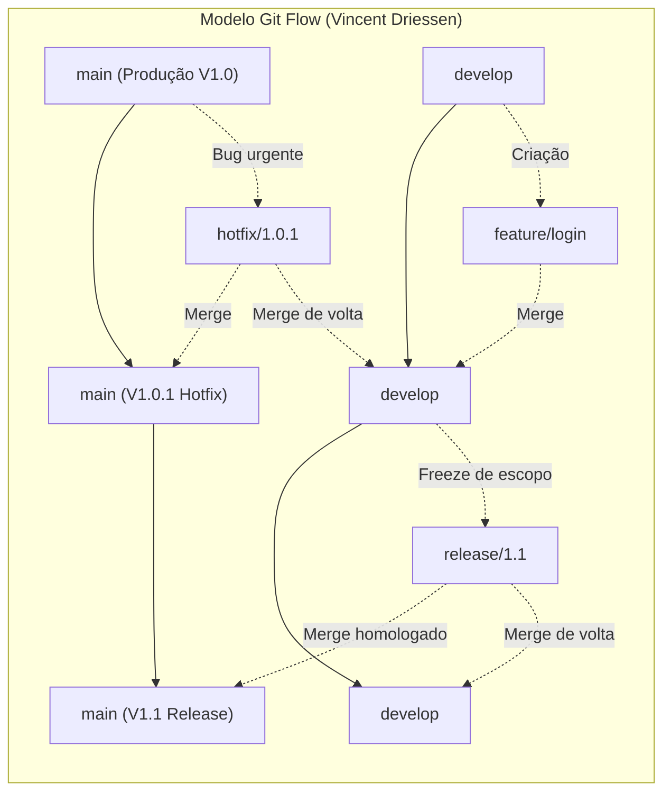
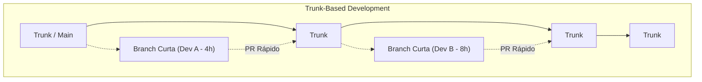
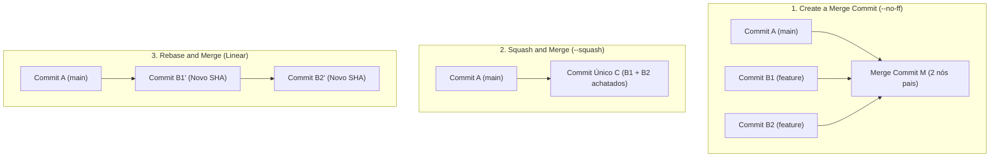

# 02 - Estratégias de Branching e Plataformas Git Colaborativas

> **Matéria:** DevOps, Plataforma de Desenvolvimento e Engenharia de Entrega  
> **Cargo:** B02 – Técnico de Controle Externo – Especialidade: Tecnologia da Informação  
> **Arquivo:** `02_git_estrategias_de_branching_e_plataformas_colaborativas.md`  

---

## 📌 Ementa / Itens do Edital
- Plataformas de hospedagem, colaboração e automação baseadas em Git: GitHub e GitLab
- Estratégias de branching (fluxos de ramificação): Git Flow, Trunk-Based Development, GitHub Flow e GitLab Flow
- Fluxo de trabalho com Pull Requests (GitHub) e Merge Requests (GitLab)
- Estratégias de mesclagem (Merge Commit, Squash and Merge, Rebase and Merge)
- Políticas de proteção de branches, governança de código e arquivos de configuração (`CODEOWNERS`)

---

## 🧭 Sumário
- [1. Modelos e Estratégias de Branching](#1-modelos-e-estratégias-de-branching)
  - [1.1 O Modelo Git Flow: Ramos Perenes e Ramos Temporários](#11-o-modelo-git-flow-ramos-perenes-e-ramos-temporários)
  - [1.2 Trunk-Based Development (TBD): Filosofia, Feature Flags e Branch by Abstraction](#12-trunk-based-development-tbd-filosofia-feature-flags-e-branch-by-abstraction)
  - [1.3 O Modelo GitHub Flow](#13-o-modelo-github-flow)
  - [1.4 O Modelo GitLab Flow (Ambientes e Versões)](#14-o-modelo-gitlab-flow-ambientes-e-versões)
  - [1.5 Matriz Comparativa Síntese entre os Modelos de Ramificação](#15-matriz-comparativa-síntese-entre-os-modelos-de-ramificação)
- [2. Estratégias de Integração e Mesclagem (Merge Commit, Squash e Rebase)](#2-estratégias-de-integração-e-mesclagem-merge-commit-squash-e-rebase)
  - [2.1 Create a Merge Commit (`git merge --no-ff`)](#21-create-a-merge-commit-git-merge---no-ff)
  - [2.2 Squash and Merge (`git merge --squash`)](#22-squash-and-merge-git-merge---squash)
  - [2.3 Rebase and Merge (`git rebase`)](#23-rebase-and-merge-git-rebase)
- [3. Governança, Regras de Proteção de Branches e `CODEOWNERS`](#3-governança-regras-de-proteção-de-branches-e-codeowners)
  - [3.1 Regras de Proteção de Branches (Branch Protection Rules)](#31-regras-de-proteção-de-branches-branch-protection-rules)
  - [3.2 O Arquivo `CODEOWNERS` e Revisões Bloqueantes](#32-o-arquivo-codeowners-e-revisões-bloqueantes)
  - [3.3 Comparativo Terminológico e Operacional: GitHub vs. GitLab](#33-comparativo-terminológico-e-operacional-github-vs-gitlab)
- [4. Questões Comentadas & Prática Padrão FCC](#4-questões-comentadas--prática-padrão-fcc)

---

## 1. Modelos e Estratégias de Branching

A estratégia de ramificação (*branching strategy*) estabelece as regras e convenções que orientam como desenvolvedores criam branches, integram códigos, isolam novas funcionalidades e estabilizam versões para publicação. A escolha inadequada de um modelo de ramificação é a principal causadora do chamado **"Merge Hell"** — o cenário traumático em que múltiplas branches isoladas divergem por semanas ou meses, acumulando centenas de conflitos de mesclagem de resolução complexa e arriscada.



### 1.1 O Modelo Git Flow: Ramos Perenes e Ramos Temporários

Formalizado por Vincent Driessen em 2010, o **Git Flow** foi concebido para produtos de software que operam com ciclos de lançamento formais e programados com versionamento semântico estrito (como distribuições empacotadas para desktop, aplicativos de smartphone em lojas de apps e sistemas legados com janelas mensais ou trimestrais de homologação).

O Git Flow define rigorosamente duas categorias de branches:

#### 1. Ramos Perenes (Long-Lived Branches)
Permanecem ativos durante todo o ciclo de vida do repositório:
- **`main` (ou `master`):** Armazena exclusivamente o código em estado de prontidão para produção ou que já está rodando nos servidores produtivos. Cada commit na branch `main` representa um release oficial de software e deve ser compulsoriamente etiquetado com uma tag semântica (ex.: `v1.0.0`, `v1.1.0`).
- **`develop`:** Atua como o ramo integrador do trabalho contínuo de desenvolvimento. Reúne as funcionalidades concluídas e testadas que comporão o próximo lançamento planejado.

#### 2. Ramos Temporários de Suporte (Short-Lived / Supporting Branches)
Possuem ciclo de vida efêmero e regras rígidas de derivação e mesclagem:
- **`feature/*`:** Nascem **exclusivamente a partir de `develop`** e realizam merge de volta **obrigatoriamente em `develop`**. São utilizadas por equipes para implementar funcionalidades específicas sem interferir no trabalho alheio.
- **`release/*`:** Nascem **a partir de `develop`** quando o conjunto de funcionalidades planejadas para a próxima versão está finalizado (*code freeze*). Durante a existência da branch de release, é proibida a adição de novas funcionalidades; realizam-se apenas correções de defeitos identificados em homologação, ajustes finos de documentação e bump de versão. Ao ser finalizada e homologada, a branch de release é mesclada na **`main`** (recebendo uma tag) **E também na `develop`** (para repassar os ajustes de homologação ao fluxo principal).
- **`hotfix/*`:** Nascem **diretamente a partir de `main`** para solucionar incidentes críticos de segurança ou bugs impeditivos em produção que não podem aguardar o próximo ciclo formal de release. Uma vez testada e validada, a branch de hotfix deve ser mesclada na **`main`** (com nova subversão de patch, ex.: `v1.0.1`) **E compulsoriamente na `develop`**, impedindo que lançamentos futuros reintroduzam a falha que acabara de ser corrigida.

> 🚨 **ALERTA DE PROVA / PEGADINHA FCC:**  
> A FCC adora cobrar o destino de mesclagem das branches temporárias de **`hotfix`** e de **`release`** no Git Flow:
> - **`hotfix`:** Deriva de `main` $\rightarrow$ Realiza merge **em `main` E em `develop`**!
> - **`release`:** Deriva de `develop` $\rightarrow$ Realiza merge **em `main` E em `develop`**!
> Se a alternativa afirmar que o hotfix ou a release faz merge apenas na `main`, a afirmativa está incorreta!

### 1.2 Trunk-Based Development (TBD): Filosofia, Feature Flags e Branch by Abstraction

O **Trunk-Based Development (TBD)** é o modelo de ramificação preconizado pelas organizações de alta performance tecnológica (como Google, Meta, Netflix) e referendado com destaque empírico nas pesquisas do **DORA** (*State of DevOps Report*).



- **Filosofia Central:** Existe **apenas um único ramo perene**, denominado `trunk` (ou `main`).
- Todos os desenvolvedores integram seu trabalho ao `trunk` com altíssima frequência (ao menos uma vez por dia, preferencialmente múltiplas vezes).
- Se houver uso de branches de tarefas, elas devem ser estritamente de **vida curtíssima (*short-lived feature branches*)**, durando poucas horas ou no máximo 1 a 2 dias, sendo submetidas a Pull Requests pequenos e fáceis de revisar.
- **Habilitadores Técnicos Indispensáveis:**
  1. **Feature Flags / Feature Toggles:** Como integrar ao trunk códigos de histórias de usuário complexas que levam duas semanas para serem construídas? A equipe comita e sobe o código diariamente para produção, mas o mantém envolto em uma condicional booleana (*Feature Flag*). O recurso inacabado executa em produção desativado para os cidadãos e auditores, sem risco de quebra.
  2. **Branch by Abstraction:** Padrão arquitetural em nível de código-fonte utilizado para refatorar subsistemas complexos diretamente no trunk: cria-se uma interface/abstração intermediária entre o chamador e a implementação legada; implementa-se o novo componente gradualmente; redireciona-se o chamador para a nova implementação; e expurga-se o código legado do repositório, sem a necessidade de criar branches paralelas de longa duração.

### 1.3 O Modelo GitHub Flow

Criado pela equipe do GitHub, o **GitHub Flow** é uma abordagem minimalista e centrada na web, amplamente adotada em arquiteturas de microsserviços e sistemas com entregas contínuas:

- **Premissa Inviolável:** A branch `main` é permanentemente estável e **a qualquer momento pronta para entrar em produção** (*"Anything in the main branch is deployable"*).
- **Ciclo Operacional:**
  1. Cria-se uma branch descritiva diretamente a partir da `main` (ex.: `add-oauth2-support`);
  2. Adicionam-se commits frequentes e mensagens claras;
  3. Abre-se uma *Pull Request* precocemente para iniciar a discussão técnica e executar pipelines de CI automatizados;
  4. Após aprovação em revisão por pares e nos testes automatizados, o código é implantado em produção (para validação imediata);
  5. Realiza-se o merge na branch `main` e a branch de trabalho é excluída.

### 1.4 O Modelo GitLab Flow (Ambientes e Versões)

O **GitLab Flow** une a simplicidade do GitHub Flow à necessidade corporativa de gerenciar múltiplos ambientes de infraestrutura e suporte a versões legadas:

1. **GitLab Flow com Branches de Ambiente (*Environment Branches*):**
   - Cria-se uma branch perene para cada ambiente do ciclo de vida: `main` (desenvolvimento/integração), `pre-production` (homologação/staging) e `production` (produção real).
   - O código flui em sentido único: da `main` para `pre-production`, e de `pre-production` para `production`. O merge entre essas branches dispara automaticamente o pipeline de implantação no respectivo ambiente físico, garantindo que tudo o que entra em produção passou comprovadamente por homologação.
2. **GitLab Flow com Branches de Versão (*Release Branches*):**
   - Utilizado quando uma organização precisa manter suporte a múltiplas versões ativas de um mesmo software distribuído (ex.: versões 1.x, 2.x e 3.x). Correções de bugs são aplicadas primeiro na `main` e depois retroalimentadas (*backported*) nas branches de versão ativas através de comandos `git cherry-pick`.

### 1.5 Matriz Comparativa Síntese entre os Modelos de Ramificação

| Dimensão de Análise | Git Flow | Trunk-Based Development (TBD) | GitHub Flow | GitLab Flow (Ambientes) |
| :--- | :--- | :--- | :--- | :--- |
| **Complexidade Estrutural** | **Alta** (múltiplas branches com regras estritas) | **Mínima** | Baixa | Moderada |
| **Ramos Perenes Principais** | 2 (`main` e `develop`) | 1 (`trunk` / `main`) | 1 (`main`) | 1 principal + ramos de ambiente (`prod`, `staging`) |
| **Duração das Branches** | Longa (semanas a meses) | Curtíssima (horas a no máximo 1-2 dias) | Curta (ciclo da tarefa) | Curta para features; perene para ambientes |
| **Frequência de Deploys** | Baixa/Média (janelas de release agendadas) | Contínua (múltiplas vezes ao dia sob demanda) | Contínua (a cada PR aprovado) | Progressiva por promoção de ambiente |
| **Risco de Conflitos (Merge Hell)**| **Elevado** devido ao isolamento prolongado | **Quase nulo** (resolução precoce) | Baixo | Baixo |
| **Uso de Feature Flags** | Opcional | **Crítico / Essencial** | Opcional | Recomendado |
| **Aderência ao DevOps / CI/CD** | Baixa (silos temporais em branches) | **Padrão Ouro (Recomendado DORA)** | Alta para web e microsserviços | Alta para governança corporativa |

---

## 2. Estratégias de Integração e Mesclagem (Merge Commit, Squash e Rebase)

Ao aprovar uma *Pull Request* (no GitHub) ou *Merge Request* (no GitLab), as plataformas oferecem três estratégias fundamentais para integrar os commits da branch de trabalho ao ramo de destino:



### 2.1 Create a Merge Commit (`git merge --no-ff`)

- **Operação Subjacente:** Executa um merge do tipo *no fast-forward*. Cria um nó de commit especial na árvore do Git que possui **dois nós pais**: o último commit da branch de destino e o último commit da branch de trabalho.
- **Vantagens:** Preserva integralmente o histórico original de todos os commits intermediários e a exata demarcação cronológica de que aquele conjunto de linhas foi concebido em uma branch isolada.
- **Desvantagens:** Pode transformar o grafo visual do repositório em uma "teia de espaguete" de difícil interpretação, repleta de commits triviais como *"wip"*, *"corrigindo typo"* ou *"ajuste de teste"*.

### 2.2 Squash and Merge (`git merge --squash`)

- **Operação Subjacente:** Coleta todas as modificações introduzidas pelos múltiplos commits da branch de trabalho, une-as em uma única alteração atômica e registra **um único e coeso commit novo** no topo da branch de destino, descartando os commits individuais intermediários.
- **Vantagens:** Mantém o histórico do branch principal (`main`) estritamente limpo, coeso e legível. Cada commit na `main` corresponde a uma entrega funcional completa (*atomic commit*). Facilita drasticamente a identificação de bugs via `git bisect` e a reversão de falhas em produção via um único comando `git revert <hash>`.
- **Desvantagens:** Suprime o detalhamento granular dos micro-passos dados pelo desenvolvedor durante a confecção da funcionalidade.

### 2.3 Rebase and Merge (`git rebase`)

- **Operação Subjacente:** Pega os commits individuais da branch de trabalho e os reaplica um a um sobre a ponta mais recente da branch de destino, gerando um histórico estritamente linear sem nós de merge intermediários.
- **Pontos de Atenção:** Ao reaplicar os commits, o Git recalcula os identificadores criptográficos (hashes SHA-1/SHA-256), alterando a identidade dos commits originais. Não cria nó com múltiplos pais.

---

## 3. Governança, Regras de Proteção de Branches e `CODEOWNERS`

Em instituições governamentais e órgãos de controle externo como o TCE-GO, os repositórios de código constituem ativos estratégicos sujeitos a rígidos requisitos de conformidade, trilhas de auditoria e segregação de funções.

### 3.1 Regras de Proteção de Branches (Branch Protection Rules)

As configurações de proteção de branch (*Branch Protection Rules* no GitHub ou *Protected Branches* no GitLab) impõem controles automatizados invioláveis sobre ramos críticos (especialmente `main` e `develop`):

1. **Bloqueio de Push Direto (*Require a pull request before merging*):** Impede que qualquer desenvolvedor envie commits diretamente para a branch principal sem a abertura de uma Pull Request formal.
2. **Bloqueio de Forçamento de Histórico (*Block Force Pushes*):** Desativa compulsoriamente a permissão para executar comandos `git push --force`, impedindo a reescrita deliberada ou acidental do histórico versionado.
3. **Bloqueio de Exclusão (*Prevent Branch Deletion*):** Impede que comandos administrativos apaguem a branch principal.
4. **Revisão Obrigatória por Pares (*Required Approvals*):** Condiciona o merge à aprovação formal de ao menos um (ou mais) revisores humanos qualificados, impedindo a auto-aprovação de código pelo próprio autor.
5. **Aprovação Obrigatória em Verificações de Status do CI (*Required Status Checks*):** Exige que suítes de testes unitários, checagens de linter e análises de vulnerabilidades executadas nos runners de CI reportem sucesso obrigatório antes que o botão de merge seja liberado.
6. **Assinatura Criptográfica Obrigatória (*Require Signed Commits*):** Rejeita commits que não possuam assinatura criptográfica válida (via chaves GPG ou SSH), comprovando a identidade real do autor e prevenindo falsificação de identidade (*commit spoofing*).

### 3.2 O Arquivo `CODEOWNERS` e Revisões Bloqueantes

O arquivo **`CODEOWNERS`** (alocado na raiz do repositório, dentro da pasta `.github/` ou em `.gitlab/`) permite estabelecer proprietários técnicos e papéis de governança baseados em diretórios ou extensões de arquivos:

```text
# O time de arquitetura é dono de todo o repositório por padrão:
*       @orgao-tce/time-arquitetura

# Mudanças em módulos de autenticação e criptografia exigem aprovação da equipe de segurança:
/src/auth/      @orgao-tce/time-seguranca-app
/config/jwt/    @orgao-tce/time-seguranca-app

# Migrações e scripts SQL de banco de dados exigem aprovação obrigatória dos DBAs:
*.sql           @orgao-tce/time-dbas
/database/      @orgao-tce/time-dbas
```

**Mecânica de Aplicação:** Quando um desenvolvedor abre uma *Pull Request* alterando qualquer arquivo coberto pelas regras do `CODEOWNERS`, a plataforma Git adiciona **automaticamente e de forma obrigatória** as equipes ou usuários especificados como revisores bloqueantes. O merge da PR torna-se tecnicamente impossível até que os proprietários do código tenham revisado e concedido a aprovação.

### 3.3 Comparativo Terminológico e Operacional: GitHub vs. GitLab

| Conceito / Recurso | Plataforma GitHub | Plataforma GitLab |
| :--- | :--- | :--- |
| **Proposta de Integração de Código** | **Pull Request (PR)** | **Merge Request (MR)** |
| **Pipeline de Automação CI/CD** | **GitHub Actions** (`.github/workflows/*.yml`) | **GitLab CI/CD** (`.gitlab-ci.yml`) |
| **Agente Executor de Tarefas** | **GitHub Runner** (*Hosted* ou *Self-Hosted*) | **GitLab Runner** (Shared ou Specific) |
| **Regras de Governança de Ramos** | *Branch Protection Rules* | *Protected Branches* |
| **Arquivo de Donos de Código** | `.github/CODEOWNERS` ou raiz | `.gitlab/CODEOWNERS` ou raiz |

---

## 4. Questões Comentadas & Prática Padrão FCC

### Questão 1 (FCC - Adaptada / TI - Modelos de Branching: Git Flow)
No modelo de desenvolvimento e controle de versões conhecido como **Git Flow**, concebido por Vincent Driessen, há ramos com tempos de vida diferentes que atendem a papéis bem definidos no ciclo de lançamento de um software. Considere uma situação em que uma falha de segurança gravíssima é detectada na versão que se encontra atualmente em execução no ambiente de produção de uma Secretaria Estadual.

De acordo com as convenções formais do Git Flow, a equipe de sustentação deve:  
A) Criar um branch de `hotfix` derivado da branch `develop`, implementar a correção, testar e realizar o merge exclusivamente na branch `feature`, descartando o branch `main`.  
B) Criar um branch de `hotfix` derivado diretamente da branch `main`, implementar a correção necessária e, após os testes, realizar o merge dessa correção tanto na branch `main` quanto na branch `develop`.  
C) Criar um branch temporário de `release` derivado de `main` e, após a aplicação do patch, fundi-lo apenas na branch `release` anterior sem interagir com `main`.  
D) Aplicar a alteração diretamente no servidor de produção via terminal SSH, uma vez que o Git Flow proíbe a criação de ramos emergenciais quando a branch `main` já possui uma tag vinculada.  
E) Criar um branch de `feature` a partir de `develop`, aguardar a janela de homologação semestral e realizar o merge apenas em `develop`, mantendo o ambiente de produção com a vulnerabilidade ativa até o próximo grande lançamento.

> **Comentário Detalhado:**
> - **A)** Incorreta. O branch de `hotfix` deriva de `main` (onde está o bug de produção) e não de `develop`. Fazer merge apenas em `feature` não corrigiria a produção.
> - **B)** Correta. De acordo com as especificações canônicas do Git Flow, o branch de `hotfix` deriva diretamente da branch `main` (para corrigir o estado exato de produção). Concluída a correção e os testes, o merge deve ser efetuado **na branch `main`** (gerando nova tag semântica) **E compulsoriamente na branch `develop`**, assegurando que os novos desenvolvimentos não reintroduzam a vulnerabilidade no próximo ciclo de release.
> - **C)** Incorreta. Branches de `release` nascem de `develop` para congelar o escopo de novas funcionalidades planejadas, e não para correções emergenciais.
> - **D)** Incorreta. Fazer alterações diretas em servidores sem controle de versão viola os princípios mais basilares de governança de TI. O Git Flow suporta correções emergenciais via ramo de hotfix.
> - **E)** Incorreta. Incidentes críticos de segurança em produção não podem aguardar o fluxo moroso de branches de `feature`, cuja finalidade é construir novas funcionalidades.
> 
> **Gabarito: B**

---

### Questão 2 (FCC - Adaptada / TI - Trunk-Based Development vs. Git Flow e Feature Flags)
Em uma instituição que busca atingir os mais altos níveis de desempenho avaliados pelas métricas DORA (*Deployment Frequency* de múltiplos deploys diários e *Lead Time for Changes* inferior a 1 hora), a equipe de arquitetura decidiu migrar do modelo Git Flow para o **Trunk-Based Development (TBD)**.

A respeito do Trunk-Based Development e de seus habilitadores técnicos, assinale a afirmativa correta:  
A) O Trunk-Based Development exige a criação de ramos de desenvolvimento que fiquem isolados por pelo menos trinta dias, assegurando que o código nunca seja compartilhado antes de passar por uma auditoria manual externa.  
B) No Trunk-Based Development, para permitir que desenvolvedores integrem código ao ramo principal com alta frequência sem disponibilizar funcionalidades incompletas aos usuários finais em produção, utiliza-se a técnica de *Feature Flags* (ou *Feature Toggles*).  
C) O modelo Trunk-Based Development proíbe a execução de testes automatizados no pipeline de Integração Contínua para não desacelerar os merges diários no ramo principal.  
D) No Trunk-Based Development, é mandatório manter duas branches permanentes em paralelo: uma denominada `trunk` e outra denominada `develop`, ambas recebendo commits ao mesmo tempo.  
E) A prática de *Branch by Abstraction* consiste em abrir uma branch no repositório remoto para cada desenvolvedor individual, a qual nunca sofrerá merge com o trunk até o fim do projeto.

> **Comentário Detalhado:**
> - **A)** Incorreta. O Trunk-Based Development preconiza o oposto: branches de curtíssima duração (*short-lived branches*, de algumas horas a 1 ou 2 dias) ou integração direta no trunk, eliminando branches isoladas de longa duração.
> - **B)** Correta. O habilitador técnico crucial do TBD para viabilizar entregas diárias de histórias de usuário complexas é o uso de **Feature Flags / Feature Toggles**: o código em desenvolvimento é continuamente integrado no trunk e publicado em produção, mas protegido por uma chave lógica que o mantém inativo para os usuários finais até sua validação completa.
> - **C)** Incorreta. O TBD depende criticamente da execução compulsória de testes automatizados e builds rápidos no CI a cada commit; sem eles, o trunk se tornaria instável com facilidade.
> - **D)** Incorreta. No TBD há **apenas um ramo perene** (`trunk` ou `main`). A existência de um ramo `develop` permanente paralelo é característica do Git Flow.
> - **E)** Incorreta. *Branch by Abstraction* não é um ramo no repositório Git, mas um padrão de design em código que introduz interfaces abstratas intermediárias para possibilitar refatorações graduais e seguras diretamente no trunk.
> 
> **Gabarito: B**

---

### Questão 3 (FCC - Adaptada / TI - Estratégias de Merge em Pull Requests)
Durante a revisão de uma *Pull Request* no GitHub para integração de um microsserviço de arrecadação tributária, um desenvolvedor submeteu 12 commits intermediários contendo mensagens como `"wip"`, `"ajustando indentacao"`, `"corrigindo erro de digitacao"` e `"mais um teste"`. O líder técnico determinou que o merge fosse efetuado utilizando a estratégia **Squash and Merge**.

O principal benefício técnico proporcionado pela estratégia de **Squash and Merge** nessa situação é:  
A) Clonar o repositório em uma máquina externa sem transferir as credenciais de segurança do Git.  
B) Converter a branch em um contêiner Docker para execução automática antes da compilação.  
C) Combinar todos os 12 commits fragmentados da branch secundária em um único commit coeso e descritivo na branch principal (`main`), mantendo o histórico de produção limpo e facilitando eventuais reversões (*git revert*).  
D) Preservar todos os nós de commit individuais e gerar um commit com três nós pais obrigatórios no grafo do Git.  
E) Reescrever os certificados digitais de commit do autor para mascarar a autoria de quem realizou a modificação no código.

> **Comentário Detalhado:**
> - **A)** Incorreta. Squash and Merge é uma operação de mesclagem na árvore de commits do Git e não tem relação com clonagem em máquinas externas.
> - **B)** Incorreta. A operação de merge lida com grafos de controle de versão, não convertendo branches em contêineres Docker.
> - **C)** Correta. O **Squash and Merge** condensa (achata) todos os commits da branch de trabalho em um único commit atômico aplicado sobre o branch principal. Isso elimina ruídos de mensagens provisórias (*"wip"*, *"fix"*) e mantém a história do repositório linear, limpa e coesa. Se for necessário reverter a alteração no futuro, basta executar `git revert` sobre aquele commit único.
> - **D)** Incorreta. A preservação de todos os commits intermediários e a criação de um nó de junção é papel do *Merge Commit* tradicional (`--no-ff`), que possui dois pais, e não três.
> - **E)** Incorreta. O propósito do Squash não é alterar ou fraudar a identidade do autor das alterações.
> 
> **Gabarito: C**

---

### Questão 4 (FCC - Adaptada / TI - Governança de Repositórios e Políticas de Proteção)
Para implementar controles rigorosos de segurança e conformidade em um repositório institucional hospedado no GitHub, a administração de TI de um Tribunal de Contas deseja assegurar que:
1. Nenhum desenvolvedor consiga sobrescrever o histórico da branch `main` utilizando o comando `git push --force`.
2. Todo código passe compulsoriamente por testes automatizados antes de ser mesclado.
3. Quaisquer alterações em arquivos de configuração de banco de dados (`/database/`) exijam a aprovação explícita da equipe de DBAs.

Para atingir esses três objetivos, a configuração necessária envolve, respectivamente:  
A) Desativar o pipeline de CI; habilitar a opção *Allow force pushes*; e criar um arquivo `.gitignore` listando a pasta `/database/`.  
B) Ativar as regras de proteção de branch (*Branch Protection Rules*) bloqueando *force pushes*; configurar *Required status checks* vinculados ao job de testes do CI; e configurar o arquivo `CODEOWNERS` mapeando o caminho `/database/` para a equipe de DBAs com aprovação obrigatória.  
C) Atribuir a todos os usuários o perfil de *Owner* do repositório; habilitar o acesso anônimo via HTTP; e apagar o histórico de commits anteriores da branch principal.  
D) Configurar o GitLab Runner em modo compartilhado sem restrição de tags; habilitar a flag `fast-forward only`; e renomear os arquivos `.sql` para `.txt`.  
E) Revogar o acesso de leitura de todos os membros da equipe e realizar commits manuais em produção utilizando um pendrive criptografado.

> **Comentário Detalhado:**
> - **A)** Incorreta. Permitir *force pushes* violaria o requisito 1, e colocar a pasta no `.gitignore` impediria o seu versionamento.
> - **B)** Correta. Os três recursos de governança do GitHub atendem perfeitamente aos requisitos institucionais:
>   1. *Branch Protection Rules* com bloqueio explícito de force pushes protege a rastreabilidade do histórico;
>   2. *Required Status Checks* bloqueia o botão de merge até que os pipelines automatizados de testes sejam aprovados;
>   3. O arquivo `CODEOWNERS` permite delegar compulsoriamente revisões bloqueantes a grupos específicos (`/database/ @time-dbas`).
> - **C)** Incorreta. Atribuir privilégios de Owner a todos destrói qualquer política de governança e segregação de funções.
> - **D)** Incorreta. Modificar extensões de arquivo ou alterar flags de fast-forward não provê controle de aprovação por papéis.
> - **E)** Incorreta. O uso de mídias físicas manuais é contrário aos princípios fundamentais de DevOps e colaboração moderna.
> 
> **Gabarito: B**

---

### Questão 5 (FCC - Adaptada / TI - GitHub Flow e GitLab Flow)
Em relação aos modelos de ramificação simplificados com foco em ambientes de computação em nuvem, assinale a afirmativa correta sobre o **GitHub Flow** e o **GitLab Flow**:  
A) No GitHub Flow, o código deve ser obrigatoriamente submetido a aprovação de pelo menos quatro ramos intermediários (`develop`, `homolog`, `staging` e `canary`) antes que qualquer branch de tarefa possa ser criada.  
B) O GitLab Flow com branches de ambiente (*Environment Branches*) propõe que alterações fluam sequencialmente entre ramos representativos de infraestrutura (por exemplo, da branch `main` para `pre-production`, e desta para `production`), mantendo a rastreabilidade do que está implantado em cada estágio.  
C) No GitHub Flow, o branch `main` nunca reflete o código de produção, servindo apenas para testes de protótipos que são descartados semanalmente.  
D) No GitLab Flow, é proibido o uso de *Merge Requests*, sendo a sincronização entre branches realizada exclusivamente por comandos de upload via FTP.  
E) Tanto o GitHub Flow quanto o GitLab Flow rejeitam completamente o uso do sistema Git, exigindo ferramentas baseadas em controle de versão centralizado (SVN).

> **Comentário Detalhado:**
> - **A)** Incorreta. O GitHub Flow é caracterizado pela ausência de ramos intermediários perenes, utilizando apenas a branch `main` e branches temporárias curtas.
> - **B)** Correta. O GitLab Flow com *branches de ambiente* introduz ramos alinhados aos estágios da infraestrutura (como `main`, `pre-production` e `production`). O merge entre branches promove o deploy automático nos respectivos ambientes, proporcionando rastreabilidade rigorosa sobre quais versões estão ativas em cada camada.
> - **C)** Incorreta. No GitHub Flow, o postulado fundamental é: *"Anything in the main branch is deployable"* (tudo no branch main deve estar pronto para produção).
> - **D)** Incorreta. O GitLab Flow é estruturado prioritariamente em torno do uso de *Merge Requests* (MRs) com revisões por pares e pipelines integrados.
> - **E)** Incorreta. Ambos foram criados especificamente para tirar proveito da arquitetura distribuída do Git.
> 
> **Gabarito: B**
