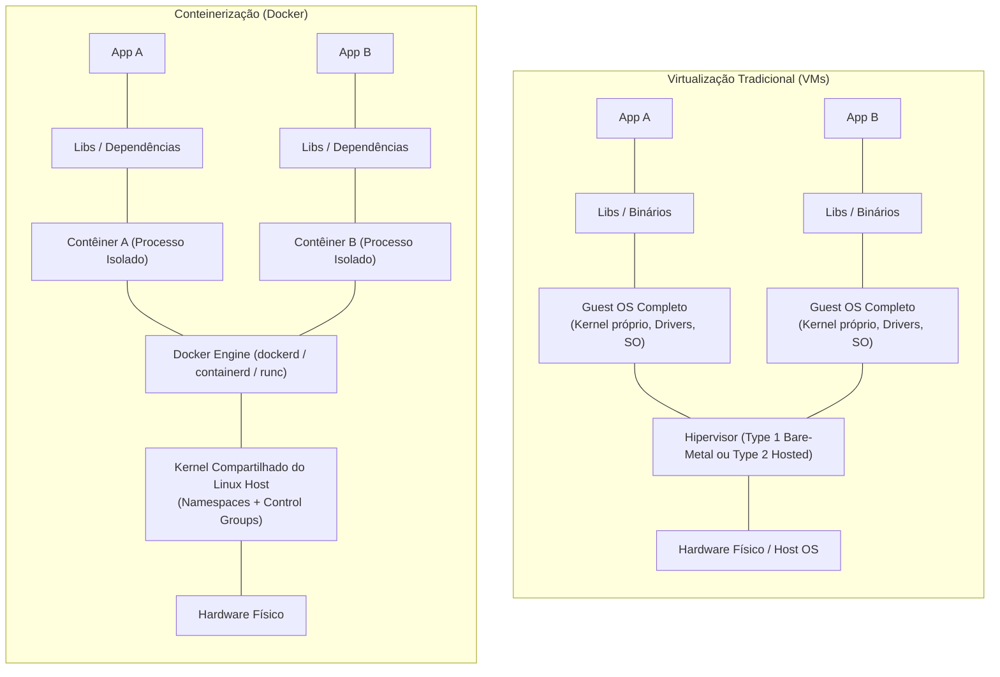
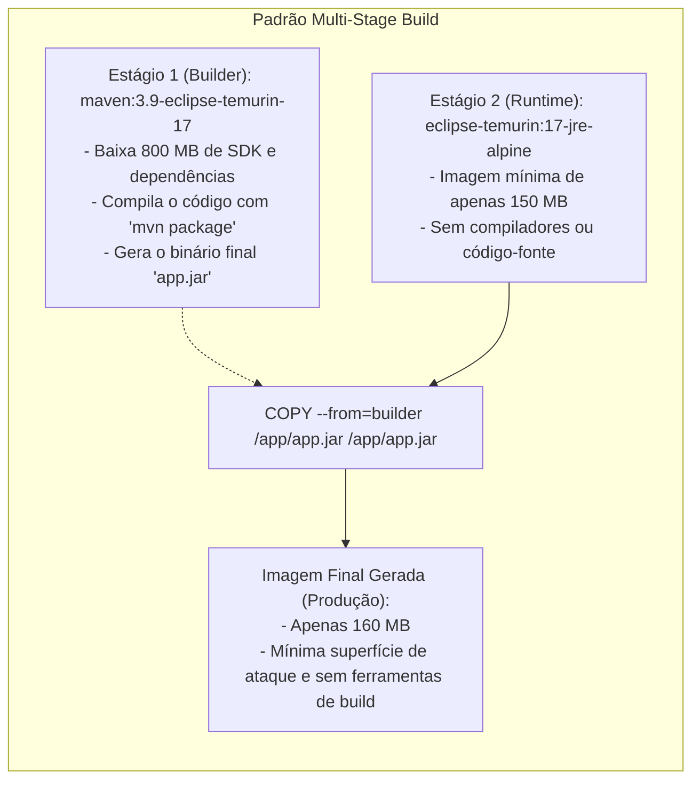
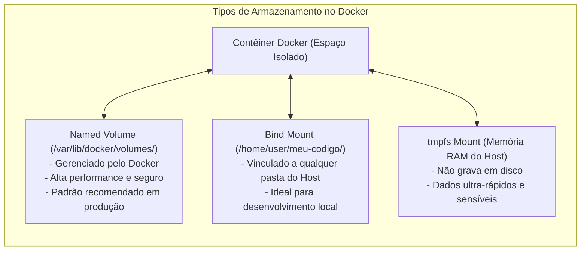

# 03 - Conteinerização com Docker e Docker Compose

> **Matéria:** DevOps, Plataforma de Desenvolvimento e Engenharia de Entrega  
> **Cargo:** B02 – Técnico de Controle Externo – Especialidade: Tecnologia da Informação  
> **Arquivo:** `03_conteinerizacao_docker_e_docker_compose.md`  

---

## 📌 Ementa / Itens do Edital
- Conceitos de conteinerização vs. virtualização tradicional
- Arquitetura e componentes do Docker (Daemon, Client, Images, Containers, Registries)
- Construção de imagens e instruções do Dockerfile
- Otimização com builds de múltiplos estágios (Multi-Stage Builds)
- Gestão de dados (Volumes, Bind Mounts e tmpfs) e Redes no Docker
- Orquestração de múltiplos contêineres com Docker Compose

---

## 🌳 Classificação Hierárquica

```text
3. Conteinerização com Docker e Docker Compose
├── 3.1 Fundamentos de Conteinerização
│   ├── 3.1.1 Máquinas Virtuais (VMs / Hypervisor Type 1 e 2) vs. Contêineres:
│   │   ├── VMs: Virtualizam o hardware e executam um Sistema Operacional convidado (Guest OS) completo
│   │   └── Contêineres: Virtualizam o Sistema Operacional, compartilhando o mesmo Kernel do host
│   ├── 3.1.2 Primitivas do Kernel Linux:
│   │   ├── Namespaces: Isolamento de visão (PID, NET, IPC, MNT, UTS, USER)
│   │   └── Control Groups (cgroups): Limitação e governança de recursos (CPU, Memória, I/O)
│   ├── 3.1.3 Arquitetura Docker:
│   │   ├── Docker Client (CLI `docker`)
│   │   ├── Docker Daemon (`dockerd`) e Docker Engine
│   │   ├── containerd (gestor de ciclo de vida OCI) e runc (runtime de baixo nível)
│   │   └── Registries de Imagens (Docker Hub, AWS ECR, Harbor, GitHub Packages)
│   └── 3.1.4 Sistema de Arquivos em Camadas (UnionFS / Overlay2) e Copy-on-Write (CoW)
├── 3.2 Construção de Imagens e o Dockerfile
│   ├── 3.2.1 Conceito de Imagem Docker: Imutável, formada por camadas de somente leitura (Read-Only Layers)
│   ├── 3.2.2 Instruções Fundamentais do Dockerfile:
│   │   ├── `FROM`: Imagem base oficial
│   │   ├── `WORKDIR`: Definição do diretório de trabalho padrão
│   │   ├── `COPY` vs. `ADD`: COPY para cópias locais diretas; ADD para extração de `.tar` e URLs
│   │   ├── `RUN`: Execução de comandos durante o build gerando novas camadas
│   │   ├── `ENV` vs. `ARG`: Variáveis de ambiente de runtime vs. argumentos temporários de build
│   │   ├── `EXPOSE`: Metadado informativo/documental de porta de rede (não publica no host)
│   │   ├── `CMD` vs. `ENTRYPOINT`: Argumentos padrão flexíveis vs. binário fixo imutável (Exec form vs. Shell form)
│   │   ├── `USER`: Execução sem privilégios de root (Princípio do Menor Privilégio)
│   │   └── `HEALTHCHECK`: Verificação periódica de integridade interna da aplicação
│   ├── 3.2.3 Cache de Camadas: Ordenação ótima de instruções no Dockerfile
│   └── 3.2.4 Multi-Stage Builds: Separação de ambiente de compilação e runtime enxuto (Alpine/Distroless/Scratch)
├── 3.3 Gerenciamento de Armazenamento e Redes no Docker
│   ├── 3.3.1 Camada do Contêiner (Container Read-Write Layer) e Efemeridade
│   ├── 3.3.2 Mecanismos de Persistência de Dados:
│   │   ├── Named Volumes: Gerenciados pelo Docker em `/var/lib/docker/volumes/` (Padrão para Produção)
│   │   ├── Bind Mounts: Mapeamento de caminho absoluto do host no contêiner (Desenvolvimento Local)
│   │   └── tmpfs Mounts: Armazenamento em memória RAM volátil do host (Dados sensíveis e alta performance)
│   └── 3.3.3 Drivers de Rede Docker:
│       ├── `bridge`: Rede virtual privada padrão no mesmo host (DNS embutido em redes customizadas)
│       ├── `host`: Compartilhamento direto da pilha de rede do host (sem isolamento de portas)
│       ├── `none`: Isolamento total de rede (apenas loopback `127.0.0.1`)
│       ├── `overlay`: Rede distribuída multi-host (Swarm e Kubernetes)
│       └── `macvlan`: Atribuição de endereço MAC físico na LAN
└── 3.4 Orquestração Local com Docker Compose
    ├── 3.4.1 Finalidade: Definição e execução declarativa de múltiplos contêineres (`compose.yaml`)
    ├── 3.4.2 Estrutura do Manifesto Compose:
    │   ├── `services`: Mapeamento de contêineres, `build`, `image`, `ports`, `environment`, `volumes`
    │   ├── `networks`: Redes isoladas com resolução de nomes por DNS interno automático
    │   ├── `volumes`: Declaração de volumes compartilhados persistentes
    │   └── `depends_on`: Ordem de inicialização de dependências
    └── 3.4.3 Comandos CLI Essenciais: `docker compose up -d`, `down -v`, `ps`, `logs -f`, `exec`
```

---

## 📖 Resumo Teórico & Pontos-Chave Aprofundados

### 1. Virtualização Tradicional (VMs) vs. Conteinerização (Docker)

A compreensão da barreira arquitetural entre Máquinas Virtuais e Contêineres é o tópico mais recorrente da FCC em infraestrutura moderna.



#### Tabela Comparativa Detalhada: VMs vs. Contêineres

| Parâmetro de Comparação | Máquinas Virtuais (VMs) | Contêineres (Docker) |
| :--- | :--- | :--- |
| **Abstração Principal** | Abstração em nível de **Hardware**. | Abstração em nível de **Sistema Operacional**. |
| **Presença de Kernel Próprio** | **SIM**. Cada VM possui seu próprio kernel independente (Guest OS). | **NÃO**. Todos os contêineres compartilham o **mesmo Kernel do host**. |
| **Mecanismo de Controle** | Hipervisor (*Hypervisor* Type 1 como KVM/ESXi ou Type 2 como VirtualBox). | Primitivas do Kernel Linux: *Namespaces* e *cgroups*. |
| **Tempo de Inicialização** | De dezenas de segundos a vários minutos (boot de SO completo). | Milissegundos a poucos segundos (inicialização de um processo comum). |
| **Consumo de Recursos (Overhead)** | Elevado: consome gigabytes de RAM e disco só para manter o Guest OS. | Mínimo: consome apenas a memória e CPU necessárias pelo binário da aplicação. |
| **Densidade Operacional** | Baixa a Média (dezenas de VMs por servidor físico). | Altíssima (centenas ou milhares de contêineres no mesmo servidor). |
| **Nível de Isolamento** | Muito alto (isolamento a nível de hardware via instruções de CPU VT-x/AMD-V). | Alto (isolamento a nível de processo do SO via kernel). |

#### As Duas Primitivas Fundamentais do Kernel Linux:
1. **Linux Namespaces (Isolamento de Visão):** Determinam o que um contêiner consegue *enxergar*.
   - `pid`: Isola a árvore de processos (o processo principal da aplicação enxerga a si mesmo como `PID 1`).
   - `net`: Isola interfaces de rede, portas TCP/UDP e tabelas de roteamento.
   - `mnt`: Isola pontos de montagem do sistema de arquivos (*mount points*).
   - `ipc`: Isola mecanismos de comunicação interprocessos (memória compartilhada, semáforos).
   - `uts`: Isola o nome da máquina (*hostname*) e domínio de rede.
   - `user`: Mapeia identificadores de usuários e grupos (UID/GID), permitindo ser root dentro do contêiner sem ser root no host.
2. **Control Groups - `cgroups` (Limitação e Governança de Recursos):** Determinam quanto um contêiner consegue *consumir*.
   - Limitam e contabilizam o uso de memória RAM, frações de núcleos de CPU, largura de banda de rede e limites de I/O em disco.

> 🚨 **ALERTA DE PROVA / PEGADINHA FCC:**  
> A FCC adora afirmar que *"contêineres Docker inicializam mais lentamente que VMs porque precisam carregar os módulos de drivers do seu próprio kernel convidado"*. ISSO É FALSO! Contêineres iniciam em milissegundos porque **não fazem boot de kernel nem de sistema operacional**; são meros processos isolados rodando sobre o kernel já carregado da máquina hospedeira.

---

### 2. Anatomia do Dockerfile e Otimização com Multi-Stage Builds

Uma imagem Docker é um modelo somente leitura (*read-only*) composto por camadas superpostas através de um sistema de arquivos unificado (*Overlay2 UnionFS*).



#### Diretivas Fundamentais do Dockerfile:
- **`FROM <imagem>:<tag>`:** Define a imagem base. O comando `FROM scratch` inicia a partir de uma imagem vazia de 0 bytes (ideal para binários compilados estáticos em Go/Rust).
- **`WORKDIR /caminho`:** Define o diretório de execução para os comandos subsequentes. Cria a pasta automaticamente caso ela não exista.
- **`COPY` vs. `ADD`:**
  - `COPY`: Simples e previsível. Copia arquivos e diretórios da máquina local (contexto de build) para o interior da imagem. **É a diretiva recomendada pelas boas práticas.**
  - `ADD`: Possui comportamentos automáticos extras: faz o download de arquivos remotos via URL e descompacta arquivos tar/gzip (`.tar.gz`) automaticamente no destino. Seu uso indiscriminado é desencorajado por motivos de previsibilidade.
- **`RUN`:** Executa comandos durante a construção da imagem (ex.: `apt-get install` ou `npm install`), gerando uma nova camada imutável no sistema de arquivos da imagem.
- **`CMD` vs. `ENTRYPOINT`:**
  - **`ENTRYPOINT`:** Define o executável imutável principal do contêiner. Não é sobrescrito facilmente por argumentos no `docker run`.
  - **`CMD`:** Fornece os parâmetros ou comandos padrão. Se acompanhado de `ENTRYPOINT`, seus valores servem como argumentos padrão flexíveis.
  - *Regra de Sobrescrita:* Parâmetros passados ao final do `docker run imagem arg1 arg2` substituem inteiramente os valores do `CMD`, mas são repassados como argumentos para o `ENTRYPOINT`.
  - *Sintaxe recomendada (Exec Form):* Sempre utilizar colchetes no formato JSON: `ENTRYPOINT ["nginx", "-g", "daemon off;"]`. O formato de concha (*Shell Form* `ENTRYPOINT nginx`) executa sob `/bin/sh -c`, impedindo o encaminhamento de sinais do sistema operacional (como `SIGTERM` e `SIGKILL`).
- **`EXPOSE <porta>`:** Instrução **meramente informativa e documental**. Ela avisa aos desenvolvedores em qual porta o serviço escuta por padrão, mas **não publica nem abre portas na máquina hospedeira**. Para expor portas na máquina host, é obrigatório utilizar o parâmetro `-p <porta_host>:<porta_container>` no comando `docker run`.
- **`ENV` vs. `ARG`:**
  - `ARG`: Define variáveis disponíveis **exclusivamente durante a construção da imagem** (`docker build --build-arg NOME=VALOR`). Não persiste no contêiner em execução.
  - `ENV`: Define variáveis de ambiente que persistem gravadas na imagem e estão **disponíveis durante a execução do contêiner (runtime)**.

---

### 3. Persistência de Dados e Drivers de Rede no Docker

Por padrão, contêineres são **efêmeros e sem estado (*stateless*)**. Qualquer alteração feita no sistema de arquivos do contêiner é gravada em uma camada fina de leitura e escrita (*Container Read-Write Layer*). Quando o contêiner é destruído (`docker rm`), essa camada é apagada permanentemente.



#### Comparativo de Armazenamento: Volumes vs. Bind Mounts vs. tmpfs Mounts

| Tipo de Montagem | Onde reside no Host | Gerenciado pelo Docker? | Caso de Uso Típico |
| :--- | :--- | :--- | :--- |
| **Named Volumes** | `/var/lib/docker/volumes/<nome>/_data` | **SIM** (`docker volume create/ls/rm`) | **Bancos de dados e dados produtivos persistentes**. Independente do contêiner. |
| **Bind Mounts** | Qualquer caminho arbitrário (ex.: `/opt/app` ou `C:\projeto`) | **NÃO** (depende da estrutura de pastas do SO host) | **Desenvolvimento local** (compartilhar código-fonte em tempo real com hot-reload). |
| **tmpfs Mounts** | Memória volátil **RAM** do hospedeiro | **SIM** (via Docker Engine) | **Armazenamento de senhas/chaves em memória** e operações de escrita intensa temporária. |

#### Drivers de Rede do Docker:
- **`bridge` (Ponte):** O driver padrão. Cria uma rede interna privada no host (`docker0`). Contêineres recebem endereços IP internos (ex.: `172.17.0.x`). Ao criar redes customizadas pelo usuário (`docker network create minha-rede`), o Docker disponibiliza **resolução automática de DNS por nome de contêiner**.
- **`host`:** Remove o isolamento de rede entre o contêiner e o host. O contêiner usa diretamente a pilha de rede da máquina hospedeira. Se a aplicação escutar na porta 80, ela estará acessível diretamente na porta 80 do host sem necessidade de NAT (`-p`). Não permite que dois contêineres usem a mesma porta simultaneamente.
- **`none`:** Desativa totalmente a pilha de rede. O contêiner possui apenas a interface de loopback (`127.0.0.1`), ficando completamente isolado da internet e de outros contêineres.
- **`overlay`:** Cria uma rede distribuída multi-host, permitindo que contêineres executados em servidores físicos distintos comuniquem-se de forma transparente e criptografada (base do Docker Swarm e orquestradores).
- **`macvlan`:** Atribui um endereço físico MAC da rede local diretamente à interface virtual do contêiner, fazendo com que ele se comporte como um dispositivo físico independente na LAN corporativa.

---

### 4. Docker Compose: Orquestração Local Multi-Contêiner

O Docker Compose é a ferramenta padrão para definir e rodar aplicações multi-contêiner através de arquivos de configuração YAML declarativos (`compose.yaml` ou `docker-compose.yml`).

Exemplo prático de arquitetura Web + Banco de Dados:
```yaml
services:
  web:
    build: .
    ports:
      - "8080:80"        # Host:Container
    environment:
      - DB_HOST=db
      - DB_NAME=auditoria
    depends_on:
      db:
        condition: service_healthy
    networks:
      - backend-net

  db:
    image: postgres:16-alpine
    environment:
      POSTGRES_DB: auditoria
      POSTGRES_PASSWORD: secret_password
    volumes:
      - pgdata:/var/lib/postgresql/data
    healthcheck:
      test: ["CMD-SHELL", "pg_isready -U postgres"]
      interval: 5s
      timeout: 5s
      retries: 5
    networks:
      - backend-net

volumes:
  pgdata:                # Volume persistente gerenciado

networks:
  backend-net:           # Rede bridge isolada customizada
```

> ⭐ **IMPORTANTE / REGRA DE OURO:**  
> No Docker Compose, todos os serviços definidos na mesma rede comunicam-se entre si utilizando o **próprio nome do serviço como endereço de rede (hostname)**. No exemplo acima, a aplicação `web` conecta-se ao PostgreSQL apontando a conexão para `db:5432`, graças ao servidor DNS embutido na rede do Docker.

---

## 🌐 Fontes Recomendadas na Internet

### 1. Documentação Oficial do Docker
- [Docker Documentation & Get Started Guide](https://docs.docker.com/get-started/): Guia oficial cobrindo arquitetura do Docker Engine, ciclo de vida de contêineres, gerenciamento de imagens e registries.
- [Docker Best Practices for Writing Dockerfiles](https://docs.docker.com/develop/develop-images/instructions/): Manual de boas práticas de construção de imagens, explicando o funcionamento do cache de camadas, ordenação de comandos e diretivas `CMD` vs `ENTRYPOINT`.
- [Multi-Stage Builds no Docker](https://docs.docker.com/build/building/multi-stage/): Guia oficial detalhando a separação de ambientes de compilação e execução final para redução drástica do tamanho e mitigação de vulnerabilidades em imagens.
- [The Compose Specification (Docker Compose)](https://docs.docker.com/compose/compose-file/): Especificação formal da sintaxe do arquivo de composição (`compose.yaml` / `docker-compose.yml`), cobrindo definição de `services`, `networks`, `volumes` e `depends_on`.

### 2. Normas e Padrões da Indústria
- [Open Container Initiative (OCI)](https://opencontainers.org/): Padrões abertos para formato de imagens de contêiner (Image Spec) e runtime de execução de contêineres (Runtime Spec).

---

## 📝 Questões Comentadas & Exemplos (Padrão FCC)

### Questão 1 (FCC - Adaptada / TI - Fundamentos e Primitivas de Conteinerização)
Com relação às diferenças conceituais e arquiteturais entre a virtualização baseada em Máquinas Virtuais (VMs) tradicionais e a conteinerização utilizando a tecnologia Docker, assinale a afirmativa correta:  
A) Contêineres Docker executam um hipervisor (*Hypervisor Type 1*) emulado dentro de cada processo para gerenciar o acesso direto ao processador físico.  
B) Cada contêiner Docker possui e carrega em memória um Sistema Operacional convidado (*Guest OS*) completo e independente, incluindo seus próprios drivers de hardware e kernel proprietário.  
C) Enquanto as máquinas virtuais virtualizam a camada de hardware e exigem um Sistema Operacional convidado (*Guest OS*) completo sobre o hipervisor, os contêineres Docker virtualizam o sistema operacional, compartilhando o mesmo núcleo (*Kernel*) do hospedeiro por meio de primitivas como *namespaces* e *control groups (cgroups)* do Linux.  
D) As máquinas virtuais inicializam em milissegundos devido à ausência de camada de abstração de hardware, ao passo que contêineres Docker demandam longos minutos de inicialização devido ao carregamento de imagens de disco.  
E) O isolamento proporcionado por contêineres Docker impede qualquer comunicação de rede entre dois contêineres hospedados no mesmo computador físico.

> **Gabarito: C**  
> **Comentário Analítico Passo a Passo:**  
> - **A está INCORRETA:** Hipervisores (sejam Type 1 bare-metal como VMware ESXi ou Type 2 hospedados como VirtualBox) são a fundação da tecnologia de Máquinas Virtuais. O Docker não utiliza hipervisores para gerenciar seus contêineres.  
> - **B está INCORRETA:** Pegadinha clássica da FCC em concursos de Tribunais e SEFAZs. Contêineres **não possuem kernel próprio nem Guest OS completo**. Todos os contêineres em execução utilizam e compartilham o kernel do sistema operacional hospedeiro (*host*).  
> - **C está CORRETA:** Definição canônica de conteinerização. O Docker utiliza primitivas essenciais do kernel Linux:
>   - **Namespaces:** Oferecem isolamento de visibilidade para processos (`pid`), rede (`net`), pontos de montagem (`mnt`), usuários (`user`) e IPC.
>   - **Cgroups (Control Groups):** Garantem limitação e governança sobre o consumo de recursos computacionais (memória RAM, quotas de CPU, limites de I/O em disco).  
> - **D está INCORRETA:** É exatamente o oposto: contêineres inicializam em frações de segundos (milissegundos) porque iniciam como processos nativos no host sem passar pela fase de boot de sistema operacional. As VMs demoram consideravelmente mais porque precisam simular o boot completo de BIOS, kernel e inicialização de serviços do Guest OS.  
> - **E está INCORRETA:** Contêineres no mesmo host comunicam-se de forma eficiente por meio de pontes de rede virtual gerenciadas pelo Docker (como o driver `bridge`).

---

### Questão 2 (FCC - Adaptada / TI - Dockerfile: Instruções CMD, ENTRYPOINT e EXPOSE)
Um analista de infraestrutura da Secretaria da Fazenda elaborou o seguinte `Dockerfile` para conteinerizar uma API REST desenvolvida em Python:

```dockerfile
FROM python:3.11-slim
WORKDIR /app
COPY requirements.txt .
RUN pip install --no-cache-dir -r requirements.txt
COPY . .
EXPOSE 5000
ENTRYPOINT ["python", "app.py"]
CMD ["--port", "5000"]
```

Após compilar a imagem com a tag `api-fazenda:1.0`, o analista executou no terminal do servidor o comando:
`docker run -d -p 8080:5000 api-fazenda:1.0 --port 9000`

A respeito desse cenário e das instruções do Dockerfile, assinale a afirmativa correta:  
A) A instrução `EXPOSE 5000` publicou a porta 5000 diretamente no endereço IP público da máquina física, tornando desnecessária a utilização do parâmetro `-p 8080:5000` no comando de execução.  
B) O comando final executado dentro do contêiner será `python app.py --port 9000`, pois os argumentos passados na linha de comando do `docker run` sobrescrevem os valores definidos na instrução `CMD`, mantendo intacto o `ENTRYPOINT`.  
C) O contêiner falhará ao iniciar, pois a especificação conjunta das diretivas `ENTRYPOINT` e `CMD` no mesmo `Dockerfile` é proibida pela especificação do Docker.  
D) A flag `-p 8080:5000` fará com que as requisições que chegam à porta 5000 da máquina hospedeira sejam redirecionadas para a porta 8080 dentro do contêiner.  
E) A instrução `COPY . .` impede a reutilização do cache de compilação da camada gerada por `RUN pip install`, mesmo que o arquivo `requirements.txt` não tenha sido modificado.

> **Gabarito: B**  
> **Comentário Analítico Passo a Passo:**  
> - **A está INCORRETA:** A diretiva `EXPOSE` tem caráter puramente documental e informativo (metadado na imagem). Ela não abre portas no firewall nem publica portas no host. A publicação de portas no host exige explicitamente o mapeamento através do comando `docker run -p` ou diretiva `ports` no Compose.  
> - **B está CORRETA:** Quando combinadas, a instrução `ENTRYPOINT` fixa o executável permanente (`python app.py`) e a instrução `CMD` fornece os parâmetros padrão (`--port 5000`). Ao invocar `docker run api-fazenda:1.0 --port 9000`, os argumentos informados no final da linha de comando sobrescrevem o conteúdo do `CMD`, fazendo com que o processo executado internamente seja exatamente `python app.py --port 9000`.  
> - **C está INCORRETA:** O uso conjunto de `ENTRYPOINT` e `CMD` é o padrão de excelência recomendado pela documentação do Docker para criar imagens com comandos pré-definidos e argumentos configuráveis.  
> - **D está INCORRETA:** A sintaxe do parâmetro de publicação de portas é `-p <porta_host>:<porta_container>`. Portanto, o tráfego que chega na porta 8080 da máquina hospedeira é direcionado para a porta 5000 do contêiner. A alternativa inverteu a relação.  
> - **E está INCORRETA:** A estrutura adotada no Dockerfile é uma boa prática consagrada: copiar primeiro apenas o `requirements.txt` e executar o `pip install` garante que, se apenas arquivos de código-fonte mudarem (refletidos no posterior `COPY . .`), o Docker reutilizará o cache das dependências já instaladas, economizando tempo de build.

---

### Questão 3 (FCC - Adaptada / TI - Multi-Stage Builds e Otimização de Imagens)
Em auditorias de segurança de aplicações conteinerizadas em órgãos públicos, é comum encontrar vulnerabilidades associadas à inclusão indevida de ferramentas de compilação, compiladores C/C++, gerenciadores de pacotes e código-fonte dentro de imagens que operam no ambiente de produção.

A técnica preconizada pelo Docker para mitigar esse risco e reduzir drasticamente o tamanho final das imagens distribuidíveis em produção é:  
A) Compactar o contêiner em um arquivo executável `.zip` antes de executar o comando `docker push`.  
B) Adoção de *Multi-Stage Builds*, permitindo utilizar imagens pesadas contendo SDKs e compiladores apenas no estágio inicial de compilação e transferir exclusivamente o binário final gerado para uma imagem enxuta e mínima de runtime.  
C) Utilização compulsória da instrução `RUN chmod 777 -R /` no Dockerfile para revogar privilégios administrativos de todos os processos internos.  
D) Desativação do Docker Daemon e execução de contêineres diretamente como scripts de shell no servidor hospedeiro.  
E) Substituição do Dockerfile por um script Bash imperativo gravado no setor de boot da controladora de armazenamento.

> **Gabarito: B**  
> **Comentário Analítico Passo a Passo:**  
> - **A está INCORRETA:** O Docker trabalha com o padrão OCI de camadas e imagens em formato tarball gerenciadas por registries, não fazendo sentido o empacotamento manual em zip para execução.  
> - **B está CORRETA:** A funcionalidade de **Multi-Stage Builds** (construção em múltiplos estágios usando múltiplas instruções `FROM ... AS <stage>`) permite separar o ciclo de construção do ciclo de entrega. No primeiro estágio utiliza-se uma imagem com SDK completo (Maven, Go SDK, Rust), compilando a aplicação. No estágio subsequente, utiliza-se uma imagem enxuta (como Alpine, Distroless ou Scratch) e copia-se apenas o binário ou artefato compilado (`COPY --from=builder ...`). Isso resulta em imagens de poucos megabytes, sem compiladores ou gerenciadores de pacotes instalados, reduzindo radicalmente a superfície de ataque e potenciais vulnerabilidades (CVEs).  
> - **C está INCORRETA:** Executar `chmod 777` em todo o sistema concede permissões totais de leitura, escrita e execução para qualquer usuário, agravando severamente a vulnerabilidade do contêiner.  
> - **D está INCORRETA:** Essa ação descaracteriza completamente o uso de contêineres e perde todo o isolamento de namespaces e cgroups.  
> - **E está INCORRETA:** Afirmativa sem qualquer embasamento técnico em engenharia de software e computação em nuvem.

---

### Questão 4 (FCC - Adaptada / TI - Gestão de Persistência e Volumes no Docker)
Ao planejar a implantação de um Sistema de Gerenciamento de Banco de Dados relacional (PostgreSQL) em contêineres Docker, um arquiteto de sistemas alertou a equipe que contêineres possuem ciclo de vida efêmero e que os dados armazenados na camada de gravação padrão do contêiner seriam perdidos caso o contêiner fosse removido.

Para garantir a persistência duradoura, alto desempenho de I/O e gerenciamento seguro dos arquivos de dados do banco de dados pelo próprio Docker Engine, a solução tecnicamente recomendada é a utilização de:  
A) *tmpfs mounts*, pois gravam todas as tabelas e índices diretamente na memória volátil RAM do servidor, assegurando persistência permanente mesmo se a máquina física for desligada da tomada.  
B) Camada padrão de leitura e escrita do contêiner (*Container Read-Write Layer*), uma vez que o sistema *UnionFS* garante a recuperação automática de dados após a execução de comandos `docker rm -f`.  
C) *Named Volumes* (Volumes Gerenciados), que são desacoplados do ciclo de vida dos contêineres, alocados em diretórios dedicados gerenciados pelo Docker no host (`/var/lib/docker/volumes/`) e podem ser facilmente compartilhados e reutilizados por outros contêineres.  
D) Links simbólicos do Linux apontando diretamente para o arquivo `/dev/null`.  
E) Arquivos temporários criados dentro da pasta `/tmp` do contêiner, dispensando qualquer configuração adicional no host.

> **Gabarito: C**  
> **Comentário Analítico Passo a Passo:**  
> - **A está INCORRETA:** O *tmpfs mount* persiste dados exclusivamente na memória RAM temporária do host; se o host for reiniciado ou o contêiner for parado, todos os dados em tmpfs são irremediavelmente perdidos. Não serve para persistência de bancos de dados.  
> - **B está INCORRETA:** A camada de gravação do contêiner (*Read-Write layer*) é completamente excluída e destruída quando o contêiner é removido (`docker rm`), resultando em perda catastrófica de dados.  
> - **C está CORRETA:** Os **Named Volumes** (Volumes nomeados gerenciados pelo Docker) são a abordagem primária e recomendada para persistência de dados em ambientes produtivos. Eles residem em uma área dedicada e controlada pelo Docker no disco do host (por padrão `/var/lib/docker/volumes/`), não dependem do ciclo de vida do contêiner (sobrevivem à recriação de contêineres), são imunes à estrutura de diretórios específica do host e oferecem o melhor desempenho para gravação em sistemas de contêineres.  
> - **D está INCORRETA:** O dispositivo `/dev/null` é um "buraco negro" no Linux que descarta imediatamente qualquer dado enviado a ele.  
> - **E está INCORRETA:** A pasta `/tmp` interna do contêiner faz parte da camada efêmera de escrita, perdendo tudo ao recriar o contêiner.

---

### Questão 5 (FCC - Adaptada / TI - Redes e Orquestração com Docker Compose)
Considere uma aplicação composta por dois microsserviços declarados no arquivo `compose.yaml`: um serviço denominado `frontend` (porta interna 80) e um serviço denominado `backend-api` (porta interna 3000), ambos anexados a uma mesma rede customizada do tipo `bridge` denominada `app-network`.

A respeito da comunicação entre esses serviços e das características de redes no Docker Compose, assinale a opção correta:  
A) O serviço `frontend` não pode se comunicar com o `backend-api` via rede local, sendo mandatório que ambos publiquem suas portas em endereços IP públicos de internet.  
B) O serviço `frontend` é capaz de alcançar o serviço `backend-api` enviando requisições HTTP diretamente para o endereço `http://backend-api:3000`, graças ao mecanismo nativo de resolução de nomes por DNS embutido pelo Docker em redes customizadas.  
C) Para que contêineres em uma mesma rede customizada do Compose conversem entre si, é obrigatório utilizar o driver de rede `none`.  
D) No Docker Compose, a resolução de nomes por DNS entre serviços só funciona se o desenvolvedor codificar manualmente os endereços IP fixos de cada contêiner no arquivo `/etc/hosts` de cada imagem antes de compilar o Dockerfile.  
E) O comando `docker compose down` desliga os contêineres, mas é terminantemente incapaz de remover as redes criadas pelo arquivo Compose.

> **Gabarito: B**  
> **Comentário Analítico Passo a Passo:**  
> - **A está INCORRETA:** Serviços conectados na mesma rede virtual privada do Docker podem se comunicar diretamente através da rede interna sem qualquer necessidade de expor portas para a internet pública ou para o host.  
> - **B está CORRETA:** Em qualquer rede definida pelo usuário (*user-defined bridge network*), o Docker ativa automaticamente um servidor DNS interno integrado. Esse mecanismo resolve o **nome do serviço** declarado no arquivo Compose (neste caso, `backend-api`) para o endereço IP interno atribuído àquele contêiner, permitindo comunicação direta via `http://backend-api:3000`.  
> - **C está INCORRETA:** O driver de rede `none` desativa completamente qualquer conectividade de rede externa e entre contêineres, deixando apenas o loopback local.  
> - **D está INCORRETA:** A grande vantagem do Docker Compose e das redes customizadas do Docker é exatamente dispensar o gerenciamento manual de IPs fixos ou alterações no arquivo `/etc/hosts`, pois a resolução de nomes via DNS é 100% dinâmica e automática.  
> - **E está INCORRETA:** O comando `docker compose down` encerra os contêineres e remove automaticamente tanto os contêineres quanto as redes criadas para a aplicação. (Para remover volumes persistentes associados, deve-se acrescentar a flag `-v`).
