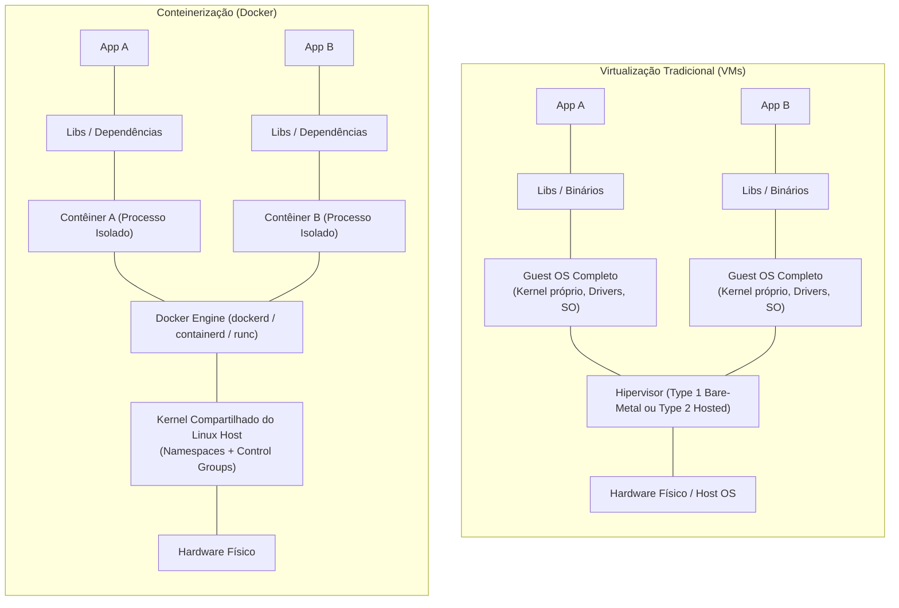
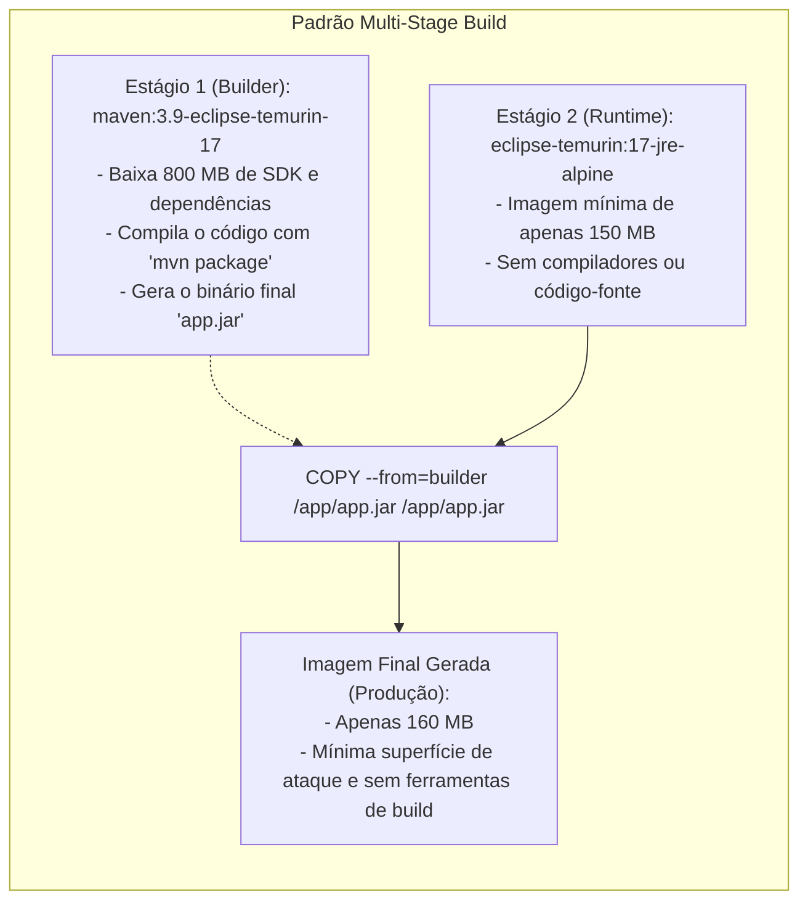
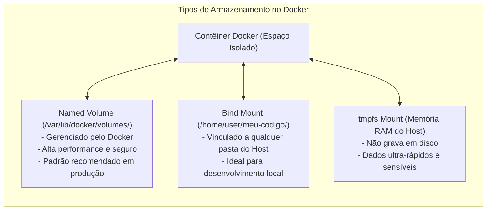

# 03 - Conteinerização com Docker e Docker Compose

> **Matéria:** DevOps, Plataforma de Desenvolvimento e Engenharia de Entrega  
> **Cargo:** B02 – Técnico de Controle Externo – Especialidade: Tecnologia da Informação  
> **Arquivo:** `03_conteinerizacao_docker_e_docker_compose.md`  

---

## 📌 Ementa / Itens do Edital
- Conceitos de conteinerização vs. virtualização tradicional
- Arquitetura e componentes do Docker (Daemon, Client, Images, Containers, Registries)
- Construção de imagens e instruções do Dockerfile
- Otimização com builds de múltiplos estágios (Multi-Stage Builds)
- Gestão de dados (Volumes, Bind Mounts e tmpfs) e Redes no Docker
- Orquestração de múltiplos contêineres com Docker Compose

---

## 🧭 Sumário
- [1. Fundamentos de Conteinerização vs. Virtualização Tradicional](#1-fundamentos-de-conteinerização-vs-virtualização-tradicional)
  - [1.1 Máquinas Virtuais (Hypervisors) vs. Contêineres (Kernel Compartilhado)](#11-máquinas-virtuais-hypervisors-vs-contêineres-kernel-compartilhado)
  - [1.2 Primitivas Essenciais do Kernel Linux: Namespaces e Control Groups (cgroups)](#12-primitivas-essenciais-do-kernel-linux-namespaces-e-control-groups-cgroups)
  - [1.3 Arquitetura do Docker Engine: Client, Daemon, containerd, runc e Registries](#13-arquitetura-do-docker-engine-client-daemon-containerd-runc-e-registries)
  - [1.4 Sistema de Arquivos em Camadas (Overlay2 UnionFS) e Copy-on-Write (CoW)](#14-sistema-de-arquivos-em-camadas-overlay2-unionfs-e-copy-on-write-cow)
- [2. Construção de Imagens e Anatomia do Dockerfile](#2-construção-de-imagens-e-anatomia-do-dockerfile)
  - [2.1 Instruções Canônicas: FROM, WORKDIR, COPY vs. ADD, RUN, ENV vs. ARG](#21-instruções-canônicas-from-workdir-copy-vs-add-run-env-vs-arg)
  - [2.2 Execução de Processos: ENTRYPOINT vs. CMD (Exec Form vs. Shell Form)](#22-execução-de-processos-entrypoint-vs-cmd-exec-form-vs-shell-form)
  - [2.3 Exposição de Portas e Segurança: EXPOSE vs. Publicação no Host e Diretiva USER](#23-exposição-de-portas-e-segurança-expose-vs-publicação-no-host-e-diretiva-user)
  - [2.4 Otimização com Builds de Múltiplos Estágios (Multi-Stage Builds) e Cache de Camadas](#24-otimização-com-builds-de-múltiplos-estágios-multi-stage-builds-e-cache-de-camadas)
- [3. Persistência de Dados e Gerenciamento de Armazenamento](#3-persistência-de-dados-e-gerenciamento-de-armazenamento)
  - [3.1 Efemeridade da Camada de Leitura e Escrita do Contêiner](#31-efemeridade-da-camada-de-leitura-e-escrita-do-contêiner)
  - [3.2 Comparativo: Named Volumes vs. Bind Mounts vs. tmpfs Mounts](#32-comparativo-named-volumes-vs-bind-mounts-vs-tmpfs-mounts)
- [4. Redes no Docker: Drivers e Resolução de Nomes](#4-redes-no-docker-drivers-e-resolução-de-nomes)
  - [4.1 Drivers de Rede: bridge, host, none, overlay e macvlan](#41-drivers-de-rede-bridge-host-none-overlay-e-macvlan)
  - [4.2 Resolução de Nomes por DNS Integrado em Redes Customizadas](#42-resolução-de-nomes-por-dns-integrado-em-redes-customizadas)
- [5. Orquestração Multi-Contêiner com Docker Compose](#5-orquestração-multi-contêiner-com-docker-compose)
  - [5.1 Estrutura do Manifesto Compose: Services, Networks, Volumes e depends_on](#51-estrutura-do-manifesto-compose-services-networks-volumes-e-depends_on)
  - [5.2 Ciclo de Vida e Comandos Operacionais da CLI](#52-ciclo-de-vida-e-comandos-operacionais-da-cli)
- [6. Questões Comentadas & Prática Padrão FCC](#6-questões-comentadas--prática-padrão-fcc)

---

## 1. Fundamentos de Conteinerização vs. Virtualização Tradicional

A compreensão da barreira arquitetural entre Máquinas Virtuais (VMs) e Contêineres de software constitui um dos temas mais recorrentes em concursos públicos da FCC na área de infraestrutura, arquitetura de sistemas e DevOps.



### 1.1 Máquinas Virtuais (Hypervisors) vs. Contêineres (Kernel Compartilhado)

A distinção basilar assenta-se no **nível de abstração** e na **existência ou não de um núcleo de sistema operacional independente**:

- **Máquinas Virtuais (VMs):**
  - Operam sob a abstração em **nível de hardware**.
  - O **Hipervisor** (*Hypervisor* Type 1 bare-metal como VMware ESXi/KVM, ou Type 2 hospedado como VirtualBox) emula componentes físicos virtuais (CPU, memória RAM, interfaces de rede, controladoras de disco).
  - Cada máquina virtual instala e executa um **Sistema Operacional convidado (*Guest OS*) completo e autônomo**, contendo seu próprio Kernel, drivers e daemons de inicialização.
  - **Sobrecarga (*Overhead*):** Elevado consumo de espaço em disco e memória RAM apenas para manter as instâncias de SO convidado rodando; tempo de inicialização lento (de dezenas de segundos a vários minutos para executar o boot completo).
- **Contêineres (Docker / OCI):**
  - Operam sob a abstração em **nível de sistema operacional**.
  - Os contêineres **NÃO possuem kernel próprio nem executam um Guest OS completo**. Todos os contêineres em execução em um mesmo host compartilham diretamente o **mesmo Kernel do sistema operacional hospedeiro**.
  - Um contêiner nada mais é do que um **processo padrão do Linux encapsulado e isolado** do restante do sistema através de recursos nativos do núcleo.
  - **Eficiência e Densidade:** Inicialização em milissegundos (o tempo de iniciar um processo simples); consumo mínimo de RAM e CPU; densidade operacional altíssima (dezenas ou centenas de contêineres em um mesmo nó físico).

| Parâmetro de Comparação | Máquinas Virtuais (VMs) | Contêineres (Docker) |
| :--- | :--- | :--- |
| **Nível de Abstração** | Abstração da camada de **Hardware**. | Abstração em nível de **Processos do Sistema Operacional**. |
| **Núcleo de SO (Kernel)** | **SIM**. Cada VM possui seu próprio kernel independente (*Guest OS*). | **NÃO**. Compartilham o **mesmo Kernel do host**. |
| **Mecanismo Central** | Hipervisor (*Hypervisor Type 1 ou Type 2*). | Primitivas do Kernel Linux: *Namespaces* e *cgroups*. |
| **Tempo de Inicialização** | Dezenas de segundos a minutos (boot de SO completo). | Milissegundos a poucos segundos (inicialização de processo comum). |
| **Consumo de Recursos** | Alto (gigabytes alocados para o SO convidado). | Mínimo (apenas o espaço estritamente consumido pela aplicação). |
| **Nível de Isolamento** | Muito alto (isolamento por hardware via instruções de CPU VT-x/AMD-V). | Alto (isolamento em espaço de usuário do Linux via kernel). |

### 1.2 Primitivas Essenciais do Kernel Linux: Namespaces e Control Groups (cgroups)

A segurança e o isolamento de um contêiner Docker não decorrem de mágica, mas do acoplamento de duas tecnologias maduras do Kernel Linux:

#### 1. Linux Namespaces (Isolamento de Visibilidade)
Determinam **o que um contêiner consegue enxergar**. Cada contêiner recebe seu próprio conjunto isolado de namespaces:
- **`pid` (Process ID):** Isola a árvore de processos. Dentro do contêiner, o processo principal da aplicação visualiza a si mesmo como `PID 1`, sendo totalmente cego aos processos em execução no host e em outros contêineres.
- **`net` (Network):** Isola interfaces de rede, portas TCP/UDP, tabelas de roteamento e regras de firewall (iptables/nftables).
- **`mnt` (Mount):** Isola os pontos de montagem do sistema de arquivos, garantindo que o contêiner enxergue apenas a sua raiz (`/`) privativa.
- **`ipc` (Inter-Process Communication):** Isola mecanismos de comunicação interprocessos, como memória compartilhada e semáforos POSIX.
- **`uts` (UNIX Timesharing System):** Permite que cada contêiner possua seu próprio *hostname* e nome de domínio independente.
- **`user` (User IDs):** Mapeia UIDs e GIDs entre o contêiner e o host, viabilizando que um processo execute como `root` (UID 0) dentro do contêiner, mas seja mapeado para um usuário não privilegiado comum (ex.: UID 10001) no sistema hospedeiro.

#### 2. Control Groups - `cgroups` (Limitação e Governança de Recursos)
Determinam **quanto de recursos computacionais um contêiner pode consumir**:
- Permitem estabelecer quotas estritas e limites máximos de consumo de **memória RAM** (evitando ataques de exaustão de memória e acionamento descontrolado do *OOM Killer* no host).
- Limitam a fração de **tempo de CPU** (ex.: reservar 1.5 núcleos para um serviço).
- Controlam a largura de banda de tráfego de rede e taxas de leitura/gravação em disco (*Block I/O limits*).

### 1.3 Arquitetura do Docker Engine: Client, Daemon, containerd, runc e Registries

A arquitetura do Docker é cliente-servidor distribuída e baseada em componentes modulares padronizados pela *Open Container Initiative* (OCI):

- **Docker Client (CLI):** O binário de linha de comando `docker` utilizado pelos operadores e desenvolvedores. Comunica-se com o daemon local ou remoto através de chamadas REST em um socket Unix (`/var/run/docker.sock`) ou conexão TCP com TLS.
- **Docker Daemon (`dockerd`):** Serviço persistente de segundo plano que processa requisições da API, orquestra contêineres, compila imagens e gerencia volumes e redes virtuais.
- **containerd:** Daemon de gerenciamento de contêineres de alto nível (desacoplado do Docker e doado à CNCF). Supervisiona o ciclo de vida completo: download de imagens de repositórios remotos, provisionamento de armazenamento e monitoramento de execução.
- **runc:** Runtime de baixo nível compatível com a especificação OCI. É o componente final responsável por interagir diretamente com as chamadas de sistema (*syscalls*) do Kernel Linux para criar os *namespaces* e *cgroups* e despachar o processo do contêiner.
- **Registries de Imagens:** Servidores centralizados de catalogação e armazenamento de imagens Docker (como Docker Hub público, AWS Elastic Container Registry - ECR, Harbor corporativo ou GitHub Packages).

### 1.4 Sistema de Arquivos em Camadas (Overlay2 UnionFS) e Copy-on-Write (CoW)

Uma imagem Docker é uma coleção imutável de **camadas de somente leitura (*Read-Only Layers*)** empilhadas hierarquicamente.
- **UnionFS / Overlay2:** Driver de armazenamento padrão que sobrepõe as múltiplas camadas de diretórios, apresentando-as ao contêiner como um sistema de arquivos unificado e coeso.
- **Copy-on-Write (CoW):** Quando um contêiner é instanciado a partir de uma imagem, o Docker cria uma camada muito fina e descartável de **leitura e escrita (*Container Read-Write Layer*)** no topo da pilha. Se o contêiner precisa alterar um arquivo que pertence a uma camada inferior de somente leitura, o driver copia esse arquivo para a camada superior gravável e aplica a alteração ali. As camadas da imagem base permanecem intactas e compartilhadas por todos os outros contêineres que utilizam a mesma imagem.

---

## 2. Construção de Imagens e Anatomia do Dockerfile

O `Dockerfile` é o manifesto declarativo em formato de texto simples que estabelece o passo a passo automatizado para compilar uma imagem de contêiner.

### 2.1 Instruções Canônicas: FROM, WORKDIR, COPY vs. ADD, RUN, ENV vs. ARG

- **`FROM <imagem>:<tag>`:** Especifica a imagem base que fundamenta a construção. Toda compilação deve iniciar por um comando `FROM` (ou `FROM scratch` para construir uma imagem vazia de 0 bytes para binários estáticos).
- **`WORKDIR /caminho`:** Define o diretório de trabalho padrão para as instruções subsequentes (`RUN`, `CMD`, `ENTRYPOINT`, `COPY`). Se a pasta não existir no sistema de arquivos da imagem, o Docker a cria automaticamente. É uma boa prática usar `WORKDIR` em vez de comandos imperativos `RUN cd /caminho`.
- **`COPY` vs. `ADD` (Ponto Forte em Provas):**
  - **`COPY <origem> <destino>`:** Realiza a cópia direta, simples e estrita de arquivos e pastas da máquina local (contexto de build) para o interior da imagem. **É a instrução oficialmente recomendada pelas boas práticas para cópias locais.**
  - **`ADD <origem> <destino>`:** Possui recursos extras automáticos: permite baixar arquivos remotos via URLs HTTP/HTTPS e descompacta compulsoriamente arquivos tar/gzip (`.tar`, `.tar.gz`) diretamente no destino. Por apresentar comportamentos implícitos que podem introduzir vulnerabilidades ou aumentar o tamanho da imagem, seu uso indiscriminado é desaconselhado pela comunidade técnica.
- **`RUN <comando>`:** Executa comandos durante a fase de construção (*build-time*), como instalação de pacotes (`apt-get install`, `npm install`). Cada comando `RUN` gera uma **nova camada imutável** no sistema de arquivos da imagem.
- **`ENV` vs. `ARG`:**
  - **`ARG`:** Define variáveis disponíveis **exclusivamente durante a compilação da imagem** (`docker build --build-arg CHAVE=VALOR`). Não persiste nos metadados nem no ambiente do contêiner em runtime.
  - **`ENV`:** Define variáveis de ambiente que são gravadas permanentemente na imagem e permanecem **ativas durante a execução do contêiner em produção (runtime)**.

### 2.2 Execução de Processos: ENTRYPOINT vs. CMD (Exec Form vs. Shell Form)

A definição de qual processo será executado ao instanciar o contêiner é regulada pela combinação de `ENTRYPOINT` e `CMD`:

- **`ENTRYPOINT`:** Define o **executável imutável principal** do contêiner. Ele transforma o contêiner em um comando executável dedicado. Não é sobrescrito facilmente por parâmetros informados ao final do comando `docker run`.
- **`CMD`:** Define os **argumentos padrão** ou o comando de fallback. Se utilizado em conjunto com `ENTRYPOINT`, os valores declarados no `CMD` atuam como parâmetros padrão que podem ser facilmente substituídos pelo usuário na linha de comando.
- **Regra de Sobrescrita Prática:** Ao executar `docker run minha-imagem arg1 arg2`, os argumentos `arg1 arg2` substituem integralmente o conteúdo da diretiva `CMD`, mas são repassados como parâmetros para o executável fixado no `ENTRYPOINT`.

**Formatos de Notação (Exec Form vs. Shell Form):**
- **Exec Form (Recomendado):** Notação em vetor JSON com aspas duplas: `ENTRYPOINT ["nginx", "-g", "daemon off;"]`. Executa o processo diretamente sem passar por interpretadores de terminal, permitindo que o processo receba os sinais de término do sistema operacional (`SIGTERM`, `SIGKILL`) como `PID 1`.
- **Shell Form (Desaconselhado):** Notação em string simples: `ENTRYPOINT nginx -g "daemon off;"`. O Docker invoca internamente `/bin/sh -c`, tornando o shell o `PID 1` e impedindo o repasse adequado de sinais de encerramento gracioso para a aplicação.

### 2.3 Exposição de Portas e Segurança: EXPOSE vs. Publicação no Host e Diretiva USER

- **`EXPOSE <porta>`:** Instrução **meramente informativa e documental**. Ela sinaliza ao desenvolvedor ou orquestrador em qual porta o serviço interno escuta por padrão, mas **NÃO abre portas no firewall da máquina host nem publica a porta externamente**. Para que o contêiner fique acessível pelo tráfego de fora do host, o operador deve compulsoriamente mapear a porta via `docker run -p <porta_host>:<porta_container>` ou pela diretiva `ports` no Docker Compose.
- **Diretiva `USER` e Segurança (Princípio do Menor Privilégio):** Por padrão, os processos dentro de um contêiner rodam como o usuário `root` (UID 0). Caso a aplicação sofra um ataque de *container breakout*, o invasor pode comprometer o host. A diretiva `USER <usuario_sem_privilegio>` altera o contexto de execução para um usuário comum do sistema, mitigando severamente riscos de escalada de privilégios.

### 2.4 Otimização com Builds de Múltiplos Estágios (Multi-Stage Builds) e Cache de Camadas



#### O Padrão Multi-Stage Build
Em pipelines corporativos de CI/CD, compilar software exige SDKs volumosos, compiladores C/C++, ferramentas de empacotamento e código-fonte bruto. Se esses artefatos forem mantidos na imagem final que vai para produção, a imagem terá gigabytes de tamanho e conterá dezenas de vulnerabilidades conhecidas (CVEs).

A funcionalidade de **Multi-Stage Builds** resolve esse problema declarando múltiplos comandos `FROM` no mesmo `Dockerfile`:
1. **Estágio de Construção (*Builder*):** `FROM maven:3.9-eclipse-temurin-17 AS builder`. Utiliza o ambiente pesado de build para compilar e empacotar a aplicação, gerando o artefato final (`app.jar`).
2. **Estágio de Execução (*Runtime*):** `FROM eclipse-temurin:17-jre-alpine`. Utiliza uma imagem base mínima que contém apenas o ambiente estrito de execução (JRE ou Alpine/Distroless).
3. **Cópia Seletiva:** Através do comando `COPY --from=builder /app/target/app.jar /app/app.jar`, extrai-se apenas o binário compilado. Todo o SDK do Maven, código-fonte original e arquivos temporários são descartados.
4. **Benefícios:** Redução drástica do tamanho da imagem (de centenas de megabytes para dezenas), agilidade no download pelos nós do Kubernetes e minimização radical da superfície de ataque cibernético.

---

## 3. Persistência de Dados e Gerenciamento de Armazenamento

Por definição arquitetural, os contêineres Docker são **efêmeros e sem estado (*stateless*)**. Compreender as opções de persistência é requisito obrigatório para a sustentação de bancos de dados relacionais e sistemas de arquivos corporativos.



### 3.1 Efemeridade da Camada de Leitura e Escrita do Contêiner

Todas as modificações, gravações de logs e escritas em tabelas realizadas por uma aplicação em execução dentro de um contêiner são salvas na camada fina de leitura e escrita (*Container Read-Write Layer*).
- Se o contêiner for parado (`docker stop`) e reiniciado (`docker start`), esses dados são preservados.
- Contudo, **se o contêiner for removido (`docker rm`)**, essa camada é destruída imediata e irremediavelmente, ocasionando a perda total de todos os dados que não foram explicitamente montados em volumes persistentes.

### 3.2 Comparativo: Named Volumes vs. Bind Mounts vs. tmpfs Mounts

| Tipo de Montagem | Localização no Disco do Host | Gerenciado pelo Docker Engine? | Caso de Uso Principal e Boas Práticas |
| :--- | :--- | :--- | :--- |
| **Named Volumes** | `/var/lib/docker/volumes/<nome>/_data` | **SIM** (via comandos `docker volume create/ls/rm`) | **Padrão ouro para produção e bancos de dados (PostgreSQL, MySQL, MongoDB)**. Independe do SO hospedeiro, permite backups simples e oferece alto rendimento de I/O. |
| **Bind Mounts** | Qualquer caminho arbitrário absoluto do host (ex.: `/opt/app` ou `C:\projetos`) | **NÃO** (depende da estrutura física e de permissões do host) | **Desenvolvimento local**. Permite montar o código-fonte da máquina do desenvolvedor dentro do contêiner para viabilizar *hot-reloading* imediato. |
| **tmpfs Mounts** | Alocado diretamente na **Memória RAM** volátil do hospedeiro | **SIM** (via Docker Engine) | **Armazenamento de segredos, senhas e operações temporárias intensivas**. Não grava dados no disco físico; os dados somem ao desligar o contêiner. |

---

## 4. Redes no Docker: Drivers e Resolução de Nomes

O Docker abstrai a conectividade de contêineres através de subsistemas de rede modulares controlados por drivers específicos.

### 4.1 Drivers de Rede: bridge, host, none, overlay e macvlan

- **`bridge` (Ponte):** É o driver de rede padrão no Linux. Cria uma ponte de rede virtual interna na máquina hospedeira (tipicamente `docker0`). Cada contêiner recebe um endereço IP privativo (ex.: na faixa `172.17.0.0/16`).
- **`host`:** Elimina o isolamento de pilha de rede entre o contêiner e a máquina hospedeira. O contêiner compartilha as portas e a interface de rede física diretamente com o host. Não há overhead de tradução de endereços (NAT), mas dois contêineres não podem utilizar a mesma porta simultaneamente.
- **`none`:** Desativa compulsoriamente a conectividade de rede do contêiner. Mantém apenas a interface local de loopback (`127.0.0.1`), deixando o contêiner completamente isolado de acessos externos e de outros serviços.
- **`overlay`:** Driver de rede virtual distribuída para ambientes com múltiplos servidores físicos (*multi-host*). Criptografa e roteia o tráfego de contêineres entre diferentes nós, atuando como alicerce de orquestradores como o Docker Swarm.
- **`macvlan`:** Atribui um endereço MAC físico diretamente à interface virtual do contêiner, fazendo com que ele se apresente perante a rede corporativa (switch/roteador físico) como se fosse um servidor físico independente com IP próprio na sub-rede da LAN.

### 4.2 Resolução de Nomes por DNS Integrado em Redes Customizadas

Existe uma diferença crítica cobrada em concursos entre a rede bridge padrão e redes bridge criadas pelo usuário:
1. **Rede Bridge Padrão (`bridge` default):** Contêineres só conseguem se comunicar diretamente por endereços IP ou usando links legados desaconselhados (`--link`). **Não há suporte nativo à resolução automática de nomes por DNS.**
2. **Redes Customizadas pelo Usuário (*User-Defined Networks*):** Ao criar uma rede com `docker network create minha-rede`, o Docker ativa um **servidor DNS interno embutido**. Todos os contêineres vinculados a essa rede conseguem resolver e alcançar seus pares **utilizando diretamente o próprio nome do contêiner como endereço de rede (hostname)**.

---

## 5. Orquestração Multi-Contêiner com Docker Compose

O **Docker Compose** é a ferramenta oficial do ecossistema Docker voltada para definir, versionar e gerenciar a execução de múltiplos contêineres interconectados em uma única máquina hospedeira através de arquivos declarativos YAML (`compose.yaml` ou `docker-compose.yml`).

### 5.1 Estrutura do Manifesto Compose: Services, Networks, Volumes e depends_on

O arquivo Compose estrutura a topologia de microsserviços em seções padronizadas:

```yaml
services:
  web:
    build: .
    ports:
      - "8080:80"        # Mapeamento Porta Host : Porta Contêiner
    environment:
      - DB_HOST=db
      - DB_NAME=tce_fiscal
    depends_on:
      db:
        condition: service_healthy
    networks:
      - rede-corporativa

  db:
    image: postgres:16-alpine
    environment:
      POSTGRES_DB: tce_fiscal
      POSTGRES_PASSWORD: senha_segura_tce
    volumes:
      - pgdata:/var/lib/postgresql/data
    healthcheck:
      test: ["CMD-SHELL", "pg_isready -U postgres"]
      interval: 5s
      timeout: 5s
      retries: 5
    networks:
      - rede-corporativa

volumes:
  pgdata:                # Volume persistente gerenciado nomeado

networks:
  rede-corporativa:      # Rede bridge customizada com DNS interno automático
```

- **`services`:** Declara cada um dos contêineres da aplicação. Define a imagem pronta (`image:`) ou o contexto de construção local (`build:`), portas mapeadas (`ports:`), variáveis (`environment:`) e volumes acoplados.
- **`depends_on`:** Especifica a ordem de inicialização das dependências. Em sua forma moderna, permite aguardar não apenas a subida do contêiner dependente, mas a validação de que ele está funcionalmente pronto através de regras de `condition: service_healthy`.
- **`networks`:** Define as redes virtuais privativas. Todos os serviços conectados à mesma rede conseguem se comunicar apontando o tráfego diretamente para o **nome do serviço** (ex.: a aplicação web acessa o banco via `db:5432`).
- **`volumes`:** Declara os volumes gerenciados que devem sobreviver à desmontagem dos contêineres.

### 5.2 Ciclo de Vida e Comandos Operacionais da CLI

- **`docker compose up -d`:** Compila imagens pendentes, cria redes, provisiona volumes e inicia todos os serviços em segundo plano (*detached mode*).
- **`docker compose down`:** Interrompe a execução dos contêineres e remove os contêineres e as redes criadas. **Atenção:** Os dados dos volumes persistentes NÃO são apagados pelo comando padrão. Para excluir também os volumes gerenciados, deve-se explicitar a flag `-v` (`docker compose down -v`).
- **`docker compose ps`:** Lista o estado operacional dos contêineres gerenciados pelo manifesto Compose.
- **`docker compose logs -f [servico]`:** Exibe o fluxo contínuo de logs consolidados de todos os contêineres ou de um serviço específico.
- **`docker compose exec [servico] [comando]`:** Dispara a execução de um comando interativo dentro de um contêiner em execução (ex.: `docker compose exec db psql -U postgres`).

---

## 6. Questões Comentadas & Prática Padrão FCC

### Questão 1 (FCC - Adaptada / TI - Fundamentos e Primitivas de Conteinerização)
Com relação às diferenças conceituais e arquiteturais entre a virtualização baseada em Máquinas Virtuais (VMs) tradicionais e a conteinerização utilizando a tecnologia Docker, assinale a afirmativa correta:  
A) Contêineres Docker executam um hipervisor (*Hypervisor Type 1*) emulado dentro de cada processo para gerenciar o acesso direto ao processador físico.  
B) Cada contêiner Docker possui e carrega em memória um Sistema Operacional convidado (*Guest OS*) completo e independente, incluindo seus próprios drivers de hardware e kernel proprietário.  
C) Enquanto as máquinas virtuais virtualizam a camada de hardware e exigem um Sistema Operacional convidado (*Guest OS*) completo sobre o hipervisor, os contêineres Docker virtualizam o sistema operacional, compartilhando o mesmo núcleo (*Kernel*) do hospedeiro por meio de primitivas como *namespaces* e *control groups (cgroups)* do Linux.  
D) As máquinas virtuais inicializam em milissegundos devido à ausência de camada de abstração de hardware, ao passo que contêineres Docker demandam longos minutos de inicialização devido ao carregamento de imagens de disco.  
E) O isolamento proporcionado por contêineres Docker impede qualquer comunicação de rede entre dois contêineres hospedados no mesmo computador físico.

> **Comentário Detalhado:**
> - **A)** Incorreta. O hipervisor é o componente alicerce das Máquinas Virtuais, e não de contêineres Docker. O Docker opera sem hipervisores.
> - **B)** Incorreta. Contêineres **não possuem kernel próprio nem carregam um Guest OS completo**. Todos os contêineres compartilham diretamente o Kernel do sistema operacional hospedeiro (*host*).
> - **C)** Correta. Definição arquitetural clássica: as VMs virtualizam o hardware sobre o qual roda um SO convidado completo; os contêineres operam na camada do SO, executando como processos isolados no host viabilizados pelas primitivas nativas do Linux: *namespaces* (isolamento de visibilidade) e *cgroups* (limitação de recursos de CPU, RAM e I/O).
> - **D)** Incorreta. Contêineres inicializam em frações de segundos (milissegundos) pois são meros processos despachados pelo kernel já carregado, enquanto as VMs exigem o boot completo de todo o SO convidado.
> - **E)** Incorreta. Contêineres no mesmo host comunicam-se perfeitamente através de pontes de rede virtual (*bridge networks*) gerenciadas pelo Docker.
> 
> **Gabarito: C**

---

### Questão 2 (FCC - Adaptada / TI - Dockerfile: Instruções CMD, ENTRYPOINT e EXPOSE)
Um analista de infraestrutura da Secretaria da Fazenda elaborou o seguinte `Dockerfile` para conteinerizar uma API REST desenvolvida em Python:

```dockerfile
FROM python:3.11-slim
WORKDIR /app
COPY requirements.txt .
RUN pip install --no-cache-dir -r requirements.txt
COPY . .
EXPOSE 5000
ENTRYPOINT ["python", "app.py"]
CMD ["--port", "5000"]
```

Após compilar a imagem com a tag `api-fazenda:1.0`, o analista executou no terminal do servidor o comando:
`docker run -d -p 8080:5000 api-fazenda:1.0 --port 9000`

A respeito desse cenário e das instruções do Dockerfile, assinale a afirmativa correta:  
A) A instrução `EXPOSE 5000` publicou a porta 5000 diretamente no endereço IP público da máquina física, tornando desnecessária a utilização do parâmetro `-p 8080:5000` no comando de execução.  
B) O comando final executado dentro do contêiner será `python app.py --port 9000`, pois os argumentos passados na linha de comando do `docker run` sobrescrevem os valores definidos na instrução `CMD`, mantendo intacto o `ENTRYPOINT`.  
C) O contêiner falhará ao iniciar, pois a especificação conjunta das diretivas `ENTRYPOINT` e `CMD` no mesmo `Dockerfile` é proibida pela especificação do Docker.  
D) A flag `-p 8080:5000` fará com que as requisições que chegam à porta 5000 da máquina hospedeira sejam redirecionadas para a porta 8080 dentro do contêiner.  
E) A instrução `COPY . .` impede a reutilização do cache de compilação da camada gerada por `RUN pip install`, mesmo que o arquivo `requirements.txt` não tenha sido modificado.

> **Comentário Detalhado:**
> - **A)** Incorreta. A diretiva `EXPOSE` é meramente informativa e documental; ela não abre portas no host nem publica tráfego externo. O mapeamento físico de portas exige obrigatoriamente o uso do parâmetro `-p` no `docker run`.
> - **B)** Correta. A combinação recomendada de `ENTRYPOINT` e `CMD` fixa o executável permanente no `ENTRYPOINT` (`python app.py`) e fornece parâmetros flexíveis padrão no `CMD` (`--port 5000`). Ao rodar o comando informando `--port 9000` no final, os argumentos passados sobrescrevem o conteúdo do `CMD`, resultando na execução final do comando `python app.py --port 9000`.
> - **C)** Incorreta. A especificação oficial encoraja explicitamente a combinação de `ENTRYPOINT` e `CMD` para viabilizar comandos parametrizáveis.
> - **D)** Incorreta. A sintaxe de portas é `-p <porta_host>:<porta_container>`. As requisições que chegam à porta 8080 do host são encaminhadas para a porta 5000 do contêiner.
> - **E)** Incorreta. A estrutura de colocar `COPY requirements.txt` e `RUN pip install` antes de `COPY . .` é a melhor prática consagrada para aproveitar o cache de camadas do Docker caso apenas o código-fonte tenha mudado.
> 
> **Gabarito: B**

---

### Questão 3 (FCC - Adaptada / TI - Multi-Stage Builds e Otimização de Imagens)
Em auditorias de segurança de aplicações conteinerizadas em órgãos públicos, é comum encontrar vulnerabilidades associadas à inclusão indevida de ferramentas de compilação, compiladores C/C++, gerenciadores de pacotes e código-fonte dentro de imagens que operam no ambiente de produção.

A técnica preconizada pelo Docker para mitigar esse risco e reduzir drasticamente o tamanho final das imagens distribuidíveis em produção é:  
A) Compactar o contêiner em um arquivo executável `.zip` antes de executar o comando `docker push`.  
B) Adoção de *Multi-Stage Builds*, permitindo utilizar imagens pesadas contendo SDKs e compiladores apenas no estágio inicial de compilação e transferir exclusivamente o binário final gerado para uma imagem enxuta e mínima de runtime.  
C) Utilização compulsória da instrução `RUN chmod 777 -R /` no Dockerfile para revogar privilégios administrativos de todos os processos internos.  
D) Desativação do Docker Daemon e execução de contêineres diretamente como scripts de shell no servidor hospedeiro.  
E) Substituição do Dockerfile por um script Bash imperativo gravado no setor de boot da controladora de armazenamento.

> **Comentário Detalhado:**
> - **A)** Incorreta. O ecossistema Docker opera sob o padrão OCI de camadas e registries em nuvem, não utilizando arquivos zip manuais para distribuição.
> - **B)** Correta. A técnica de **Multi-Stage Builds** utiliza múltiplas declarações `FROM` no mesmo Dockerfile. O primeiro estágio emprega uma imagem pesada com todos os compiladores e ferramentas para gerar o binário da aplicação. O estágio final utiliza uma imagem mínima de runtime (como Alpine ou Distroless) e copia exclusivamente o binário pronto (`COPY --from=builder ...`). O resultado é uma imagem final levíssima, sem compiladores ou SDKs, minimizando a superfície de ataque a CVEs.
> - **C)** Incorreta. Conceder permissão 777 para todo o sistema de arquivos amplia drasticamente o risco de segurança e escalada de privilégios.
> - **D)** Incorreta. Desativar o daemon anularia todo o ecossistema de conteinerização.
> - **E)** Incorreta. Afirmativa descabida sem respaldo técnico.
> 
> **Gabarito: B**

---

### Questão 4 (FCC - Adaptada / TI - Gestão de Persistência e Volumes no Docker)
Ao planejar a implantação de um Sistema de Gerenciamento de Banco de Dados relacional (PostgreSQL) em contêineres Docker, um arquiteto de sistemas alertou a equipe que contêineres possuem ciclo de vida efêmero e que os dados armazenados na camada de gravação padrão do contêiner seriam perdidos caso o contêiner fosse removido.

Para garantir a persistência duradoura, alto desempenho de I/O e gerenciamento seguro dos arquivos de dados do banco de dados pelo próprio Docker Engine, a solução tecnicamente recomendada é a utilização de:  
A) *tmpfs mounts*, pois gravam todas as tabelas e índices diretamente na memória volátil RAM do servidor, assegurando persistência permanente mesmo se a máquina física for desligada da tomada.  
B) Camada padrão de leitura e escrita do contêiner (*Container Read-Write Layer*), uma vez que o sistema *UnionFS* garante a recuperação automática de dados após a execução de comandos `docker rm -f`.  
C) *Named Volumes* (Volumes Gerenciados), que são desacoplados do ciclo de vida dos contêineres, alocados em diretórios dedicados gerenciados pelo Docker no host (`/var/lib/docker/volumes/`) e podem ser facilmente compartilhados e reutilizados por outros contêineres.  
D) Links simbólicos do Linux apontando diretamente para o arquivo `/dev/null`.  
E) Arquivos temporários criados dentro da pasta `/tmp` do contêiner, dispensando qualquer configuração adicional no host.

> **Comentário Detalhado:**
> - **A)** Incorreta. O *tmpfs mount* grava dados na memória RAM volátil, sendo apagado ao desligar o contêiner ou reiniciar a máquina.
> - **B)** Incorreta. A camada de escrita padrão (*Read-Write Layer*) é completamente destruída ao remover o contêiner (`docker rm`), resultando em perda de dados.
> - **C)** Correta. Os **Named Volumes** (volumes nomeados gerenciados pelo Docker Engine) são a solução canônica para persistência de dados em produção. Eles residem em `/var/lib/docker/volumes/`, sobrevivem à exclusão de contêineres, são imunes a alterações na estrutura de pastas do host e proporcionam o melhor desempenho de escrita e leitura para bancos de dados.
> - **D)** Incorreta. O `/dev/null` é um dispositivo virtual de descarte que apaga imediatamente qualquer dado recebido.
> - **E)** Incorreta. A pasta `/tmp` é volátil e faz parte da camada efêmera do contêiner.
> 
> **Gabarito: C**

---

### Questão 5 (FCC - Adaptada / TI - Redes e Orquestração com Docker Compose)
Considere uma aplicação composta por dois microsserviços declarados no arquivo `compose.yaml`: um serviço denominado `frontend` (porta interna 80) e um serviço denominado `backend-api` (porta interna 3000), ambos anexados a uma mesma rede customizada do tipo `bridge` denominada `app-network`.

A respeito da comunicação entre esses serviços e das características de redes no Docker Compose, assinale a opção correta:  
A) O serviço `frontend` não pode se comunicar com o `backend-api` via rede local, sendo mandatório que ambos publiquem suas portas em endereços IP públicos de internet.  
B) O serviço `frontend` é capaz de alcançar o serviço `backend-api` enviando requisições HTTP diretamente para o endereço `http://backend-api:3000`, graças ao mecanismo nativo de resolução de nomes por DNS embutido pelo Docker em redes customizadas.  
C) Para que contêineres em uma mesma rede customizada do Compose conversem entre si, é obrigatório utilizar o driver de rede `none`.  
D) No Docker Compose, a resolução de nomes por DNS entre serviços só funciona se o desenvolvedor codificar manualmente os endereços IP fixos de cada contêiner no arquivo `/etc/hosts` de cada imagem antes de compilar o Dockerfile.  
E) O comando `docker compose down` desliga os contêineres, mas é terminantemente incapaz de remover as redes criadas pelo arquivo Compose.

> **Comentário Detalhado:**
> - **A)** Incorreta. Contêineres na mesma rede privada do Docker comunicam-se diretamente sem qualquer necessidade de expor ou publicar portas na internet pública ou no host.
> - **B)** Correta. Em qualquer rede definida pelo usuário (*user-defined network*), o Docker ativa automaticamente um servidor DNS interno embutido. Ele traduz automaticamente o **nome do serviço** (neste caso, `backend-api`) para o IP interno do contêiner correspondente, viabilizando chamadas diretas como `http://backend-api:3000`.
> - **C)** Incorreta. O driver `none` desativa completamente a conectividade de rede, mantendo apenas o loopback interno isolado.
> - **D)** Incorreta. A resolução via DNS embutido dispensa completamente alterações manuais em arquivos `/etc/hosts` ou gestão de IPs fixos.
> - **E)** Incorreta. O comando `docker compose down` desliga e remove tanto os contêineres quanto as redes criadas pelo manifesto Compose.
> 
> **Gabarito: B**
