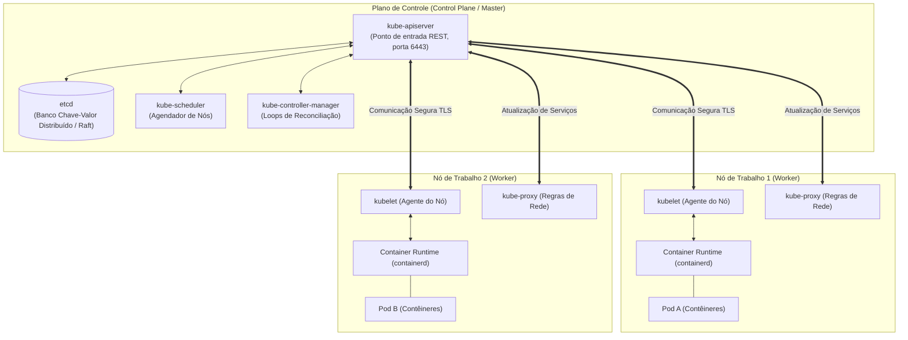
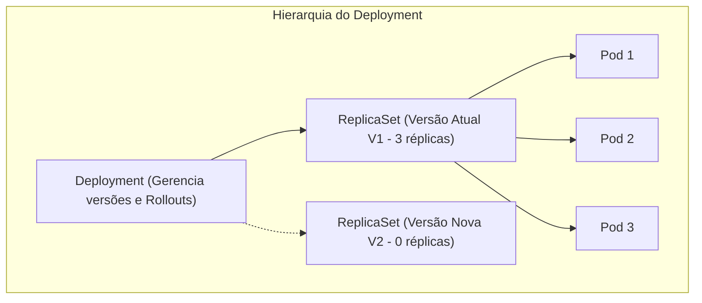
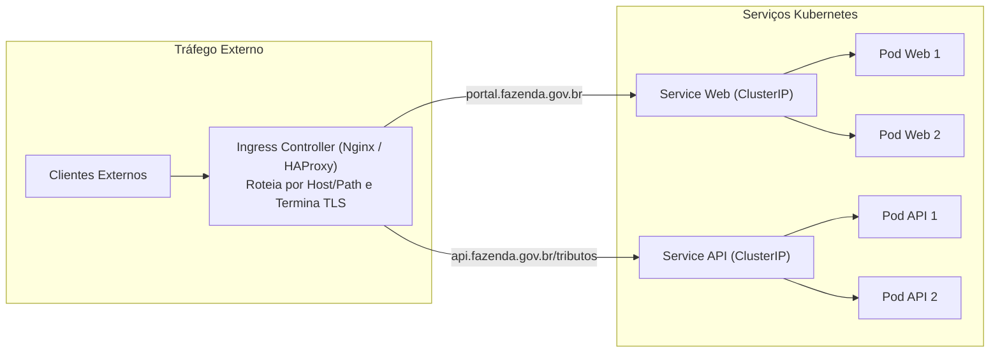
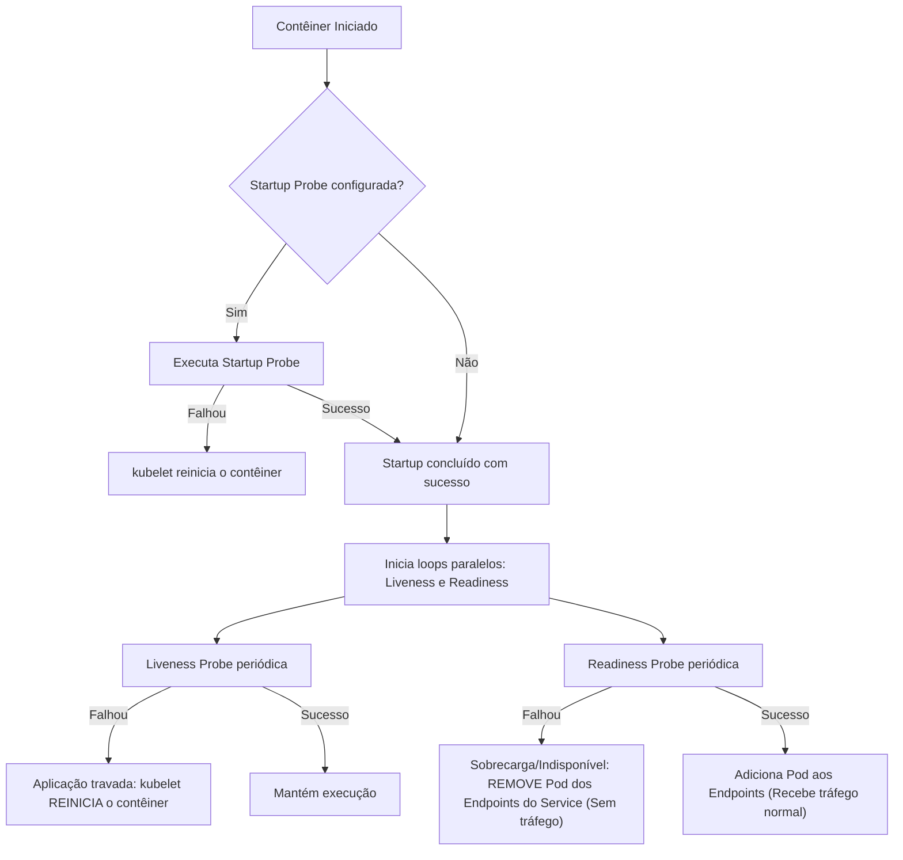

# 04 - Orquestração com Kubernetes e Gestão de Ambientes

> **Matéria:** DevOps, Plataforma de Desenvolvimento e Engenharia de Entrega  
> **Cargo:** B02 – Técnico de Controle Externo – Especialidade: Tecnologia da Informação  
> **Arquivo:** `04_orquestracao_com_kubernetes_e_gestao_de_ambientes.md`  

---

## 📌 Ementa / Itens do Edital
- Orquestração de contêineres com Kubernetes (K8s)
- Arquitetura de clusters Kubernetes (Plano de Controle / Control Plane e Nós de Trabalho / Worker Nodes)
- Objetos fundamentais: Pods, Deployments, ReplicaSets, StatefulSets, DaemonSets, Services e Ingress
- Mecanismos de configuração, persistência e governança: ConfigMaps, Secrets, Namespaces, PV e PVC
- Probes de integridade e ciclo de vida: Liveness, Readiness e Startup Probes
- Estratégias de implantação (Rolling Update, Recreate, Blue-Green, Canary)
- Gestão e segregação de ambientes: Desenvolvimento, Homologação e Produção (Paridade Dev/Prod)

---

## 🧭 Sumário
- [1. Arquitetura do Kubernetes: Control Plane vs. Worker Nodes](#1-arquitetura-do-kubernetes-control-plane-vs-worker-nodes)
    - [1.1 Componentes do Plano de Controle (Control Plane)](#11-componentes-do-plano-de-controle-control-plane)
    - [1.2 Componentes dos Nós de Execução (Worker Nodes)](#12-componentes-dos-nos-de-execucao-worker-nodes)
    - [1.3 O Loop de Reconciliação Contínua e o Estado Desejado](#13-o-loop-de-reconciliacao-continua-e-o-estado-desejado)
- [2. Workloads e Controladores: Qual Objeto Escolher?](#2-workloads-e-controladores-qual-objeto-escolher)
    - [2.1 Pods: A Menor Unidade Implantável](#21-pods-a-menor-unidade-implantavel)
    - [2.2 Deployment e ReplicaSet: Gerenciamento Declarativo para Aplicações Stateless](#22-deployment-e-replicaset-gerenciamento-declarativo-para-aplicacoes-stateless)
    - [2.3 StatefulSet: Identidade Estável e Volumes para Cargas Stateful](#23-statefulset-identidade-estavel-e-volumes-para-cargas-stateful)
    - [2.4 DaemonSet: Instância Única por Nó de Infraestrutura](#24-daemonset-instancia-unica-por-no-de-infraestrutura)
    - [2.5 Job e CronJob: Tarefas em Lote e Rotinas Agendadas](#25-job-e-cronjob-tarefas-em-lote-e-rotinas-agendadas)
- [3. Serviços de Rede (Services) e Roteamento de Borda (Ingress)](#3-servicos-de-rede-services-e-roteamento-de-borda-ingress)
    - [3.1 Tipos de Services: ClusterIP, NodePort, LoadBalancer e ExternalName](#31-tipos-de-services-clusterip-nodeport-loadbalancer-e-externalname)
    - [3.2 O Objeto Ingress e Controladores de Roteamento de Camada 7](#32-o-objeto-ingress-e-controladores-de-roteamento-de-camada-7)
- [4. Ciclo de Vida, Resiliência e Probes de Integridade](#4-ciclo-de-vida-resiliencia-e-probes-de-integridade)
    - [4.1 Liveness Probe vs. Readiness Probe vs. Startup Probe](#41-liveness-probe-vs-readiness-probe-vs-startup-probe)
    - [4.2 Tabela Comparativa de Comportamento em Caso de Falha](#42-tabela-comparativa-de-comportamento-em-caso-de-falha)
- [5. Governança, Armazenamento e Segregação de Ambientes](#5-governanca-armazenamento-e-segregacao-de-ambientes)
    - [5.1 ConfigMaps e Secrets: Injeção Desacoplada de Configurações](#51-configmaps-e-secrets-injecao-desacoplada-de-configuracoes)
    - [5.2 Persistência: PersistentVolume (PV), PersistentVolumeClaim (PVC) e StorageClass](#52-persistencia-persistentvolume-pv-persistentvolumeclaim-pvc-e-storageclass)
    - [5.3 Segregação de Ambientes e Paridade Dev/Prod (Twelve-Factor App)](#53-segregacao-de-ambientes-e-paridade-devprod-twelve-factor-app)
- [Fontes Oficiais e Referências Bibliográficas](#fontes-oficiais-e-referencias-bibliograficas)

---

## 1. Arquitetura do Kubernetes: Control Plane vs. Worker Nodes

O Kubernetes (K8s) é a plataforma líder da indústria para orquestração declarativa de contêineres em ambientes distribuídos e elásticos. Concebido a partir da experiência do Google com seus sistemas internos (Borg e Omega) e posteriormente doado à *Cloud Native Computing Foundation* (CNCF), o Kubernetes opera sob o paradigma do **estado desejado (*declarative reconciliation*)**: o operador define as metas do cluster em manifestos YAML e a plataforma atua ininterruptamente para assegurar que o **estado real** coincida com o **estado declarado**.



### 1.1 Componentes do Plano de Controle (Control Plane)

O Plano de Controle é responsável por tomar decisões globais sobre o cluster (como agendamento de recursos), detectar e responder a eventos (como inicializar um novo Pod quando as réplicas de um Deployment não são atendidas):

1. **`kube-apiserver`:** É o coração e a porta de entrada de todo o cluster. Expõe a API REST do Kubernetes em HTTPS (porta padrão 6443). Todos os clientes externos (como a CLI `kubectl` ou esteiras de CI/CD) e todos os nós internos comunicam-se **exclusivamente com ele**. É o único componente autorizado a realizar operações diretas de leitura e gravação no banco de dados distribuído `etcd`.
2. **`etcd`:** Armazena o estado completo de configuração, segredos, metadados e objetos do cluster. Trata-se de um banco de dados relacional distribuído chave-valor altamente consistente que utiliza o algoritmo de consenso Raft. Fazer backup regular do `etcd` equivale a garantir a recuperação completa de desastres (*Disaster Recovery*) de todo o cluster K8s.
3. **`kube-scheduler`:** Responsável por analisar Pods recém-criados que ainda não possuem um nó atribuído e selecionar o nó de trabalho ideal para executá-los. Considera restrições de hardware (CPU e RAM solicitadas), regras de afinidade e anti-afinidade (*nodeAffinity*, *podAntiAffinity*), tolerâncias a manchas (*taints & tolerations*) e disponibilidade de portas.
4. **`kube-controller-manager`:** Executa os controladores internos em processos de segundo plano. Cada controlador é um loop contínuo de reconciliação que compara o estado real observado via API Server com o estado desejado (ex.: *Node Controller* para nós que falham, *Deployment Controller* para substituição de versões, *EndpointSlice Controller* para roteamento de rede).
5. **`cloud-controller-manager`:** Módulo opcional que integra a lógica do Kubernetes com as APIs dos provedores de nuvem pública (AWS, Azure, Google Cloud), provisionando dinamicamente balanceadores de carga, rotas e discos gerenciados.

### Questão 01
**(FCC – TRT – Analista Judiciário / Tecnologia da Informação)**  
A arquitetura do Kubernetes é dividida entre o Plano de Controle (*Control Plane*) e os Nós de Execução (*Worker Nodes*). O componente central do *Control Plane* que atua como o único banco de dados de armazenamento consistente e altamente disponível, guardando todo o estado do cluster, suas configurações e especificações de objetos no modelo chave-valor, é o:

* **A)** `kube-scheduler`
* **B)** `etcd`
* **C)** `kube-apiserver`
* **D)** `kubelet`
* **E)** `kube-proxy`

> **Comentário Detalhado:**
>
> - **A) Incorreta.** O `kube-scheduler` analisa os nós e decide em qual nó cada Pod deve ser executado.
> - **B) Correta.** O **`etcd`** é um banco de dados distribuído de chave-valor consistente e de alta disponibilidade (baseado no algoritmo de consenso Raft) que armazena todos os dados do cluster Kubernetes como a fonte única da verdade.
> - **C) Incorreta.** O `kube-apiserver` é a porta de entrada da API que se comunica com o etcd.
> - **D) Incorreta.** O `kubelet` é o agente que executa nos nós de trabalho (*Worker Nodes*).
> - **E) Incorreta.** O `kube-proxy` gerencia as regras de rede nos nós de trabalho.
>
> **Gabarito: B**

---


### 1.2 Componentes dos Nós de Execução (Worker Nodes)

Os Nós de Trabalho (*Worker Nodes*) são os servidores físicos ou máquinas virtuais encarregados de executar as cargas de trabalho reais da organização:

1. **`kubelet`:** O agente de gerenciamento instalado em cada nó do cluster. Ele consome as especificações do Pod (*PodSpecs*) enviadas pelo `kube-apiserver` e interage com o runtime local de contêineres via *Container Runtime Interface* (CRI) para garantir que os contêineres descritos sejam criados, permaneçam em execução e estejam saudáveis. Ele também supervisiona o resultado das *probes* de integridade e reporta o status do nó ao Control Plane.
2. **`kube-proxy`:** Componente de rede distribuído executado em cada nó de trabalho. Mantém as regras de rede (usando tabelas `iptables` ou módulos `IPVS` do Linux), viabilizando a abstração de *Service* e implementando o balanceamento de conexões TCP/UDP entre as réplicas ativas dos Pods.
3. **Container Runtime:** O software responsável pela execução física dos contêineres (como `containerd` ou `CRI-O`). Opera em conformidade com os padrões da OCI (*Open Container Initiative*).

> ⭐ **IMPORTANTE / REGRA DE OURO:**  
> Nenhum componente do cluster comunica-se diretamente com o `etcd`, com exceção do **`kube-apiserver`**. O `kube-scheduler`, o `controller-manager` e os agentes `kubelet` consultam e atualizam o estado do cluster **sempre e obrigatoriamente através do `kube-apiserver`**.

---

### Questão 02 (FCC - Adaptada / TI - Arquitetura de Clusters Kubernetes)
Durante o planejamento de alta disponibilidade para a infraestrutura de computação em nuvem de um Tribunal de Contas, a equipe de operações analisou a distribuição de responsabilidades entre os componentes do Plano de Controle (*Control Plane*) e dos Nós de Execução (*Worker Nodes*) do Kubernetes.

A respeito das funções e interações entre esses componentes, assinale a afirmativa correta:  

* **A)** O `etcd` atua como servidor de proxy reverso e balanceador de carga HTTP para receber diretamente as requisições dos usuários da internet.
* **B)** O `kube-scheduler` é o único componente autorizado a realizar operações de gravação e leitura no banco de dados distribuído `etcd`.
* **C)** O `kubelet` é o agente executado em cada nó de trabalho (*Worker Node*) responsável por receber as especificações dos Pods (*PodSpecs*) a partir do `kube-apiserver` e assegurar que os contêineres descritos estejam em execução e saudáveis no nó.
* **D)** O `kube-controller-manager` tem como responsabilidade exclusiva alocar endereços IP públicos nas placas de rede físicas dos servidores blade da instituição.
* **E)** O `kube-proxy` roda unicamente no nó Master e impede que contêineres dentro do mesmo Pod consigam se comunicar via `localhost`.

> **Comentário Detalhado:**
>
> - **A)** Incorreta. O `etcd` é o banco de dados chave-valor distribuído que preserva o estado completo e as configurações do cluster K8s, operando em rede privada e sem qualquer exposição para o tráfego de usuários finais da internet.
> - **B)** Incorreta. O **único** componente do cluster que possui autorização e capacidade de interagir diretamente com o banco de dados `etcd` é o **`kube-apiserver`**. Todos os outros componentes (incluindo o scheduler e os controllers) comunicam-se via API Server.
> - **C)** Correta. O **`kubelet`** é o agente primário de cada nó de trabalho (*Worker Node*). Ele estabelece comunicação contínua com o `kube-apiserver`, recebe as especificações dos Pods (*PodSpecs*), comanda o runtime de contêineres via CRI para instanciar as cargas de trabalho e supervisiona a saúde das instâncias através das sondas (*probes*).
> - **D)** Incorreta. O `kube-controller-manager` executa múltiplos loops de reconciliação contínua (como Node Controller e Deployment Controller) para manter o estado desejado do cluster, não gerenciando alocação física de IPs em blades.
> - **E)** Incorreta. O `kube-proxy` opera em cada nó de trabalho gerenciando regras de rede de serviços, e contêineres do mesmo Pod comunicam-se nativamente via `localhost`.
> 
> **Gabarito: C**

---


### 1.3 O Loop de Reconciliação Contínua e o Estado Desejado

O ciclo de vida do Kubernetes baseia-se em um mecanismo ininterrupto:
$$\text{Observar Estado Real} \longrightarrow \text{Comparar com Estado Desejado} \longrightarrow \text{Executar Ação Corretiva}$$
Se um desenvolvedor define `replicas: 4` em um manifesto e um nó físico desliga subitamente (derrubando 2 Pods), o *Controller Manager* detecta que o estado real caiu para 2 réplicas e comanda o *kube-scheduler* a despachar 2 novos Pods em nós sadios remanescentes, restaurando a capacidade desejada sem qualquer intervenção humana (*Self-Healing*).

---


### Questão 03
**(FCC – TRT – Analista Judiciário / Tecnologia da Informação)**  
O modelo operacional do Kubernetes é fundamentado no princípio do Loop de Reconciliação Contínua (*Reconciliation Loop*). Esse mecanismo arquitetural opera continuamente por meio da seguinte dinâmica:

* **A)** O administrador digita comandos no terminal a cada dez segundos para manter os servidores ligados.
* **B)** Os controladores (*controllers*) observam o estado atual do cluster (*current state*), comparam-no com o estado desejado (*desired state*) declarado nos manifestos de configuração e executam ações automatizadas de convergência para fazer com que o estado atual se iguale ao estado desejado.
* **C)** O cluster apaga todos os bancos de dados caso a energia elétrica oscile.
* **D)** O sistema interrompe todo o tráfego de rede caso detecte um Pod com consumo de memória inferior a 50%.
* **E)** Os servidores são formatados diariamente para eliminar arquivos temporários.

> **Comentário Detalhado:**
>
> - **A) Incorreta.** O processo é 100% autônomo e contínuo.
> - **B) Correta.** É o cerne da automação do Kubernetes: o usuário declara o estado desejado (ex: "desejo 5 réplicas do Pod X"). O controlador monitora a realidade: se um nó cai e sobram apenas 4 pods, o controlador detecta a discrepância e dispara a criação de um novo Pod imediatamente para restabelecer as 5 réplicas (*self-healing* declarativo).
> - **C) Incorreta.** Kubernetes provê resiliência e alta disponibilidade.
> - **D) Incorreta.** Comportamento inexistente.
> - **E) Incorreta.** Afirmação absurda.
>
> **Gabarito: B**

---

## 2. Workloads e Controladores: Qual Objeto Escolher?

O Kubernetes não executa contêineres diretamente de forma isolada; ele os encapsula em abstrações funcionais denominadas *Workloads*.



### 2.1 Pods: A Menor Unidade Implantável

O **Pod** é a menor e mais básica unidade gerenciável do modelo de objetos do Kubernetes:

- Um Pod encapsula **um ou mais contêineres estreitamente acoplados** que compartilham recursos de baixo nível:
    1. **Network Namespace Compartilhado:** Todos os contêineres do mesmo Pod compartilham o mesmo endereço IP e a mesma tabela de portas. Eles podem se comunicar internamente via `localhost` com altíssima performance.
    2. **Volumes Compartilhados:** Podem montar os mesmos diretórios de dados locais.

- **Padrão Sidecar:** Um contêiner primário executa a lógica de negócio (ex.: API Node.js), enquanto contêineres secundários (*sidecars*) realizam tarefas de apoio (ex.: agente Envoy de Service Mesh ou agente de envio de logs).
- **Efemeridade Crítica:** Pods são descartáveis e mortais. Eles nunca devem ser instanciados de forma avulsa em produção; devem ser sempre gerenciados por controladores de carga de trabalho.

### 2.2 Deployment e ReplicaSet: Gerenciamento Declarativo para Aplicações Stateless

- **`ReplicaSet`:** Controlador encarregado de manter um número fixo e estável de réplicas de Pods rodando a qualquer momento, utilizando seletores de rótulos (*Labels and Selectors*).
- **`Deployment`:** Abstração de nível superior que gerencia os `ReplicaSets` de forma declarativa:
    - Permite realizar atualizações sem tempo de inatividade (*RollingUpdate*);
    - Controla o ritmo de rollout através das diretivas `maxSurge` (quantos Pods extras podem ser criados acima da meta) e `maxUnavailable` (quantos Pods podem ficar indisponíveis durante a transição);
    - Possibilita pausar, retomar e reverter versões instantaneamente (`kubectl rollout undo deployment/<nome>`).
    - **Uso ideal:** Aplicações web sem estado (*stateless*), microsserviços REST, APIs de processamento assíncrono.

### Questão 04
**(FCC – TRT – Analista Judiciário / Tecnologia da Informação)**  
Para implantar e gerenciar aplicações sem estado (*stateless*) em clusters Kubernetes, o controlador de carga de trabalho recomendado como padrão na arquitetura é o **Deployment**. A relação estrutural entre um objeto *Deployment* e os objetos *ReplicaSets* e *Pods* sob sua gestão estabelece que:

* **A)** O Deployment gerencia diretamente contêineres individuais sem a existência de Pods.
* **B)** O Deployment gerencia versões de ReplicaSets (criando novos ReplicaSets durante atualizações de versão e mantendo os antigos para viabilizar *rollbacks* rápidos), e os ReplicaSets garantem a quantidade declarada de réplicas ativas dos Pods em execução.
* **C)** O ReplicaSet comanda o Deployment em uma hierarquia invertida.
* **D)** Cada Deployment só pode conter um único Pod no cluster inteiro.
* **E)** O Deployment exige que a aplicação utilize armazenamento físico em disquetes de alta densidade.

> **Comentário Detalhado:**
>
> - **A) Incorreta.** A menor unidade gerenciável no Kubernetes é o Pod, nunca contêineres soltos.
> - **B) Correta.** A hierarquia canônica de workloads *stateless*: **Deployment $\rightarrow$ ReplicaSet $\rightarrow$ Pods**. Ao atualizar a imagem de um Deployment, ele cria um novo ReplicaSet e migra as réplicas progressivamente (*RollingUpdate*), permitindo voltar à versão anterior (*rollback*) instantaneamente apenas reativando o ReplicaSet anterior.
> - **C) Incorreta.** O Deployment situa-se acima do ReplicaSet.
> - **D) Incorreta.** Suporta dezenas ou centenas de réplicas escaladas horizontalmente.
> - **E) Incorreta.** Afirmação absurda.
>
> **Gabarito: B**

---


### 2.3 StatefulSet: Identidade Estável e Volumes para Cargas Stateful

Projetado para aplicações que demandam persistência de dados e ordenação estrita:

- **Identidade de Rede Estável:** Cada Pod recebe um nome ordinal determinístico que persiste mesmo se o Pod for recriado (ex.: `postgres-0`, `postgres-1`, `postgres-2`).
- **Volumes Dedicados via `volumeClaimTemplates`:** Cada réplica recebe seu próprio disco persistente individual; se o `postgres-1` morrer e renascer em outro nó, o Kubernetes reanexa exatamente o mesmo disco à nova réplica.
- **Inicialização e Parada Ordenada:** Pods sobem sequencialmente (0, depois 1, depois 2) e são encerrados na ordem inversa (2, depois 1, depois 0).
- **Uso ideal:** Bancos de dados distribuídos (PostgreSQL com replicação, MongoDB, Cassandra), sistemas de mensageria (Apache Kafka, RabbitMQ).

---

### Questão 05 (FCC - Adaptada / TI - Controladores de Carga de Trabalho: Workloads K8s)
Uma equipe de desenvolvimento da Secretaria da Fazenda precisa implantar três soluções distintas no cluster Kubernetes institucional:

1. Uma API de consulta tributária sem estado (*stateless*), que deve permitir atualizações de versão sem parada de serviço (*rolling updates*) e escalabilidade horizontal automática.
2. Um cluster de banco de dados distribuído que exige armazenamento persistente com discos dedicados e nomes de rede fixos e ordenados para cada réplica.
3. Um agente de segurança e coleta de logs que deve ser executado obrigatoriamente com exatamente uma cópia em cada nó de trabalho do cluster.

Os objetos e controladores do Kubernetes mais indicados para atender aos cenários 1, 2 e 3 são, respectivamente:  

* **A)** `Deployment`; `StatefulSet`; e `DaemonSet`.
* **B)** `StatefulSet`; `Deployment`; e `CronJob`.
* **C)** `Job`; `ReplicaSet`; e `ConfigMap`.
* **D)** `DaemonSet`; `Job`; e `StatefulSet`.
* **E)** `Deployment`; `CronJob`; e `Ingress`.

> **Comentário Detalhado:**
>
> - **A)** Correta. As três opções correspondem perfeitamente às definições da arquitetura K8s:
>     - Cenário 1: Aplicações sem estado (*stateless*) com atualização sem parada (*RollingUpdate*) e escalabilidade horizontal são gerenciadas canonicamente por **`Deployments`**.
>     - Cenário 2: Bancos de dados e sistemas com estado (*stateful*) que exigem discos persistentes dedicados e nomes estáveis com ordenação determinística (`pod-0`, `pod-1`) exigem o uso de **`StatefulSets`**.
>     - Cenário 3: Agentes de coleta de logs, telemetria e segurança que precisam rodar com exatamente uma cópia em cada nó do cluster são orquestrados por **`DaemonSets`**.
> - **B)** Incorreta. O StatefulSet é para o cenário 2 e o CronJob é para tarefas periódicas.
> - **C)** Incorreta. Job é para tarefas pontuais de lote e ConfigMap é para injeção de configurações.
> - **D)** Incorreta. A ordem dos controladores está incorreta para os cenários descritos.
> - **E)** Incorreta. O Ingress é um recurso de rede/borda de Camada 7, não um controlador de execução de agentes em nós.
> 
> **Gabarito: A**

---


### 2.4 DaemonSet: Instância Única por Nó de Infraestrutura

- Garante que **exatamente uma cópia de um determinado Pod seja executada em todos os nós de trabalho** do cluster.
- Se novos nós forem adicionados ao cluster (por autoscaling de infraestrutura), o *DaemonSet* automaticamente agenda uma réplica do Pod no nó recém-adicionado. Se um nó for removido, o Pod é destruído.
- **Uso ideal:** Daemons de infraestrutura, coletores de logs (Fluentd, Logstash), agentes de monitoramento de métricas (Prometheus Node Exporter) e plugins de rede CNI (Calico, Flannel).

### Questão 06
**(FCC – TRT – Analista Judiciário / Tecnologia da Informação)**  
Em um cluster Kubernetes corporativo, a equipe de operações necessita assegurar que exatamente uma cópia de um Pod de coleta de logs (como o Fluentd) e de um agente de monitoramento de infraestrutura execute em **todos** os nós de trabalho (*Worker Nodes*), inclusive sendo provisionado automaticamente em novos nós adicionados ao cluster. O objeto controlador do Kubernetes concebido especificamente para esse propósito é o:

* **A)** *Job*
* **B)** *StatefulSet*
* **C)** *DaemonSet*
* **D)** *ReplicaSet*
* **E)** *CronJob*

> **Comentário Detalhado:**
>
> - **A) Incorreta.** *Job* executa tarefas em lote que finalizam após a conclusão com sucesso.
> - **B) Incorreta.** *StatefulSet* gerencia cargas com estado e identificadores ordinais fixos.
> - **C) Correta.** O **`DaemonSet`** garante que todos (ou alguns nós específicos) executem exatamente uma réplica do Pod. Quando novos nós entram no cluster, o DaemonSet aloca o Pod neles automaticamente; se um nó é removido, o Pod é destruído (padrão ideal para agentes de log, métricas e storage da infraestrutura).
> - **D) Incorreta.** *ReplicaSet* distribui réplicas arbitrariamente pelo cluster conforme capacidade.
> - **E) Incorreta.** *CronJob* executa Jobs periodicamente com base em agendamentos cron.
>
> **Gabarito: C**

---


### 2.5 Job e CronJob: Tarefas em Lote e Rotinas Agendadas

- **`Job`:** Cria um ou mais Pods e assegura que eles executem até o término bem-sucedido (código de saída zero). Ao concluir a tarefa, o Pod é encerrado e não é reiniciado pelo kubelet. Indicado para migrações de schema de banco de dados e relatórios pontuais.
- **`CronJob`:** Gerencia a execução periódica de `Jobs` com base em uma tabela temporal padrão (sintaxe cron de 5 campos, ex.: `0 2 * * *` para rodar diariamente às 02h). Indicado para rotinas de backup noturno e limpezas de cache.

---

## 3. Serviços de Rede (Services) e Roteamento de Borda (Ingress)

Como os Pods são efêmeros e seus IPs são dinâmicos e voláteis, sistemas corporativos exigem pontos de acesso estáveis para comunicação.



### 3.1 Tipos de Services: ClusterIP, NodePort, LoadBalancer e ExternalName

O objeto **`Service`** provê um endereço IP virtual fixo (*VIP*) e um registro DNS imutável para um conjunto de Pods selecionados via *labels*:

1. **`ClusterIP` (Padrão):**
    - Cria um IP virtual acessível **estritamente de dentro do cluster**.
    - É o padrão ouro para comunicação interna entre microsserviços (comunicação leste-oeste).

2. **`NodePort`:**
    - Abre uma porta estática de alto nível (por padrão entre as faixas **30000 e 32767**) em todas as interfaces de rede de **todos os nós do cluster**.
    - Qualquer cliente que enviar tráfego para `<IP_Qualquer_No>:<NodePort>` é balanceado e direcionado aos Pods do serviço.

3. **`LoadBalancer`:**
    - Estende o tipo `NodePort` ao solicitar automaticamente a criação de um balanceador de carga externo gerenciado no provedor de nuvem pública (AWS NLB, Azure Load Balancer).
    - O balanceador da nuvem recebe o tráfego externo e o despacha para os nós do Kubernetes.

4. **`ExternalName`:**
    - Não utiliza seletores nem endereços IP virtuais; atua como um redirecionamento interno de DNS mapeando o serviço para um nome externo (registro CNAME), como `database.orgao.gov.br`.

### Questão 07
**(FCC – TRT – Analista Judiciário / Tecnologia da Informação)**  
Os objetos do tipo *Service* no Kubernetes fornecem abstração de rede estável e balanceamento de carga para conjuntos dinâmicos de Pods. O tipo de *Service* padrão, que atribui um endereço IP virtual interno alcançável exclusivamente dentro dos limites do cluster, denomina-se:

* **A)** `NodePort`
* **B)** `ClusterIP`
* **C)** `LoadBalancer`
* **D)** `ExternalName`
* **E)** `IngressController`

> **Comentário Detalhado:**
>
> - **A) Incorreta.** `NodePort` expõe o serviço em uma porta estática (faixa 30000-32767) em cada nó do cluster para acesso externo.
> - **B) Correta.** O **`ClusterIP`** é o tipo padrão (*default*): aloca um IP virtual estável roteável apenas internamente na rede do cluster, perfeito para comunicação interna entre microsserviços (ex: backend acessando o banco de dados).
> - **C) Incorreta.** `LoadBalancer` provisiona um balanceador de carga público externo gerenciado pelo provedor de nuvem (GCP, AWS, Azure).
> - **D) Incorreta.** `ExternalName` mapeia o Service para um registro CNAME DNS externo.
> - **E) Incorreta.** Ingress Controller é um controlador de roteamento de borda (L7), não um tipo de Service.
>
> **Gabarito: B**

---


### 3.2 O Objeto Ingress e Controladores de Roteamento de Camada 7

Enquanto criar múltiplos serviços do tipo `LoadBalancer` gera custos financeiros elevados e aloca dezenas de IPs públicos, o **`Ingress`** atua como um roteador de borda consolidado na Camada 7 (HTTP/HTTPS):

- **Funcionalidades:** Roteamento baseado em nomes de domínio (*Virtual Hosting* baseado em SNI, ex.: `portal.tce.go.gov.br` vs `auditoria.tce.go.gov.br`), roteamento baseado em caminhos de URL (ex.: `/api/v1/auth` vs `/api/v1/certidoes`) e **terminação centralizada de criptografia TLS/SSL**.
- **Ingress Controller:** O objeto `Ingress` é apenas um manifesto declarativo de regras. Ele exige a presença de um **Ingress Controller** ativo no cluster (como NGINX Ingress Controller, Traefik, HAProxy ou Kong) para interceptar o tráfego e aplicar o roteamento.

---

### Questão 08 (FCC - Adaptada / TI - Objetos de Rede: Services e Ingress)
No Kubernetes, o mecanismo de abstração que permite agrupar um conjunto de Pods sob um mesmo endereço IP estável e balancear o tráfego de rede entre eles, bem como o componente responsável por receber tráfego HTTP/HTTPS externo e roteá-lo com base no nome do domínio e no caminho da URL para múltiplos serviços internos, são denominados, respectivamente:  

* **A)** `ConfigMap` e `kubelet`.
* **B)** `Service` e `Ingress`.
* **C)** `Namespace` e `etcd`.
* **D)** `PersistentVolumeClaim` e `kube-proxy`.
* **E)** `DaemonSet` e `ReplicaSet`.

> **Comentário Detalhado:**
>
> - **A)** Incorreta. `ConfigMap` provê injeção de parâmetros em texto claro e o `kubelet` gerencia contêineres nos nós.
> - **B)** Correta. O **`Service`** atua como uma abstração lógica que fornece um endereço IP estável e balanceia conexões entre réplicas de Pods selecionadas por labels. Já o **`Ingress`** opera na Camada 7 (HTTP/HTTPS), gerenciando o tráfego de borda externo, viabilizando roteamento por nomes de host (domínios virtuais), caminhos de requisição e terminação segura de certificados TLS/SSL.
> - **C)** Incorreta. `Namespace` é partição lógica interna e `etcd` é o armazenamento distribuído do cluster.
> - **D)** Incorreta. `PersistentVolumeClaim` lida com alocação de armazenamento em disco persistente.
> - **E)** Incorreta. Trata-se de controladores de cargas de trabalho, e não de componentes de rede e roteamento de borda.
> 
> **Gabarito: B**

---


## 4. Ciclo de Vida, Resiliência e Probes de Integridade

O agente `kubelet` utiliza três sondas de monitoramento (*probes*) para acompanhar a integridade física e funcional dos contêineres:



### 4.1 Liveness Probe vs. Readiness Probe vs. Startup Probe

1. **`livenessProbe` (Sonda de Sobrevivência):**
    - **Objetivo:** Detectar se a aplicação interna entrou em estado de falha fatal irrecuperável (ex.: *deadlock* de threads, vazamento catastrófico de memória ou loop infinito).
    - **Consequência da Falha:** O `kubelet` **encerra o contêiner imediatamente e o reinicia** de acordo com a política de reinício (*restartPolicy*).

2. **`readinessProbe` (Sonda de Prontidão):**
    - **Objetivo:** Detectar se a aplicação está **pronta para receber tráfego de rede** dos clientes.
    - **Consequência da Falha:** O contêiner **NÃO é reiniciado**! O Kubernetes apenas **remove temporariamente o endereço IP do Pod da lista de Endpoints do Service**, impedindo que requisições de usuários sejam enviadas a um Pod que está ocupado ou aquecendo caches.

3. **`startupProbe` (Sonda de Inicialização):**
    - **Objetivo:** Proteger aplicações legadas que demoram vários minutos para inicializar (ex.: monólitos corporativos em Java/Spring).
    - **Mecanismo:** Desativa as verificações de Liveness e Readiness até que a aplicação complete seu boot inicial, prevenindo que o kubelet mate prematuramente um contêiner que apenas estava inicializando seus módulos internos.

---

### Questão 09 (FCC - Adaptada / TI - Monitoramento de Saúde de Pods: Probes)
Considere uma aplicação Java rodando em um contêiner no Kubernetes que, devido a um vazamento severo de conexões com o banco de dados, parou completamente de responder às requisições da rede e entrou em estado de deadlock irrecuperável. No manifesto de implantação da aplicação, foram configuradas sondas do tipo `livenessProbe` e `readinessProbe`.

Diante da falha contínua da verificação realizada pela sonda `livenessProbe`, a ação executada pelo agente `kubelet` será:  

* **A)** Ignorar a falha, registrando apenas uma linha de advertência no arquivo de log do sistema hospedeiro.
* **B)** Enviar uma requisição para a AWS solicitando a compra de mais memória física para o cluster.
* **C)** Encerrar o contêiner em falha e reiniciá-lo automaticamente, buscando restaurar a operacionalidade da aplicação.
* **D)** Manter o contêiner em execução e apenas remover temporariamente seu endereço IP da lista de Endpoints do Service, sem efetuar o reinício do processo.
* **E)** Desinstalar o sistema operacional Linux do nó de trabalho e formatar o disco rígido principal.

> **Comentário Detalhado:**
>
> - **A)** Incorreta. O mecanismo de resiliência (*self-healing*) do Kubernetes não permite que o kubelet ignore falhas contínuas de sondas de sobrevivência.
> - **B)** Incorreta. Probes em contêineres individuais não acionam compras ou provisionamento financeiro de recursos em nuvem pública.
> - **C)** Correta. A finalidade precípua da **`livenessProbe`** é identificar se a aplicação travou irrecuperavelmente. Caso a sonda falhe pelo limite consecutivo configurado (*failureThreshold*), o agente `kubelet` encerra o contêiner (sinal `SIGTERM`/`SIGKILL`) e **reinicia-o compulsoriamente** com base na política de reinício do Pod (*restartPolicy*), restaurando o serviço.
> - **D)** Incorreta. A ação de apenas remover o Pod da lista de Endpoints do Service sem reiniciar o contêiner é a consequência exclusiva da falha na **`readinessProbe`**, e não na `livenessProbe`.
> - **E)** Incorreta. Ação absurda e destrutiva sem qualquer fundamento técnico.
> 
> **Gabarito: C**

---


### 4.2 Tabela Comparativa de Comportamento em Caso de Falha

| Tipo de Sonda | Propósito Essencial | Ação do Kubernetes em Caso de Falha Contínua | Impacto no Tráfego de Rede |
| :--- | :--- | :--- | :--- |
| **`livenessProbe`** | Verificar se a aplicação está viva e operante. | **REINICIA o contêiner** (emite `SIGTERM` e `SIGKILL`). | O Pod fica temporariamente indisponível até o reinício. |
| **`readinessProbe`** | Verificar se a aplicação pode atender requisições agora. | **NÃO reinicia o contêiner**. | **Remove o Pod dos Endpoints do Service** (zero tráfego). |
| **`startupProbe`** | Proteger o tempo de boot inicial de sistemas lentos. | **REINICIA o contêiner** somente se o tempo limite de boot expirar. | O Pod não recebe tráfego até passar na sonda. |

> 🚨 **ALERTA DE PROVA / PEGADINHA FCC:**  
> A pegadinha clássica da FCC em questões sobre probes é inverter as consequências de falha:
>
> - Afirmar que a falha da **readinessProbe** causa a destruição ou reinicialização do contêiner (**FALSO!** A readiness apenas remove o Pod do balanceador do Service).
> - O reinício compulsório ocorre na falha contínua da **livenessProbe**!

---

## 5. Governança, Armazenamento e Segregação de Ambientes

### 5.1 ConfigMaps e Secrets: Injeção Desacoplada de Configurações

Em cumprimento ao Fator III da metodologia *Twelve-Factor App* (*Store config in the environment*), parâmetros de configuração e credenciais nunca devem estar fixados (*hardcoded*) dentro do código-fonte ou da imagem Docker:

- **`ConfigMap`:** Armazena dados de configuração não sensíveis em texto claro (variáveis de ambiente, URLs de serviços externos, arquivos de configuração completos como `nginx.conf`). Podem ser injetados no contêiner como variáveis de ambiente ou montados como arquivos em volumes virtuais.
- **`Secret`:** Armazena dados estritamente sensíveis (senhas de banco de dados, chaves privadas SSH, tokens JWT, certificados digitais TLS). Por padrão no Kubernetes vanilla, os dados são armazenados no `etcd` e codificados em Base64 (exigindo a habilitação de criptografia em repouso no `etcd` para segurança corporativa plena).

### Questão 10
**(FCC – TRT – Analista Judiciário / Tecnologia da Informação)**  
Em conformidade com a metodologia dos Doze Fatores (*Twelve-Factor App*), a configuração de uma aplicação deve ser estritamente separada do código-fonte. No Kubernetes, essa segregação é implementada por meio de dois objetos nativos: *ConfigMaps* e *Secrets*. A diferença fundamental de propósito entre eles estabelece que:

* **A)** *ConfigMaps* armazenam dados confidenciais criptografados, enquanto *Secrets* guardam arquivos de imagem públicos sem restrição.
* **B)** *ConfigMaps* destinam-se a dados de configuração não confidenciais em texto claro (como URLs de endpoints, portas e flags de log), ao passo que *Secrets* são concebidos para armazenar dados confidenciais e credenciais sensíveis (como senhas, chaves de API, tokens e certificados TLS), codificados em Base64 ou protegidos por criptografia em repouso no `etcd`.
* **C)** *Secrets* não podem ser montados como variáveis de ambiente nos Pods.
* **D)** Ambos os objetos são deletados obrigatoriamente a cada 5 minutos pelo Kubernetes.
* **E)** *ConfigMaps* só aceitam configurações escritas em linguagem Pascal.

> **Comentário Detalhado:**
>
> - **A) Incorreta.** Relação de confidencialidade invertida.
> - **B) Correta.** Definição arquitetural exata: **ConfigMaps** para configurações gerais legíveis; **Secrets** para credenciais sensíveis que demandam controle de acesso via RBAC, auditoria de acesso e encriptação no etcd. Ambos podem ser injetados em Pods como variáveis de ambiente ou montados como arquivos em volumes.
> - **C) Incorreta.** Secrets podem ser injetados perfeitamente como variáveis de ambiente via `secretKeyRef` ou `envFrom`.
> - **D) Incorreta.** São objetos persistentes estáveis.
> - **E) Incorreta.** Dados são armazenados como pares chave-valor universais.
>
> **Gabarito: B**

---


### 5.2 Persistência: PersistentVolume (PV), PersistentVolumeClaim (PVC) e StorageClass

O Kubernetes implementa um padrão desacoplado entre administradores de infraestrutura e desenvolvedores para gerenciar armazenamento de dados:

```mermaid
flowchart LR
    ADMIN["Administrador / Cloud Provider"] -->|Provisiona storage físico| PV["PersistentVolume (PV)"]
    DEV["Desenvolvedor"] -->|Solicita 100Gi ReadWriteOnce| PVC["PersistentVolumeClaim (PVC)"]
    PVC -.->|Vinculação Automática (Binding)| PV
    POD["Pod (StatefulSet / Deployment)"] -->|Consome o storage| PVC
```

- **`PersistentVolume` (PV):** O recurso de armazenamento real provisionado no cluster (disco SAN, volume AWS EBS, export NFS). Representa a oferta de capacidade física.
- **`PersistentVolumeClaim` (PVC):** A solicitação formal de armazenamento feita por um desenvolvedor (especificando tamanho em gigabytes e modo de acesso, como `ReadWriteOnce` ou `ReadWriteMany`). O Kubernetes vincula automaticamente o PVC a um PV compatível.
- **`StorageClass`:** Permite o provisionamento dinâmico de volumes. Quando um PVC referencia uma StorageClass, o Kubernetes aciona a API do provedor de infraestrutura para criar o disco físico sob demanda, dispensando o provisionamento manual prévio de PVs.

### 5.3 Segregação de Ambientes e Paridade Dev/Prod (Twelve-Factor App)

A gestão profissional de múltiplos ambientes (Desenvolvimento, Homologação/Staging e Produção) exige conformidade com as boas práticas de governança:

1. **Paridade entre Ambientes (Fator X do Twelve-Factor App):** As ferramentas, bibliotecas e sistemas de retaguarda (bancos de dados, mensageria) devem ser estritamente idênticos em todos os estágios. Não se deve utilizar SQLite em desenvolvimento e PostgreSQL em produção; utilize o mesmo PostgreSQL conteinerizado em todos os ambientes.
2. **Modelos de Isolamento Multi-Ambiente:**
    - **Soft Multi-Tenancy (Namespaces Compartilhados no mesmo Cluster):** Ambientes separados logicamente por `Namespaces` dentro de um único cluster. Exige o uso obrigatório de **`ResourceQuota`** (para limitar o teto de CPU e RAM de desenvolvimento e evitar que testes sobrecarreguem a produção), **`LimitRange`** e **`NetworkPolicies`** (regras de firewall interno impedindo comunicação entre namespaces).
    - **Hard Multi-Tenancy (Clusters Físicos Dedicados):** Padrão recomendado para órgãos do setor público como o TCE-GO. Mantêm-se clusters fisicamente isolados para Produção e Não-Produção, eliminando qualquer risco de contaminação cruzada, vazamento de dados fiscais ou exaustão de plano de controle.

---

### Questão 11 (FCC - Adaptada / TI - Gestão de Ambientes, Segregação e Armazenamento Persistente)
Em um órgão público, os ambientes de Desenvolvimento, Homologação e Produção compartilham a infraestrutura de computação. Para garantir a governança e o isolamento operacional desses ambientes de acordo com as boas práticas do Kubernetes e da metodologia dos Doze Fatores (*Twelve-Factor App*), a equipe técnica deve:  

* **A)** Utilizar `Namespaces` distintos combinados com `ResourceQuotas` para impor limites máximos de consumo de CPU e memória em cada ambiente, associando segredos e credenciais via objetos `Secret` e configurações não sensíveis via `ConfigMap`.
* **B)** Gravar senhas de bancos de dados diretamente em texto claro dentro do código-fonte da aplicação para evitar o overhead de processamento do K8s.
* **C)** Conceder permissões de administrador de cluster (*cluster-admin*) irrestritas a todos os estagiários nos ambientes de homologação e produção.
* **D)** Utilizar a estratégia de deploy *Recreate* em produção durante o horário de pico de atendimento ao cidadão para forçar o desligamento dos servidores.
* **E)** Armazenar os dados transacionais de bancos de dados exclusivamente na camada efêmera do Pod, proibindo o uso de `PersistentVolumes` (PV) e `PersistentVolumeClaims` (PVC).

> **Comentário Detalhado:**
>
> - **A)** Correta. O particionamento lógico em **`Namespaces`** associado a cotas estritas de recursos (**`ResourceQuota`**) impede que o ambiente de desenvolvimento monopolize os recursos de CPU e memória do cluster. Além disso, a segregação de configurações em **`ConfigMaps`** e credenciais confidenciais em **`Secrets`** materializa o Fator III (*Config*) do Twelve-Factor App, garantindo que a mesma imagem de contêiner imutável seja promovida entre os ambientes sem risco de exposição de dados.
> - **B)** Incorreta. Manter senhas no código-fonte viola os mais fundamentais princípios de segurança da informação e governança.
> - **C)** Incorreta. Distribuir privilégios irrestritos de *cluster-admin* contraria abertamente o Princípio do Menor Privilégio (*PoLP*) e as normas de controle de acesso RBAC.
> - **D)** Incorreta. A estratégia de publicação *Recreate* causa indisponibilidade forçada (*downtime*) e não deve ser utilizada em horários de pico operacional de produção.
> - **E)** Incorreta. Armazenar dados em camadas efêmeras provocaria perda catastrófica e definitiva de informações a cada reinicialização de Pods de banco de dados.
> 
> **Gabarito: A**

---


## 🌐 Fontes Oficiais e Referências Bibliográficas

* [Kubernetes Official Documentation - Componentes da Arquitetura](https://kubernetes.io/pt-br/docs/concepts/overview/components/) - Control Plane (API Server, etcd, Scheduler, Controller Manager) e Node (kubelet, kube-proxy, runtime).
* [Kubernetes Official Documentation - Workloads e Deployments](https://kubernetes.io/docs/concepts/workloads/controllers/deployment/) - Gestão declarativa de Pods, ReplicaSets, Rolling Updates e Rollbacks.
* [Kubernetes Official Documentation - Services e Ingress](https://kubernetes.io/pt-br/docs/concepts/services-networking/service/) - Comunicação de rede (ClusterIP, NodePort, LoadBalancer) e roteamento HTTP/HTTPS via Ingress.
* [Kubernetes Official Documentation - Configure Liveness, Readiness and Startup Probes](https://kubernetes.io/docs/tasks/configure-pod-container/configure-liveness-readiness-startup-probes/) - Monitoramento de integridade e prontidão operacional dos contêineres.
* [Kubernetes Official Documentation - Persistent Volumes](https://kubernetes.io/pt-br/docs/concepts/storage/persistent-volumes/) - Gestão de armazenamento persistente com PV, PVC e StorageClass.
* BURNS, Brendan; BEDA, Joe; HIGHTOWER, Kelsey. **Kubernetes: Up and Running: Dive into the Future of Infrastructure**. 3. ed. Sebastopol: O'Reilly Media, 2022. (Cap. 4 - Pods; Cap. 5 - Services; Cap. 9 - Deployments).
* SAYFAN, Gigi. **Mastering Kubernetes**. 4. ed. Birmingham: Packt Publishing, 2022. (Cap. 2 - Arquitetura de Alto Nível; Cap. 6 - Rede e Armazenamento).
* LUKSA, Marko. **Kubernetes em Ação**. Rio de Janeiro: Alta Books, 2019. (Cap. 6 e 7 - Volumes, ConfigMaps e Secrets).
