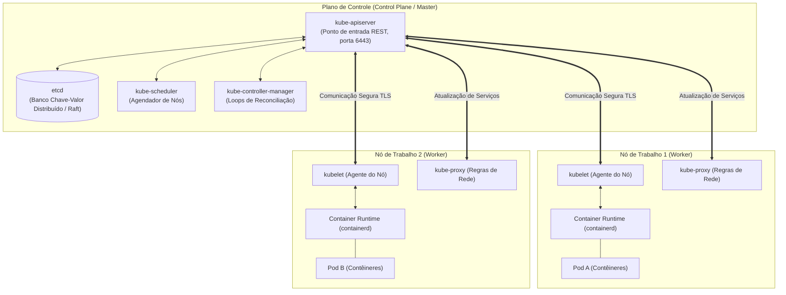
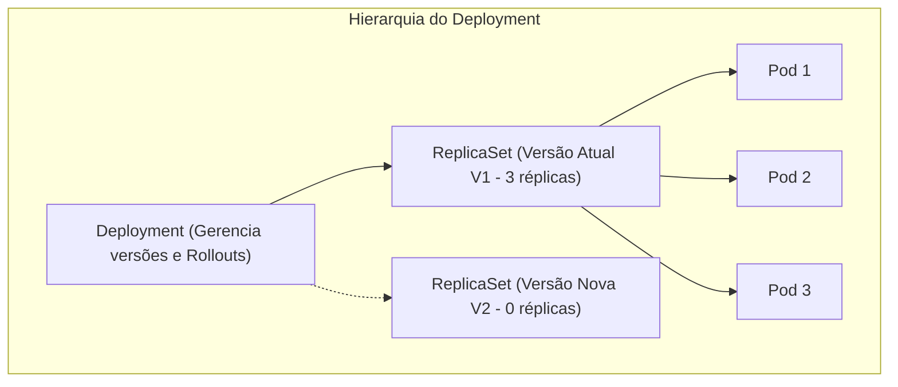
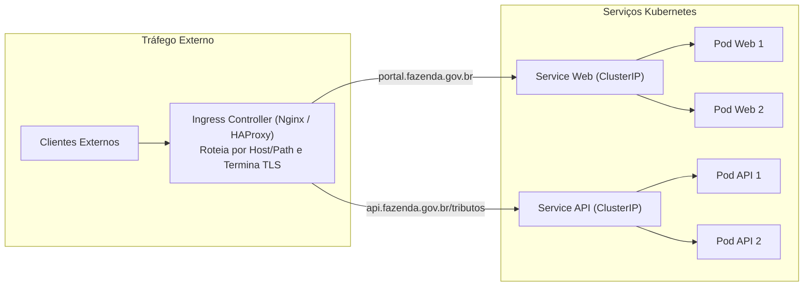
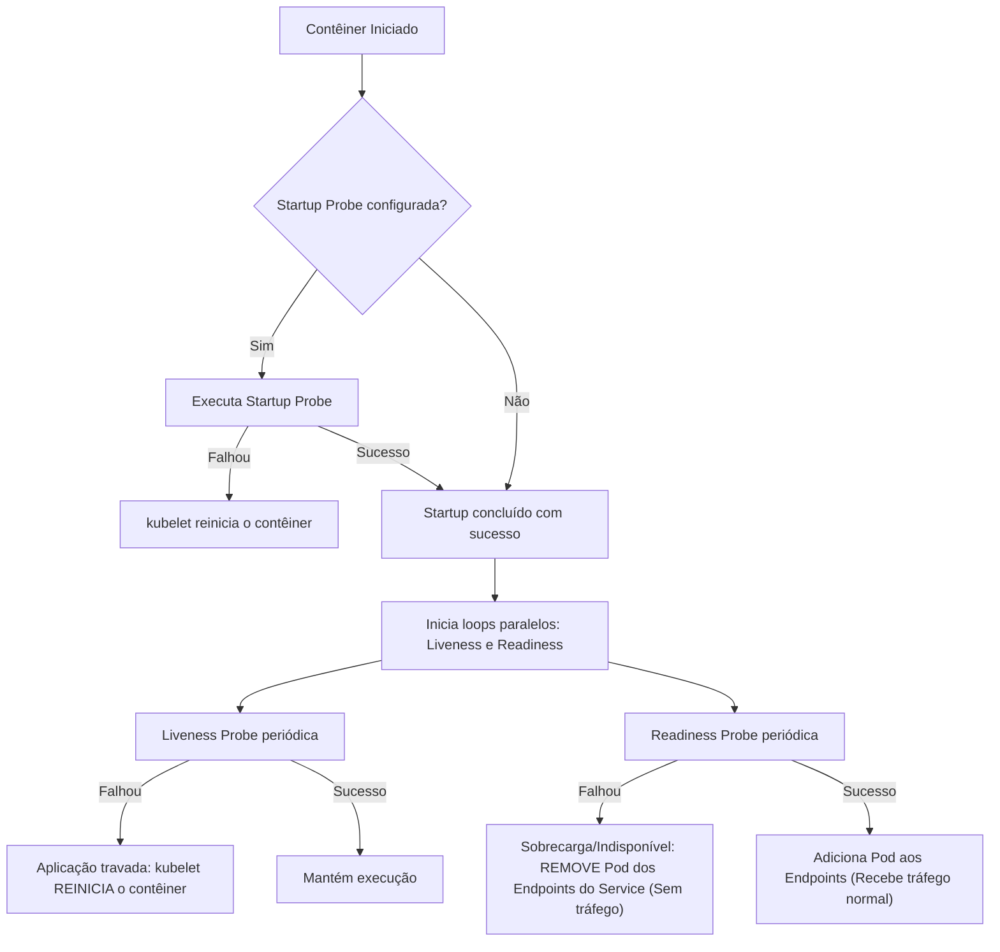

# 04 - Orquestração com Kubernetes e Gestão de Ambientes

> **Matéria:** DevOps, Plataforma de Desenvolvimento e Engenharia de Entrega  
> **Cargo:** B02 – Técnico de Controle Externo – Especialidade: Tecnologia da Informação  
> **Arquivo:** `04_orquestracao_com_kubernetes_e_gestao_de_ambientes.md`  

---

## 📌 Ementa / Itens do Edital
- Orquestração de contêineres com Kubernetes (K8s)
- Arquitetura de clusters Kubernetes (Plano de Controle / Control Plane e Nós de Trabalho / Worker Nodes)
- Objetos fundamentais: Pods, Deployments, ReplicaSets, StatefulSets, DaemonSets, Services e Ingress
- Mecanismos de configuração, persistência e governança: ConfigMaps, Secrets, Namespaces, PV e PVC
- Probes de integridade e ciclo de vida: Liveness, Readiness e Startup Probes
- Estratégias de implantação (Rolling Update, Recreate, Blue-Green, Canary)
- Gestão e segregação de ambientes: Desenvolvimento, Homologação e Produção (Paridade Dev/Prod)

---

## 🌳 Classificação Hierárquica

```text
4. Orquestração com Kubernetes e Gestão de Ciclo de Ambientes
├── 4.1 Arquitetura e Componentes do Cluster Kubernetes
│   ├── 4.1.1 Plano de Controle (Control Plane):
│   │   ├── `kube-apiserver`: Ponto de entrada REST centralizado; autenticação, autorização (RBAC) e admissão; único componente que acessa o etcd
│   │   ├── `etcd`: Armazenamento de chave-valor distribuído, consistente e altamente disponível (Algoritmo Raft); estado completo do cluster
│   │   ├── `kube-scheduler`: Algoritmo de agendamento de Pods nos Worker Nodes com base em recursos, afinidades e restrições
│   │   ├── `kube-controller-manager`: Loops de reconciliação contínua (Node Controller, Deployment Controller, EndpointSlice Controller)
│   │   └── `cloud-controller-manager`: Integração com APIs e recursos de nuvens públicas (AWS, GCP, Azure)
│   └── 4.1.2 Nós de Execução (Worker Nodes):
│       ├── `kubelet`: Agente primário do nó; consome PodSpecs via API Server e gerencia contêineres via CRI (Container Runtime Interface)
│       ├── `kube-proxy`: Gestor de regras de rede local (iptables / IPVS); viabiliza a abstração de Services e balanceamento interno
│       └── Container Runtime (containerd, CRI-O): Motor de execução de contêineres de baixo nível em conformidade com o padrão OCI
├── 4.2 Objetos, Cargas de Trabalho (Workloads) e Abstrações
│   ├── 4.2.1 Pods: Menor unidade gerenciável; encapsula 1 ou mais contêineres compartilhando Network Namespace (IP/localhost) e Volumes
│   ├── 4.2.2 Controladores de Carga de Trabalho (Workload Controllers):
│   │   ├── `ReplicaSet`: Garante a cardinalidade exata de réplicas de Pods através de seletores de rótulos (Labels e Selectors)
│   │   ├── `Deployment`: Gerenciamento declarativo de ReplicaSets; rollouts com zero downtime, pausar/retomar e rollbacks automáticos
│   │   ├── `StatefulSet`: Para aplicações com estado persistente; nomes estáveis ordenados (pod-0, pod-1) e volumes dedicados
│   │   ├── `DaemonSet`: Garante a execução de exatamente uma cópia de Pod em cada nó (coleta de logs, telemetria, drivers de rede)
│   │   └── `Job` e `CronJob`: Execução de tarefas em lote até o término com sucesso e rotinas periódicas agendadas
│   ├── 4.2.3 Serviços de Rede e Exposição (Services & Ingress):
│   │   ├── `ClusterIP` (Padrão): Endereço IP virtual interno acessível estritamente dentro do cluster
│   │   ├── `NodePort`: Mapeamento de porta estática de alto nível (30000-32767) em todos os nós do cluster
│   │   ├── `LoadBalancer`: Provisionamento automático de balanceador de carga em nuvem externa
│   │   ├── `ExternalName`: Resolução via CNAME para recursos externos
│   │   └── `Ingress`: Roteador de Camada 7 (HTTP/HTTPS); roteamento por Host/Path, terminação TLS e consolidação de IP público
│   ├── 4.2.4 Monitoramento de Saúde de Pods (Probes):
│   │   ├── `livenessProbe`: Detecta se a aplicação travou (se falhar, o kubelet reinicia o contêiner)
│   │   ├── `readinessProbe`: Detecta se a aplicação está pronta para receber tráfego (se falhar, remove o Pod dos Endpoints do Service)
│   │   └── `startupProbe`: Protege aplicações lentas durante o boot inicial antes da ativação das demais probes
│   ├── 4.2.5 Configuração, Segredos e Armazenamento:
│   │   ├── `ConfigMap`: Configurações em texto claro (variáveis, arquivos montados)
│   │   ├── `Secret`: Dados sensíveis codificados em Base64 (credenciais, certificados TLS)
│   │   ├── `PersistentVolume` (PV) e `PersistentVolumeClaim` (PVC): Desacoplamento entre provisionamento de storage e consumo pelo Pod
│   │   └── `StorageClass`: Provisionamento dinâmico de volumes persistentes
│   └── 4.2.6 Isolamento Lógico: `Namespace`, `ResourceQuota` (limites do time) e `LimitRange`
├── 4.3 Estratégias de Rollout e Ciclo de Vida
│   ├── 4.3.1 Rolling Update: Atualização progressiva sem parada controlada por `maxSurge` e `maxUnavailable`
│   ├── 4.3.2 Recreate: Destruição total prévia dos Pods antigos antes de instanciar os novos (gera downtime)
│   ├── 4.3.3 Blue-Green Deployment: Chaveamento atômico de tráfego entre Deployments paralelos
│   └── 4.3.4 Canary Deployment: Encaminhamento de fração percentual de tráfego real para validação em produção
└── 4.4 Gestão e Segregação de Ambientes
    ├── 4.4.1 Ambientes Operacionais: Desenvolvimento (Dev), Homologação/Staging e Produção (Prod)
    ├── 4.4.2 Paridade Dev/Prod (Metodologia Twelve-Factor App): Minimização de divergências estruturais e tecnológicas
    └── 4.4.3 Modelos de Isolamento: Namespaces Compartilhados (Soft Multi-Tenancy) vs. Clusters Dedicados (Hard Multi-Tenancy)
```

---

## 📖 Resumo Teórico & Pontos-Chave Aprofundados

### 1. Arquitetura do Kubernetes: Control Plane vs. Worker Nodes

O Kubernetes é uma plataforma distribuída orientada a estado desejado (*declarative management*). Ele opera em um loop contínuo de reconciliação: compara continuamente o **estado real** do cluster com o **estado desejado** declarado nos arquivos YAML e atua para eliminar qualquer discrepância.



#### A. Componentes do Control Plane
1. **`kube-apiserver`:** O coração da arquitetura. Expõe a API REST do Kubernetes. Todos os componentes externos (como o utilitário `kubectl`) e internos (como o `kubelet` e o `kube-scheduler`) comunicam-se **exclusivamente através dele**. É o único componente autorizado a interagir diretamente com o banco de dados `etcd`.
2. **`etcd`:** Armazena o estado completo de configuração, segredos e metadados de todos os objetos do cluster. Trata-se de um banco de dados relacional distribuído chave-valor altamente consistente que utiliza o algoritmo de consenso Raft. Fazer backup do `etcd` equivale a fazer backup de todo o cluster K8s.
3. **`kube-scheduler`:** Responsável por selecionar em qual nó de trabalho (*Worker Node*) um Pod recém-criado deve ser alocado. Leva em consideração restrições de CPU/RAM, afinidade e anti-afinidade (*nodeAffinity*, *podAntiAffinity*), tolerâncias a manchas (*taints & tolerations*) e disponibilidade de portas.
4. **`kube-controller-manager`:** Executa os controladores centrais do Kubernetes em segundo plano. Cada controlador é um loop infinito que observa o cluster através do API Server e executa correções caso o estado mude (ex.: se um nó falha, o *Node Controller* percebe e aciona o agendamento dos Pods perdidos em outros nós sadios).

#### B. Componentes dos Worker Nodes
1. **`kubelet`:** O agente de gerenciamento instalado em cada nó físico ou VM de trabalho. Ele recebe as especificações do Pod (*PodSpecs*) enviadas pelo API Server e garante que os contêineres descritos sejam criados e permaneçam saudáveis, acionando o runtime local via CRI (*Container Runtime Interface*). Ele também monitora a saúde das probes e reporta o status de volta ao API Server.
2. **`kube-proxy`:** Responsável pela manutenção das regras de rede em cada nó (gerenciando regras do `iptables` ou tabelas `IPVS` do kernel Linux). Implementa o encaminhamento de pacotes para a abstração de *Service*, balanceando as conexões entre as réplicas ativas dos Pods.
3. **Container Runtime:** O software responsável pela execução real dos contêineres (ex.: `containerd`, `CRI-O`). O Docker Engine legado foi substituído pela interface padronizada CRI.

> ⭐ **IMPORTANTE / REGRA DE OURO:**  
> Nenhum componente do cluster comunica-se diretamente com o `etcd`, com exceção do **`kube-apiserver`**. O `kube-scheduler`, o `controller-manager` e os agentes `kubelet` consultam e atualizam o estado do cluster **sempre e obrigatoriamente através do `kube-apiserver`**.

---

### 2. Workloads e Controladores: Qual Objeto Escolher?

O Kubernetes oferece múltiplos controladores para atender a diferentes perfis de arquitetura de software:



| Objeto / Controlador | Estado (State) | Comportamento e Finalidade Principal | Exemplo Típico |
| :--- | :--- | :--- | :--- |
| **Pod** | Efêmero | Menor unidade implantável; agrupa um ou mais contêineres que compartilham IP e portas em localhost. Nunca deve ser criado avulso em produção. | Aplicação simples |
| **Deployment** | Stateless | Gerencia `ReplicaSets` de forma declarativa; substituição contínua sem indisponibilidade (*RollingUpdate*), auto-recuperação e facilidade de rollback. | APIs REST, Microsserviços Web, Backends |
| **StatefulSet** | Stateful | Gerencia aplicações que exigem **identidade de rede estável e persistente**, ordem determinística de inicialização/parada (`pod-0`, `pod-1`) e volumes dedicados via `volumeClaimTemplates`. | PostgreSQL, Kafka, ZooKeeper, Elasticsearch |
| **DaemonSet** | Não se aplica | Garante que **exatamente uma cópia do Pod** seja executada em todos (ou em um subconjunto selecionado) os nós do cluster. Adiciona automaticamente o Pod em nós novos. | Fluentd/Logstash (coleta de logs), Prometheus Node Exporter, agentes de segurança |
| **Job** | Transitório | Cria Pods que executam uma tarefa específica até a conclusão bem-sucedida (código de saída 0) e então são finalizados. | Migração de schema de banco de dados, processamento de relatórios em lote |
| **CronJob** | Agendado | Executa um `Job` periodicamente com base em uma tabela cronológica padrão (sintaxe cron de 5 campos). | Backups noturnos de banco de dados, limpeza periódica de tabelas temporárias |

---

### 3. Serviços de Rede (Services) e Roteamento de Camada 7 (Ingress)

Como Pods são efêmeros e podem morrer e renascer com endereços IP totalmente novos a qualquer segundo, a comunicação entre componentes de software no Kubernetes é viabilizada pela abstração de **`Service`**, que provê um ponto de acesso estável com endereço IP virtual e entrada DNS imutável.



#### Tipos de Services:
1. **`ClusterIP` (Padrão):**
   - Cria um endereço IP virtual interno alcançável **unicamente dentro do cluster**.
   - Ideal para comunicação leste-oeste (microsserviço comunicando com microsserviço ou com banco de dados).
2. **`NodePort`:**
   - Abre uma porta fixa de alto nível (por padrão entre **30000 e 32767**) em cada nó de trabalho do cluster.
   - O tráfego que chega em `<NodeIP>:<NodePort>` é balanceado e encaminhado aos Pods do serviço.
3. **`LoadBalancer`:**
   - Cria automaticamente um balanceador de carga externo gerenciado junto ao provedor de nuvem (como AWS NLB, GCP Cloud Load Balancing).
   - O tráfego externo bate no balanceador da nuvem e é despachado diretamente para os nós do Kubernetes.
4. **`ExternalName`:**
   - Redireciona requisições internas do cluster para um nome de domínio externo (registro DNS CNAME), como `meu-db.rds.amazonaws.com`.

#### O Objeto `Ingress`:
Enquanto `LoadBalancer` cria um dispositivo de rede caro para cada Service individual na nuvem, o **`Ingress`** atua como um roteador de borda de aplicação (Camada 7 - HTTP/HTTPS). Ele provê:
- Roteamento baseado em nome de host (ex.: `auditoria.orgao.gov.br` vs `arrecadacao.orgao.gov.br`).
- Roteamento baseado em caminho de URL (ex.: `/api/v1/auth` vs `/api/v1/relatorios`).
- Terminação de certificados digitais TLS/SSL com gestão de certificados centralizada.

---

### 4. Ciclo de Vida e Monitoramento com Probes de Integridade

O Kubernetes disponibiliza três tipos distintos de sondas (*probes*) executadas pelo agente `kubelet` para avaliar a saúde dos contêineres:



#### Tabela Comparativa de Probes

| Sonda (*Probe*) | Finalidade Técnica | O que acontece em caso de Falha? | Cenário Prático de Aplicação |
| :--- | :--- | :--- | :--- |
| **`livenessProbe`** | Determinar se o contêiner ainda está **vivo e em execução**. | O `kubelet` **mata o contêiner e o reinicia** de acordo com a política de reinício (*restartPolicy*). | Detectar travamentos fatais, deadlocks ou vazamento de memória irrecuperável. |
| **`readinessProbe`** | Determinar se o contêiner está **pronto para processar requisições**. | O Kubernetes **remove o IP do Pod da lista de Endpoints** do Service. O contêiner **NÃO é reiniciado**. | Aplicação inicializando cache interno ou sobrecarregada temporariamente. |
| **`startupProbe`** | Proteger aplicações que possuem tempo de boot inicial muito prolongado. | Enquanto não responder sucesso, suspende as checagens de Liveness e Readiness. Se exceder o tempo limite, reinicia. | Sistemas legados em Java corporativo que levam 3 a 5 minutos para carregar contexto. |

> 🚨 **ALERTA DE PROVA / PEGADINHA FCC:**  
> A FCC adora trocar as consequências da falha entre `livenessProbe` e `readinessProbe`:  
> - Se a **`livenessProbe`** falha $\rightarrow$ O contêiner é **REINICIADO** (*killed & restarted*).  
> - Se a **`readinessProbe`** falha $\rightarrow$ O contêiner **NÃO é reiniciado**, apenas **deixa de receber tráfego de rede** do Service até se recuperar.

---

## 🌐 Fontes Recomendadas na Internet

### 1. Documentação Oficial do Kubernetes
- [Documentação Oficial do Kubernetes (pt-BR)](https://kubernetes.io/pt-br/docs/concepts/): Manual oficial traduzido abordando a arquitetura do plano de controle (*Control Plane*), componentes (`kube-apiserver`, `etcd`, `kube-scheduler`), nós de trabalho e o agente `kubelet`.
- [Conceitos de Rede e Services no Kubernetes (pt-BR)](https://kubernetes.io/pt-br/docs/concepts/services-networking/service/): Detalhamento formal dos tipos de serviços de rede (`ClusterIP`, `NodePort`, `LoadBalancer`) e controladores de ingresso de camada 7 (*Ingress*).
- [Workloads e Estratégias de Rollout no Kubernetes](https://kubernetes.io/pt-br/docs/concepts/workloads/controllers/deployment/): Especificação de `Deployments`, `ReplicaSets`, estratégias de *RollingUpdate* e mecanismos de auto-recuperação de Pods.
- [Configure Liveness, Readiness and Startup Probes](https://kubernetes.io/docs/tasks/configure-pod-container/configure-liveness-readiness-startup-probes/): Guia prático com especificações em YAML para validação HTTP, TCP e comandos de execução.

### 2. Metodologias e Padrões Arquiteturais
- [The Twelve-Factor App (Os Doze Fatores em Português)](https://12factor.net/pt_br/): Metodologia canônica para construção de aplicações modernas nativas em nuvem, com ênfase no Fator X (Paridade entre Desenvolvimento e Produção) e Fator III (Configurações desacopladas em variáveis de ambiente).

---

## 📝 Questões Comentadas & Exemplos (Padrão FCC)

### Questão 1 (FCC - Adaptada / TI - Arquitetura de Clusters Kubernetes)
Durante o planejamento de alta disponibilidade para a infraestrutura de computação em nuvem de um Tribunal de Contas, a equipe de operações analisou a distribuição de responsabilidades entre os componentes do Plano de Controle (*Control Plane*) e dos Nós de Execução (*Worker Nodes*) do Kubernetes.

A respeito das funções e interações entre esses componentes, assinale a afirmativa correta:  
A) O `etcd` atua como servidor de proxy reverso e balanceador de carga HTTP para receber diretamente as requisições dos usuários da internet.  
B) O `kube-scheduler` é o único componente autorizado a realizar operações de gravação e leitura no banco de dados distribuído `etcd`.  
C) O `kubelet` é o agente executado em cada nó de trabalho (*Worker Node*) responsável por receber as especificações dos Pods (*PodSpecs*) a partir do `kube-apiserver` e assegurar que os contêineres descritos estejam em execução e saudáveis no nó.  
D) O `kube-controller-manager` tem como responsabilidade exclusiva alocar endereços IP públicos nas placas de rede físicas dos servidores blade da instituição.  
E) O `kube-proxy` roda unicamente no nó Master e impede que contêineres dentro do mesmo Pod consigam se comunicar via `localhost`.

> **Gabarito: C**  
> **Comentário Analítico Passo a Passo:**  
> - **A está INCORRETA:** O `etcd` é um banco de dados chave-valor distribuído que armazena com consistência estrita todos os dados de estado e configuração do cluster K8s. Ele opera em rede interna restrita e não processa tráfego HTTP de usuários finais.  
> - **B está INCORRETA:** O **único** componente do cluster que se comunica diretamente com o `etcd` é o **`kube-apiserver`**. O `kube-scheduler`, assim como todos os demais componentes, acessa as informações do cluster exclusivamente enviando requisições para o `kube-apiserver`.  
> - **C está CORRETA:** O **`kubelet`** é o agente central de cada nó de trabalho (*worker*). Ele comunica-se continuamente com o `kube-apiserver` para monitorar quais Pods foram agendados para seu respectivo nó, aciona o runtime de contêineres local (como `containerd`) para criar ou destruir os contêineres e verifica a saúde dos mesmos por meio das sondas de monitoramento.  
> - **D está INCORRETA:** O `kube-controller-manager` agrega múltiplos loops de reconciliação lógica (como o *Deployment Controller*, *Node Controller*, *Job Controller*) para aproximar o estado real do cluster do estado desejado, não tendo relação com atribuição de IPs físicos em servidores blade.  
> - **E está INCORRETA:** O `kube-proxy` é um componente de rede distribuído executado em cada nó de trabalho para manter regras de encaminhamento (iptables/IPVS). Ademais, contêineres no mesmo Pod compartilham o Network Namespace e comunicam-se perfeitamente via `localhost`.

---

### Questão 2 (FCC - Adaptada / TI - Controladores de Carga de Trabalho: Workloads K8s)
Uma equipe de desenvolvimento da Secretaria da Fazenda precisa implantar três soluções distintas no cluster Kubernetes institucional:
1. Uma API de consulta tributária sem estado (*stateless*), que deve permitir atualizações de versão sem parada de serviço (*rolling updates*) e escalabilidade horizontal automática.
2. Um cluster de banco de dados distribuído que exige armazenamento persistente com discos dedicados e nomes de rede fixos e ordenados para cada réplica.
3. Um agente de segurança e coleta de logs que deve ser executado obrigatoriamente com exatamente uma cópia em cada nó de trabalho do cluster.

Os objetos e controladores do Kubernetes mais indicados para atender aos cenários 1, 2 e 3 são, respectivamente:  
A) `Deployment`; `StatefulSet`; e `DaemonSet`.  
B) `StatefulSet`; `Deployment`; e `CronJob`.  
C) `Job`; `ReplicaSet`; e `ConfigMap`.  
D) `DaemonSet`; `Job`; e `StatefulSet`.  
E) `Deployment`; `CronJob`; e `Ingress`.

> **Gabarito: A**  
> **Comentário Analítico Passo a Passo:**  
> - **Item 1:** Para aplicações sem estado (*stateless*), que demandam alta disponibilidade, atualização contínua sem tempo de inatividade (*RollingUpdate*) e escalonamento simples, o objeto padrão e consagrado é o **`Deployment`**.  
> - **Item 2:** Para aplicações com estado persistente (*stateful*), como bancos de dados distribuídos e corretores de mensagens (Kafka, PostgreSQL), que demandam identificadores de rede únicos e fixos (`pod-0`, `pod-1`) e provisionamento de volumes dedicados persistentes, o controlador projetado pelo Kubernetes é o **`StatefulSet`**.  
> - **Item 3:** Para agentes de infraestrutura, coletores de telemetria ou sistemas de segurança que precisam de exatamente uma instância rodando em cada nó físico/virtual do cluster, o controlador mandatório é o **`DaemonSet`**.  
> - Portanto, a sequência correta é: `Deployment`, `StatefulSet` e `DaemonSet` (Alternativa A). As demais alternativas combinam controladores em desacordo com as exigências técnicas de cada aplicação.

---

### Questão 3 (FCC - Adaptada / TI - Objetos de Rede: Services e Ingress)
No Kubernetes, o mecanismo de abstração que permite agrupar um conjunto de Pods sob um mesmo endereço IP estável e balancear o tráfego de rede entre eles, bem como o componente responsável por receber tráfego HTTP/HTTPS externo e roteá-lo com base no nome do domínio e no caminho da URL para múltiplos serviços internos, são denominados, respectivamente:  
A) `ConfigMap` e `kubelet`.  
B) `Service` e `Ingress`.  
C) `Namespace` e `etcd`.  
D) `PersistentVolumeClaim` e `kube-proxy`.  
E) `DaemonSet` e `ReplicaSet`.

> **Gabarito: B**  
> **Comentário Analítico Passo a Passo:**  
> - **A está INCORRETA:** `ConfigMap` armazena pares chave-valor para configuração de contêineres e `kubelet` é o agente de execução de nós de trabalho, sem atuar como roteador de borda HTTP.  
> - **B está CORRETA:** O **`Service`** é a primitiva do Kubernetes que desacopla os clientes do ciclo de vida efêmero dos Pods, fornecendo um endereço IP estável (seja `ClusterIP`, `NodePort` ou `LoadBalancer`) e uma entrada de DNS interna para balancear requisições entre as réplicas ativas dos Pods selecionados via labels. Já o **`Ingress`** atua na Camada 7 do modelo OSI, gerenciando o tráfego externo de borda (HTTP/HTTPS), executando roteamento por caminhos (ex.: `/api`), por nomes de domínio virtuais (SNI) e terminação de certificados TLS/SSL.  
> - **C está INCORRETA:** `Namespace` é um mecanismo de particionamento e isolamento lógico interno no cluster, e `etcd` é o banco de dados do cluster.  
> - **D está INCORRETA:** `PersistentVolumeClaim` (PVC) é uma solicitação de alocação de armazenamento em disco persistente.  
> - **E está INCORRETA:** `DaemonSet` e `ReplicaSet` são controladores de ciclo de vida de Pods (cargas de trabalho), e não mecanismos de rede e roteamento de borda.

---

### Questão 4 (FCC - Adaptada / TI - Monitoramento de Saúde de Pods: Probes)
Considere uma aplicação Java rodando em um contêiner no Kubernetes que, devido a um vazamento severo de conexões com o banco de dados, parou completamente de responder às requisições da rede e entrou em estado de deadlock irrecuperável. No manifesto de implantação da aplicação, foram configuradas sondas do tipo `livenessProbe` e `readinessProbe`.

Diante da falha contínua da verificação realizada pela sonda `livenessProbe`, a ação executada pelo agente `kubelet` será:  
A) Ignorar a falha, registrando apenas uma linha de advertência no arquivo de log do sistema hospedeiro.  
B) Enviar uma requisição para a AWS solicitando a compra de mais memória física para o cluster.  
C) Encerrar o contêiner em falha e reiniciá-lo automaticamente, buscando restaurar a operacionalidade da aplicação.  
D) Manter o contêiner em execução e apenas remover temporariamente seu endereço IP da lista de Endpoints do Service, sem efetuar o reinício do processo.  
E) Desinstalar o sistema operacional Linux do nó de trabalho e formatar o disco rígido principal.

> **Gabarito: C**  
> **Comentário Analítico Passo a Passo:**  
> - **A está INCORRETA:** O Kubernetes opera com base no princípio de auto-recuperação (*self-healing*); o `kubelet` não ignora a falha repetida de uma sonda vital.  
> - **B está INCORRETA:** O escalonamento e provimento de recursos de infraestrutura não é acionado diretamente pela falha isolada de uma probe de liveness em um contêiner individual.  
> - **C está CORRETA:** A finalidade da **`livenessProbe`** é verificar se a aplicação interna está "viva". Se ela falhar pelo número consecutivo de vezes configurado (*failureThreshold*), o agente `kubelet` considera a aplicação irrecuperável por meios normais, emite um sinal de terminação (`SIGTERM` seguido de `SIGKILL`) para encerrar o contêiner e **reinicia-o imediatamente** de acordo com a política de reinício do Pod (*restartPolicy*), restaurando o serviço após um deadlock ou crash de aplicação.  
> - **D está INCORRETA:** A ação descrita (remover o Pod da lista de Endpoints do Service sem reiniciar o contêiner) é o comportamento exclusivo da **`readinessProbe`**, e não da `livenessProbe`. Essa distinção é crucial em provas da FCC.  
> - **E está INCORRETA:** Ação esdrúxula e destrutiva que não existe no ecossistema de contêineres.

---

### Questão 5 (FCC - Adaptada / TI - Gestão de Ambientes, Segregação e Armazenamento Persistente)
Em um órgão público, os ambientes de Desenvolvimento, Homologação e Produção compartilham a infraestrutura de computação. Para garantir a governança e o isolamento operacional desses ambientes de acordo com as boas práticas do Kubernetes e da metodologia dos Doze Fatores (*Twelve-Factor App*), a equipe técnica deve:  
A) Utilizar `Namespaces` distintos combinados com `ResourceQuotas` para impor limites máximos de consumo de CPU e memória em cada ambiente, associando segredos e credenciais via objetos `Secret` e configurações não sensíveis via `ConfigMap`.  
B) Gravar senhas de bancos de dados diretamente em texto claro dentro do código-fonte da aplicação para evitar o overhead de processamento do K8s.  
C) Conceder permissões de administrador de cluster (*cluster-admin*) irrestritas a todos os estagiários nos ambientes de homologação e produção.  
D) Utilizar a estratégia de deploy *Recreate* em produção durante o horário de pico de atendimento ao cidadão para forçar o desligamento dos servidores.  
E) Armazenar os dados transacionais de bancos de dados exclusivamente na camada efêmera do Pod, proibindo o uso de `PersistentVolumes` (PV) e `PersistentVolumeClaims` (PVC).

> **Gabarito: A**  
> **Comentário Analítico Passo a Passo:**  
> - **A está CORRETA:** A utilização de **`Namespaces`** permite particionar logicamente os recursos de um cluster para diferentes times ou ambientes. O uso de **`ResourceQuota`** assegura que o ambiente de desenvolvimento não consuma toda a capacidade computacional (CPU e RAM) em detrimento da homologação ou produção. Além disso, desacoplar configurações em **`ConfigMaps`** e dados confidenciais em **`Secrets`** cumpre com rigor o Fator III da metodologia *Twelve-Factor App* (*Config*), permitindo que a mesma imagem de contêiner seja promovida entre os ambientes sem recompilação.  
> - **B está INCORRETA:** Hardcodificar senhas no código viola os princípios mais básicos de segurança e segurança da informação, facilitando o vazamento de credenciais.  
> - **C está INCORRETA:** Conceder *cluster-admin* irrestrito viola o Princípio do Menor Privilégio (*PoLP*) e a governança de acesso RBAC.  
> - **D está INCORRETA:** A estratégia *Recreate* gera indisponibilidade forçada (*downtime*) e nunca deve ser aplicada em produção no horário de expediente quando se busca alta disponibilidade.  
> - **E está INCORRETA:** Descartar `PersistentVolumes` e salvar dados de bancos em camadas efêmeras acarretaria na perda total e irreversível de dados a cada reinício de Pod.
