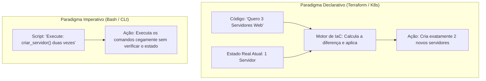
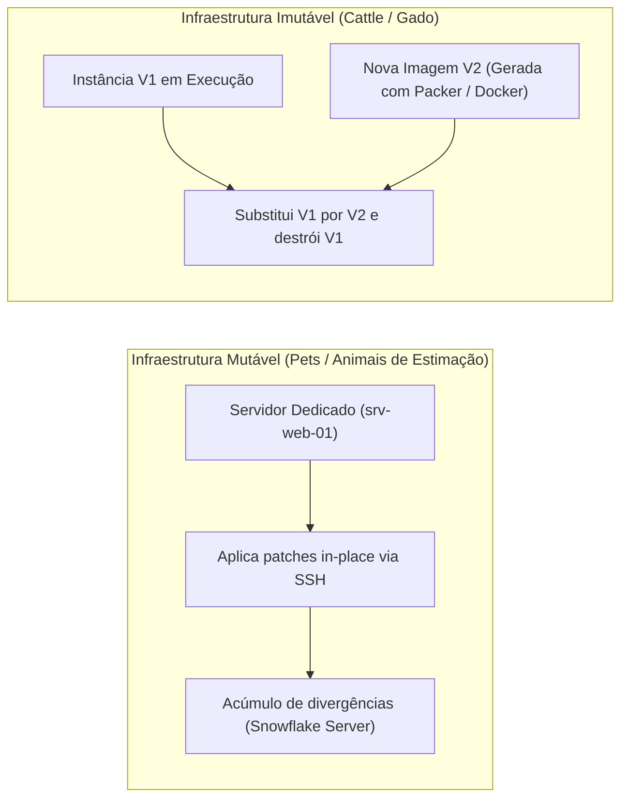
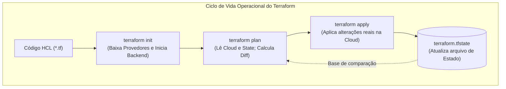
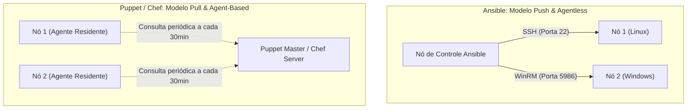

# 05 - Infraestrutura como Código (IaC) e Gerenciamento de Configuração

> **Matéria:** DevOps, Plataforma de Desenvolvimento e Engenharia de Entrega  
> **Cargo:** B02 – Técnico de Controle Externo – Especialidade: Tecnologia da Informação  
> **Arquivo:** `05_infraestrutura_como_codigo_iac_e_gerenciamento_de_configuracao.md`  

---

## 📌 Ementa / Itens do Edital
- Conceitos de Infraestrutura como Código (IaC - Infrastructure as Code)
- Abordagens: Declarativa vs. Imperativa / Procedural
- Infraestrutura Imutável vs. Mutável (Paradigma Pets vs. Cattle)
- Idempotência e controle de desvio de estado (Configuration Drift)
- Ferramentas de provisionamento declarativo: Terraform e OpenTofu
- Ferramentas de gerenciamento de configuração: Ansible, Puppet e Chef (Arquitetura Push vs. Pull, Agentless vs. Agent-based)

---

## 🧭 Sumário
- [1. Fundamentos de Infraestrutura como Código (IaC)](#1-fundamentos-de-infraestrutura-como-código-iac)
    - [1.1 Definição, Propósito e Benefícios de Engenharia](#11-definição-propósito-e-benefícios-de-engenharia)
    - [1.2 Paradigma Declarativo (O Quê) vs. Imperativo (Como)](#12-paradigma-declarativo-o-quê-vs-imperativo-como)
    - [1.3 O Princípio da Idempotência e Desvio de Configuração (Configuration Drift)](#13-o-princípio-da-idempotência-e-desvio-de-configuração-configuration-drift)
    - [1.4 Infraestrutura Mutável vs. Imutável (Pets vs. Cattle)](#14-infraestrutura-mutável-vs-imutável-pets-vs-cattle)
- [2. Provisionamento Declarativo com Terraform e OpenTofu](#2-provisionamento-declarativo-com-terraform-e-opentofu)
    - [2.1 Estrutura e Blocos Fundamentais da Linguagem HCL](#21-estrutura-e-blocos-fundamentais-da-linguagem-hcl)
    - [2.2 O Arquivo de Estado (terraform.tfstate), Remote Backend e State Locking](#22-o-arquivo-de-estado-terraformtfstate-remote-backend-e-state-locking)
    - [2.3 Ciclo Operacional da CLI: init, validate, plan, apply e destroy](#23-ciclo-operacional-da-cli-init-validate-plan-apply-e-destroy)
- [3. Gerenciamento Automatizado de Configuração: Ansible vs. Puppet vs. Chef](#3-gerenciamento-automatizado-de-configuração-ansible-vs-puppet-vs-chef)
    - [3.1 Modelos Arquiteturais: Push vs. Pull e Agentless vs. Agent-Based](#31-modelos-arquiteturais-push-vs-pull-e-agentless-vs-agent-based)
    - [3.2 Matriz Comparativa Detalhada: Ansible vs. Puppet vs. Chef](#32-matriz-comparativa-detalhada-ansible-vs-puppet-vs-chef)
    - [3.3 Anatomia Operacional do Ansible: Inventário, Playbooks, Módulos, Handlers e Roles](#33-anatomia-operacional-do-ansible-inventário-playbooks-módulos-handlers-e-roles)
    - [3.4 Sinergia Arquitetural: Terraform no Provisionamento + Ansible na Configuração](#34-sinergia-arquitetural-terraform-no-provisionamento--ansible-na-configuração)
- [4. Questões Comentadas & Prática Padrão FCC](#4-questões-comentadas--prática-padrão-fcc)

---

## 1. Fundamentos de Infraestrutura como Código (IaC)

A Infraestrutura como Código (*Infrastructure as Code - IaC*) é a prática de engenharia que substitui o provisionamento manual e artesanal de recursos computacionais (telas interativas de consoles de nuvem, assistentes gráficos e comandos isolados no terminal) por **arquivos descritivos de configuração legíveis por máquina e versionados em sistemas de controle de versão (como o Git)**.



### 1.1 Definição, Propósito e Benefícios de Engenharia

O propósito primordial da IaC é aplicar os mesmos rigores e benefícios do desenvolvimento de software ao gerenciamento de infraestrutura de TI:

- **Reprodutibilidade e Consistência:** Permite recriar ambientes completos de homologação, testes e produção com total fidelidade a partir de um único comando, erradicando o problema do "na minha máquina funciona".
- **Rastreabilidade e Auditoria:** Cada modificação em redes, regras de firewall ou servidores fica registrada no histórico de commits do Git, documentando quem alterou, quando alterou e qual foi a justificativa técnica.
- **Automação via Pipelines de CI/CD:** A infraestrutura pode ser validada por linters estáticos, testes de segurança e submetida a aprovações por pares antes de ser aplicada compulsoriamente por runners automatizados (*GitOps*).

### 1.2 Paradigma Declarativo (O Quê) vs. Imperativo (Como)

As linguagens e ferramentas de IaC dividem-se em dois paradigmas fundamentais:

- **Paradigma Declarativo (O Quê / *Desired State*):**
    - O operador define o **estado final almejado da infraestrutura** (ex.: *"devem existir 3 máquinas virtuais com 8GB de RAM na sub-rede privada"*).
    - O motor da ferramenta de IaC é responsável por consultar o estado atual da nuvem, compará-lo com o código, deduzir a diferença matemática (*delta*) e orquestrar a execução estrita das ações necessárias para atingir a meta.
    - Se 1 máquina já existir, o motor cria apenas 2. Se as 3 já existirem, o motor não faz nada.
    - **Exemplos Canônicos:** Terraform, OpenTofu, AWS CloudFormation, manifestos do Kubernetes.
- **Paradigma Imperativo / Procedural (Como / *Execution Steps*):**
    - O operador programa a **sequência cronológica e explícita de passos e comandos** que o sistema deve executar para erguer a infraestrutura (ex.: *"passo 1: chame a API de criar VM; passo 2: pause por 30 segundos; passo 3: anexe o disco"*).
    - A ferramenta executa as instruções cegamente. Se o script falhar na metade, o ambiente fica em estado inconsistente (*partially applied*), exigindo scripts corretivos ou intervenções manuais.
    - **Exemplos Canônicos:** Shell Scripts (Bash/PowerShell), AWS CLI, chamadas via SDK Python (Boto3).

### 1.3 O Princípio da Idempotência e Desvio de Configuração (Configuration Drift)

Dois conceitos são cobrados com rigor terminológico pela FCC:

#### Idempotência
Uma operação é dita **idempotente** se a sua execução repetida múltiplas vezes sobre um mesmo sistema produz **exatamente o mesmo resultado final da primeira execução**, sem gerar efeitos colaterais indesejados, duplicações de recursos ou erros de execução.
- *Na prática:* Se você executar `terraform apply` ou rodar um *Playbook* do Ansible dez vezes consecutivas sobre uma infraestrutura estável sem alterar o código, a ferramenta validará que o estado real já coincide com o estado desejado e reportará **zero alterações** (`0 to add, 0 to change, 0 to destroy` ou `changed=0`).

#### Desvio de Configuração (*Configuration Drift*)
O desvio de configuração manifesta-se quando recursos de produção são modificados manualmente "fora de banda" (*out-of-band*), por exemplo:

- Um administrador conecta via console web da nuvem ou via terminal SSH e altera manualmente uma porta de firewall ou a quantidade de memória de uma instância sem refletir essa mudança no repositório Git.
- **Impacto:** O ambiente real diverge da especificação formal do código versionado.
- **Correção Automatizada:** Na execução seguinte de planejamento (`terraform plan`), o motor compara o estado real com o código, detecta a divergência e propõe a reversão compulsória da alteração manual, restaurando a conformidade institucional.

### 1.4 Infraestrutura Mutável vs. Imutável (Pets vs. Cattle)

O debate arquitetural entre sistemas mutáveis e imutáveis é consagrado na metáfora de Randy Bias: *"Pets vs. Cattle"* (Animais de Estimação vs. Gado).



| Critério de Análise | Infraestrutura Mutável (*Pets*) | Infraestrutura Imutável (*Cattle*) |
| :--- | :--- | :--- |
| **Mecanismo de Atualização** | Atualizações no local (*in-place*), instalando patches e compilando código diretamente na máquina em execução. | **Destruição da instância antiga** e subida de uma nova instância pré-construída com a imagem atualizada. |
| **Identidade dos Servidores** | Servidores únicos, com nomes próprios e manutenção artesanal (*animais de estimação*). | Servidores anônimos, descartáveis, idênticos e substituíveis (*cabeças de gado*). |
| **Patologia / Risco Típico** | **Servidores "Snowflake":** Instâncias artesanais com configurações acumuladas que ninguém sabe reproduzir do zero. | Tempo e pipeline necessários para compilar e homologar a imagem antes do deploy. |
| **Facilidade de Rollback** | Complexa e arriscada (exige scripts de desinstalação reversos). | **Instantânea e segura:** Basta apontar o balanceador para a imagem anterior testada. |
| **Tecnologias Viabilizadoras** | Ansible, Puppet, Chef, scripts Bash in-place. | Packer, Docker, Terraform, Kubernetes, AMIs de nuvem. |

---

## 2. Provisionamento Declarativo com Terraform e OpenTofu

O **Terraform** (desenvolvido pela HashiCorp) e seu fork comunitário de código aberto **OpenTofu** (mantido sob a governança da *Linux Foundation*) são as plataformas líderes para provisionamento declarativo multi-nuvem e multi-provedor.



### 2.1 Estrutura e Blocos Fundamentais da Linguagem HCL

O código é estruturado na linguagem *HashiCorp Configuration Language* (HCL) através de blocos declarativos coesos:

```hcl
terraform {
  required_version = ">= 1.5.0"
  required_providers {
    aws = {
      source  = "hashicorp/aws"
      version = "~> 5.0"
    }
  }
  backend "s3" { # Remote Backend Seguro
    bucket         = "tce-terraform-state"
    key            = "producao/infra.tfstate"
    region         = "us-east-1"
    dynamodb_table = "tce-lock-table" # State Locking
  }
}

provider "aws" {
  region = var.regiao_padrao
}

resource "aws_vpc" "rede_tce" {
  cidr_block           = "10.0.0.0/16"
  enable_dns_hostnames = true
  tags = {
    Name = "vpc-fiscalizacao-tce"
  }
}

output "vpc_id" {
  value       = aws_vpc.rede_tce.id
  description = "ID da VPC gerada pelo provedor"
}
```

- **`terraform {}`:** Configurações globais do próprio motor, requisitos de versões mínimas e declaração do *Backend* de armazenamento do estado.
- **`provider`:** Módulos de plugins responsáveis por traduzir as instruções HCL em chamadas REST para as APIs dos provedores de destino (AWS, Azure, Google Cloud, VMware, Kubernetes).
- **`resource`:** Bloco primordial que declara os componentes que devem ser criados e mantidos no provedor (ex.: VPCs, instâncias EC2, bancos RDS).
- **`data`:** Fontes de dados (*Data Sources*) utilizadas para consultar informações sobre recursos pré-existentes na infraestrutura que foram criados fora do escopo do manifesto atual.
- **`variable`:** Parâmetros de entrada que tornam o código flexível e reutilizável.
- **`output`:** Valores de retorno exportados após a execução (ex.: IP público de um balanceador, ID de uma VPC).
- **`module`:** Pacote de configurações HCL autocontidas e parametrizadas que funcionam como funções reutilizáveis em múltiplos ambientes.

### 2.2 O Arquivo de Estado (terraform.tfstate), Remote Backend e State Locking

- **A Função do `terraform.tfstate`:** É o coração transacional do Terraform. Ele mapeia os identificadores declarados no código HCL com os identificadores reais gerados nas APIs da nuvem (ex.: mapeia o recurso `aws_vpc.rede_tce` ao identificador físico `vpc-0123456789abcdef0`), além de armazenar metadados e dependências.
- **Remote Backend:** Em times profissionais e órgãos públicos, o arquivo `.tfstate` **nunca deve ser versionado no Git local** (pois pode conter senhas em texto claro e causará conflitos insolúveis). Ele deve ser armazenado em um repositório remoto seguro com criptografia em repouso (ex.: Amazon S3, Google Cloud Storage, Terraform Cloud).
- **State Locking (Bloqueio de Estado):** Mecanismo de controle de concorrência que impede que dois operadores ou pipelines de CI/CD executem `terraform apply` simultaneamente sobre a mesma infraestrutura, o que provocaria corrupção catastrófica de dados. No AWS S3, o locking é implementado através de tabelas no **Amazon DynamoDB**.

### 2.3 Ciclo Operacional da CLI: init, validate, plan, apply e destroy

1. **`terraform init`:** Inicializa o diretório de trabalho, baixa os plugins dos provedores necessários (`providers`) e conecta ao *backend* de estado configurado.
2. **`terraform validate`:** Realiza a análise estática da sintaxe HCL e checa a consistência interna das variáveis sem consultar as APIs dos provedores.
3. **`terraform plan`:** Executa o planejamento especulativo: consulta a nuvem real, compara com o `.tfstate` e com o código HCL, exibindo a prévia exata do que será criado (`+`), alterado (`~`) ou destruído (`-`), **sem realizar modificações reais**.
4. **`terraform apply`:** Aplica efetivamente as alterações na nuvem com base no plano aprovado e atualiza o arquivo de estado.
5. **`terraform destroy`:** Destrói de forma controlada todos os recursos gerenciados por aquele projeto específico de IaC.

---

## 3. Gerenciamento Automatizado de Configuração: Ansible vs. Puppet vs. Chef

Enquanto o Terraform se especializa em **provisionar a infraestrutura básica** (redes, instâncias virtuais, balanceadores), as ferramentas de gerenciamento de configuração especializam-se em **configurar o interior dos sistemas operacionais** (instalar pacotes, aplicar patches de segurança, gerenciar arquivos de configuração e orquestrar serviços).



### 3.1 Modelos Arquiteturais: Push vs. Pull e Agentless vs. Agent-Based

- **Modelo Push (Empurrado) vs. Pull (Puxado):**
    - **Push (Ansible):** O servidor central de controle toma a iniciativa ativa: conecta-se aos nós de destino e empurra os comandos e scripts de configuração sob demanda do operador.
    - **Pull (Puppet e Chef):** Os nós clientes possuem agentes residentes executando em segundo plano que consultam periodicamente o servidor mestre (ex.: a cada 30 minutos) para verificar se há novas diretivas e aplicar correções locais.
- **Agentless (Sem Agente) vs. Agent-Based (Baseado em Agente):**
    - **Agentless (Ansible):** Não requer a instalação de nenhum software, daemon ou agente proprietário nos nós gerenciados. Utiliza protocolos de comunicação remota já existentes no próprio sistema operacional hospedeiro: **SSH** (porta 22) para sistemas Linux/Unix e **WinRM** (porta 5986) para sistemas Windows. Requer apenas o interpretador Python instalado nos nós-alvo.
    - **Agent-Based (Puppet e Chef):** Exige a instalação, configuração e manutenção de um agente residente proprietário (*Puppet Agent* ou *Chef Client*) em cada nó gerenciado, além de infraestrutura de certificados digitais TLS (PKI dedicada) para autenticar os nós junto ao servidor central.

### 3.2 Matriz Comparativa Detalhada: Ansible vs. Puppet vs. Chef

| Dimensão Técnica | Ansible | Puppet | Chef |
| :--- | :--- | :--- | :--- |
| **Arquitetura de Agentes** | **Agentless (Sem Agente)** | **Agent-based (Baseado em Agente)** | **Agent-based (Baseado em Agente)** |
| **Modelo de Execução** | **Push** (Nó de controle despacha tarefas) | **Pull** (Nó cliente busca configurações) | **Pull** (Nó cliente busca configurações) |
| **Protocolo de Transporte** | **SSH** padrão (Linux) e **WinRM** (Windows) | HTTPS com certificados TLS (PKI dedicada) | HTTPS com certificados TLS e API REST |
| **Linguagem de Definição** | **YAML** + Templates Jinja2 | DSL declarativa própria (*Puppet Language*) | **Ruby puro** (*Cookbooks* e *Recipes*) |
| **Curva de Aprendizado** | Baixa e imediata | Moderada | Alta (exige fluência em Ruby) |
| **Requisito no Destino** | Python instalado e servidor SSH/WinRM ativo | Agente Puppet instalado e em execução | Agente Chef Client instalado e em execução |

### 3.3 Anatomia Operacional do Ansible: Inventário, Playbooks, Módulos, Handlers e Roles

1. **Arquivo de Inventário (`inventory`):** Mapeia os endereços IP ou nomes de domínio dos servidores-alvo agrupados por categorias lógicas (formato INI ou YAML):
   ```ini
   [webservers]
   10.0.1.10
   10.0.1.11

   [dbservers]
   10.0.2.20
   ```
2. **Playbooks:** Manifestos em YAML que definem as "jogadas" (*plays*), associando grupos do inventário a uma sequência de tarefas (*tasks*):
   ```yaml
   - name: Configurar Servidor Web Corporativo
     hosts: webservers
     become: true
     tasks:
       - name: Garantir que o Nginx esteja instalado
         apt:
           name: nginx
           state: present

       - name: Atualizar o arquivo de configuracao
         template:
           src: nginx.conf.j2
           dest: /etc/nginx/nginx.conf
         notify: Reiniciar Servico Nginx

     handlers:
       - name: Reiniciar Servico Nginx
         service:
           name: nginx
           state: restarted
   ```
3. **Módulos Idempotentes:** Funções especializadas que realizam as modificações de baixo nível (`apt`, `package`, `service`, `systemd`, `copy`, `template`, `file`).
4. **Handlers (Gatilhos Condicionais):** Tarefas especiais que **só são executadas se alguma tarefa anterior tiver efetivamente modificado o estado do nó (`changed=true`)** e emitido um evento via diretiva `notify`. Se a tarefa não causou alteração (status `ok`), o handler não é disparado, evitando reinicializações desnecessárias de serviços em produção.
5. **Facts (Fatos do Sistema):** O Ansible coleta automaticamente no início da execução um dicionário detalhado de metadados do nó gerenciado (endereços IP, interfaces, capacidade de memória RAM, versão do Kernel, distribuição Linux).
6. **Roles (Papéis Modulares):** Estrutura padronizada de diretórios (`tasks/`, `handlers/`, `templates/`, `defaults/`, `vars/`) que organiza pacotes de automação para reutilização em larga escala.

### 3.4 Sinergia Arquitetural: Terraform no Provisionamento + Ansible na Configuração

A prática de ponta em engenharia de plataforma e DevOps preconiza a combinação harmônica das duas ferramentas:

- **Terraform:** Atua na camada de **Infraestrutura**. Cria VPCs, sub-redes, gateways de internet, grupos de segurança, discos e instancia as máquinas virtuais ou clusters Kubernetes.
- **Ansible:** Atua na camada de **Configuração do Sistema**. Uma vez provisionadas as instâncias, o Ansible conecta-se a elas via SSH para endurecer o sistema operacional (*hardening*), instalar utilitários, configurar usuários e preparar os nós para as cargas de trabalho corporativas.

---

## 4. Questões Comentadas & Prática Padrão FCC

### Questão 1 (FCC - Adaptada / TI - Fundamentos de IaC, Idempotência e Drift)
Uma equipe de governança de TI de uma Secretaria de Fazenda está auditando a conformidade dos processos de implantação de infraestrutura em nuvem pública. Durante a auditoria, foram avaliados os conceitos de Idempotência, Abordagem Declarativa e Desvio de Configuração (*Configuration Drift*).

A respeito desses conceitos fundamentais de Infraestrutura como Código (IaC), assinale a afirmativa correta:  

* **A)** A idempotência significa que cada execução de um arquivo de IaC adiciona cumulativamente um novo conjunto de instâncias duplicadas no provedor de nuvem.
* **B)** O paradigma declarativo obriga o administrador a especificar detalhadamente cada uma das chamadas de API, laços `for` e condicionais imperativas que a infraestrutura deve seguir para criar cada componente.
* **C)** O desvio de configuração (*Configuration Drift*) ocorre quando recursos de infraestrutura em produção são modificados manualmente fora do controle do código de IaC, criando discrepâncias entre o estado real da nuvem e o estado definido nos manifestos versionados.
* **D)** Ferramentas de IaC declarativas como o Terraform não são capazes de identificar recursos que foram alterados manualmente por operadores técnicos.
* **E)** A idempotência aplica-se exclusivamente a bancos de dados relacionais NoSQL, sendo inaplicável a sistemas operacionais e regras de firewall em nuvem.

> **Comentário Detalhado:**
> - **A)** Incorreta. Idempotência é o oposto: a garantia matemática de que reaplicar o mesmo manifesto resultará em nenhuma alteração adicional se o sistema já estiver no estado desejado.
> - **B)** Incorreta. Essa formulação descreve o paradigma **imperativo/procedural**. No paradigma declarativo, especifica-se apenas o estado final almejado (o "quê"), sem programar passos imperativos de execução.
> - **C)** Correta. O **Configuration Drift** (desvio de configuração) ocorre precisamente quando intervenções manuais (*out-of-band*) são realizadas na infraestrutura em produção sem atualizar o repositório de IaC, fazendo com que o estado real divirja do estado versionado em código.
> - **D)** Incorreta. Uma das maiores vantagens do Terraform é detectar o *drift* durante a etapa de `plan` e propor ações para reconduzir a infraestrutura ao estado definido em código.
> - **E)** Incorreta. A idempotência é princípio universal aplicável a qualquer recurso automatizável por IaC.
> 
> **Gabarito: C**

---

### Questão 2 (FCC - Adaptada / TI - Infraestrutura Mutável vs. Imutável)
No âmbito das práticas de DevOps e entrega contínua, o debate entre **Infraestrutura Mutável** e **Infraestrutura Imutável** é frequentemente ilustrado pela analogia *"Pets vs. Cattle"* (Animais de Estimação vs. Gado).

A esse respeito, assinale a opção que descreve corretamente a abordagem de **Infraestrutura Imutável**:  

* **A)** Os servidores recebem identificadores fixos e poéticos, e quando um pacote precisa de atualização de segurança, técnicos conectam via SSH para aplicar o patch diretamente na máquina ativa.
* **B)** Quando uma modificação ou nova versão do software precisa ser implantada, uma nova imagem ou contêiner contendo toda a pilha atualizada é instanciada para substituir os componentes antigos, os quais são prontamente descartados e destruídos.
* **C)** Os servidores tornam-se servidores "Snowflake", acumulando configurações históricas manuais que impedem que o ambiente seja replicado a partir do zero.
* **D)** As instâncias nunca podem ser desligadas sob qualquer hipótese, exigindo replicação física de hardware para garantir a imutabilidade do silício.
* **E)** A infraestrutura imutável proíbe a utilização de ferramentas de provisionamento como Terraform e orquestradores de contêineres como Kubernetes.

> **Comentário Detalhado:**
> - **A)** Incorreta. Aplicar modificações e patches no local (*in-place*) via terminal SSH caracteriza a **Infraestrutura Mutável** (*Pets*).
> - **B)** Correta. Na **Infraestrutura Imutável** (*Cattle*), os servidores nunca são alterados no local após a inicialização. Qualquer nova funcionalidade ou correção de segurança resulta na compilação de uma nova imagem imutável (AMI ou imagem Docker) e instanciação de novos componentes; uma vez validados, as instâncias antigas são destruídas e descartadas.
> - **C)** Incorreta. A geração de servidores "Snowflake" artesanais e irreproduzíveis é a principal patologia da Infraestrutura Mutável, sendo erradicada pelo modelo imutável.
> - **D)** Incorreta. Na infraestrutura imutável os nós são descartáveis por definição.
> - **E)** Incorreta. Terraform e Kubernetes são as plataformas centrais que viabilizam a infraestrutura imutável na indústria.
> 
> **Gabarito: B**

---

### Questão 3 (FCC - Adaptada / TI - Terraform: Ciclo de Vida e Arquivo de Estado)
Considere o fluxo operacional do Terraform ao gerenciar recursos em um provedor de nuvem pública. Um engenheiro de software concluiu alterações em um arquivo `main.tf` e necessita avaliar o impacto das alterações sem aplicá-las efetivamente na nuvem, além de garantir que nenhum outro colega de equipe corrompa o arquivo de estado executando operações simultâneas.

Os mecanismos e comandos do Terraform relacionados a essas necessidades são, respectivamente:  

* **A)** O comando `terraform destroy` para simular as alterações; e o arquivo `.gitignore` para bloquear o acesso concorrente.
* **B)** O comando `terraform plan` para visualizar a prévia das ações planejadas; e o mecanismo de *State Locking* configurado no backend remoto para garantir controle de concorrência.
* **C)** O comando `terraform init` para aplicar as alterações; e a exclusão definitiva do arquivo `terraform.tfstate`.
* **D)** O comando `terraform apply -force` para simulação; e o uso de servidores FTP locais compartilhados.
* **E)** A compilação manual do código HCL em arquivos binários ELF; e o desligamento da interface de rede do computador.

> **Comentário Detalhado:**
> - **A)** Incorreta. `terraform destroy` apaga os recursos reais da nuvem e `.gitignore` apenas oculta arquivos no Git, sem atuar como trava de concorrência.
> - **B)** Correta. O comando **`terraform plan`** calcula especulativamente as ações necessárias (mostrando `+`, `~`, `-`) sem tocar na infraestrutura real. Já o **State Locking** em um backend remoto (como AWS S3 com tabela DynamoDB) bloqueia o arquivo `.tfstate` durante a operação, impedindo que execuções simultâneas corrompam o estado do cluster.
> - **C)** Incorreta. `terraform init` apenas baixa provedores, e apagar o arquivo `.tfstate` causa perda completa do rastreamento de infraestrutura.
> - **D)** Incorreta. `terraform apply` executa as alterações reais e FTP não provê travas de concorrência transacionais.
> - **E)** Incorreta. O Terraform interpreta HCL de forma nativa sem gerar arquivos ELF.
> 
> **Gabarito: B**

---

### Questão 4 (FCC - Adaptada / TI - Gerenciamento de Configuração: Ansible vs. Puppet vs. Chef)
No que diz respeito à arquitetura operacional e aos modelos de comunicação das ferramentas líderes de gerenciamento automatizado de configuração (Ansible, Puppet e Chef), assinale a afirmativa correta:  

* **A)** O Ansible exige a instalação prévia de um agente residente em segundo plano (*daemon*) em cada nó gerenciado para receber as diretivas via protocolo Telnet desprotegido.
* **B)** O Puppet e o Chef utilizam tipicamente o modelo de comunicação *Push*, no qual o servidor central empurra compulsoriamente os comandos para os clientes sem a presença de daemons locais.
* **C)** O Ansible adota uma arquitetura *agentless* (sem agente) e opera com base no modelo *Push*, comunicando-se com os nós de destino por meio de canais padrão de comunicação segura (como SSH em hosts Linux e WinRM em hosts Windows).
* **D)** O Puppet rejeita arquivos declarativos, utilizando scripts imperativos puramente compilados em linguagem C++ para orquestrar as máquinas virtuais.
* **E)** O Chef é escrito exclusivamente em arquivos binários fechados, sendo impossível customizar suas receitas com linguagens de script.

> **Comentário Detalhado:**
> - **A)** Incorreta. O Ansible é notório por ser **agentless** (dispensa agentes dedicados) e utiliza canais modernos e seguros como SSH e WinRM.
> - **B)** Incorreta. Puppet e Chef baseiam-se primordialmente no modelo **Pull**, no qual agentes residentes (*daemons*) consultam periodicamente o servidor mestre central.
> - **C)** Correta. Formulação canônica e impecável: o Ansible é **agentless** (sem agente residente nos alvos) e utiliza o modelo **Push** (o nó de controle empurra ativamente as instruções via **SSH** em servidores Linux ou **WinRM** em servidores Windows).
> - **D)** Incorreta. O Puppet emprega uma DSL declarativa própria (*Puppet Language*), e não executáveis C++.
> - **E)** Incorreta. As receitas e livros de receitas do Chef são codificados em linguagem **Ruby pura**.
> 
> **Gabarito: C**

---

### Questão 5 (FCC - Adaptada / TI - Componentes do Ansible: Playbooks, Handlers e Inventário)
Considere o seguinte trecho simplificado de automação em Ansible:

```yaml
- name: Configurar Servidor Web Nginx
  hosts: webservers
  become: true
  tasks:
    - name: Garantir que o pacote nginx esteja instalado
      apt:
        name: nginx
        state: present

    - name: Atualizar o arquivo de configuracao principal
      template:
        src: nginx.conf.j2
        dest: /etc/nginx/nginx.conf
      notify: Reiniciar o Nginx

  handlers:
    - name: Reiniciar o Nginx
      service:
        name: nginx
        state: restarted
```

A respeito da execução desse *Playbook* e do comportamento de seus componentes, é correto afirmar:  

* **A)** Se o arquivo de template `nginx.conf.j2` não contiver alterações em relação ao arquivo já existente no nó remoto, a tarefa reportará o status `ok` (sem modificações), o evento `notify` não disparará o handler e o serviço Nginx **não** será reiniciado.
* **B)** O handler `Reiniciar o Nginx` será executado compulsoriamente dez vezes no início do playbook antes da instalação do pacote `nginx`.
* **C)** A diretiva `hosts: webservers` indica que o playbook será executado exclusivamente no nó de controle local, ignorando o arquivo de inventário.
* **D)** O parâmetro `state: present` no módulo `apt` força a reinstalação do Nginx mesmo se o pacote já estiver presente na versão correta, violando a idempotência.
* **E)** A sintaxe desse arquivo é codificada em JSON estrito, sendo incompatível com a linguagem YAML.

> **Comentário Detalhado:**
> - **A)** Correta. No Ansible, os **Handlers** operam sob o princípio da reatividade condicional: eles só são executados ao final do playbook se alguma tarefa disparadora emitir o sinal `notify` em virtude de uma alteração real no sistema (status `changed=true`). Se o arquivo remoto já for idêntico ao template, a tarefa retorna `ok`, o handler não é disparado e o serviço Nginx não sofre reinicialização indevida, assegurando a idempotência.
> - **B)** Incorreta. Handlers executam apenas uma vez ao final do playbook se forem notificados.
> - **C)** Incorreta. `hosts: webservers` pesquisa e seleciona o grupo de alvos definido no arquivo de **Inventário** (`inventory`).
> - **D)** Incorreta. O parâmetro `state: present` é estritamente idempotente: se o pacote já estiver instalado, ele não reinstala nem gera mudanças.
> - **E)** Incorreta. O formato é a sintaxe pura e padrão **YAML**.
> 
> **Gabarito: A**
