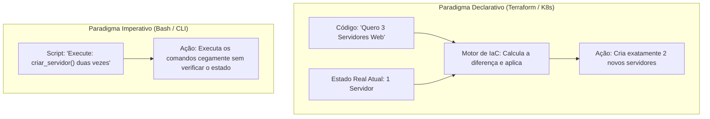
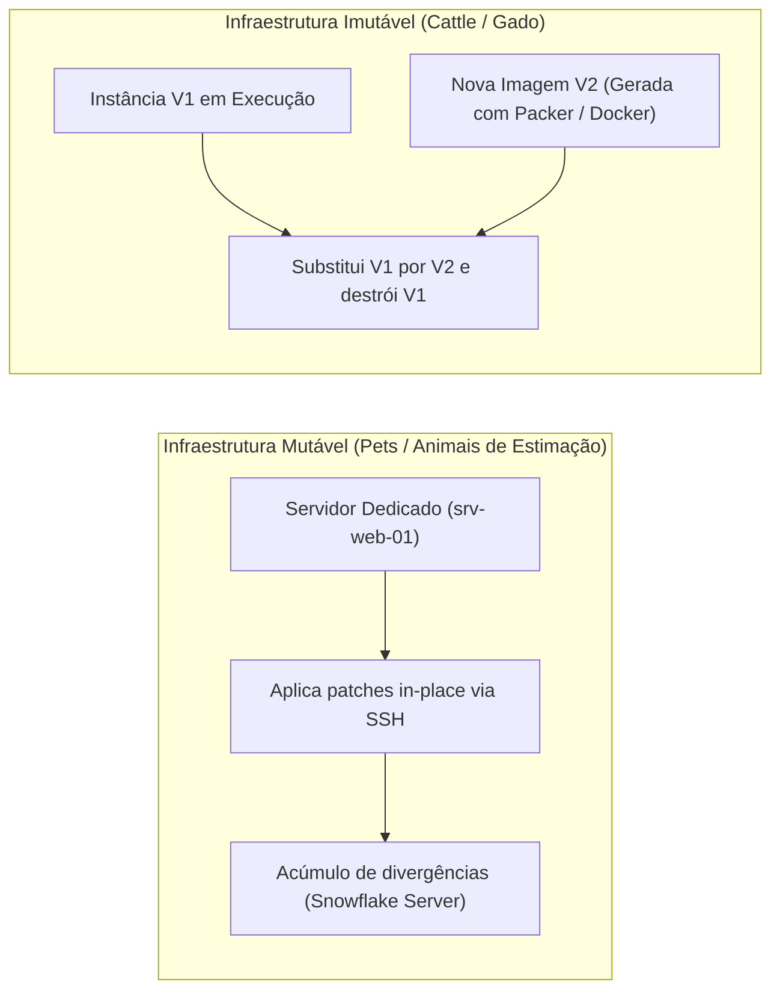
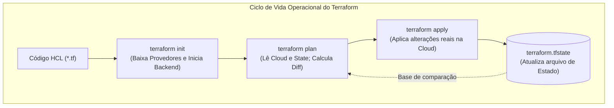
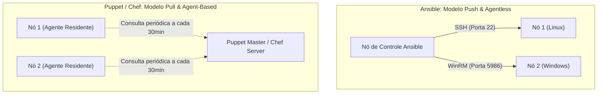

# 05 - Infraestrutura como Código (IaC) e Gerenciamento de Configuração

> **Matéria:** DevOps, Plataforma de Desenvolvimento e Engenharia de Entrega  
> **Cargo:** B02 – Técnico de Controle Externo – Especialidade: Tecnologia da Informação  
> **Arquivo:** `05_infraestrutura_como_codigo_iac_e_gerenciamento_de_configuracao.md`  

---

## 📌 Ementa / Itens do Edital
- Conceitos de Infraestrutura como Código (IaC - Infrastructure as Code)
- Abordagens: Declarativa vs. Imperativa / Procedural
- Infraestrutura Imutável vs. Mutável (Paradigma Pets vs. Cattle)
- Idempotência e controle de desvio de estado (Configuration Drift)
- Ferramentas de provisionamento declarativo: Terraform e OpenTofu
- Ferramentas de gerenciamento de configuração: Ansible, Puppet e Chef (Arquitetura Push vs. Pull, Agentless vs. Agent-based)

---

## 🌳 Classificação Hierárquica

```text
5. Infraestrutura como Código (IaC) e Gerenciamento Automatizado de Configuração
├── 5.1 Fundamentos de Infraestrutura como Código (IaC)
│   ├── 5.1.1 Definição: Gerenciamento e provisionamento de infraestrutura computacional (redes, VMs, balanceadores, firewalls) por meio de definições descritivas em código
│   ├── 5.1.2 Benefícios Chave: Reprodutibilidade, consistência de ambientes, histórico auditável via Git e integração com pipelines de CI/CD
│   ├── 5.1.3 Paradigmas de Especificação:
│   │   ├── Declarativo (O quê / Desired State): Descreve o estado final almejado; a ferramenta calcula o grafo de execução (Terraform, OpenTofu, manifestos K8s)
│   │   └── Imperativo / Procedural (Como / Steps): Descreve a sequência explícita de passos e comandos para atingir o estado (Shell Script, AWS CLI)
│   ├── 5.1.4 Idempotência: Propriedade pela qual a execução sucessiva do mesmo manifesto produz exatamente o mesmo resultado sem efeitos colaterais adversos
│   ├── 5.1.5 Desvio de Configuração (Configuration Drift): Divergência entre o estado real da infraestrutura e o estado definido no repositório de código (alterações manuais fora de banda)
│   └── 5.1.6 Infraestrutura Mutável vs. Imutável:
│       ├── Mutável (In-place updates): Atualização e instalação de pacotes diretamente no servidor ativo (risco de servidores "Snowflake" artesanais)
│       └── Imutável (Pets vs. Cattle): Servidores nunca são modificados no local; atualizações geram novas imagens de SO (AMI/Packer/Docker) e destroem as instâncias obsoletas
├── 5.2 Provisionamento com Terraform e OpenTofu
│   ├── 5.2.1 Linguagem HashiCorp Configuration Language (HCL):
│   │   ├── `terraform {}`: Requisitos de versão e configuração do Backend de estado
│   │   ├── `provider`: Plugins que dialogam com as APIs dos provedores (AWS, Azure, GCP, Kubernetes)
│   │   ├── `resource`: Declaração dos objetos reais a serem criados e mantidos
│   │   ├── `data`: Fontes de dados para consultar objetos pré-existentes na infraestrutura
│   │   ├── `variable` (entradas parametrizadas), `output` (valores exportados) e `locals`
│   │   └── `module`: Empacotamento de recursos reutilizáveis e padronizados
│   ├── 5.2.2 Arquivo de Estado (`terraform.tfstate`):
│   │   ├── Mapeamento estrito entre os blocos de código HCL e os identificadores reais de nuvem
│   │   ├── Estado Remoto (Remote Backend): Armazenamento centralizado seguro (ex.: Amazon S3, Google Cloud Storage, Terraform Cloud)
│   │   └── Bloqueio de Estado (State Locking): Mecanismo de concorrência que impede execuções simultâneas conflitantes (ex.: AWS DynamoDB)
│   └── 5.2.3 Ciclo de Comandos da CLI:
│       ├── `terraform init`: Inicializa plugins de provedores e conecta ao backend de estado
│       ├── `terraform validate`: Validação estática de sintaxe e consistência
│       ├── `terraform plan`: Cálculo especulativo do diff entre estado real e desejado (+, ~, -)
│       ├── `terraform apply`: Execução das alterações na infraestrutura real
│       └── `terraform destroy`: Destruição controlada de todos os recursos gerenciados
└── 5.3 Gerenciamento de Configuração: Ansible vs. Puppet vs. Chef
    ├── 5.3.1 Arquitetura Operacional:
    │   ├── Ansible: Sem Agente (Agentless), Modelo Push, comunicação via SSH (Linux) e WinRM (Windows)
    │   ├── Puppet: Baseado em Agente (Agent-based), Modelo Pull, servidor Puppet Master e linguagem declarativa própria
    │   └── Chef: Baseado em Agente (Agent-based), Modelo Pull, Chef Server e "Receitas/Cookbooks" escritos em Ruby puro
    ├── 5.3.2 Componentes e Estrutura do Ansible:
    │   ├── Nó de Controle (Control Node) e Nós Gerenciados (Managed Nodes)
    │   ├── Arquivo de Inventário (Inventory): Mapeamento de hosts e grupos em formato INI ou YAML
    │   ├── Playbooks: Manifestos em YAML contendo sequências de tarefas (`tasks`) declarativas
    │   ├── Módulos Idempotentes: `apt`, `yum`, `package`, `service`, `systemd`, `copy`, `template` (Jinja2)
    │   ├── Fatos (Ansible Facts): Coleta dinâmica de variáveis de ambiente e hardware do nó gerenciado
    │   ├── Handlers: Tarefas especiais disparadas condicionalmente por eventos (`notify`)
    │   └── Roles: Estrutura modular padronizada (`tasks`, `handlers`, `templates`, `defaults`, `vars`)
    └── 5.3.3 Sinergia Arquitetural: Terraform para provisionamento de infraestrutura + Ansible para configuração de sistemas operacionais e aplicações
```

---

## 📖 Resumo Teórico & Pontos-Chave Aprofundados

### 1. Fundamentos de IaC: Paradigmas, Idempotência e Desvio de Configuração

A Infraestrutura como Código (IaC) é a prática de engenharia que substitui o provisionamento manual por consoles web e comandos isolados no terminal por **arquivos de configuração declarativos versionados em repositórios Git**.



#### A. Declarativo vs. Imperativo (Procedural)
- **Declarativo (O quê):** O desenvolvedor descreve o **estado final desejado** da infraestrutura. O mecanismo de IaC é inteligente o suficiente para descobrir o estado atual, calcular a discrepância (*delta*) e executar apenas as chamadas necessárias para atingir o estado pretendido. Exemplos: Terraform, OpenTofu, CloudFormation, manifestos do Kubernetes.
- **Imperativo / Procedural (Como):** O desenvolvedor instrui explicitamente a **sequência de etapas e comandos** que o sistema deve executar para chegar ao resultado. Se o script falhar no meio do caminho, o estado do sistema fica inconsistente e exige tratamento manual de erros. Exemplos: scripts em Bash/PowerShell, comandos do AWS CLI.

#### B. Idempotência
A **idempotência** é o princípio basilar da estabilidade em IaC:
- *Definição formal:* Uma operação é dita idempotente se o resultado de sua aplicação repetida sobre um mesmo sistema é **idêntico ao resultado de sua primeira aplicação**, sem produzir efeitos colaterais indesejados.
- *Na prática:* Se você executar `terraform apply` ou rodar um *Playbook* do Ansible dez vezes consecutivas sem alterar o código nem o ambiente, a ferramenta verificará que tudo já está conforme o desejado e relatará zero mudanças (`0 to add, 0 to change, 0 to destroy` ou `changed=0`).

#### C. Desvio de Configuração (*Configuration Drift*)
Ocorre quando alterações manuais diretas são efetuadas no ambiente de produção (por exemplo, um analista entra no console da nuvem ou conecta via SSH no servidor e altera uma regra de firewall ou a versão de um pacote).
- **Consequência:** O estado real do ambiente diverge do estado versionado no repositório de código.
- **Resolução via IaC:** Na execução seguinte de planejamento (`terraform plan`), a ferramenta detecta o *drift* comparando o estado real com o código e propõe a reversão compulsória da alteração manual, restaurando a governança.

#### D. Infraestrutura Mutável vs. Imutável (Pets vs. Cattle)



| Critério | Infraestrutura Mutável (*Pets*) | Infraestrutura Imutável (*Cattle*) |
| :--- | :--- | :--- |
| **Abordagem de Atualização** | Atualizações no local (*in-place*), instalando patches no servidor ativo. | Destruição da instância antiga e instanciação de uma **nova imagem imutável** (AMI/Contêiner). |
| **Identidade dos Servidores** | Únicos, com nomes fixos e cuidados artesanais (*animais de estimação*). | Descartáveis, anônimos e idênticos (*gado numerado*). |
| **Risco Principal** | Servidores *"Snowflake"* (configurações únicas e irreproduzíveis que ninguém sabe recriar). | Tempo necessário para construir e homologar a imagem antes do deploy. |
| **Facilidade de Rollback** | Complexa (exige desfazer scripts de migração). | Quase instantânea (basta voltar à imagem prévia testada). |
| **Ferramental Típico** | Ansible, Puppet, Chef, scripts Bash. | Packer, Docker, Terraform, Kubernetes. |

---

### 2. Provisionamento com Terraform e OpenTofu

O Terraform (e seu fork comunitário de código aberto OpenTofu) é a ferramenta padrão de mercado para provisionamento declarativo multi-nuvem.



#### A. Estrutura do Código em HCL (*HashiCorp Configuration Language*)
Um projeto Terraform é estruturado em blocos declarativos:
```hcl
terraform {
  required_version = ">= 1.5.0"
  required_providers {
    aws = {
      source  = "hashicorp/aws"
      version = "~> 5.0"
    }
  }
  backend "s3" { # Remote State Seguro
    bucket         = "sefaz-terraform-state"
    key            = "prod/vpc.tfstate"
    region         = "us-east-1"
    dynamodb_table = "sefaz-tf-lock" # State Locking
  }
}

provider "aws" {
  region = var.aws_region
}

resource "aws_vpc" "principal" {
  cidr_block           = "10.0.0.0/16"
  enable_dns_hostnames = true
  tags = {
    Name = "vpc-sefaz-producao"
  }
}

output "vpc_id" {
  value       = aws_vpc.principal.id
  description = "Identificador da VPC criada"
}
```

#### B. O Papel Vital do Arquivo de Estado (`terraform.tfstate`)
- O arquivo `.tfstate` é o cérebro do Terraform: ele mapeia as declarações no código HCL com os identificadores físicos dos objetos criados na API do provedor (ex.: vincula o recurso `aws_vpc.principal` ao ID real `vpc-0a1b2c3d4e5f`).
- **Remote State:** Em equipes profissionais, o arquivo de estado nunca é armazenado localmente no Git (contém segredos e causa divergências). Ele é armazenado em um *Remote Backend* (como bucket S3 criptografado).
- **State Locking:** Para evitar que dois desenvolvedores ou pipelines de CI/CD executem `terraform apply` concorrentemente e corrompam o estado, utiliza-se o bloqueio de estado (*State Locking*, como tabelas do Amazon DynamoDB).

---

### 3. Gerenciamento de Configuração: Ansible vs. Puppet vs. Chef

Enquanto o Terraform se especializa em provisionar a infraestrutura base (VPCs, subnets, balanceadores, clusters), as ferramentas de gerenciamento de configuração especializam-se em configurar o interior dos sistemas operacionais e das aplicações.



#### Tabela Comparativa Detalhada: Ansible vs. Puppet vs. Chef

| Dimensão Técnica | Ansible | Puppet | Chef |
| :--- | :--- | :--- | :--- |
| **Arquitetura** | **Agentless (Sem Agente)** | **Agent-based (Baseado em Agente)** | **Agent-based (Baseado em Agente)** |
| **Modelo de Execução** | **Push** (Controlador empurra tarefas) | **Pull** (Agente consulta o servidor) | **Pull** (Agente consulta o servidor) |
| **Protocolo de Comunicação** | **SSH** padrão (Linux) e **WinRM** (Windows) | HTTPS com certificados TLS (PKI dedicada) | HTTPS com certificados TLS e API REST |
| **Linguagem / Sintaxe** | **YAML** + Templates Jinja2 | DSL declarativa proprietária (*Puppet Language*) | **Ruby puro** (*Cookbooks* e *Recipes*) |
| **Facilidade de Adoção** | Altíssima (requer apenas Python no host) | Média (exige infraestrutura de servidor mestre) | Média/Baixa (exige proficiência em Ruby) |
| **Requisito no Alvo** | Servidor SSH ativo e Python instalado | Agente Puppet instalado e configurado | Agente Chef Client instalado e configurado |

#### Anatomia do Ansible
1. **Inventário (`inventory`):** Arquivo que lista os servidores alvos agrupados por função (ex.: `[webservers]`, `[dbservers]`).
2. **Playbooks:** Arquivos em formato YAML que contêm uma ou mais "jogadas" (*plays*), associando grupos de servidores a tarefas (*tasks*).
3. **Módulos:** Funções idempotentes que realizam as ações reais no nó de destino (`apt`, `package`, `service`, `copy`, `template`).
4. **Handlers:** Tarefas especiais que só são disparadas se uma tarefa anterior reportar que fez uma alteração de fato (`changed=true`) e disparar um aviso via diretiva `notify: restart_nginx`.
5. **Facts:** Variáveis descobertas automaticamente pelo Ansible sobre a máquina remota no início da execução (IPs, memória, distribuição Linux, hostname).
6. **Roles:** Padrão estruturado de diretórios que organiza tarefas, variáveis, handlers e arquivos para reuso em larga escala.

> ⭐ **IMPORTANTE / REGRA DE OURO:**  
> A dobradinha moderna recomendada em DevOps é:  
> - **Terraform:** Usado para **provisionar** a infraestrutura externa (redes, instâncias, discos).  
> - **Ansible:** Usado para **configurar** os serviços e pacotes internos dessas instâncias recém-criadas.

---

## 🌐 Fontes Recomendadas na Internet

### 1. Documentação Oficial de Ferramentas de IaC
- [Terraform Official Documentation (HashiCorp Developer)](https://developer.hashicorp.com/terraform/docs): Manual de referência oficial sobre a linguagem declarativa HCL, provedores de nuvem, blocos de recursos, gestão do arquivo de estado (`terraform.tfstate`) e ciclo de execução (`init`, `plan`, `apply`, `destroy`).
- [OpenTofu Official Documentation](https://opentofu.org/docs/): Documentação do projeto de código aberto mantido sob governança da Linux Foundation como alternativa aberta ao Terraform.
- [Ansible Official Documentation (Red Hat)](https://docs.ansible.com/ansible/latest/user_guide/index.html): Guia completo cobrindo a arquitetura sem agente (*agentless*), escrita de *Playbooks* em YAML, organização de módulos (`apt`, `service`, `template`) e papéis (*Roles*).

### 2. Obras Fundamentais de Engenharia de Infraestrutura
- [Infrastructure as Code Principles (Martin Fowler / Kief Morris)](https://martinfowler.com/bliki/InfrastructureAsCode.html): Artigo conceitual formalizando as propriedades de idempotência, prevenção de derivação de configuração (*configuration drift*) e o paradigma de infraestrutura imutável.

---

## 📝 Questões Comentadas & Exemplos (Padrão FCC)

### Questão 1 (FCC - Adaptada / TI - Fundamentos de IaC, Idempotência e Drift)
Uma equipe de governança de TI de uma Secretaria de Fazenda está auditando a conformidade dos processos de implantação de infraestrutura em nuvem pública. Durante a auditoria, foram avaliados os conceitos de Idempotência, Abordagem Declarativa e Desvio de Configuração (*Configuration Drift*).

A respeito desses conceitos fundamentais de Infraestrutura como Código (IaC), assinale a afirmativa correta:  
A) A idempotência significa que cada execução de um arquivo de IaC adiciona cumulativamente um novo conjunto de instâncias duplicadas no provedor de nuvem.  
B) O paradigma declarativo obriga o administrador a especificar detalhadamente cada uma das chamadas de API, laços `for` e condicionais imperativas que a infraestrutura deve seguir para criar cada componente.  
C) O desvio de configuração (*Configuration Drift*) ocorre quando recursos de infraestrutura em produção são modificados manualmente fora do controle do código de IaC, criando discrepâncias entre o estado real da nuvem e o estado definido nos manifestos versionados.  
D) Ferramentas de IaC declarativas como o Terraform não são capazes de identificar recursos que foram alterados manualmente por operadores técnicos.  
E) A idempotência aplica-se exclusivamente a bancos de dados relacionais NoSQL, sendo inaplicável a sistemas operacionais e regras de firewall em nuvem.

> **Gabarito: C**  
> **Comentário Analítico Passo a Passo:**  
> - **A está INCORRETA:** Idempotência é exatamente o contrário: a garantia de que reaplicar o mesmo manifesto sobre um ambiente que já está no estado desejado resultará em **nenhuma alteração** (`changed=0`), sem gerar instâncias duplicadas.  
> - **B está INCORRETA:** Essa descrição corresponde ao paradigma **imperativo/procedural**. No paradigma declarativo, o administrador define apenas o *estado final almejado* (o "quê"), deixando a cargo do motor da ferramenta calcular as ações necessárias (o "como").  
> - **C está CORRETA:** Definição precisa de **Configuration Drift**: quando operadores ou administradores realizam intervenções manuais (*out-of-band*) diretamente no console ou via terminal SSH sem atualizar os códigos de IaC, o estado real diverge do estado versionado no Git.  
> - **D está INCORRETA:** Uma das principais vantagens das ferramentas declarativas de IaC como o Terraform é justamente a detecção de *drift*: na etapa de planejamento (`terraform plan`), o Terraform consulta o estado real da nuvem, compara com o código e exibe as discrepâncias introduzidas manualmente, propondo corrigi-las.  
> - **E está INCORRETA:** A idempotência é uma propriedade lógica primordial e transversal da engenharia de infraestrutura moderna, aplicada intensamente a redes, balanceadores, VMs e gestão de pacotes de sistemas operacionais.

---

### Questão 2 (FCC - Adaptada / TI - Infraestrutura Mutável vs. Imutável)
No âmbito das práticas de DevOps e entrega contínua, o debate entre **Infraestrutura Mutável** e **Infraestrutura Imutável** é frequentemente ilustrado pela analogia *"Pets vs. Cattle"* (Animais de Estimação vs. Gado).

A esse respeito, assinale a opção que descreve corretamente a abordagem de **Infraestrutura Imutável**:  
A) Os servidores recebem identificadores fixos e poéticos, e quando um pacote precisa de atualização de segurança, técnicos conectam via SSH para aplicar o patch diretamente na máquina ativa.  
B) Quando uma modificação ou nova versão do software precisa ser implantada, uma nova imagem ou contêiner contendo toda a pilha atualizada é instanciada para substituir os componentes antigos, os quais são prontamente descartados e destruídos.  
C) Os servidores tornam-se servidores "Snowflake", acumulando configurações históricas manuais que impedem que o ambiente seja replicado a partir do zero.  
D) As instâncias nunca podem ser desligadas sob qualquer hipótese, exigindo replicação física de hardware para garantir a imutabilidade do silício.  
E) A infraestrutura imutável proíbe a utilização de ferramentas de provisionamento como Terraform e orquestradores de contêineres como Kubernetes.

> **Gabarito: B**  
> **Comentário Analítico Passo a Passo:**  
> - **A está INCORRETA:** Tratar servidores com cuidados individuais artesanais e aplicar patches no local (*in-place updates*) via SSH caracteriza a **Infraestrutura Mutável** (*Pets*).  
> - **B está CORRETA:** Na **Infraestrutura Imutável** (*Cattle*), os servidores são tratados como descartáveis e reprodutíveis. Quando há uma alteração de código ou atualização de segurança, não se altera o servidor em execução: compila-se uma nova imagem de máquina (AMI pré-construída com Packer) ou imagem de contêiner e sobe-se uma nova instância idêntica. Uma vez que a nova instância está saudável, o tráfego é direcionado a ela e a instância antiga é destruída, garantindo consistência total e rollback trivial.  
> - **C está INCORRETA:** Os servidores *"Snowflake"* (artesanais e irreproduzíveis) são a principal consequência indesejada da **Infraestrutura Mutável**. A abordagem imutável elimina os servidores snowflake.  
> - **D está INCORRETA:** Na infraestrutura imutável, as instâncias são constantemente substituídas e descartadas; imutabilidade refere-se ao fato de seus arquivos internos não serem modificados após o boot.  
> - **E está INCORRETA:** Terraform, Packer e Kubernetes são exatamente as principais tecnologias viabilizadoras da infraestrutura imutável no mercado.

---

### Questão 3 (FCC - Adaptada / TI - Terraform: Ciclo de Vida e Arquivo de Estado)
Considere o fluxo operacional do Terraform ao gerenciar recursos em um provedor de nuvem pública. Um engenheiro de software concluiu alterações em um arquivo `main.tf` e necessita avaliar o impacto das alterações sem aplicá-las efetivamente na nuvem, além de garantir que nenhum outro colega de equipe corrompa o arquivo de estado executando operações simultâneas.

Os mecanismos e comandos do Terraform relacionados a essas necessidades são, respectivamente:  
A) O comando `terraform destroy` para simular as alterações; e o arquivo `.gitignore` para bloquear o acesso concorrente.  
B) O comando `terraform plan` para visualizar a prévia das ações planejadas; e o mecanismo de *State Locking* configurado no backend remoto para garantir controle de concorrência.  
C) O comando `terraform init` para aplicar as alterações; e a exclusão definitiva do arquivo `terraform.tfstate`.  
D) O comando `terraform apply -force` para simulação; e o uso de servidores FTP locais compartilhados.  
E) A compilação manual do código HCL em arquivos binários ELF; e o desligamento da interface de rede do computador.

> **Gabarito: B**  
> **Comentário Analítico Passo a Passo:**  
> - **A está INCORRETA:** O comando `terraform destroy` destrói efetivamente os recursos reais na nuvem, e o arquivo `.gitignore` apenas impede que arquivos sejam adicionados ao controle de versão Git, sem prover controle transacional de concorrência.  
> - **B está CORRETA:** O comando **`terraform plan`** é a ferramenta de planejamento especulativo: ele compara o código HCL com o estado real atual da nuvem e com o arquivo de estado, exibindo a prévia exata do que será adicionado (`+`), modificado (`~`) ou removido (`-`), **sem realizar qualquer alteração na infraestrutura real**. Para equipes que trabalham de forma colaborativa, o uso de um *Remote Backend* com **State Locking** (como Amazon S3 com DynamoDB) garante que, enquanto um processo de `plan` ou `apply` estiver em andamento, o arquivo de estado seja bloqueado, impedindo que execuções concorrentes gerem inconsistências ou corrupção de dados.  
> - **C está INCORRETA:** `terraform init` apenas prepara o ambiente baixando plugins; e excluir o arquivo `.tfstate` faria o Terraform perder a rastreabilidade de todos os recursos já provisionados.  
> - **D está INCORRETA:** `terraform apply` executa as modificações reais na nuvem e o uso de FTP não fornece bloqueio seguro de estado.  
> - **E está INCORRETA:** O HCL não é compilado em binários ELF; ele é interpretado pelo motor do Terraform.

---

### Questão 4 (FCC - Adaptada / TI - Gerenciamento de Configuração: Ansible vs. Puppet vs. Chef)
No que diz respeito à arquitetura operacional e aos modelos de comunicação das ferramentas líderes de gerenciamento automatizado de configuração (Ansible, Puppet e Chef), assinale a afirmativa correta:  
A) O Ansible exige a instalação prévia de um agente residente em segundo plano (*daemon*) em cada nó gerenciado para receber as diretivas via protocolo Telnet desprotegido.  
B) O Puppet e o Chef utilizam tipicamente o modelo de comunicação *Push*, no qual o servidor central empurra compulsoriamente os comandos para os clientes sem a presença de daemons locais.  
C) O Ansible adota uma arquitetura *agentless* (sem agente) e opera com base no modelo *Push*, comunicando-se com os nós de destino por meio de canais padrão de comunicação segura (como SSH em hosts Linux e WinRM em hosts Windows).  
D) O Puppet rejeita arquivos declarativos, utilizando scripts imperativos puramente compilados em linguagem C++ para orquestrar as máquinas virtuais.  
E) O Chef é escrito exclusivamente em arquivos binários fechados, sendo impossível customizar suas receitas com linguagens de script.

> **Gabarito: C**  
> **Comentário Analítico Passo a Passo:**  
> - **A está INCORRETA:** A marca registrada e diferencial do Ansible é ser **agentless** (não exige daemons clientes instalados nos nós-alvo) e utilizar protocolos criptografados consolidados de mercado (SSH/WinRM).  
> - **B está INCORRETA:** Puppet e Chef operam tipicamente com base no modelo **Pull**: os nós clientes possuem agentes residentes (*Puppet Agent* ou *Chef Client*) que entram em contato periodicamente (por exemplo, a cada 30 minutos) com o servidor central (*Master/Server*) para buscar o catálogo atualizado de configurações e aplicá-lo localmente.  
> - **C está CORRETA:** Essa é a formulação técnica impecável: o Ansible é **agentless** (dispensa agentes dedicados) e utiliza a abordagem **Push** (o nó de controle se conecta ativamente aos alvos e empurra os comandos e módulos). A comunicação é feita nativamente por meio de **SSH** em distribuições Linux/Unix e **WinRM** em sistemas operacionais Windows.  
> - **D está INCORRETA:** O Puppet utiliza uma DSL declarativa própria (*Puppet Manifests* com extensão `.pp`), e não scripts compilados em C++.  
> - **E está INCORRETA:** O Chef é amplamente conhecido por utilizar receitas (*Recipes*) e livros de receitas (*Cookbooks*) escritos na linguagem **Ruby puro**.

---

### Questão 5 (FCC - Adaptada / TI - Componentes do Ansible: Playbooks, Handlers e Inventário)
Considere o seguinte trecho simplificado de automação em Ansible:

```yaml
- name: Configurar Servidor Web Nginx
  hosts: webservers
  become: true
  tasks:
    - name: Garantir que o pacote nginx esteja instalado
      apt:
        name: nginx
        state: present

    - name: Atualizar o arquivo de configuracao principal
      template:
        src: nginx.conf.j2
        dest: /etc/nginx/nginx.conf
      notify: Reiniciar o Nginx

  handlers:
    - name: Reiniciar o Nginx
      service:
        name: nginx
        state: restarted
```

A respeito da execução desse *Playbook* e do comportamento de seus componentes, é correto afirmar:  
A) Se o arquivo de template `nginx.conf.j2` não contiver alterações em relação ao arquivo já existente no nó remoto, a tarefa reportará o status `ok` (sem modificações), o evento `notify` não disparará o handler e o serviço Nginx **não** será reiniciado.  
B) O handler `Reiniciar o Nginx` será executado compulsoriamente dez vezes no início do playbook antes da instalação do pacote `nginx`.  
C) A diretiva `hosts: webservers` indica que o playbook será executado exclusivamente no nó de controle local, ignorando o arquivo de inventário.  
D) O parâmetro `state: present` no módulo `apt` força a reinstalação do Nginx mesmo se o pacote já estiver presente na versão correta, violando a idempotência.  
E) A sintaxe desse arquivo é codificada em JSON estrito, sendo incompatível com a linguagem YAML.

> **Gabarito: A**  
> **Comentário Analítico Passo a Passo:**  
> - **A está CORRETA:** Os **Handlers** do Ansible são tarefas condicionais reativas: eles só são executados ao final da jogada se ao menos uma tarefa que contém a diretiva `notify` tiver provocado uma alteração real no sistema (status `changed=true`). Se o arquivo `/etc/nginx/nginx.conf` remoto já for idêntico ao template renderizado, o Ansible atesta o estado desejado, não altera o arquivo (status `ok`) e o handler de reinício não é acionado, evitando paradas de serviço desnecessárias e preservando a idempotência.  
> - **B está INCORRETA:** Os Handlers não rodam no início nem de forma repetitiva; por padrão, eles rodam apenas uma vez ao final da execução do playbook caso notificados.  
> - **C está INCORRETA:** A diretiva `hosts: webservers` pesquisa e seleciona o grupo de hosts chamado `webservers` declarado no arquivo de **Inventário** (`inventory`).  
> - **D está INCORRETA:** A instrução `state: present` é rigorosamente idempotente: ela verifica se o pacote está instalado; caso já esteja instalado, o Ansible não realiza nenhuma operação e retorna com sucesso.  
> - **E está INCORRETA:** O arquivo está perfeitamente formatado na sintaxe padrão **YAML**, a linguagem nativa dos Playbooks do Ansible.
