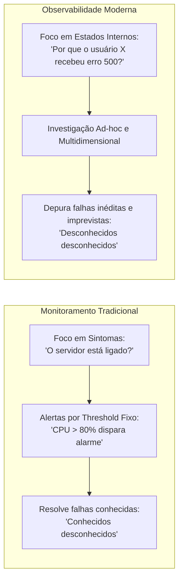
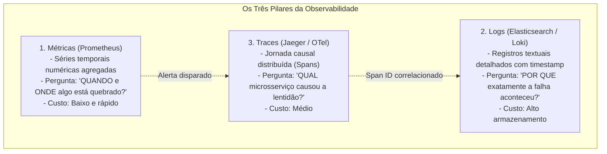
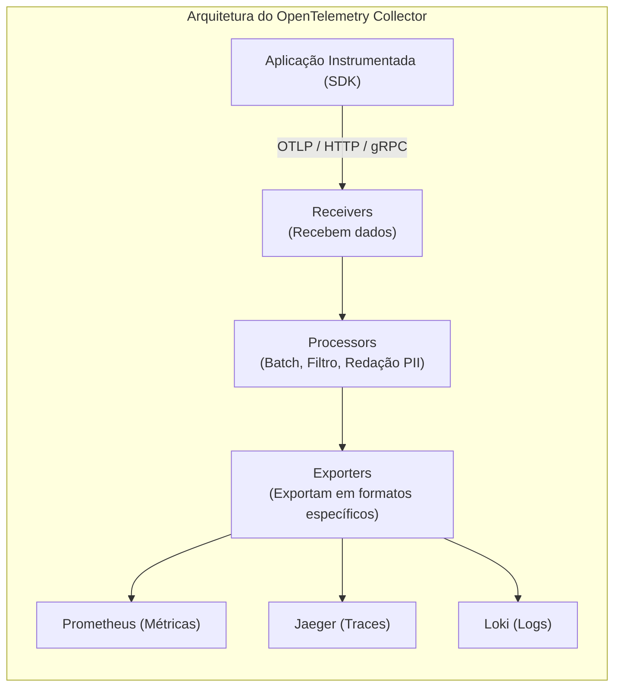
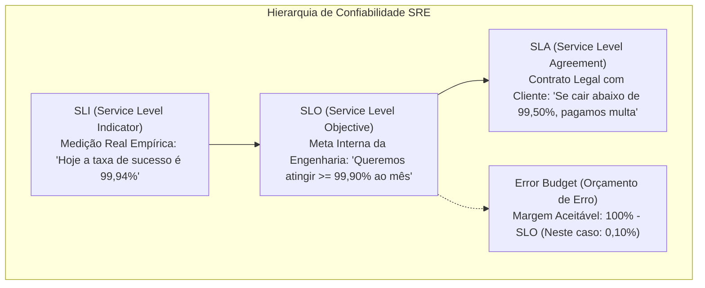

# 06 - Observabilidade, Monitoramento e Telemetria

> **Matéria:** DevOps, Plataforma de Desenvolvimento e Engenharia de Entrega  
> **Cargo:** B02 – Técnico de Controle Externo – Especialidade: Tecnologia da Informação  
> **Arquivo:** `06_observabilidade_monitoramento_e_telemetria.md`  

---

## 📌 Ementa / Itens do Edital
- Conceitos de Monitoramento Tradicional vs. Observabilidade
- Os Quatro Sinais Dourados do Google SRE (Latência, Tráfego, Erros e Saturação)
- Os Três Pilares da Observabilidade: Métricas, Logs Estruturados e Rastreamento Distribuído (Traces)
- Padrão OpenTelemetry (OTel), instrumentação e propagação de contexto
- Engenharia de Confiabilidade de Sites (SRE): SLI, SLO, SLA e Orçamento de Erro (Error Budget)
- Métricas DORA (DevOps Research and Assessment) e gestão de incidentes

---

## 🌳 Classificação Hierárquica

```text
6. Engenharia de Confiabilidade, Observabilidade e Telemetria
├── 6.1 Monitoramento Tradicional vs. Observabilidade
│   ├── 6.1.1 Monitoramento Tradicional:
│   │   ├── Foco reativo em sintomas ("O sistema está operante?")
│   │   ├── Limiares estáticos de alerta (Thresholds: CPU > 85%)
│   │   └── Domínio de problemas previsíveis ("Conhecidos desconhecidos" - Known Unknowns)
│   ├── 6.1.2 Observabilidade Moderna (Charity Majors / Rudolf Kalman):
│   │   ├── Capacidade de inferir estados internos de sistemas complexos a partir de suas saídas externas
│   │   ├── Foco na depuração de falhas inéditas e não planejadas ("Desconhecidos desconhecidos" - Unknown Unknowns)
│   │   └── Essencial para sistemas distribuídos e microsserviços dinâmicos e efêmeros
│   ├── 6.1.3 Os Quatro Sinais Dourados (The Four Golden Signals - Google SRE):
│   │   ├── Latência (Latency): Tempo para responder a requisições (distinguindo sucesso de erro)
│   │   ├── Tráfego (Traffic): Demanda de carga sobre o sistema (RPS, conexões simultâneas)
│   │   ├── Erros (Errors): Taxa de requisições que falharam (erros HTTP 5xx, falhas de schema)
│   │   └── Saturação (Saturation): Quão próximo de 100% de capacidade os recursos estão operando
│   └── 6.1.4 Metodologias Complementares: USE (Utilization, Saturation, Errors) e RED (Rate, Errors, Duration)
├── 6.2 Os Três Pilares da Observabilidade
│   ├── 6.2.1 Métricas (Metrics):
│   │   ├── Dados numéricos agregados organizados em séries temporais (Time Series)
│   │   ├── Tipos de Métricas: Contador (Counter - valor cumulativo), Medidor (Gauge - valor flutuante), Histograma e Sumário
│   │   └── Ecossistema: Prometheus (coleta via Pull/Scraping de endpoints `/metrics`, TSDB, PromQL, Alertmanager) e Grafana
│   ├── 6.2.2 Logs Estruturados (Structured Logging):
│   │   ├── Registro textual imutável e cronológico de eventos discretos
│   │   ├── Formato Estruturado em JSON (timestamp, level, message, service, trace_id, span_id, user_id)
│   │   └── Pilhas de Agregação e Indexação:
│   │       ├── Stack ELK (Elasticsearch, Logstash, Kibana)
│   │       ├── Stack EFK (Elasticsearch, Fluentd/Fluent Bit como DaemonSet em K8s, Kibana)
│   │       └── Grafana Loki (indexação eficiente baseada em rótulos/labels, armazenamento em buckets)
│   └── 6.2.3 Rastreamento Distribuído (Distributed Tracing):
│       ├── Rastreamento causal de uma transação através de uma malha complexa de microsserviços
│       ├── Componentes Centrais:
│       │   ├── Trace: Grafo causal completo da transação de ponta a ponta identificado por um Trace ID único
│       │   └── Span: Unidade básica de trabalho em um serviço específico (Span ID, Parent Span ID, timestamps, tags, logs)
│       └── Ferramentas Consolidadas: Jaeger e Zipkin
├── 6.3 Padrão Aberto OpenTelemetry (OTel)
│   ├── 6.3.1 Iniciativa CNCF: Fusão de OpenTracing e OpenCensus em um padrão unificado aberto e agnóstico de fornecedor
│   ├── 6.3.2 Arquitetura OTel:
│   │   ├── OTel API: Abstração para bibliotecas e instrumentação de código
│   │   ├── OTel SDK: Implementação com suporte a amostragem (sampling), lotes e exportadores
│   │   └── OTel Collector: Proxy de telemetria composto por Receivers, Processors e Exporters
│   ├── 6.3.3 Modalidades de Instrumentação: Automática (via bytecode/agentes) vs. Manual (código explícito)
│   └── 6.3.4 Propagação de Contexto (Context Propagation): Especificação W3C Trace Context (cabeçalhos `traceparent` e `tracestate`)
└── 6.4 Gestão de Indicadores de Confiabilidade SRE e Métricas DORA
    ├── 6.4.1 O Triângulo da Confiabilidade SRE:
    │   ├── SLI (Service Level Indicator): O que é efetivamente medido em tempo real
    │   ├── SLO (Service Level Objective): Meta interna almejada pela equipe de engenharia
    │   ├── SLA (Service Level Agreement): Contrato formal externo com penalidades jurídicas/financeiras
    │   └── Orçamento de Erro (Error Budget: 100% - SLO): Margem aceitável de risco para inovação
    └── 6.4.2 Métricas DORA de Desempenho Operacional:
        ├── Frequência de Implantação (Deployment Frequency)
        ├── Tempo de Lead para Mudanças (Lead Time for Changes)
        ├── Taxa de Falha em Mudanças (Change Failure Rate)
        └── Tempo de Restauração de Serviços (Time to Restore Service / MTTR)
```

---

## 📖 Resumo Teórico & Pontos-Chave Aprofundados

### 1. Monitoramento Tradicional vs. Observabilidade

Em sistemas legados monolíticos, o monitoramento tradicional centrava-se em vigiar a infraestrutura física com verificações do tipo caixa-preta (*ping* e limites estáticos de CPU). Em arquiteturas distribuídas nativas em nuvem (centenas de microsserviços e contêineres efêmeros), essa abordagem é insuficiente.



#### Definição Canônica de Observabilidade:
Derivada da Teoria dos Sistemas Lineares e Controle Matemático por Rudolf Kalman e popularizada na TI por Charity Majors:
> *"Um sistema é observável se o seu estado interno puder ser inferido inteiramente a partir do conhecimento de suas saídas externas."*

#### Os Quatro Sinais Dourados do Google SRE (*Site Reliability Engineering*):
1. **Latência (*Latency*):** O tempo necessário para atender a uma requisição. **Atenção:** É vital distinguir a latência de requisições bem-sucedidas da latência de requisições com falha (um erro 500 rápido não significa que a aplicação está rápida).
2. **Tráfego (*Traffic*):** A medição da demanda imposta ao sistema. Em serviços web, mede-se por requisições HTTP por segundo (RPS); em sistemas de streaming de áudio/vídeo, por sessões ativas ou largura de banda consumida.
3. **Erros (*Errors*):** A taxa de requisições que falharam. Divide-se em:
   - *Erros Explícitos:* Retorno HTTP 500 (*Internal Server Error*), timeout ou conexão recusada.
   - *Erros Implícitos:* O sistema retorna HTTP 200 (*OK*), mas o corpo da resposta traz uma mensagem do tipo `"erro ao processar dados"`.
4. **Saturação (*Saturation*):** Quão "cheio" está o sistema. Mede a fração utilizada de um recurso computacional limitado que possui capacidade máxima (ex.: percentual de uso de memória RAM, threads ativas do pool do servidor de aplicação ou espaço em disco).

> 🚨 **ALERTA DE PROVA / PEGADINHA FCC:**  
> A FCC adora cobrar os Quatro Sinais Dourados do Google SRE. Memorize o mnemônico **L-T-E-S**: **L**atência, **T**ráfego, **E**rros e **S**aturação. A banca costuma substituir "Saturação" por "Segurança" ou "Simplicidade" para tentar induzir o candidato ao erro.

---

### 2. Os Três Pilares da Observabilidade (Métricas, Logs e Traces)

Nenhum pilar isolado provê observabilidade completa. Eles são complementares e resolvem diferentes aspectos da investigação de falhas:



#### Tabela Comparativa dos Três Pilares

| Pilar | Definição e Formato | Vantagens | Desvantagens / Desafios | Tecnologia Referência |
| :--- | :--- | :--- | :--- | :--- |
| **Métricas** | Dados numéricos agregados com carimbo de tempo (*Time Series*). Ex.: `http_requests_total{status="500"}`. | Baixíssimo consumo de armazenamento e CPU; alertas instantâneos em tempo real. | Falta de contexto individual (não informa qual usuário ou qual parâmetro causou o erro). | Prometheus, Grafana |
| **Logs** | Registros de eventos com timestamp (preferencialmente estruturados em JSON). | Riqueza contextual profunda; mensagens de exceção e rastreamento de pilha (*stack trace*). | Volume massivo de dados; custo computacional elevado de indexação e armazenamento. | Elastic Stack (ELK), Fluent Bit, Loki |
| **Traces** | Rastreamento causal e temporal do trajeto de uma requisição através da malha de microsserviços. | Identifica instantaneamente gargalos de latência leste-oeste e dependências ocultas. | Exige instrumentação em todo o ecossistema e propagação rigorosa de cabeçalhos. | Jaeger, Zipkin, OpenTelemetry |

#### Tipos Primários de Métricas no Prometheus:
- **Counter (Contador):** Valor cumulativo que **apenas cresce** monotonicamente (ou é zerado no reinício da aplicação). Usado para contar total de requisições, total de erros ou bytes processados. Utiliza-se a função PromQL `rate()` para calcular a taxa por segundo.
- **Gauge (Medidor):** Valor numérico instantâneo que **pode subir e descer** livremente. Usado para medir temperatura de CPU, uso de memória RAM em bytes ou número de conexões ativas no banco de dados.
- **Histogram (Histograma):** Realiza a amostragem de dados e agrupa as observações em baldes contáveis configuráveis (*buckets*), registrando também a soma total e o contador total de observações. Essencial para cálculo estatístico de percentis de latência ($p50, p95, p99$).
- **Summary (Sumário):** Semelhante ao histograma, mas calcula os percentis diretamente no lado do cliente/aplicação sobre uma janela de tempo deslizante.

---

### 3. Rastreamento Distribuído (Distributed Tracing) e OpenTelemetry

Em ambientes modernos, uma requisição iniciada pelo usuário pode atravessar o Ingress, um serviço de Autenticação, uma API Gateway, um microsserviço de Cobrança, um tópico do Kafka e uma base de dados relacional.


#### A. Componentes do Tracing:
- **Trace:** Representa a árvore hierárquica completa de eventos que compõem o processamento de uma requisição de ponta a ponta. Identificado por um **Trace ID** único de 128 bits.
- **Span:** Representa uma operação lógica individual realizada em um componente do sistema. Contém:
  - `Span ID` (identificador único do span);
  - `Parent Span ID` (identificador do span que originou a chamada);
  - Timestamps de início e término (duração);
  - Atributos / Tags (pares chave-valor, ex.: `http.status_code=200`, `db.statement="SELECT..."`);
  - Eventos de log com carimbo de tempo.

#### B. Propagação de Contexto W3C Trace Context
Para que múltiplos microsserviços consigam correlacionar suas operações a um mesmo Trace, o serviço cliente injeta metadados em cabeçalhos HTTP na chamada ao serviço seguinte:
- `traceparent`: `00-4bf92f3577b34da6a3ce929d0e0e4736-00f067aa0ba902b7-01`  
  *(versão - trace_id - parent_span_id - trace_flags)*.

#### C. O Padrão OpenTelemetry (OTel)
O OpenTelemetry é o projeto de observabilidade sob tutela da CNCF (*Cloud Native Computing Foundation*) que unificou os projetos OpenTracing e OpenCensus.



- **OTel API:** Define os tipos abstratos de dados para que os desenvolvedores instrumentem código sem dependência de fornecedor.
- **OTel SDK:** Implementa a API com processamento de lotes, amostragem e exportação de telemetria.
- **OTel Collector:** Componente executado como proxy/agente independente. Possui três etapas em pipeline:
  1. **Receivers:** Portas de entrada que aceitam telemetria em múltiplos formatos (OTLP nativo, Prometheus, Jaeger, Zipkin).
  2. **Processors:** Tratam os dados em trânsito (agrupamento em lote, amostragem inteligente, mascaramento de informações confidenciais/PII).
  3. **Exporters:** Encaminham os dados tratados para destinos de armazenamento (backends como Prometheus, Elastic, Jaeger ou nuvens comerciais).

---

### 4. Confiabilidade SRE: SLI, SLO, SLA e Orçamento de Erro (Error Budget)

O Google formalizou a engenharia de confiabilidade (*Site Reliability Engineering - SRE*) baseada em um triângulo conceitual rigoroso:



#### Definições Essenciais:
1. **SLI (*Service Level Indicator*):** A métrica em tempo real observada. É uma medida de conformidade dada por:  
   $\text{SLI} = \frac{\text{Eventos Bons}}{\text{Total de Eventos Válidos}} \times 100\%$  
   *Exemplo:* $99{,}94\%$ das requisições responderam com sucesso em menos de 300 ms.
2. **SLO (*Service Level Objective*):** O alvo interno ou meta acordada pela equipe técnica para o SLI.  
   *Exemplo:* O serviço deve manter SLI $\ge 99{,}90\%$ durante qualquer janela móvel de 30 dias.
3. **SLA (*Service Level Agreement*):** O contrato formal comercial e jurídico firmado entre o provedor e os usuários/clientes finais. Estabelece sanções financeiras, créditos de serviço ou penalidades jurídicas caso o serviço seja descumprido.  
   *Regra de Ouro:* O **SLA é sempre mais flexível (menos restritivo) que o SLO** (ex.: se o SLO é $99{,}9\%$, o SLA contratual pode ser $99{,}5\%$). Isso concede à equipe técnica uma margem de segurança para reagir a incidentes antes de violar o contrato comercial.
4. **Error Budget (*Orçamento de Erro*):** A margem matemática de falha tolerada pelo SLO:  
   $\text{Error Budget} = 100\% - \text{SLO}$  
   - Se o SLO de disponibilidade é de $99{,}9\%$, o orçamento de erro é de $0{,}1\%$.
   - **Mecanismo de Equilíbrio:** Enquanto houver saldo positivo no Orçamento de Erro, a equipe pode assumir riscos calculados e lançar novas funcionalidades em produção. Se o orçamento de erro for totalmente consumido por incidentes recentes, **novos deploys são suspensos** e toda a equipe passa a atuar exclusivamente na melhoria de estabilidade, testes e resiliência do sistema.

---

## 🌐 Fontes Recomendadas na Internet

### 1. Obras Oficiais e Padrões da Indústria
- [Google SRE Book - Monitoring Distributed Systems](https://sre.google/sre-book/monitoring-distributed-systems/): Livro oficial gratuito do Google sobre Engenharia de Confiabilidade de Sites, definindo os Quatro Sinais Dourados (*Latency, Traffic, Errors, Saturation*), a arquitetura de alertas e o gerenciamento de *Error Budgets*.
- [OpenTelemetry Core Concepts & Architecture (opentelemetry.io)](https://opentelemetry.io/docs/concepts/): Padrão aberto oficial da CNCF especificando a estrutura de telemetria unificada (Traces, Metrics e Logs), ciclo de Spans, propagação de contexto W3C e arquitetura do *OTel Collector*.
- [Documentação Oficial do Prometheus (Prometheus.io)](https://prometheus.io/docs/introduction/overview/): Guia de arquitetura do banco de séries temporais, modelo de coleta baseado em *scraping* (pull), tipos de métricas (*Counter, Gauge, Histogram*) e linguagem de consulta PromQL.
- [DORA DevOps Research Program (dora.dev)](https://dora.dev/research/): Portal de pesquisas anuais do Google Cloud/DORA detalhando as 4 métricas essenciais de desempenho operacional (*Deployment Frequency*, *Lead Time for Changes*, *Change Failure Rate* e *Time to Restore Service*).

---

## 📝 Questões Comentadas & Exemplos (Padrão FCC)

### Questão 1 (FCC - Adaptada / TI - Monitoramento vs. Observabilidade e Sinais Dourados SRE)
No contexto de arquiteturas de sistemas distribuídos e práticas modernas de confiabilidade de software (SRE - *Site Reliability Engineering*), assinale a afirmativa correta a respeito dos Quatro Sinais Dourados (*Four Golden Signals*):  
A) Os Quatro Sinais Dourados definidos pelo Google SRE são: Criptografia, Autenticação, Não Repúdio e Integridade.  
B) A Saturação mede quão próximo da sua capacidade operacional máxima um recurso do sistema está operando, como o esgotamento do pool de threads ou da memória física disponível.  
C) A Latência deve ser calculada unicamente agregando todas as requisições em uma média simples, sendo irrelevante diferenciar o tempo de resposta das requisições bem-sucedidas do tempo de resposta das requisições que falharam com erro 500.  
D) O sinal de Tráfego avalia o custo financeiro da conta de energia elétrica dos servidores instalados no datacenter.  
E) A observabilidade é uma técnica aplicável estritamente a softwares legados monolíticos, sendo desnecessária em microsserviços conteinerizados em Kubernetes.

> **Gabarito: B**  
> **Comentário Analítico Passo a Passo:**  
> - **A está INCORRETA:** Criptografia, autenticação, integridade e não repúdio são pilares da Segurança da Informação. Os Quatro Sinais Dourados de monitoramento do SRE são **Latência, Tráfego, Erros e Saturação**.  
> - **B está CORRETA:** A **Saturação (*Saturation*)** indica quão "cheio" está o sistema, medindo a utilização relativa de recursos computacionais restritos com capacidade finita (ex.: uso de memória RAM, threads alocadas em pools de conexões HTTP, buffers de canais de mensageria). Se a saturação atinge 100%, a degradação de desempenho ou travamento do serviço torna-se iminente.  
> - **C está INCORRETA:** O Google SRE Book enfatiza expressamente que é crítico **separar a latência das requisições com sucesso da latência de requisições com erro**. Muitas vezes um erro de permissão ou falha de banco retorna em 5 ms com código HTTP 500; incluir esse erro na média falsearia a métrica, fazendo parecer que o sistema está mais rápido quando na verdade está falhando.  
> - **D está INCORRETA:** Tráfego mede a demanda operacional real imposta ao sistema por usuários ou clientes externos (ex.: requisições HTTP por segundo, conexões simultâneas ativas).  
> - **E está INCORRETA:** A observabilidade é indispensável exatamente em arquiteturas complexas distribuídas de microsserviços, onde o isolamento e o volume de transações simultâneas tornam a inspeção manual inviável.

---

### Questão 2 (FCC - Adaptada / TI - Os Três Pilares da Observabilidade)
A respeito dos três pilares fundamentais da observabilidade (Métricas, Logs e Rastreamento Distribuído/Traces), considere as seguintes afirmativas:

I. As métricas são representadas por dados numéricos agregados organizados ao longo do tempo (séries temporais), sendo computacionalmente eficientes e ideais para a geração de alertas instantâneos sobre a saúde do sistema.  
II. Os logs registram eventos discretos com carimbo de tempo (*timestamp*); quando estruturados em formatos padronizados (como JSON), facilitam a indexação, agregação e correlação com identificadores de rastreamento (*trace_id*).  
III. O tipo de métrica do Prometheus denominado *Counter* representa um valor numérico instantâneo que pode variar livremente para cima ou para baixo, sendo indicado para registrar a quantidade atual de memória RAM em uso em um servidor.

Está correto o que se afirma em:  
A) I, apenas.  
B) I e II, apenas.  
C) II e III, apenas.  
D) I e III, apenas.  
E) I, II e III.

> **Gabarito: B**  
> **Comentário Analítico Passo a Passo:**  
> - **Item I está CORRETO:** Métricas são séries temporais numéricas (*time series*) de baixo custo computacional de armazenamento e processamento, sendo perfeitas para construir painéis no Grafana e acionar regras de alerta no Alertmanager.  
> - **Item II está CORRETO:** Logs descrevem eventos discretos. Quando adotam formato estruturado em JSON com campos bem definidos (`timestamp`, `level`, `service`, `trace_id`), permitem buscas rápidas e correlação direta com traces e spans em plataformas como Elasticsearch ou Grafana Loki.  
> - **Item III está INCORRETO:** O **Counter** (Contador) é uma métrica cumulativa monotônica que **apenas sobe** (ou reinicia em zero no restart do processo), perfeita para contabilizar o número total de requisições processadas. A métrica que pode subir e descer livremente é o **Gauge** (Medidor), que é o tipo correto para mensurar consumo de memória RAM, threads ativas ou nível de temperatura.  
> - **Análise das Alternativas:**  
>   - **A está incorreta** porque o item II também está correto.  
>   - **B está CORRETA**, contemplando precisamente os itens I e II.  
>   - **C está incorreta** porque o item III é falso e o item I é verdadeiro.  
>   - **D está incorreta** porque o item III é falso.  
>   - **E está incorreta** pela falsidade do item III.

---

### Questão 3 (FCC - Adaptada / TI - Rastreamento Distribuído e OpenTelemetry)
Uma requisição de pagamento enviada ao portal da Secretaria de Fazenda percorre sequencialmente o serviço de borda (*Edge Gateway*), o microsserviço de validação cadastral e o serviço de liquidação bancária. Para depurar atrasos na resposta, a equipe de TI implementou rastreamento distribuído (*Distributed Tracing*) utilizando o padrão OpenTelemetry.

A esse respeito, assinale a opção correta:  
A) O *Trace* representa a unidade individual de execução dentro de um único método local de um microsserviço, enquanto o *Span* representa o conjunto de todas as transações financeiras ocorridas no mês.  
B) Cada operação lógica realizada em um microsserviço no caminho da requisição é representada por um *Span*, o qual possui horário de início, duração, atributos contextuais, um identificador único (*Span ID*) e, opcionalmente, um identificador de pai (*Parent Span ID*), permitindo reconstruir a árvore hierárquica completa da transação associada a um *Trace ID* global.  
C) A propagação de contexto entre microsserviços via protocolo HTTP dispensa qualquer cabeçalho de rede, pois o OpenTelemetry altera dinamicamente o endereço MAC das placas de rede físicas para transmitir o identificador do trace.  
D) No coletor do OpenTelemetry (*OTel Collector*), a etapa denominada *Receiver* é responsável por despachar os dados consolidados para bancos de dados de armazenamento permanente como Prometheus ou Jaeger.  
E) O padrão OpenTelemetry proíbe a exportação de dados para soluções abertas, exigindo contratação exclusiva de provedores de nuvem proprietários.

> **Gabarito: B**  
> **Comentário Analítico Passo a Passo:**  
> - **A está INCORRETA:** A alternativa inverteu os conceitos: o **Trace** representa a jornada completa de ponta a ponta da transação por toda a malha de microsserviços, enquanto o **Span** representa o segmento ou unidade atômica de trabalho em um serviço individual.  
> - **B está CORRETA:** Essa é a definição canônica da especificação do OpenTelemetry e do tracing moderno. O conjunto de todas as ações causadas por uma requisição compõe o **Trace** (com seu `Trace ID`). Cada etapa intermediária (chamada REST, execução de query SQL, publicação em fila) é delimitada como um **Span**, que registra o tempo exato de início e fim, tags de contexto, um `Span ID` próprio e o `Parent Span ID` do nó que realizou a chamada, viabilizando a representação da árvore de execução e localização precisa de gargalos.  
> - **C está INCORRETA:** A propagação de contexto depende criticamente de cabeçalhos padronizados de rede (como a especificação *W3C Trace Context* com o cabeçalho `traceparent`), não havendo modificação de endereços MAC em hardware físico.  
> - **D está INCORRETA:** No pipeline do *OTel Collector*, o **Receiver** é a porta de *entrada* que recebe ou extrai a telemetria; quem exporta e envia os dados para os backends (Prometheus, Jaeger, Loki) é o componente **Exporter**.  
> - **E está INCORRETA:** O OpenTelemetry é um padrão aberto mantido pela CNCF (*Cloud Native Computing Foundation*), projetado explicitamente para ser neutro de fornecedor (*vendor-neutral*) e compatível tanto com ferramentas de código aberto quanto com produtos comerciais.

---

### Questão 4 (FCC - Adaptada / TI - Engenharia de Confiabilidade SRE: SLI, SLO e SLA)
Em uma reunião de alinhamento entre a equipe de operações e os gestores de negócios de um Tribunal de Contas Estadual, foram discutidas as metas de confiabilidade e disponibilidade para o novo Portal de Prestação de Contas dos Jurisdicionados.

Com base nas práticas consagradas de SRE (*Site Reliability Engineering*), a relação conceitual e hierárquica entre SLI, SLO e SLA define que:  
A) O SLA deve ser rigorosamente mais estrito e exigente do que o SLO interno, para assegurar que penalidades financeiras sejam aplicadas antes que a equipe técnica perceba qualquer degradação do serviço.  
B) O SLI (*Service Level Indicator*) é o indicador medido empiricamente em tempo real; o SLO (*Service Level Objective*) é a meta interna acordada pela engenharia; e o SLA (*Service Level Agreement*) é o acordo legal ou comercial com os usuários externos, contendo penalidades em caso de descumprimento.  
C) O Orçamento de Erro (*Error Budget*) é uma verba financeira destinada à aquisição de equipamentos de hardware adicionais sempre que o sistema ultrapassa o SLA contratual.  
D) Se uma equipe consome 100% do seu Orçamento de Erro (*Error Budget*), as diretrizes do SRE recomendam acelerar imediatamente a entrega de novos recursos e funcionalidades não testadas em produção.  
E) O SLO é estritamente documental e não se relaciona com os valores obtidos pelo SLI.

> **Gabarito: B**  
> **Comentário Analítico Passo a Passo:**  
> - **A está INCORRETA:** Uma das principais regras de ouro do SRE estabelece que o **SLA é sempre mais tolerante (menos restritivo) que o SLO**. Por exemplo, se o SLO interno é de 99,9% de disponibilidade, o SLA com clientes deve ser de 99,5%. Essa diferença cria uma zona de amortecimento (*buffer*) que permite à equipe resolver incidentes antes de sofrer sanções ou penalidades legais/financeiras.  
> - **B está CORRETA:** Apresenta a distinção perfeita do triângulo de confiabilidade:
>   - **SLI:** A medida quantitativa real observada no sistema (ex.: latência atual ou taxa de sucesso observada de 99,92%).
>   - **SLO:** A meta interna de nível de serviço estabelecida pela equipe para nortear a operação (ex.: manter o SLI $\ge 99{,}90\%$).
>   - **SLA:** O contrato formal vinculante entre a organização e seus usuários externos, estipulando compensações em caso de descumprimento.  
> - **C está INCORRETA:** O *Error Budget* (Orçamento de Erro) não é verba monetária, mas sim uma margem métrica de risco calculada como $100\% - \text{SLO}$ (ex.: tolerância de $0{,}1\%$ de falha), utilizada para equilibrar a velocidade de inovação com a estabilidade do sistema.  
> - **D está INCORRETA:** Quando o orçamento de erro é esgotado, a política do SRE prevê o congelamento temporário de novos lançamentos de funcionalidades, concentrando a força de trabalho da equipe exclusivamente em resiliência, automação de testes e estabilidade até que o orçamento se recupere.  
> - **E está INCORRETA:** O SLO é a meta numérica diretamente vinculada à medição do SLI.

---

### Questão 5 (FCC - Adaptada / TI - Métricas DORA e Gestão de Incidentes)
De acordo com as pesquisas consolidadas do DORA (*DevOps Research and Assessment*), as quatro métricas chave utilizadas mundialmente para mensurar a maturidade e a performance das equipes de engenharia de software e entrega contínua são:  
A) Custo Total de Propriedade (TCO); Número de Linhas de Código (LOC); Quantidade de Commits por Hora; e Pontos de Função por Mês.  
B) Frequência de Implantação (*Deployment Frequency*); Tempo de Lead para Mudanças (*Lead Time for Changes*); Taxa de Falha em Mudanças (*Change Failure Rate*); e Tempo de Restauração de Serviços (*Time to Restore Service* / MTTR).  
C) Índice de Complexidade Ciclomática; Total de Branches Abertas; Cobertura de Testes Unitários de 100%; e Percentual de Homologações Manuais por Comitês Executivos.  
D) Quantidade de Bugs Reabertos; Consumo de Memória por Usuário Conectado; Largura de Banda Utilizada por Download; e Número de E-mails Trocados no Suporte Técnico.  
E) Frequência de Reuniões Diárias; Total de Histórias de Usuário no Backlog; Quantidade de Telas Desenvolvidas; e Tempo de Execução do Sistema Operacional.

> **Gabarito: B**  
> **Comentário Analítico Passo a Passo:**  
> - **A está INCORRETA:** Linhas de código (LOC) e contagem de commits são métricas de vaidade ultrapassadas que não refletem a eficácia de entrega e confiabilidade.  
> - **B está CORRETA:** As quatro métricas fundamentais cientificamente validadas pelo programa DORA (Google Cloud / DevOps Research and Assessment) dividem-se em:
>   - **Velocidade / Rendimento (Throughput):**
>     1. *Deployment Frequency (DF):* Frequência com que o código é colocado com sucesso em produção;
>     2. *Lead Time for Changes (LTTC):* Tempo que leva para um commit chegar ao ambiente de produção.
>   - **Estabilidade / Confiabilidade (Stability):**
>     3. *Change Failure Rate (CFR):* Percentual de implantações que resultam em incidentes ou requerem reversão imediata (*rollback*);
>     4. *Time to Restore Service (MTTR):* Tempo necessário para restaurar a integridade do serviço quando um incidente ocorre em produção.  
> - **C está INCORRETA:** Embora a complexidade ciclomática e a cobertura de testes sejam métricas técnicas de qualidade de código, elas não compõem o conjunto das quatro métricas DORA. Homologações manuais por comitês (CABs) são, na verdade, um indicador de baixa maturidade.  
> - **D e E estão INCORRETAS:** Relatam métricas avulsas de suporte ou de gestão de projetos que não constituem as métricas universais de entrega contínua do DORA.
