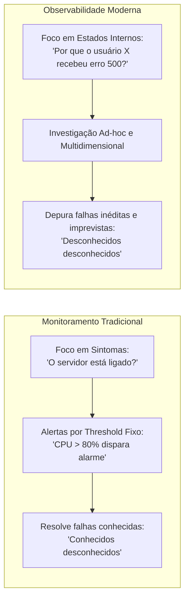
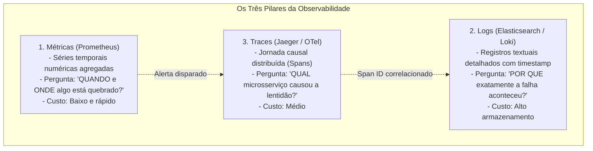
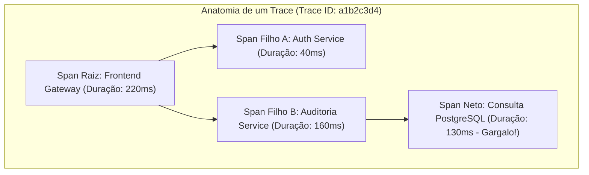
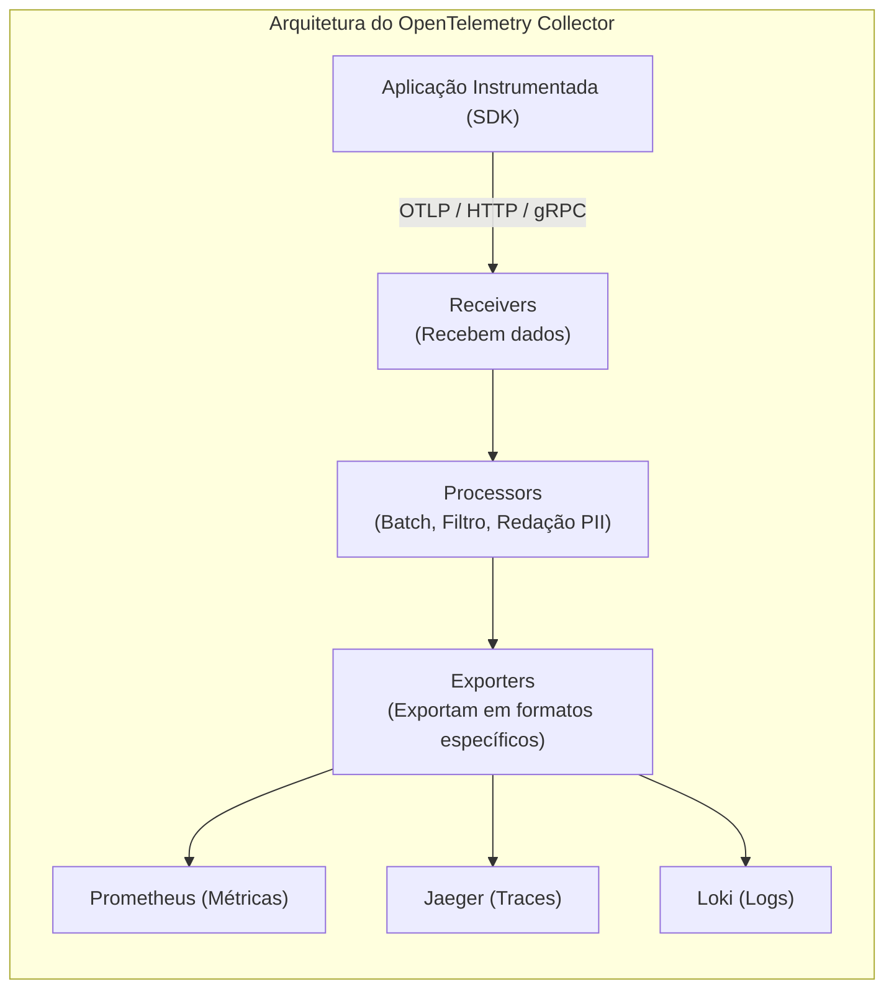
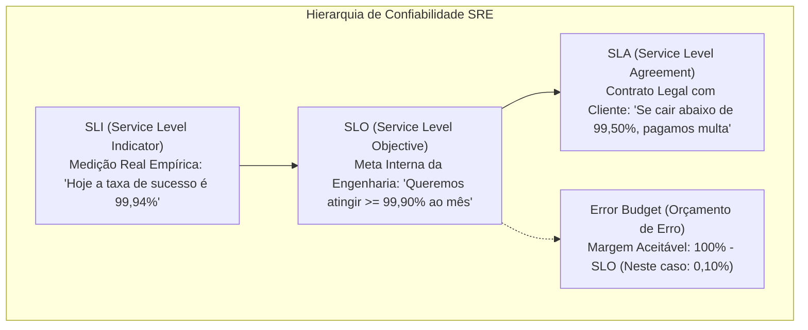

# 06 - Observabilidade, Monitoramento e Telemetria

> **Matéria:** DevOps, Plataforma de Desenvolvimento e Engenharia de Entrega  
> **Cargo:** B02 – Técnico de Controle Externo – Especialidade: Tecnologia da Informação  
> **Arquivo:** `06_observabilidade_monitoramento_e_telemetria.md`  


---


## 📌 Ementa / Itens do Edital
- Conceitos de Monitoramento Tradicional vs. Observabilidade
- Os Quatro Sinais Dourados do Google SRE (Latência, Tráfego, Erros e Saturação)
- Os Três Pilares da Observabilidade: Métricas, Logs Estruturados e Rastreamento Distribuído (Traces)
- Padrão OpenTelemetry (OTel), instrumentação e propagação de contexto
- Engenharia de Confiabilidade de Sites (SRE): SLI, SLO, SLA e Orçamento de Erro (Error Budget)
- Métricas DORA (DevOps Research and Assessment) e gestão de incidentes

---

## 🧭 Sumário

1. [Monitoramento Tradicional vs. Observabilidade Moderna](#1-monitoramento-tradicional-vs-observabilidade-moderna)
    1. [Transição de Sintomas para Estados Internos](#11-transicao-de-sintomas-para-estados-internos)
    2. [Os Quatro Sinais Dourados do Google SRE (Four Golden Signals)](#12-os-quatro-sinais-dourados-do-google-sre-four-golden-signals)
    3. [Metodologias Complementares: USE (Brendan Gregg) e RED (Tom Wilkie)](#13-metodologias-complementares-use-brendan-gregg-e-red-tom-wilkie)
    4. [Teste 224](#Teste-224)
    5. [Teste 225](#Teste-225)
    6. [Teste 226](#Teste-226)
2. [Os Três Pilares da Observabilidade](#2-os-tres-pilares-da-observabilidade)
    1. [Métricas (Metrics) e Tipos Primários no Prometheus (Counter, Gauge, Histogram, Summary)](#21-metricas-metrics-e-tipos-primarios-no-prometheus-counter-gauge-histogram-summary)
    2. [Logs Estruturados (Structured Logging) e Pilhas de Agregação (ELK, EFK, Loki)](#22-logs-estruturados-structured-logging-e-pilhas-de-agregacao-elk-efk-loki)
    3. [Rastreamento Distribuído (Distributed Tracing): Traces, Spans e Identificadores Globais](#23-rastreamento-distribuido-distributed-tracing-traces-spans-e-identificadores-globais)
    4. [Tabela Comparativa de Propósitos e Custos dos Três Pilares](#24-tabela-comparativa-de-propositos-e-custos-dos-tres-pilares)
    5. [Teste 227](#Teste-227)
    6. [Teste 228](#Teste-228)
    7. [Teste 229](#Teste-229)
3. [O Padrão Aberto OpenTelemetry (OTel)](#3-o-padrao-aberto-opentelemetry-otel)
    1. [Arquitetura Unificada: OTel API, OTel SDK e OTel Collector](#31-arquitetura-unificada-otel-api-otel-sdk-e-otel-collector)
    2. [Propagação de Contexto W3C Trace Context (traceparent e tracestate)](#32-propagacao-de-contexto-w3c-trace-context-traceparent-e-tracestate)
    3. [Teste 230](#Teste-230)
4. [Engenharia de Confiabilidade SRE: O Triângulo SLI, SLO, SLA e Error Budgets](#4-engenharia-de-confiabilidade-sre-o-triangulo-sli-slo-sla-e-error-budgets)
    1. [Distinção Formal entre SLI, SLO e SLA](#41-distincao-formal-entre-sli-slo-e-sla)
    2. [O Orçamento de Erro (Error Budget) como Equilíbrio entre Inovação e Confiabilidade](#42-o-orcamento-de-erro-error-budget-como-equilibrio-entre-inovacao-e-confiabilidade)
    3. [Teste 231](#Teste-231)
    4. [Teste 232](#Teste-232)
5. [Métricas DORA e Desempenho Operacional em Engenharia](#5-metricas-dora-e-desempenho-operacional-em-engenharia)
    1. [As Quatro Dimensões DORA: Throughput vs. Stability](#51-as-quatro-dimensoes-dora-throughput-vs-stability)
    2. [Teste 233](#Teste-233)
6. [🌐 Fontes Oficiais e Referências Bibliográficas](#fontes-oficiais-e-referencias-bibliograficas)

---

## 1. Monitoramento Tradicional vs. Observabilidade Moderna

Em infraestruturas tradicionais monolíticas e hospedadas em datacenters físicos, a gerência de operações baseava-se em **monitoramento reativo**: checagens periódicas via ping (*heartbeats* ICMP) e disparos de alertas fundamentados em limiares estáticos (*thresholds*, ex.: disparar e-mail de alerta quando o consumo de CPU da VM ultrapassar 80%).

Com a emergência de arquiteturas distribuídas nativas em nuvem (*cloud native*), milhares de microsserviços efêmeros, orquestração de contêineres e funções serverless, essa abordagem mostrou-se insuficiente. O sistema pode estar com todos os servidores operando em 30% de CPU e, ainda assim, milhares de cidadãos enfrentarem erros HTTP 500 intermitentes devido a travamentos de conexões em banco de dados ou falhas de comunicação em malhas de rede.



### 1.1 Transição de Sintomas para Estados Internos

- **Definição Matemática e Canônica:** Originária da Teoria do Controle Linear formalizada por Rudolf E. Kálmán (1960) e consolidada na computação por Charity Majors:
  > *"Um sistema é observável se o seu estado interno puder ser integralmente inferido a partir do conhecimento de suas saídas externas expostas."*
- **A Fronteira Conceitual:**
    - **Monitoramento Tradicional:** Informa **quando** algo está quebrado (*"O sistema está fora do ar?"*). Presta-se a diagnosticar problemas previsíveis cujas causas já são familiares à equipe (*known unknowns*).
    - **Observabilidade:** Permite entender **por que** algo quebrou (*"Por que a transação do usuário X demorou 12 segundos e gerou falha na emissão da certidão?"*). Viabiliza a investigação aberta e multidimensional de problemas inéditos e imprevistos decorrentes do comportamento caótico de sistemas distribuídos (*unknown unknowns*).

### 1.2 Os Quatro Sinais Dourados do Google SRE (Four Golden Signals)

No seminal *Google Site Reliability Engineering Book*, a equipe de confiabilidade do Google catalogou os quatro pilares essenciais de telemetria para qualquer serviço voltado ao usuário:

1. **Latência (*Latency*):** O tempo decorrido para processar e responder a uma requisição.
    - **Regra de Ouro:** É imperativo **separar a latência das requisições bem-sucedidas da latência das requisições com erro**. Frequentemente, uma falha de autenticação ou erro de rota retorna imediatamente em 3 ms com código HTTP 500; agregar essa resposta rápida à média geral mascararia a lentidão real das requisições legítimas que estão demorando 4 segundos para carregar dados.

2. **Tráfego (*Traffic*):** A medição da demanda imposta ao sistema. Em serviços web e APIs REST, afere-se tipicamente pelo número de requisições HTTP por segundo (RPS); em serviços de banco de dados, pelo volume de transações por segundo (TPS); em redes de streaming, pela quantidade de conexões ativas ou vazão de dados em megabits por segundo.
3. **Erros (*Errors*):** A taxa de requisições que falharam. Divide-se em:
    - *Erros Explícitos:* Respostas com códigos de erro HTTP 5xx (500, 502, 503), timeouts de soquete ou falhas de conexão recusada.
    - *Erros Implícitos:* Requisições que retornam código HTTP 200 (OK), mas cujo conteúdo transporta uma mensagem de falha funcional (ex.: resposta com `{"status": "erro", "mensagem": "falha na comunicação com a Receita Federal"}`).

4. **Saturação (*Saturation*):** Quão "cheio" está o sistema. Mede a fração utilizada de um recurso computacional finito e restrito (ex.: percentual de ocupação da memória RAM física, esgotamento do pool de threads do Tomcat, taxa de utilização de discos SSD ou filas de espera em conexões com bancos relacionais). À medida que a saturação se aproxima de 100%, o sistema degrada subitamente seu desempenho.

> 🚨 **ALERTA DE PROVA / PEGADINHA FCC:**  
> A FCC adora cobrar os Quatro Sinais Dourados do Google SRE. Memorize a sigla **L-T-E-S**: **L**atência, **T**ráfego, **E**rros e **S**aturação.  
> As alternativas incorretas costumam substituir "Saturação" por "Segurança", "Simplicidade" ou "Sincronização" para induzir o candidato ao erro.

### 1.3 Metodologias Complementares: USE (Brendan Gregg) e RED (Tom Wilkie)

Além dos Quatro Sinais Dourados, destacam-se duas metodologias amplamente cobradas em avaliações de arquitetura:

- **Método USE (Brendan Gregg - Foco em Recursos e Infraestrutura):** Para cada recurso de hardware/sistema (CPU, disco, barramento de rede), analisa-se:
    - **U (Utilization):** Percentual médio de tempo em que o recurso esteve ocupado.
    - **S (Saturation):** Volume de trabalho pendente na fila aguardando processamento.
    - **E (Errors):** Contagem de erros de hardware ou de driver associados ao recurso.
- **Método RED (Tom Wilkie - Foco em Microsserviços e Requisições):** Adequado para avaliar serviços que processam chamadas de rede:
    - **R (Rate):** Taxa de requisições por segundo.
    - **E (Errors):** Quantidade ou taxa de requisições que falharam.
    - **D (Duration):** Duração/tempo gasto pelas requisições (latência).

---

### Teste 224
**(FCC – TRT – Analista Judiciário / Tecnologia da Informação)**  
Na engenharia de sistemas modernos, a distinção conceitual entre o Monitoramento Tradicional e a Observabilidade Moderna fundamenta-se na teoria do controle. A respeito dessa distinção, é correto afirmar:

* **A)** O monitoramento tradicional testa os sistemas internamente com inteligência artificial, enquanto a observabilidade analisa exclusivamente se o computador está ligado à tomada considerando os requisitos operacionais de segurança, escalabilidade, auditoria e desempenho corporativo considerando os requisitos operacionais de segurança, escalabilidade, auditoria e desempenho corporativo.
* **B)** O monitoramento tradicional foca em verificar sintomas e métricas pré-conhecidas de falha ("o sistema está funcionando?"), respondendo por problemas conhecidos (*known unknowns*); a observabilidade é a propriedade de inferir os estados internos de um sistema complexo exclusivamente a partir de suas saídas de telemetria externa, permitindo diagnosticar comportamentos inéditos e inesperados (*unknown unknowns*).
* **C)** Observabilidade e monitoramento são termos rigorosamente sinônimos, não havendo qualquer distinção técnica ou arquitetural entre ambos.
* **D)** A observabilidade exige o desligamento de todos os agentes de telemetria de produção.
* **E)** O monitoramento tradicional é capaz de isolar falhas de concorrência em sistemas distribuídos de microsserviços sem necessidade de logs ou traces.


---

> **Comentário Detalhado:**
>
> - **A) Incorreta.** Relação invertida e simplória.
> - **B) Correta.** Definição clássica de Charity Majors e da literatura SRE: o monitoramento tradicional avisa quando algo quebrou baseado em limites pré-definidos (*thresholds* e alertas de sintomas conhecidos). A **Observabilidade** mede quão bem você consegue compreender o estado interno de um sistema complexo examinando apenas suas saídas de telemetria (métricas, logs, traces), sendo essencial para desvendar causas inéditas em sistemas distribuídos (*unknown unknowns*).
> - **C) Incorreta.** Há clara distinção de escopo e capacidade diagnóstica.
> - **D) Incorreta.** A observabilidade alimenta-se diretamente da telemetria.
> - **E) Incorreta.** Sistemas distribuídos demandam rastreamento distribuído e alta cardinalidade que o monitoramento tradicional não suporta.
>
> **Gabarito: B**

---

### Teste 225
**(FCC - Adaptada / TI - Monitoramento vs. Observabilidade e Sinais Dourados SRE)**
No contexto de arquiteturas de sistemas distribuídos e práticas modernas de confiabilidade de software (SRE - *Site Reliability Engineering*), assinale a afirmativa correta a respeito dos Quatro Sinais Dourados (*Four Golden Signals*):  

* **A)** Os Quatro Sinais Dourados definidos pelo Google SRE são: Criptografia, Autenticação, Não Repúdio e Integridade.
* **B)** A Saturação mede quão próximo da sua capacidade operacional máxima um recurso do sistema está operando, como o esgotamento do pool de threads ou da memória física disponível.
* **C)** A Latência deve ser calculada unicamente agregando todas as requisições em uma média simples, sendo irrelevante diferenciar o tempo de resposta das requisições bem-sucedidas do tempo de resposta das requisições que falharam com erro 500.
* **D)** O sinal de Tráfego avalia o custo financeiro da conta de energia elétrica dos servidores instalados no datacenter.
* **E)** A observabilidade é uma técnica aplicável estritamente a softwares legados monolíticos, sendo desnecessária em microsserviços conteinerizados em Kubernetes.


---

> **Comentário Detalhado:**
>
> - **A)** Incorreta. Criptografia, autenticação, integridade e não repúdio são atributos de Segurança da Informação. Os Quatro Sinais Dourados do SRE são **Latência, Tráfego, Erros e Saturação**.
> - **B)** Correta. A **Saturação (*Saturation*)** expressa quão "ocupado" ou sobrecarregado está o sistema, aferindo a fração utilizada de um recurso computacional finito (memória RAM, quotas de CPU, limites de conexões de banco de dados, buffers de rede). Ao atingir 100%, ocorre degradação aguda de performance.
> - **C)** Incorreta. O modelo SRE enfatiza que é imperativo **diferenciar a latência das requisições com sucesso da latência de requisições com erro**, pois requisições abortadas com erro podem retornar rapidamente e mascarar a lentidão das requisições legítimas.
> - **D)** Incorreta. Tráfego afere a demanda imposta ao sistema pelos usuários ou clientes (ex.: requisições por segundo, sessões ativas).
> - **E)** Incorreta. A observabilidade é indispensável prioritariamente em sistemas distribuídos complexos e efêmeros.
> 
> **Gabarito: B**

---

### Teste 226
**(FCC – TRT – Analista Judiciário / Tecnologia da Informação)**  
No diagnóstico de desempenho de sistemas computacionais, duas metodologias de telemetria consagradas são o método **USE** (proposto por Brendan Gregg) e o método **RED** (proposto por Tom Wilkie). A correta caracterização dessas metodologias estabelece que:

* **A)** O método USE aplica-se a requisições de microsserviços e o método RED foca em memórias ROM analógicas considerando os requisitos operacionais de segurança, escalabilidade, auditoria e desempenho corporativo considerando os requisitos operacionais de segurança, escalabilidade, auditoria e desempenho corporativo.
* **B)** O método USE orienta-se a recursos físicos de infraestrutura e hardware, analisando a **Utilização** (% de tempo ocupado), a **Saturação** (filas de espera de trabalho reprimido) e os **Erros** de cada recurso; o método RED orienta-se a serviços e requisições de software, medindo a Taxa de Requisições (**Rate**), a Taxa de Falhas (**Errors**) e a Duração (**Duration** / tempo de resposta).
* **C)** O método RED mede exclusivamente o consumo de energia elétrica em watts dos servidores.
* **D)** Ambas as metodologias recomendam que a saturação dos discos seja mantida permanentemente em 100%.
* **E)** O método USE proíbe o registro de erros em sistemas de arquivos.


---

> **Comentário Detalhado:**
>
> - **A) Incorreta.** A relação de foco está invertida.
> - **B) Correta.** É a divisão clássica da engenharia de observabilidade:
>   - **USE Method (Brendan Gregg):** foca em **recursos** (CPU, memória, disco, interfaces de rede): *Utilization, Saturation, Errors*;
>   - **RED Method (Tom Wilkie):** foca em **serviços e transações** (APIs e microsserviços): *Rate* (requisições por segundo), *Errors* (falhas por segundo) e *Duration* (latência/tempo gasto).
> - **C) Incorreta.** RED mede tráfego, erros e duração de requisições de software.
> - **D) Incorreta.** Saturação alta indica gargalo severo e filas reprimidas.
> - **E) Incorreta.** Erros são o terceiro elemento obrigatório do método USE.
>
> **Gabarito: B**

---

## 2. Os Três Pilares da Observabilidade

A observabilidade moderna estrutura-se sobre a convergência de três tipos de dados de telemetria independentes, porém rigorosamente complementares: **Métricas, Logs e Rastreamento Distribuído (*Traces*)**.



### 2.1 Métricas (Metrics) e Tipos Primários no Prometheus (Counter, Gauge, Histogram, Summary)

As **métricas** são valores numéricos atômicos agregados ao longo do tempo (*Time Series*), enriquecidos com pares chave-valor denominados rótulos (*labels*). Exemplo no Prometheus: `http_requests_total{method="POST", handler="/pagamento", status="500"}`.

O modelo de dados do **Prometheus** (padrão ouro para Kubernetes) estabelece quatro tipos canônicos de métricas:

1. **Counter (Contador):**
    - É uma métrica cumulativa monotônica cujo valor **apenas sobe** (ou é reiniciado em zero quando a aplicação reinicia).
    - **Nunca decresce** sob condições normais de operação.
    - Usado para contar o número total de requisições atendidas, o total de erros registrados ou bytes transmitidos. No PromQL, utiliza-se a função `rate(http_requests_total[5m])` para derivar a taxa de requisições por segundo.

2. **Gauge (Medidor):**
    - É um valor numérico instantâneo que **pode subir e descer livremente** ao longo do tempo.
    - Usado para representar o estado momentâneo de um recurso variável: quantidade de memória RAM livre em bytes, temperatura da CPU, número de conexões ativas no pool do banco de dados ou contagem de réplicas de Pods rodando.

3. **Histogram (Histograma):**
    - Amostra observações (geralmente latências de requisições ou tamanhos de payloads) e as conta em **baldes de tamanho configurável (*buckets*)**.
    - Expõe automaticamente métricas auxiliares: contagem total de observações (`_count`) e soma total dos valores (`_sum`).
    - É a estrutura fundamental para calcular estatisticamente os **percentis de latência ($p50, p90, p95, p99$)** no lado do servidor com a função `histogram_quantile()`.

4. **Summary (Sumário):**
    - Semelhante ao histograma, mas calcula os percentis diretamente na própria aplicação instrumentada (no cliente) sobre uma janela de tempo deslizante, expondo os quantis já prontos. Não permite agregação matemática de percentis entre múltiplas instâncias no servidor.

### 2.2 Logs Estruturados (Structured Logging) e Pilhas de Agregação (ELK, EFK, Loki)

Os **logs** são registros textuais cronológicos e imutáveis de eventos discretos que ocorreram em um ponto específico no tempo dentro de uma aplicação:

- **A Importância dos Logs Estruturados em JSON:** Em vez de emitir strings desordenadas (`[INFO] O usuario 123 logou`), as aplicações modernas devem emitir logs estruturados em objetos JSON:

```json
{
  "timestamp": "2027-04-15T14:32:00.123Z",
  "level": "ERROR",
  "service": "auditoria-fiscal",
  "message": "Falha na comunicacao com base de dados tributaria",
  "user_id": "usr-8891",
  "trace_id": "4bf92f3577b34da6a3ce929d0e0e4736",
  "span_id": "00f067aa0ba902b7",
  "error_details": "ConnectionTimeoutException: database unreachable"
}
```

  A inclusão de campos como `trace_id` viabiliza a correlação cruzada imediata entre o log e o rastreamento distribuído correspondente.

- **Pilhas de Agregação de Logs:**
    - **Stack ELK (Elasticsearch, Logstash, Kibana):** O Logstash coleta e processa os logs; o Elasticsearch atua como mecanismo de busca e indexação distribuída em texto integral; o Kibana provê os dashboards visuais de consulta.
    - **Stack EFK (Elasticsearch, Fluentd/Fluent Bit, Kibana):** Substitui o Logstash pelo **Fluent Bit** (leitor de logs levíssimo em C instalado como `DaemonSet` em cada nó do Kubernetes) para enviar os logs dos contêineres para o Elasticsearch.
    - **Grafana Loki:** Abordagem moderna e econômica inspirada no Prometheus. Em vez de indexar o texto integral de cada log (o que consome gigabytes de RAM e disco), o Loki indexa apenas os metadados e rótulos (*labels*), armazenando o texto comprimido em buckets de armazenamento de objetos (como Amazon S3 ou MinIO).

### 2.3 Rastreamento Distribuído (Distributed Tracing): Traces, Spans e Identificadores Globais

Em arquiteturas de microsserviços, uma única ação do usuário desencadeia uma cascata de dezenas de chamadas assíncronas entre serviços distribuídos. O **Rastreamento Distribuído (*Distributed Tracing*)** reconstrói o grafo causal e temporal de ponta a ponta dessa transação.



- **Trace (Rastreio):** O grafo acíclico direcionado completo da jornada de uma requisição pelo ecossistema de software. É identificado por um identificador global único chamado **`Trace ID`** (número hexadecimal de 128 bits).
- **Span (Segmento):** A unidade atômica básica de trabalho executada por um serviço individual durante o processamento do Trace. Um Span encapsula:
    - **`Span ID`:** Identificador único daquela operação local (64 bits);
    - **`Parent Span ID`:** O identificador do Span que o invocou (se for o primeiro da cadeia, é o *Root Span*);
    - **Timestamps:** Horário exato de início e fim da operação (permitindo calcular a duração e latência);
    - **Tags / Atributos:** Metadados estruturados (ex.: `http.method: POST`, `db.statement: SELECT * FROM notas_fiscais`);
    - **Eventos:** Anotações temporais com mensagens ou erros de exceção ocorridos durante a execução do span.

### 2.4 Tabela Comparativa de Propósitos e Custos dos Três Pilares

| Pilar | Pergunta que Responde | Granularidade dos Dados | Custo de Armazenamento e Processamento | Ferramentas de Referência |
| :--- | :--- | :--- | :--- | :--- |
| **Métricas** | **"Quando e onde algo está quebrado?"** | Numérica, agregada e contínua (*Time Series*). | **Muito Baixo** (ótima relação custo/benefício para retenção longa). | Prometheus, Datadog, InfluxDB, Grafana |
| **Logs** | **"Por que exatamente o erro aconteceu?"** | Textual individualizada por evento discreto. | **Muito Alto** (exige compressão e descarte programado por TTL). | Stack ELK, Fluent Bit, Grafana Loki |
| **Traces** | **"Qual serviço no fluxo causou o atraso ou falha?"** | Grafo hierárquico causal de transação distribuída. | **Médio** (requer uso de amostragem/*sampling* em alta escala). | Jaeger, Zipkin, OpenTelemetry |

---

### Teste 227
**(FCC - Adaptada / TI - Os Três Pilares da Observabilidade)**
A respeito dos três pilares fundamentais da observabilidade (Métricas, Logs e Rastreamento Distribuído/Traces), considere as seguintes afirmativas:

I. As métricas são representadas por dados numéricos agregados organizados ao longo do tempo (séries temporais), sendo computacionalmente eficientes e ideais para a geração de alertas instantâneos sobre a saúde do sistema.  

II. Os logs registram eventos discretos com carimbo de tempo (*timestamp*); quando estruturados em formatos padronizados (como JSON), facilitam a indexação, agregação e correlação com identificadores de rastreamento (*trace_id*).  

III. O tipo de métrica do Prometheus denominado *Counter* representa um valor numérico instantâneo que pode variar livremente para cima ou para baixo, sendo indicado para registrar a quantidade atual de memória RAM em uso em um servidor.  

Está correto o que se afirma em:  

* **A)** I, apenas.
* **B)** I e II, apenas.
* **C)** II e III, apenas.
* **D)** I e III, apenas.
* **E)** I, II e III.


---

> **Comentário Detalhado:**
>
> - **A)** Incorreta. O item II também está correto.
> - **B)** Correta. Os itens I e II estão tecnicamente perfeitos: métricas são séries temporais numéricas de baixo overhead ideais para dashboards e alertas em tempo real; logs registram eventos discretos com contexto profundo que, quando estruturados em JSON, viabilizam buscas e correlação cruzada com traces.
> - **C)** Incorreta. O item III está errado e o item I está correto.
> - **D)** Incorreta. O item III é falso.
> - **E)** Incorreta. O item III é falso porque o **Counter** é cumulativo monotônico (apenas sobe). A métrica do Prometheus que varia livremente para cima e para baixo (como o uso momentâneo de memória RAM ou temperatura) é o **Gauge** (Medidor).
> 
> **Gabarito: B**

---

### Teste 228
**(FCC – TRT – Analista Judiciário / Tecnologia da Informação)**  
Em arquiteturas de microsserviços de grande escala, a substituição de logs em texto livre não estruturado por Logs Estruturados (*Structured Logging*, tipicamente formatados em JSON) é uma exigência essencial de observabilidade. A principal vantagem dos logs estruturados consiste em:

* **A)** Impedir que o arquivo de log seja aberto por editores de texto no sistema hospedeiro.
* **B)** Permitir a indexação eficiente de pares chave-valor (como `timestamp`, `level`, `user_id`, `trace_id` e `http_status`), viabilizando consultas analíticas rápidas, correlações precisas e agregações estatísticas por ferramentas de ingestão centralizada (como Elasticsearch, OpenSearch e Grafana Loki).
* **C)** Forçar que todos os logs sejam gravados exclusivamente em caixas de som de alta potência considerando os requisitos operacionais de segurança, escalabilidade, auditoria e desempenho corporativo considerando os requisitos operacionais de segurança, escalabilidade, auditoria e desempenho corporativo.
* **D)** Aumentar a quantidade de erros da aplicação para gerar mais alertas à gerência.
* **E)** Excluir automaticamente os rastros de auditoria fiscal a cada transação bancária.


---

> **Comentário Detalhado:**
>
> - **A) Incorreta.** Arquivos JSON continuam sendo texto legível por humanos.
> - **B) Correta.** Logs estruturados padronizam as mensagens em JSON (`{"level": "ERROR", "trace_id": "abc-123", "duration_ms": 42}`). Isso transforma dados textuais caóticos em registros parseáveis e consultáveis instantaneamente por motores de busca e agregação, possibilitando correlações cruzadas e métricas em tempo real.
> - **C) Incorreta.** Afirmação absurda.
> - **D) Incorreta.** Não há geração forçada de erros.
> - **E) Incorreta.** Registros de auditoria devem ser preservados com integridade.
>
> **Gabarito: B**

---

### Teste 229
**(FCC - Adaptada / TI - Rastreamento Distribuído e OpenTelemetry)**
Uma requisição de pagamento enviada ao portal da Secretaria de Fazenda percorre sequencialmente o serviço de borda (*Edge Gateway*), o microsserviço de validação cadastral e o serviço de liquidação bancária. Para depurar atrasos na resposta, a equipe de TI implementou rastreamento distribuído (*Distributed Tracing*) utilizando o padrão OpenTelemetry.

A esse respeito, assinale a opção correta:  

* **A)** O *Trace* representa a unidade individual de execução dentro de um único método local de um microsserviço, enquanto o *Span* representa o conjunto de todas as transações financeiras ocorridas no mês.
* **B)** Cada operação lógica realizada em um microsserviço no caminho da requisição é representada por um *Span*, o qual possui horário de início, duração, atributos contextuais, um identificador único (*Span ID*) e, opcionalmente, um identificador de pai (*Parent Span ID*), permitindo reconstruir a árvore hierárquica completa da transação associada a um *Trace ID* global.
* **C)** A propagação de contexto entre microsserviços via protocolo HTTP dispensa qualquer cabeçalho de rede, pois o OpenTelemetry altera dinamicamente o endereço MAC das placas de rede físicas para transmitir o identificador do trace considerando os requisitos operacionais de segurança, escalabilidade, auditoria e desempenho corporativo em conformidade com as diretrizes e padrões de arquitetura corporativa.
* **D)** No coletor do OpenTelemetry (*OTel Collector*), a etapa denominada *Receiver* é responsável por despachar os dados consolidados para bancos de dados de armazenamento permanente como Prometheus ou Jaeger.
* **E)** O padrão OpenTelemetry proíbe a exportação de dados para soluções abertas, exigindo contratação exclusiva de provedores de nuvem proprietários.


---

> **Comentário Detalhado:**
>
> - **A)** Incorreta. Houve inversão terminológica: o **Trace** representa a árvore causal completa da transação de ponta a ponta, enquanto o **Span** representa a unidade individual de execução dentro de um componente específico.
> - **B)** Correta. Definição precisa do padrão OTel: cada operação delimitada forma um **Span** (com Span ID, timestamps, atributos e Parent Span ID), os quais juntos constituem a árvore hierárquica do **Trace** (com seu Trace ID único de ponta a ponta).
> - **C)** Incorreta. A propagação de contexto baseia-se em cabeçalhos HTTP padronizados da especificação W3C Trace Context (`traceparent`), não modificando endereços de hardware.
> - **D)** Incorreta. No *OTel Collector*, o **Receiver** recebe os dados na entrada; quem despacha e exporta a telemetria processada para os backends de armazenamento é o **Exporter**.
> - **E)** Incorreta. O OpenTelemetry é um padrão aberto sob a tutela da CNCF concebido exatamente para ser agnóstico de fornecedor (*vendor-neutral*).
> 
> **Gabarito: B**

---

## 3. O Padrão Aberto OpenTelemetry (OTel)

Historicamente, as equipes de TI ficavam presas a bibliotecas proprietárias de telemetria específicas de cada fabricante (*Vendor Lock-in*). Para sanar essa fragmentação, a CNCF fundiu os projetos abertos *OpenTracing* e *OpenCensus*, criando o **OpenTelemetry (OTel)** como o padrão aberto e unificado da indústria para instrumentação de software.



### 3.1 Arquitetura Unificada: OTel API, OTel SDK e OTel Collector

O ecossistema OpenTelemetry organiza-se em três camadas estritamente desacopladas:

1. **OTel API:** A camada de abstração com a qual o código da aplicação interage. Define as interfaces para criar métricas, traces e logs. O código da aplicação instrumentado contra a API OTel **não depende de nenhum backend específico** e compila sem referenciar ferramentas de terceiros.
2. **OTel SDK:** A implementação concreta da API. Gerencia filas de memória, suporte a amostragem (*sampling*), empacotamento em lotes e conversão dos dados de telemetria no protocolo nativo **OTLP (*OpenTelemetry Protocol*)** via gRPC ou HTTP.
3. **OTel Collector:** Um serviço proxy independente que atua como centralizador de telemetria. É composto por um pipeline de três estágios lineares:
    - **Receivers:** Portas de entrada configuráveis que recebem dados de telemetria em múltiplos protocolos (OTLP, Jaeger, Zipkin, Prometheus).
    - **Processors:** Tratam os dados em trânsito (agrupamento em lotes para economia de rede, amostragem estatística, filtragem de métricas e **ofuscação/redação de dados sensíveis e PII** protegidos pela LGPD).
    - **Exporters:** Traduzem e despacham a telemetria processada para os destinos de persistência configurados (Prometheus para métricas, Jaeger para traces, Elasticsearch para logs).

### 3.2 Propagação de Contexto W3C Trace Context (traceparent e tracestate)

Para que o `Trace ID` seja preservado quando uma chamada cruza a fronteira de um microsserviço para outro via HTTP ou filas de mensageria, o OpenTelemetry utiliza a especificação padronizada **W3C Trace Context**:

- **Cabeçalho `traceparent`:** Estrutura compacta transmitida na requisição:
  `traceparent: 00-4bf92f3577b34da6a3ce929d0e0e4736-00f067aa0ba902b7-01`
    - `00`: Versão da especificação W3C.
    - `4bf92f3577b34da6a3ce929d0e0e4736`: O **`Trace ID`** global compartilhado por todos os serviços.
    - `00f067aa0ba902b7`: O **`Parent Span ID`** da operação que originou o disparo.
    - `01`: Flags de rastreamento (onde `01` indica que a requisição foi selecionada para amostragem/gravação).

---

### Teste 230
**(FCC – TRT – Analista Judiciário / Tecnologia da Informação)**  
O OpenTelemetry (OTel), projeto incubado pela Cloud Native Computing Foundation (CNCF), consolidou-se como o padrão aberto da indústria para instrumentação e coleta de telemetria unificada (métricas, logs e traces). A arquitetura do OpenTelemetry estabelece uma separação clara entre:

* **A)** A API do OpenTelemetry (que fornece as interfaces e contratos de instrumentação agnósticos no código da aplicação, sem dependência de implementações concretas) e o SDK do OpenTelemetry (que implementa a API, gerenciando amostragem, buffers de memória e exportação de dados para coletores ou backends analíticos).
* **B)** O monitor de vídeo LCD e a memória cache do processador.
* **C)** O protocolo HTTP e os cabos de energia elétrica de corrente contínua.
* **D)** O sistema de arquivos Windows FAT32 e os discos de estado sólido NVMe.
* **E)** As linguagens de programação funcionais e os bancos de dados não relacionais NoSQL considerando os requisitos operacionais de segurança, escalabilidade, auditoria e desempenho corporativo considerando os requisitos operacionais de segurança, escalabilidade, auditoria e desempenho corporativo.


---

> **Comentário Detalhado:**
>
> - **A) Correta.** A separação formal entre **OpenTelemetry API** e **OpenTelemetry SDK** é uma das maiores elegâncias arquiteturais do projeto: as bibliotecas e frameworks de terceiros só precisam depender da API (contrato abstrato estável), sem amarrar a aplicação a nenhum fornecedor. A aplicação final acopla o SDK para configurar para onde e como os dados serão exportados.
> - **B) Incorreta.** Componentes de hardware.
> - **C) Incorreta.** Protocolos de rede vs eletricidade.
> - **D) Incorreta.** Sistemas de arquivos e storage.
> - **E) Incorreta.** Paradigmas conceituais genéricos.
>
> **Gabarito: A**

---

## 4. Engenharia de Confiabilidade SRE: O Triângulo SLI, SLO, SLA e Error Budgets

O modelo de confiabilidade do Google SRE substitui debates subjetivos sobre qualidade por acordos matemáticos e operacionais claros.



### 4.1 Distinção Formal entre SLI, SLO e SLA

1. **SLI (*Service Level Indicator* - Indicador de Nível de Serviço):**
    - É a **medida quantitativa real e empírica observada em produção em tempo real**.
    - É calculado como uma razão percentual de eventos aceitáveis sobre o total de eventos válidos:
     $$\text{SLI} = \frac{\text{Número de Requisições com Sucesso (Status < 500)}}{\text{Total de Requisições Válidas}} \times 100\%$$
    - *Exemplo:* "Nas últimas 24 horas, o SLI de disponibilidade medido foi de 99,94%".

2. **SLO (*Service Level Objective* - Objetivo de Nível de Serviço):**
    - É a **meta interna almejada pela equipe de engenharia e operações**.
    - Define o nível de qualidade que o serviço deve manter para que os usuários finais estejam plenamente satisfeitos.
    - *Exemplo:* "Nosso SLO é que 99,90% das requisições respondam em menos de 300 ms em qualquer janela móvel de 30 dias".

3. **SLA (*Service Level Agreement* - Acordo de Nível de Serviço):**
    - É o **contrato formal, jurídico ou comercial celebrado com os clientes externos ou cidadãos**.
    - Estabelece as obrigações do provedor e as **consequências formais (penalidades financeiras, ressarcimentos ou sanções contratuais)** caso o nível de serviço seja violado.

> ⭐ **REGRA DE OURO DA FCC / RELAÇÃO ENTRE SLO E SLA:**  
> O **SLA é sempre MAIS TOLERANTE (menos restritivo) que o SLO interno**!  
> Exemplo clássico:  
>
> - **SLO interno da engenharia:** $99{,}9\%$ de disponibilidade.  
> - **SLA comercial do contrato:** $99{,}5\%$ de disponibilidade.  
> Essa diferença matemática cria uma zona de amortecimento (*buffer de segurança*) que permite à equipe técnica detectar falhas, agir e restaurar o serviço antes que o descumprimento atinja o limite do SLA e gere multas financeiras para a organização.

### 4.2 O Orçamento de Erro (Error Budget) como Equilíbrio entre Inovação e Confiabilidade

O conceito mais transformador do SRE é o **Orçamento de Erro (*Error Budget*)**:

- Parte do princípio de que **100% de disponibilidade é um objetivo equivocado e economicamente inviável**. Exigir 100% paralisa a capacidade da equipe de inovar e lançar novas funcionalidades, pois qualquer deploy carrega risco residual.
- O Error Budget é definido matematicamente como a margem de falha tolerada pelo SLO:
  $$\text{Error Budget} = 100\% - \text{SLO}$$
    - Se o SLO estabelecido é de $99{,}9\%$ ao mês, o Orçamento de Erro é de $0{,}1\%$.

**A Política Operacional de Conflito Dev vs. Ops:**

- **Saldo Positivo no Error Budget:** A equipe de desenvolvimento possui "crédito de risco" para acelerar deploys, experimentar novas funcionalidades e aceitar pequenos incidentes controlados.
- **Orçamento de Erro Esgotado (Saldo Zerado ou Negativo):** Quando incidentes recentes consomem todo o orçamento de erro daquele mês, **todos os novos lançamentos de funcionalidades são compulsoriamente suspensos (*freeze de inovação*)**. A equipe de engenharia inteira é mobilizada para trabalhar em confiabilidade: refatoração de código frágil, automação de testes, melhorias de observabilidade e fortalecimento de pipelines, até que o sistema recupere sua margem de estabilidade.

---

### Teste 231
**(FCC - Adaptada / TI - Engenharia de Confiabilidade SRE: SLI, SLO e SLA)**
Em uma reunião de alinhamento entre a equipe de operações e os gestores de negócios de um Tribunal de Contas Estadual, foram discutidas as metas de confiabilidade e disponibilidade para o novo Portal de Prestação de Contas dos Jurisdicionados.

Com base nas práticas consagradas de SRE (*Site Reliability Engineering*), a relação conceitual e hierárquica entre SLI, SLO e SLA define que:  

* **A)** O SLA deve ser rigorosamente mais estrito e exigente do que o SLO interno, para assegurar que penalidades financeiras sejam aplicadas antes que a equipe técnica perceba qualquer degradação do serviço considerando os requisitos operacionais de segurança, escalabilidade, auditoria e desempenho corporativo.
* **B)** O SLI (*Service Level Indicator*) é o indicador medido empiricamente em tempo real; o SLO (*Service Level Objective*) é a meta interna acordada pela engenharia; e o SLA (*Service Level Agreement*) é o acordo legal ou comercial com os usuários externos, contendo penalidades em caso de descumprimento.
* **C)** O Orçamento de Erro (*Error Budget*) é uma verba financeira destinada à aquisição de equipamentos de hardware adicionais sempre que o sistema ultrapassa o SLA contratual.
* **D)** Se uma equipe consome 100% do seu Orçamento de Erro (*Error Budget*), as diretrizes do SRE recomendam acelerar imediatamente a entrega de novos recursos e funcionalidades não testadas em produção.
* **E)** O SLO é estritamente documental e não se relaciona com os valores obtidos pelo SLI.


---

> **Comentário Detalhado:**
>
> - **A)** Incorreta. O SLA é sempre **mais tolerante (menos restritivo)** que o SLO interno, fornecendo uma margem de segurança operacional para a engenharia conter incidentes antes de violar obrigações contratuais externas.
> - **B)** Correta. Formulação impecável do triângulo do SRE: o **SLI** é a métrica observada em produção em tempo real; o **SLO** é a meta interna de qualidade acordada pela engenharia; o **SLA** é o compromisso jurídico/formal vinculante com os usuários externos estipulando compensações ou penalidades.
> - **C)** Incorreta. O *Error Budget* é uma margem métrica de tolerância a falhas calculada como $100\% - \text{SLO}$, não se tratando de recurso financeiro orçamentário.
> - **D)** Incorreta. Ao consumir 100% do Error Budget, as diretrizes de SRE impõem o congelamento de novas entregas de funcionalidades, direcionando o esforço técnico exclusivamente para a restauração da estabilidade e resiliência.
> - **E)** Incorreta. O SLO é a meta numérica de referência direta pela qual o SLI é monitorado e avaliado.
> 
> **Gabarito: B**

---

### Teste 232
**(FCC – TCE – Auditor de Controle Externo / Tecnologia da Informação)**  
Na Engenharia de Confiabilidade de Sites (*Site Reliability Engineering* - SRE), o conceito de Orçamento de Erro (*Error Budget*) é a métrica reguladora fundamental que equilibra o ritmo de inovação das equipes de produto com a estabilidade do sistema. Matematicamente e operacionalmente, o Orçamento de Erro é definido como:

* **A)** A quantia financeira em dólares destinada a pagar multas judiciais decorrentes de vazamento de senhas.
* **B)** A fração de indisponibilidade ou falhas toleradas pelo objetivo acordado de nível de serviço, calculada formalmente como $100\% - SLO$; enquanto houver saldo positivo no Orçamento de Erro, a equipe pode realizar novos lançamentos arriscados em produção, mas caso o saldo seja consumido antes do fim da janela temporal, novos lançamentos são congelados e o esforço técnico é redirecionado para confiabilidade e correções.
* **C)** A quantidade máxima de linhas de código com defeito que um desenvolvedor pode comitar por hora de trabalho considerando os requisitos operacionais de segurança, escalabilidade, auditoria e desempenho corporativo considerando os requisitos operacionais de segurança, escalabilidade, auditoria e desempenho corporativo.
* **D)** A taxa de juros bancários cobrada por transações financeiras com cartão de crédito corporativo.
* **E)** O número total de computadores queimados em um ano de operação do data center.


---

> **Comentário Detalhado:**
>
> - **A) Incorreta.** O Error Budget é uma métrica de engenharia de confiabilidade temporal, não um fundo financeiro de multas.
> - **B) Correta.** É a célebre definição do Google SRE: se o SLO (*Service Level Objective*) é de $99,9\%$, o **Error Budget** é de $0,1\%$ de falhas toleradas no período. Esse orçamento transforma a discussão política entre Produto (que quer velocidade) e Operações (que quer estabilidade) em uma regra matemática compartilhada: se há orçamento sobrando, libera-se a inovação; se o orçamento estourou, congelam-se novos deploys para focar em estabilização.
> - **C) Incorreta.** Métrica sem fundamento técnico.
> - **D) Incorreta.** Conceito financeiro bancário.
> - **E) Incorreta.** Perda de hardware físico.
>
> **Gabarito: B**

---

## 5. Métricas DORA e Desempenho Operacional em Engenharia

Desenvolvido pelo grupo *DevOps Research and Assessment* (DORA / Google Cloud), este framework científico consolidou os quatro indicadores universais para avaliar o desempenho de entrega e estabilidade de software:

### 5.1 As Quatro Dimensões DORA: Throughput vs. Stability

| Métrica DORA | Eixo Operacional | O que ela Mede | Nível de Alta Performance (Elite) |
| :--- | :--- | :--- | :--- |
| **Deployment Frequency (DF)** | **Velocidade (*Throughput*)** | Com que frequência a organização implanta com sucesso alterações em produção. | **Múltiplos deploys por dia** (sob demanda contínua). |
| **Lead Time for Changes (LTTC)** | **Velocidade (*Throughput*)** | O tempo transcorrido desde o primeiro commit no controle de versão até a entrada efetiva em produção. | **Menos de 1 hora**. |
| **Change Failure Rate (CFR)** | **Estabilidade (*Stability*)** | O percentual de implantações em produção que resultam em falha operacional imediata (exigindo hotfix ou rollback). | **0% a 15%** de falhas. |
| **Time to Restore Service (MTTR)** | **Estabilidade (*Stability*)** | O tempo médio decorrido para restabelecer a operação plena quando ocorre uma degradação ou indisponibilidade em produção. | **Menos de 1 hora**. |

---

### Teste 233
**(FCC - Adaptada / TI - Métricas DORA e Gestão de Incidentes)**
De acordo com as pesquisas consolidadas do DORA (*DevOps Research and Assessment*), as quatro métricas chave utilizadas mundialmente para mensurar a maturidade e a performance das equipes de engenharia de software e entrega contínua são:  

* **A)** Custo Total de Propriedade (TCO); Número de Linhas de Código (LOC); Quantidade de Commits por Hora; e Pontos de Função por Mês.
* **B)** Frequência de Implantação (*Deployment Frequency*); Tempo de Lead para Mudanças (*Lead Time for Changes*); Taxa de Falha em Mudanças (*Change Failure Rate*); e Tempo de Restauração de Serviços (*Time to Restore Service* / MTTR).
* **C)** Índice de Complexidade Ciclomática; Total de Branches Abertas; Cobertura de Testes Unitários de 100%; e Percentual de Homologações Manuais por Comitês Executivos em estrita conformidade com as normas legais e regulamentares aplicáveis.
* **D)** Quantidade de Bugs Reabertos; Consumo de Memória por Usuário Conectado; Largura de Banda Utilizada por Download; e Número de E-mails Trocados no Suporte Técnico.
* **E)** Frequência de Reuniões Diárias; Total de Histórias de Usuário no Backlog; Quantidade de Telas Desenvolvidas; e Tempo de Execução do Sistema Operacional.


---

> **Comentário Detalhado:**
>
> - **A) Incorreta.** Linhas de código e commits horários são métricas de vaidade operacional que não mensuram eficácia de entrega contínua.
> - **B) CORRETA.** As quatro métricas fundamentais comprovadas pelo DORA abrangem: Frequência de Implantação (*Deployment Frequency*), Tempo de Lead para Mudanças (*Lead Time for Changes*), Taxa de Falha em Mudanças (*Change Failure Rate*) e Tempo de Restauração de Serviços (*Time to Restore Service* / MTTR).
> - **C) Incorreta.** Complexidade ciclomática e cobertura percentual de testes são métricas estáticas de código interno, e não métricas de fluxo de entrega DORA.
> - **D) Incorreta.** Métricas operacionais periféricas de infraestrutura ou suporte sem enquadramento no framework DORA.
> - **E) Incorreta.** Rituais ágeis e contagem de itens de backlog não compõem a matriz de mensuração de desempenho do DORA.
> 
> **Gabarito: B**

---

## 🌐 Fontes Oficiais e Referências Bibliográficas

* [OpenTelemetry Official Documentation - Core Concepts](https://opentelemetry.io/docs/concepts/signals/) - Os três pilares fundamentais da observabilidade moderna: Métricas, Logs estruturados e Traces distribuídos.
* [Prometheus Official Documentation - Metric Types](https://prometheus.io/docs/concepts/metric_types/) - Tipologia de séries temporais: Counter, Gauge, Histogram e Summary.
* [Google SRE Book - Service Level Objectives (SLI, SLO, SLA)](https://sre.google/sre-book/service-level-objectives/) - Engenharia de confiabilidade de sites, cálculo de orçamentos de erro (*error budgets*) e acordos de nível de serviço.
* [DORA - Four Keys Metrics and Continuous Delivery](https://dora.dev/guides/dora-metrics-four-keys/) - Monitoramento contínuo de tempo de restauração e taxa de falhas operacionais.
* BEYER, Betsy et al. **Site Reliability Engineering: How Google Runs Production Systems**. Sebastopol: O'Reilly Media, 2016. (Cap. 4 - Service Level Objectives; Cap. 6 - Monitoring Distributed Systems).
* MAJORS, Charity; FONG-JONES, Liz; MIRANDA, George. **Observabilidade em Engenharia de Software**. São Paulo: Novatec, 2023. (Cap. 2 a 4 - Tracing Distribuído e Telemetria em Sistemas Complexos).
* TURNBULL, James. **The Art of Monitoring**. Nova York: James Turnbull, 2016. (Cap. 3 e 4 - Métricas de Séries Temporais e Alertas Inteligentes).
