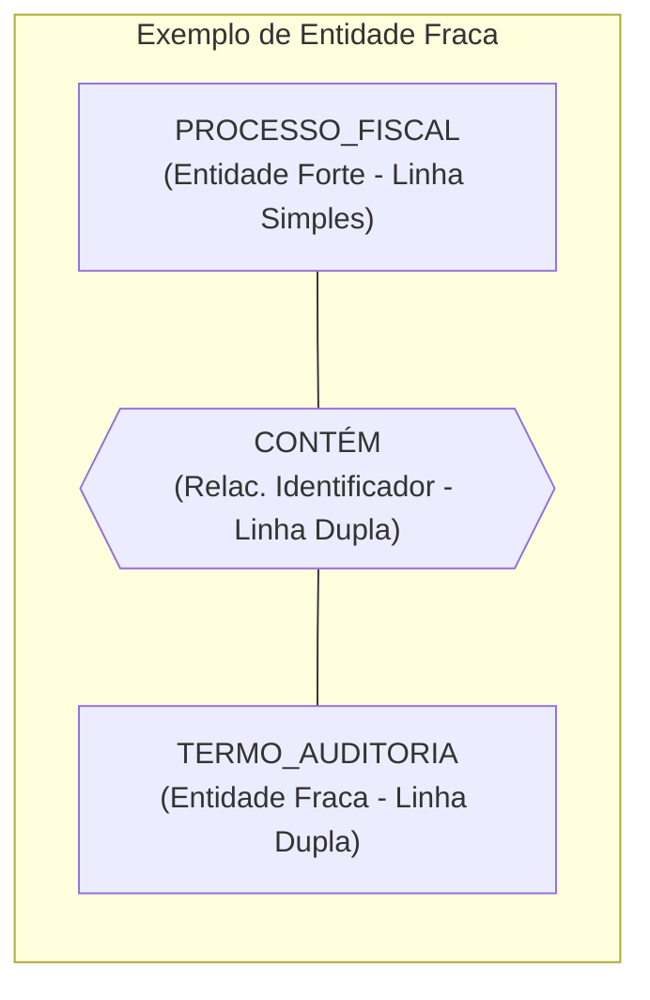
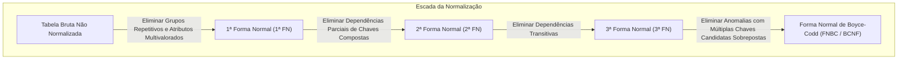
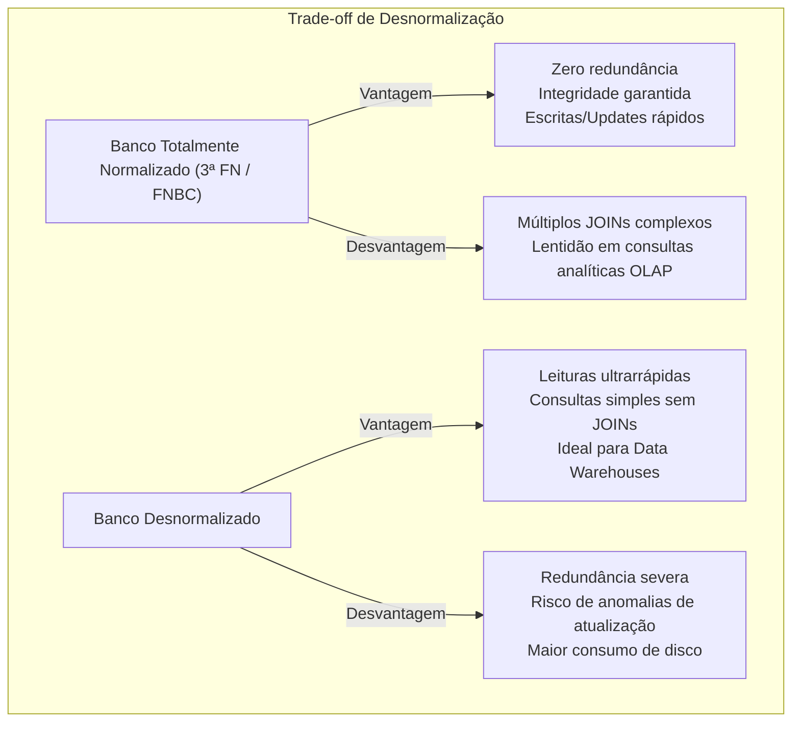

```mermaid
flowchart TD
    subgraph Operacoes_Algebricas["Álgebra Relacional"]
        A["Operações Fundamentais"] --> A1["Seleção: &sigma;_cond(R)<br/>(Filtra Tuplas/Linhas)"]
        A --> A2["Projeção: &pi;_cols(R)<br/>(Filtra Atributos/Colunas)"]
        A --> A3["Produto Cartesiano: R &times; S<br/>(Todas as Combinações)"]
        A --> A4["União: R &cup; S<br/>(Compatibilidade de Esquema)"]
        A --> A5["Diferença: R - S<br/>(Presentes em R, ausentes em S)"]
        A --> A6["Renomeação: &rho;_S(R)<br/>(Muda Rótulos)"]
        B["Operações Derivadas"] --> B1["Junção Natural: R &#x22C8; S"]
        B --> B2["Theta Join: R &#x22C8;_&theta; S"]
        B --> B3["Interseção: R &cap; S = R - (R - S)"]
        B --> B4["Divisão: R &divide; S (Universal)"]
    end
```

# 01 - Modelagem de Dados, MER e Normalização

> **Matéria:** Banco de Dados  
> **Cargo:** B02 – Técnico de Controle Externo – Especialidade: Tecnologia da Informação  
> **Arquivo:** `01_modelagem_de_dados_mer_e_normalizacao.md`  

---

## 📌 Ementa / Itens do Edital
- Modelagem conceitual, lógica e física de dados
- Modelo Entidade-Relacionamento (MER) e Diagrama Entidade-Relacionamento (DER)
- Álgebra Relacional (operações fundamentais e derivadas)
- Dependências funcionais e Formas Normais (1ª FN, 2ª FN, 3ª FN e BCNF)
- Processo de Desnormalização de dados

---

## 🧭 Sumário

1. [As Três Fases do Projeto de Banco de Dados](#1-as-tres-fases-do-projeto-de-banco-de-dados)
    1. [Modelo Conceitual: Semântica e Independência de Tecnologia](#11-modelo-conceitual-semantica-e-independencia-de-tecnologia)
    2. [Modelo Lógico: Dependência do Paradigma Relacional](#12-modelo-logico-dependencia-do-paradigma-relacional)
    3. [Modelo Físico: Implementação e Otimização no SGBD](#13-modelo-fisico-implementacao-e-otimizacao-no-sgbd)
    4. [Tabela Comparativa dos Níveis de Abstração](#14-tabela-comparativa-dos-niveis-de-abstracao)
    5. [Teste 234](#Teste-234)
2. [Modelo Entidade-Relacionamento (MER / DER de Peter Chen)](#2-modelo-entidade-relacionamento-mer-der-de-peter-chen)
    1. [Entidades Fortes (Regulares) vs. Entidades Fracas](#21-entidades-fortes-regulares-vs-entidades-fracas)
    2. [Teste 235](#Teste-235)
    3. [Tipologia e Representação Gráfica dos Atributos](#22-tipologia-e-representacao-grafica-dos-atributos)
    4. [Teste 236](#Teste-236)
    5. [Relacionamentos, Cardinalidade e Participação (Total vs. Parcial)](#23-relacionamentos-cardinalidade-e-participacao-total-vs-parcial)
    6. [Teste 237](#Teste-237)
3. [Álgebra Relacional: Operações Formais e Consultas](#3-algebra-relacional-operacoes-formais-e-consultas)
    1. [As Seis Operações Fundamentais](#as-seis-operacoes-fundamentais)
    2. [Operações Derivadas: Junção Natural, Theta Join, Equijunção, Interseção e Divisão Relacional](#32-operacoes-derivadas-juncao-natural-theta-join-equijuncao-intersecao-e-divisao-relacional)
    3. [Teste 238](#Teste-238)
    4. [Teste 239](#Teste-239)
4. [Teoria da Normalização e Formas Normais (Codd)](#4-teoria-da-normalizacao-e-formas-normais-codd)
    1. [Dependências Funcionais: Total, Parcial e Transitiva](#41-dependencias-funcionais-total-parcial-e-transitiva)
    2. [Teste 240](#Teste-240)
    3. [A Escada da Normalização: 1ª FN, 2ª FN e 3ª FN](#42-a-escada-da-normalizacao-1a-fn-2a-fn-e-3a-fn)
    4. [Teste 241](#Teste-241)
    5. [Forma Normal de Boyce-Codd (FNBC / BCNF) vs. 3ª FN](#43-forma-normal-de-boyce-codd-fnbc-bcnf-vs-3a-fn)
    6. [Teste 242](#Teste-242)
    7. [Teste 243](#Teste-243)
5. [Processo de Desnormalização de Dados](#5-processo-de-desnormalizacao-de-dados)
    1. [Motivações e Trade-offs: OLTP vs. OLAP / Data Warehouses](#51-motivacoes-e-trade-offs-oltp-vs-olap-data-warehouses)
    2. [Técnicas Comuns e Riscos de Integridade](#52-tecnicas-comuns-e-riscos-de-integridade)
    3. [Teste 244](#Teste-244)
6. [Fontes Oficiais e Referências Bibliográficas](#fontes-oficiais-e-referencias-bibliograficas)

---

## 1. As Três Fases do Projeto de Banco de Dados

O projeto e a modelagem de dados para sistemas de gestão pública e auditoria fiscal evoluem ao longo de **três níveis sucessivos de abstração**, garantindo que a semântica das regras de negócio do Estado seja preservada independentemente dos detalhes físicos de armazenamento em disco.

### 1.1 Modelo Conceitual: Semântica e Independência de Tecnologia
- **Escopo e Foco:** É o modelo de mais alto nível de abstração. Captura as entidades do mundo real, seus atributos fundamentais e como elas se relacionam, espelhando fielmente os requisitos do negócio sem qualquer preocupação tecnológica.
- **Independência Absoluta:** É **totalmente independente do software de SGBD** (PostgreSQL, Oracle) e até mesmo do paradigma lógico adotado (Relacional, Documentos, Grafos).
- **Notação Canônica:** O Diagrama Entidade-Relacionamento (DER) clássico de Peter Chen ou modelagens conceituais equivalentes.
- **Restrição Crítica:** O modelo conceitual **NÃO possui chaves estrangeiras (FKs)**, não define índices e não estipula tipos de dados de implementação (como `VARCHAR`, `INTEGER` ou `BLOB`).

### 1.2 Modelo Lógico: Dependência do Paradigma Relacional
- **Escopo e Foco:** Traduz o modelo conceitual para as estruturas do paradigma de banco de dados escolhido (quase universalmente o **Modelo Relacional** de Edgar F. Codd).
- **Mapeamento de Abstrações:** Entidades tornam-se **tabelas (relações)**, atributos tornam-se **colunas (atributos relacionais)**, instâncias tornam-se **tuplas (linhas)** e relacionamentos tornam-se **chaves estrangeiras (Foreign Keys - FK)** ou novas tabelas associativas (no caso de relacionamentos $N:M$).
- **Aplicação da Normalização:** É no modelo lógico que se aplicam formalmente as regras de normalização (1ª FN, 2ª FN, 3ª FN e FNBC) para expurgar anomalias de atualização e redundâncias desnecessárias.
- **Independência de Software:** Permanece independente de um SGBD específico (o mesmo modelo lógico atende ao PostgreSQL, Oracle Database ou SQL Server).

### 1.3 Modelo Físico: Implementação e Otimização no SGBD
- **Escopo e Foco:** Representa a implementação concreta e de mais baixo nível, altamente dependente dos recursos internos, dialeto SQL e mecanismos de armazenamento do SGBD corporativo contratado.
- **Elementos Físicos:** Scripts DDL (`CREATE TABLE`), definição precisa dos tipos de dados de baixo nível (`NUMERIC(15,2)`, `TIMESTAMPTZ`, `VARCHAR2`), definição de métodos de acesso e estruturas de **índices** (`B-Tree`, `Hash`, `GIN`, `GiST`, `BRIN`), estratégias de **particionamento de tabelas** (por lista, alcance ou hash), alocação de **tablespaces** e parâmetros de blocos de disco.
- **Decisões de Engenharia:** Avaliação de desnormalização deliberada para acelerar relatórios de grande porte e definição de restrições de integridade física (*constraints*).

### 1.4 Tabela Comparativa dos Níveis de Abstração

| Dimensão de Comparação | Modelo Conceitual | Modelo Lógico | Modelo Físico |
| :--- | :--- | :--- | :--- |
| **Público-Alvo Principal** | Analistas de negócio, auditores e usuários | Arquitetos de software e Administradores de Dados (DA) | Administradores de Banco de Dados (DBAs) e Engenheiros de Infra |
| **Independência de SGBD** | **Total** (independe de SGBD e de paradigma) | **Independente do SGBD**, dependente do paradigma relacional | **Totalmente dependente** do SGBD específico (PostgreSQL, Oracle) |
| **Estruturas Centrais** | Entidades, Atributos, Relacionamentos, Cardinalidade | Tabelas, Colunas, Chaves Primárias (PK), Chaves Estrangeiras (FK) | DDL SQL, Índices físicos, Tablespaces, Particionamento, Storage |
| **Momento da Normalização** | Não se aplica formalmente (define semântica) | **Etapa central de normalização** (1ª FN até Boyce-Codd) | Otimizações e eventual desnormalização controlada |

> 🚨 **ALERTA DE PROVA / FCC:**  
> A FCC adora cobrar a fronteira entre os modelos:
>
> - O **Modelo Conceitual** NÃO possui chaves estrangeiras nem tipos de dados de sistema operacional.
> - A introdução formal de **chaves estrangeiras (FKs)** ocorre estritamente na transição para o **Modelo Lógico**.
> - Estruturas de aceleração física como **índices B-Tree, particionamento e tablespaces** pertencem com exclusividade ao **Modelo Físico**.

---

### Teste 234
**(FGV - TRT / Analista Judiciário - TI - Fases do Projeto e Níveis de Abstração)**
No ciclo de vida do projeto de bancos de dados relacionais, a modelagem é classicamente particionada em três níveis conceituais progressivos: Modelo Conceitual, Modelo Lógico e Modelo Físico. 

A respeito desses modelos e de suas respectivas características arquiteturais, assinale a afirmativa correta:

* **A)** O modelo físico independe do Sistema Gerenciador de Banco de Dados (SGBD) adotado, concentrando-se na especificação pura das regras de negócio e diagramas de classes sem tipos primitivos.
* **B)** O modelo conceitual possui dependência direta do paradigma de dados escolhido (relacional, hierárquico ou grafos), determinando a alocação de chaves primárias e tipos de dados de armazenamento como `VARCHAR` e `INT`.
* **C)** O modelo lógico é uma representação de alto nível voltada à comunicação com o usuário final de negócio, na qual não constam tabelas, chaves primárias ou chaves estrangeiras.
* **D)** O modelo conceitual captura os requisitos de negócio e a semântica dos dados independentemente de tecnologia ou SGBD; o modelo lógico mapeia essas entidades para o paradigma relacional (tabelas, chaves); e o modelo físico define o armazenamento, estruturas de partição, índices e parâmetros de desempenho específicos do SGBD.
* **E)** A desnormalização é uma decisão estritamente tomada durante o modelo conceitual com o intuito de facilitar a validação dos diagramas pelos gestores de negócio.

---

> **Comentário Detalhado:**
>
> - **A)** Incorreta. O modelo físico é 100% dependente do SGBD específico (Oracle, PostgreSQL, MySQL), definindo scripts DDL, tablespaces, alocação de blocos e tipos nativos de armazenamento.
> - **B)** Incorreta. O modelo conceitual é completamente independente de paradigma de banco de dados e de tecnologia de SGBD.
> - **C)** Incorreta. O modelo lógico já adota o paradigma relacional, definindo rigorosamente tabelas, atributos, chaves primárias (PK), chaves estrangeiras (FK) e normalização.
> - **D)** **CORRETA.** Descreve com exatidão a clássica divisão de três esquemas proposta pela arquitetura ANSI/SPARC: Modelo Conceitual (independente de SGBD e de modelo de dados lógico), Modelo Lógico (dependente do modelo relacional, independente do software SGBD específico) e Modelo Físico (implementação concreta no SGBD).
> - **E)** Incorreta. A desnormalização ocorre nas fases lógica/física para otimização de leitura e desempenho transacional/analítico, jamais no modelo conceitual.
> 
> **Gabarito: D**

---

## 2. Modelo Entidade-Relacionamento (MER / DER de Peter Chen)

Publicado em 1976 por Peter Pin-Shan Chen, o Modelo Entidade-Relacionamento tornou-se a ferramenta semântica universal para representação conceitual de esquemas de dados.

### 2.1 Entidades Fortes (Regulares) vs. Entidades Fracas

- **Entidade Forte (Regular):**
    - Possui existência autônoma e independente no mundo real.
    - Possui ao menos um atributo identificador próprio (chave primária) que distingue univocamente cada uma de suas instâncias.
    - Representação gráfica de Chen: **Retângulo de linha simples**.
- **Entidade Fraca:**
    - Sua existência depende obrigatoriamente da existência de outra entidade (denominada entidade proprietária ou dominante). Se a entidade proprietária for removida, a entidade fraca deixa de fazer sentido.
    - Não possui chave primária completa própria; possui apenas um **discriminador** ou **chave parcial**, que identifica a ocorrência apenas no escopo da sua entidade dominante.
    - Sua identificação plena é formada pela junção: $\text{Chave da Entidade Forte} + \text{Chave Parcial}$.
    - Representação gráfica de Chen: **Retângulo de linha dupla**.
- **Relacionamento Identificador:**
    - É o relacionamento formal que vincula a entidade fraca à sua entidade forte proprietária.
    - Representação gráfica de Chen: **Losango de linha dupla**.

---

### Teste 235
**(FCC - Adaptada / TI - Modelo Entidade-Relacionamento de Peter Chen)**
No contexto do Diagrama Entidade-Relacionamento (DER) segundo a notação original proposta por Peter Chen, analise a seguinte situação de negócio:  
*"Em um órgão de fiscalização fazendária, cada PROCESSO_FISCAL possui um número de processo que o identifica unicamente. Cada processo pode conter múltiplos TERMOS_FISCAIS. Um termo fiscal possui apenas uma numeração sequencial interna (ex.: 1, 2, 3), só faz sentido existir vinculado ao seu respectivo processo fiscal e sua identificação plena depende da chave primária do processo."*

Conforme a teoria canônica do DER, a entidade `TERMO_FISCAL`, a numeração sequencial interna e o relacionamento entre `PROCESSO_FISCAL` e `TERMO_FISCAL` são classificados, respectivamente, como:  

* **A)** Entidade Associativa, Atributo Composto e Auto-relacionamento.
* **B)** Entidade Fraca, Chave Parcial (discriminador) e Relacionamento Identificador.
* **C)** Entidade Regular, Atributo Multivalorado e Relacionamento Não-identificador.
* **D)** Entidade Fraca, Atributo Derivado e Agregação.
* **E)** Superclasse, Atributo Atômico e Relacionamento Ternário.

---

> **Comentário Detalhado:**
>
> - **A)** Incorreta. Entidades associativas resolvem relacionamentos $N:M$ com atributos próprios, e auto-relacionamento ocorre quando uma entidade se relaciona consigo mesma.
> - **B)** Correta. Classificação impecável segundo a teoria de Chen:
>     1. `TERMO_FISCAL` depende existencialmente de `PROCESSO_FISCAL` e não possui chave primária global própria; logo, é uma **Entidade Fraca** (representada por retângulo de linha dupla);
>     2. A numeração sequencial interna (1, 2, 3) identifica o termo apenas dentro de cada processo; logo, é uma **Chave Parcial** ou **Discriminador** (representada por elipse com sublinhado tracejado);
>     3. O relacionamento que conecta a entidade fraca à sua proprietária é um **Relacionamento Identificador** (representado por losango de linha dupla).
>
> - **C)** Incorreta. `TERMO_FISCAL` não é uma entidade regular (forte), pois depende da proprietária para sua identificação plena.
> - **D)** Incorreta. A numeração sequencial não é atributo derivado (calculado dinamicamente).
> - **E)** Incorreta. Conceitos de especialização/generalização e relacionamentos ternários não se aplicam ao cenário.
> 
> **Gabarito: B**

---

### 2.2 Tipologia e Representação Gráfica dos Atributos

No modelo clássico de Chen, os atributos são expressos por elipses conectadas às entidades:

| Tipo de Atributo | Definição Teórica Rigorosa | Representação Gráfica (Chen) | Exemplo Prático |
| :--- | :--- | :--- | :--- |
| **Simples (Atômico)** | Não divisível em partes menores dotadas de significado próprio. | Elipse com linha simples | `CPF`, `Matrícula`, `Idade` |
| **Composto** | Pode ser desmembrado em múltiplos subatributos autônomos. | Elipse ramificada em subelipses | `Endereço` (`Logradouro`, `Número`, `CEP`) |
| **Monovalorado** | Armazena exatamente um valor para cada instância da entidade. | Elipse padrão de linha simples | `Data_Nascimento`, `Data_Emissao` |
| **Multivalorado** | Pode assumir múltiplos valores simultâneos para a mesma entidade. | Elipse com **linha dupla** | `Telefones`, `E-mails`, `CNAEs_Secundarios` |
| **Determinante (Identificador)**| Identifica univocamente a instância da entidade forte. | Elipse com texto **sublinhado contínuo** | `<u>NumContrato</u>`, `<u>IdProcesso</u>` |
| **Discriminador (Chave Parcial)**| Identifica a entidade fraca apenas dentro do escopo da forte. | Elipse com texto **sublinhado tracejado** | `Num_Sequencial_Termo` |
| **Derivado** | Valor calculado dinamicamente a partir de outros atributos persistidos. | Elipse com **borda tracejada/pontilhada** | `Idade` (calculada de `Data_Nasc`) |

### Teste 236
**(FCC - TRT-2 / Analista Judiciário - TI - Tipologia dos Atributos no MER)**
Em alguns casos, dois ou mais valores de atributos em um modelo de Entidade-Relacionamento estão relacionados. Por exemplo, os atributos `Idade` e `Data_Nascimento` de um Auditor de Controle Externo. Para uma entidade `AUDITOR` em particular, o valor de `Idade` pode ser determinado pela data corrente do sistema e pelo valor de `Data_Nascimento` persistido. 

Portanto, segundo a teoria formal do MER concebida por Peter Chen, o atributo `Idade` é denominado atributo [ I ], ao passo que `Data_Nascimento` é denominado atributo [ II ].

As lacunas [ I ] e [ II ] são, correta e respectivamente, preenchidas por:

* **A)** armazenado — derivado.
* **B)** derivado — armazenado (ou básico).
* **C)** multivalorado — monovalorado.
* **D)** identificador — composto.
* **E)** determinante — discriminador.

---

> **Comentário Detalhado:**
>
> - **A)** Incorreta. A ordem está invertida: `Idade` é calculado, logo é derivado, não armazenado.
> - **B)** **CORRETA.** Na notação clássica de Peter Chen:
>   - **Atributo Derivado:** É aquele cujo valor não precisa ser persistido fisicamente na base, pois pode ser computado dinamicamente a partir de outro(s) atributo(s) ou do relógio do sistema. Graficamente é representado por uma elipse de contorno tracejado/pontilhado.
>   - **Atributo Armazenado (ou Base):** É o dado primitivo persistido no disco a partir do qual derivações são calculadas.
> - **C)** Incorreta. Ambos são atributos monovalorados (uma pessoa tem uma única data de nascimento e uma única idade em um dado momento).
> - **D)** Incorreta. Identificador é chave primária; `Idade` não identifica unicamente um servidor.
> - **E)** Incorreta. Determinante e discriminador referem-se a chaves primárias e parciais de entidades fortes e fracas.
> 
> **Gabarito: B**

---

### 2.3 Relacionamentos, Cardinalidade e Participação (Total vs. Parcial)

- **Grau do Relacionamento:** Quantidade de entidades participantes (Binário = 2 entidades; Ternário = 3 entidades; Unário / Auto-relacionamento = a mesma entidade se relaciona consigo mesma, como `FUNCIONARIO gerencia FUNCIONARIO`).
- **Razão de Cardinalidade:** Especifica o número máximo de ocorrências de relacionamento nas quais uma entidade pode participar:
    - $1:1$ (Um para Um);
    - $1:N$ (Um para Muitos);
    - $N:M$ (Muitos para Muitos - na conversão lógica, exige compulsoriamente a criação de uma tabela associativa intermediária).
- **Participação Total (Dependência de Existência):** Toda entidade do conjunto de entidades **obrigatoriamente deve participar** de ao menos uma instância do relacionamento. É representada graficamente por uma **linha dupla** que liga a entidade ao losango. Na notação $(mín, máx)$, expressa-se com $mín \ge 1$.
- **Participação Parcial:** A participação é opcional (algumas instâncias podem não participar do relacionamento). Representada por uma **linha simples**. Na notação $(mín, máx)$, expressa-se com $mín = 0$.

> 🚨 **ALERTA DE PROVA / PEGADINHA FCC:**  
> Cuidado com a notação de cardinalidade:
>
> - Na notação clássica de Chen com cardinalidade nas pontas ($1$ e $N$), o valor representa a cardinalidade máxima permitida.
> - Na notação de pares de limites $(mín, máx)$, se $mín = 0$, a participação é **parcial**; se $mín = 1$, a participação é **total**. Além disso, na notação $(min, max)$, os limites ficam posicionados **adjacentes à entidade que possui aquela restrição**!

---

### Teste 237
**(FCC - TRT-1 / Analista Judiciário - TI - Relacionamentos e Mapeamento N:M)**
No Modelo Entidade-Relacionamento utilizado para projetar bancos de dados relacionais, quando se define que há um conjunto de relacionamentos de cardinalidade muitos para muitos ($N:M$) entre dois conjuntos de entidades $A$ e $B$, essa especificação significa e exige, do ponto de vista conceitual e de conversão lógica, que:

* **A)** uma entidade de $A$ está associada compulsoriamente a exatamente uma entidade de $B$, e cada entidade de $B$ está associada a no máximo duas entidades de $A$.
* **B)** uma entidade do conjunto $A$ pode estar associada a várias instâncias do conjunto $B$, e uma entidade do conjunto $B$ também pode estar associada a várias instâncias de $A$. Na conversão para o modelo relacional lógico, exige a criação de uma tabela associativa intermediária contendo as chaves primárias de $A$ e $B$ como chaves estrangeiras.
* **C)** os conjuntos de entidades $A$ e $B$ devem necessariamente possuir esquemas idênticos com o mesmo número e tipos de atributos primitivos.
* **D)** a chave primária de $A$ deve ser migrada diretamente como atributo simples e chave estrangeira na tabela $B$, tornando dispensável a criação de qualquer nova relação no banco de dados.
* **E)** uma entidade do conjunto $B$ associa-se a apenas uma entidade de $A$, configurando uma dependência existencial que transforma a entidade $B$ em entidade fraca.

---

> **Comentário Detalhado:**
>
> - **A)** Incorreta. A cardinalidade $N:M$ não restringe as associações a números fixos como "exatamente uma" ou "no máximo duas".
> - **B)** **CORRETA.** O relacionamento muitos-para-muitos ($N:M$) define que cada registro em $A$ pode relacionar-se com zero, um ou vários registros em $B$, e vice-versa. Na etapa de conversão lógica para o modelo relacional, um relacionamento $N:M$ não pode ser resolvido com inserção de chave estrangeira simples em nenhuma das tabelas originais sem violar a Primeira Forma Normal (1FN); logo, é mandatória a criação de uma **tabela associativa** (tabela de junção) cuja chave primária é tipicamente composta pelas chaves estrangeiras que referenciam $A$ e $B$.
> - **C)** Incorreta. Entidades relacionadas não precisam compartilhar os mesmos atributos.
> - **D)** Incorreta. A migração direta de FK resolve relacionamentos $1:N$ (migra-se a PK do lado 1 para a tabela do lado $N$), mas é inviável em $N:M$.
> - **E)** Incorreta. A assertiva descreve um relacionamento $1:N$ com dependência de existência, não uma relação $N:M$.
> 
> **Gabarito: B**

---

## 3. Álgebra Relacional: Operações Formais e Consultas

A Álgebra Relacional é uma linguagem de consulta formal procedimental concebida por Edgar F. Codd. Suas operações manipulam uma ou duas relações como entrada e produzem uma nova relação como saída (propriedade de **fechamento da álgebra relacional**).

### 3.1 As Seis Operações Fundamentais

Qualquer consulta relacional teórica pode ser expressa combinando as seis operações primitivas:

1. **Seleção ($\sigma_{\text{condição}}(R)$):** Filtra linhas (tuplas) que satisfazem a um predicado lógico booleano. É um operador unário que atua no eixo **horizontal**. Corresponde à cláusula `WHERE` do SQL.
2. **Projeção ($\pi_{\text{lista\_atributos}}(R)$):** Filtra colunas (atributos) selecionadas, descartando as demais. É um operador unário que atua no eixo **vertical**. **Propriedade Mandatória:** A projeção matemática **elimina compulsoriamente tuplas duplicadas** do resultado final (dado que relações são conjuntos puros). Corresponde a `SELECT DISTINCT` no SQL.
3. **Produto Cartesiano ($R \times S$):** Operador binário que combina cada tupla da relação $R$ com todas as tuplas da relação $S$. Se $R$ possui $n_1$ tuplas e grau $k_1$, e $S$ possui $n_2$ tuplas e grau $k_2$, o produto $R \times S$ terá exatamente $n_1 \cdot n_2$ tuplas e grau $k_1 + k_2$.
4. **União ($R \cup S$):** Combina todas as tuplas de $R$ e $S$. Exige compulsoriamente **compatibilidade de união**: $R$ e $S$ devem ter o mesmo grau (mesmo número de atributos) e os tipos dos atributos correspondentes devem pertencer a domínios compatíveis.
5. **Diferença de Conjuntos ($R - S$):** Retorna as tuplas que existem na relação $R$, mas que **não estão presentes** na relação $S$. Também exige compatibilidade de união.
6. **Renomeação ($\rho_{S}(R)$ ou $\rho_{S(A_1, A_2, \dots)}(R)$):** Altera o nome da relação resultante ou rebatiza seus atributos, permitindo desambiguar colunas em junções recursivas.

### 3.2 Operações Derivadas: Junção Natural, Theta Join, Equijunção, Interseção e Divisão Relacional

São operações construídas a partir da composição das primitivas fundamentais:

- **Theta Join ($R \bowtie_{\theta} S$):** Combina o produto cartesiano com uma condição de seleção: $\sigma_{\theta}(R \times S)$. Se a condição $\theta$ envolver apenas testes de igualdade ($=$), denomina-se **Equijunção**.
- **Junção Natural ($R \bowtie S$):** Executa uma equijunção automática baseada em todos os atributos que compartilham o mesmo nome e tipo em $R$ e $S$, projetando as colunas comuns uma única vez no resultado:
  $$R \bowtie S = \pi_{\text{esquema\_unificado}}(\sigma_{R.A_1 = S.A_1 \land \dots \land R.A_m = S.A_m}(R \times S))$$
- **Interseção ($R \cap S$):** Retorna as tuplas presentes simultaneamente em $R$ e $S$. Derivável pela diferença: $R \cap S = R - (R - S)$.
- **Divisão Relacional ($R \div S$):** Operação fundamental para responder a consultas que envolvem o **quantificador universal "para todos" ($\forall$)** — por exemplo, *"encontrar os auditores que fiscalizaram TODOS os municípios do estado de Goiás"*.
    - Se $R$ possui esquema $(A, B)$ e $S$ possui esquema $(B)$, a divisão $R \div S$ produz uma relação de esquema $(A)$ contendo as tuplas $t$ tais que, para toda tupla $s \in S$, o par ordenado $(t, s)$ existe na relação $R$.

---

### Teste 238
**(FCC - Adaptada / TI - Álgebra Relacional e Divisão Relacional)**
Em sistemas de banco de dados relacionais, deseja-se elaborar uma consulta algébrica formal para responder à seguinte demanda de auditoria:  
*"Recuperar o código de todos os Auditores Fiscais que realizaram inspeções em TODOS os estabelecimentos cadastrados no estado."*

Considere os esquemas das relações:

- `INSPECAO (CodAuditor, CodEstabelecimento)`
- `ESTABELECIMENTO (CodEstabelecimento)`

A operação da Álgebra Relacional que expressa diretamente essa semântica de quantificação universal ("para todos"), sem a necessidade de aninhamentos complexos de operadores de diferença, é a:  

* **A)** Junção Externa Completa (`INSPECAO` $\mathbin{⟗}$ `ESTABELECIMENTO`)
* **B)** Equijunção (`INSPECAO` $\bowtie_{\text{CodEstabelecimento} = \text{CodEstabelecimento}}$ `ESTABELECIMENTO`)
* **C)** Divisão Relacional (`INSPECAO` $\div$ `ESTABELECIMENTO`)
* **D)** Produto Cartesiano (`INSPECAO` $\times$ `ESTABELECIMENTO`)
* **E)** Interseção (`INSPECAO` $\cap$ `ESTABELECIMENTO`)

---

> **Comentário Detalhado:**
>
> - **A)** Incorreta. O Full Outer Join preserva tuplas sem correspondência em ambos os lados preenchendo com nulos, sem filtrar por quantificação universal.
> - **B)** Incorreta. A Equijunção apenas relaciona inspeções a estabelecimentos existentes, retornando auditores que inspecionaram *ao menos um* estabelecimento.
> - **C)** Correta. A **Divisão Relacional ($R \div S$)** é o operador formal da álgebra relacional projetado para expressar o quantificador universal $\forall$ (*"para todos"*). A operação `INSPECAO` $\div$ `ESTABELECIMENTO` retorna unicamente as tuplas de `CodAuditor` que estão combinadas com **todas** as tuplas presentes na relação `ESTABELECIMENTO`.
> - **D)** Incorreta. O Produto Cartesiano gera todas as combinações possíveis entre auditores e estabelecimentos, multiplicando o número de tuplas.
> - **E)** Incorreta. A Interseção exige esquemas compatíveis quanto à união (mesmo número e tipos de atributos), o que não ocorre entre relações com graus diferentes.
> 
> **Gabarito: C**

---

### Teste 239
**(FCC - Adaptada / TI - Álgebra Relacional)**
Na Álgebra Relacional, uma consulta sobre duas relações $R(A, B, C)$ e $S(C, D, E)$ tem por objetivo filtrar as tuplas de $R$ onde o atributo $A = 10$, concatenar com as tuplas correspondentes de $S$ onde $R.C = S.C$, e projetar apenas as colunas $B$ e $D$.

A expressão formal algébrica que representa essa operação com precisão é:  

* **A)** $\pi_{B, D} (\sigma_{A = 10} (R \bowtie S))$
* **B)** $\sigma_{B, D} (\pi_{A = 10} (R \times S))$
* **C)** $\pi_{B, D} (\sigma_{A = 10} (R) \cup \sigma_{A = 10} (S))$
* **D)** $\rho_{B, D} (\sigma_{A = 10} (R - S))$
* **E)** $\pi_{A = 10} (\sigma_{B, D} (R \div S))$

---

> **Comentário Detalhado:**
>
> - **A)** Correta. A junção natural $R \bowtie S$ realiza a equijunção pelo atributo comum $C$ ($R.C = S.C$). Em seguida, a seleção $\sigma_{A=10}$ filtra apenas as tuplas onde $A$ vale $10$. Por fim, a projeção $\pi_{B, D}$ descarta as demais colunas e projeta unicamente os atributos solicitados $B$ e $D$, eliminando eventuais duplicatas.
> - **B)** Incorreta. Inverte a sintaxe dos operadores: $\sigma$ recebe uma condição booleana (e não uma lista de atributos como $B, D$) e $\pi$ recebe atributos.
> - **C)** Incorreta. O operador de união ($\cup$) concatena tuplas verticalmente e exige que as relações sejam compatíveis quanto à união (mesmo grau e domínios equivalentes), o que não ocorre entre $R$ e $S$.
> - **D)** Incorreta. O operador $\rho$ representa a operação de renomeação.
> - **E)** Incorreta. O operador $\div$ expressa a divisão relacional, inadequada para consultas com junção condicional e projeção.
> 
> **Gabarito: A**

---

## 4. Teoria da Normalização e Formas Normais (Codd)

A teoria da normalização, concebida por Edgar F. Codd, consiste em uma técnica formal de análise de esquemas relacionais com base em suas **Dependências Funcionais (DF)** e chaves primárias. Seu objetivo é minimizar a redundância de dados e erradicar as anomalias de inserção, exclusão e alteração.

### 4.1 Dependências Funcionais: Total, Parcial e Transitiva

Dada uma relação $R$, diz-se que o conjunto de atributos $X$ determina funcionalmente o atributo $Y$ ($X \rightarrow Y$) se, e somente se, para quaisquer duas tuplas $t_1, t_2 \in R$, sempre que $t_1[X] = t_2[X]$, obrigatoriamente $t_1[Y] = t_2[Y]$. O lado esquerdo ($X$) é chamado de **determinante** e o direito ($Y$) de **dependente**.

- **Dependência Funcional Total:** Ocorre quando $Y$ depende funcionalmente de $X$ e não depende de nenhum subconjunto próprio de $X$.
- **Dependência Funcional Parcial:** Ocorre quando um atributo não-chave depende de apenas uma parte de uma chave primária composta (isto é, existe $A \subset X$ tal que $A \rightarrow Y$).
- **Dependência Funcional Transitiva:** Ocorre quando $X \rightarrow Y$ e $Y \rightarrow Z$, onde $Y$ não é superchave e $Y \not\rightarrow X$. Consequentemente, $X$ determina $Z$ indiretamente através de $Y$.

### Teste 240
**(FGV - TJ-BA / Analista Judiciário - TI - Dependências Funcionais e Axiomas de Armstrong)**
Considere uma relação $R(A, B, C, D)$ sobre a qual vigora o seguinte conjunto de dependências funcionais primitivas:

$$F = \{ A \rightarrow B, \quad A \rightarrow C, \quad C \rightarrow D \}$$

Com base nos Axiomas de Armstrong (Reflexividade, Aumento e Transitividade) e em suas regras derivadas (União, Decomposição e Pseudotransitividade), assinale a dependência funcional que **NÃO** pode ser derivada logicamente de $F$:

* **A)** $B \rightarrow C$
* **B)** $A \rightarrow D$
* **C)** $A \rightarrow B, C$
* **D)** $A, B, C \rightarrow A, B$
* **E)** $C, B \rightarrow D, B$

---

> **Comentário Detalhado:**
>
> - **A)** **CORRETA (não pode ser derivada).** Para verificar se $B \rightarrow C$ é válida, calculamos o fechamento de atributos de $B$, denotado por $B^+$: como não há nenhuma regra em $F$ com $B$ no lado esquerdo determinante, temos $B^+ = \{B\}$. Como $C \notin B^+$, a dependência $B \rightarrow C$ é **falsa** e não pode ser inferida a partir de $F$.
> - **B)** Incorreta (pode ser derivada). Pela regra da Transitividade: como $A \rightarrow C$ e $C \rightarrow D$, então $A \rightarrow D$ é válida ($A^+ = \{A, B, C, D\}$).
> - **C)** Incorreta (pode ser derivada). Pela regra da União: como $A \rightarrow B$ e $A \rightarrow C$, então $A \rightarrow B, C$ é válida.
> - **D)** Incorreta (pode ser derivada). Pelo Axioma da Reflexividade: como $\{A, B\} \subseteq \{A, B, C\}$, a dependência trivial $A, B, C \rightarrow A, B$ é universalmente verdadeira.
> - **E)** Incorreta (pode ser derivada). Pelo Axioma do Aumento: dada a dependência $C \rightarrow D$, adicionando o atributo $B$ a ambos os lados da implicação, obtém-se $C, B \rightarrow D, B$.
> 
> **Gabarito: A**

---

### 4.2 A Escada da Normalização: 1ª FN, 2ª FN e 3ª FN

1. **Primeira Forma Normal (1ª FN):**
    - **Regra:** Todos os domínios de atributos devem conter **apenas valores atômicos e indivisíveis**. Proíbe-se a presença de atributos multivalorados, atributos compostos e grupos repetitivos (como campos contendo listas separadas por vírgula ou tabelas aninhadas).

2. **Segunda Forma Normal (2ª FN):**
    - **Regra:** A relação deve estar na **1ª FN** e todo atributo não-chave deve depender **totalmente da chave primária**, eliminando qualquer dependência funcional parcial.
    - **Regra de Ouro em Provas:** A violação da 2ª FN só pode ocorrer se a chave primária for **composta** (possuir 2 ou mais atributos). Se a chave primária for simples (apenas 1 atributo), estando na 1ª FN ela estará **automaticamente na 2ª FN**!

3. **Terceira Forma Normal (3ª FN):**
    - **Regra:** A relação deve estar na **2ª FN** e nenhum atributo não-chave pode depender transitivamente da chave primária.
    - **Definição Formal de Codd:** Para toda dependência funcional não-trivial $X \rightarrow A$:
        1. $X$ é uma superchave; **OU**
        2. $A$ é um atributo primo (faz parte de ao menos uma chave candidata).

### Teste 241
**(FGV - TRT / Analista Judiciário - TI - Normalização e Primeira Forma Normal)**
O modelo de dados conceitual de um sistema de gestão de recursos humanos prevê a entidade `FUNCIONARIO`. Para fins de cálculo de benefícios e assistência médica, é necessário cadastrar os dados dos dependentes de cada funcionário (`NomeDependente`, `DataNascDependente`, `Parentesco`), sem limite superior de quantidade.

Para implementar esse modelo em um banco de dados relacional assegurando a conformidade rigorosa com a **Primeira Forma Normal (1FN)**, avalie as seguintes abordagens técnicas:

I. Armazenar no registro do funcionário um atributo estruturado do tipo vetor/array contendo os dados empacotados de todos os dependentes.  
II. Replicar a linha do funcionário na tabela principal tantas vezes quantos forem os dependentes cadastrados, variando apenas os dados do dependente.  
III. Criar uma tabela autônoma `DEPENDENTE` vinculada à tabela `FUNCIONARIO` por meio de uma chave estrangeira (`IdFuncionario`), com chave primária composta por `(IdFuncionario, NumSequencialDependente)`.  

Conforme a teoria da normalização relacional de Codd, está correto apenas o que se afirma em:

* **A)** I.
* **B)** II.
* **C)** III.
* **D)** I e II.
* **E)** II e III.

---

> **Comentário Detalhado:**
>
> - **I.** Incorreta. O uso de vetores, listas ou colunas multivaloradas viola explicitamente o requisito basilar da Primeira Forma Normal (1FN), segundo o qual todos os atributos de uma relação devem possuir domínios puramente **atômicos** (indivisíveis).
> - **II.** Incorreta. Replicar a tupla inteira do funcionário para cada dependente cria redundância massiva, anomalias graves de atualização/exclusão e viola a integridade de entidade caso a chave primária seja apenas o identificador do funcionário.
> - **III.** **CORRETA.** A técnica canônica para resolver atributos multivalorados ou grupos repetitivos e atender à 1FN consiste em decompor a estrutura: cria-se uma tabela separada (`DEPENDENTE`) que herda a chave da entidade principal como chave estrangeira (`FK`), garantindo atomicidade estrita em todas as colunas.
> 
> **Gabarito: C**

---

### 4.3 Forma Normal de Boyce-Codd (FNBC / BCNF) vs. 3ª FN

A **Forma Normal de Boyce-Codd (FNBC)** é uma versão mais estrita da 3ª FN criada por Raymond F. Boyce e Edgar F. Codd para lidar com anomalias sutis que surgem quando uma tabela possui **múltiplas chaves candidatas compostas que se sobrepõem** (compartilham atributos entre si):

- **Regra Inflexível da FNBC:** Uma relação $R$ está na FNBC se, e somente se, para **toda** dependência funcional não-trivial $X \rightarrow A$, **$X$ for obrigatoriamente uma superchave**.
- **Diferença Crucial:** Na FNBC, **elimina-se a condição de escape do atributo primo da 3ª FN**. Mesmo que $A$ faça parte de uma chave candidata, se o determinante $X$ não for superchave, a relação viola a FNBC.
- Toda relação que está na FNBC está automaticamente na 3ª FN. A recíproca não é verdadeira.

---

### Teste 242
**(FCC - Adaptada / TI - Forma Normal de Boyce-Codd vs. 3ª FN)**
Considere uma relação $R(A, B, C)$ com o seguinte conjunto de dependências funcionais:  
$F = \{ (A, B) \rightarrow C, \quad C \rightarrow B \}$  
Sabe-se que as chaves candidatas dessa relação são $(A, B)$ e $(A, C)$.

Com base nas definições formais das Formas Normais, afirma-se corretamente que a relação $R$:  

* **A)** Não está na 1ª FN, pois apresenta dependências funcionais sobrepostas.
* **B)** Está na 2ª FN, mas viola a 3ª FN porque $C$ determina um atributo não-chave.
* **C)** Está na 3ª FN, mas não está na Forma Normal de Boyce-Codd (FNBC).
* **D)** Está na Forma Normal de Boyce-Codd (FNBC), pois todas as dependências funcionais são triviais.
* **E)** Encontra-se na 4ª FN, pois não possui atributos multivalorados dependentes.

---

> **Comentário Detalhado:**
>
> - **A)** Incorreta. A relação está na 1ª FN (domínios atômicos).
> - **B)** Incorreta. A relação não viola a 3ª FN.
> - **C)** Correta. Análise detalhada:
>     1. Chaves candidatas: $(A, B)$ e $(A, C)$. Todos os atributos ($A, B, C$) são atributos primos (pertencem a ao menos uma chave).
>     2. 2ª FN: Como não existem atributos não-primos, a relação está na 2ª FN.
>     3. 3ª FN: Para $(A, B) \rightarrow C$, $(A, B)$ é superchave. Para $C \rightarrow B$, embora $C$ não seja superchave, $B$ é atributo primo. Logo, a relação **atende à 3ª FN**.
>     4. FNBC: A FNBC exige estritamente que, para toda dependência não-trivial $X \rightarrow Y$, o determinante $X$ seja superchave. Na dependência $C \rightarrow B$, o determinante $C$ **não é superchave**. Portanto, a relação **viola a FNBC**.
>
> - **D) Incorreta.** A relação viola expressamente a Forma Normal de Boyce-Codd, pois em  \rightarrow B$ o determinante $ não é superchave.
> - **E) Incorreta.** A 4ª FN examina dependências multivaloradas, mas a relação sequer atinge a conformidade com a FNBC.
> 
> **Gabarito: C**

---

### Teste 243
**(FCC - Adaptada / TI - Teoria da Normalização)**
Considere uma relação não normalizada de um sistema de compras públicas representada pelo esquema:  
`CONTRATO (NumContrato, NumItem, CodFornecedor, NomeFornecedor, DescricaoItem, Quantidade, ValorUnitario)`  
Onde a chave primária composta da relação é `(NumContrato, NumItem)`. Sabe-se ainda que existem as seguintes dependências funcionais:

- `(NumContrato, NumItem) -> Quantidade, ValorUnitario`
- `NumItem -> DescricaoItem`
- `NumContrato -> CodFornecedor, NomeFornecedor`
- `CodFornecedor -> NomeFornecedor`

Para que o esquema atinja estritamente a **Segunda Forma Normal (2ª FN)**, deve-se:  

* **A)** Eliminar os grupos repetitivos e garantir a atomicidade dos campos, mantendo todos os atributos na mesma tabela.
* **B)** Eliminar as dependências funcionais parciais, decompondo a relação de modo que nenhum atributo não-chave dependa de apenas parte da chave primária composta.
* **C)** Eliminar as dependências transitivas, garantindo que o `NomeFornecedor` não dependa de `CodFornecedor`.
* **D)** Converter todas as chaves primárias em chaves substitutas (*surrogate keys*) UUID geradas pelo SGBD.
* **E)** Desnormalizar a relação unificando `Quantidade` e `ValorUnitario` em um atributo multivalorado.

---

> **Comentário Detalhado:**
>
> - **A)** Incorreta. A atomicidade de domínios e a eliminação de grupos repetitivos constituem a regra da **Primeira Forma Normal (1ª FN)**.
> - **B)** Correta. A **Segunda Forma Normal (2ª FN)** exige que a relação esteja na 1ª FN e que todo atributo não-chave dependa *totalmente* da chave primária. Como a chave primária é composta por `(NumContrato, NumItem)`, atributos como `DescricaoItem` (que depende apenas de `NumItem`) e `CodFornecedor` (que depende apenas de `NumContrato`) configuram **dependências funcionais parciais**, devendo ser isolados em tabelas próprias para atingir a 2ª FN.
> - **C)** Incorreta. A eliminação de dependências transitivas (`CodFornecedor -> NomeFornecedor`) é o requisito exclusivo para a **Terceira Forma Normal (3ª FN)**.
> - **D)** Incorreta. A adoção de chaves substitutas (*surrogate keys*) é escolha de modelagem física, sem relação formal com os postulados de Edgar F. Codd.
> - **E)** Incorreta. Introduzir atributos multivalorados violaria a 1ª FN, degradando o esquema para o estado não normalizado.
> 
> **Gabarito: B**

---

## 5. Processo de Desnormalização de Dados

A **desnormalização** consiste na introdução deliberada, planejada e controlada de redundância em um esquema de banco de dados físico previamente normalizado.

### 5.1 Motivações e Trade-offs: OLTP vs. OLAP / Data Warehouses

- **Sistemas Transacionais (OLTP - Online Transaction Processing):** Exigem alta normalização (3ª FN / FNBC) para garantir escrita rápida, bloqueio granular de linhas e integridade referencial sem risco de anomalias.
- **Sistemas Analíticos (OLAP - Online Analytical Processing / Data Warehouses):** Priorizam o desempenho em **leitura massiva** e agregação de dados. Em esquemas como o *Star Schema* (Esquema em Estrela), desnormalizam-se as tabelas de dimensões para eliminar junções caras (`JOINs`) de centenas de milhões de linhas.

### 5.2 Técnicas Comuns e Riscos de Integridade

- **Técnicas de Desnormalização:**
    1. *Junção Pré-calculada:* Mesclar duas tabelas $1:N$ em uma única tabela para evitar consultas com `JOIN`.
    2. *Campos Totalizadores / Derivados Persistidos:* Adicionar uma coluna `ValorTotalNota` na tabela mestre para evitar calcular `SUM()` de itens a cada requisição.
    3. *Replicação de Colunas de Consulta Frequente:* Armazenar o `NomeFornecedor` diretamente na tabela de `Empenho`.

- **Riscos e Trade-offs:**
    - Redundância severa e aumento do consumo de armazenamento em disco;
    - **Risco Crítico de Inconsistência:** Atualizar o nome do fornecedor exige atualizar milhões de registros duplicados; se uma atualização falhar pela metade, o banco de dados entra em estado inconsistente.

---

### Teste 244
**(FGV - TJ-AP / Analista Judiciário - Banco de Dados - Desnormalização e Trade-offs OLTP vs. OLAP)**
No projeto de bancos de dados analíticos (Data Warehouses) e repositórios de dados para auditoria contínua, analistas de TI frequentemente ponderam entre o esquema puramente em estrela (*Star Schema*) e o esquema em flocos de neve (*Snowflake Schema*).

A respeito da técnica de modelagem multidimensional e de seus impactos arquiteturais sobre o desempenho das consultas analíticas, assinale a afirmativa correta:

* **A)** A normalização das tabelas de dimensão (esquema Snowflake) elimina redundâncias, mas impacta negativamente o tempo de resposta das consultas analíticas (OLAP) ao exigir uma maior quantidade de junções (*joins*) entre tabelas normalizadas.
* **B)** O esquema Star Schema é totalmente normalizado até a Boyce-Codd Normal Form (BCNF), o que minimiza o espaço de armazenamento consumido em disco e maximiza a quantidade de tabelas no data warehouse.
* **C)** A técnica de desnormalização é fortemente recomendada em sistemas puramente transacionais (OLTP) de alta concorrência para acelerar as operações concorrentes de `INSERT` e `UPDATE`.
* **D)** A criação de chaves substitutas (*surrogate keys*) nas tabelas dimensionais prejudica a governança e inviabiliza o rastreamento histórico de dimensões de alteração lenta (SCD).
* **E)** O Snowflake Schema é o padrão adotado em todos os data marts por dispensar completamente o uso de índices e por apresentar desempenho de leitura invariavelmente superior ao Star Schema.

---

> **Comentário Detalhado:**
>
> - **A)** **CORRETA.** O modelo *Snowflake* decompõe as tabelas de dimensão em múltiplas sub-tabelas normalizadas (ex.: normalizar `Cidade` e `Estado` para fora da dimensão `Cliente`). Embora reduza o consumo de armazenamento ao eliminar dados duplicados, ele degrada significativamente o desempenho de consultas OLAP complexas porque força o motor SQL a executar múltiplos *joins* pesados para reconstituir o contexto da dimensão. Já o *Star Schema* adota dimensões propositalmente desnormalizadas, favorecendo consultas simples e varreduras extremamente rápidas.
> - **B)** Incorreta. O *Star Schema* é intencionalmente **desnormalizado** em suas dimensões; quem busca normalização dimensional é o modelo Snowflake.
> - **C)** Incorreta. Em sistemas OLTP, a desnormalização introduz redundância de dados que encarece e desacelera operações de escrita (`INSERT`, `UPDATE`), além de gerar riscos de inconsistência transacional.
> - **D)** Incorreta. As chaves substitutas (*surrogate keys*) são essenciais justamente para permitir o gerenciamento de dimensões que mudam lentamente (Slowly Changing Dimensions - SCD Tipos 2 e 3).
> - **E)** Incorreta. O *Star Schema* é a estrutura dimensional predominante e recomendada por Ralph Kimball para data marts justamente por sua simplicidade e superior performance em leitura.
> 
> **Gabarito: A**

---

## 🌐 Fontes Oficiais e Referências Bibliográficas

* [PostgreSQL 17 Official Documentation - Data Definition (DDL)](https://www.postgresql.org/docs/current/ddl.html) - Criação de tabelas, restrições de integridade (PRIMARY KEY, FOREIGN KEY, CHECK, UNIQUE) e domínios.
* [PostgreSQL 17 Official Documentation - Queries and Joins](https://www.postgresql.org/docs/current/queries.html) - Consultas relacionais, junções internas e externas, agregações e subconsultas.
* [Oracle Database 19c Documentation - Relational Concepts](https://docs.oracle.com/en/database/oracle/oracle-database/19/cncpt/transactions.html) - Fundamentos do modelo relacional, integridade referencial e álgebra relacional aplicada.
* [MongoDB Official Documentation - Data Modeling Introduction](https://www.mongodb.com/docs/manual/core/data-modeling-introduction/) - Modelagem orientada a documentos, contraste com modelo relacional e desnormalização controlada.
* ELMASRI, Ramez; NAVATHE, Shamkant B. **Sistemas de Banco de Dados**. 7. ed. São Paulo: Pearson, 2019. (Cap. 3 - Modelo Entidade-Relacionamento; Cap. 14 - Formas Normais e Dependências Funcionais).
* SILBERSCHATZ, Abraham; KORTH, Henry F.; SUDARSHAN, S. **Sistema de Banco de Dados**. 7. ed. Rio de Janeiro: GEN LTC, 2020. (Cap. 2 - Modelo Relacional; Cap. 6 - Projeto de Banco de Dados e Teoria da Normalização).
* HEUSER, Carlos Alberto. **Projeto de Banco de Dados**. 6. ed. Porto Alegre: Bookman, 2009. (Cap. 2 - Modelo Conceitual DER; Cap. 5 - Normalização de Dados).
