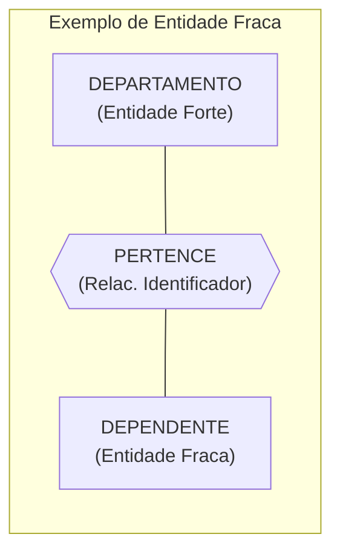
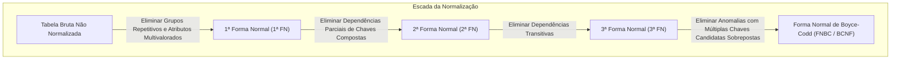
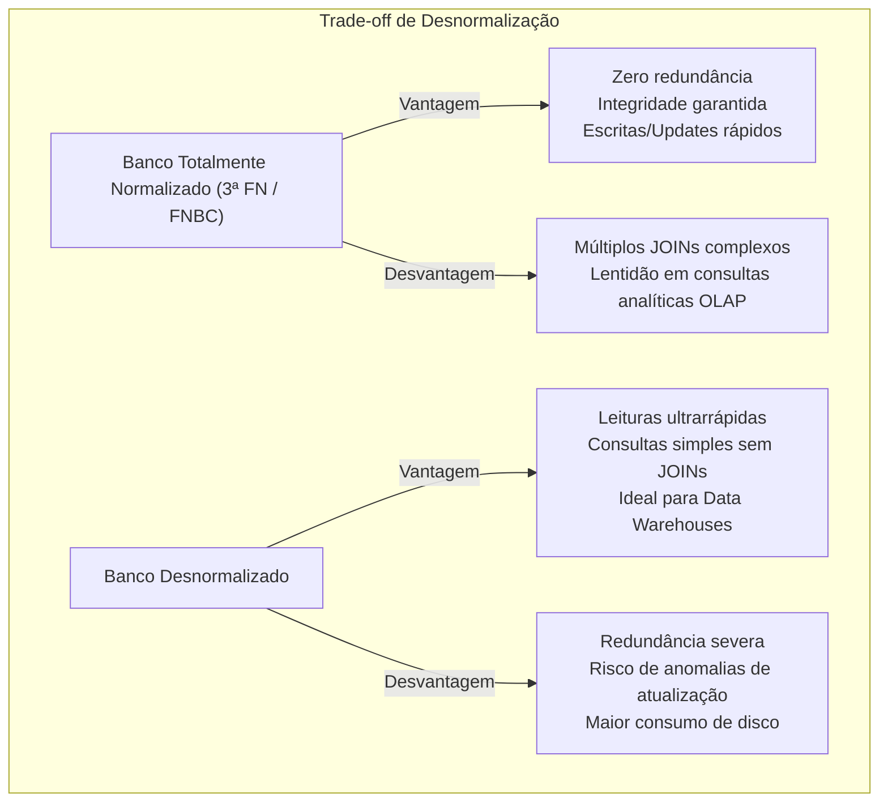

# 01 - Modelagem de Dados, MER e Normalização

> **Matéria:** Banco de Dados  
> **Cargo:** B02 – Técnico de Controle Externo – Especialidade: Tecnologia da Informação  
> **Arquivo:** `01_modelagem_de_dados_mer_e_normalizacao.md`  

---

## 📌 Ementa / Itens do Edital
- Modelagem conceitual, lógica e física de dados
- Modelo Entidade-Relacionamento (MER) e Diagrama Entidade-Relacionamento (DER)
- Álgebra Relacional (operações fundamentais e derivadas)
- Dependências funcionais e Formas Normais (1ª FN, 2ª FN, 3ª FN e BCNF)
- Processo de Desnormalização de dados

---

## 🌳 Classificação Hierárquica

```text
1. Modelagem Relacional, Álgebra Relacional e Teoria da Normalização
├── 1.1 Fases do Projeto de Banco de Dados
│   ├── 1.1.1 Modelo Conceitual: Independente de SGBD e tecnologia (visão do negócio, entidades e regras)
│   ├── 1.1.2 Modelo Lógico: Dependente do paradigma (Relacional: tabelas, colunas, chaves primárias e estrangeiras)
│   └── 1.1.3 Modelo Físico: Dependente do SGBD específico (PostgreSQL, Oracle: tipos de dados de baixo nível, índices, particionamento e tablespaces)
├── 1.2 Modelo Entidade-Relacionamento (MER / DER de Peter Chen)
│   ├── 1.2.1 Entidades: Entidades Fortes (regulares) vs. Entidades Fracas (dependência existencial e de identificação)
│   ├── 1.2.2 Atributos: Simples vs. Compostos, Monovalorados vs. Multivalorados, Determinantes (Chave) e Derivados
│   ├── 1.2.3 Relacionamentos e Cardinalidade:
│   │   ├── Grau do relacionamento (Binário, Ternário, Auto-relacionamento / recursivo)
│   │   └── Razões de Cardinalidade: 1:1, 1:N, N:M
│   └── 1.2.4 Participação: Total (obrigatória - linha dupla) vs. Parcial (opcional - linha simples)
├── 1.3 Álgebra Relacional (Operações Formais)
│   ├── 1.3.1 Operações Fundamentais:
│   │   ├── Seleção (sigma_condição(R)): Filtra tuplas/linhas que atendem a um predicado
│   │   ├── Projeção (pi_atributos(R)): Filtra colunas/atributos eliminando duplicatas
│   │   ├── Produto Cartesiano (R x S): Combina todas as tuplas de R com todas as tuplas de S
│   │   ├── União (R U S): Combina tuplas de relações compatíveis quanto à união
│   │   ├── Diferença (R - S): Tuplas presentes em R mas ausentes em S
│   │   └── Renomeação (rho_S(R)): Altera o nome da relação ou de seus atributos
│   └── 1.3.2 Operações Derivadas:
│       ├── Junção Natural (R |><| S): Junção baseada em atributos com o mesmo nome e tipo
│       ├── Junção Condicional / Theta Join (R |><|_theta S) e Equijunção
│       ├── Junção Externa: Left, Right e Full Outer Join
│       ├── Interseção (R intersect S = R - (R - S))
│       └── Divisão Relacional (R / S): Identifica elementos associados a todos os elementos de outra relação
├── 1.4 Teoria da Normalização e Formas Normais (Codd)
│   ├── 1.4.1 Dependência Funcional (X -> Y): O valor de X determina univocamente o valor de Y
│   │   ├── Dependência Funcional Total vs. Parcial
│   │   └── Dependência Funcional Transitiva (X -> Y e Y -> Z => X -> Z)
│   ├── 1.4.2 Primeira Forma Normal (1ª FN):
│   │   └── Regra: Todos os atributos devem ser atômicos (indivisíveis) e monovalorados; proibição de grupos repetitivos e arrays
│   ├── 1.4.3 Segunda Forma Normal (2ª FN):
│   │   └── Regra: Estar na 1ª FN e todo atributo não-chave depender funcionalmente e TOTALMENTE da chave primária (elimina dependências parciais; relevante apenas para chaves compostas)
│   ├── 1.4.4 Terceira Forma Normal (3ª FN):
│   │   └── Regra: Estar na 2ª FN e nenhum atributo não-chave depender de outro atributo não-chave (elimina dependências transitivas)
│   └── 1.4.5 Forma Normal de Boyce-Codd (FNBC / BCNF):
│       └── Regra: Para toda dependência não trivial X -> Y, X deve ser uma superchave candidata
└── 1.5 Processo de Desnormalização
    ├── 1.5.1 Motivação: Otimização do desempenho de leitura em sistemas analíticos (OLAP / Data Warehouses)
    ├── 1.5.2 Técnicas Comuns: Junção pré-calculada de tabelas, introdução de atributos derivados/acumulados e replicação de colunas
    └── 1.5.3 Trade-offs e Riscos: Redundância de dados, anomalias de atualização (inconsistência potencial) e maior consumo de armazenamento
```

---

## 📖 Teoria Aprofundada & Conceitos Essenciais

### 1. As Três Fases do Projeto de Banco de Dados

O projeto de banco de dados evolui por três níveis sucessivos de abstração, garantindo a separação entre a semântica do negócio e as restrições físicas de armazenamento:


#### Tabela Comparativa dos Níveis de Abstração

| Dimensão | Modelo Conceitual | Modelo Lógico | Modelo Físico |
|---|---|---|---|
| **Público-alvo** | Analistas de negócio e usuários finais | Desenvolvedores e Administradores de Dados (DA) | Administradores de Banco de Dados (DBA) |
| **Independência de Software** | Independente de SGBD e de modelo de dados | Independente do software de SGBD, dependente do modelo (ex.: Relacional) | Totalmente dependente do SGBD (PostgreSQL, Oracle, SQL Server) |
| **Construções Principais** | Entidades, Relacionamentos, Atributos, Cardinalidades (min, max) | Tabelas, Colunas, Tipos de Dados abstratos, Chaves Primárias (PK), Chaves Estrangeiras (FK) | DDL (`CREATE TABLE`), Índices (`B-Tree`, `BRIN`), Tablespaces, Particionamento, Alocação de Blocos de Disco |
| **Normalização** | Não se aplica formalmente (define regras semânticas) | Fase primordial de aplicação das Formas Normais (1ª FN a FNBC) | Otimização física; eventual desnormalização intencional |

> ⭐ **IMPORTANTE / REGRA DE OURO:**  
> A FCC adora cobrar a distinção:  
> - **Modelo Conceitual:** NÃO contém chaves estrangeiras nem tipos de dados de implementação (como `VARCHAR2` ou `INT`).  
> - **Modelo Lógico:** Introduz o conceito de chave estrangeira (FK) decorrente do mapeamento dos relacionamentos conceituais.  
> - **Modelo Físico:** Define o método de acesso, parâmetros de armazenamento em disco e sintaxe específica do dialeto do SGBD.

---

### 2. Modelo Entidade-Relacionamento (MER / DER de Peter Chen)

Proposto por Peter Chen em 1976, o MER é a base da modelagem conceitual.

#### 2.1 Entidades e Classificação
- **Entidade Forte (Regular):** Possui existência independente de outras entidades e possui seu próprio atributo identificador (chave primária). Representada por um **retângulo de linha simples**.
- **Entidade Fraca:** Sua existência depende de outra entidade (entidade dominante/proprietária). Não possui chave primária própria completa; possui apenas uma **chave parcial** (discriminador). Representada por um **retângulo de linha dupla**.
- **Relacionamento Identificador:** Conecta a entidade fraca à sua proprietária, representado por um **losango de linha dupla**.



#### 2.2 Classificação Rigorosa dos Atributos

| Tipo de Atributo | Definição Teórica | Representação Gráfica (Chen) | Exemplo Prático |
|---|---|---|---|
| **Simples (Atômico)** | Não divisível em subcomponentes com significado autônomo | Elipse com linha simples | `CPF`, `Idade`, `Matrícula` |
| **Composto** | Pode ser subdividido em componentes independentes menores | Elipse ramificada em subelipses | `Endereço` (composto por: `Logradouro`, `Número`, `Bairro`, `CEP`) |
| **Monovalorado** | Possui um único valor para cada ocorrência da entidade | Elipse padrão | `Data_Nascimento` |
| **Multivalorado** | Pode conter múltiplos valores simultâneos para a mesma entidade | Elipse com **linha dupla** | `Telefones`, `E-mails`, `Idiomas` |
| **Determinante (Identificador)** | Identifica univocamente a instância da entidade | Elipse com o texto **sublinhado** | `<u>NumContrato</u>` |
| **Discriminador (Chave Parcial)** | Identifica uma entidade fraca no escopo de uma entidade forte | Elipse com texto sublinhado por linha **tracejada** | `Num_Sequencial_Dependente` |
| **Derivado** | Valor calculado dinamicamente a partir de outros atributos persistidos | Elipse com **linha tracejada** | `Idade` (calculada de `Data_Nasc`), `Tempo_Serviço` |

#### 2.3 Cardinalidade e Participação
- **Razão de Cardinalidade:** Representa o número máximo de instâncias de relacionamento ($1:1$, $1:N$, $N:M$).
- **Participação Total (Dependência de Existência):** Toda entidade do conjunto DEVE participar do relacionamento. Graficamente representada por uma **linha dupla** conectando a entidade ao losango.
- **Participação Parcial:** A participação é opcional. Graficamente representada por uma **linha simples**.

> 🚨 **ALERTA DE PROVA / PEGADINHA FCC:**  
> A FCC frequentemente confunde o candidato com a **Notação Min-Max**:  
> No par $(mín, máx)$, se o $mín = 0$, a participação é **parcial**; se o $mín = 1$, a participação é **total**. Na notação estrutural de Chen clássica, a cardinalidade máxima é anotada no lado oposto ou na ponta da relação, enquanto na notação $(min, max)$ ela fica adjacente à entidade que possui aquela restrição!

---

### 3. Álgebra Relacional: Operações Formais

A Álgebra Relacional é uma linguagem de consulta formal procedural que fundamenta a teoria relacional de Edgar F. Codd. Suas operações recebem uma ou duas relações e produzem uma nova relação como resultado.

#### 3.1 Operações Fundamentais

```mermaid
flowchart TD
    subgraph Operacoes_Algebricas["Álgebra Relacional"]
        A["Operações Fundamentais"] --> A1["Seleção: &sigma;_cond(R)<br/>(Filtra Tuplas/Linhas)"]
        A --> A2["Projeção: &pi;_cols(R)<br/>(Filtra Atributos/Colunas)"]
        A --> A3["Produto Cartesiano: R &times; S<br/>(Todas as Combinações)"]
        A --> A4["União: R &cup; S<br/>(Compatibilidade de Esquema)"]
        A --> A5["Diferença: R - S<br/>(Presentes em R, ausentes em S)"]
        A --> A6["Renomeação: &rho;_S(R)<br/>(Muda Rótulos)"]
        B["Operações Derivadas"] --> B1["Junção Natural: R &#x22C8; S"]
        B --> B2["Theta Join: R &#x22C8;_&theta; S"]
        B --> B3["Interseção: R &cap; S = R - (R - S)"]
        B --> B4["Divisão: R &divide; S (Universal)"]
    end
```



1. **Seleção ($\sigma_{\text{condição}}(R)$):** Filtra linhas (tuplas) com base em um predicado booleano. Opera horizontalmente. Equivalente à cláusula `WHERE` do SQL.
2. **Projeção ($\pi_{\text{atributos}}(R)$):** Filtra colunas (atributos) especificadas e **obrigatoriamente elimina tuplas duplicadas** do resultado (pois relações matemáticas são conjuntos puros). Opera verticalmente. Equivalente a `SELECT DISTINCT colunas` do SQL.
3. **Produto Cartesiano ($R \times S$):** Combina cada tupla de $R$ com todas as tuplas de $S$. Se $R$ tem $n_1$ tuplas e grau $k_1$, e $S$ tem $n_2$ tuplas e grau $k_2$, o resultado terá $n_1 \cdot n_2$ tuplas e grau $k_1 + k_2$.
4. **União ($R \cup S$):** Agrupa tuplas de duas relações compatíveis (mesmo número de atributos e tipos de dados de domínio equivalentes).
5. **Diferença de Conjuntos ($R - S$):** Retorna as tuplas existentes em $R$ que não constam em $S$. Também exige compatibilidade quanto à união.
6. **Renomeação ($\rho_{S}(R)$ ou $\rho_{S(B_1, B_2, \dots)}(R)$):** Permite nomear relações intermediárias ou alterar nomes de atributos.

#### 3.2 Operações Derivadas de Destaque em Concursos

- **Junção Natural ($R \bowtie S$):** Combina tuplas de $R$ e $S$ que possuem valores iguais para todos os atributos comuns aos dois esquemas, projetando o atributo comum uma única vez.  
  Matematicamente: $R \bowtie S = \pi_{\text{atributos\_únicos}}(\sigma_{R.A_1 = S.A_1 \land \dots \land R.A_m = S.A_m}(R \times S))$.
- **Theta-Join ($R \bowtie_{\theta} S$):** Produto cartesiano seguido de uma seleção baseada em uma condição $\theta$ qualquer: $\sigma_{\theta}(R \times S)$. Se $\theta$ utilizar exclusivamente comparações de igualdade ($=$), denomina-se **Equijunção**.
- **Interseção ($R \cap S$):** Tuplas que aparecem simultaneamente em $R$ e em $S$. Derivável por: $R \cap S = R - (R - S)$.
- **Divisão Relacional ($R \div S$):** Aplica-se quando se busca entidades associadas a **todos** os elementos de um conjunto de referência (consultas do tipo *"quais fiscais auditaram todos os municípios do Estado?"*). Se $R$ possui esquema $(A, B)$ e $S$ possui esquema $(B)$, então $R \div S$ retorna uma relação com esquema $(A)$ contendo as tuplas $t$ tais que para toda tupla $s \in S$, o par $(t[A], s[B]) \in R$.

---

### 4. Teoria da Normalização e Formas Normais

A teoria da normalização, introduzida por Edgar F. Codd, busca eliminar anomalias de atualização, redundâncias indesejadas e inconsistências lógicas em esquemas relacionais através do conceito formal de **Dependência Funcional (DF)**.

#### 4.1 Dependência Funcional ($X \rightarrow Y$)
Dado um esquema de relação $R$, diz-se que o conjunto de atributos $X$ determina funcionalmente o conjunto $Y$ ($X \rightarrow Y$) se, para quaisquer duas tuplas $t_1, t_2 \in R$, sempre que $t_1[X] = t_2[X]$, obrigatoriamente $t_1[Y] = t_2[Y]$.

- **Dependência Funcional Total:** $Y$ depende funcionalmente de $X$, e não depende de nenhum subconjunto próprio de $X$.
- **Dependência Funcional Parcial:** Ocorre quando $Y$ depende de apenas uma parte de uma chave primária composta $X$ (isto é, existe $A \subset X$ tal que $A \rightarrow Y$).
- **Dependência Funcional Transitiva:** Ocorre quando $X \rightarrow Y$, $Y \rightarrow Z$, onde $Y$ não é superchave e $Y \not\rightarrow X$, implicando que $X$ determina $Z$ indiretamente por meio de $Y$.



#### 4.2 Quadro Comparativo das Formas Normais

| Forma Normal | Requisito Precedente | Regra Mandatória | Anomalia Combatida | Condição de Avaliação Imediata |
|---|---|---|---|---|
| **1ª FN** | Nenhuma | Todos os domínios de atributos devem ser atômicos; proíbem-se atributos multivalorados, compostos e grupos repetitivos. | Tabelas aninhadas, vetores/arrays como colunas | Linhas com colunas contendo listas separadas por vírgula violam a 1ª FN |
| **2ª FN** | Estar na 1ª FN | Todo atributo não-chave deve depender funcionalmente e **totalmente** da chave primária (ausência de DF parcial). | Redundância por repetição de dados de apenas parte da entidade | **Se a chave primária for SIMPLES (1 coluna), estando na 1ª FN ela já está AUTOMATICAMENTE na 2ª FN!** |
| **3ª FN** | Estar na 2ª FN | Nenhum atributo não-chave pode depender transitivamente da chave primária. Formalmente, para toda DF $X \rightarrow A$, ou $X$ é superchave, ou $A$ é atributo primo (pertence a uma chave candidata). | Inconsistência ao atualizar atributos indiretos | Colunas não-chave que calculam ou dependem de outras colunas não-chave (ex.: `CodUF -> NomeUF`) violam a 3ª FN |
| **FNBC** | Estar na 3ª FN | Para toda dependência funcional não-trivial $X \rightarrow A$, **$X$ deve ser obrigatoriamente uma superchave**. | Anomalias quando existem múltiplas chaves candidatas compostas que se sobrepõem | É mais estrita que a 3ª FN; não admite exceção nem mesmo se $A$ for atributo primo |

> 🚨 **ALERTA DE PROVA / PEGADINHA FCC:**  
> A FCC adora cobrar: *"Uma relação com chave primária simples pode violar a 2ª FN?"*  
> **NÃO!** Para haver dependência parcial, a chave primária DEVE ser composta (possuir 2 ou mais atributos). Com chave simples, qualquer dependência em relação à chave é obrigatoriamente total.

---

### 5. Desnormalização: Trade-offs e Aplicação Prática

A desnormalização consiste na introdução deliberada e controlada de redundância em um esquema físico de banco de dados previamente normalizado.



#### Cenários Comuns de Aplicação:
1. **Sistemas de Apoio à Decisão (OLAP / Data Warehouse):** Esquemas em estrela (*Star Schema*) e floco de neve (*Snowflake Schema*).
2. **Campos Totalizadores Pré-calculados:** Armazenamento do `ValorTotalNota` na tabela mestre para evitar execução contínua de `SUM(item.valor)` sobre milhões de registros.
3. **Replicação de Descrições Frequentes:** Armazenamento de `NomeCliente` diretamente na tabela de `Fatura` para evitar junções na geração massiva de relatórios.

---

## 🌐 Fontes Recomendadas na Internet

### 1. Materiais Acadêmicos Canônicos e Notas de Aula
- [Stanford University CS145 - Relational Algebra & Query Processing](https://web.stanford.edu/class/cs145/): Notas de aula abertas de Stanford detalhando as operações formais da Álgebra Relacional ($\sigma, \pi, \times, \bowtie, \cup, -, \rho$), equivalências lógicas e otimização de expressões relacionais.
- [Fundamentos de Bancos de Dados - Notas de Aula USP (ICMC)](https://www.icmc.usp.br/): Materiais acadêmicos didáticos cobrindo o Modelo Entidade-Relacionamento (Peter Chen), mapeamento conceitual-lógico e decomposição sem perdas.
- [GeeksforGeeks - Normal Forms in DBMS (1NF to BCNF)](https://www.geeksforgeeks.org/normal-forms-in-dbms/): Guia prático e ilustrado com exemplos passo a passo sobre identificação de dependências funcionais parciais e transitivas.

---

## 📝 Questões Comentadas & Exemplos (Padrão FCC)

### Questão 1 (FCC - Adaptada / TI - Teoria da Normalização)
Considere uma relação não normalizada de um sistema de compras públicas representada pelo esquema:
`CONTRATO (NumContrato, NumItem, CodFornecedor, NomeFornecedor, DescricaoItem, Quantidade, ValorUnitario)`
Onde a chave primária composta da relação é `(NumContrato, NumItem)`. Sabe-se ainda que existem as seguintes dependências funcionais:
- `(NumContrato, NumItem) -> Quantidade, ValorUnitario`
- `NumItem -> DescricaoItem`
- `NumContrato -> CodFornecedor, NomeFornecedor`
- `CodFornecedor -> NomeFornecedor`

Para que o esquema atinja estritamente a **Segunda Forma Normal (2ª FN)**, deve-se:
A) Eliminar os grupos repetitivos e garantir a atomicidade dos campos, mantendo todos os atributos na mesma tabela.  
B) Eliminar as dependências funcionais parciais, decompondo a relação de modo que nenhum atributo não-chave dependa de apenas parte da chave primária composta.  
C) Eliminar as dependências transitivas, garantindo que o `NomeFornecedor` não dependa de `CodFornecedor`.  
D) Converter todas as chaves primárias em chaves substitutas (*surrogate keys*) UUID geradas pelo SGBD.  
E) Desnormalizar a relação unificando `Quantidade` e `ValorUnitario` em um atributo multivalorado.

> **Gabarito: B**  
> **Comentário Analítico Passo a Passo:**  
> - **A está INCORRETA:** A eliminação de grupos repetitivos e a garantia da atomicidade dos domínios é a regra fundamental da **Primeira Forma Normal (1ª FN)**, e não da 2ª FN.  
> - **B está CORRETA:** A definição matemática da **Segunda Forma Normal (2ª FN)** exige que a relação esteja na 1ª FN e que todo atributo não-chave dependa *funcionalmente e totalmente* da chave primária candidata. No esquema original, a chave primária é composta por `(NumContrato, NumItem)`. No entanto, `DescricaoItem` depende apenas de `NumItem` (metade da chave), e `CodFornecedor` depende apenas de `NumContrato` (outra metade da chave). Essas são dependências parciais clássicas. A decomposição necessária para colocar a relação na 2ª FN exige isolar essas dependências parciais em relações próprias.  
> - **C está INCORRETA:** A eliminação de dependências transitivas entre atributos não-chave (`CodFornecedor -> NomeFornecedor`) é o requisito específico para atingir a **Terceira Forma Normal (3ª FN)**.  
> - **D está INCORRETA:** A criação de chaves substitutas (*surrogate keys*) é uma decisão de modelagem física/lógica e não tem correlação com a definição formal matemática das formas normais de Edgar F. Codd.  
> - **E está INCORRETA:** A introdução de atributos multivalorados rebaixaria a tabela para um estado não normalizado (violando a 1ª FN), contrariando frontalmente os princípios de normalização.

---

### Questão 2 (FCC - Adaptada / TI - Álgebra Relacional)
Na Álgebra Relacional, uma consulta sobre duas relações $R(A, B, C)$ e $S(C, D, E)$ tem por objetivo filtrar as tuplas de $R$ onde o atributo $A = 10$, concatenar com as tuplas correspondentes de $S$ onde $R.C = S.C$, e projetar apenas as colunas $B$ e $D$.

A expressão formal algébrica que representa essa operação com precisão é:
A) $\pi_{B, D} (\sigma_{A = 10} (R \bowtie S))$  
B) $\sigma_{B, D} (\pi_{A = 10} (R \times S))$  
C) $\pi_{B, D} (\sigma_{A = 10} (R) \cup \sigma_{A = 10} (S))$  
D) $\rho_{B, D} (\sigma_{A = 10} (R - S))$  
E) $\pi_{A = 10} (\sigma_{B, D} (R \div S))$

> **Gabarito: A**  
> **Comentário Analítico Passo a Passo:**  
> - **A está CORRETA:** A operação deve ocorrer nesta ordem conceitual:
>   1. O operador de Junção Natural ($R \bowtie S$) executa a equijunção baseada no atributo comum $C$ ($R.C = S.C$).
>   2. O operador de Seleção ($\sigma_{A = 10}$) filtra exclusivamente as tuplas onde o atributo $A$ assume o valor $10$.
>   3. O operador de Projeção ($\pi_{B, D}$) descarta as colunas irrelevantes ($A, C, E$) e retorna apenas as colunas solicitadas ($B$ e $D$), eliminando tuplas duplicadas.  
> - **B está INCORRETA:** Inverte erroneamente as funções de seleção ($\sigma$) e projeção ($\pi$); além disso, aplica $\sigma_{B, D}$, o que é sintaticamente incorreto, pois $\sigma$ recebe uma condição booleana, não uma lista de atributos.  
> - **C está INCORRETA:** A operação de união ($\cup$) requer que as relações sejam compatíveis quanto à união (mesmo número e tipos de atributos), o que não ocorre entre $R$ e $S$. Ademais, união concatena conjuntos de linhas verticalmente, enquanto a questão exigiu combinação horizontal de atributos correspondentes.  
> - **D está INCORRETA:** O operador $\rho$ representa a operação de Renomeação de relações ou atributos, e não de projeção/junção.  
> - **E está INCORRETA:** O operador $\div$ representa a Divisão Relacional, inadequada para operações de junção condicional e projeção simples.

---

### Questão 3 (FCC - Adaptada / TI - Modelo Entidade-Relacionamento de Peter Chen)
No contexto do Diagrama Entidade-Relacionamento (DER) segundo a notação original proposta por Peter Chen, analise a seguinte situação de negócio:
*"Em um órgão de fiscalização fazendária, cada PROCESSO_FISCAL possui um número de processo que o identifica unicamente. Cada processo pode conter múltiplos TERMOS_FISCAIS. Um termo fiscal possui apenas uma numeração sequencial interna (ex.: 1, 2, 3), só faz sentido existir vinculado ao seu respectivo processo fiscal e sua identificação plena depende da chave primária do processo."*

Conforme a teoria canônica do DER, a entidade `TERMO_FISCAL`, a numeração sequencial interna e o relacionamento entre `PROCESSO_FISCAL` e `TERMO_FISCAL` são classificados, respectivamente, como:
A) Entidade Associativa, Atributo Composto e Auto-relacionamento.  
B) Entidade Fraca, Chave Parcial (discriminador) e Relacionamento Identificador.  
C) Entidade Regular, Atributo Multivalorado e Relacionamento Não-identificador.  
D) Entidade Fraca, Atributo Derivado e Agregação.  
E) Superclasse, Atributo Atômico e Relacionamento Ternário.

> **Gabarito: B**  
> **Comentário Analítico Passo a Passo:**  
> - **A está INCORRETA:** Entidade Associativa é fruto da resolução de um relacionamento $N:M$ contendo atributos próprios. Auto-relacionamento ocorre quando uma entidade se relaciona consigo mesma (ex.: `FUNCIONARIO` gerencia `FUNCIONARIO`).  
> - **B está CORRETA:** 
>   1. `TERMO_FISCAL` não possui chave primária global própria e depende da existência de `PROCESSO_FISCAL` para existir e ser identificado; logo, é uma **Entidade Fraca** (representada por retângulo de linha dupla).
>   2. A numeração sequencial interna (1, 2, 3) identifica o termo apenas no escopo daquele processo específico; logo, constitui uma **Chave Parcial** ou **Discriminador** (representada por linha pontilhada/tracejada sob o nome do atributo).
>   3. O relacionamento que conecta a entidade proprietária à entidade fraca é denominado **Relacionamento Identificador** (representado por losango de linha dupla).  
> - **C está INCORRETA:** Entidade Regular (ou forte) possui chave primária independente. Atributo multivalorado armazena múltiplos valores na mesma tupla, o que não descreve a coluna de numeração sequencial.  
> - **D está INCORRETA:** A numeração sequencial não é calculada dinamicamente com base em outro atributo (como seria o caso de um atributo derivado, ex.: `idade`).  
> - **E está INCORRETA:** Conceitos de Especialização/Generalização (Superclasse) e Relacionamento Ternário (envolvendo três entidades distintas) não se aplicam ao cenário descrito.

---

### Questão 4 (FCC - Adaptada / TI - Forma Normal de Boyce-Codd vs. 3ª FN)
Considere uma relação $R(A, B, C)$ com o seguinte conjunto de dependências funcionais:
$F = \{ (A, B) \rightarrow C, \quad C \rightarrow B \}$
Sabe-se que as chaves candidatas dessa relação são $(A, B)$ e $(A, C)$.

Com base nas definições formais das Formas Normais, afirma-se corretamente que a relação $R$:
A) Não está na 1ª FN, pois apresenta dependências funcionais sobrepostas.  
B) Está na 2ª FN, mas viola a 3ª FN porque $C$ determina um atributo não-chave.  
C) Está na 3ª FN, mas não está na Forma Normal de Boyce-Codd (FNBC).  
D) Está na Forma Normal de Boyce-Codd (FNBC), pois todas as dependências funcionais são triviais.  
E) Encontra-se na 4ª FN, pois não possui atributos multivalorados dependentes.

> **Gabarito: C**  
> **Comentário Analítico Passo a Passo:**  
> - **Análise das Dependências e Chaves Candidatas:**
>   - Chaves candidatas: $(A, B)$ e $(A, C)$.
>   - Atributos primos (pertencem a pelo menos uma chave candidata): $A, B, C$. Todos os atributos da tabela são primos!
>   - Atributos não-primos: nenhum.  
> - **Verificação da 2ª FN:**
>   - Para violar a 2ª FN, um atributo não-primo deveria depender de um subconjunto próprio de uma chave candidata. Como não existem atributos não-primos, a relação está na **2ª FN**.  
> - **Verificação da 3ª FN:**
>   - A regra da 3ª FN estabelece que para toda dependência funcional não-trivial $X \rightarrow Y$:
>     1. $X$ é superchave; OU
>     2. $Y$ é atributo primo.
>   - Para $(A, B) \rightarrow C$: $(A, B)$ é superchave (condição 1 satisfeita).
>   - Para $C \rightarrow B$: $C$ não é superchave, MAS $B$ é atributo primo (pertence à chave $(A, B)$). Logo, a condição 2 está satisfeita! Portanto, **a relação está na 3ª FN**.  
> - **Verificação da FNBC:**
>   - A FNBC é mais rigorosa: para toda dependência funcional não-trivial $X \rightarrow Y$, **$X$ deve ser OBRIGATORIAMENTE uma superchave** (não existe a cláusula de escape do atributo primo).
>   - Na dependência $C \rightarrow B$, $C$ não é superchave. Logo, **a relação viola a FNBC**.  
> - **A, B, D e E estão INCORRETAS:** A relação está na 1ª, 2ª e 3ª FN, mas não na FNBC, exatamente como fundamentado na alternativa C.

---

### Questão 5 (FCC - Adaptada / TI - Álgebra Relacional e Divisão Relacional)
Em sistemas de banco de dados relacionais, deseja-se elaborar uma consulta algébrica formal para responder à seguinte demanda de auditoria:
*"Recuperar o código de todos os Auditores Fiscais que realizaram inspeções em TODOS os estabelecimentos cadastrados no estado."*

Considere os esquemas das relações:
- `INSPECAO (CodAuditor, CodEstabelecimento)`
- `ESTABELECIMENTO (CodEstabelecimento)`

A operação da Álgebra Relacional que expressa diretamente essa semântica de quantificação universal ("para todos"), sem a necessidade de aninhamentos complexos de operadores de diferença, é a:
A) Junção Externa Completa (`INSPECAO` $\mathbin{⟗}$ `ESTABELECIMENTO`)  
B) Equijunção (`INSPECAO` $\bowtie_{\text{CodEstabelecimento} = \text{CodEstabelecimento}}$ `ESTABELECIMENTO`)  
C) Divisão Relacional (`INSPECAO` $\div$ `ESTABELECIMENTO`)  
D) Produto Cartesiano (`INSPECAO` $\times$ `ESTABELECIMENTO`)  
E) Interseção (`INSPECAO` $\cap$ `ESTABELECIMENTO`)

> **Gabarito: C**  
> **Comentário Analítico Passo a Passo:**  
> - **A está INCORRETA:** O Full Outer Join preserva tuplas de ambos os lados que não possuem correspondência preenchendo com valores nulos; nada tem a ver com a condição de "todos".  
> - **B está INCORRETA:** A Equijunção apenas correlaciona os registros de inspeção aos estabelecimentos existentes, retornando auditores que inspecionaram *pelo menos um* estabelecimento (e não todos).  
> - **C está CORRETA:** A **Divisão Relacional ($R \div S$)** é a operação formal criada especificamente para resolver consultas que envolvem o quantificador universal $\forall$ (*"para todos"*). Se a relação `INSPECAO` contém o par `(CodAuditor, CodEstabelecimento)` e a relação `ESTABELECIMENTO` contém `(CodEstabelecimento)`, a operação `INSPECAO` $\div$ `ESTABELECIMENTO` retornará uma relação unária `(CodAuditor)` contendo apenas os auditores que possuem tuplas associadas a **todos** os estabelecimentos presentes na relação `ESTABELECIMENTO`.  
> - **D está INCORRETA:** O Produto Cartesiano gera todas as combinações possíveis entre auditores e estabelecimentos, multiplicando a cardinalidade das relações.  
> - **E está INCORRETA:** A Interseção ($\cap$) exige compatibilidade de esquemas (mesmo número e tipos de atributos), o que não ocorre entre uma relação com dois atributos e outra com apenas um.
