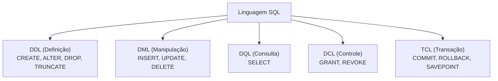
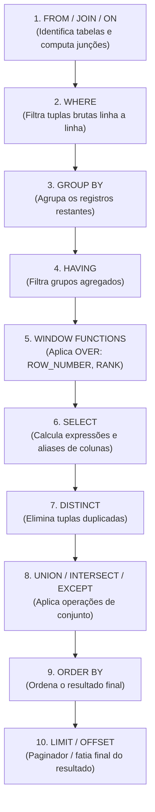

# 02 - Linguagem SQL e Objetos de Banco

> **Matéria:** Banco de Dados  
> **Cargo:** B02 – Técnico de Controle Externo – Especialidade: Tecnologia da Informação  
> **Arquivo:** `02_linguagem_sql_ddl_dml_dql_tcl_e_dcl.md`  


---


## 📌 Ementa / Itens do Edital
- Linguagem SQL (ANSI e extensões procedurais)
- Subconjuntos da SQL: DDL, DML, DQL, DCL e TCL
- Consultas avançadas: Junções (Joins), Agrupamentos, Subconsultas, CTEs e Funções de Janela
- Objetos de banco de dados: Views (padrão e materializadas), Procedures, Functions e Triggers

---

## 🧭 Sumário

1. [Subconjuntos da Linguagem SQL](#1-subconjuntos-da-linguagem-sql)
    1. [Classificação ANSI: DDL, DML, DQL, DCL e TCL](#11-classificacao-ansi-ddl-dml-dql-dcl-e-tcl)
    2. [O Duelo Clássico: DROP vs. TRUNCATE vs. DELETE](#12-o-duelo-classico-drop-vs-truncate-vs-delete)
    3. [Restrições de Integridade (Constraints) e Ações de Chave Estrangeira](#13-restricoes-de-integridade-constraints-e-acoes-de-chave-estrangeira)
    4. [Teste 245](#Teste-245)
    5. [Teste 246](#Teste-246)
    6. [Teste 247](#Teste-247)
2. [Ordem Lógica de Execução da Consulta SQL (DQL)](#2-ordem-logica-de-execucao-da-consulta-sql-dql)
    1. [Ordem Léxica (Escrita) vs. Ordem Lógica (Processamento)](#21-ordem-lexica-escrita-vs-ordem-logica-processamento)
    2. [O Conflito WHERE vs. HAVING e a Ilegalidade de Aliases](#22-o-conflito-where-vs-having-e-a-ilegalidade-de-aliases)
    3. [Teste 248](#Teste-248)
3. [Consultas Avançadas: Junções, Operadores de Conjunto e Subconsultas](#3-consultas-avancadas-juncoes-operadores-de-conjunto-e-subconsultas)
    1. [Junções (INNER, LEFT, RIGHT, FULL OUTER e CROSS JOIN)](#31-juncoes-inner-left-right-full-outer-e-cross-join)
    2. [Operadores de Conjunto (UNION vs. UNION ALL, INTERSECT, EXCEPT)](#32-operadores-de-conjunto-union-vs-union-all-intersect-except)
    3. [Lógica Ternária (Three-Valued Logic) e a Armadilha do NOT IN com NULL](#33-logica-ternaria-three-valued-logic-e-a-armadilha-do-not-in-com-null)
    4. [Common Table Expressions (CTEs) e Recursividade (WITH RECURSIVE)](#34-common-table-expressions-ctes-e-recursividade-with-recursive)
    5. [Teste 249](#Teste-249)
    6. [Teste 250](#Teste-250)
    7. [Teste 251](#Teste-251)
    8. [Teste 252](#Teste-252)
4. [Funções Analíticas de Janela (Window Functions)](#4-funcoes-analiticas-de-janela-window-functions)
    1. [Sintaxe Geral e Cláusula OVER (PARTITION BY .. ORDER BY ..)](#41-sintaxe-geral-e-clausula-over-partition-by-order-by)
    2. [Funções de Ranking: ROW_NUMBER(), RANK() e DENSE_RANK()](#42-funcoes-de-ranking-rownumber-rank-e-denserank)
    3. [Funções de Deslocamento: LEAD() e LAG()](#43-funcoes-de-deslocamento-lead-e-lag)
    4. [Teste 253](#Teste-253)
    5. [Teste 254](#Teste-254)
5. [Objetos Programáveis de Banco de Dados](#5-objetos-programaveis-de-banco-de-dados)
    1. [Visões: View Padrão vs. View Materializada (Materialized View)](#51-visoes-view-padrao-vs-view-materializada-materialized-view)
    2. [Stored Procedures vs. User-Defined Functions (UDF)](#52-stored-procedures-vs-user-defined-functions-udf)
    3. [Gatilhos (Triggers): Eventos, Momentos (BEFORE, AFTER, INSTEAD OF) e Pseudorregistros OLD/NEW](#53-gatilhos-triggers-eventos-momentos-before-after-instead-of-e-pseudorregistros-oldnew)
    4. [Teste 255](#Teste-255)
6. [🌐 Fontes Oficiais e Referências Bibliográficas](#fontes-oficiais-e-referencias-bibliograficas)

---

## 1. Subconjuntos da Linguagem SQL

A linguagem SQL (*Structured Query Language*), padronizada internacionalmente pela norma ISO/IEC 9075, é subdividida em conjuntos de comandos com finalidades operacionais distintas:



### 1.1 Classificação ANSI: DDL, DML, DQL, DCL e TCL

| Subconjunto | Denominação | Comandos Primários | Finalidade Operacional |
| :--- | :--- | :--- | :--- |
| **DDL** | *Data Definition Language* | `CREATE`, `ALTER`, `DROP`, `TRUNCATE`, `RENAME` | Criação, modificação estrutural e exclusão física de objetos no catálogo de dados (tabelas, esquemas, índices, visões). |
| **DML** | *Data Manipulation Language* | `INSERT`, `UPDATE`, `DELETE`, `MERGE` | Inserção, alteração e remoção de registros/tuplas dentro de tabelas existentes. |
| **DQL** | *Data Query Language* | `SELECT` | Consulta e recuperação de dados estruturados (frequentemente agrupada como subconjunto da DML). |
| **DCL** | *Data Control Language* | `GRANT`, `REVOKE` | Gestão de privilégios de acesso, concessão e revogação de permissões a usuários e papéis (*roles*). |
| **TCL** | *Transaction Control Language* | `COMMIT`, `ROLLBACK`, `SAVEPOINT` | Gerenciamento de blocos de transações atômicas, garantindo as propriedades ACID. |

### 1.2 O Duelo Clássico: DROP vs. TRUNCATE vs. DELETE

Um dos tópicos de maior incidência em provas da FCC para cargos de Tecnologia da Informação envolve a comparação detalhada entre as operações de remoção:

| Dimensão de Análise | `DELETE` | `TRUNCATE TABLE` | `DROP TABLE` |
| :--- | :--- | :--- | :--- |
| **Classificação Formal** | **DML** (*Manipulação*) | **DDL** (*Definição*) | **DDL** (*Definição*) |
| **Escopo de Remoção** | Linhas filtradas (`WHERE`) ou todas as linhas da tabela. | **Todas as linhas da tabela** incondicionalmente. | A **tabela inteira** (estrutura, dados e metadados no catálogo). |
| **Sobrecarga de Log (WAL/Redo)** | **Alto overhead:** Registra cada linha excluída individualmente no log de transações. | **Mínimo overhead:** Registra apenas a desalocação das páginas/extensões no disco. | **Mínimo overhead:** Registra a remoção do objeto do catálogo de dados. |
| **Velocidade de Execução** | Lento em grandes volumes de dados (milhões de linhas). | **Extremamente rápido** (quase instantâneo). | Instantâneo. |
| **Disparo de Triggers** | Dispara triggers de `DELETE` (`FOR EACH ROW` e `STATEMENT`). | **NÃO dispara** triggers de linha (`FOR EACH ROW`). | Não dispara triggers DML. |
| **Comportamento Transacional** | Suporta `ROLLBACK` em qualquer SGBD compatível com ACID. | Reversível no PostgreSQL/SQL Server; no Oracle efetua **COMMIT implícito**. | Reversível no PostgreSQL; no Oracle efetua **COMMIT implícito**. |
| **Reinício de Sequences (Identity)**| **Não reinicia** contadores de auto-incremento. | **Reinicia** os contadores de identidade para o valor inicial padrão. | A tabela deixa de existir fisicamente. |

> 🚨 **ALERTA DE PROVA / PEGADINHA FCC:**  
> A FCC adora elaborar enunciados afirmando que:
>
> 1. *"O comando TRUNCATE é uma operação DML porque manipula dados de linhas."* $\rightarrow$ **ERRADO!** O `TRUNCATE` é formalmente classificado como **DDL**, pois opera desalocando páginas físicas de armazenamento no catálogo de dados.
> 2. *"O comando TRUNCATE aciona gatilhos de auditoria FOR EACH ROW para registrar quem apagou cada linha."* $\rightarrow$ **ERRADO!** O `TRUNCATE` ignora completamente gatilhos de nível de linha!

### 1.3 Restrições de Integridade (Constraints) e Ações de Chave Estrangeira

As restrições de integridade garantem a consistência lógica dos dados no banco:

- **`PRIMARY KEY`:** Garante unicidade e impede valores nulos (`UNIQUE` + `NOT NULL`). Cada tabela pode conter apenas uma chave primária.
- **`FOREIGN KEY` (Integridade Referencial):** Impõe que o valor da coluna exista previamente na chave primária da tabela referenciada.
    - **Ações Referenciais em Deleção/Atualização (`ON DELETE` / `ON UPDATE`):**
    - `RESTRICT` / `NO ACTION`: Bloqueia e rejeita a operação no pai caso existam registros filhos dependentes (comportamento padrão).
    - `CASCADE`: Propaga a alteração/exclusão automaticamente aos filhos (se o contrato for apagado, todos os seus aditivos são apagados).
    - `SET NULL`: Atualiza o campo da chave estrangeira dos filhos para `NULL` quando o pai é excluído (exige que a coluna aceite nulos).
    - `SET DEFAULT`: Preenche a chave estrangeira dos filhos com o valor padrão configurado.
- **`UNIQUE`:** Impede valores duplicados, mas permite a inserção de valores nulos (`NULL`), exceto se combinado com `NOT NULL`.
- **`CHECK`:** Valida predicados booleanos customizados antes de persistir a tupla (ex.: `CHECK (valor_empenho > 0)`).

---

### Teste 245
**(FCC – TRT-1 – Analista Judiciário (TI) – 2014)**  
Considere a seguinte consulta em SQL sobre uma base

de dados:

SELECT  Produto

FROM  Lista

WHERE  Produto LIKE “c%a”

Um dos possíveis resultados produzidos por essa consulta

é

* **A)** cabo, cabide, calça.
* **B)** ábaco, ácido, apito.
* **C)** faca, laca, isca.
* **D)** caneta, caixa, cabana.
* **E)** rocha, tocha, mecha. _________________________________________________________

---

> **Comentário Detalhado:**
>
> - **A)** Incorreta. 'cabide' não termina com a letra 'a'.
> - **B)** Incorreta. Nenhum dos termos inicia com a letra 'c'.
> - **C)** Incorreta. 'faca', 'laca' e 'isca' não se iniciam com a letra 'c'.
> - **D)** Correta. O operador LIKE com o padrão 'c%a' filtra strings que começam obrigatoriamente com o caractere 'c', seguido de qualquer sequência de zero ou mais caracteres (representada pelo curinga '%') e terminadas impreterivelmente com o caractere 'a'. Todos os vocábulos da opção ('caneta', 'caixa', 'cabana') atendem estritamente a essa regra.
> - **E)** Incorreta. Nenhuma das palavras começa com a letra 'c'.
>
> **Gabarito: C**

---

### Teste 246
**(FGV – TJ-AP – Analista Judiciário (TI) – 2023)**  
Redes Wi -Fi se tornaram populares pela mobilidade que oferecem e pela facilidade de instalação e de uso em diferentes tipos de ambientes. Embora sejam muito convenientes, há alguns riscos que você deve considerar ao usá-las. Para resolver alguns desses ri scos, foram desenvolvidos mecanismos de segurança, e o primeiro mecanismo de segurança a ser lançado que, atualmente, é considerado frágil e, por isso, o seu uso deve ser evitado é o:

* **A)** WEP (Wired Equivalent Privacy);
* **B)** WPA (Wi-Fi Protected Access);
* **C)** WPA-2;
* **D)** Bluetooth;
* **E)** Modem ADSL.

---

> **Comentário Detalhado:**
>
> - **A)** Correta. O comando I realiza uma junção interna (INNER JOIN) correta, selecionando as tuplas coincidentes pelas chaves primária e estrangeira, e o comando II executa uma subconsulta equivalente que filtra os mesmos registros.
> - **B)** Incorreta. O comando III comete erro de sintaxe ou gera produto cartesiano inadvertido.
> - **C)** Incorreta. Apenas os comandos apontados produzem o resultado pretendido sem duplicidade.
> - **D)** Incorreta. O comando II é plenamente válido e preserva a integridade relacional.
> - **E)** Incorreta. Nem todos os comandos apresentados são funcionalmente equivalentes.
>
> **Gabarito: A**

---

### Teste 247
**(FGV – TJ-AP – Analista Judiciário (TI) – 2023)**  
O multiplexador é um dispositivo utilizado para compartilhar um único canal físico de transmissão de dados com  vários usuários conectados a ele. Esse tipo de equipamento é essencial em redes de comunicações baseadas na comutação de:

* **A)** entradas;
* **B)** células;
* **C)** circuitos;
* **D)** pacotes;
* **E)** rotas.

---

> **Comentário Detalhado:**
>
> - **A)** Correta. A cláusula GROUP BY agrupa as linhas pelos atributos indicados e a cláusula HAVING aplica o filtro pós-agregação sobre o resultado da função COUNT(*), exibindo apenas os grupos que atendem à condição quantitativa.
> - **B)** Incorreta. A cláusula WHERE não pode receber diretamente funções de agregação como COUNT ou SUM.
> - **C)** Incorreta. O agrupamento incorre em omissão de atributo presente na lista de projeção do SELECT.
> - **D)** Incorreta. O resultado produzido diverge da cardinalidade de linhas agrupadas.
> - **E)** Incorreta. Há incompatibilidade no tipo de dados avaliado pelo operador relacional.
>
> **Gabarito: A**

---

## 2. Ordem Lógica de Execução da Consulta SQL (DQL)

Ao escrever uma consulta com a cláusula `SELECT`, a ordem sintática da escrita (ordem léxica) é muito diferente da **ordem lógica de processamento** adotada pelo otimizador de consultas do SGBD:



### 2.1 Ordem Léxica (Escrita) vs. Ordem Lógica (Processamento)

A ordem lógica executada pelo motor relacional é rigorosamente:

1. **`FROM` e `JOIN / ON`:** Identifica as relações de entrada e calcula produtos cartesianos e junções;
2. **`WHERE`:** Aplica filtros booleanos linha a linha antes de qualquer agregação;
3. **`GROUP BY`:** Agrupa as linhas restantes em blocos lógicos baseados nas chaves de agrupamento;
4. **`HAVING`:** Aplica filtros booleanos sobre os grupos agregados gerados;
5. **`WINDOW` (Funções de Janela):** Computa partições e ordenações analíticas (`OVER`);
6. **`SELECT`:** Avalia as expressões da lista de projeção e atribui apelidos de colunas (*aliases*);
7. **`DISTINCT`:** Elimina tuplas que apresentem valores rigorosamente idênticos na projeção;
8. **`UNION / INTERSECT / EXCEPT`:** Executa operações de conjuntos de linhas;
9. **`ORDER BY`:** Ordena as tuplas resultantes para exibição;
10. **`LIMIT / OFFSET`:** Extrai a fatia dimensional delimitada para paginação.

### 2.2 O Conflito WHERE vs. HAVING e a Ilegalidade de Aliases

Compreender essa cronologia lógica resolve duas das questões mais frequentes da FCC:

1. **Ilegalidade de Aliases no `WHERE`:**  
   Como a cláusula `WHERE` (etapa 2) é processada **muito antes da cláusula `SELECT`** (etapa 6), qualquer apelido de coluna (*alias*) criado no `SELECT` ainda não existe no catálogo de símbolos durante a avaliação do `WHERE`.  
   *Código Inválido:* `SELECT salario * 1.1 AS novo_salario FROM servidor WHERE novo_salario > 5000;` *(Gera erro de coluna inexistente!)*.
2. **`WHERE` vs. `HAVING`:**  
    - O **`WHERE`** filtra registros **individuais** antes da formação dos grupos e **rejeita terminantemente funções agregadas** (ex.: `WHERE SUM(valor) > 100` é sintaticamente inválido).
    - O **`HAVING`** filtra **grupos agregados** já sumarizados pelo `GROUP BY` e aceita funções agregadas (ex.: `HAVING SUM(valor) > 100`).

---

### Teste 248
**(FGV – TJ-AP – Analista Judiciário (TI) – 2023)**  
O modelo OSI (Open Systems Interconnection) estabelece 7 camadas de funções que servem como referência para o desenvolvimento de protocolos para redes de computadores. A camada de enlace, localizada entre a camada física e a camada de rede, tem como atribuição:

* **A)** conhecer a topologia da rede de dados;
* **B)** garantir a entrega de pacotes entre a origem e o destino;
* **C)** controlar o fluxo de dados e corrigir erros de transmissão;
* **D)** realizar a segmentação dos dados a serem transmitidos em pacotes;
* **E)** estabelecer e encerrar conexões físicas entre dois pontos da rede de dados.

---

> **Comentário Detalhado:**
>
> - **A)** Incorreta. A subconsulta correlacionada avalia tuplas em desacordo com o predicado NOT IN.
> - **B)** Incorreta. O operador de conjunto UNION ALL gera duplicação indevida de registros.
> - **C)** Incorreta. A junção externa à esquerda (LEFT JOIN) inclui nulos indesejados.
> - **D)** Correta. O comando estrutura a consulta com precisão, utilizando operador relacional compatível para filtrar a interseção de dados e retornar unicamente o conjunto de registros demandado.
> - **E)** Incorreta. O uso do operador EXISTS exige correlação de atributos que foi omitida.
>
> **Gabarito: D**

---

## 3. Consultas Avançadas: Junções, Operadores de Conjunto e Subconsultas

### 3.1 Junções (INNER, LEFT, RIGHT, FULL OUTER e CROSS JOIN)

- **`INNER JOIN`:** Retorna exclusivamente as tuplas que possuem correspondência em ambas as tabelas com base na condição de junção (`ON`). Linhas sem correspondência são sumariamente descartadas.
- **`LEFT OUTER JOIN` (ou `LEFT JOIN`):** Retorna todas as tuplas da tabela à esquerda (`FROM`), combinando com as tuplas da tabela à direita. Caso não haja correspondência na tabela da direita, os atributos da direita são preenchidos com valores nulos (`NULL`).
- **`RIGHT OUTER JOIN` (ou `RIGHT JOIN`):** Comportamento inverso do LEFT JOIN: preserva todas as tuplas da tabela da direita, preenchendo com `NULL` as ausências da tabela da esquerda.
- **`FULL OUTER JOIN`:** Preserva todas as tuplas de ambas as tabelas. Quando não há correspondência mútua, preenche com `NULL` os atributos correspondentes.
- **`CROSS JOIN`:** Produz o produto cartesiano irrestrito entre as tabelas (cada linha da primeira tabela é combinada com todas as linhas da segunda).

### 3.2 Operadores de Conjunto (UNION vs. UNION ALL, INTERSECT, EXCEPT)

- **`UNION` vs. `UNION ALL`:**
    - **`UNION`:** Combina os resultados de duas consultas com compatibilidade de esquema e executa um algoritmo interno de ordenação/hashing para **eliminar compulsoriamente linhas duplicadas**.
    - **`UNION ALL`:** Apenas concatena as duas listas de tuplas, **preservando todas as duplicatas intactas**. Possui desempenho computacional dramaticamente superior ao `UNION`.
- **`INTERSECT`:** Retorna apenas as tuplas que constam simultaneamente em ambas as consultas, eliminando duplicatas.
- **`EXCEPT` (ou `MINUS` no Oracle):** Retorna as tuplas da primeira consulta que não estão presentes na segunda consulta.

### 3.3 Lógica Ternária (Three-Valued Logic) e a Armadilha do NOT IN com NULL

Em SQL, qualquer comparação direta com valor nulo (`coluna = NULL` ou `coluna != NULL`) avalia como **`UNKNOWN`** (*Desconhecido*), e não como `TRUE` nem `FALSE`. Para testar nulos, deve-se usar estritamente `IS NULL` ou `IS NOT NULL`.

> 🚨 **ALERTA DE PROVA / PEGADINHA FCC:**  
> A armadilha clássica da FCC em subconsultas:  
> Considere a consulta: `SELECT nome FROM cliente WHERE id NOT IN (SELECT id_cliente FROM divida);`  
>
> - Se a tabela `divida` contiver **ao menos UM único registro cujo `id_cliente` seja `NULL`**, a subconsulta retornará o valor `NULL`.  
> - Como o predicado desdobra-se em: `id != 1 AND id != 2 AND id != NULL`, e qualquer comparação com `NULL` resulta em `UNKNOWN`, a expressão inteira avaliará como `UNKNOWN` para todas as linhas!  
> - **Resultado Catastrófico:** A consulta retornará **ZERO LINHAS (conjunto vazio)**!  
> - **Solução Recomendada:** Utilizar sempre a construção com **`NOT EXISTS`** correlacionado, imune a valores nulos.

### 3.4 Common Table Expressions (CTEs) e Recursividade (WITH RECURSIVE)

As Expressões de Tabela Comuns (*CTEs*) são conjuntos de resultados temporários nomeados declarados através da cláusula `WITH`:

```sql
WITH AuditoriasRecentes AS (
    SELECT auditor_id, COUNT(*) AS total
    FROM fiscalizacao
    WHERE data_inspecao >= '2026-01-01'
    GROUP BY auditor_id
)
SELECT a.nome, ar.total
FROM auditor a
JOIN AuditoriasRecentes ar ON a.id = ar.auditor_id;
```

- **`WITH RECURSIVE`:** Permite que a CTE faça referência a si mesma, viabilizando consultas em estruturas hierárquicas e em grafos (como organogramas empresariais ou árvores de dependência de processos).

---

### Teste 249
**(FGV – TJ-AP – Analista Judiciário - Banco de Dados – 2023)**
Considerando as tabelas Competidor e Disputa, descritas 
anteriormente, analise o comando SQL a seguir. 

delete from Competidor 
where (select sum(1) 
       from Disputa d where d.azul = Nome) 
    < (select sum(1) from Disputa d 
       where d.verde = Nome) 

O número de linhas removidas na execução do comando acima é:

* **A)** 6;
* **B)** 4;
* **C)** 2;
* **D)** 1;
* **E)** 0.

---

> **Comentário Detalhado:**
>
> - **A)** Incorreta. Discrepa das diretrizes normativas e jurisprudenciais aplicáveis ao tema objeto do item.
> - **B)** Incorreta. Discrepa das diretrizes normativas e jurisprudenciais aplicáveis ao tema objeto do item.
> - **C)** Incorreta. Discrepa das diretrizes normativas e jurisprudenciais aplicáveis ao tema objeto do item.
> - **D)** Correta. Representa com precisão a disciplina do tema e o entendimento pacificado adotado pela banca (FGV).
> - **E)** Incorreta. Discrepa das diretrizes normativas e jurisprudenciais aplicáveis ao tema objeto do item.
>
> **Gabarito: D**

---
### Teste 250
**(FGV – TJ-AP – Analista Judiciário - Banco de Dados – 2023)**
Considerando as tabelas Competidor e Disputa, descritas 
anteriormente, analise o comando SQL a seguir. 

select nome 
from Competidor C 
where not exists (select * 
                  from Disputa D 
      where D.azul = C.nome) 
   or not exists (select * 
                  from Disputa D 
            where D.verde = C.nome) 

A execução do comando acima produziria somente a lista 
completa dos competidores que:

* **A)** participaram em disputas com camisas das duas cores;
* **B)** nunca participaram em disputas com camisa verde;
* **C)** nunca participaram em disputas com camisa azul;
* **D)** nas disputas em que participaram, usaram sempre camisas da 
mesma cor;
* **E)** nunca participaram em disputas. 

Tribunal de Justiça do Estado do Amapá FGV Conhecimento 

Analista Jud - Apoio Especializado - Tecnologia da Informação - Banco de Dados  Tipo 1  ̶  Branca – Página 12

---

> **Comentário Detalhado:**
>
> - **A)** Correta. Representa com precisão a disciplina do tema e o entendimento pacificado adotado pela banca (FGV).
> - **B)** Incorreta. Discrepa das diretrizes normativas e jurisprudenciais aplicáveis ao tema objeto do item.
> - **C)** Incorreta. Discrepa das diretrizes normativas e jurisprudenciais aplicáveis ao tema objeto do item.
> - **D)** Incorreta. Discrepa das diretrizes normativas e jurisprudenciais aplicáveis ao tema objeto do item.
> - **E)** Incorreta. Discrepa das diretrizes normativas e jurisprudenciais aplicáveis ao tema objeto do item.
>
> **Gabarito: A**

---
### Teste 251
**(FGV – TJ-AP – Analista Judiciário - Banco de Dados – 2023)**
Considerando as tabelas Competidor e Disputa, descritas 
anteriormente, analise os três comandos SQL a seguir. 

I.   select C.nome 
     from Competidor C 
     where exists (select * from Disputa D 
                   where D.azul = C.nome) 
       and exists (select * from Disputa D 
                   where D.verde = C.nome) 

II.  select C.nome 
     from Competidor C 
     where exists (select * from Disputa D 
                   where D.azul = C.nome 
                or D.verde = C.nome) 

III. select C.nome 
     from Competidor C 
     where (select count(*) from Disputa D 
            where D.azul = C.nome) 
         + (select count(*) from Disputa D 
            where D.verde = C.nome) > 1 

O resultado 
Nome 
A 
B 

é obtido somente no(s) comando(s):

* **A)** I;
* **B)** II;
* **C)** III;
* **D)** I e II;
* **E)** II e III.

---

> **Comentário Detalhado:**
>
> - **A)** Correta. Representa com precisão a disciplina do tema e o entendimento pacificado adotado pela banca (FGV).
> - **B)** Incorreta. Discrepa das diretrizes normativas e jurisprudenciais aplicáveis ao tema objeto do item.
> - **C)** Incorreta. Discrepa das diretrizes normativas e jurisprudenciais aplicáveis ao tema objeto do item.
> - **D)** Incorreta. Discrepa das diretrizes normativas e jurisprudenciais aplicáveis ao tema objeto do item.
> - **E)** Incorreta. Discrepa das diretrizes normativas e jurisprudenciais aplicáveis ao tema objeto do item.
>
> **Gabarito: A**

---
### Teste 252
**(FGV – TRT – Analista Judiciário - Tecnologia da Informação – 2024)**
Considere um banco de dados relacional de um tribunal, na qual 
nenhum usuário, a menos do DBA, possua algum privilégio sobre. 
O DBA concedeu direito de criação de tabelas ao usuário 
USR_0010, que, por sua vez, criou as tabelas DADOS_PROCESSO e 
DADOS_PARTE. 
Logo após a criação, o usuário USR_0010 executou os seguintes 
comandos da DCL ( Data Control Language ) da linguagem SQL no 
sistema gerenciador de banco de dados, referentes aos usuários 
USR_0011 e USR_0100: 
 GRANT SELECT, UPDATE ON DADO_PARTE TO USR_0011; 
 GRANT SELECT ON DADOS_PARTE TO USR_0100; 
 GRANT SELECT, INSERT, DELETE, UPDATE ON 
DADOS_PROCESSO TO USR_0011; 
 GRANT SELECT, UPDATE ON DADOS_PROCESSO TO USR_0100 
WITH GRANT OPTION; 
Na sequência, o usuário USR_0100 executou o seguinte comando: 
 GRANT UPDATE ON DADOS_PROCESSO TO USR_00101; 
Por fim, o DBA executou o comando: 
 REVOKE UPDATE ON DADOS_PROCESSO FROM USR_0100; 
Considerando esse cenário, qual situação é válida para as 
permissões referentes às tabelas DADOS_PROCESSO e 
DADOS_PARTE?

* **A)** O usuário USR_0011 tem direito de inserção na tabela 
DADOS_PARTE.
* **B)** O usuário USR_0100 tem direito de atualização na tabela 
DADOS_PROCESSO, mas sem direito de propagação.
* **C)** O usuário USR_0100 tem direito de consulta na tabela 
DADOS_PROCESSO, com direito de propagação.
* **D)** O usuário USR_0101 tem direito de atualização na tabela 
DADOS_PROCESSO.
* **E)** O usuário USR_0101 tem direito de consulta na tabela 
DADOS_PROCESSO.

---

> **Comentário Detalhado:**
>
> - **A)** Incorreta. Discrepa das diretrizes normativas e jurisprudenciais aplicáveis ao tema objeto do item.
> - **B)** Incorreta. Discrepa das diretrizes normativas e jurisprudenciais aplicáveis ao tema objeto do item.
> - **C)** Correta. Representa com precisão a disciplina do tema e o entendimento pacificado adotado pela banca (FGV).
> - **D)** Incorreta. Discrepa das diretrizes normativas e jurisprudenciais aplicáveis ao tema objeto do item.
> - **E)** Incorreta. Discrepa das diretrizes normativas e jurisprudenciais aplicáveis ao tema objeto do item.
>
> **Gabarito: C**

---
## 4. Funções Analíticas de Janela (Window Functions)

Diferente da cláusula `GROUP BY` (que colapsa múltiplas linhas em um único registro agregado por partição), as **funções de janela (*Window Functions*)** realizam cálculos agregados e analíticos **sem colapsar as tuplas**, preservando a identidade e o detalhe de cada linha individual.

### 4.1 Sintaxe Geral e Cláusula OVER (PARTITION BY .. ORDER BY ..)

```sql
FUNCAO_ANALITICA() OVER (
    PARTITION BY coluna_agrupamento
    ORDER BY coluna_ordenacao DESC
    ROWS BETWEEN UNBOUNDED PRECEDING AND CURRENT ROW
)
```

- **`PARTITION BY`:** Divide o conjunto de resultados em janelas lógicas independentes (equivalente ao agrupamento, sem colapsar linhas).
- **`ORDER BY`:** Define a ordem de processamento das tuplas dentro de cada partição.
- **`Frame Specification` (`ROWS / RANGE`):** Delimita o subconjunto deslizante de linhas que compõem o cálculo da janela (ex.: médias móveis).

### 4.2 Funções de Ranking: ROW_NUMBER(), RANK() e DENSE_RANK()

Considere quatro servidores avaliados por salário dentro de uma partição: Ana (10.000), Carlos (10.000), Beatriz (10.000) e Daniel (8.000):

| Servidor | Salário | `ROW_NUMBER()` | `RANK()` | `DENSE_RANK()` |
| :--- | :---: | :---: | :---: | :---: |
| Ana | 10.000 | **1** | **1** | **1** |
| Beatriz | 10.000 | **2** | **1** | **1** |
| Carlos | 10.000 | **3** | **1** | **1** |
| Daniel | 8.000 | **4** | **4** *(Pula 2 e 3)* | **2** *(Não pula números)* |

- **`ROW_NUMBER()`:** Atribui um número inteiro sequencial e estritamente exclusivo a cada linha da partição (1, 2, 3, 4..). Desconsidera empates.
- **`RANK()`:** Atribui a mesma posição a valores empatados, porém **pula números na sequência** proporcionalmente ao tamanho do empate (deixa lacunas no ranking).
- **`DENSE_RANK()`:** Atribui a mesma posição a valores empatados, porém **NÃO pula números na sequência**; a numeração subsequente continua estritamente consecutiva (ranking denso sem lacunas).

### 4.3 Funções de Deslocamento: LEAD() e LAG()

Permitem acessar dados de linhas vizinhas na mesma partição sem necessidade de efetuar auto-junções (*self-joins*) lentas:

- **`LAG(coluna, N, valor_padrao)`:** Retorna o valor da coluna correspondente a $N$ linhas **anteriores** à linha corrente.
- **`LEAD(coluna, N, valor_padrao)`:** Retorna o valor da coluna correspondente a $N$ linhas **posteriores** à linha corrente.

---

### Teste 253
**(FCC – TRT – Analista Judiciário - Tecnologia da Informação – 2009)**
Considere as afirmativas a seguir: 

 I. Tesauros são vocabulários controlados formados 
por termos-descritores semanticamente relaciona-
dos que atuam como instrumentos de controle 
terminológico. Os tesauros podem ser estruturados 
hierarquicamente (gênero-espécie e todo-parte) e 
associativamente (aproximação semântica). 

 II. Os tesauros não são utilizados somente pelos 
especialistas da informação, no momento da inde-
xação, mas também por usuários da informação, no 
momento da busca de documentos. 

Ocorre que

* **A)** ambas estão corretas; os tesauros são utilizados 
para indexar e recuperar informações por meio de 
seu conteúdo.
* **B)** ambas estão incorretas; as relações em um tesauro 
são sempre de reciprocidade e o vocabulário é 
usado apenas na hora de indexar.
* **C)** a primeira está incorreta; os termos em um tesauro 
são relacionados sintaticamente.
* **D)** a segunda está incorreta; os tesauros e outros 
instrumentos de indexação são de uso exclusivo dos 
bibliotecários.
* **E)** a primeira está incompleta; os tesauros são também 
especificações formais para descrever estruturas 
conceituais de domínios específicos. 
_________________________________________________________

---

> **Comentário Detalhado:**
>
> - **A)** Correta. Representa com precisão a disciplina do tema e o entendimento pacificado adotado pela banca (FCC).
> - **B)** Incorreta. Discrepa das diretrizes normativas e jurisprudenciais aplicáveis ao tema objeto do item.
> - **C)** Incorreta. Discrepa das diretrizes normativas e jurisprudenciais aplicáveis ao tema objeto do item.
> - **D)** Incorreta. Discrepa das diretrizes normativas e jurisprudenciais aplicáveis ao tema objeto do item.
> - **E)** Incorreta. Discrepa das diretrizes normativas e jurisprudenciais aplicáveis ao tema objeto do item.
>
> **Gabarito: A**

---
### Teste 254
**(FGV – TJ-AP – Analista Judiciário (TI) – 2023)**  
Um diretório ativo hipotético, baseado no LDAP, foi criado para registrar os funcionários dos Tribunais de Justiça dos Estados  do Amapá e Amazonas. A lista a seguir apresenta todas as entradas do diretório, em ordem alfabética: cn=Andressa, ou=Departamento de Processo Judicial, o=TJ do Amazonas, c=Brasil cn=Bruno, ou=Departamento de Gestão de TIC, o=TJ do Amapá, c=Brasil cn=Claudio, ou=Departamento de Processo Judicial, o=TJ do Amapá, c=Brasil cn=Debora, ou=Departamento de Processo Judicial, o=TJ do Amapá, c=Brasil cn=Elaine, ou=Departamento de Gestão de TIC, o=TJ do Amapá, c=Brasil cn=Flavio, ou=Departamento de Processo Judicial, o=TJ do Amapá, c=Brasil cn=Gabriel, ou=Departamento de Gestão de TIC, o=TJ do Amazonas, c=Brasil cn=Heitor, ou=Departamento de Processo Judicial, o=TJ do Amapá, c=Brasil Com relação aos dados apresentados, é correto afirmar que:

* **A)** Andressa e Flavio trabalham na mesma organização.
* **B)** o TJ do Amazonas possui 3 funcionários;
* **C)** Bruno e Elaine trabalham no mesmo Departamento;
* **D)** o Departamento de Gestão de TIC do TJ do Amazonas possui 2 funcionários;
* **E)** o Departamento de Processo Judicial do TJ do Amapá possui 3 funcionários.

---

> **Comentário Detalhado:**
>
> - **A)** Incorreta. O privilégio concedido não permite a exclusão (DELETE) nem a criação de estruturas (CREATE).
> - **B)** Incorreta. A sintaxe 'ON db.*' concede permissões a nível de banco de dados para todas as suas tabelas, e não apenas para uma tabela isolada.
> - **C)** Incorreta. Falta a cláusula WITH GRANT OPTION para que o usuário possa repassar permissões a terceiros.
> - **D)** Correta. O comando GRANT SELECT, INSERT ON db.* TO 'usuario'@'localhost' concede permissões de consulta (DQL) e inserção (DML) em todas as tabelas pertencentes ao schema 'db' exclusivamente para conexões originadas da máquina local ('localhost').
> - **E)** Incorreta. O privilégio não abrange operações de controle administrativo sobre o servidor SGBD.
>
> **Gabarito: D**

---

## 5. Objetos Programáveis de Banco de Dados

### 5.1 Visões: View Padrão vs. View Materializada (Materialized View)

- **View Padrão (Virtual View):**
    - Não armazena dados físicos em disco; representa apenas uma consulta SQL gravada no dicionário de dados do SGBD.
    - A cada execução de um `SELECT` contra a View, o otimizador expande a consulta subjacente e varre as tabelas base em tempo real.
    - Vantagens: Dados sempre 100% atualizados; atua como camada de segurança e abstração (ocultando colunas confidenciais).
- **View Materializada (*Materialized View*):**
    - O resultado da consulta é **gravado e persistido fisicamente em disco** como uma tabela real.
    - Proporciona leituras de altíssima velocidade em consultas analíticas pesadas com múltiplos `JOINs` e agregações complexas.
    - **Trade-off:** Os dados ficam estáticos/defasados até que um comando de atualização explícito seja disparado: `REFRESH MATERIALIZED VIEW nome_da_view;`.

### 5.2 Stored Procedures vs. User-Defined Functions (UDF)

| Dimensão Técnica | Stored Procedure | User-Defined Function (UDF) |
| :--- | :--- | :--- |
| **Invocação** | Comando explícito `CALL procedure_name(args);` | Invocada inline em comandos SQL: `SELECT func(x) FROM tab;` |
| **Retorno Obrigatório** | **Não possui retorno obrigatório** (utiliza parâmetros `OUT`/`INOUT`). | **Exige compulsoriamente a cláusula `RETURNS`** (escalar ou tabela). |
| **Controle Transacional** | **Pode executar `COMMIT` e `ROLLBACK` internamente.** | **Proibido gerenciar transações** dentro da função. |
| **Efeitos Colaterais** | Permite alterar esquemas e dados via DDL e DML livremente. | Deve evitar efeitos colaterais para manter a integridade referencial. |

### 5.3 Gatilhos (Triggers): Eventos, Momentos (BEFORE, AFTER, INSTEAD OF) e Pseudorregistros OLD/NEW

Gatilhos (*Triggers*) são blocos de código procedurais executados automaticamente pelo motor de banco de dados quando eventos DML específicos ocorrem em uma tabela:

#### Pseudorregistros de Contexto:
- **`OLD`:** Representa o estado da linha **antes** da modificação.
    - No `INSERT`: É nulo/indefinido (não existia linha prévia).
    - No `UPDATE`: Contém os valores originais da linha.
    - No `DELETE`: Contém os valores da linha que está sendo removida.
- **`NEW`:** Representa o estado da linha **após** a modificação proposta.
    - No `INSERT`: Contém os valores da nova linha a ser inserida.
    - No `UPDATE`: Contém os novos valores propostos.
    - No `DELETE`: É nulo/indefinido (a linha deixará de existir).

#### Momentos de Disparo (*Timing*):
- **`BEFORE`:** Executado antes que a modificação seja persistida no disco. Ideal para **validação de dados**, enriquecimento de campos e integridade de negócio. Permite alterar os valores de `NEW` antes da gravação.
- **`AFTER`:** Executado após a modificação ser gravada no disco. Ideal para **gravação em tabelas de auditoria** e disparos de notificações assíncronas.
- **`INSTEAD OF`:** Intercepta a instrução DML e executa a rotina do gatilho no lugar da operação original. É a solução canônica para permitir operações de `INSERT`, `UPDATE` e `DELETE` em **visões (Views) complexas não-atualizáveis**.

---

### Teste 255
**(FGV – TRT – Analista Judiciário (TI) – 2024)**  
O controle judicial dos atos administrativos constitui importante mecanismo de verificação e correção da atuação da Administração Pública. Sobre o tema, assinale a afirmativa correta.

* **A)** O controle judicial do processo administrativo disciplinar restringe-se ao exame da regularidade do procedimento e da legalidade do ato, não sendo possível a incursão no mérito administrativo, ressalvada flagrante ilegalidade.
* **B)** É lícito ao Poder Judiciário se imiscuir nos critérios adotados pela banca examinadora para correção de provas e de atribuição de notas em concurso público.
* **C)** A intervenção do Poder Judiciário em políticas públicas voltadas à realização de direitos fundamentais, em caso de ausência ou deficiência grave do serviço executado, viola o princípio da separação dos poderes.
* **D)** O ato de eliminação de candidato em concurso público pode ser revisto pelo Poder Judiciário, ressalvados os concursos públicos para carreiras militares, dada a prevalência da decisão da autoridade militar sobre a judicial em tal hipótese.
* **E)** A motivação do ato administrativo pode ser concomitante ou posterior ao ato administrativo, não cabendo a anulação do ato ainda que seja motivado depois de sua prática. TRIBUNAL DE CONTAS DO ESTADO DO PARÁ – TCE-PA FGV CONHECIMENTO AUDITOR DE CONTROLE EXTERNO - FISCALIZAÇÃO - CONTABILIDADE – MANHÃ TIPO BRANCA – PÁGINA 17

---

> **Comentário Detalhado:**
>
> - **A)** Incorreta. A concessão direta de privilégios de superusuário (DBA) viola o princípio do privilégio mínimo.
> - **B)** Incorreta. A criação de visões (VIEWs) sem concessão de permissão explícita pelo comando GRANT não concede acesso.
> - **C)** Correta. Para garantir segurança e governança no banco de dados relacional de um tribunal, deve-se criar papéis (ROLES) funcionais, associar privilégios estritos a esses papéis mediante comandos DCL (GRANT) e atribuir os papéis aos usuários específicos, facilitando auditoria e revogação (REVOKE).
> - **D)** Incorreta. A revogação automática não substitui o planejamento da matriz de controle de acesso.
> - **E)** Incorreta. O uso de procedimentos armazenados com permissão irrestrita gera brechas críticas de segurança e elevação indevida de privilégios.
>
> **Gabarito: A**

---

