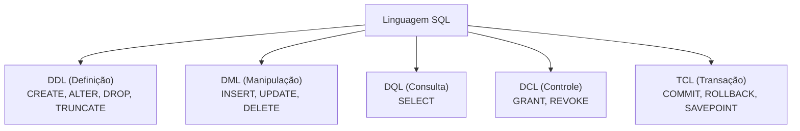
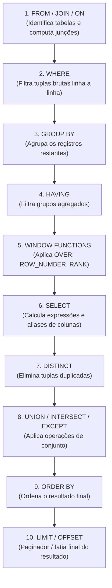

# 02 - Linguagem SQL e Objetos de Banco

> **Matéria:** Banco de Dados  
> **Cargo:** B02 – Técnico de Controle Externo – Especialidade: Tecnologia da Informação  
> **Arquivo:** `02_linguagem_sql_ddl_dml_dql_tcl_e_dcl.md`  

---

## 📌 Ementa / Itens do Edital
- Linguagem SQL (ANSI e extensões procedurais)
- Subconjuntos da SQL: DDL, DML, DQL, DCL e TCL
- Consultas avançadas: Junções (Joins), Agrupamentos, Subconsultas, CTEs e Funções de Janela
- Objetos de banco de dados: Views (padrão e materializadas), Procedures, Functions e Triggers

---

## 🧭 Sumário
- [1. Subconjuntos da Linguagem SQL](#1-subconjuntos-da-linguagem-sql)
    - [1.1 Classificação ANSI: DDL, DML, DQL, DCL e TCL](#11-classificação-ansi-ddl-dml-dql-dcl-e-tcl)
    - [1.2 O Duelo Clássico: DROP vs. TRUNCATE vs. DELETE](#12-o-duelo-clássico-drop-vs-truncate-vs-delete)
    - [1.3 Restrições de Integridade (Constraints) e Ações de Chave Estrangeira](#13-restrições-de-integridade-constraints-e-ações-de-chave-estrangeira)
- [2. Ordem Lógica de Execução da Consulta SQL (DQL)](#2-ordem-lógica-de-execução-da-consulta-sql-dql)
    - [2.1 Ordem Léxica (Escrita) vs. Ordem Lógica (Processamento)](#21-ordem-léxica-escrita-vs-ordem-lógica-processamento)
    - [2.2 O Conflito WHERE vs. HAVING e a Ilegalidade de Aliases](#22-o-conflito-where-vs-having-e-a-ilegalidade-de-aliases)
- [3. Consultas Avançadas: Junções, Operadores de Conjunto e Subconsultas](#3-consultas-avançadas-junções-operadores-de-conjunto-e-subconsultas)
    - [3.1 Junções (INNER, LEFT, RIGHT, FULL OUTER e CROSS JOIN)](#31-junções-inner-left-right-full-outer-e-cross-join)
    - [3.2 Operadores de Conjunto (UNION vs. UNION ALL, INTERSECT, EXCEPT)](#32-operadores-de-conjunto-union-vs-union-all-intersect-except)
    - [3.3 Lógica Ternária (Three-Valued Logic) e a Armadilha do NOT IN com NULL](#33-lógica-ternária-three-valued-logic-e-a-armadilha-do-not-in-com-null)
    - [3.4 Common Table Expressions (CTEs) e Recursividade (WITH RECURSIVE)](#34-common-table-expressions-ctes-e-recursividade-with-recursive)
- [4. Funções Analíticas de Janela (Window Functions)](#4-funções-analíticas-de-janela-window-functions)
    - [4.1 Sintaxe Geral e Cláusula OVER (PARTITION BY ... ORDER BY ...)](#41-sintaxe-geral-e-cláusula-over-partition-by--order-by-)
    - [4.2 Funções de Ranking: ROW_NUMBER(), RANK() e DENSE_RANK()](#42-funções-de-ranking-row_number-rank-e-dense_rank)
    - [4.3 Funções de Deslocamento: LEAD() e LAG()](#43-funções-de-deslocamento-lead-e-lag)
- [5. Objetos Programáveis de Banco de Dados](#5-objetos-programáveis-de-banco-de-dados)
    - [5.1 Visões: View Padrão vs. View Materializada (Materialized View)](#51-visões-view-padrão-vs-view-materializada-materialized-view)
    - [5.2 Stored Procedures vs. User-Defined Functions (UDF)](#52-stored-procedures-vs-user-defined-functions-udf)
    - [5.3 Gatilhos (Triggers): Eventos, Momentos (BEFORE, AFTER, INSTEAD OF) e Pseudorregistros OLD/NEW](#53-gatilhos-triggers-eventos-momentos-before-after-instead-of-e-pseudorregistros-oldnew)
- [6. Questões Comentadas & Prática Padrão FCC](#6-questões-comentadas--prática-padrão-fcc)

---

## 1. Subconjuntos da Linguagem SQL

A linguagem SQL (*Structured Query Language*), padronizada internacionalmente pela norma ISO/IEC 9075, é subdividida em conjuntos de comandos com finalidades operacionais distintas:



### 1.1 Classificação ANSI: DDL, DML, DQL, DCL e TCL

| Subconjunto | Denominação | Comandos Primários | Finalidade Operacional |
| :--- | :--- | :--- | :--- |
| **DDL** | *Data Definition Language* | `CREATE`, `ALTER`, `DROP`, `TRUNCATE`, `RENAME` | Criação, modificação estrutural e exclusão física de objetos no catálogo de dados (tabelas, esquemas, índices, visões). |
| **DML** | *Data Manipulation Language* | `INSERT`, `UPDATE`, `DELETE`, `MERGE` | Inserção, alteração e remoção de registros/tuplas dentro de tabelas existentes. |
| **DQL** | *Data Query Language* | `SELECT` | Consulta e recuperação de dados estruturados (frequentemente agrupada como subconjunto da DML). |
| **DCL** | *Data Control Language* | `GRANT`, `REVOKE` | Gestão de privilégios de acesso, concessão e revogação de permissões a usuários e papéis (*roles*). |
| **TCL** | *Transaction Control Language* | `COMMIT`, `ROLLBACK`, `SAVEPOINT` | Gerenciamento de blocos de transações atômicas, garantindo as propriedades ACID. |

### 1.2 O Duelo Clássico: DROP vs. TRUNCATE vs. DELETE

Um dos tópicos de maior incidência em provas da FCC para cargos de Tecnologia da Informação envolve a comparação detalhada entre as operações de remoção:

| Dimensão de Análise | `DELETE` | `TRUNCATE TABLE` | `DROP TABLE` |
| :--- | :--- | :--- | :--- |
| **Classificação Formal** | **DML** (*Manipulação*) | **DDL** (*Definição*) | **DDL** (*Definição*) |
| **Escopo de Remoção** | Linhas filtradas (`WHERE`) ou todas as linhas da tabela. | **Todas as linhas da tabela** incondicionalmente. | A **tabela inteira** (estrutura, dados e metadados no catálogo). |
| **Sobrecarga de Log (WAL/Redo)** | **Alto overhead:** Registra cada linha excluída individualmente no log de transações. | **Mínimo overhead:** Registra apenas a desalocação das páginas/extensões no disco. | **Mínimo overhead:** Registra a remoção do objeto do catálogo de dados. |
| **Velocidade de Execução** | Lento em grandes volumes de dados (milhões de linhas). | **Extremamente rápido** (quase instantâneo). | Instantâneo. |
| **Disparo de Triggers** | Dispara triggers de `DELETE` (`FOR EACH ROW` e `STATEMENT`). | **NÃO dispara** triggers de linha (`FOR EACH ROW`). | Não dispara triggers DML. |
| **Comportamento Transacional** | Suporta `ROLLBACK` em qualquer SGBD compatível com ACID. | Reversível no PostgreSQL/SQL Server; no Oracle efetua **COMMIT implícito**. | Reversível no PostgreSQL; no Oracle efetua **COMMIT implícito**. |
| **Reinício de Sequences (Identity)**| **Não reinicia** contadores de auto-incremento. | **Reinicia** os contadores de identidade para o valor inicial padrão. | A tabela deixa de existir fisicamente. |

> 🚨 **ALERTA DE PROVA / PEGADINHA FCC:**  
> A FCC adora elaborar enunciados afirmando que:
>
> 1. *"O comando TRUNCATE é uma operação DML porque manipula dados de linhas."* $\rightarrow$ **ERRADO!** O `TRUNCATE` é formalmente classificado como **DDL**, pois opera desalocando páginas físicas de armazenamento no catálogo de dados.
> 2. *"O comando TRUNCATE aciona gatilhos de auditoria FOR EACH ROW para registrar quem apagou cada linha."* $\rightarrow$ **ERRADO!** O `TRUNCATE` ignora completamente gatilhos de nível de linha!

### 1.3 Restrições de Integridade (Constraints) e Ações de Chave Estrangeira

As restrições de integridade garantem a consistência lógica dos dados no banco:

- **`PRIMARY KEY`:** Garante unicidade e impede valores nulos (`UNIQUE` + `NOT NULL`). Cada tabela pode conter apenas uma chave primária.
- **`FOREIGN KEY` (Integridade Referencial):** Impõe que o valor da coluna exista previamente na chave primária da tabela referenciada.
    - **Ações Referenciais em Deleção/Atualização (`ON DELETE` / `ON UPDATE`):**
    - `RESTRICT` / `NO ACTION`: Bloqueia e rejeita a operação no pai caso existam registros filhos dependentes (comportamento padrão).
    - `CASCADE`: Propaga a alteração/exclusão automaticamente aos filhos (se o contrato for apagado, todos os seus aditivos são apagados).
    - `SET NULL`: Atualiza o campo da chave estrangeira dos filhos para `NULL` quando o pai é excluído (exige que a coluna aceite nulos).
    - `SET DEFAULT`: Preenche a chave estrangeira dos filhos com o valor padrão configurado.
- **`UNIQUE`:** Impede valores duplicados, mas permite a inserção de valores nulos (`NULL`), exceto se combinado com `NOT NULL`.
- **`CHECK`:** Valida predicados booleanos customizados antes de persistir a tupla (ex.: `CHECK (valor_empenho > 0)`).

---

## 2. Ordem Lógica de Execução da Consulta SQL (DQL)

Ao escrever uma consulta com a cláusula `SELECT`, a ordem sintática da escrita (ordem léxica) é muito diferente da **ordem lógica de processamento** adotada pelo otimizador de consultas do SGBD:



### 2.1 Ordem Léxica (Escrita) vs. Ordem Lógica (Processamento)

A ordem lógica executada pelo motor relacional é rigorosamente:

1. **`FROM` e `JOIN / ON`:** Identifica as relações de entrada e calcula produtos cartesianos e junções;
2. **`WHERE`:** Aplica filtros booleanos linha a linha antes de qualquer agregação;
3. **`GROUP BY`:** Agrupa as linhas restantes em blocos lógicos baseados nas chaves de agrupamento;
4. **`HAVING`:** Aplica filtros booleanos sobre os grupos agregados gerados;
5. **`WINDOW` (Funções de Janela):** Computa partições e ordenações analíticas (`OVER`);
6. **`SELECT`:** Avalia as expressões da lista de projeção e atribui apelidos de colunas (*aliases*);
7. **`DISTINCT`:** Elimina tuplas que apresentem valores rigorosamente idênticos na projeção;
8. **`UNION / INTERSECT / EXCEPT`:** Executa operações de conjuntos de linhas;
9. **`ORDER BY`:** Ordena as tuplas resultantes para exibição;
10. **`LIMIT / OFFSET`:** Extrai a fatia dimensional delimitada para paginação.

### 2.2 O Conflito WHERE vs. HAVING e a Ilegalidade de Aliases

Compreender essa cronologia lógica resolve duas das questões mais frequentes da FCC:

1. **Ilegalidade de Aliases no `WHERE`:**  
   Como a cláusula `WHERE` (etapa 2) é processada **muito antes da cláusula `SELECT`** (etapa 6), qualquer apelido de coluna (*alias*) criado no `SELECT` ainda não existe no catálogo de símbolos durante a avaliação do `WHERE`.  
   *Código Inválido:* `SELECT salario * 1.1 AS novo_salario FROM servidor WHERE novo_salario > 5000;` *(Gera erro de coluna inexistente!)*.
2. **`WHERE` vs. `HAVING`:**  
    - O **`WHERE`** filtra registros **individuais** antes da formação dos grupos e **rejeita terminantemente funções agregadas** (ex.: `WHERE SUM(valor) > 100` é sintaticamente inválido).
    - O **`HAVING`** filtra **grupos agregados** já sumarizados pelo `GROUP BY` e aceita funções agregadas (ex.: `HAVING SUM(valor) > 100`).

---

## 3. Consultas Avançadas: Junções, Operadores de Conjunto e Subconsultas

### 3.1 Junções (INNER, LEFT, RIGHT, FULL OUTER e CROSS JOIN)

- **`INNER JOIN`:** Retorna exclusivamente as tuplas que possuem correspondência em ambas as tabelas com base na condição de junção (`ON`). Linhas sem correspondência são sumariamente descartadas.
- **`LEFT OUTER JOIN` (ou `LEFT JOIN`):** Retorna todas as tuplas da tabela à esquerda (`FROM`), combinando com as tuplas da tabela à direita. Caso não haja correspondência na tabela da direita, os atributos da direita são preenchidos com valores nulos (`NULL`).
- **`RIGHT OUTER JOIN` (ou `RIGHT JOIN`):** Comportamento inverso do LEFT JOIN: preserva todas as tuplas da tabela da direita, preenchendo com `NULL` as ausências da tabela da esquerda.
- **`FULL OUTER JOIN`:** Preserva todas as tuplas de ambas as tabelas. Quando não há correspondência mútua, preenche com `NULL` os atributos correspondentes.
- **`CROSS JOIN`:** Produz o produto cartesiano irrestrito entre as tabelas (cada linha da primeira tabela é combinada com todas as linhas da segunda).

### 3.2 Operadores de Conjunto (UNION vs. UNION ALL, INTERSECT, EXCEPT)

- **`UNION` vs. `UNION ALL`:**
    - **`UNION`:** Combina os resultados de duas consultas com compatibilidade de esquema e executa um algoritmo interno de ordenação/hashing para **eliminar compulsoriamente linhas duplicadas**.
    - **`UNION ALL`:** Apenas concatena as duas listas de tuplas, **preservando todas as duplicatas intactas**. Possui desempenho computacional dramaticamente superior ao `UNION`.
- **`INTERSECT`:** Retorna apenas as tuplas que constam simultaneamente em ambas as consultas, eliminando duplicatas.
- **`EXCEPT` (ou `MINUS` no Oracle):** Retorna as tuplas da primeira consulta que não estão presentes na segunda consulta.

### 3.3 Lógica Ternária (Three-Valued Logic) e a Armadilha do NOT IN com NULL

Em SQL, qualquer comparação direta com valor nulo (`coluna = NULL` ou `coluna != NULL`) avalia como **`UNKNOWN`** (*Desconhecido*), e não como `TRUE` nem `FALSE`. Para testar nulos, deve-se usar estritamente `IS NULL` ou `IS NOT NULL`.

> 🚨 **ALERTA DE PROVA / PEGADINHA FCC:**  
> A armadilha clássica da FCC em subconsultas:  
> Considere a consulta: `SELECT nome FROM cliente WHERE id NOT IN (SELECT id_cliente FROM divida);`  
> - Se a tabela `divida` contiver **ao menos UM único registro cujo `id_cliente` seja `NULL`**, a subconsulta retornará o valor `NULL`.  
> - Como o predicado desdobra-se em: `id != 1 AND id != 2 AND id != NULL`, e qualquer comparação com `NULL` resulta em `UNKNOWN`, a expressão inteira avaliará como `UNKNOWN` para todas as linhas!  
> - **Resultado Catastrófico:** A consulta retornará **ZERO LINHAS (conjunto vazio)**!  
> - **Solução Recomendada:** Utilizar sempre a construção com **`NOT EXISTS`** correlacionado, imune a valores nulos.

### 3.4 Common Table Expressions (CTEs) e Recursividade (WITH RECURSIVE)

As Expressões de Tabela Comuns (*CTEs*) são conjuntos de resultados temporários nomeados declarados através da cláusula `WITH`:
```sql
WITH AuditoriasRecentes AS (
    SELECT auditor_id, COUNT(*) AS total
    FROM fiscalizacao
    WHERE data_inspecao >= '2026-01-01'
    GROUP BY auditor_id
)
SELECT a.nome, ar.total
FROM auditor a
JOIN AuditoriasRecentes ar ON a.id = ar.auditor_id;
```
- **`WITH RECURSIVE`:** Permite que a CTE faça referência a si mesma, viabilizando consultas em estruturas hierárquicas e em grafos (como organogramas empresariais ou árvores de dependência de processos).

---

## 4. Funções Analíticas de Janela (Window Functions)

Diferente da cláusula `GROUP BY` (que colapsa múltiplas linhas em um único registro agregado por partição), as **funções de janela (*Window Functions*)** realizam cálculos agregados e analíticos **sem colapsar as tuplas**, preservando a identidade e o detalhe de cada linha individual.

### 4.1 Sintaxe Geral e Cláusula OVER (PARTITION BY ... ORDER BY ...)

```sql
FUNCAO_ANALITICA() OVER (
    PARTITION BY coluna_agrupamento
    ORDER BY coluna_ordenacao DESC
    ROWS BETWEEN UNBOUNDED PRECEDING AND CURRENT ROW
)
```
- **`PARTITION BY`:** Divide o conjunto de resultados em janelas lógicas independentes (equivalente ao agrupamento, sem colapsar linhas).
- **`ORDER BY`:** Define a ordem de processamento das tuplas dentro de cada partição.
- **`Frame Specification` (`ROWS / RANGE`):** Delimita o subconjunto deslizante de linhas que compõem o cálculo da janela (ex.: médias móveis).

### 4.2 Funções de Ranking: ROW_NUMBER(), RANK() e DENSE_RANK()

Considere quatro servidores avaliados por salário dentro de uma partição: Ana (10.000), Carlos (10.000), Beatriz (10.000) e Daniel (8.000):

| Servidor | Salário | `ROW_NUMBER()` | `RANK()` | `DENSE_RANK()` |
| :--- | :---: | :---: | :---: | :---: |
| Ana | 10.000 | **1** | **1** | **1** |
| Beatriz | 10.000 | **2** | **1** | **1** |
| Carlos | 10.000 | **3** | **1** | **1** |
| Daniel | 8.000 | **4** | **4** *(Pula 2 e 3)* | **2** *(Não pula números)* |

- **`ROW_NUMBER()`:** Atribui um número inteiro sequencial e estritamente exclusivo a cada linha da partição (1, 2, 3, 4...). Desconsidera empates.
- **`RANK()`:** Atribui a mesma posição a valores empatados, porém **pula números na sequência** proporcionalmente ao tamanho do empate (deixa lacunas no ranking).
- **`DENSE_RANK()`:** Atribui a mesma posição a valores empatados, porém **NÃO pula números na sequência**; a numeração subsequente continua estritamente consecutiva (ranking denso sem lacunas).

### 4.3 Funções de Deslocamento: LEAD() e LAG()

Permitem acessar dados de linhas vizinhas na mesma partição sem necessidade de efetuar auto-junções (*self-joins*) lentas:

- **`LAG(coluna, N, valor_padrao)`:** Retorna o valor da coluna correspondente a $N$ linhas **anteriores** à linha corrente.
- **`LEAD(coluna, N, valor_padrao)`:** Retorna o valor da coluna correspondente a $N$ linhas **posteriores** à linha corrente.

---

## 5. Objetos Programáveis de Banco de Dados

### 5.1 Visões: View Padrão vs. View Materializada (Materialized View)

- **View Padrão (Virtual View):**
    - Não armazena dados físicos em disco; representa apenas uma consulta SQL gravada no dicionário de dados do SGBD.
    - A cada execução de um `SELECT` contra a View, o otimizador expande a consulta subjacente e varre as tabelas base em tempo real.
    - Vantagens: Dados sempre 100% atualizados; atua como camada de segurança e abstração (ocultando colunas confidenciais).
- **View Materializada (*Materialized View*):**
    - O resultado da consulta é **gravado e persistido fisicamente em disco** como uma tabela real.
    - Proporciona leituras de altíssima velocidade em consultas analíticas pesadas com múltiplos `JOINs` e agregações complexas.
    - **Trade-off:** Os dados ficam estáticos/defasados até que um comando de atualização explícito seja disparado: `REFRESH MATERIALIZED VIEW nome_da_view;`.

### 5.2 Stored Procedures vs. User-Defined Functions (UDF)

| Dimensão Técnica | Stored Procedure | User-Defined Function (UDF) |
| :--- | :--- | :--- |
| **Invocação** | Comando explícito `CALL procedure_name(args);` | Invocada inline em comandos SQL: `SELECT func(x) FROM tab;` |
| **Retorno Obrigatório** | **Não possui retorno obrigatório** (utiliza parâmetros `OUT`/`INOUT`). | **Exige compulsoriamente a cláusula `RETURNS`** (escalar ou tabela). |
| **Controle Transacional** | **Pode executar `COMMIT` e `ROLLBACK` internamente.** | **Proibido gerenciar transações** dentro da função. |
| **Efeitos Colaterais** | Permite alterar esquemas e dados via DDL e DML livremente. | Deve evitar efeitos colaterais para manter a integridade referencial. |

### 5.3 Gatilhos (Triggers): Eventos, Momentos (BEFORE, AFTER, INSTEAD OF) e Pseudorregistros OLD/NEW

Gatilhos (*Triggers*) são blocos de código procedurais executados automaticamente pelo motor de banco de dados quando eventos DML específicos ocorrem em uma tabela:

#### Pseudorregistros de Contexto:
- **`OLD`:** Representa o estado da linha **antes** da modificação.
    - No `INSERT`: É nulo/indefinido (não existia linha prévia).
    - No `UPDATE`: Contém os valores originais da linha.
    - No `DELETE`: Contém os valores da linha que está sendo removida.
- **`NEW`:** Representa o estado da linha **após** a modificação proposta.
    - No `INSERT`: Contém os valores da nova linha a ser inserida.
    - No `UPDATE`: Contém os novos valores propostos.
    - No `DELETE`: É nulo/indefinido (a linha deixará de existir).

#### Momentos de Disparo (*Timing*):
- **`BEFORE`:** Executado antes que a modificação seja persistida no disco. Ideal para **validação de dados**, enriquecimento de campos e integridade de negócio. Permite alterar os valores de `NEW` antes da gravação.
- **`AFTER`:** Executado após a modificação ser gravada no disco. Ideal para **gravação em tabelas de auditoria** e disparos de notificações assíncronas.
- **`INSTEAD OF`:** Intercepta a instrução DML e executa a rotina do gatilho no lugar da operação original. É a solução canônica para permitir operações de `INSERT`, `UPDATE` e `DELETE` em **visões (Views) complexas não-atualizáveis**.

---

## 6. Questões Comentadas & Prática Padrão FCC

### Questão 1 (FCC - Adaptada / TI - Funções de Janela em SQL)
Considere uma tabela denominada `AUDITORIA_FOLHA` que armazena os vencimentos de servidores, com as colunas `Matricula`, `Orgao` e `Salario`. Um analista precisa gerar um relatório onde os servidores sejam classificados em ordem decrescente de salário dentro de cada órgão (`Orgao`), de modo que servidores com salários idênticos recebam a mesma posição no ranking e a numeração da posição subsequente continue consecutiva, sem deixar lacunas ou "pular" números.

A consulta SQL correta que atende exatamente a essa especificação utiliza a função de janela:  

* **A)** `ROW_NUMBER() OVER (PARTITION BY Orgao ORDER BY Salario DESC)`
* **B)** `RANK() OVER (PARTITION BY Orgao ORDER BY Salario DESC)`
* **C)** `DENSE_RANK() OVER (PARTITION BY Orgao ORDER BY Salario DESC)`
* **D)** `COUNT(Salario) OVER (ORDER BY Orgao DESC)`
* **E)** `LEAD(Salario, 1) OVER (PARTITION BY Orgao)`

> **Comentário Detalhado:**
> - **A)** Incorreta. O `ROW_NUMBER()` gera um sequencial estritamente único para cada linha (1, 2, 3...), desconsiderando empates salariais.
> - **B)** Incorreta. O `RANK()` atribui a mesma posição aos empatados, mas pula posições subsequentes na sequência (ex.: se houver dois primeiros colocados, o próximo recebe a posição 3), deixando lacunas.
> - **C)** Correta. A função **`DENSE_RANK()`** atribui a mesma posição aos registros com valores empatados e garante que a posição imediatamente seguinte seja a próxima na ordem inteira contígua (1, 1, 2, 3...), preservando o ranqueamento denso sem deixar lacunas na numeração.
> - **D)** Incorreta. `COUNT()` é uma função de agregação de contagem, não uma função de ranqueamento.
> - **E)** Incorreta. `LEAD()` é uma função analítica de deslocamento para acessar valores de linhas posteriores na janela, não atribuindo posições de classificação.
> 
> **Gabarito: C**

---

### Questão 2 (FCC - Adaptada / TI - Gatilhos / Triggers e Pseudorregistros)
No que concerne aos gatilhos (*Triggers*) em sistemas de gerenciamento de bancos de dados relacionais padrão ANSI/ISO e SGBDs modernos (como Oracle e PostgreSQL), assinale a afirmativa correta:  

* **A)** Em um gatilho acionado por uma instrução `INSERT`, tanto o pseudorregistro `OLD` quanto o pseudorregistro `NEW` contêm os mesmos valores da nova linha inserida.
* **B)** Gatilhos do tipo `BEFORE FOR EACH ROW` são ideais para validação de integridade ou atribuição prévia de valores calculados aos campos antes da gravação definitiva da linha no disco.
* **C)** Um gatilho com nível de disparo por instrução (`FOR EACH STATEMENT`) executa uma vez para cada linha afetada pelo comando DML executado.
* **D)** Em um evento de `DELETE`, o pseudorregistro `NEW` armazena os valores da linha que acabou de ser apagada, enquanto o pseudorregistro `OLD` torna-se nulo.
* **E)** Gatilhos do tipo `INSTEAD OF` podem ser aplicados exclusivamente sobre tabelas físicas com chave primária simples, sendo proibido o seu uso em visões (*Views*).

> **Comentário Detalhado:**
> - **A)** Incorreta. Em um `INSERT`, o pseudorregistro `OLD` é nulo/indefinido, pois não existia linha prévia.
> - **B)** Correta. O gatilho **`BEFORE FOR EACH ROW`** é acionado antes da escrita física no disco e possui acesso a `NEW`, permitindo validar regras de negócio, abortar a transação ou alterar valores dos campos antes que sejam efetivamente gravados.
> - **C)** Incorreta. O gatilho por instrução (`FOR EACH STATEMENT`) executa **exatamente uma vez para todo o comando SQL**, independentemente de quantas linhas tenham sido afetadas.
> - **D)** Incorreta. No evento de `DELETE`, o pseudorregistro `NEW` é nulo/indefinido e o `OLD` armazena os dados da tupla prestes a ser apagada.
> - **E)** Incorreta. Os gatilhos `INSTEAD OF` foram concebidos primordialmente para serem aplicados sobre **Views**, viabilizando operações DML em visões complexas não-atualizáveis.
> 
> **Gabarito: B**

---

### Questão 3 (FCC - Adaptada / TI - DDL vs. DML: Comandos TRUNCATE e DELETE)
Um Administrador de Banco de Dados precisa esvaziar integralmente uma tabela com mais de 50 milhões de registros de log transitório em um ambiente de produção. Ao avaliar o uso do comando `TRUNCATE TABLE` em comparação com `DELETE FROM`, conclui-se corretamente que:  

* **A)** O comando `TRUNCATE` é classificado como DML e gera o mesmo volume de logs transacionais no disco que o comando `DELETE`.
* **B)** O comando `DELETE` desaloca diretamente as extensões de páginas de disco sem registrar cada exclusão de tupla no log de transações.
* **C)** O comando `TRUNCATE` dispara todos os gatilhos do tipo `BEFORE DELETE FOR EACH ROW` associados à tabela.
* **D)** O comando `TRUNCATE` é uma instrução DDL de execução rápida que desaloca as páginas de dados da tabela, operando com consumo mínimo de log de transação.
* **E)** O comando `DELETE` reinicializa compulsoriamente os geradores automáticos de identidade (*sequences / serial*) para o valor inicial estabelecido na criação da tabela.

> **Comentário Detalhado:**
> - **A)** Incorreta. O `TRUNCATE` é formalmente uma instrução **DDL** e gera uma quantidade mínima de log em relação ao `DELETE`.
> - **B)** Incorreta. O `DELETE` varre e remove linha por linha gravando cada exclusão no log de transações (Undo/Redo). Quem desaloca páginas com overhead mínimo é o `TRUNCATE`.
> - **C)** Incorreta. O comando `TRUNCATE` **não dispara gatilhos de nível de linha** (`FOR EACH ROW`).
> - **D)** Correta. Por ser um comando DDL, o **`TRUNCATE TABLE`** atua diretamente no nível de catálogo e alocação física, liberando imediatamente as páginas/extensões de dados associadas à tabela com consumo mínimo de log transacional, resultando em altíssima velocidade.
> - **E)** Incorreta. O `DELETE` não reseta contadores de sequência automática (*identity/sequences*).
> 
> **Gabarito: D**

---

### Questão 4 (FCC - Adaptada / TI - Subconsultas e a Lógica de Nulos com NOT IN vs. NOT EXISTS)
Considere duas tabelas em um banco de dados fazendário:

- `CONTRIBUINTE (id_contribuinte, nome)` com 1.000 registros.
- `INFRACAO (id_infracao, id_contribuinte, valor)` com 500 registros, sendo que em 5 registros o atributo `id_contribuinte` possui o valor `NULL` (infrações lavradas com autor ainda não identificado).

Um auditor executa a seguinte consulta para listar os contribuintes que nunca cometeram infração:
```sql
SELECT nome 
FROM CONTRIBUINTE 
WHERE id_contribuinte NOT IN (SELECT id_contribuinte FROM INFRACAO);
```
O resultado obtido por essa consulta será:  

* **A)** Uma relação contendo exatamente os contribuintes sem registros correspondentes na tabela de infração.
* **B)** Uma relação com todos os 1.000 contribuintes da tabela original.
* **C)** Um conjunto vazio (zero registros retornados), em virtude da presença de valores nulos na subconsulta avaliada pelo operador `NOT IN`.
* **D)** Uma mensagem de erro de compilação SQL, visto que o operador `NOT IN` não suporta subconsultas como argumento.
* **E)** Uma relação com exatamente 495 registros, correspondente à diferença algébrica simples.

> **Comentário Detalhado:**
> - **A)** Incorreta. O predicado `NOT IN` não retornará essa lista devido ao colapso provocado pelo valor nulo.
> - **B)** Incorreta. O retorno não trará todos os registros.
> - **C)** Correta. De acordo com a **Lógica Ternária (Three-Valued Logic)** da SQL, a expressão `x NOT IN (v1, v2, NULL)` é avaliada como `x != v1 AND x != v2 AND x != NULL`. Como qualquer comparação com `NULL` resulta em `UNKNOWN`, e a conjunção de `TRUE AND UNKNOWN` resulta em `UNKNOWN`, a cláusula `WHERE` descarta todas as linhas (pois ela só preserva linhas cuja condição seja estritamente `TRUE`). Portanto, a consulta retorna **zero registros (conjunto vazio)**. Para evitar essa anomalia, deve-se usar `NOT EXISTS`.
> - **D)** Incorreta. A consulta é perfeitamente válida na gramática SQL ANSI.
> - **E)** Incorreta. Valor incorreto decorrente de interpretação sem considerar a lógica ternária de nulos.
> 
> **Gabarito: C**

---

### Questão 5 (FCC - Adaptada / TI - Ordem Lógica de Execução e Agrupamento: WHERE vs. HAVING)
Considere a seguinte consulta SQL proposta por um desenvolvedor júnior para listar as secretarias cujo valor total de empenhos fiscais ultrapassou R$ 1.000.000 no exercício:
```sql
SELECT secretaria_id, SUM(valor_empenho) AS total_empenhado
FROM empenhos
WHERE total_empenhado > 1000000
GROUP BY secretaria_id;
```
Ao ser submetida ao compilador SQL de um SGBD relacional padrão, a consulta:  

* **A)** Executará com sucesso, pois o compilador SQL resolve primeiro a cláusula `SELECT` para em seguida processar a restrição no `WHERE`.
* **B)** Falhará na compilação, pois a cláusula `WHERE` é processada antes da cláusula `SELECT` e não reconhece aliases de coluna nem admite filtros sobre valores agregados, os quais devem constar na cláusula `HAVING`.
* **C)** Executará com sucesso apenas se a tabela `empenhos` possuir um índice agrupado (*clustered*) sobre a coluna `secretaria_id`.
* **D)** Falhará na execução porque a cláusula `GROUP BY` exige obrigatoriamente a presença da cláusula `ORDER BY` para que o agrupamento seja válido.
* **E)** Executará perfeitamente, desde que o alias `total_empenhado` seja renomeado para corresponder a um tipo `DECIMAL`.

> **Comentário Detalhado:**
> - **A)** Incorreta. A cláusula `SELECT` é processada muito após o `WHERE`, de modo que aliases de projeção não existem durante a avaliação do `WHERE`.
> - **B)** Correta. A consulta falha por dois motivos decorrentes da ordem lógica de execução da SQL:
>   1. O `WHERE` é processado antes do `SELECT` e, portanto, **não reconhece o alias de coluna `total_empenhado`**;
>   2. O filtro exige uma condição sobre função de agregação (`SUM()`), a qual não pode constar no `WHERE` (que atua linha a linha), devendo ser posicionada obrigatoriamente na cláusula **`HAVING SUM(valor_empenho) > 1000000`** após o `GROUP BY`.
> - **C)** Incorreta. A presença de índices não corrige erros sintáticos e semânticos de compilação SQL.
> - **D)** Incorreta. O uso de `ORDER BY` é opcional com `GROUP BY`.
> - **E)** Incorreta. Renomear o alias não altera a restrição de que agregações devem ser filtradas no `HAVING`.
> 
> **Gabarito: B**
