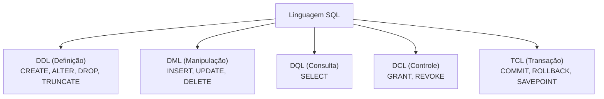
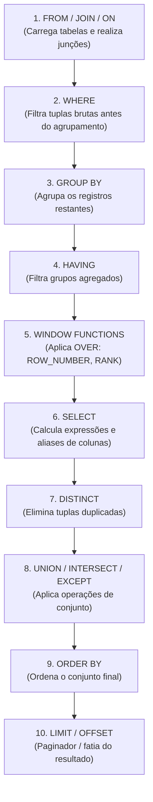
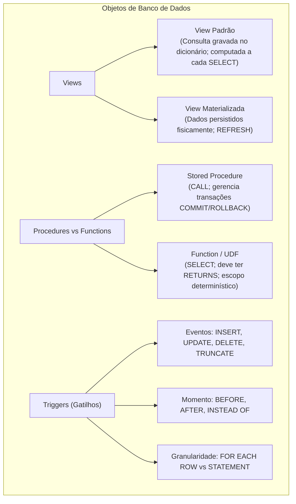

# 02 - Linguagem SQL e Objetos de Banco

> **Matéria:** Banco de Dados  
> **Cargo:** B02 – Técnico de Controle Externo – Especialidade: Tecnologia da Informação  
> **Arquivo:** `02_linguagem_sql_ddl_dml_dql_tcl_e_dcl.md`  

---

## 📌 Ementa / Itens do Edital
- Linguagem SQL (ANSI e extensões procedurais)
- Subconjuntos da SQL: DDL, DML, DQL, DCL e TCL
- Consultas avançadas: Junções (Joins), Agrupamentos, Subconsultas, CTEs e Funções de Janela
- Objetos de banco de dados: Views (padrão e materializadas), Procedures, Functions e Triggers

---

## 🌳 Classificação Hierárquica

```text
2. Linguagem SQL ANSI e Objetos Programáveis de Banco
├── 2.1 Sublinguagens da SQL
│   ├── 2.1.1 DDL (Data Definition Language):
│   │   ├── Comandos: CREATE, ALTER, DROP, TRUNCATE (diferenças entre DROP e TRUNCATE)
│   │   └── Restrições de Integridade (Constraints): PRIMARY KEY, FOREIGN KEY (ações ON DELETE/UPDATE CASCADE/SET NULL/RESTRICT), UNIQUE, NOT NULL, CHECK, DEFAULT
│   ├── 2.1.2 DML (Data Manipulation Language): INSERT, UPDATE, DELETE (operações baseadas em tuplas)
│   ├── 2.1.3 DCL (Data Control Language): GRANT (concessão de privilégios) e REVOKE (revogação de privilégios)
│   └── 2.1.4 TCL (Data Transaction Language): COMMIT, ROLLBACK, SAVEPOINT
├── 2.2 Consultas Avançadas em SQL (DQL)
│   ├── 2.2.1 Cláusula SELECT e Ordem Lógica de Execução:
│   │   └── FROM -> ON -> JOIN -> WHERE -> GROUP BY -> HAVING -> SELECT -> DISTINCT -> ORDER BY -> LIMIT / OFFSET
│   ├── 2.2.2 Junções (Joins):
│   │   ├── INNER JOIN (interseção exata entre tabelas)
│   │   ├── LEFT OUTER JOIN e RIGHT OUTER JOIN (inclusão de tuplas sem correspondência de um dos lados)
│   │   ├── FULL OUTER JOIN (união de tuplas com ou sem correspondência)
│   │   └── CROSS JOIN (produto cartesiano) e NATURAL JOIN
│   ├── 2.2.3 Agrupamentos e Funções Agregadas:
│   │   ├── Funções: COUNT(), SUM(), AVG(), MIN(), MAX()
│   │   └── Diferença crucial entre WHERE (filtra linhas individuais antes do agrupamento) e HAVING (filtra grupos após o agrupamento)
│   ├── 2.2.4 Operadores de Conjunto: UNION (elimina duplicatas), UNION ALL (mantém duplicatas), INTERSECT, EXCEPT / MINUS
│   ├── 2.2.5 Subconsultas (Subqueries): Escalares, de coluna/linha, correlacionadas (dependentes da consulta externa) e operadores IN, EXISTS, NOT EXISTS, ALL, ANY
│   ├── 2.2.6 Common Table Expressions (CTEs): Cláusula WITH (legibilidade e recursividade WITH RECURSIVE)
│   └── 2.2.7 Funções de Janela (Window Functions):
│       ├── Cláusula OVER (PARTITION BY ... ORDER BY ...)
│       └── Funções de Ranking e Deslocamento: ROW_NUMBER(), RANK(), DENSE_RANK(), LEAD(), LAG()
└── 2.3 Objetos de Banco de Dados
    ├── 2.3.1 Visões (Views):
    │   ├── Views Padrão (consultas salvas no catálogo, avaliadas dinamicamente a cada execução; segurança e abstração)
    │   └── Views Materializadas (Materialized Views: resultados fisicamente pré-calculados e armazenados em disco; comando REFRESH MATERIALIZED VIEW)
    ├── 2.3.2 Stored Procedures vs. User-Defined Functions (UDF):
    │   ├── Procedures: Executam lógica de negócio com comandos DDL/DML, podem gerenciar transações (COMMIT/ROLLBACK), chamadas com CALL
    │   └── Functions: Devem retornar um valor ou tabela (RETURNS), podem ser usadas dentro de expressões SELECT, tradicionalmente não gerenciam transações
    └── 2.3.3 Gatilhos (Triggers):
        ├── Eventos disparadores: INSERT, UPDATE, DELETE, TRUNCATE
        ├── Momento de execução: BEFORE (validação e transformação prévia), AFTER (auditoria e replicação), INSTEAD OF (utilizado em views não atualizáveis)
        ├── Nível de granularidade: Por Linha (FOR EACH ROW - acessa pseudorregistros OLD e NEW) vs. Por Instrução (FOR EACH STATEMENT)
        └── Triggers em cascata e loops infinitos de disparo
```

---

## 📖 Teoria Aprofundada & Conceitos Essenciais

### 1. Subconjuntos da Linguagem SQL

A linguagem SQL (*Structured Query Language*) é dividida em sublinguagens especializadas segundo a norma ISO/IEC 9075:



| Subconjunto | Significado | Comandos Primários | Propósito Principal |
|---|---|---|---|
| **DDL** | *Data Definition Language* | `CREATE`, `ALTER`, `DROP`, `TRUNCATE`, `RENAME` | Criação, modificação estrutural e exclusão de objetos do esquema (tabelas, índices, visões). |
| **DML** | *Data Manipulation Language* | `INSERT`, `UPDATE`, `DELETE`, `MERGE` | Inserção, modificação e remoção de instâncias/tuplas em tabelas existentes. |
| **DQL** | *Data Query Language* | `SELECT` | Consulta e recuperação de dados estruturados (muitas bancas classificam como subconjunto da DML). |
| **DCL** | *Data Control Language* | `GRANT`, `REVOKE` | Gestão de privilégios de acesso, autorizações de usuários e papéis (*roles*). |
| **TCL** | *Transaction Control Language* | `COMMIT`, `ROLLBACK`, `SAVEPOINT` | Gerenciamento de blocos de transações e garantia da propriedade ACID. |

#### O Duelo Clássico: `DROP` vs. `TRUNCATE` vs. `DELETE`

| Critério | `DELETE` | `TRUNCATE` | `DROP` |
|---|---|---|---|
| **Classificação ANSI** | **DML** | **DDL** | **DDL** |
| **Escopo de Ação** | Remove tuplas selecionadas (`WHERE`) ou todas as linhas | Remove **todas** as linhas de uma tabela incondicionalmente | Remove a **tabela inteira** (dados, estrutura e metadados) |
| **Geração de Log (Undo/Redo)** | Alto overhead: registra a exclusão linha por linha no log de transação | Mínimo overhead: desaloca as páginas de dados diretamente no disco | Mínimo overhead: remove os metadados do dicionário de dados |
| **Desempenho** | Lento em grandes volumes | **Extremamente rápido** | Imediato |
| **Disparo de Gatilhos** | Dispara triggers de `DELETE` (`FOR EACH ROW` e `STATEMENT`) | **NÃO dispara** triggers `FOR EACH ROW` (em alguns SGBDs dispara `TRUNCATE STATEMENT`) | Não dispara triggers DML |
| **Capacidade de Rollback** | Totalmente reversível via `ROLLBACK` em transações abertas | No PostgreSQL/SQL Server suporta rollback se dentro de transação; no Oracle efetua **COMMIT implícito** | No PostgreSQL suporta rollback transacional; no Oracle efetua **COMMIT implícito** |
| **Reset de Sequência Identity** | **Não** reinicia contadores automáticos | **Reinicia** contadores de autoincremento para o valor inicial | Objeto deixa de existir |

> 🚨 **ALERTA DE PROVA / PEGADINHA FCC:**  
> A FCC adora afirmar que o `TRUNCATE` é um comando DML. **ERRADO!** O `TRUNCATE TABLE` é classificado formalmente como comando **DDL**, pois manipula diretamente as estruturas físicas de alocação de armazenamento do catálogo de dados.

---

### 2. Ordem Lógica de Execução da Consulta SQL (DQL)

Ao escrever uma consulta SQL, a ordem léxica (como o código é digitado) difere substancialmente da ordem **lógica** de processamento do compilador/otimizador do SGBD:



#### Implicações Críticas para Provas:
1. **Aliases no `WHERE`:** Não é permitido referenciar no `WHERE` um alias criado na cláusula `SELECT`, pois o `WHERE` é avaliado antes do `SELECT`.  
   *Exemplo Inválido:* `SELECT Salario * 1.1 AS NovoSalario FROM Funcionario WHERE NovoSalario > 5000;` *(Gera erro de coluna inexistente!)*.
2. **`WHERE` vs. `HAVING`:**
   - O `WHERE` filtra linhas **individuais** antes da agregação e **não admite** funções agregadas (`WHERE SUM(valor) > 100` é sintaticamente inválido).
   - O `HAVING` filtra **grupos agregados** gerados pelo `GROUP BY` e aceita funções agregadas (`HAVING SUM(valor) > 100`).

---

### 3. Operadores de Conjunto e Funções de Agregação

- **`UNION` vs. `UNION ALL`:**  
  - `UNION`: Agrupa os resultados de duas consultas e executa uma etapa implícita de ordenação/hashing para **eliminar linhas duplicadas**.
  - `UNION ALL`: Apenas concatena as listas de registros **mantendo todas as duplicatas** intactas. Possui desempenho muito superior ao `UNION`.
- **`COUNT(*)` vs. `COUNT(coluna)`:**  
  - `COUNT(*)`: Conta todas as linhas da partição, incluindo tuplas preenchidas com valores nulos.
  - `COUNT(coluna)`: Conta estritamente as linhas em que o atributo especificado é **não nulo** (`coluna IS NOT NULL`).

#### Lógica Ternária (*Three-Valued Logic*) e a Armadilha do `NOT IN` com `NULL`

Em SQL, qualquer comparação direta com valor nulo (`coluna = NULL` ou `coluna != NULL`) avalia como `UNKNOWN` (Desconhecido), e não `TRUE` nem `FALSE`.

> 🚨 **ALERTA DE PROVA / PEGADINHA FCC:**  
> Se a subconsulta de um `NOT IN` retornar pelo menos **um único registro nulo** (`NULL`), a expressão inteira avaliará como `UNKNOWN` para todas as linhas, resultando em um **retorno VAZIO (zero linhas)**!  
> *Solução Segura:* Usar sempre o operador correlacionado **`NOT EXISTS`**, que opera com semântica booleana baseada na existência ou inexistência de tuplas, imune a valores nulos.

---

### 4. Funções Analíticas de Janela (*Window Functions*)

Diferente do `GROUP BY` (que colapsa múltiplas linhas em um único registro agregado), as funções de janela realizam cálculos analíticos agregados **sem colapsar as linhas**, preservando a identidade de cada tupla individual.

Sintaxe Geral:
```sql
FUNCAO() OVER (
    PARTITION BY coluna_particao 
    ORDER BY coluna_ordenacao
    ROWS BETWEEN UNBOUNDED PRECEDING AND CURRENT ROW
)
```

#### Comparativo de Funções de Classificação (Ranking)

Considere quatro servidores com salários: Ana (10.000), Carlos (10.000), Beatriz (10.000) e Daniel (8.000).

| Servidor | Salário | `ROW_NUMBER()` | `RANK()` | `DENSE_RANK()` |
|---|:---:|:---:|:---:|:---:|
| Ana | 10.000 | 1 | 1 | 1 |
| Beatriz | 10.000 | 2 | 1 | 1 |
| Carlos | 10.000 | 3 | 1 | 1 |
| Daniel | 8.000 | 4 | **4** *(Pula 2 e 3)* | **2** *(Não pula números)* |

- **`ROW_NUMBER()`:** Atribui um identificador inteiro sequencial contínuo estritamente único a cada linha, desconsiderando empates.
- **`RANK()`:** Atribui posições idênticas a valores empatados, porém **deixa lacunas (pula posições)** na sequência para compensar os empates.
- **`DENSE_RANK()`:** Atribui posições idênticas a valores empatados e **não deixa lacunas (não pula posições)**; a numeração segue estritamente contígua.
- **`LEAD(coluna, N)` / `LAG(coluna, N)`:** Acessa o valor de uma linha à frente (`LEAD`) ou de uma linha anterior (`LAG`) dentro da mesma partição sem necessidade de auto-junção.

---

### 5. Objetos de Banco de Dados: Views, Procedures, Functions e Gatilhos



#### 5.1 Visões: View Padrão vs. View Materializada
- **View Padrão:** Não consome espaço físico de dados; apenas uma definição SQL gravada no catálogo. A cada execução, a query é desdobrada e executada sobre as tabelas base.
- **View Materializada:** O resultado da query é gravado fisicamente em disco como uma tabela real. Oferece alta velocidade em consultas analíticas complexas, mas requer atualização periódica explícita (`REFRESH MATERIALIZED VIEW`).

#### 5.2 Stored Procedures vs. Funções (UDF)

| Característica | Stored Procedure | User-Defined Function (UDF) |
|---|---|---|
| **Forma de Execução** | Comando `CALL procedure_name(args)` | Usada inline em expressões `SELECT func(x) FROM tab` |
| **Retorno de Valores** | Não obrigatório (retorna via parâmetros `OUT`/`INOUT`) | **Obrigatório** cláusula `RETURNS tipo_dado` |
| **Controle Transacional** | Pode emitir comandos `COMMIT` e `ROLLBACK` internamente | **Proibido** controlar transações no corpo da função |
| **Efeitos Colaterais** | Permite alterar estruturas e tabelas via DDL e DML livremente | Deve evitar efeitos colaterais para manter a pureza referencial |

#### 5.3 Gatilhos (Triggers) e Pseudorregistros

Os gatilhos são rotinas executadas automaticamente pelo SGBD em resposta a eventos DML específicos.

| Evento DML | Pseudorregistro `OLD` | Pseudorregistro `NEW` |
|---|---|---|
| `INSERT` | **Indefinido / Nulo** (não havia linha anterior) | Contém os valores da tupla que está sendo inserida |
| `UPDATE` | Contém os valores originais da linha antes da alteração | Contém os novos valores propostos após a alteração |
| `DELETE` | Contém os valores da linha prestes a ser apagada | **Indefinido / Nulo** (não haverá nova linha) |

- **`BEFORE`:** Disparado antes da escrita no log/tabela; ideal para **validação de dados** e preenchimento de campos (`NEW.data_criacao := NOW()`).
- **`AFTER`:** Disparado após a persistência bem-sucedida; ideal para **tabelas de auditoria** e disparos de notificações assíncronas.
- **`INSTEAD OF`:** Intercepta o comando e executa uma rotina alternativa no seu lugar. É a única forma suportada por diversos SGBDs para permitir operações de `INSERT`, `UPDATE` ou `DELETE` em **Views complexas não-atualizáveis**.

---

## 🌐 Fontes Recomendadas na Internet

### 1. Documentação Oficial de Referência SQL
- [PostgreSQL Documentation - The SQL Language & Queries](https://www.postgresql.org/docs/current/queries.html): Manual oficial cobrindo expressões de consulta, sintaxe de junções (`INNER`, `OUTER`), ordenação, subconsultas e Common Table Expressions (`WITH`).
- [PostgreSQL Documentation - Window Functions](https://www.postgresql.org/docs/current/tutorial-window.html): Guia didático sobre funções analíticas de janela, particionamento (`OVER (PARTITION BY ...)`), ordenação de frame e funções de classificação (`ROW_NUMBER`, `RANK`, `DENSE_RANK`).
- [Oracle Database SQL Language Reference](https://docs.oracle.com/en/database/oracle/oracle-database/): Referência técnica da Oracle sobre comandos DDL, DML, DCL, TCL e objetos procedurais (PL/SQL Triggers, Packages e Stored Procedures).
- [PostgreSQL Tutorial - Triggers e Stored Procedures](https://www.postgresqltutorial.com/postgresql-triggers/): Guia prático detalhando a mecânica de gatilhos `BEFORE` e `AFTER`, manipulação de registros `OLD` e `NEW` e criação de views materializadas com atualização programada.

---

## 📝 Questões Comentadas & Exemplos (Padrão FCC)

### Questão 1 (FCC - Adaptada / TI - Funções de Janela em SQL)
Considere uma tabela denominada `AUDITORIA_FOLHA` que armazena os vencimentos de servidores, com as colunas `Matricula`, `Orgao` e `Salario`. Um analista precisa gerar um relatório onde os servidores sejam classificados em ordem decrescente de salário dentro de cada órgão (`Orgao`), de modo que servidores com salários idênticos recebam a mesma posição no ranking e a numeração da posição subsequente continue consecutiva, sem deixar lacunas ou "pular" números.

A consulta SQL correta que atende exatamente a essa especificação utiliza a função de janela:
A) `ROW_NUMBER() OVER (PARTITION BY Orgao ORDER BY Salario DESC)`  
B) `RANK() OVER (PARTITION BY Orgao ORDER BY Salario DESC)`  
C) `DENSE_RANK() OVER (PARTITION BY Orgao ORDER BY Salario DESC)`  
D) `COUNT(Salario) OVER (ORDER BY Orgao DESC)`  
E) `LEAD(Salario, 1) OVER (PARTITION BY Orgao)`

> **Gabarito: C**  
> **Comentário Analítico Passo a Passo:**  
> - **A está INCORRETA:** O `ROW_NUMBER()` gera um sequencial estritamente exclusivo (1, 2, 3, 4...) para cada linha da partição, sem admitir empates em nenhuma hipótese. Servidores com salários iguais receberiam posições distintas.  
> - **B está INCORRETA:** O `RANK()` resolve empates atribuindo a mesma classificação aos empatados, mas **pula posições** subsequentes proporcionalmente ao tamanho do empate (ex.: se houver dois primeiros colocados, o próximo receberá a classificação 3).  
> - **C está CORRETA:** O **`DENSE_RANK()`** atribui a mesma posição aos registros empatados e garante que a posição seguinte seja imediatamente a próxima na sequência inteira (1, 1, 2, 3...), mantendo o ranqueamento denso e sem lacunas numéricas, atendendo perfeitamente ao enunciado.  
> - **D está INCORRETA:** `COUNT()` é uma função puramente agregada/acumulada de contagem, não uma função de ordenação de ranking.  
> - **E está INCORRETA:** `LEAD()` é uma função analítica de deslocamento que busca valores de linhas subsequentes na janela, não tendo a propriedade de gerar posições ordinais de classificação.

---

### Questão 2 (FCC - Adaptada / TI - Gatilhos / Triggers e Pseudorregistros)
No que concerne aos gatilhos (*Triggers*) em sistemas de gerenciamento de bancos de dados relacionais padrão ANSI/ISO e SGBDs modernos (como Oracle e PostgreSQL), assinale a afirmativa correta:
A) Em um gatilho acionado por uma instrução `INSERT`, tanto o pseudorregistro `OLD` quanto o pseudorregistro `NEW` contêm os mesmos valores da nova linha inserida.  
B) Gatilhos do tipo `BEFORE FOR EACH ROW` são ideais para validação de integridade ou atribuição prévia de valores calculados aos campos antes da gravação definitiva da linha no disco.  
C) Um gatilho com nível de disparo por instrução (`FOR EACH STATEMENT`) executa uma vez para cada linha afetada pelo comando DML executado.  
D) Em um evento de `DELETE`, o pseudorregistro `NEW` armazena os valores da linha que acabou de ser apagada, enquanto o pseudorregistro `OLD` torna-se nulo.  
E) Gatilhos do tipo `INSTEAD OF` podem ser aplicados exclusivamente sobre tabelas físicas com chave primária simples, sendo proibido o seu uso em visões (*Views*).

> **Gabarito: B**  
> **Comentário Analítico Passo a Passo:**  
> - **A está INCORRETA:** Durante um `INSERT`, uma nova tupla está sendo criada; portanto, o pseudorregistro `OLD` é nulo/indefinido, existindo unicamente o registro `NEW`.  
> - **B está CORRETA:** O gatilho **`BEFORE FOR EACH ROW`** é interceptado antes que as modificações sejam gravadas fisicamente nas páginas de dados do banco. Ele tem acesso aos valores do registro através de `NEW` e pode validá-los, abortar a operação com exceção ou modificar campos diretamente antes da gravação (ex.: `NEW.usuario_alteracao := CURRENT_USER`).  
> - **C está INCORRETA:** O gatilho com nível de instrução (`FOR EACH STATEMENT`) é executado **exatamente uma vez** para toda a instrução SQL, quer ela afete 0, 1 ou 100.000 tuplas. Quem executa repetidamente para cada linha alterada é o `FOR EACH ROW`.  
> - **D está INCORRETA:** Na deleção (`DELETE`), a linha está sendo excluída do banco. Logo, existe apenas o pseudorregistro `OLD` (com os valores prévios à remoção); o `NEW` é completamente nulo/indefinido.  
> - **E está INCORRETA:** Os gatilhos `INSTEAD OF` foram concebidos especificamente para serem vinculados a **Views** (visões), permitindo que operações DML executadas sobre visões complexas não atualizáveis sejam redirecionadas e traduzidas customizadamente para as tabelas base.

---

### Questão 3 (FCC - Adaptada / TI - DDL vs. DML: Comandos TRUNCATE e DELETE)
Um Administrador de Banco de Dados precisa esvaziar integralmente uma tabela com mais de 50 milhões de registros de log transitório em um ambiente de produção. Ao avaliar o uso do comando `TRUNCATE TABLE` em comparação com `DELETE FROM`, conclui-se corretamente que:
A) O comando `TRUNCATE` é classificado como DML e gera o mesmo volume de logs transacionais no disco que o comando `DELETE`.  
B) O comando `DELETE` desaloca diretamente as extensões de páginas de disco sem registrar cada exclusão de tupla no log de transações.  
C) O comando `TRUNCATE` dispara todos os gatilhos do tipo `BEFORE DELETE FOR EACH ROW` associados à tabela.  
D) O comando `TRUNCATE` é uma instrução DDL de execução rápida que desaloca as páginas de dados da tabela, operando com consumo mínimo de log de transação.  
E) O comando `DELETE` reinicializa compulsoriamente os geradores automáticos de identidade (*sequences / serial*) para o valor inicial estabelecido na criação da tabela.

> **Gabarito: D**  
> **Comentário Analítico Passo a Passo:**  
> - **A está INCORRETA:** O `TRUNCATE` é um comando de **DDL** (*Data Definition Language*) e gera uma quantidade mínima de log, pois desaloca os blocos/páginas de armazenamento diretamente no nível do catálogo, ao contrário do `DELETE`, que é DML e gera log exaustivo linha por linha.  
> - **B está INCORRETA:** Quem desaloca as páginas diretamente com overhead mínimo é o `TRUNCATE`. O `DELETE` varre e marca as linhas como deletadas tupla a tupla, gravando todas as operações detalhadas no log de transações (Undo/Redo).  
> - **C está INCORRETA:** Uma das principais características do `TRUNCATE` é que ele **não dispara gatilhos de nível de linha** (`FOR EACH ROW`), tornando a operação substancialmente mais veloz e inviabilizando rotinas de auditoria baseadas em triggers de linha.  
> - **D está CORRETA:** Por ser um comando DDL, o `TRUNCATE TABLE` esvazia a tabela de forma imediata por meio da desalocação direta das páginas/extensões de dados associadas à tabela no dicionário do SGBD, consumindo uma fração ínfima de log transacional em comparação ao `DELETE`.  
> - **E está INCORRETA:** O `DELETE` não reseta colunas do tipo *identity / sequence*; a tabela continua a gerar os próximos números a partir do último valor alcançado. O `TRUNCATE`, por outro lado, tradicionalmente reseta as sequências para o valor inicial padrão (ex.: `TRUNCATE TABLE tabela RESTART IDENTITY`).

---

### Questão 4 (FCC - Adaptada / TI - Subconsultas e a Lógica de Nulos com NOT IN vs. NOT EXISTS)
Considere duas tabelas em um banco de dados fazendário:
- `CONTRIBUINTE (id_contribuinte, nome)` com 1.000 registros.
- `INFRACAO (id_infracao, id_contribuinte, valor)` com 500 registros, sendo que em 5 registros o atributo `id_contribuinte` possui o valor `NULL` (infrações lavradas com autor ainda não identificado).

Um auditor executa a seguinte consulta para listar os contribuintes que nunca cometeram infração:
```sql
SELECT nome 
FROM CONTRIBUINTE 
WHERE id_contribuinte NOT IN (SELECT id_contribuinte FROM INFRACAO);
```
O resultado obtido por essa consulta será:
A) Uma relação contendo exatamente os contribuintes sem registros correspondentes na tabela de infração.  
B) Uma relação com todos os 1.000 contribuintes da tabela original.  
C) Um conjunto vazio (zero registros retornados), em virtude da presença de valores nulos na subconsulta avaliada pelo operador `NOT IN`.  
D) Uma mensagem de erro de compilação SQL, visto que o operador `NOT IN` não suporta subconsultas como argumento.  
E) Uma relação com exatamente 495 registros, correspondente à diferença algébrica simples.

> **Gabarito: C**  
> **Comentário Analítico Passo a Passo:**  
> - **A está INCORRETA:** Isso só ocorreria se a subconsulta garantisse ausência de nulos (`WHERE id_contribuinte IS NOT NULL`) ou se a consulta utilizasse `NOT EXISTS`.  
> - **B está INCORRETA:** O retorno não contemplará todos os registros; ele será vazio.  
> - **C está CORRETA:** Trata-se da mais clássica pegadinha da FCC sobre **Lógica Ternária (Three-Valued Logic)** em SQL. A expressão `x NOT IN (val1, val2, NULL)` é logicamente equivalente a:  
>   `x != val1 AND x != val2 AND x != NULL`  
>   Em SQL, qualquer comparação direta com `NULL` resulta em `UNKNOWN` (`Desconhecido`).  
>   De acordo com a tabela verdade da conjunção (`AND`), se qualquer operando for `UNKNOWN` e nenhum for `FALSE`, a expressão inteira avalia como `UNKNOWN`. Como as cláusulas `WHERE` descartam qualquer tupla cuja condição final não seja estritamente `TRUE`, **nenhuma linha será retornada** (resultado vazio).  
> - **D está INCORRETA:** A consulta é 100% sintaticamente válida na gramática ANSI SQL.  
> - **E está INCORRETA:** Valor arbitrário que ignora o colapso lógico gerado pelo valor `NULL` dentro do predicado `NOT IN`.

---

### Questão 5 (FCC - Adaptada / TI - Ordem Lógica de Execução e Agrupamento: WHERE vs. HAVING)
Considere a seguinte consulta SQL proposta por um desenvolvedor júnior para listar as secretarias cujo valor total de empenhos fiscais ultrapassou R$ 1.000.000 no exercício:
```sql
SELECT secretaria_id, SUM(valor_empenho) AS total_empenhado
FROM empenhos
WHERE total_empenhado > 1000000
GROUP BY secretaria_id;
```
Ao ser submetida ao compilador SQL de um SGBD relacional padrão, a consulta:
A) Executará com sucesso, pois o compilador SQL resolve primeiro a cláusula `SELECT` para em seguida processar a restrição no `WHERE`.  
B) Falhará na compilação, pois a cláusula `WHERE` é processada antes da cláusula `SELECT` e não reconhece aliases de coluna nem admite filtros sobre valores agregados, os quais devem constar na cláusula `HAVING`.  
C) Executará com sucesso apenas se a tabela `empenhos` possuir um índice agrupado (*clustered*) sobre a coluna `secretaria_id`.  
D) Falhará na execução porque a cláusula `GROUP BY` exige obrigatoriamente a presença da cláusula `ORDER BY` para que o agrupamento seja válido.  
E) Executará perfeitamente, desde que o alias `total_empenhado` seja renomeado para corresponder a um tipo `DECIMAL`.

> **Gabarito: B**  
> **Comentário Analítico Passo a Passo:**  
> - **A está INCORRETA:** A ordem lógica de processamento do SGBD inicia no `FROM/JOIN`, seguido imediatamente pelo `WHERE`. A cláusula `SELECT` só é avaliada após o `HAVING`. Logo, no momento em que o `WHERE` é processado, o alias `total_empenhado` sequer existe no escopo de símbolos.  
> - **B está CORRETA:** A consulta apresenta dois erros fundamentais derivados da ordem lógica de execução:
>   1. O `WHERE` filtra tuplas individuais *antes* do agrupamento e, portanto, **não reconhece aliases definidos no `SELECT`**.
>   2. O filtro sobre o resultado da função de agregação (`SUM(valor_empenho)`) não pode figurar no `WHERE`; deve obrigatoriamente constar na cláusula **`HAVING SUM(valor_empenho) > 1000000`**, que é avaliada *após* a etapa de agrupamento (`GROUP BY`).  
> - **C está INCORRETA:** Índices interferem no plano de acesso e no tempo de resposta físico da consulta, mas jamais corrigem ou alteram a semântica e a validação sintática do comando SQL.  
> - **D está INCORRETA:** A cláusula `ORDER BY` é totalmente opcional em consultas com `GROUP BY`.  
> - **E está INCORRETA:** Tipos de dados e nomes de aliases não mitigam o erro estrutural de posicionamento indevido de filtro agregado no `WHERE`.
