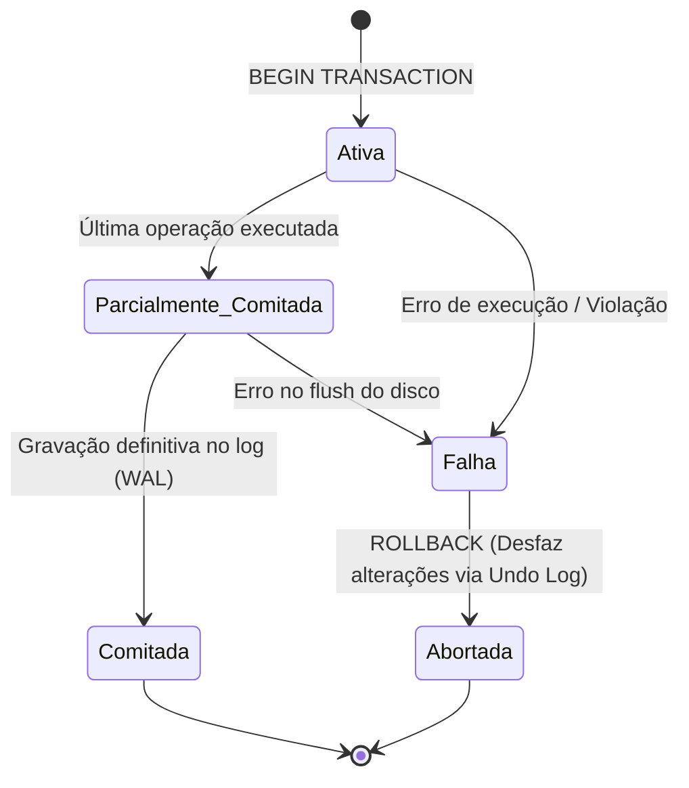
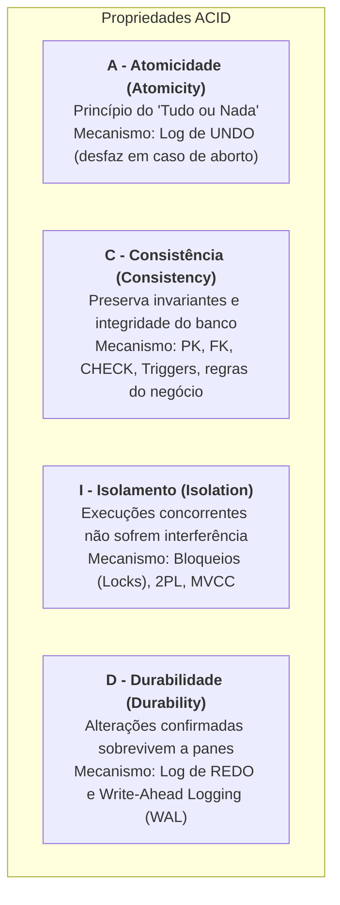
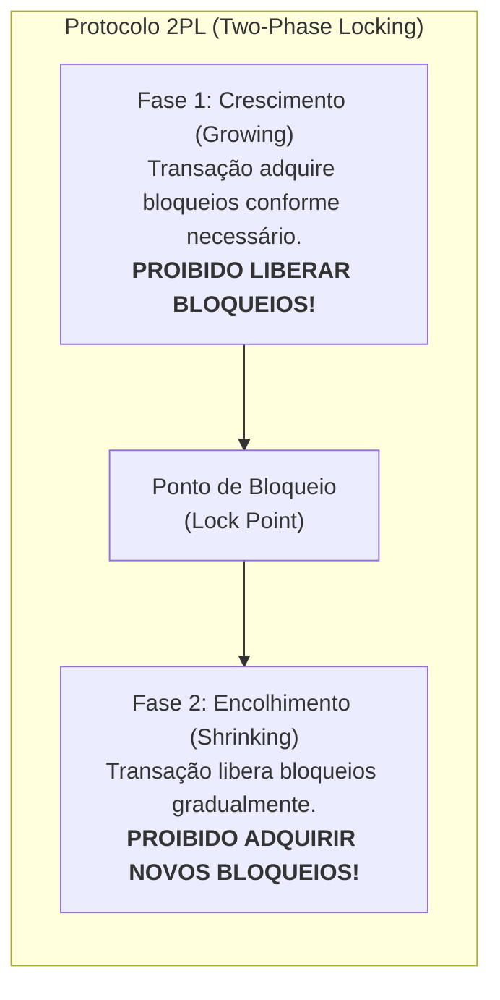
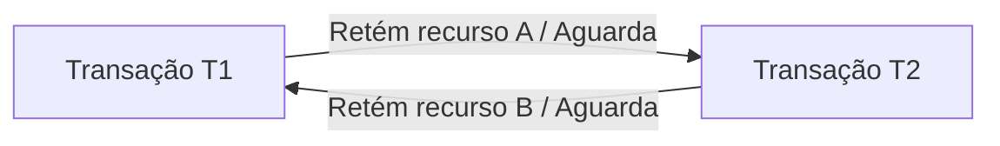

# 03 - Transações, Propriedades ACID e Concorrência

> **Matéria:** Banco de Dados  
> **Cargo:** B02 – Técnico de Controle Externo – Especialidade: Tecnologia da Informação  
> **Arquivo:** `03_transacoes_propriedades_acid_e_concorrencia.md`  

---

## 📌 Ementa / Itens do Edital
- Conceito de Transação de banco de dados
- As quatro propriedades fundamentais: ACID (Atomicidade, Consistência, Isolamento, Durabilidade)
- Comandos de controle transacional: COMMIT, ROLLBACK e SAVEPOINT
- Anomalias de concorrência (Leitura Suja, Leitura Não Repetível, Leitura Fantasma, Atualização Perdida)
- Níveis de Isolamento ANSI SQL
- Mecanismos de controle de concorrência: Bloqueios (Locks), 2PL, MVCC e Deadlocks

---

## 🧭 Sumário
- [1. O Conceito Formal de Transação e o Modelo ACID](#1-o-conceito-formal-de-transacao-e-o-modelo-acid)
    - [1.1 Ciclo de Vida e Estados de uma Transação](#11-ciclo-de-vida-e-estados-de-uma-transacao)
    - [1.2 As Quatro Propriedades Fundamentais: ACID](#12-as-quatro-propriedades-fundamentais-acid)
    - [1.3 Mecanismos Internos: Undo Log, Redo Log e Write-Ahead Logging (WAL)](#13-mecanismos-internos-undo-log-redo-log-e-write-ahead-logging-wal)
- [2. Comandos de Controle Transacional (TCL)](#2-comandos-de-controle-transacional-tcl)
    - [2.1 COMMIT, ROLLBACK e Gestão de SAVEPOINTs](#21-commit-rollback-e-gestao-de-savepoints)
- [3. Fenômenos e Anomalias de Concorrência](#3-fenomenos-e-anomalias-de-concorrencia)
    - [3.1 Leitura Suja (Dirty Read)](#31-leitura-suja-dirty-read)
    - [3.2 Leitura Não Repetível (Non-Repeatable Read)](#32-leitura-nao-repetivel-non-repeatable-read)
    - [3.3 Leitura Fantasma (Phantom Read)](#33-leitura-fantasma-phantom-read)
    - [3.4 Atualização Perdida (Lost Update)](#34-atualizacao-perdida-lost-update)
- [4. Níveis de Isolamento ANSI SQL-92](#4-niveis-de-isolamento-ansi-sql-92)
    - [4.1 Matriz de Isolamento vs. Fenômenos Admitidos](#41-matriz-de-isolamento-vs-fenomenos-admitidos)
    - [4.2 Snapshot Isolation (Isolamento por Instantâneo)](#42-snapshot-isolation-isolamento-por-instantaneo)
- [5. Técnicas de Controle de Concorrência](#5-tecnicas-de-controle-de-concorrencia)
    - [5.1 Bloqueios (Locks) e Matriz de Compatibilidade (Shared vs. Exclusive)](#51-bloqueios-locks-e-matriz-de-compatibilidade-shared-vs-exclusive)
    - [5.2 Protocolo de Bloqueio em Duas Fases (2PL - Two-Phase Locking): Básico, Estrito e Rigoroso](#52-protocolo-de-bloqueio-em-duas-fases-2pl-two-phase-locking-basico-estrito-e-rigoroso)
    - [5.3 Controle Multiversão de Concorrência (MVCC)](#53-controle-multiversao-de-concorrencia-mvcc)
    - [5.4 Impasses (Deadlocks): Detecção via Wait-For Graph e Resolução por Transação Vítima](#54-impasses-deadlocks-deteccao-via-wait-for-graph-e-resolucao-por-transacao-vitima)
- [Fontes Oficiais e Referências Bibliográficas](#fontes-oficiais-e-referencias-bibliograficas)
- [6. Questões Comentadas & Prática Padrão FCC](#6-questoes-comentadas-pratica-padrao-fcc)

---

## 1. O Conceito Formal de Transação e o Modelo ACID

Uma **transação** de banco de dados é uma unidade lógica e atômica de processamento que agrupa uma ou mais instruções SQL (leitura e escrita) que devem ser executadas de modo estritamente indivisível. No contexto de auditoria e controle externo no setor público, uma transação típica é a liquidação de uma despesa orçamentária: o sistema deve simultaneamente debitar o saldo do empenho e creditar a conta bancária do fornecedor. Se apenas uma das ações ocorrer, o banco de dados entrará em colapso fiscal.

### 1.1 Ciclo de Vida e Estados de uma Transação

Durante sua existência, uma transação transita por estados formais bem definidos na teoria de sistemas relacionais:



- **Ativa (*Active*):** O estado inicial. A transação está sendo executada pela aplicação.
- **Parcialmente Comitada (*Partially Committed*):** A última instrução SQL foi processada na memória RAM, mas os dados ainda não foram gravados permanentemente no log em disco.
- **Comitada (*Committed*):** Todas as alterações foram confirmadas e gravadas no log transacional em armazenamento persistente (*Write-Ahead Logging*). A transação foi concluída com sucesso.
- **Falha (*Failed*):** Ocorre quando uma instrução viola uma restrição de integridade ou o sistema sofre interrupção antes da conclusão definitiva.
- **Abortada (*Aborted*):** O SGBD executa o comando `ROLLBACK`, desfazendo todas as modificações parciais já executadas e restaurando a base de dados ao estado exato anterior ao início da transação.

### 1.2 As Quatro Propriedades Fundamentais: ACID

Para que a integridade dos dados seja inviolável mesmo diante de falhas de hardware, interrupções de energia elétrica e concorrência massiva de usuários, o SGBD deve garantir integralmente as propriedades do acrônimo **ACID** (Jim Gray e Andreas Reuter):



1. **A - Atomicidade (*Atomicity*):**
    - Princípio do **"tudo ou nada"** (*all-or-nothing*). Todas as operações que compõem a transação são consolidadas em conjunto no banco de dados, ou nenhuma delas produzirá efeito algum. Não existe efetivação parcial de transação.

2. **C - Consistência (*Consistency*):**
    - Garante que a transação conduz o banco de dados de um **estado válido para outro estado igualmente válido**. A transação não pode violar nenhuma regra de integridade declarativa (chaves primárias, chaves estrangeiras, restrições `CHECK`, valores `NOT NULL`) ou procedimental (gatilhos e regras de negócio).

3. **I - Isolamento (*Isolation*):**
    - Assegura que a execução concomitante de múltiplas transações seja invisível entre si. Os efeitos intermediários e temporários de uma transação não comitada não podem ser observados por outras transações concorrentes. O resultado final deve equivaler a uma execução estritamente sequencial (*serializável*).

4. **D - Durabilidade (*Durability*):**
    - Garante que, uma vez que a transação foi confirmada com sucesso (`COMMIT`), suas modificações tornam-se **permanentes e indeléveis**. As alterações não serão perdidas sob nenhuma hipótese, resistindo até mesmo a falhas catastróficas de energia física ou travamentos no sistema operacional da máquina servidora.

### 1.3 Mecanismos Internos: Undo Log, Redo Log e Write-Ahead Logging (WAL)

- **Undo Log (Segmentos de Rollback):** Registra os valores **anteriores** à modificação. Se uma transação falhar ou for cancelada, o SGBD lê o Undo Log para restaurar os dados originais (garantindo a **Atomicidade**).
- **Redo Log / WAL (*Write-Ahead Logging*):** Registra os **novos** valores gerados pela transação.
    - **A Regra Inviolável do WAL:** O registro de log que descreve a alteração **deve ser gravado fisicamente em disco síncrono ANTES** que as páginas de dados correspondentes sejam descarregadas da memória RAM para os arquivos de dados (*datafiles*).
    - Isso garante a **Durabilidade**: se faltar energia imediatamente após o commit, o SGBD lê o Redo Log no boot de recuperação (*Crash Recovery*) e reaplica (*redo*) as alterações nas tabelas.

---

## 2. Comandos de Controle Transacional (TCL)

A linguagem SQL provê comandos dedicados para controlar as fronteiras transacionais:

### 2.1 COMMIT, ROLLBACK e Gestão de SAVEPOINTs

- **`COMMIT`:** Finaliza a transação com sucesso, gravando definitivamente todas as alterações pendentes no log transacional e liberando todos os bloqueios (*locks*) de recursos retidos.
- **`ROLLBACK`:** Cancela integralmente a transação, desfazendo todas as operações pendentes desde o `BEGIN TRANSACTION` e restaurando a base ao estado inicial.
- **`SAVEPOINT nome_ponto`:** Estabelece um **marco intermediário de salvamento** dentro de uma transação aberta.
- **`ROLLBACK TO SAVEPOINT nome_ponto`:** Reverte as operações executadas **apenas após o marco especificado**, mantendo preservadas as instruções anteriores ao savepoint. **Atenção:** O comando `ROLLBACK TO SAVEPOINT` **NÃO encerra a transação**; ela permanece aberta aguardando novas instruções ou a finalização formal com `COMMIT` ou `ROLLBACK` total.

---

## 3. Fenômenos e Anomalias de Concorrência

Quando múltiplas transações concorrem pelo acesso aos mesmos dados sem controle de concorrência estrito, quatro anomalias clássicas podem se manifestar:

### 3.1 Leitura Suja (Dirty Read)
- **Definição:** Ocorre quando uma transação $T_1$ modifica uma linha no buffer, a transação $T_2$ lê esse valor ainda **não comitado**, e logo em seguida a transação $T_1$ sofre um **`ROLLBACK`**.
- **Impacto:** A transação $T_2$ tomou decisões de negócio baseando-se em um dado ilegítimo que nunca existiu formalmente no banco de dados.

### 3.2 Leitura Não Repetível (Non-Repeatable Read)
- **Definição:** Ocorre quando a transação $T_1$ consulta uma linha específica. Em seguida, a transação $T_2$ altera ou apaga essa exata linha e executa **`COMMIT`**. Posteriormente, a transação $T_1$ relê a mesma linha e encontra valores divergentes ou constata que ela foi removida.
- **Impacto:** Consultas idênticas sobre a mesma linha dentro do mesmo escopo transacional retornam valores distintos.

### 3.3 Leitura Fantasma (Phantom Read)
- **Definição:** Ocorre quando a transação $T_1$ executa uma consulta filtrando um intervalo de dados (ex.: `SELECT * FROM contratos WHERE valor > 500000`) e recupera 10 tuplas. Em seguida, a transação $T_2$ insere novas linhas que atendem a esse predicado e executa **`COMMIT`**. Quando $T_1$ reexecuta a mesma consulta de intervalo, obtém 12 tuplas.
- **Impacto:** Surgem novos registros ("fantasmas") que satisfazem a condição de busca no curso da mesma transação.

### 3.4 Atualização Perdida (Lost Update)
- **Definição:** Duas transações ($T_1$ e $T_2$) leem simultaneamente a mesma tupla (ex.: saldo = 100). Ambas realizam cálculos locais independentes ($T_1$ soma 50; $T_2$ subtrai 30) e gravam os novos valores. A gravação mais tardia sobrescreve a anterior sem considerar seu cálculo, perdendo uma das atualizações.

---

## 4. Níveis de Isolamento ANSI SQL-92

A norma ANSI/ISO SQL-92 estabelece quatro níveis canônicos de isolamento transacional, regulados pela tolerância ou bloqueio formal às anomalias de concorrência:

### 4.1 Matriz de Isolamento vs. Fenômenos Admitidos

| Nível de Isolamento | Leitura Suja (*Dirty Read*) | Leitura Não Repetível (*Non-Repeatable Read*) | Leitura Fantasma (*Phantom Read*) | Mecanismo Típico de Implementação |
| :--- | :---: | :---: | :---: | :--- |
| **`READ UNCOMMITTED`** | ❌ **Permite** | ❌ **Permite** | ❌ **Permite** | Leituras sem bloqueios; não gera snapshots. |
| **`READ COMMITTED`** | ✅ **Previne** | ❌ **Permite** | ❌ **Permite** | Lê apenas dados já comitados. Cada instrução `SELECT` tira um novo snapshot. *(Padrão em PostgreSQL e Oracle)* |
| **`REPEATABLE READ`** | ✅ **Previne** | ✅ **Previne** | ❌ **Permite** *(no ANSI)* | Lê o snapshot gerado no instante em que a primeira instrução da transação iniciou. *(Padrão no MySQL InnoDB)* |
| **`SERIALIZABLE`** | ✅ **Previne** | ✅ **Previne** | ✅ **Previne** | Bloqueios de predicado / Range Locks ou SSI (*Serializable Snapshot Isolation*). Simula execução serial estrita. |

> 🚨 **ALERTA DE PROVA / PEGADINHA FCC:**  
>
> 1. *"Qual o nível de isolamento MÍNIMO que impede Leitura Não Repetível?"* $\rightarrow$ **`REPEATABLE READ`**.
> 2. No PostgreSQL, a implementação prática do nível `REPEATABLE READ` via MVCC impede também leituras fantasmas; contudo, nas questões teóricas da FCC baseadas estritamente no **padrão ANSI SQL-92**, o candidato deve assinalar que o `REPEATABLE READ` **admite Leitura Fantasma**!
> 3. O único nível do padrão ANSI que previne **todos os três fenômenos** é o **`SERIALIZABLE`**.

### 4.2 Snapshot Isolation (Isolamento por Instantâneo)

Implementado em motores que utilizam controle de concorrência multiversão (MVCC):

- No início da transação, o SGBD captura uma "fotografia" lógica (*snapshot*) do banco baseada no número de transação (*Transaction ID - XID*).
- Todas as consultas daquela transação enxergam estritamente o estado dos dados consolidado no momento do snapshot, impedindo Leituras Não Repetíveis e Leituras Fantasmas sem a necessidade de adquirir bloqueios pesados de leitura.

---

## 5. Técnicas de Controle de Concorrência

### 5.1 Bloqueios (Locks) e Matriz de Compatibilidade (Shared vs. Exclusive)

O controle pessimista de concorrência baseia-se na alocação de travas (*locks*) sobre tuplas, páginas ou tabelas:

- **Bloqueio Compartilhado (Shared Lock - S):** Solicitado para operações de leitura (`SELECT`). Múltiplas transações podem reter simultaneamente bloqueios compartilhados sobre o mesmo registro.
- **Bloqueio Exclusivo (Exclusive Lock - X):** Solicitado para operações de modificação (`INSERT`, `UPDATE`, `DELETE`). Apenas uma transação pode reter o bloqueio exclusivo; nenhuma outra transação pode obter bloqueio S ou X sobre a mesma linha até sua liberação.

| Bloqueio Solicitado \ Bloqueio Existente | Shared (S) | Exclusive (X) |
| :---: | :---: | :---: |
| **Shared (S)** | ✅ **Compatível** (Permitido) | ❌ Conflito (Aguarda liberação) |
| **Exclusive (X)** | ❌ Conflito (Aguarda liberação) | ❌ Conflito (Aguarda liberação) |

### 5.2 Protocolo de Bloqueio em Duas Fases (2PL - Two-Phase Locking): Básico, Estrito e Rigoroso

O protocolo **2PL** é o algoritmo matemático que garante a **serializabilidade** das escalas de execução concorrente:



- **Regra Fundamental do 2PL Básico:** A transação possui duas fases estanques:
    1. *Fase de Crescimento (*Growing Phase*):* A transação pode adquirir quantos bloqueios precisar, mas **é terminantemente proibida de liberar qualquer bloqueio**.
    2. *Fase de Encolhimento (*Shrinking Phase*):* A transação pode liberar bloqueios já utilizados, mas **é terminantemente proibida de adquirir novos bloqueios**.

- **Strict 2PL (2PL Estrito):** Todos os bloqueios **exclusivos (X)** devem ser mantidos até o fim definitivo da transação (`COMMIT` ou `ROLLBACK`). Evita abortos em cascata (*cascadeless schedules*).
- **Rigorous 2PL (2PL Rigoroso):** Todos os bloqueios (tanto **compartilhados - S** quanto **exclusivos - X**) devem ser mantidos até o `COMMIT` ou `ROLLBACK`. É a variante mais utilizada na prática por garantir serializabilidade estrita.

> 🚨 **ALERTA DE PROVA / PEGADINHA FCC:**  
> O protocolo 2PL garante a **serializabilidade**, mas **NÃO evita impasses (*deadlocks*)**! Transações operando sob o 2PL básico podem sofrer deadlocks frequentemente.

### 5.3 Controle Multiversão de Concorrência (MVCC)

Adotado nativamente por PostgreSQL e Oracle:

- **Princípio:** *"Leitores nunca bloqueiam escritores, e escritores nunca bloqueiam leitores."*
- **Mecanismo:** Ao atualizar uma linha, o SGBD não sobrescreve os dados no mesmo local; ele cria uma **nova versão física da tupla** contendo metadados de cabeçalho:
    - No PostgreSQL: `xmin` (ID da transação criadora) e `xmax` (ID da transação que apagou ou gerou versão superior).
    - Leitores consultam versões visíveis compatíveis com o seu instante temporal (*snapshot*), garantindo alto rendimento de leitura e escrita concorrentes.

### 5.4 Impasses (Deadlocks): Detecção via Wait-For Graph e Resolução por Transação Vítima

Um **deadlock** ocorre quando duas ou mais transações entram em estado de bloqueio mútuo e circular: a transação $T_1$ retém o recurso $A$ e aguarda o recurso $B$, enquanto a transação $T_2$ retém o recurso $B$ e aguarda o recurso $A$. Nenhuma das transações consegue prosseguir.



- **Detecção via Wait-For Graph (Grafo de Espera):** O SGBD constrói dinamicamente um grafo direcionado onde os nós são transações e as arestas indicam dependências de espera. **A detecção de um ciclo no grafo sinaliza formalmente um deadlock**.
- **Resolução via Transação Vítima:** Ao detectar o ciclo, o SGBD seleciona uma **transação vítima** (com base em critérios de menor custo computacional ou menor volume de dados alterados), aborta sua execução compulsoriamente via `ROLLBACK` forçado e devolve o erro à aplicação cliente.
- **Técnicas de Prevenção por Timestamps:**
    - *Wait-Die (Não-preemptivo):* Se a transação mais antiga solicitar recurso retido pela mais nova, ela espera (*wait*); se a mais nova solicitar recurso retido pela mais antiga, a mais nova morre (*die/rollback*).
    - *Wound-Wait (Preemptivo):* Se a transação mais antiga solicitar recurso retido pela mais nova, ela fere e aborta a mais nova (*wound/preempt*); se a mais nova solicitar da mais antiga, ela espera (*wait*).

---

## 🌐 Fontes Oficiais e Referências Bibliográficas

* [PostgreSQL 17 Official Documentation - Concurrency Control and MVCC](https://www.postgresql.org/docs/current/mvcc.html) - Controle de concorrência multiversão, níveis de isolamento (Read Committed, Repeatable Read, Serializable).
* [PostgreSQL 17 Official Documentation - Write-Ahead Logging (WAL)](https://www.postgresql.org/docs/current/wal-intro.html) - Registro em log prévio para garantia de durabilidade (D) e atomicidade (A) em transações ACID.
* [Oracle Database 19c Documentation - Transactions and Concurrency](https://docs.oracle.com/en/database/oracle/oracle-database/19/cncpt/transactions.html) - Bloqueios, serializabilidade, Savepoints e controle de transações concorrentes.
* [Martin Kleppmann - Transactions and Isolation Levels in Distributed Systems](https://martinfowler.com/articles/patterns-of-distributed-systems/) - Análise formal das anomalias de concorrência (Dirty Read, Non-repeatable Read, Phantom Read e Write Skew).
* SILBERSCHATZ, Abraham; KORTH, Henry F.; SUDARSHAN, S. **Sistema de Banco de Dados**. 7. ed. Rio de Janeiro: GEN LTC, 2020. (Cap. 17 - Transações; Cap. 18 - Controle de Concorrência; Cap. 19 - Sistema de Recuperação).
* ELMASRI, Ramez; NAVATHE, Shamkant B. **Sistemas de Banco de Dados**. 7. ed. São Paulo: Pearson, 2019. (Cap. 20 - Conceitos de Processamento de Transações; Cap. 21 - Técnicas de Controle de Concorrência).
* KLEPPMANN, Martin. **Projetando Aplicações Intensivas em Dados: As Ideias Confiáveis por Trás de Sistemas Escaláveis**. São Paulo: Novatec, 2018. (Cap. 7 - Transações e Níveis de Isolamento).

---

## 6. Questões Comentadas & Prática Padrão FCC

### Questão 1 (FCC - Adaptada / TI - Níveis de Isolamento Transacional ANSI SQL)
Em um sistema de arrecadação tributária estadual, duas transações concorrentes ($T_1$ e $T_2$) executam operações sobre a mesma tabela de contribuintes. A transação $T_1$ realiza a leitura de um registro de débitos fiscais. Em seguida, a transação $T_2$ altera o valor desse débito e efetiva a operação com `COMMIT`. Posteriormente, ainda dentro do seu escopo, a transação $T_1$ relê o mesmo registro e encontra o novo valor alterado e comitado por $T_2$.

Considerando os fenômenos de concorrência e os níveis de isolamento padronizados pela norma ANSI SQL:  

* **A)** O fenômeno observado é classificado como *Leitura Suja* (*Dirty Read*), e ocorre quando o nível de isolamento está configurado como `SERIALIZABLE`.
* **B)** O fenômeno observado é classificado como *Leitura Não Repetível* (*Non-Repeatable Read*), e para impedi-lo o nível de isolamento transacional deve ser configurado no mínimo como `REPEATABLE READ`.
* **C)** O fenômeno observado é classificado como *Leitura Fantasma* (*Phantom Read*), sendo permitido exclusivamente no nível de isolamento `READ UNCOMMITTED`.
* **D)** O nível de isolamento `READ COMMITTED` impede a ocorrência de Leituras Não Repetíveis e Leituras Fantasmas, mas autoriza Leituras Sujas.
* **E)** A ocorrência de leituras não repetíveis viola o princípio da Durabilidade (D do ACID), revertendo compulsoriamente a transação $T_2$.

> **Comentário Detalhado:**
>
> - **A)** Incorreta. Leitura Suja ocorre quando uma transação lê dados modificados por outra transação que **ainda não fez commit** (podendo abortar). No caso narrado, $T_2$ comitou com sucesso antes da releitura.
> - **B)** Correta. O fenômeno em que a mesma transação relê a mesma linha e encontra valores modificados por outra transação que já efetuou commit é a **Leitura Não Repetível** (*Non-Repeatable Read*). Conforme a matriz ANSI SQL-92, o nível `READ COMMITTED` permite esse fenômeno, sendo necessário configurar no mínimo o nível **`REPEATABLE READ`** para impedi-lo.
> - **C)** Incorreta. Leitura Fantasma ocorre em consultas baseadas em intervalos onde surgem novas linhas inseridas.
> - **D)** Incorreta. O nível `READ COMMITTED` previne Leituras Sujas, mas **permite** Leituras Não Repetíveis e Leituras Fantasmas.
> - **E)** Incorreta. A Durabilidade garante a permanência dos dados comitados após falhas físicas, não atuando sobre anomalias de visibilidade concorrente.
> 
> **Gabarito: B**

---

### Questão 2 (FCC - Adaptada / TI - MVCC, Bloqueios e Deadlocks)
A respeito dos mecanismos de controle de concorrência, bloqueios (*locks*) e tratamento de impasses (*deadlocks*) em SGBDs relacionais modernos, assinale a afirmativa correta:  

* **A)** O protocolo de Bloqueio em Duas Fases (2PL - *Two-Phase Locking*) determina que uma transação pode intercalar a aquisição e a liberação de bloqueios livremente ao longo de toda a sua execução.
* **B)** No mecanismo de Controle de Concorrência Multiversão (MVCC), operações de leitura e operações de escrita não se bloqueiam mutuamente para uma mesma linha, pois leitores visualizam uma versão consistente histórica (instantâneo) dos dados enquanto escritores gravam uma nova versão.
* **C)** Um bloqueio do tipo Compartilhado (*Shared Lock - S*) impede que qualquer outra transação simultânea obtenha novos bloqueios compartilhados sobre o mesmo recurso para leitura.
* **D)** Os impasses (*deadlocks*) são tratados pelo SGBD mantendo todas as transações envolvidas em espera infinita até que o administrador reinicie o servidor físico.
* **E)** O grafo de espera (*Wait-For Graph*) é uma estrutura utilizada para calcular o espaço em disco ocupado pelos logs de auditoria, não possuindo utilidade na detecção de deadlocks.

> **Comentário Detalhado:**
>
> - **A)** Incorreta. O protocolo 2PL proíbe a alternância livre: divide-se em fase de crescimento (apenas obtém locks) e fase de encolhimento (apenas libera locks).
> - **B)** Correta. O pilar fundamental do MVCC é: *"Leitores não bloqueiam escritores, e escritores não bloqueiam leitores"*. Leitores consultam versões prévias consolidadas no seu snapshot temporal, permitindo que escritores criem novas versões sem travar leituras.
> - **C)** Incorreta. Bloqueios Compartilhados (S) são compatíveis entre si; múltiplas transações podem reter simultaneamente bloqueios S sobre o mesmo dado para leitura.
> - **D)** Incorreta. Os SGBDs detectam deadlocks ativamente e abortam uma transação vítima com rollback automático.
> - **E)** Incorreta. O *Wait-For Graph* é a estrutura canônica para detectar ciclos direcionados de espera mútua entre transações.
> 
> **Gabarito: B**

---

### Questão 3 (FCC - Adaptada / TI - As Quatro Propriedades ACID e Logs)
Em um SGBD corporativo, um desligamento repentino do fornecimento de energia elétrica interrompeu as operações enquanto dezenas de transações eram processadas. Durante a rotina de inicialização automática (Crash Recovery), o SGBD utilizou seus arquivos de log transacional para restaurar a consistência da base.

Sobre os mecanismos que asseguram as propriedades ACID nesse cenário, assinale a afirmativa correta:  

* **A)** A Atomicidade foi mantida pelo subsistema de recuperação que aplicou as operações de REDO para desfazer as alterações de transações que não haviam comitado no momento da queda.
* **B)** A Durabilidade assegura que todas as transações que receberam a confirmação de `COMMIT` antes da interrupção elétrica sejam reaplicadas a partir dos arquivos de log (REDO/WAL), caso suas páginas ainda estivessem apenas na memória RAM.
* **C)** A Consistência é a propriedade responsável por garantir que as transações concorrentes não interfiram entre si, mesmo que os dados não estejam totalmente gravados em disco.
* **D)** A Atomicidade autoriza que, em caso de pane catastrófica, parte das instruções de uma transação crítica permaneça gravada para evitar retrabalho da aplicação cliente.
* **E)** O mecanismo de Write-Ahead Logging (WAL) determina que as páginas de dados sejam obrigatoriamente persistidas nas tabelas físicas do disco antes que o registro transacional seja gravado no log.

> **Comentário Detalhado:**
>
> - **A)** Incorreta. Desfazer operações de transações não comitadas é responsabilidade do log de **UNDO**. O REDO reaplica transações comitadas.
> - **B)** Correta. A **Durabilidade** garante que transações comitadas persistam mesmo que os dados estivessem voláteis na memória RAM durante a queda. No processo de recuperação, o SGBD lê o Redo Log / WAL e reaplica as alterações comitadas na base de dados.
> - **C)** Incorreta. O impedimento de interferência entre transações concorrentes é atribuição da propriedade de **Isolamento** (I do ACID).
> - **D)** Incorreta. A Atomicidade obedece ao princípio estrito do "tudo ou nada", proibindo a persistência parcial de transações.
> - **E)** Incorreta. O princípio do WAL (*Write-Ahead Logging*) estipula exatamente o inverso: o registro de log deve ser gravado em disco **antes** que as páginas de dados modificadas sejam gravadas nas tabelas físicas.
> 
> **Gabarito: B**

---

### Questão 4 (FCC - Adaptada / TI - Protocolo 2PL: Serializabilidade e Variantes)
O protocolo de Bloqueio em Duas Fases (*Two-Phase Locking - 2PL*) é um algoritmo de controle de concorrência com ampla aplicação em bancos de dados relacionais.

Acerca do funcionamento e das variantes do protocolo 2PL, é correto afirmar:  

* **A)** O 2PL básico garante tanto a serializabilidade quanto a imunidade total contra a ocorrência de bloqueios mútuos (*deadlocks*).
* **B)** Uma transação que adota o 2PL entra na fase de encolhimento (*shrinking phase*) a partir do momento em que obtém seu primeiro bloqueio compartilhado.
* **C)** No protocolo Rigorous 2PL (2PL Rigoroso), a transação mantém todos os seus bloqueios exclusivos e compartilhados até o término definitivo da transação com `COMMIT` ou `ROLLBACK`.
* **D)** No protocolo Strict 2PL (2PL Estrito), a transação deve liberar todos os seus bloqueios exclusivos imediatamente após a execução do comando DML correspondente, antes do `COMMIT`.
* **E)** O protocolo 2PL assegura que a ordem de commit das transações seja sempre idêntica à ordem cronológica de inicialização dos seus processos.

> **Comentário Detalhado:**
>
> - **A)** Incorreta. O 2PL garante **serializabilidade**, mas **NÃO evita deadlocks**!
> - **B)** Incorreta. A fase de encolhimento inicia quando a transação realiza a liberação do seu primeiro bloqueio.
> - **C)** Correta. No **Rigorous 2PL**, todos os bloqueios adquiridos (tanto compartilhados - S quanto exclusivos - X) são mantidos obrigatoriamente até o fim definitivo da transação com `COMMIT` ou `ROLLBACK`, simplificando a recuperação e prevenindo abortos em cascata.
> - **D)** Incorreta. No Strict 2PL, os bloqueios exclusivos (X) devem ser mantidos até o fim definitivo da transação (commit/rollback).
> - **E)** Incorreta. O 2PL assegura equivalência a uma ordem serial válida qualquer, não vinculando à ordem de início dos processos.
> 
> **Gabarito: C**

---

### Questão 5 (FCC - Adaptada / TI - Controle de Transações: SAVEPOINT e ROLLBACK TO)
Considere a sequência de comandos executada em uma única sessão transacional em um SGBD em conformidade com o padrão ANSI SQL:

```sql
BEGIN TRANSACTION;
  INSERT INTO fornecedores (id, nome) VALUES (1, 'Fornecedor Alfa');
  SAVEPOINT ponto_1;
  INSERT INTO fornecedores (id, nome) VALUES (2, 'Fornecedor Beta');
  SAVEPOINT ponto_2;
  INSERT INTO fornecedores (id, nome) VALUES (3, 'Fornecedor Gama');
  ROLLBACK TO SAVEPOINT ponto_1;
  INSERT INTO fornecedores (id, nome) VALUES (4, 'Fornecedor Delta');
COMMIT;
```

Considerando que a tabela `fornecedores` encontrava-se vazia antes do início do bloco transacional e que nenhuma instrução apresentou erro de restrição de integridade, quais registros constarão na tabela após o término da execução?  

* **A)** Fornecedor Alfa, Fornecedor Beta, Fornecedor Gama e Fornecedor Delta.
* **B)** Fornecedor Alfa e Fornecedor Delta apenas.
* **C)** Fornecedor Delta apenas.
* **D)** Fornecedor Alfa, Fornecedor Beta e Fornecedor Delta.
* **E)** Nenhum registro, pois o comando `ROLLBACK TO SAVEPOINT` desfaz a transação inteira e aborta o bloco.

> **Comentário Detalhado:**
>
> - **Passo 1:** `INSERT (1, 'Fornecedor Alfa')` é executado na transação ativa.
> - **Passo 2:** É criado o marco `SAVEPOINT ponto_1`.
> - **Passo 3:** `INSERT (2, 'Fornecedor Beta')` é executado.
> - **Passo 4:** É criado o marco `SAVEPOINT ponto_2`.
> - **Passo 5:** `INSERT (3, 'Fornecedor Gama')` é executado.
> - **Passo 6:** O comando `ROLLBACK TO SAVEPOINT ponto_1` desfaz **todas as instruções executadas após o marco `ponto_1`**. Portanto, as inserções de 'Fornecedor Beta' e 'Fornecedor Gama' são desfeitas e o ponto `ponto_2` é descartado. A transação continua aberta, mantendo preservada a inserção do 'Fornecedor Alfa'.
> - **Passo 7:** `INSERT (4, 'Fornecedor Delta')` é executado.
> - **Passo 8:** O comando `COMMIT` efetiva definitivamente as operações retidas na transação.  
> - **Resultado Final:** Apenas os fornecedores com id 1 ('Fornecedor Alfa') e id 4 ('Fornecedor Delta') foram persistidos no banco.  
> - **A, C, D e E estão INCORRETAS:** Ignoram a semântica precisa do rollback parcial orientado por savepoint.
> 
> **Gabarito: B**
