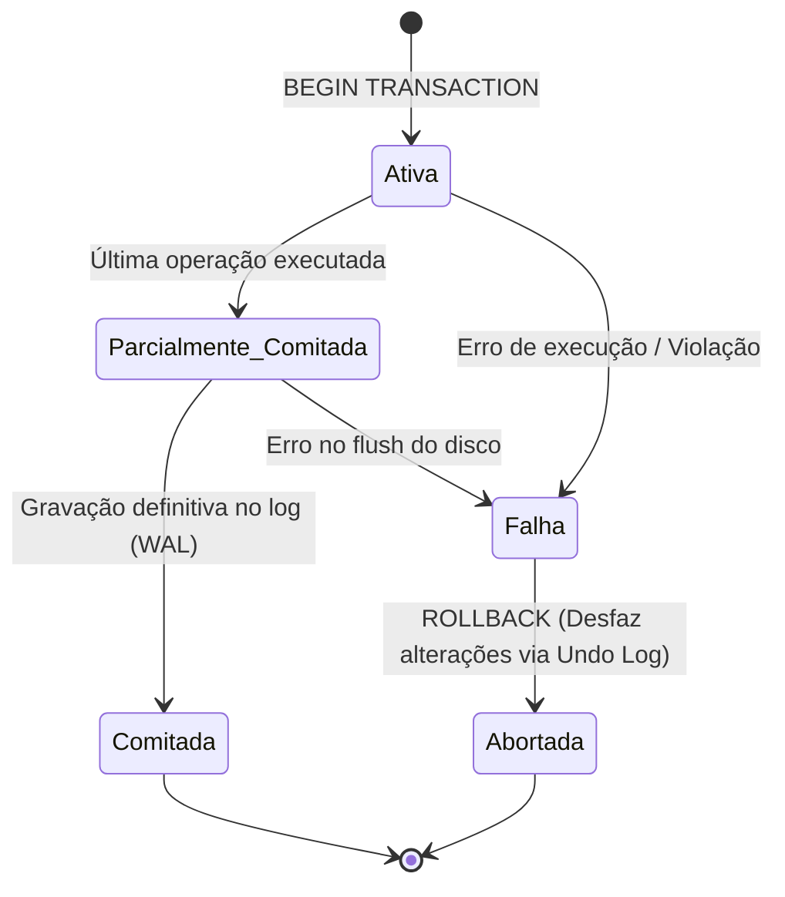
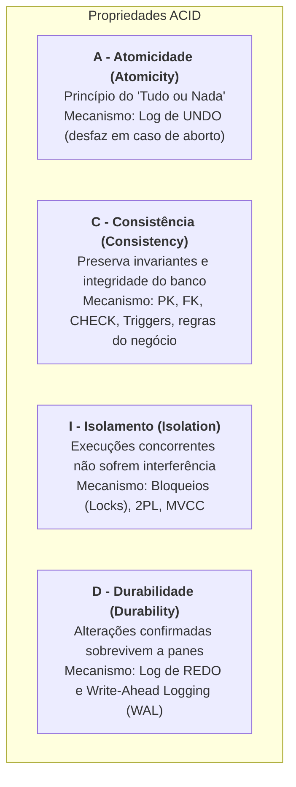
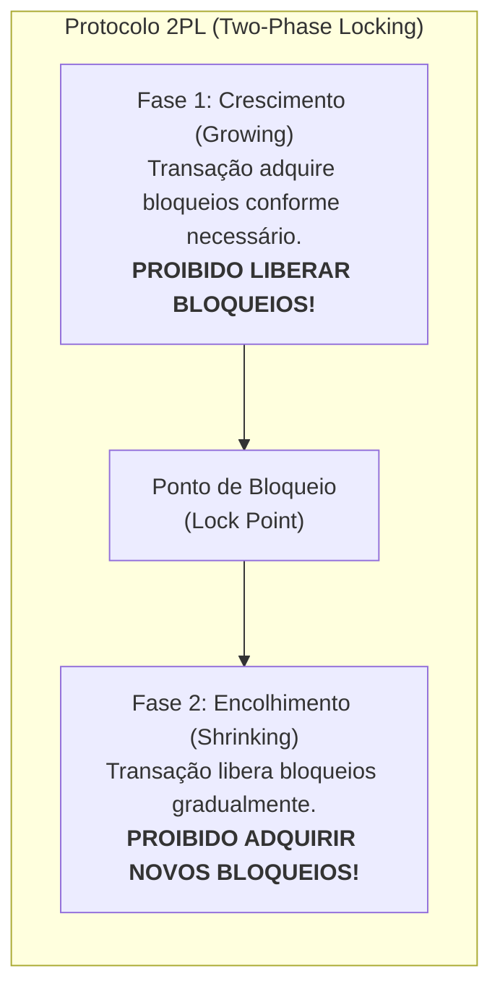
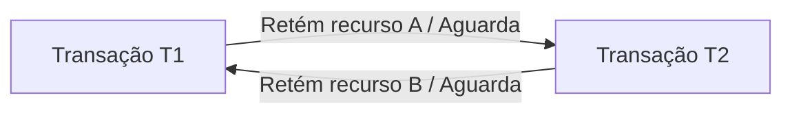

# 03 - Transações, Propriedades ACID e Concorrência

> **Matéria:** Banco de Dados  
> **Cargo:** B02 – Técnico de Controle Externo – Especialidade: Tecnologia da Informação  
> **Arquivo:** `03_transacoes_propriedades_acid_e_concorrencia.md`  

---

## 📌 Ementa / Itens do Edital
- Conceito de Transação de banco de dados
- As quatro propriedades fundamentais: ACID (Atomicidade, Consistência, Isolamento, Durabilidade)
- Comandos de controle transacional: COMMIT, ROLLBACK e SAVEPOINT
- Anomalias de concorrência (Leitura Suja, Leitura Não Repetível, Leitura Fantasma, Atualização Perdida)
- Níveis de Isolamento ANSI SQL
- Mecanismos de controle de concorrência: Bloqueios (Locks), 2PL, MVCC e Deadlocks

---

## 🧭 Sumário

1. [O Conceito Formal de Transação e o Modelo ACID](#1-o-conceito-formal-de-transacao-e-o-modelo-acid)
    1. [Ciclo de Vida e Estados de uma Transação](#11-ciclo-de-vida-e-estados-de-uma-transacao)
    2. [As Quatro Propriedades Fundamentais: ACID](#12-as-quatro-propriedades-fundamentais-acid)
    3. [Mecanismos Internos: Undo Log, Redo Log e Write-Ahead Logging (WAL)](#13-mecanismos-internos-undo-log-redo-log-e-write-ahead-logging-wal)
    4. [Teste 256](#Teste-256)
    5. [Teste 257](#Teste-257)
2. [Comandos de Controle Transacional (TCL)](#2-comandos-de-controle-transacional-tcl)
    1. [COMMIT, ROLLBACK e Gestão de SAVEPOINTs](#21-commit-rollback-e-gestao-de-savepoints)
    2. [Teste 258](#Teste-258)
3. [Fenômenos e Anomalias de Concorrência](#3-fenomenos-e-anomalias-de-concorrencia)
    1. [Leitura Suja (Dirty Read)](#31-leitura-suja-dirty-read)
    2. [Leitura Não Repetível (Non-Repeatable Read)](#32-leitura-nao-repetivel-non-repeatable-read)
    3. [Leitura Fantasma (Phantom Read)](#33-leitura-fantasma-phantom-read)
    4. [Atualização Perdida (Lost Update)](#34-atualizacao-perdida-lost-update)
    5. [Teste 259](#Teste-259)
4. [Níveis de Isolamento ANSI SQL-92](#4-niveis-de-isolamento-ansi-sql-92)
    1. [Matriz de Isolamento vs. Fenômenos Admitidos](#41-matriz-de-isolamento-vs-fenomenos-admitidos)
    2. [Snapshot Isolation (Isolamento por Instantâneo)](#42-snapshot-isolation-isolamento-por-instantaneo)
    3. [Teste 260](#Teste-260)
    4. [Teste 261](#Teste-261)
5. [Técnicas de Controle de Concorrência](#5-tecnicas-de-controle-de-concorrencia)
    1. [Bloqueios (Locks) e Matriz de Compatibilidade (Shared vs. Exclusive)](#51-bloqueios-locks-e-matriz-de-compatibilidade-shared-vs-exclusive)
    2. [Protocolo de Bloqueio em Duas Fases (2PL - Two-Phase Locking): Básico, Estrito e Rigoroso](#52-protocolo-de-bloqueio-em-duas-fases-2pl-two-phase-locking-basico-estrito-e-rigoroso)
    3. [Controle Multiversão de Concorrência (MVCC)](#53-controle-multiversao-de-concorrencia-mvcc)
    4. [Impasses (Deadlocks): Detecção via Wait-For Graph e Resolução por Transação Vítima](#54-impasses-deadlocks-deteccao-via-wait-for-graph-e-resolucao-por-transacao-vitima)
    5. [Teste 262](#Teste-262)
    6. [Teste 263](#Teste-263)
    7. [Teste 264](#Teste-264)
    8. [Teste 265](#Teste-265)
    9. [Teste 266](#Teste-266)
6. [🌐 Fontes Oficiais e Referências Bibliográficas](#fontes-oficiais-e-referencias-bibliograficas)

---

## 1. O Conceito Formal de Transação e o Modelo ACID

Uma **transação** de banco de dados é uma unidade lógica e atômica de processamento que agrupa uma ou mais instruções SQL (leitura e escrita) que devem ser executadas de modo estritamente indivisível. No contexto de auditoria e controle externo no setor público, uma transação típica é a liquidação de uma despesa orçamentária: o sistema deve simultaneamente debitar o saldo do empenho e creditar a conta bancária do fornecedor. Se apenas uma das ações ocorrer, o banco de dados entrará em colapso fiscal.

### 1.1 Ciclo de Vida e Estados de uma Transação

Durante sua existência, uma transação transita por estados formais bem definidos na teoria de sistemas relacionais:

- **Ativa (*Active*):** O estado inicial. A transação está sendo executada pela aplicação.
- **Parcialmente Comitada (*Partially Committed*):** A última instrução SQL foi processada na memória RAM, mas os dados ainda não foram gravados permanentemente no log em disco.
- **Comitada (*Committed*):** Todas as alterações foram confirmadas e gravadas no log transacional em armazenamento persistente (*Write-Ahead Logging*). A transação foi concluída com sucesso.
- **Falha (*Failed*):** Ocorre quando uma instrução viola uma restrição de integridade ou o sistema sofre interrupção antes da conclusão definitiva.
- **Abortada (*Aborted*):** O SGBD executa o comando `ROLLBACK`, desfazendo todas as modificações parciais já executadas e restaurando a base de dados ao estado exato anterior ao início da transação.

### 1.2 As Quatro Propriedades Fundamentais: ACID

Para que a integridade dos dados seja inviolável mesmo diante de falhas de hardware, interrupções de energia elétrica e concorrência massiva de usuários, o SGBD deve garantir integralmente as propriedades do acrônimo **ACID** (Jim Gray e Andreas Reuter):

1. **A - Atomicidade (*Atomicity*):**
    - Princípio do **"tudo ou nada"** (*all-or-nothing*). Todas as operações que compõem a transação são consolidadas em conjunto no banco de dados, ou nenhuma delas produzirá efeito algum. Não existe efetivação parcial de transação.

2. **C - Consistência (*Consistency*):**
    - Garante que a transação conduz o banco de dados de um **estado válido para outro estado igualmente válido**. A transação não pode violar nenhuma regra de integridade declarativa (chaves primárias, chaves estrangeiras, restrições `CHECK`, valores `NOT NULL`) ou procedimental (gatilhos e regras de negócio).

3. **I - Isolamento (*Isolation*):**
    - Assegura que a execução concomitante de múltiplas transações seja invisível entre si. Os efeitos intermediários e temporários de uma transação não comitada não podem ser observados por outras transações concorrentes. O resultado final deve equivaler a uma execução estritamente sequencial (*serializável*).

4. **D - Durabilidade (*Durability*):**
    - Garante que, uma vez que a transação foi confirmada com sucesso (`COMMIT`), suas modificações tornam-se **permanentes e indeléveis**. As alterações não serão perdidas sob nenhuma hipótese, resistindo até mesmo a falhas catastróficas de energia física ou travamentos no sistema operacional da máquina servidora.

### 1.3 Mecanismos Internos: Undo Log, Redo Log e Write-Ahead Logging (WAL)

- **Undo Log (Segmentos de Rollback):** Registra os valores **anteriores** à modificação. Se uma transação falhar ou for cancelada, o SGBD lê o Undo Log para restaurar os dados originais (garantindo a **Atomicidade**).
- **Redo Log / WAL (*Write-Ahead Logging*):** Registra os **novos** valores gerados pela transação.
    - **A Regra Inviolável do WAL:** O registro de log que descreve a alteração **deve ser gravado fisicamente em disco síncrono ANTES** que as páginas de dados correspondentes sejam descarregadas da memória RAM para os arquivos de dados (*datafiles*).
    - Isso garante a **Durabilidade**: se faltar energia imediatamente após o commit, o SGBD lê o Redo Log no boot de recuperação (*Crash Recovery*) e reaplica (*redo*) as alterações nas tabelas.

---

### Teste 256
**(FCC – TRT-13 – Analista Judiciário - Tecnologia da Informação – 2014)**
Em um ambiente de banco de dados Oracle 11g ideal, foram criadas duas tabelas por meio das instruções PL/SQL a seguir:  
CREATE TABLE orders (order_id NUMBER PRIMARY KEY, line_items_count NUMBER DEFAULT 0 ); 
CREATE TABLE lineitems (order_id REFERENCES orders,  seq_no   NUMBER, CONSTRAINT lineitems PRIMARY 
KEY(order_id,seq_no) );  
 Foi criada, relacionada às tabelas, a seguinte 
trigger, 
colocada em execução: 

CREATE OR REPLACE TRIGGER lineitems_trigger 
  AFTER INSERT OR UPDATE OR DELETE ON lineitems  
  FOR EACH ROW 
BEGIN 
  IF (INSERTING OR UPDATING) 
  THEN 
    UPDATE orders SET line_items_count = NVL(line_items_count,0)+1 
    WHERE order_id = :new.order_id; 
  END IF; 
  IF (DELETING OR UPDATING) 
  THEN 
    UPDATE orders SET line_items_count = NVL(line_items_count,0)-1 
    WHERE order_id = :old.order_id; 
  END IF; 
END; 
/  
 Em seguida, foram executadas as instruções abaixo, nesta ordem: 

INSERT INTO orders (order_id) VALUES (78); 
INSERT INTO orders(order_id) VALUES (92); 
INSERT INTO lineitems (order_id, seq_no) VALUES (78,1); 
INSERT INTO lineitems (order_id, seq_no) VALUES (78,2); 
SELECT * FROM orders;  
 Considere: 

 I. Ao executar a instrução INSERT INTO orders (order_id) VALUES (78);  a trigger  incrementou o valor contido no 
campo 
line_items_count
 passando de 0 para 1. 

 II.  Ao executar a instrução INSERT INTO lineitems (order_id, seq_no) VALUES (78,1);  a trigger  incrementou 
o valor contido no campo 
line_items_count
 da tabela 
orders
 passando de 0 para 1. 

 III.  Ao executar a instrução INSERT INTO lineitems (order_id, seq_no) VALUES (78,2);  a trigger  incrementou 
o valor contido no campo 
line_items_count
 da tabela 
orders
 passando de 1 para 2. 

 IV.  A instrução SELECT * FROM orders;  mostrará no campo line_items_count  da linha cujo order_id  é 78 o valor 3.  
 Está correto o que consta APENAS em

* **A)** I e IV.
* **B)** I.
* **C)** II e IV.
* **D)** II e III.
* **E)** III.

---

> **Comentário Detalhado:**
>
> - **A)** Incorreta. Discrepa das diretrizes normativas e jurisprudenciais aplicáveis ao tema objeto do item.
> - **B)** Incorreta. Discrepa das diretrizes normativas e jurisprudenciais aplicáveis ao tema objeto do item.
> - **C)** Incorreta. Discrepa das diretrizes normativas e jurisprudenciais aplicáveis ao tema objeto do item.
> - **D)** Incorreta. Discrepa das diretrizes normativas e jurisprudenciais aplicáveis ao tema objeto do item.
> - **E)** Correta. Representa com precisão a disciplina do tema e o entendimento pacificado adotado pela banca (FCC).
>
> **Gabarito: E**

---
### Teste 257
**(FGV – TJ-BA – Analista Judiciário - Tecnologia da Informação – 2015)**
Transações distribuídas em bancos de dados são caracterizadas 
pela participação de dois ou mais hosts ligados em rede. Um dos 
problemas para sua implementação é a garantia de que cada 
participante faça a sua parte, de modo que uma transação  seja 
corretamente completada. Um algoritmo usualmente utilizado 
nesse contexto é:

* **A)** Open Data Base Connection;
* **B)** Dynamic Serializability;
* **C)** Two phase commitment;
* **D)** Compensating transactions;
* **E)** Two phase lock.

---

> **Comentário Detalhado:**
>
> - **A)** Incorreta. Discrepa das diretrizes normativas e jurisprudenciais aplicáveis ao tema objeto do item.
> - **B)** Incorreta. Discrepa das diretrizes normativas e jurisprudenciais aplicáveis ao tema objeto do item.
> - **C)** Correta. Representa com precisão a disciplina do tema e o entendimento pacificado adotado pela banca (FGV).
> - **D)** Incorreta. Discrepa das diretrizes normativas e jurisprudenciais aplicáveis ao tema objeto do item.
> - **E)** Incorreta. Discrepa das diretrizes normativas e jurisprudenciais aplicáveis ao tema objeto do item.
>
> **Gabarito: C**

---
## 2. Comandos de Controle Transacional (TCL)

A linguagem SQL provê comandos dedicados para controlar as fronteiras transacionais:

### 2.1 COMMIT, ROLLBACK e Gestão de SAVEPOINTs

- **`COMMIT`:** Finaliza a transação com sucesso, gravando definitivamente todas as alterações pendentes no log transacional e liberando todos os bloqueios (*locks*) de recursos retidos.
- **`ROLLBACK`:** Cancela integralmente a transação, desfazendo todas as operações pendentes desde o `BEGIN TRANSACTION` e restaurando a base ao estado inicial.
- **`SAVEPOINT nome_ponto`:** Estabelece um **marco intermediário de salvamento** dentro de uma transação aberta.
- **`ROLLBACK TO SAVEPOINT nome_ponto`:** Reverte as operações executadas **apenas após o marco especificado**, mantendo preservadas as instruções anteriores ao savepoint. **Atenção:** O comando `ROLLBACK TO SAVEPOINT` **NÃO encerra a transação**; ela permanece aberta aguardando novas instruções ou a finalização formal com `COMMIT` ou `ROLLBACK` total.

---

### Teste 258
**(FGV – TRT – Analista Judiciário - Suporte e Infraestrutura de TI – 2022)**
No processamento de transações distribuídas em gerenciadores 
de bancos de dados, o algoritmo frequentemente em pregado 
para garantir que todos os participantes de uma transação 
distribuída tenham conhecimento do seu desfecho é conhecido 
como:

* **A)** D-commit;
* **B)** Dynamic Data Exchange;
* **C)** Liveness;
* **D)** Multi-commit;
* **E)** Two-phase commit.

---

> **Comentário Detalhado:**
>
> - **A)** Correta. Representa com precisão a disciplina do tema e o entendimento pacificado adotado pela banca (FGV).
> - **B)** Incorreta. Discrepa das diretrizes normativas e jurisprudenciais aplicáveis ao tema objeto do item.
> - **C)** Incorreta. Discrepa das diretrizes normativas e jurisprudenciais aplicáveis ao tema objeto do item.
> - **D)** Incorreta. Discrepa das diretrizes normativas e jurisprudenciais aplicáveis ao tema objeto do item.
> - **E)** Incorreta. Discrepa das diretrizes normativas e jurisprudenciais aplicáveis ao tema objeto do item.
>
> **Gabarito: A**

---
## 3. Fenômenos e Anomalias de Concorrência

Quando múltiplas transações concorrem pelo acesso aos mesmos dados sem controle de concorrência estrito, quatro anomalias clássicas podem se manifestar:

### 3.1 Leitura Suja (Dirty Read)
- **Definição:** Ocorre quando uma transação $T_1$ modifica uma linha no buffer, a transação $T_2$ lê esse valor ainda **não comitado**, e logo em seguida a transação $T_1$ sofre um **`ROLLBACK`**.
- **Impacto:** A transação $T_2$ tomou decisões de negócio baseando-se em um dado ilegítimo que nunca existiu formalmente no banco de dados.

### 3.2 Leitura Não Repetível (Non-Repeatable Read)
- **Definição:** Ocorre quando a transação $T_1$ consulta uma linha específica. Em seguida, a transação $T_2$ altera ou apaga essa exata linha e executa **`COMMIT`**. Posteriormente, a transação $T_1$ relê a mesma linha e encontra valores divergentes ou constata que ela foi removida.
- **Impacto:** Consultas idênticas sobre a mesma linha dentro do mesmo escopo transacional retornam valores distintos.

### 3.3 Leitura Fantasma (Phantom Read)
- **Definição:** Ocorre quando a transação $T_1$ executa uma consulta filtrando um intervalo de dados (ex.: `SELECT * FROM contratos WHERE valor > 500000`) e recupera 10 tuplas. Em seguida, a transação $T_2$ insere novas linhas que atendem a esse predicado e executa **`COMMIT`**. Quando $T_1$ reexecuta a mesma consulta de intervalo, obtém 12 tuplas.
- **Impacto:** Surgem novos registros ("fantasmas") que satisfazem a condição de busca no curso da mesma transação.

### 3.4 Atualização Perdida (Lost Update)
- **Definição:** Duas transações ($T_1$ e $T_2$) leem simultaneamente a mesma tupla (ex.: saldo = 100). Ambas realizam cálculos locais independentes ($T_1$ soma 50; $T_2$ subtrai 30) e gravam os novos valores. A gravação mais tardia sobrescreve a anterior sem considerar seu cálculo, perdendo uma das atualizações.

---

### Teste 259
**(FGV – TJ-RR – Analista Judiciário - Suporte e Infraestrutura de TI – 2024)**
A maioria dos projetos de computadores modernos baseia -se em 
conceitos desenvolvidos por John Von Neumann. Para a execução de 
uma instrução, diversos componentes do sistema computacional são 
envolvidos, tais como pro cessadores, barramentos, operadores 
lógicos e memórias. O ciclo de execução de uma instrução pode 
abranger várias operações, dependendo da natureza da instrução. 
A seguir são apresentadas quatro etapas do ciclo de execução de 
uma instrução. 
I. A busca do código de operação na memória principal, localizado 
no endereço indicado pelo Ciclo de Instrução, e seu 
armazenamento no Registrador de Instrução. 
II. A Unidade de Controle comanda a execução da instrução e, se 
necessário, processa os dados disponíveis nos registradores. 
III. Caso a instrução exija, a Unidade de Controle busca o(s) dado(s) 
na memória e os armazena nos registradores. Esta fase se repete 
até que todos os dados necessários à execução sejam 
transferidos. 
IV. O Decodificador de Instrução decodifi ca o código de operação 
contido no Registrador de Instrução. 
A sequência correta dessas etapas, desde o início até a execução da 
instrução, é

* **A)** III – I – IV – II.
* **B)** I – III – IV – II.
* **C)** I – IV – III – II.
* **D)** III – I – II – IV.
* **E)** III – IV – I – II.

---

> **Comentário Detalhado:**
>
> - **A)** Correta. Representa com precisão a disciplina do tema e o entendimento pacificado adotado pela banca (FGV).
> - **B)** Incorreta. Discrepa das diretrizes normativas e jurisprudenciais aplicáveis ao tema objeto do item.
> - **C)** Incorreta. Discrepa das diretrizes normativas e jurisprudenciais aplicáveis ao tema objeto do item.
> - **D)** Incorreta. Discrepa das diretrizes normativas e jurisprudenciais aplicáveis ao tema objeto do item.
> - **E)** Incorreta. Discrepa das diretrizes normativas e jurisprudenciais aplicáveis ao tema objeto do item.
>
> **Gabarito: A**

---
## 4. Níveis de Isolamento ANSI SQL-92

A norma ANSI/ISO SQL-92 estabelece quatro níveis canônicos de isolamento transacional, regulados pela tolerância ou bloqueio formal às anomalias de concorrência:

### 4.1 Matriz de Isolamento vs. Fenômenos Admitidos

| Nível de Isolamento | Leitura Suja (*Dirty Read*) | Leitura Não Repetível (*Non-Repeatable Read*) | Leitura Fantasma (*Phantom Read*) | Mecanismo Típico de Implementação |
| :--- | :---: | :---: | :---: | :--- |
| **`READ UNCOMMITTED`** | ❌ **Permite** | ❌ **Permite** | ❌ **Permite** | Leituras sem bloqueios; não gera snapshots. |
| **`READ COMMITTED`** | ✅ **Previne** | ❌ **Permite** | ❌ **Permite** | Lê apenas dados já comitados. Cada instrução `SELECT` tira um novo snapshot. *(Padrão em PostgreSQL e Oracle)* |
| **`REPEATABLE READ`** | ✅ **Previne** | ✅ **Previne** | ❌ **Permite** *(no ANSI)* | Lê o snapshot gerado no instante em que a primeira instrução da transação iniciou. *(Padrão no MySQL InnoDB)* |
| **`SERIALIZABLE`** | ✅ **Previne** | ✅ **Previne** | ✅ **Previne** | Bloqueios de predicado / Range Locks ou SSI (*Serializable Snapshot Isolation*). Simula execução serial estrita. |

> 🚨 **ALERTA DE PROVA / PEGADINHA FCC:**  
>
> 1. *"Qual o nível de isolamento MÍNIMO que impede Leitura Não Repetível?"* $\rightarrow$ **`REPEATABLE READ`**.
> 2. No PostgreSQL, a implementação prática do nível `REPEATABLE READ` via MVCC impede também leituras fantasmas; contudo, nas questões teóricas da FCC baseadas estritamente no **padrão ANSI SQL-92**, o candidato deve assinalar que o `REPEATABLE READ` **admite Leitura Fantasma**!
> 3. O único nível do padrão ANSI que previne **todos os três fenômenos** é o **`SERIALIZABLE`**.

### 4.2 Snapshot Isolation (Isolamento por Instantâneo)

Implementado em motores que utilizam controle de concorrência multiversão (MVCC):

- No início da transação, o SGBD captura uma "fotografia" lógica (*snapshot*) do banco baseada no número de transação (*Transaction ID - XID*).
- Todas as consultas daquela transação enxergam estritamente o estado dos dados consolidado no momento do snapshot, impedindo Leituras Não Repetíveis e Leituras Fantasmas sem a necessidade de adquirir bloqueios pesados de leitura.

---

### Teste 260
**(FGV – TJ-RR – Analista Judiciário - Governança e Gestão de TI – 2024)**
A maioria dos projetos de computadores modernos baseia -se em 
conceitos desenvolvidos por John Von Neumann. Para a execução de 
uma instrução, diversos componentes do sistema computacional são 
envolvidos, tais como processadores, barramentos, operadores 
lógicos e memórias. O ciclo de execução de uma instrução pode 
abranger várias operações, dependendo da natureza da instrução. 
A seguir, são apresentadas quatro etapas do ciclo de execução de 
uma instrução: 
I. A busca do código de operação na memória principal, localizado 
no endereço indicado pelo Ciclo de Instrução, e seu 
armazenamento no Registrador de Instrução. 
II. A Unidade de Controle comanda a execução da instrução e, se 
necessário, processa os dados disponíveis nos registradores. 
III. Caso a instrução exija, a Unidade de Controle busca o(s) dado(s) 
na memória e os armazena nos registradores. Esta fase se repete 
até que todos os dados necessários à execução sejam 
transferidos. 
IV. O Decodificador de Instrução decodifica o código de operação 
contido no Registrador de Instrução. 
A sequência correta dessas etapas, desde o início até a execução da 
instrução, é

* **A)** III – I – IV – II.
* **B)** I – III – IV – II.
* **C)** I – IV – III – II.
* **D)** III – I – II – IV.
* **E)** III – IV – I – II.

---

> **Comentário Detalhado:**
>
> - **A)** Correta. Representa com precisão a disciplina do tema e o entendimento pacificado adotado pela banca (FGV).
> - **B)** Incorreta. Discrepa das diretrizes normativas e jurisprudenciais aplicáveis ao tema objeto do item.
> - **C)** Incorreta. Discrepa das diretrizes normativas e jurisprudenciais aplicáveis ao tema objeto do item.
> - **D)** Incorreta. Discrepa das diretrizes normativas e jurisprudenciais aplicáveis ao tema objeto do item.
> - **E)** Incorreta. Discrepa das diretrizes normativas e jurisprudenciais aplicáveis ao tema objeto do item.
>
> **Gabarito: A**

---
### Teste 261
**(FCC – TRT-6 – Analista Judiciário - Tecnologia da Informação – 2012)**
Considere os seguintes comandos em PL/SQL: 

CREATE TABLE VALORES (ID INT NOT NULL PRIMARY KEY,VALOR INT); 
INSERT INTO VALORES VALUES (1,5); 
INSERT INTO VALORES VALUES (1,6); 
INSERT INTO VALORES VALUES (NULL,7); 
INSERT INTO VALORES VALUES (2,1); 
INSERT INTO VALORES VALUES (2,8); 
INSERT INTO VALORES VALUES (3,9); 
INSERT INTO VALORES VALUES (NULL,10); 
SELECT COUNT(VALOR) FROM VALORES WHERE VALOR >= 5; 

A consulta retornará o valor

* **A)** 2.
* **B)** 14.
* **C)** 6.
* **D)** 29.
* **E)** 5.

---

> **Comentário Detalhado:**
>
> - **A)** Incorreta. Discrepa das diretrizes normativas e jurisprudenciais aplicáveis ao tema objeto do item.
> - **B)** Incorreta. Discrepa das diretrizes normativas e jurisprudenciais aplicáveis ao tema objeto do item.
> - **C)** Incorreta. Discrepa das diretrizes normativas e jurisprudenciais aplicáveis ao tema objeto do item.
> - **D)** Correta. Representa com precisão a disciplina do tema e o entendimento pacificado adotado pela banca (FCC).
> - **E)** Incorreta. Discrepa das diretrizes normativas e jurisprudenciais aplicáveis ao tema objeto do item.
>
> **Gabarito: D**

---
## 5. Técnicas de Controle de Concorrência

### 5.1 Bloqueios (Locks) e Matriz de Compatibilidade (Shared vs. Exclusive)

O controle pessimista de concorrência baseia-se na alocação de travas (*locks*) sobre tuplas, páginas ou tabelas:

- **Bloqueio Compartilhado (Shared Lock - S):** Solicitado para operações de leitura (`SELECT`). Múltiplas transações podem reter simultaneamente bloqueios compartilhados sobre o mesmo registro.
- **Bloqueio Exclusivo (Exclusive Lock - X):** Solicitado para operações de modificação (`INSERT`, `UPDATE`, `DELETE`). Apenas uma transação pode reter o bloqueio exclusivo; nenhuma outra transação pode obter bloqueio S ou X sobre a mesma linha até sua liberação.

| Bloqueio Solicitado \ Bloqueio Existente | Shared (S) | Exclusive (X) |
| :---: | :---: | :---: |
| **Shared (S)** | ✅ **Compatível** (Permitido) | ❌ Conflito (Aguarda liberação) |
| **Exclusive (X)** | ❌ Conflito (Aguarda liberação) | ❌ Conflito (Aguarda liberação) |

### 5.2 Protocolo de Bloqueio em Duas Fases (2PL - Two-Phase Locking): Básico, Estrito e Rigoroso

O protocolo **2PL** é o algoritmo matemático que garante a **serializabilidade** das escalas de execução concorrente:

- **Regra Fundamental do 2PL Básico:** A transação possui duas fases estanques:
    1. *Fase de Crescimento (*Growing Phase*):* A transação pode adquirir quantos bloqueios precisar, mas **é terminantemente proibida de liberar qualquer bloqueio**.
    2. *Fase de Encolhimento (*Shrinking Phase*):* A transação pode liberar bloqueios já utilizados, mas **é terminantemente proibida de adquirir novos bloqueios**.

- **Strict 2PL (2PL Estrito):** Todos os bloqueios **exclusivos (X)** devem ser mantidos até o fim definitivo da transação (`COMMIT` ou `ROLLBACK`). Evita abortos em cascata (*cascadeless schedules*).
- **Rigorous 2PL (2PL Rigoroso):** Todos os bloqueios (tanto **compartilhados - S** quanto **exclusivos - X**) devem ser mantidos até o `COMMIT` ou `ROLLBACK`. É a variante mais utilizada na prática por garantir serializabilidade estrita.

> 🚨 **ALERTA DE PROVA / PEGADINHA FCC:**  
> O protocolo 2PL garante a **serializabilidade**, mas **NÃO evita impasses (*deadlocks*)**! Transações operando sob o 2PL básico podem sofrer deadlocks frequentemente.

### 5.3 Controle Multiversão de Concorrência (MVCC)

Adotado nativamente por PostgreSQL e Oracle:

- **Princípio:** *"Leitores nunca bloqueiam escritores, e escritores nunca bloqueiam leitores."*
- **Mecanismo:** Ao atualizar uma linha, o SGBD não sobrescreve os dados no mesmo local; ele cria uma **nova versão física da tupla** contendo metadados de cabeçalho:
    - No PostgreSQL: `xmin` (ID da transação criadora) e `xmax` (ID da transação que apagou ou gerou versão superior).
    - Leitores consultam versões visíveis compatíveis com o seu instante temporal (*snapshot*), garantindo alto rendimento de leitura e escrita concorrentes.

### 5.4 Impasses (Deadlocks): Detecção via Wait-For Graph e Resolução por Transação Vítima

Um **deadlock** ocorre quando duas ou mais transações entram em estado de bloqueio mútuo e circular: a transação $T_1$ retém o recurso $A$ e aguarda o recurso $B$, enquanto a transação $T_2$ retém o recurso $B$ e aguarda o recurso $A$. Nenhuma das transações consegue prosseguir.

- **Detecção via Wait-For Graph (Grafo de Espera):** O SGBD constrói dinamicamente um grafo direcionado onde os nós são transações e as arestas indicam dependências de espera. **A detecção de um ciclo no grafo sinaliza formalmente um deadlock**.
- **Resolução via Transação Vítima:** Ao detectar o ciclo, o SGBD seleciona uma **transação vítima** (com base em critérios de menor custo computacional ou menor volume de dados alterados), aborta sua execução compulsoriamente via `ROLLBACK` forçado e devolve o erro à aplicação cliente.
- **Técnicas de Prevenção por Timestamps:**
    - *Wait-Die (Não-preemptivo):* Se a transação mais antiga solicitar recurso retido pela mais nova, ela espera (*wait*); se a mais nova solicitar recurso retido pela mais antiga, a mais nova morre (*die/rollback*).
    - *Wound-Wait (Preemptivo):* Se a transação mais antiga solicitar recurso retido pela mais nova, ela fere e aborta a mais nova (*wound/preempt*); se a mais nova solicitar da mais antiga, ela espera (*wait*).

---

### Teste 262
**(FGV – TJ-AP – Analista Judiciário - Banco de Dados – 2023)**
O mecanismo de recuperação de banco de dados precisa garantir 
que uma transação possa ser desfeita. Para execução do rollback 
em cascata são necessárias entradas de log do(s) valor(es):

* **A)** novo;
* **B)** antigo;
* **C)** antigo e novo;
* **D)** write-ahead;
* **E)** undo/redo.

---

> **Comentário Detalhado:**
>
> - **A)** Incorreta. Discrepa das diretrizes normativas e jurisprudenciais aplicáveis ao tema objeto do item.
> - **B)** Incorreta. Discrepa das diretrizes normativas e jurisprudenciais aplicáveis ao tema objeto do item.
> - **C)** Incorreta. Discrepa das diretrizes normativas e jurisprudenciais aplicáveis ao tema objeto do item.
> - **D)** Correta. Representa com precisão a disciplina do tema e o entendimento pacificado adotado pela banca (FGV).
> - **E)** Incorreta. Discrepa das diretrizes normativas e jurisprudenciais aplicáveis ao tema objeto do item.
>
> **Gabarito: D**

---
### Teste 263
**(FGV – TJ-AP – Analista Judiciário - Banco de Dados – 2023)**
No contexto de transações em banco de dados, a transação T1 
está inserindo um novo registro na tabela TB_JUIZ. Enquanto isso, 
a transação T2 está lendo todos os registros de TB_JUIZ para 
gerar uma listagem. Considere que: 
- T1 iniciou antes de T2; 
- T1 ainda não concluiu; e 
- T2 não enxerga o registro que está sendo inserido por T1. 
A situação apresentada acima representa um:

* **A)** bloqueio por inanição;
* **B)** bloqueio do tipo Latches;
* **C)** conflito causado por um registro fantasma;
* **D)** conflito lógico entre T1 e T2, com bloqueio do item (registro) 
que está sendo inserido por T1;
* **E)** deadlock que pode ser prevenido pelo esquema esperar-morrer 
(wait-die).

---

> **Comentário Detalhado:**
>
> - **A)** Incorreta. Discrepa das diretrizes normativas e jurisprudenciais aplicáveis ao tema objeto do item.
> - **B)** Incorreta. Discrepa das diretrizes normativas e jurisprudenciais aplicáveis ao tema objeto do item.
> - **C)** Incorreta. Discrepa das diretrizes normativas e jurisprudenciais aplicáveis ao tema objeto do item.
> - **D)** Incorreta. Discrepa das diretrizes normativas e jurisprudenciais aplicáveis ao tema objeto do item.
> - **E)** Correta. Representa com precisão a disciplina do tema e o entendimento pacificado adotado pela banca (FGV).
>
> **Gabarito: E**

---
### Teste 264
**(FGV – TJ-AP – Analista Judiciário - Banco de Dados – 2023)**
Um sistema de banco de dados envolve quatro component es 
principais: dados, hardware, software e usuários. O sistema 
gerenciador de banco de dados é um software que:

* **A)** abstrai o modelo conceitual;
* **B)** limita a independência lógica de dados;
* **C)** isola os usuários do banco de dados dos detalhes do nível de 
hardware;
* **D)** deve ser parametrizado para atender ao sistema de 
processamento analítico online;
* **E)** elimina a redundância do sistema de processamento de 
transações online.

---

> **Comentário Detalhado:**
>
> - **A)** Incorreta. Discrepa das diretrizes normativas e jurisprudenciais aplicáveis ao tema objeto do item.
> - **B)** Incorreta. Discrepa das diretrizes normativas e jurisprudenciais aplicáveis ao tema objeto do item.
> - **C)** Incorreta. Discrepa das diretrizes normativas e jurisprudenciais aplicáveis ao tema objeto do item.
> - **D)** Incorreta. Discrepa das diretrizes normativas e jurisprudenciais aplicáveis ao tema objeto do item.
> - **E)** Correta. Representa com precisão a disciplina do tema e o entendimento pacificado adotado pela banca (FGV).
>
> **Gabarito: E**

---
### Teste 265
**(FGV – TJ-AP – Analista Judiciário - Banco de Dados – 2023)**
Observe o seguinte script de criação da tabela “Empresa” e 
outros objetos em Oracle: 

CREATE TABLE empresa ( 
    empresa_ID NUMBER(12) PRIMARY KEY, 
    razao_social VARCHAR2(50) NOT NULL 
); 

CREATE SEQUENCE sq_empresa_pk 
  START WITH 2 
  INCREMENT BY 2 
  NOMAXVALUE 
  NOCACHE 
  NOCYCLE; 

CREATE OR REPLACE TRIGGER trg_bi_empresa 
    BEFORE INSERT ON empresa 
    FOR EACH ROW WHEN (NEW.empresa_ID IS NULL) 
BEGIN 
    SELECT sq_empresa_pk.NEXTVAL INTO 
:NEW.empresa_ID FROM dual; 
END; 

Após a execução do script anteriormente apresentado, analise a 
execução dos seguintes comandos: 

INSERT INTO empresa (empresa_ID, razao_social) 
VALUES (NULL, 'AAA'); 
INSERT INTO empresa (razao_social) VALUES ('BBB'); 
INSERT INTO empresa (empresa_ID, razao_social) 
VALUES (1, 'CCC'); 
INSERT INTO empresa (empresa_ID, razao_social) 
VALUES (5, 'DDD'); 
INSERT INTO empresa (empresa_ID, razao_social) 
VALUES (6, 'EEE'); 
INSERT INTO empresa (razao_social) VALUES  
('FFF'); 
COMMIT; 

Após a execução dos comandos apresentados, é correto afirmar 
que:

* **A)** foram inseridas 6 (seis) l inhas e o número final para 
sq_empresa_pk.CURRVAL é igual a 6 (seis);
* **B)** nenhuma linha pode ser inserida e o número final para 
sq_empresa_pk.CURRVAL é igual a 2 (dois);
* **C)** foram inseridas 5 (cinco) linhas e o número final para 
sq_empresa_pk.CURRVAL é igual a 6 (seis);
* **D)** foram inseridas 5 (cinco) linhas e o número final para 
sq_empresa_pk.CURRVAL é igual a 4 (quatro);
* **E)** foram inseridas 4 (quatro) linhas e o número final para 
sq_empresa_pk.CURRVAL é igual a 4 (quatro).

---

> **Comentário Detalhado:**
>
> - **A)** Incorreta. Discrepa das diretrizes normativas e jurisprudenciais aplicáveis ao tema objeto do item.
> - **B)** Incorreta. Discrepa das diretrizes normativas e jurisprudenciais aplicáveis ao tema objeto do item.
> - **C)** Correta. Representa com precisão a disciplina do tema e o entendimento pacificado adotado pela banca (FGV).
> - **D)** Incorreta. Discrepa das diretrizes normativas e jurisprudenciais aplicáveis ao tema objeto do item.
> - **E)** Incorreta. Discrepa das diretrizes normativas e jurisprudenciais aplicáveis ao tema objeto do item.
>
> **Gabarito: C**

---
### Teste 266
**(FGV – TJ-AP – Analista Judiciário - Banco de Dados – 2023)**
Transação é uma unidade l ógica de trabalho e é fundamental 
para garantir a integridade e a consistência dos dados. Observe o 
seguinte script de uma transação implementada no MySQL: 

CREATE TABLE candidato (id  INT, nome CHAR (50), 
INDEX (id)); 
START TRANSACTION; 
INSERT INTO candidato VALUES (1, 'JULIA'); 
INSERT INTO candidato VALUES (2, 'MARIA'); 
COMMIT; 
SET autocommit = 0; 
INSERT INTO candidato VALUES (3, 'SOFIA'); 
UPDATE candidato SET nome='ANA' WHERE id=3; 
DELETE FROM candidato WHERE nome='JULIA'; 
ROLLBACK; 
SELECT * FROM candidato; 

Após a execução do script apresentado, a consulta retornará as 
colunas id e nome com os valores:

* **A)** 2,MARIA
* **B)** 1,JULIA 2,MARIA
* **C)** 1,JULIA 2,MARIA 3,SOFIA
* **D)** 1,JULIA 2,MARIA 3,ANA
* **E)** 2,MARIA 3,ANA

---

> **Comentário Detalhado:**
>
> - **A)** Incorreta. Discrepa das diretrizes normativas e jurisprudenciais aplicáveis ao tema objeto do item.
> - **B)** Incorreta. Discrepa das diretrizes normativas e jurisprudenciais aplicáveis ao tema objeto do item.
> - **C)** Incorreta. Discrepa das diretrizes normativas e jurisprudenciais aplicáveis ao tema objeto do item.
> - **D)** Correta. Representa com precisão a disciplina do tema e o entendimento pacificado adotado pela banca (FGV).
> - **E)** Incorreta. Discrepa das diretrizes normativas e jurisprudenciais aplicáveis ao tema objeto do item.
>
> **Gabarito: D**

---
## 🌐 Fontes Oficiais e Referências Bibliográficas

* [PostgreSQL 17 Official Documentation - Concurrency Control and MVCC](https://www.postgresql.org/docs/current/mvcc.html) - Controle de concorrência multiversão, níveis de isolamento (Read Committed, Repeatable Read, Serializable).
* [PostgreSQL 17 Official Documentation - Write-Ahead Logging (WAL)](https://www.postgresql.org/docs/current/wal-intro.html) - Registro em log prévio para garantia de durabilidade (D) e atomicidade (A) em transações ACID.
* [Oracle Database 19c Documentation - Transactions and Concurrency](https://docs.oracle.com/en/database/oracle/oracle-database/19/cncpt/transactions.html) - Bloqueios, serializabilidade, Savepoints e controle de transações concorrentes.
* [Martin Kleppmann - Transactions and Isolation Levels in Distributed Systems](https://martinfowler.com/articles/patterns-of-distributed-systems/) - Análise formal das anomalias de concorrência (Dirty Read, Non-repeatable Read, Phantom Read e Write Skew).
* SILBERSCHATZ, Abraham; KORTH, Henry F.; SUDARSHAN, S. **Sistema de Banco de Dados**. 7. ed. Rio de Janeiro: GEN LTC, 2020. (Cap. 17 - Transações; Cap. 18 - Controle de Concorrência; Cap. 19 - Sistema de Recuperação).
* ELMASRI, Ramez; NAVATHE, Shamkant B. **Sistemas de Banco de Dados**. 7. ed. São Paulo: Pearson, 2019. (Cap. 20 - Conceitos de Processamento de Transações; Cap. 21 - Técnicas de Controle de Concorrência).
* KLEPPMANN, Martin. **Projetando Aplicações Intensivas em Dados: As Ideias Confiáveis por Trás de Sistemas Escaláveis**. São Paulo: Novatec, 2018. (Cap. 7 - Transações e Níveis de Isolamento).
