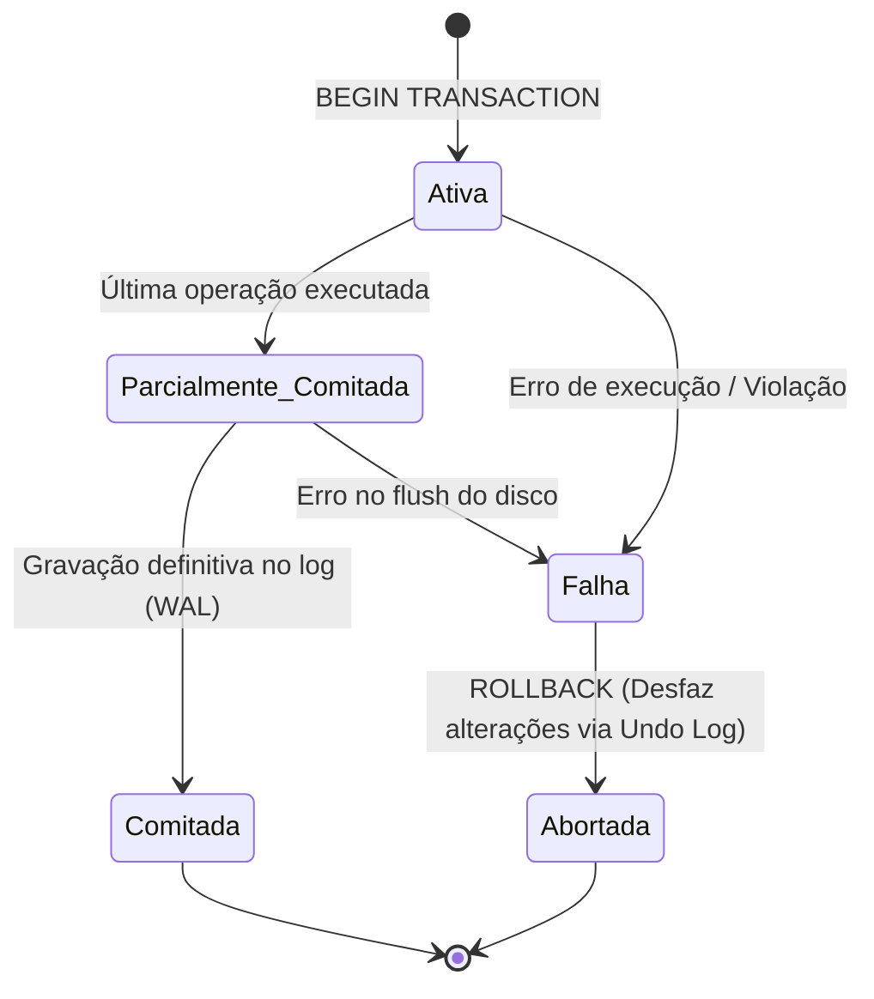
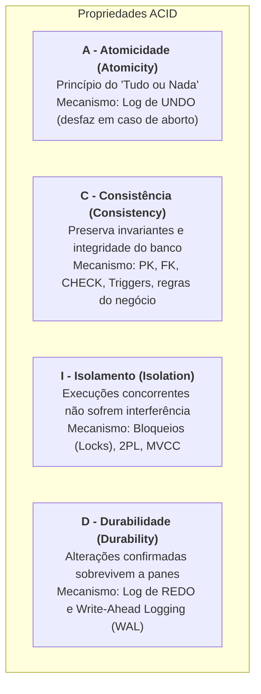
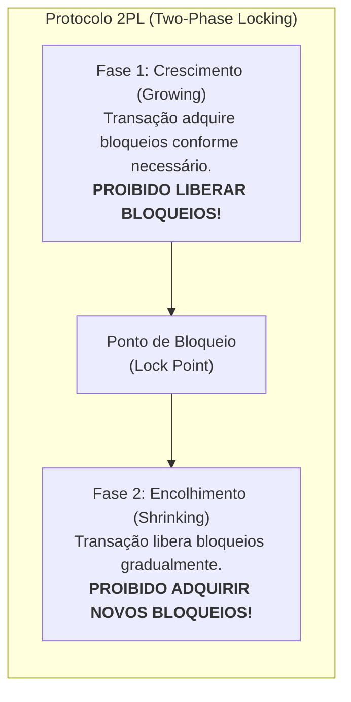
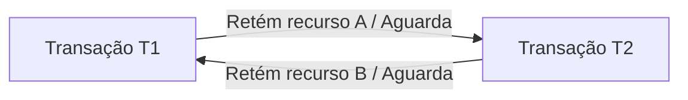

# 03 - Transações, Propriedades ACID e Concorrência

> **Matéria:** Banco de Dados  
> **Cargo:** B02 – Técnico de Controle Externo – Especialidade: Tecnologia da Informação  
> **Arquivo:** `03_transacoes_propriedades_acid_e_concorrencia.md`  

---

## 📌 Ementa / Itens do Edital
- Conceito de Transação de banco de dados
- As quatro propriedades fundamentais: ACID (Atomicidade, Consistência, Isolamento, Durabilidade)
- Comandos de controle transacional: COMMIT, ROLLBACK e SAVEPOINT
- Anomalias de concorrência (Leitura Suja, Leitura Não Repetível, Leitura Fantasma, Atualização Perdida)
- Níveis de Isolamento ANSI SQL
- Mecanismos de controle de concorrência: Bloqueios (Locks), 2PL, MVCC e Deadlocks

---

## 🌳 Classificação Hierárquica

```text
3. Transações, Propriedades ACID e Controle de Concorrência
├── 3.1 As Propriedades ACID
│   ├── 3.1.1 Atomicidade (Atomicity): Princípio do "tudo ou nada"; todas as operações da transação são efetivadas com sucesso ou todas são revertidas (gerenciada pelo subsistema de recuperação e log de Undo)
│   ├── 3.1.2 Consistência (Consistency): A transação leva o banco de um estado válido a outro estado válido, respeitando todas as regras de integridade (PK, FK, CHECK, triggers)
│   ├── 3.1.3 Isolamento (Isolation): A execução concomitante de transações não interfere entre si; o resultado é como se fossem executadas sequencialmente (gerenciada por locks e MVCC)
│   └── 3.1.4 Durabilidade (Durability): Uma vez concluída (commit), as alterações tornam-se permanentes no banco, sobrevivendo até a quedas de energia e falhas de sistema (gerenciada por logs de Redo e WAL)
├── 3.2 Anomalias e Fenômenos de Concorrência
│   ├── 3.2.1 Leitura Suja (Dirty Read): Transação lê dados alterados por outra transação que ainda NÃO fez commit (e que pode sofrer rollback)
│   ├── 3.2.2 Leitura Não Repetível (Non-Repeatable Read): Transação lê a mesma linha duas vezes e obtém valores diferentes porque outra transação alterou e comitou a linha no intervalo
│   ├── 3.2.3 Leitura Fantasma (Phantom Read): Transação executa uma consulta com filtro de intervalo (WHERE idade > 30) duas vezes e obtém um conjunto com NOVAS linhas inseridas por outra transação comitada
│   └── 3.2.4 Atualização Perdida (Lost Update): Duas transações leem o mesmo dado simultaneamente e ambas gravam uma atualização, onde a última sobrescreve a primeira sem considerar seu cálculo
├── 3.3 Níveis de Isolamento ANSI SQL
│   ├── 3.3.1 Matriz de Níveis vs. Fenômenos Permitidos:
│   │   ├── READ UNCOMMITTED: Permite Leitura Suja, Não Repetível e Fantasma (isolamento mínimo)
│   │   ├── READ COMMITTED: Previne Leitura Suja; Permite Não Repetível e Fantasma (padrão em PostgreSQL e Oracle)
│   │   ├── REPEATABLE READ: Previne Leitura Suja e Não Repetível; Permite Leitura Fantasma (padrão no MySQL InnoDB)
│   │   └── SERIALIZABLE: Previne TODOS os fenômenos (isolamento máximo, simula execução estritamente sequencial)
│   └── 3.3.2 Snapshot Isolation (Isolamento por Instantâneo no MVCC): Leituras operam em uma "fotografia" do banco no momento do início da transação
└── 3.4 Técnicas de Controle de Concorrência
    ├── 3.4.1 Controle Baseado em Bloqueios (Locks):
    │   ├── Tipos: Bloqueio Compartilhado (Shared Lock - S, para leitura) vs. Bloqueio Exclusivo (Exclusive Lock - X, para escrita)
    │   ├── Granularidade: Bloqueio de banco, tabela, página ou linha (Row-Level Locking)
    │   └── Protocolo de Bloqueio em Duas Fases (2PL - Two-Phase Locking): Fase de Crescimento (adquire locks, não libera) e Fase de Encolhimento (libera locks, não adquire novos); garante serializabilidade
    ├── 3.4.2 Controle Multiversão (MVCC - Multi-Version Concurrency Control):
    │   ├── Princípio: "Leitores nunca bloqueiam escritores, escritores nunca bloqueiam leitores"
    │   └── Mecanismo: Cada atualização cria uma nova versão da linha com campos de controle de transação (xmin e xmax no PostgreSQL)
    └── 3.4.3 Impasses (Deadlocks):
        ├── Condição onde duas ou mais transações ficam bloqueadas esperando recursos mutuamente retidos
        ├── Detecção de Deadlocks: Grafo de Espera (Wait-For Graph) e detecção de ciclos
        └── Resolução de Deadlocks: Abortar e realizar rollback automático de uma das transações (transação vítima)
```

---

## 📖 Teoria Aprofundada & Conceitos Essenciais

### 1. O Conceito Formal de Transação e o Modelo ACID

Uma **transação** é uma unidade lógica e atômica de processamento que agrupa um conjunto de instruções SQL (leitura e escrita) que devem ser executadas de modo indivisível.



#### As Quatro Propriedades ACID



| Propriedade | Significado Teórico | Mecanismo Interno do SGBD |
|---|---|---|
| **Atomicidade** | Todas as instruções da transação são confirmadas conjuntamente ou nenhuma delas surte efeito. | **Undo Log (Rollback Segments):** armazena o estado anterior dos blocos modificados para permitir a reversão total. |
| **Consistência** | O banco sai de um estado juridicamente e estruturalmente válido e atinge outro estado válido. | **Mecanismos de Integridade:** checagem de integridade declarativa (chaves primárias, estrangeiras, checks) e procedural (triggers). |
| **Isolamento** | Os efeitos intermediários de transações em andamento são invisíveis para outras transações concorrentes. | **Controle de Concorrência:** protocolos de bloqueio (2PL, tabelas de locks) e arquitetura Multiversão (MVCC). |
| **Durabilidade** | Uma vez recebido o comando `COMMIT`, as alterações tornam-se indeléveis, resistindo a falhas de energia ou quedas de sistema operacional. | **Redo Log / WAL (Write-Ahead Logging):** o registro transacional é gravado fisicamente em disco síncrono antes que os blocos de dados sejam descarregados. |

> ⭐ **IMPORTANTE / REGRA DE OURO:**  
> A diferença clássica entre **Atomicidade** e **Durabilidade**:  
> - A Atomicidade assegura o **desfecho integral** (se falhar na metade, desfaz tudo via Undo).  
> - A Durabilidade assegura a **perenidade pós-sucesso** (se faltar energia 1 milissegundo após o `COMMIT`, o banco recupera tudo no boot via Redo/WAL).

---

### 2. Comandos de Controle Transacional (TCL)

- **`COMMIT`:** Efetiva permanentemente todas as operações pendentes da transação ativa e libera todos os bloqueios adquiridos.
- **`ROLLBACK`:** Cancela integralmente a transação, desfazendo todas as modificações realizadas e restaurando o estado original.
- **`SAVEPOINT nome_ponto`:** Estabelece um marco intermediário de salvamento dentro da transação corrente.
- **`ROLLBACK TO SAVEPOINT nome_ponto`:** Reverte as operações realizadas **apenas após o marco criado**, preservando as instruções anteriores ao savepoint e mantendo a transação **aberta**.

---

### 3. Fenômenos e Anomalias de Concorrência

Quando múltiplas transações acessam e modificam os mesmos dados de modo concorrente sem isolamento adequado, podem surgir quatro anomalias clássicas:

#### 3.1 Leitura Suja (*Dirty Read*)
Ocorre quando a transação $T_1$ modifica uma linha no buffer, a transação $T_2$ lê essa mesma linha ainda **não comitada**, e em seguida $T_1$ executa um `ROLLBACK`.  
*Impacto:* $T_2$ tomou decisões de negócio baseando-se em um valor ilegítimo que nunca existiu formalmente no banco de dados.

#### 3.2 Leitura Não Repetível (*Non-Repeatable Read*)
Ocorre quando a transação $T_1$ lê uma linha específica. Logo após, a transação $T_2$ altera ou apaga essa mesma linha e executa `COMMIT`. Posteriormente, $T_1$ relê o mesmo registro e encontra valores divergentes ou constata que a linha foi excluída.  
*Impacto:* A mesma consulta pontual dentro da mesma transação devolve dados diferentes para a mesma linha.

#### 3.3 Leitura Fantasma (*Phantom Read*)
Ocorre quando a transação $T_1$ executa uma consulta baseada em um predicado de intervalo (ex.: `WHERE saldo > 10000`) e recupera um conjunto de 10 linhas. Em seguida, $T_2$ insere novas tuplas que atendem a esse predicado e executa `COMMIT`. Quando $T_1$ reexecuta a mesma consulta de intervalo, obtém 12 linhas.  
*Impacto:* Surgiram novas linhas ("fantasmas") que satisfazem o predicado dentro da mesma transação.

#### 3.4 Atualização Perdida (*Lost Update*)
Duas transações ($T_1$ e $T_2$) leem simultaneamente a mesma tupla (ex.: saldo = 100). Ambas realizam cálculos locais independentes ($T_1$ adiciona 50; $T_2$ subtrai 30) e gravam os novos saldos. A última gravação sobrescreve a primeira sem considerar seu processamento, perdendo uma das atualizações.

---

### 4. Níveis de Isolamento ANSI SQL-92

A norma ANSI SQL estabelece quatro níveis canônicos de isolamento transacional, definidos segundo a permissividade ou bloqueio aos fenômenos de concorrência:

| Nível de Isolamento | Leitura Suja (*Dirty Read*) | Leitura Não Repetível (*Non-Repeatable Read*) | Leitura Fantasma (*Phantom Read*) | Mecanismo Típico de Implementação |
|---|:---:|:---:|:---:|---|
| **`READ UNCOMMITTED`** | ❌ **Permite** | ❌ **Permite** | ❌ **Permite** | Leituras sem bloqueios; não gera snapshots. |
| **`READ COMMITTED`** | ✅ **Previne** | ❌ **Permite** | ❌ **Permite** | Lê apenas dados já comitados. Cada instrução `SELECT` tira um novo snapshot. *(Padrão em PostgreSQL e Oracle)* |
| **`REPEATABLE READ`** | ✅ **Previne** | ✅ **Previne** | ❌ **Permite** *(no ANSI)* | A transação inteira lê o snapshot do instante em que a primeira instrução iniciou. *(Padrão no MySQL InnoDB)* |
| **`SERIALIZABLE`** | ✅ **Previne** | ✅ **Previne** | ✅ **Previne** | Bloqueios de predicado / Range Locks ou SSI (*Serializable Snapshot Isolation*). |

> 🚨 **ALERTA DE PROVA / PEGADINHA FCC:**  
> 1. A FCC costuma perguntar: *"Qual o nível de isolamento MÍNIMO para impedir Leitura Não Repetível?"* $\rightarrow$ Resposta: **`REPEATABLE READ`**.  
> 2. No PostgreSQL, a implementação do nível `REPEATABLE READ` via MVCC impede não apenas a leitura não repetível, mas também impede a leitura fantasma na prática; no entanto, em provas teóricas de concurso que cobram o padrão **ANSI SQL-92**, o candidato deve responder rigorosamente a matriz teórica: `REPEATABLE READ` previne Leitura Suja e Não Repetível, mas **permite Leitura Fantasma**.

---

### 5. Mecanismos de Controle de Concorrência

#### 5.1 Bloqueios (*Locks*) e Matriz de Compatibilidade
- **Bloqueio Compartilhado (Shared Lock - S):** Adquirido para operações de leitura (`SELECT`). Múltiplas transações podem reter concorrentemente bloqueios compartilhados sobre a mesma tupla.
- **Bloqueio Exclusivo (Exclusive Lock - X):** Adquirido para operações de modificação (`INSERT`, `UPDATE`, `DELETE`). Nenhuma outra transação pode obter qualquer bloqueio (nem S nem X) sobre o mesmo recurso.

| Bloqueio Solicitado \ Bloqueio Existente | Shared (S) | Exclusive (X) |
|---|:---:|:---:|
| **Shared (S)** | ✅ **Compatível** | ❌ Conflito (Espera) |
| **Exclusive (X)** | ❌ Conflito (Espera) | ❌ Conflito (Espera) |

#### 5.2 Protocolo de Bloqueio em Duas Fases (2PL - *Two-Phase Locking*)
O protocolo 2PL garante matematicamente a **serializabilidade** das escalas de execução concorrente:



- **Strict 2PL:** Todos os bloqueios exclusivos (X) devem ser mantidos até o fim definitivo da transação (`COMMIT` ou `ROLLBACK`). Evita abortos em cascata (*cascadeless schedules*).
- **Rigorous 2PL:** Todos os bloqueios (tanto S quanto X) são mantidos até o fim definitivo da transação. É a variante mais rígida e adotada por motores relacionais.

#### 5.3 MVCC (*Multi-Version Concurrency Control*)
Adotado por bancos modernos (PostgreSQL, Oracle):
- **Princípio Central:** *"Leitores nunca bloqueiam escritores; escritores nunca bloqueiam leitores."*
- **Funcionamento:** Em vez de travar linhas no disco ao atualizar, o SGBD grava uma **nova versão** da tupla com marcas de identificação de transação (`XID`).
  - No PostgreSQL: Cada tupla possui os atributos de cabeçalho `xmin` (identificador da transação que a criou) e `xmax` (identificador da transação que a apagou ou gerou uma versão mais nova).
  - Leitores consultam versões compatíveis com o seu instantâneo (*Snapshot*), sem competir com operações de escrita em andamento.

#### 5.4 Impasses (*Deadlocks*)

O deadlock ocorre quando duas ou mais transações estão em estado de espera mútua circular: a transação $T_1$ retém o recurso $A$ e aguarda a liberação do recurso $B$, enquanto a transação $T_2$ retém o recurso $B$ e aguarda a liberação do recurso $A$.



- **Detecção:** O SGBD constrói dinamicamente um **Wait-For Graph (WFG)** onde os nós são transações e as arestas direcionadas indicam espera. A presença de um **ciclo** no grafo sinaliza inequivocamente um deadlock.
- **Resolução:** O motor de banco escolhe uma **transação vítima** com base em critérios de menor custo (menor volume de alterações feitas), cancela sua execução com `ROLLBACK` forçado e devolve o erro à aplicação.
- **Prevenção por Timestamps:**
  - **Wait-Die (Não-preemptivo):** Se a transação mais velha solicita um recurso retido pela transação mais nova, ela espera (*wait*); se a transação mais nova solicita um recurso retido pela mais velha, ela morre (*die/rollback*).
  - **Wound-Wait (Preemptivo):** Se a mais velha solicita recurso da mais nova, ela fere/aborta a mais nova (*wound/preempt*); se a mais nova solicita da mais velha, ela espera (*wait*).

---

## 🌐 Fontes Recomendadas na Internet

### 1. Documentação Oficial de Engenharia de Banco de Dados
- [PostgreSQL Documentation - Concurrency Control & MVCC](https://www.postgresql.org/docs/current/mvcc.html): Referência oficial explicando a implementação de Multi-Version Concurrency Control (MVCC), isolamento de transações, detecção de deadlocks e comandos explícitos de bloqueio (`SELECT FOR UPDATE`).
- [Oracle Database Concepts - Data Concurrency and Consistency](https://docs.oracle.com/en/database/oracle/oracle-database/): Manual canônico da Oracle abordando consistência de leitura multiversão (via segmentos de Undo e SCN), tipos de locks implícitos e transações seriais.

### 2. Obras Fundamentais de Sistemas Distribuídos e Transações
- [Designing Data-Intensive Applications - Capítulo 7: Transactions (Martin Kleppmann)](https://dataintensive.net/): Análise técnica aprofundada desmistificando as garantias do acrônimo ACID, limitações do padrão ANSI SQL-92 e funcionamento moderno de *Snapshot Isolation* e *Serializable Snapshot Isolation (SSI)*.

---

## 📝 Questões Comentadas & Exemplos (Padrão FCC)

### Questão 1 (FCC - Adaptada / TI - Níveis de Isolamento Transacional ANSI SQL)
Em um sistema de arrecadação tributária estadual, duas transações concorrentes ($T_1$ e $T_2$) executam operações sobre a mesma tabela de contribuintes. A transação $T_1$ realiza a leitura de um registro de débitos fiscais. Em seguida, a transação $T_2$ altera o valor desse débito e efetiva a operação com `COMMIT`. Posteriormente, ainda dentro do seu escopo, a transação $T_1$ relê o mesmo registro e encontra o novo valor alterado e comitado por $T_2$.

Considerando os fenômenos de concorrência e os níveis de isolamento padronizados pela norma ANSI SQL:
A) O fenômeno observado é classificado como *Leitura Suja* (*Dirty Read*), e ocorre quando o nível de isolamento está configurado como `SERIALIZABLE`.  
B) O fenômeno observado é classificado como *Leitura Não Repetível* (*Non-Repeatable Read*), e para impedi-lo o nível de isolamento transacional deve ser configurado no mínimo como `REPEATABLE READ`.  
C) O fenômeno observado é classificado como *Leitura Fantasma* (*Phantom Read*), sendo permitido exclusivamente no nível de isolamento `READ UNCOMMITTED`.  
D) O nível de isolamento `READ COMMITTED` impede a ocorrência de Leituras Não Repetíveis e Leituras Fantasmas, mas autoriza Leituras Sujas.  
E) A ocorrência de leituras não repetíveis viola o princípio da Durabilidade (D do ACID), revertendo compulsoriamente a transação $T_2$.

> **Gabarito: B**  
> **Comentário Analítico Passo a Passo:**  
> - **A está INCORRETA:** Leitura Suja ocorre quando uma transação lê dados alterados por outra transação que **ainda não comitou** (e que pode abortar). No enunciado, $T_2$ comitou com sucesso antes da releitura. Além disso, no nível `SERIALIZABLE` nenhuma anomalia é admitida.  
> - **B está CORRETA:** O fenômeno em que a mesma transação lê a mesma linha duas vezes e encontra dados alterados decorrentes de um commit concorrente é a **Leitura Não Repetível** (*Non-Repeatable Read*). Conforme a matriz ANSI SQL-92, o nível `READ COMMITTED` permite esse fenômeno, sendo necessário configurar no mínimo o nível **`REPEATABLE READ`** para preveni-lo.  
> - **C está INCORRETA:** Leitura Fantasma ocorre quando uma consulta por intervalo de linhas obtém novas tuplas adicionadas no intervalo. Ademais, Leituras Fantasmas são permitidas em `READ UNCOMMITTED`, `READ COMMITTED` e `REPEATABLE READ`.  
> - **D está INCORRETA:** O nível `READ COMMITTED` faz exatamente o inverso: impede Leituras Sujas, mas **permite** Leituras Não Repetíveis e Leituras Fantasmas.  
> - **E está INCORRETA:** A Durabilidade garante apenas que os dados comitados sobrevivam a falhas; ela não reverte transações comitadas em virtude de comportamentos de isolamento da aplicação leitora.

---

### Questão 2 (FCC - Adaptada / TI - MVCC, Bloqueios e Deadlocks)
A respeito dos mecanismos de controle de concorrência, bloqueios (*locks*) e tratamento de impasses (*deadlocks*) em SGBDs relacionais modernos, assinale a afirmativa correta:
A) O protocolo de Bloqueio em Duas Fases (2PL - *Two-Phase Locking*) determina que uma transação pode intercalar a aquisição e a liberação de bloqueios livremente ao longo de toda a sua execução.  
B) No mecanismo de Controle de Concorrência Multiversão (MVCC), operações de leitura e operações de escrita não se bloqueiam mutuamente para uma mesma linha, pois leitores visualizam uma versão consistente histórica (instantâneo) dos dados enquanto escritores gravam uma nova versão.  
C) Um bloqueio do tipo Compartilhado (*Shared Lock - S*) impede que qualquer outra transação simultânea obtenha novos bloqueios compartilhados sobre o mesmo recurso para leitura.  
D) Os impasses (*deadlocks*) são tratados pelo SGBD mantendo todas as transações envolvidas em espera infinita até que o administrador reinicie o servidor físico.  
E) O grafo de espera (*Wait-For Graph*) é uma estrutura utilizada para calcular o espaço em disco ocupado pelos logs de auditoria, não possuindo utilidade na detecção de deadlocks.

> **Gabarito: B**  
> **Comentário Analítico Passo a Passo:**  
> - **A está INCORRETA:** O protocolo 2PL proíbe terminantemente a alternância livre de aquisições e liberações. Ele exige duas fases estanques: na Fase de Crescimento apenas adquire locks; na Fase de Encolhimento apenas libera locks, sem jamais poder solicitar novos bloqueios.  
> - **B está CORRETA:** A grande inovação da arquitetura MVCC é a dissociação entre leitores e escritores (*"readers do not block writers, and writers do not block readers"*). Enquanto uma transação executa `UPDATE` gravando uma nova versão física da tupla, transações concorrentes de consulta leem a versão consolidada no início da sua execução (snapshot), eliminando bloqueios de leitura.  
> - **C está INCORRETA:** Bloqueios Compartilhados (*Shared Locks - S*) são mutuamente compatíveis. Múltiplas transações podem reter concorrentemente bloqueios S para ler o mesmo recurso. O bloqueio que exige exclusividade é o Bloqueio Exclusivo (*Exclusive Lock - X*).  
> - **D está INCORRETA:** Os SGBDs implementam subsistemas ativos de resolução de deadlocks que monitoram tempos de espera ou percorrem o grafo de espera periodicamente para abortar uma transação vítima com rollback automático.  
> - **E está INCORRETA:** O *Wait-For Graph* é a estrutura fundamental da teoria de sistemas operacionais e bancos de dados para modelar dependências entre transações concorrentes e detectar deadlocks através da identificação de ciclos direcionados.

---

### Questão 3 (FCC - Adaptada / TI - As Quatro Propriedades ACID e Logs)
Em um SGBD corporativo, um desligamento repentino do fornecimento de energia elétrica interrompeu as operações enquanto dezenas de transações eram processadas. Durante a rotina de inicialização automática (Crash Recovery), o SGBD utilizou seus arquivos de log transacional para restaurar a consistência da base.

Sobre os mecanismos que asseguram as propriedades ACID nesse cenário, assinale a afirmativa correta:
A) A Atomicidade foi mantida pelo subsistema de recuperação que aplicou as operações de REDO para desfazer as alterações de transações que não haviam comitado no momento da queda.  
B) A Durabilidade assegura que todas as transações que receberam a confirmação de `COMMIT` antes da interrupção elétrica sejam reaplicadas a partir dos arquivos de log (REDO/WAL), caso suas páginas ainda estivessem apenas na memória RAM.  
C) A Consistência é a propriedade responsável por garantir que as transações concorrentes não interfiram entre si, mesmo que os dados não estejam totalmente gravados em disco.  
D) A Atomicidade autoriza que, em caso de pane catastrófica, parte das instruções de uma transação crítica permaneça gravada para evitar retrabalho da aplicação cliente.  
E) O mecanismo de Write-Ahead Logging (WAL) determina que as páginas de dados sejam obrigatoriamente persistidas nas tabelas físicas do disco antes que o registro transacional seja gravado no log.

> **Gabarito: B**  
> **Comentário Analítico Passo a Passo:**  
> - **A está INCORRETA:** Para desfazer (*undo*) transações não finalizadas, utiliza-se o log de **UNDO**, e não de REDO. O REDO serve para reaplicar transações comitadas.  
> - **B está CORRETA:** A propriedade de **Durabilidade** exige que qualquer modificação comitada persista mesmo após colapso do hardware. Como o SGBD realiza escritas assíncronas de páginas de dados da memória para o disco (*lazy writing / checkpoint*), blocos de dados de transações comitadas podem ainda estar voláteis no buffer pool da RAM durante a pane. O SGBD garante a durabilidade reaplicando os registros do **Redo Log / WAL** no recovery.  
> - **C está INCORRETA:** A propriedade responsável por impedir a interferência mútua entre execuções concorrentes é o **Isolamento** (I do ACID), e não a Consistência.  
> - **D está INCORRETA:** A Atomicidade segue o princípio do "tudo ou nada" (*all-or-nothing*); ela proíbe terminantemente a efetivação parcial de qualquer transação.  
> - **E está INCORRETA:** O princípio basilar do **Write-Ahead Logging (WAL)** estabelece exatamente o oposto: os registros de log de modificação devem ser gravados fisicamente em disco **antes** (*ahead*) que as páginas de dados sujas sejam descarregadas nos arquivos de dados (*datafiles*).

---

### Questão 4 (FCC - Adaptada / TI - Protocolo 2PL: Serializabilidade e Variantes)
O protocolo de Bloqueio em Duas Fases (*Two-Phase Locking - 2PL*) é um algoritmo de controle de concorrência com ampla aplicação em bancos de dados relacionais.

Acerca do funcionamento e das variantes do protocolo 2PL, é correto afirmar:
A) O 2PL básico garante tanto a serializabilidade quanto a imunidade total contra a ocorrência de bloqueios mútuos (*deadlocks*).  
B) Uma transação que adota o 2PL entra na fase de encolhimento (*shrinking phase*) a partir do momento em que obtém seu primeiro bloqueio compartilhado.  
C) No protocolo Rigorous 2PL (2PL Rigoroso), a transação mantém todos os seus bloqueios exclusivos e compartilhados até o término definitivo da transação com `COMMIT` ou `ROLLBACK`.  
D) No protocolo Strict 2PL (2PL Estrito), a transação deve liberar todos os seus bloqueios exclusivos imediatamente após a execução do comando DML correspondente, antes do `COMMIT`.  
E) O protocolo 2PL assegura que a ordem de commit das transações seja sempre idêntica à ordem cronológica de inicialização dos seus processos.

> **Gabarito: C**  
> **Comentário Analítico Passo a Passo:**  
> - **A está INCORRETA:** O 2PL garante **serializabilidade**, mas **NÃO evita deadlocks**! Transações sob o 2PL básico podem frequentemente entrar em impasses e requerer mecanismos de detecção ou prevenção por timestamps.  
> - **B está INCORRETA:** A fase de crescimento (*growing phase*) é aquela em que a transação adquire bloqueios. A fase de encolhimento inicia apenas quando a transação libera seu primeiro bloqueio.  
> - **C está CORRETA:** No **Rigorous 2PL**, todos os bloqueios adquiridos pela transação — sejam de leitura (compartilhados - S) ou de escrita (exclusivos - X) — são retidos até a conclusão final da transação com `COMMIT` ou `ROLLBACK`, garantindo serializabilidade estrita e simplificando a recuperação.  
> - **D está INCORRETA:** No **Strict 2PL**, os bloqueios **exclusivos (X)** devem ser mantidos **até o fim da transação** (commit/rollback) exatamente para evitar o fenômeno de abortos em cascata. Liberá-los antes do commit violaria a definição de Strict 2PL.  
> - **E está INCORRETA:** O 2PL não força a ordem de execução a seguir a ordem cronológica de início das transações; ele garante apenas que o resultado final equivalha a *alguma* execução puramente serial válida.

---

### Questão 5 (FCC - Adaptada / TI - Controle de Transações: SAVEPOINT e ROLLBACK TO)
Considere a sequência de comandos executada em uma única sessão transacional em um SGBD em conformidade com o padrão ANSI SQL:
```sql
BEGIN TRANSACTION;
  INSERT INTO fornecedores (id, nome) VALUES (1, 'Fornecedor Alfa');
  SAVEPOINT ponto_1;
  INSERT INTO fornecedores (id, nome) VALUES (2, 'Fornecedor Beta');
  SAVEPOINT ponto_2;
  INSERT INTO fornecedores (id, nome) VALUES (3, 'Fornecedor Gama');
  ROLLBACK TO SAVEPOINT ponto_1;
  INSERT INTO fornecedores (id, nome) VALUES (4, 'Fornecedor Delta');
COMMIT;
```
Considerando que a tabela `fornecedores` encontrava-se vazia antes do início do bloco transacional e que nenhuma instrução apresentou erro de restrição de integridade, quais registros constarão na tabela após o término da execução?
A) Fornecedor Alfa, Fornecedor Beta, Fornecedor Gama e Fornecedor Delta.  
B) Fornecedor Alfa e Fornecedor Delta apenas.  
C) Fornecedor Delta apenas.  
D) Fornecedor Alfa, Fornecedor Beta e Fornecedor Delta.  
E) Nenhum registro, pois o comando `ROLLBACK TO SAVEPOINT` desfaz a transação inteira e aborta o bloco.

> **Gabarito: B**  
> **Comentário Analítico Passo a Passo:**  
> - **Passo 1:** `INSERT (1, 'Fornecedor Alfa')` é executado na transação ativa.
> - **Passo 2:** É criado o marco `SAVEPOINT ponto_1`.
> - **Passo 3:** `INSERT (2, 'Fornecedor Beta')` é executado.
> - **Passo 4:** É criado o marco `SAVEPOINT ponto_2`.
> - **Passo 5:** `INSERT (3, 'Fornecedor Gama')` é executado.
> - **Passo 6:** O comando `ROLLBACK TO SAVEPOINT ponto_1` desfaz **todas as instruções executadas após o marco `ponto_1`**. Portanto, as inserções de 'Fornecedor Beta' e 'Fornecedor Gama' são desfeitas e o ponto `ponto_2` é descartado. A transação continua aberta, mantendo preservada a inserção do 'Fornecedor Alfa'.
> - **Passo 7:** `INSERT (4, 'Fornecedor Delta')` é executado.
> - **Passo 8:** O comando `COMMIT` efetiva definitivamente as operações retidas na transação.  
> - **Resultado Final:** Apenas os fornecedores com id 1 ('Fornecedor Alfa') e id 4 ('Fornecedor Delta') foram persistidos no banco.  
> - **A, C, D e E estão INCORRETAS:** Ignoram a semântica precisa do rollback parcial orientado por savepoint.
