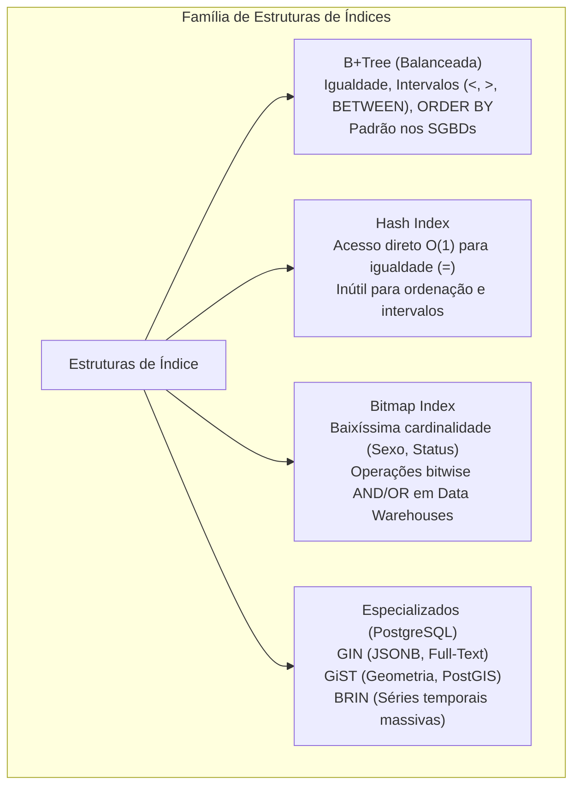
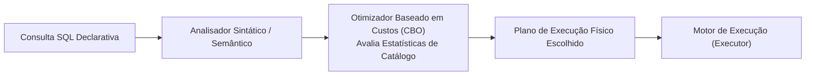
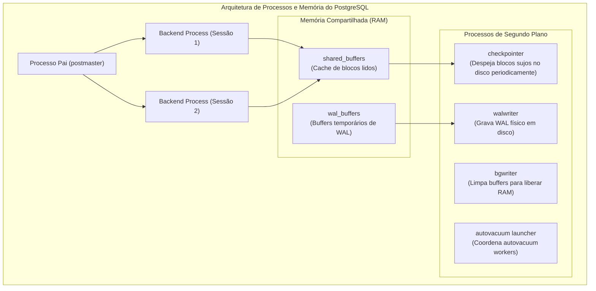
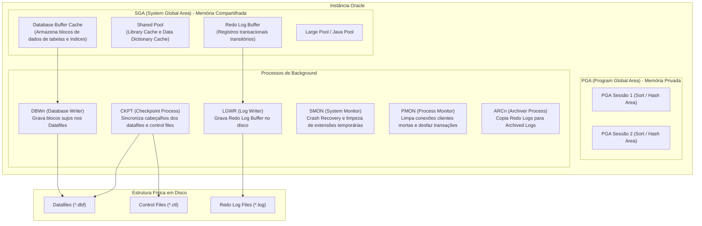

# 04 - Índices, Otimização, PostgreSQL e Oracle Database

> **Matéria:** Banco de Dados  
> **Cargo:** B02 – Técnico de Controle Externo – Especialidade: Tecnologia da Informação  
> **Arquivo:** `04_indices_otimizacao_postgresql_e_oracle.md`  

---

## 📌 Ementa / Itens do Edital
- Estruturas de índices: B-Tree, B+Tree, Hash, Bitmap, GIN e GiST
- Índices agrupados (Clustered) vs. não agrupados (Non-Clustered)
- Otimização de consultas (Query Tuning) e análise de Planos de Execução (`EXPLAIN` / `EXPLAIN ANALYZE`)
- Otimizador baseado em custos (CBO - Cost-Based Optimizer) e estatísticas
- Administração e otimização de PostgreSQL (arquitetura, VACUUM, WAL, parâmetros de memória)
- Administração e otimização de Oracle Database (instância SGA/PGA, processos de background, tablespaces)

---

## 🌳 Classificação Hierárquica

```text
4. Índices, Ajuste de Desempenho e Administração de PostgreSQL e Oracle
├── 4.1 Estruturas e Tipos de Índices
│   ├── 4.1.1 Índices em Árvore B-Tree e B+Tree:
│   │   ├── Árvores auto-balanceadas com nós raiz, nós intermediários e folhas
│   │   ├── B+Tree: Todas as chaves e dados residem exclusivamente nas folhas, que são encadeadas sequencialmente (ideal para buscas por igualdade e por intervalo: <, >, BETWEEN)
│   │   └── Padrão na grande maioria dos SGBDs (PostgreSQL, Oracle, MySQL)
│   ├── 4.1.2 Índice Hash: Acesso direto O(1) para igualdade estrita (=), inútil para intervalos
│   ├── 4.1.3 Índice Bitmap: Vetores de bits compactos; excelente para colunas de baixíssima cardinalidade (ex.: sexo, estado civil, status) em ambientes de Data Warehouse / OLAP
│   ├── 4.1.4 Índices Especializados do PostgreSQL:
│   │   ├── GIN (Generalized Inverted Index): Ideal para dados compostos, arrays, busca textual (Full-Text Search) e documentos JSONB
│   │   ├── GiST (Generalized Search Tree): Ideal para dados geométricos, geoespaciais (PostGIS) e intervalos complexos
│   │   └── BRIN (Block Range Index): Extremamente leve para tabelas gigantescas com dados fisicamente ordenados no disco (ex.: timestamps)
│   ├── 4.1.5 Índice Clustered (Agrupado / Tabela Organizada por Índice): Os dados da tabela são fisicamente gravados e ordenados na mesma ordem das folhas do índice (apenas 1 por tabela)
│   └── 4.1.6 Índices Parciais (com cláusula WHERE) e Índices por Expressão / Função
├── 4.2 Otimização de Consultas (Query Tuning)
│   ├── 4.2.1 Otimizador Baseado em Custo (CBO - Cost-Based Optimizer): Estimativa de custo computacional (I/O de disco + uso de CPU)
│   ├── 4.2.2 Importância das Estatísticas de Catálogo: Coleta periódica de amostragem de dados (ANALYZE no Postgres / DBMS_STATS no Oracle)
│   ├── 4.2.3 Planos de Execução:
│   │   ├── EXPLAIN (estimativa estática) vs. EXPLAIN ANALYZE (execução real com medição de tempo e buffers)
│   │   ├── Métodos de Acesso a Tabelas: Sequential Scan / Full Table Scan vs. Index Scan vs. Index Only Scan vs. Bitmap Index Scan
│   │   └── Algoritmos de Junção (Join Algorithms): Nested Loop Join (ideal para conjuntos pequenos indexados), Hash Join (grandes conjuntos não indexados), Merge Join (conjuntos já ordenados)
│   └── 4.2.4 Boas Práticas de Query Tuning: Evitar funções em colunas no WHERE sem índice funcional, evitar SELECT *, uso consciente de índices compostos (ordem das colunas)
├── 4.3 Administração e Otimização do PostgreSQL
│   ├── 4.3.1 Arquitetura de Processos: Processo pai postmaster, processos de background (checkpointer, writer, walwriter, autovacuum, stats collector) e conexões clientes via modelo multi-processo (fork)
│   ├── 4.3.2 Principais Parâmetros de Ajuste (postgresql.conf):
│   │   ├── shared_buffers: Memória RAM compartilhada dedicada para cache de blocos do banco
│   │   ├── work_mem: Memória alocada por operação individual de ordenação (ORDER BY) ou hash join
│   │   ├── maintenance_work_mem: Memória para operações de manutenção (VACUUM, criação de índices)
│   │   └── effective_cache_size: Estimativa de toda a memória disponível para cache (incluindo o page cache do SO)
│   ├── 4.3.3 Mecanismo de Limpeza (VACUUM e Autovacuum):
│   │   ├── Como o MVCC gera tuplas mortas (Dead Tuples / Bloat), o VACUUM é essencial para recuperar espaço e atualizar visibilidade
│   │   └── VACUUM padrão (não bloqueia leituras nem escritas) vs. VACUUM FULL (bloqueio exclusivo de tabela para compactação física)
│   └── 4.3.4 WAL (Write-Ahead Logging): Mecanismo de gravação antecipada em log transacional antes da escrita em disco dos dados
└── 4.4 Administração e Otimização do Oracle Database
    ├── 4.4.1 Arquitetura da Instância Oracle:
    │   ├── Memória Compartilhada (SGA - System Global Area): Database Buffer Cache, Shared Pool (Library Cache e Data Dictionary Cache), Redo Log Buffer, Large Pool
    │   ├── Memória Privada (PGA - Program Global Area): Alocada para cada sessão/processo servidor (sort area, hash area)
    │   └── Processos de Background Primários:
    │       ├── DBWn (Database Writer): Escreve blocos sujos do cache para os arquivos de dados (Datafiles)
    │       ├── LGWR (Log Writer): Escreve entradas do Redo Log Buffer para os Redo Log Files
    │       ├── CKPT (Checkpoint): Atualiza os cabeçalhos dos datafiles e control files com informações de sincronismo
    │       ├── SMON (System Monitor): Recuperação automática da instância na inicialização e limpeza de segmentos temporários
    │       └── PMON (Process Monitor): Limpeza de recursos e rollback de transações de processos de usuários abortados
    └── 4.4.2 Estrutura de Armazenamento Lógica vs. Física:
        ├── Estrutura Física: Datafiles, Control Files, Redo Log Files, Parameter Files (SPFILE/PFILE)
        └── Estrutura Lógica: Banco -> Tablespaces (SYSTEM, SYSAUX, UNDO, TEMP, USERS) -> Segmentos -> Extensões (Extents) -> Blocos de Dados (Oracle Data Blocks)
```

---

## 📖 Teoria Aprofundada & Conceitos Essenciais

### 1. Estruturas e Tipos de Índices

Um índice é uma estrutura auxiliar de dados associada a uma tabela, projetada para acelerar a recuperação de linhas e reduzir operações de Entrada/Saída (I/O) em disco ao custo de sobrecarga adicional durante operações de escrita (`INSERT`, `UPDATE`, `DELETE`).



#### 1.1 Árvores B-Tree e B+Tree
A esmagadora maioria dos SGBDs relacionais adota variações da **B+Tree** como estrutura de indexação padrão.
- **Estrutura Hierárquica:** Composta por um nó Raiz (*Root*), nós intermediários/galhos (*Branch*) e nós Folha (*Leaf*).
- **Auto-balanceamento:** Todas as folhas encontram-se exatamente na mesma profundidade, garantindo tempo de busca uniforme com complexidade computacional proporcional à altura da árvore.
- **Diferencial da B+Tree sobre a B-Tree pura:**
  - Na **B+Tree**, os nós internos armazenam estritamente chaves de roteamento; **todas as chaves e ponteiros de dados residem exclusivamente no nível das folhas**.
  - As folhas da B+Tree são **conectadas sequencialmente entre si por uma lista duplamente encadeada**, tornando operações de varredura por intervalo (`BETWEEN`, `>`, `<`) e ordenações (`ORDER BY`) extraordinariamente eficientes.

#### 1.2 Índice Bitmap
- Cria um vetor binário de bits para cada valor distinto que uma coluna pode assumir. Em cada vetor, o $n$-ésimo bit vale `1` se a $n$-ésima linha contiver aquele valor, ou `0` caso contrário.
- **Ideal para Baixa Cardinalidade:** Colunas que possuem pouquíssimos valores possíveis em relação ao volume da tabela (ex.: Sexo: M/F; Status: Aberto/Fechado/Cancelado).
- **Vantagem em OLAP / Data Warehouses:** Consultas com múltiplos filtros combinados são resolvidas no nível de hardware através de operações booleanas lógicas ultra-rápidas (`AND`, `OR`, `NOT`) entre vetores de bits antes de tocar a tabela física.
- **Inadequado para OLTP:** Operações de escrita travam blocos inteiros do bitmap, causando alta contenção sob concorrência intensa de modificações.

#### 1.3 Índices Especializados do PostgreSQL
1. **GIN (*Generalized Inverted Index*):** Índice invertido que mapeia cada elemento interno de uma estrutura para as linhas onde ele ocorre. Essencial para **busca textual completa (*Full-Text Search*)**, colunas de tipo **Array** e documentos semiestruturados **`JSONB`**.
2. **GiST (*Generalized Search Tree*):** Árvore extensível que serve de infraestrutura para tipos de dados geométricos, coordenadas espaciais (extensão espacial **PostGIS**) e tipos de intervalos complexos.
3. **BRIN (*Block Range Index*):** Armazena apenas os valores mínimo e máximo contidos em faixas de páginas físicas adjacentes no disco. Ocupa frações minúsculas de espaço (quilobytes) e é ideal para tabelas massivas de centenas de gigabytes cujos dados são inseridos em ordem cronológica estrita (ex.: timestamps ou logs de auditoria).

#### 1.4 Índice Agrupado (*Clustered*) vs. Não Agrupado (*Non-Clustered*)

| Critério | Índice Clustered (Agrupado) | Índice Non-Clustered (Não Agrupado / Secundário) |
|---|---|---|
| **Disposição Física dos Dados** | As folhas do índice **são os próprios registros físicos da tabela**, gravados na mesma ordem da chave. | As folhas do índice contêm a chave indexada acompanhada de um **ponteiro** (*RowID* / *TID*) apontando para a linha na área de heap. |
| **Limite por Tabela** | **Apenas 1** índice clustered por tabela (os dados só podem ser fisicamente ordenados de uma única forma). | **Múltiplos** índices permitidos por tabela. |
| **Terminologia no Oracle** | *Index-Organized Table (IOT)* | Índice Secundário / Normal |
| **Eficiência** | Excelente para buscas por intervalo na chave primária (elimina acessos indiretos à memória). | Requer uma etapa adicional de desreferenciamento (*lookup* na heap table), exceto se for um *Index Only Scan*. |

---

### 2. Otimização de Consultas (Query Tuning) e Planos de Execução

O **Otimizador Baseado em Custos (CBO - *Cost-Based Optimizer*)** é o componente interno do SGBD encarregado de avaliar os milhares de planos de execução físicos possíveis para uma mesma consulta SQL declarativa, selecionando aquele que apresentar o **menor custo estimado** (ponderação entre operações de I/O em disco e consumo de ciclos de CPU).



#### 2.1 Estatísticas de Catálogo e a Armadilha da Desatualização
O CBO depende criticamente da precisão das estatísticas de distribuição dos dados persistidas no catálogo do banco:
- Se as estatísticas estiverem desatualizadas, o otimizador pode acreditar que uma tabela possui 1.000 linhas quando ela já possui 100 milhões, escolhendo um método de acesso desastroso.
- Comando para atualizar estatísticas:
  - No PostgreSQL: `ANALYZE nome_tabela;`
  - No Oracle: `DBMS_STATS.GATHER_TABLE_STATS('SCHEMA', 'TABELA');`

#### 2.2 Análise com `EXPLAIN` vs. `EXPLAIN ANALYZE`
- **`EXPLAIN`:** Exibe apenas a estimativa teórica do otimizador baseada nas estatísticas estáticas de catálogo, **sem executar** a consulta.
- **`EXPLAIN ANALYZE`:** **Executa de fato** a consulta no banco de dados, reportando o custo teórico estimado lado a lado com as métricas reais de tempo consumido (*actual time*), quantidade real de linhas retornadas (*actual rows*) e blocos lidos de memória/disco (*buffers hit/read*).

#### 2.3 Métodos de Acesso a Tabelas e Algoritmos de Junção

| Estrutura de Execução | Descrição Operacional | Cenário Típico de Utilização |
|---|---|---|
| **Sequential Scan / Full Table Scan** | Varre a tabela bloco a bloco, do início ao fim. | Consultas sem filtro, tabelas muito pequenas ou filtros que recuperam percentual expressivo da tabela (> 10% a 20%). |
| **Index Scan** | Navega na B-Tree até a folha e busca o bloco físico da tabela via ponteiro (*RowID*). | Filtros com alta seletividade (retornam pouquíssimas linhas). |
| **Index Only Scan** | Todas as colunas projetadas no `SELECT` já constam na chave do índice (*Covering Index*). | Não necessita consultar a tabela física (*zero heap lookups*). |
| **Nested Loop Join** | Para cada tupla da relação externa, busca tuplas na relação interna. | Ideal para conjuntos pequenos onde a tabela interna possui índice direto na chave de junção. |
| **Hash Join** | Constrói uma tabela hash em memória com o conjunto menor e varre o conjunto maior contra essa hash. | Ideal para grandes volumes sem ordenação em operações de equijunção (`=`). |
| **Merge Join (Sort-Merge)** | Ordena ambos os conjuntos pela chave e os percorre paralelamente. | Ideal para volumes massivos onde ambas as relações já se encontram previamente ordenadas. |

---

### 3. Arquitetura e Administração do PostgreSQL



#### 3.1 Principais Parâmetros de Ajuste (`postgresql.conf`)
- **`shared_buffers`:** Define a quantidade de memória RAM dedicada que o PostgreSQL aloca exclusivamente para cache de blocos de dados. Em servidores dedicados de produção, a boa prática recomenda configurar em torno de **25% da memória RAM total** da máquina.
- **`work_mem`:** Quantidade de memória alocada **por operação individual** de ordenação (`ORDER BY`) ou nó de hash join. *Atenção:* Não é por conexão, e sim por operação; consultas complexas com múltiplos sorts podem alocar vários múltiplos de `work_mem` simultaneamente.
- **`maintenance_work_mem`:** Memória RAM alocada para rotinas de manutenção intensiva, como execução de `VACUUM`, `CREATE INDEX` e adição de chaves estrangeiras.
- **`effective_cache_size`:** Informa ao CBO a estimativa agregada de memória disponível para cache (somatório de `shared_buffers` com o cache de páginas do sistema operacional - *Page Cache* do Linux), auxiliando na decisão entre Index Scan e Seq Scan.

#### 3.2 O Mecanismo do MVCC, Tuplas Mortas e o `VACUUM`
Em virtude do MVCC, no PostgreSQL instruções de `UPDATE` não sobrescrevem fisicamente os bytes do registro no disco, e instruções de `DELETE` não desalocam imediatamente a tupla:
1. Uma tupla modificada ou deletada torna-se uma **tupla morta (*dead tuple*)**.
2. Com o tempo, a proliferação dessas tuplas mortas gera inchaço físico nas tabelas e índices (**Table Bloat**), degradando o desempenho das leituras.
3. **`VACUUM` Padrão (Concorrente):** Varre as páginas, marca o espaço ocupado pelas tuplas mortas como livre para que futuras gravações de novas linhas possam reutilizá-lo e atualiza o mapa de visibilidade. **Não bloqueia leituras nem escritas ordinárias**, mas geralmente não devolve o espaço livre para o sistema operacional.
4. **`VACUUM FULL`:** Adquire bloqueio exclusivo total sobre a tabela (`ACCESS EXCLUSIVE LOCK`), impedindo qualquer leitura ou escrita, reescreve a tabela inteira do zero em um novo arquivo físico de disco, compacta os dados e devolve o espaço residual ao sistema operacional.

---

### 4. Arquitetura e Administração do Oracle Database

A instância Oracle é composta pela combinação de duas estruturas fundamentais: estruturas de memória e processos de background.



#### 4.1 Processos de Segundo Plano (*Background Processes*) do Oracle
- **`DBWn` (Database Writer):** Escreve os blocos modificados da memória (*dirty buffers*) do Database Buffer Cache para os arquivos físicos de dados (*Datafiles*). Opera de modo assíncrono e preguiçoso (*lazy writing*).
- **`LGWR` (Log Writer):** Despeja o conteúdo sequencial do *Redo Log Buffer* nos arquivos físicos de *Redo Log* em disco. É acionado compulsoriamente no momento exato em que qualquer sessão executa um **`COMMIT`** (assegurando a Durabilidade), quando o buffer atinge um terço de ocupação ou antes que o `DBWn` grave blocos sujos no disco (protocolo WAL).
- **`CKPT` (Checkpoint Process):** Atualiza os cabeçalhos de todos os *Datafiles* e *Control Files* com o número de alteração do sistema (*System Change Number - SCN*) para registrar o ponto em que todos os blocos de dados modificados foram persistidos.
- **`SMON` (System Monitor):** Executa a recuperação automática da instância (*Crash/Instance Recovery*) durante a inicialização do banco após um desligamento inesperado, além de consolidar extensões livres adjacentes e liberar segmentos temporários.
- **`PMON` (Process Monitor):** Monitora ativamente os processos servidores e conexões clientes. Se um processo de usuário falhar ou for interrompido abruptamente, o `PMON` limpa o cache de sessão, desaloca os recursos de memória da PGA, desfaz a transação órfã pendente via `ROLLBACK` automático e remove todos os bloqueios de linha (*locks*) retidos.
- **`ARCn` (Archiver):** Opcional, ativado no modo `ARCHIVELOG`. Copia os arquivos de Redo Log cheios para destinos de arquivo morto (*Archived Redo Logs*), viabilizando backups a quente e recuperação pontual no tempo (PITR).

#### 4.2 Estrutura Lógica de Armazenamento do Oracle
O banco de dados relacional organiza seu armazenamento lógico em quatro níveis hierárquicos:

```text
Banco de Dados
 └── Tablespaces (SYSTEM, SYSAUX, UNDO, TEMP, USERS)
      └── Segmentos (Tabelas, Índices, Rollback)
           └── Extensões (Extents - Conjuntos contíguos de blocos)
                └── Blocos de Dados (Oracle Data Blocks - Menor unidade de I/O)
```

---

## 🌐 Fontes Recomendadas na Internet

### 1. Documentação Oficial de Administração e Otimização
- [PostgreSQL Documentation - Performance Tips & Server Configuration](https://www.postgresql.org/docs/current/performance-tips.html): Manual oficial cobrindo uso de `EXPLAIN ANALYZE`, tipos de índices (B-Tree, Hash, GIN, GiST, BRIN), algoritmos de junção e ajuste de parâmetros (`shared_buffers`, `work_mem`).
- [PostgreSQL Documentation - Routine Vacuuming & Bloat](https://www.postgresql.org/docs/current/routine-vacuuming.html): Guia oficial detalhando a gestão de tuplas mortas (*dead tuples*), funcionamento do daemon `autovacuum`, recuperação de espaço em disco e prevenção de *wraparound* de identificadores de transação.
- [Oracle Database Concepts Guide - Architecture](https://docs.oracle.com/en/database/oracle/oracle-database/): Referência técnica da Oracle descrevendo a divisão entre memória compartilhada (SGA) e privada (PGA), o papel dos processos de background (`DBWn`, `LGWR`, `CKPT`, `SMON`, `PMON`) e o armazenamento em *tablespaces*.
- [Use The Index, Luke! (Markus Winand)](https://use-the-index-luke.com/): Portal de referência global sobre indexação relacional para desenvolvedores e DBAs, explicando anatomia de árvores B-Tree, custos de busca por intervalo e o papel de índices agrupados (*clustered*).

---

## 📝 Questões Comentadas & Exemplos (Padrão FCC)

### Questão 1 (FCC - Adaptada / TI - Arquitetura da Instância Oracle Database)
Em um ambiente corporativo de missão crítica executando o Oracle Database, ocorrem falhas eventuais de comunicação na camada de rede com encerramento forçado de conexões clientes, além da necessidade contínua de assegurar a recuperação pós-pane e o registro de transações comitadas.

A respeito dos processos de segundo plano (*background processes*) e das estruturas de memória da arquitetura Oracle, assinale a afirmativa correta:
A) O processo `LGWR` (Log Writer) é responsável por gravar blocos de dados alterados da memória para os arquivos de dados (*Datafiles*) exclusivamente quando a SGA fica sem espaço livre.  
B) O processo `PMON` (Process Monitor) monitora os processos de conexões dos usuários e, quando detecta que um processo cliente falhou ou foi abortado abruptamente, realiza a limpeza dos recursos, remove os bloqueios (*locks*) pendentes e efetua o *rollback* da transação ativa.  
C) O processo `SMON` (System Monitor) atua unicamente como servidor web para exibir o painel Enterprise Manager, não possuindo funções ligadas à recuperação de falhas da instância (*crash recovery*).  
D) A *PGA* (Program Global Area) é uma região de memória compartilhada globalmente entre todas as sessões e instâncias ativas do banco, contendo o cache de blocos de dados (*Database Buffer Cache*).  
E) O processo `DBWn` (Database Writer) é acionado obrigatoriamente a cada comando `COMMIT` para descarregar o *Redo Log Buffer* nos arquivos físicos de *Redo Log*.

> **Gabarito: B**  
> **Comentário Analítico Passo a Passo:**  
> - **A está INCORRETA:** Quem grava blocos de dados sujos nos *Datafiles* é o **`DBWn`**. O **`LGWR`** é responsável estritamente por gravar as entradas do *Redo Log Buffer* nos arquivos físicos de *Redo Log*.  
> - **B está CORRETA:** O **`PMON`** (*Process Monitor*) atua como sentinela das conexões clientes. Se um usuário fecha abruptamente o aplicativo ou ocorre colapso de rede, o PMON detecta o processo zumbi, desaloca a PGA daquela sessão, libera todos os bloqueios exclusivos de linha que a sessão reteve e desfaz via rollback automático a transação pendente.  
> - **C está INCORRETA:** O **`SMON`** (*System Monitor*) tem como função prioritária realizar a recuperação da instância (*Crash Recovery*) aplicando o Redo Log e desfazendo transações não finalizadas no boot do banco de dados, além de gerenciar a consolidação de extensões livres de tablespaces.  
> - **D está INCORRETA:** A área de memória compartilhada globalmente por todas as sessões que aloja o *Database Buffer Cache* e a *Shared Pool* é a **SGA** (*System Global Area*). A **PGA** é uma estrutura de memória **privada e exclusiva** de cada processo servidor dedicado.  
> - **E está INCORRETA:** Quem grava no instante do `COMMIT` para assegurar a Durabilidade transacional é o **`LGWR`**, e não o `DBWn`. O `DBWn` efetua escritas assíncronas em lotes (*checkpoints / lazy write*).

---

### Questão 2 (FCC - Adaptada / TI - Tipos de Índices: B+Tree, Bitmap e Especializados)
Durante o desenho físico de um banco de dados para a administração tributária, um analista precisa definir as melhores estruturas de indexação para duas situações distintas:
1. Uma tabela transacional de notas fiscais com 20 milhões de linhas onde consultas frequentes realizam filtros por intervalos de datas (`WHERE data_emissao BETWEEN '2025-01-01' AND '2025-01-31'`) e ordenações sequenciais.
2. Uma tabela dimensional analítica de auditoria com 100 milhões de registros contendo a coluna `situacao_declaracao`, a qual assume apenas quatro valores possíveis (`'PENDENTE'`, `'APROVADA'`, `'NOTIFICADA'`, `'RETIFICADA'`).

As estruturas de índice tecnicamente mais recomendadas para as situações 1 e 2 são, respectivamente:
A) Índice Hash; e Índice Invertido GIN.  
B) Índice B+Tree; e Índice Bitmap.  
C) Índice Bitmap; e Índice Hash.  
D) Índice BRIN; e Índice em Árvore B-Tree Clustered exclusivo.  
E) Índice GiST; e Índice B+Tree com chave primária substituta.

> **Gabarito: B**  
> **Comentário Analítico Passo a Passo:**  
> - **A está INCORRETA:** O Índice Hash opera exclusivamente com cálculos de hashing para igualdade estrita (`=`), sendo completamente inútil para buscas por intervalo (`BETWEEN`) e ordenações (`ORDER BY`). O GIN é destinado a arrays, busca textual ou JSONB, e não para baixa cardinalidade escalar simples.  
> - **B está CORRETA:** 
>   1. A **B+Tree** possui todas as suas folhas interligadas por listas duplamente encadeadas na ordem das chaves, o que a torna a estrutura universal ideal para **buscas por intervalo (`BETWEEN`, `<`, `>`)** e classificação.
>   2. Colunas com baixíssimo número de valores distintos em relação à cardinalidade massiva da tabela (como as 4 opções de situação de declaração em 100 milhões de linhas) configuram **baixa cardinalidade**, sendo o cenário canônico de excelência para o **Índice Bitmap**, que consome pouquíssimo espaço e permite avaliações booleanas ultrarrápidas na CPU.  
> - **C está INCORRETA:** Inverte as recomendações e propõe Hash para a coluna categórica analítica de baixa cardinalidade, descartando o potencial analítico de agregação booleana do Bitmap.  
> - **D está INCORRETA:** O BRIN exige que os dados estejam fisicamente alinhados na ordem em disco; e um índice clustered tradicionalmente não se aplica a colunas repetitivas de baixa cardinalidade como chave física de tabela.  
> - **E está INCORRETA:** GiST é voltado prioritariamente para dados espaciais/geométricos e intervalos complexos de PostGIS, inadequado para a tabela transacional de notas descrita.

---

### Questão 3 (FCC - Adaptada / TI - Query Tuning: EXPLAIN e Algoritmos de Junção)
Em uma rotina de auditoria computacional, o DBA analisou o plano de execução de uma consulta que realiza a junção de duas tabelas: a tabela `orgaos` (com apenas 50 registros) e a tabela `despesas` (com 10 milhões de registros, que possui um índice B-Tree criado sobre a chave estrangeira `id_orgao`).

Considerando a mecânica do Otimizador Baseado em Custos (CBO) e as características dos algoritmos de junção física, o plano de execução mais provável e eficiente selecionado pelo SGBD será:
A) Um *Full Table Scan* em ambas as tabelas seguido por um algoritmo de *Cartesian Cross Join*.  
B) Um método de junção *Nested Loop Join*, utilizando a tabela `orgaos` como relação externa (conducente) e percorrendo a tabela `despesas` por meio de buscas no índice B-Tree (*Index Scan*).  
C) Um algoritmo de *Merge Join*, obrigando a reordenação em disco (*external sort*) dos 10 milhões de registros da tabela `despesas`.  
D) Um *Sequential Scan* exclusivo sobre a tabela `despesas` sem consultar as linhas da tabela `orgaos`.  
E) A rejeição da consulta pelo CBO, pois o otimizador não opera junções quando a disparidade de linhas entre as tabelas ultrapassa a proporção de 100 para 1.

> **Gabarito: B**  
> **Comentário Analítico Passo a Passo:**  
> - **A está INCORRETA:** Um produto cartesiano (*Cross Join*) geraria $50 \times 10.000.000 = 500.000.000$ de combinações intermediárias, configurando o pior plano de acesso possível em termos de I/O e CPU.  
> - **B está CORRETA:** O algoritmo **Nested Loop Join** é a escolha ideal quando uma das tabelas envolvidas na junção possui cardinalidade muito pequena (50 linhas na relação externa) e a outra tabela possui um índice altamente seletivo na coluna de junção (índice B-Tree em `despesas.id_orgao`). Para cada uma das 50 linhas da tabela de órgãos, o motor realiza uma busca direta no índice da tabela de despesas, resultando em custo mínimo de CPU e pouquíssimas leituras de blocos de disco.  
> - **C está INCORRETA:** O *Merge Join* exigiria que ambas as relações estivessem ordenadas pela chave de junção. Forçar a ordenação em disco de 10 milhões de linhas (*disk sort*) geraria degradação severa com gravações massivas na tablespace temporária.  
> - **D está INCORRETA:** A junção entre duas tabelas requer compulsoriamente a leitura e o cruzamento dos dados de ambas as tabelas envolvidas na cláusula `JOIN`.  
> - **E está INCORRETA:** O otimizador de consultas lida naturalmente com junções entre relações de quaisquer cardinalidades; disparidades entre tabelas constituem justamente o cenário mais corriqueiro na modelagem estrela e relacional.

---

### Questão 4 (FCC - Adaptada / TI - PostgreSQL: MVCC, Tuplas Mortas e VACUUM)
Em um servidor de banco de dados PostgreSQL executando sob alta carga de transações de atualização e exclusão, constatou-se que o espaço em disco ocupado pelos arquivos de dados cresceu exponencialmente, mesmo sem acréscimo significativo no saldo líquido de novos registros cadastrados. Esse fenômeno provocou lentidão generalizada em consultas que realizavam varreduras de tabelas.

A respeito do controle de concorrência e do processo de recuperação de espaço no PostgreSQL, é correto afirmar:
A) O crescimento excessivo decorre do modelo MVCC, no qual modificações geram tuplas mortas (*dead tuples*) no disco, devendo o administrador executar a rotina de `VACUUM` (ou ajustar o daemon `autovacuum`) para liberar o espaço para reutilização sem paralisar o sistema.  
B) O comando `VACUUM FULL` opera em segundo plano sem adquirir bloqueios restritivos sobre as tabelas, sendo a técnica indicada para execução contínua no horário de pico de produção.  
C) O PostgreSQL sobrescreve as posições originais dos bytes no disco a cada comando `UPDATE`, sendo o aumento de tamanho ocasionado unicamente por corrupção física dos nós de índice GiST.  
D) As tuplas mortas são removidas automaticamente pelo processo `checkpointer` durante o flush dos buffers no disco, tornando desnecessário o utilitário de `VACUUM`.  
E) Para eliminar as tuplas mortas e o inchaço de tabelas, o parâmetro `work_mem` deve ser configurado com o valor de zero.

> **Gabarito: A**  
> **Comentário Analítico Passo a Passo:**  
> - **A está CORRETA:** Devido à arquitetura do MVCC, comandos `UPDATE` e `DELETE` geram **tuplas mortas** (*dead tuples*), que permanecem ocupando espaço físico nos blocos de dados até serem limpas. O acúmulo contínuo dessas tuplas gera o fenômeno de **Table Bloat** (inchaço). O utilitário **`VACUUM`** (gerenciado automaticamente pelo processo de background **`autovacuum`**) percorre as tabelas, remove as referências a essas tuplas mortas e marca o espaço nos blocos como disponível para reaproveitamento em novas inserções, tudo isso de forma concorrente sem interromper as operações do sistema.  
> - **B está INCORRETA:** O `VACUUM FULL` adquire um bloqueio exclusivo estrito (`ACCESS EXCLUSIVE LOCK`), **travando totalmente a tabela** contra quaisquer leituras ou escritas simultâneas até que ela seja integralmente reescrita em um novo arquivo no disco; por esse motivo, ele é expressamente contraindicado durante horários de pico.  
> - **C está INCORRETA:** O motor MVCC do PostgreSQL **nunca** sobrescreve tuplas no lugar (*in-place update*); ele grava uma nova tupla e encerra o ciclo de vida da antiga preenchendo seu campo `xmax`.  
> - **D está INCORRETA:** O processo `checkpointer` tem a função estrita de despejar blocos de dados sujos da memória RAM (`shared_buffers`) para os arquivos físicos no disco; ele não expurga tuplas mortas nem interpreta versões de visibilidade do MVCC.  
> - **E está INCORRETA:** O parâmetro `work_mem` define a memória alocada para ordenações e operações de hash em memória por consulta; ele não possui relação operacional com a rotina de remoção de tuplas mortas.

---

### Questão 5 (FCC - Adaptada / TI - Estrutura de Armazenamento Lógica do Oracle Database)
A estrutura de armazenamento de dados no SGBD Oracle Database estabelece uma separação entre os conceitos de armazenamento físico (arquivos em disco) e armazenamento lógico.

A hierarquia que descreve rigorosamente a organização lógica de armazenamento no Oracle, da maior para a menor unidade de agregação, é:
A) Banco de Dados $\rightarrow$ Tablespace $\rightarrow$ Segmento $\rightarrow$ Extensão (*Extent*) $\rightarrow$ Bloco de Dados (*Data Block*).  
B) Banco de Dados $\rightarrow$ Segmento $\rightarrow$ Tablespace $\rightarrow$ Bloco de Dados $\rightarrow$ Extensão (*Extent*).  
C) Tablespace $\rightarrow$ Bloco de Dados $\rightarrow$ Extensão (*Extent*) $\rightarrow$ Segmento $\rightarrow$ Datafile.  
D) Datafile $\rightarrow$ Control File $\rightarrow$ Tablespace $\rightarrow$ Bloco de Dados $\rightarrow$ Redo Log.  
E) Banco de Dados $\rightarrow$ Extensão (*Extent*) $\rightarrow$ Tablespace $\rightarrow$ Segmento $\rightarrow$ Bloco de Dados.

> **Gabarito: A**  
> **Comentário Analítico Passo a Passo:**  
> - **A está CORRETA:** A arquitetura lógica de armazenamento do Oracle Database segue rigorosamente a cadeia hierárquica decrescente:
>   1. **Banco de Dados (Database):** A instância lógica global.
>   2. **Tablespaces:** Unidades lógicas primárias que agrupam segmentos (ex.: `SYSTEM`, `SYSAUX`, `USERS`, `UNDO`, `TEMP`). Cada tablespace é composta fisicamente por um ou mais *Datafiles*.
>   3. **Segmentos (Segments):** Estruturas que ocupam espaço dentro de uma tablespace, representando um objeto de dados completo (ex.: o segmento de uma tabela, o segmento de um índice, um segmento de desfazer/undo).
>   4. **Extensões (Extents):** Um segmento é formado por uma ou mais extensões. Uma extensão consiste em um conjunto de blocos de dados contíguos alocados de uma só vez para o objeto.
>   5. **Blocos de Dados (Oracle Data Blocks):** A menor unidade atômica lógica de armazenamento e a unidade elementar de I/O de disco no Oracle (com tamanhos típicos configurados em 2KB, 4KB, 8KB, 16KB ou 32KB).  
> - **B, C, D e E estão INCORRETAS:** Subvertem a ordem de contenção lógica da arquitetura Oracle ou misturam componentes físicos (*Datafiles*, *Control Files*, *Redo Logs*) dentro da hierarquia conceitual puramente lógica.
