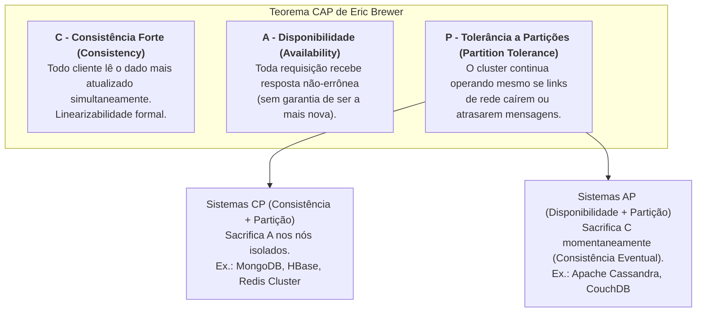
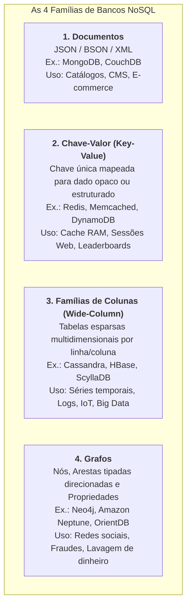
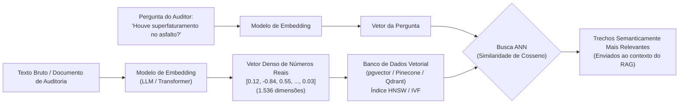

# 05 - Bancos de Dados NoSQL e Bancos Vetoriais (IA)

> **Matéria:** Banco de Dados  
> **Cargo:** B02 – Técnico de Controle Externo – Especialidade: Tecnologia da Informação  
> **Arquivo:** `05_bancos_nosql_e_bancos_vetoriais.md`  

---

## 📌 Ementa / Itens do Edital
- Teorema CAP e modelo BASE (Basic Availability, Soft state, Eventual consistency)
- Bancos de dados NoSQL e suas 4 famílias fundamentais:
  - Documentos (MongoDB)
  - Chave-Valor (Redis)
  - Famílias de Colunas / Wide-Column (Cassandra / HBase)
  - Grafos (Neo4j)
- Casos de uso, escalabilidade horizontal e características de cada modelo
- Noções de bancos de dados vetoriais aplicados à IA (Embeddings, busca semântica e algoritmos de vizinhos mais próximos)

---

## 🌳 Classificação Hierárquica

```text
5. Paradigma NoSQL e Bancos de Dados Vetoriais Modernos
├── 5.1 Teoria dos Sistemas Distribuídos e Fundamentos NoSQL
│   ├── 5.1.1 Motivação do NoSQL (Not Only SQL): Limitações de escala vertical em bancos relacionais, esquema flexível (schema-less) e big data
│   ├── 5.1.2 Teorema CAP de Eric Brewer:
│   │   ├── C (Consistency - Consistência): Todo cliente lê a versão mais recente dos dados simultaneamente
│   │   ├── A (Availability - Disponibilidade): Todo cliente recebe resposta não-errônea, sem garantia de ser a mais recente
│   │   ├── P (Partition Tolerance - Tolerância a Partições de Rede): O sistema continua operando mesmo com perda/atraso de mensagens entre nós
│   │   └── O Trade-off Inevitável: Em sistemas distribuídos em rede, P é compulsório; logo, deve-se escolher entre CP ou AP
│   ├── 5.1.3 Teorema PACELC (extensão do CAP na ausência de partição: Latência vs. Consistência)
│   └── 5.1.4 Modelo BASE vs. Propriedades ACID:
│       ├── Basically Available (Disponibilidade Básica garantida)
│       ├── Soft State (O estado pode mudar com o tempo mesmo sem novas entradas)
│       └── Eventual Consistency (Consistência Eventual: com o tempo, todas as réplicas convergirão para o mesmo valor)
├── 5.2 As Quatro Famílias de Bancos NoSQL
│   ├── 5.2.1 Bancos Orientados a Documentos:
│   │   ├── Características: Armazenamento em documentos semiestruturados (JSON / BSON / XML) com esquemas dinâmicos
│   │   ├── Tecnologia Referência: MongoDB
│   │   │   ├── Conceitos: Banco -> Coleções (Collections) -> Documentos (Documents)
│   │   │   ├── Identificador único _id (ObjectId)
│   │   │   ├── Framework de Agregação (Aggregation Pipeline: $match, $group, $project, $sort)
│   │   │   └── Particionamento de dados por Sharding (distribuição horizontal em shards) e Conjuntos de Réplicas (Replica Sets)
│   │   └── Casos de Uso: Catálogos de produtos, gestão de conteúdo (CMS), registros médicos, telemetria
│   ├── 5.2.2 Bancos Chave-Valor (Key-Value Stores):
│   │   ├── Características: O modelo mais simples e veloz; chave única mapeada para um valor opaco ou estruturado
│   │   ├── Tecnologia Referência: Redis (Remote Dictionary Server)
│   │   │   ├── Arquitetura em Memória RAM com latência de microssegundos
│   │   │   ├── Estruturas de Dados Nativas: Strings, Hashes, Lists, Sets, Sorted Sets (ZSET com pontuação/score), Bitmaps, HyperLogLog
│   │   │   ├── Estratégias de Persistência: RDB (Snapshots pontuais em disco) e AOF (Append Only File)
│   │   │   └── Recursos Adicionais: TTL (Time To Live / expiração de chaves), Pub/Sub e Bloqueios Distribuídos (Redlock)
│   │   └── Casos de Uso: Cache de alto desempenho, gestão de sessões web, contadores em tempo real, tabelas de classificação (leaderboards)
│   ├── 5.2.3 Bancos de Famílias de Colunas (Wide-Column / Column-Family):
│   │   ├── Características: Dados organizados em colunas esparsas dentro de famílias de colunas; colunas de uma linha podem variar
│   │   ├── Tecnologias: Apache Cassandra, Google Bigtable, HBase
│   │   └── Casos de Uso: Dados de séries temporais massivas, histórico financeiro, registros de cliques (clickstream) e logs industriais de IoT
│   └── 5.2.4 Bancos Orientados a Grafos:
│       ├── Características: Nós (entidades), Relacionamentos (arestas direcionadas tipadas) e Propriedades (chave-valor em nós e arestas)
│       ├── Tecnologia Referência: Neo4j (linguagem de consulta Cypher: MATCH (p:Pessoa)-[:AMIGO_DE]->(f) RETURN f)
│       └── Casos de Uso: Redes sociais, detecção de fraudes financeiras e lavagem de dinheiro, motores de recomendação e grafos de conhecimento
└── 5.3 Bancos de Dados Vetoriais Aplicados à Inteligência Artificial
    ├── 5.3.1 O que são Vetores e Embeddings:
    │   ├── Projeção de textos, códigos, imagens ou áudios em espaços vetoriais densos de centenas ou milhares de dimensões
    │   └── A proximidade geométrica entre dois vetores reflete a proximidade semântica entre os conceitos originais
    ├── 5.3.2 Operações em Bancos Vetoriais:
    │   ├── Armazenamento de embeddings associados a metadados do documento original
    │   └── Busca Semântica por Similaridade (Nearest Neighbor Search)
    ├── 5.3.3 Algoritmos de Busca Aproximada por Vizinhos mais Próximos (ANN):
    │   ├── HNSW (Hierarchical Navigable Small World): Grafo multicamadas de alta velocidade e precisão
    │   └── IVF (Inverted File Index): Agrupamento em clusters via K-Means com lista invertida
    └── 5.3.4 Tecnologias e Implementações:
        ├── Extensão pgvector no PostgreSQL (adiciona o tipo vector, índices hnsw e ivfflat, e operadores de distância <->, <=>)
        └── Bancos Vetoriais Nativos Especializados: Qdrant, Milvus, Pinecone, Chroma
```

---

## 📖 Teoria Aprofundada & Conceitos Essenciais

### 1. Teorema CAP e o Modelo BASE

O movimento NoSQL (*Not Only SQL*) emergiu da necessidade de superar os gargalos de escalabilidade vertical de bancos relacionais monolíticos em cenários de *Big Data*, admitindo esquemas flexíveis (*schemaless*) e particionamento horizontal maciço (*sharding*).

#### 1.1 O Teorema CAP (Eric Brewer / Gilbert & Lynch)
Em qualquer sistema distribuído de armazenamento de dados, é fisicamente impossível fornecer simultaneamente todas as três garantias a seguir:



1. **Consistência (Consistency):** Todos os nós do cluster enxergam exatamente a mesma cópia do dado no mesmo instante (equivalente à consistência forte ou linearizabilidade).
2. **Disponibilidade (Availability):** Todo nó não falho que receber uma requisição deve responder com sucesso (sem erros nem timeouts), mesmo que o dado entregue não seja o mais recente.
3. **Tolerância a Partições (Partition Tolerance):** O sistema continua processando requisições mesmo na presença de falhas de conectividade ou atrasos arbitrários de comunicação entre os nós da rede.

> ⭐ **IMPORTANTE / REGRA DE OURO:**  
> Como as redes físicas do mundo real estão sujeitas a quebras de links, perda de pacotes e latência, **a tolerância a partições (P) é uma premissa compulsória**. Portanto, o trade-off real do Teorema CAP resume-se à escolha entre:  
> - **CP (Consistência + Tolerância):** Em caso de quebra de link, nós isolados rejeitam requisições para evitar leituras ou escritas defasadas (sacrifica a Disponibilidade).  
> - **AP (Disponibilidade + Tolerância):** Em caso de quebra de link, todos os nós continuam respondendo aos usuários, aceitando leituras e escritas que serão sincronizadas posteriormente (sacrifica a Consistência imediata).

#### 1.2 O Teorema PACELC
Extensão formulada por Daniel Abadi que estabelece o trade-off também em tempos de normalidade:
- **Se houver Partição (P):** Escolha entre **Disponibilidade (A)** e **Consistência (C)**;
- **Senão (Else - E):** Quando a rede opera normalmente, escolha entre **Latência (L)** e **Consistência (C)**.

#### 1.3 Modelo BASE vs. ACID

| Critério | Propriedades ACID (Relacional) | Modelo BASE (NoSQL Distribuído) |
|---|---|---|
| **Premissa Central** | Consistência rígida e determinística em cada transação | Alta disponibilidade e resiliência com tolerância a descompassos transitórios |
| **Pilar 1** | **A - Atomicidade:** Princípio do tudo ou nada | **BA - Basically Available:** O sistema garante disponibilidade contínua básica, degradando partes se necessário |
| **Pilar 2** | **C - Consistência:** Preservação estrita de regras | **S - Soft State:** O estado do dado pode sofrer alterações ao longo do tempo por sincronização em segundo plano, mesmo sem nova escrita |
| **Pilar 3** | **I - Isolamento:** Transações executam sem interferência | **E - Eventual Consistency:** Na ausência de novas atualizações, todos os nós convergirão eventualmente para o mesmo valor |
| **Pilar 4** | **D - Durabilidade:** Dados comitados nunca se perdem | Réplicas assíncronas propagadas via gossip protocol |

---

### 2. As Quatro Famílias de Bancos NoSQL



#### Tabela Comparativa Completa das Famílias NoSQL

| Família | Unidade de Armazenamento | Esquema | Modelo de Consulta | Mecanismos Notáveis | Casos de Uso Canônicos |
|---|---|---|---|---|---|
| **Documentos** | Documento semiestruturado (JSON/BSON) agrupado em Coleções | Flexível (*Schema-dynamic*) | Consultas por atributos internos, índices secundários e *Aggregation Pipelines* | `_id` único, *Replica Sets*, *Sharding* por chave de partição | Catálogos comerciais, registros médicos, gestão de processos e formulários variáveis |
| **Chave-Valor** | Par Chave-Valor (string de chave associada a valor simples ou complexo) | Sem esquema (*Schema-less*) | Acesso atômico direto por chave (`GET`, `SET`) | Execução em memória RAM, TTL (*Time-To-Live*), persistência RDB/AOF | Sessões HTTP de usuários, cache de consultas caras, contadores atômicos e filas de mensagens |
| **Famílias de Colunas** | Linha com chave de partição contendo colunas dinâmicas agrupadas em famílias | Semi-estruturado (*Sparse Column*) | Linguagens declarativas inspiradas em SQL (ex.: CQL no Cassandra) | *MemTable*, *CommitLog*, *SSTables*, arquitetura descentralizada *masterless* | Séries temporais financeiras, telemetria de sensores IoT, logs de auditoria massivos |
| **Grafos** | Vértices (Nós), Arestas (Relacionamentos) e Propriedades (*Key-Value*) | Esquema livre orientado a conexões | Linguagens declarativas de travessia de padrões (ex.: Cypher) | *Index-free Adjacency* (percorrimento em tempo constante $\mathcal{O}(1)$ por nó adjacente) | Rastreamento de laranjas e lavagem de dinheiro, cartéis de licitação, motores de recomendação |

#### Destaques Tecnológicos para Concursos:
- **MongoDB:** Usa formato binário **BSON** (suporta tipos adicionais como `Date` e inteiros de 64 bits). Consultas ricas com pipeline de agregação: `$match` (filtra), `$project` (projeta), `$group` (agrega), `$sort` (ordena). Alta disponibilidade provida por **Replica Sets** (1 primário de escrita e múltiplos secundários de leitura com eleição automática).
- **Redis:** Operações ultra-rápidas em memória RAM. Estruturas nativas ricas:
  - `Strings`: textos ou números com comandos atômicos `INCR` e `DECR`.
  - `Hashes`: pares campo-valor internos, ideais para representar objetos.
  - `Lists`: listas encadeadas (suporta `LPUSH`, `RPOP`, ideais para filas).
  - `Sets`: conjuntos matemáticos sem duplicatas (`SADD`, `SINTER`).
  - `Sorted Sets (ZSET)`: elementos únicos ordenados por um *score* de ponto flutuante, perfeitos para **rankings em tempo real**.
  - Persistência: **RDB** (instantâneos compactos em disco tirados periodicamente) e **AOF (*Append Only File*)** (log que grava cada operação de escrita sequencialmente).
- **Neo4j:** Banco de grafos de propriedades. A propriedade crucial de desempenho chama-se **Index-free Adjacency**: cada nó armazena diretamente ponteiros de memória para seus nós vizinhos, permitindo navegar por milhões de conexões sem a necessidade de operações de `JOIN`.

---

### 3. Bancos de Dados Vetoriais e Inteligência Artificial (IA)

A ascensão dos modelos de linguagem (*Large Language Models - LLMs*) e das arquiteturas *Transformer* consolidou a necessidade dos bancos de dados vetoriais.



#### 3.1 O que são Embeddings?
Um *embedding* é a transformação matemática de dados não estruturados (textos, contratos fiscais, imagens, áudios) em um **vetor numérico denso em um espaço multidimensional contínuo** (com 768, 1536 ou mais dimensões).
- **Significado Semântico:** Dois conceitos conceitualmente semelhantes situam-se geometricamente próximos no hiperespaço multidimensional, mesmo que as palavras empregadas sejam completamente distintas.

#### 3.2 Métricas de Similaridade e Distância Vetorial

| Métrica | Expressão Matemática | Características | Caso de Uso Típico |
|---|---|---|---|
| **Similaridade de Cosseno** | $\cos(\theta) = \frac{\mathbf{u} \cdot \mathbf{v}}{\|\mathbf{u}\| \|\mathbf{v}\|}$ | Mede o cosseno do ângulo entre dois vetores. Varia de $-1$ a $+1$ ($+1$ indica mesma direção). **Independe da magnitude** (tamanho do texto). | Busca semântica de textos e recuperação textual no RAG. |
| **Distância Euclidiana ($L_2$)** | $\|\mathbf{u} - \mathbf{v}\|_2 = \sqrt{\sum (u_i - v_i)^2}$ | Mede a distância geométrica em linha reta no espaço euclidiano. Menor distância significa maior similaridade. | Reconhecimento de imagens e agrupamento de perfis numéricos. |
| **Produto Escalar (*Dot Product*)** | $\mathbf{u} \cdot \mathbf{v} = \sum u_i v_i$ | Pondera o ângulo e as magnitudes dos vetores. Se os vetores estiverem normalizados ($\|\mathbf{u}\| = 1$), equivale à similaridade de cosseno. | Sistemas de recomendação e processamento massivo otimizado em GPUs. |

#### 3.3 Algoritmos de Busca de Vizinhos Mais Próximos (ANN - *Approximate Nearest Neighbors*)
Em bases com milhões de vetores de alta dimensionalidade, a busca exata ($k$-NN por força bruta) torna-se inviável ($\mathcal{O}(N)$). Utilizam-se algoritmos aproximados (ANN):
- **HNSW (*Hierarchical Navigable Small World*):** Constrói uma hierarquia de grafos de proximidade em múltiplas camadas. As camadas superiores realizam saltos longos (busca rápida aproximada) e as camadas inferiores refinam a busca local. **É o padrão ouro da indústria** devido ao equilíbrio superior entre precisão (*recall*) e velocidade de resposta na ordem de milissegundos ($\mathcal{O}(\log N)$).
- **IVF (*Inverted File Index*):** Agrupa o espaço vetorial em múltiplos clusters usando o algoritmo $K$-Means e constrói uma lista invertida de vetores por centróide.

#### 3.4 Implementações Tecnológicas
- **`pgvector` (Extensão do PostgreSQL):** Adiciona o tipo de dados nativo `vector`, permitindo armazenar embeddings ao lado de dados relacionais transacionais na mesma tabela, criar índices `hnsw` e calcular distâncias via operadores:
  - `<->`: Distância Euclidiana ($L_2$).
  - `<=>`: Distância de Cosseno ($1 - \text{Similaridade de Cosseno}$).
  - `<#>`: Produto Escalar Negativo.
- **Bancos Nativos Especializados:** Motores distribuídos construídos exclusivamente para vetores: **Pinecone**, **Milvus**, **Qdrant**, **Chroma**.

---

## 🌐 Fontes Recomendadas na Internet

### 1. Documentação Oficial das Tecnologias NoSQL e Vetoriais
- [MongoDB Official Manual](https://www.mongodb.com/docs/manual/): Documentação canônica do banco orientado a documentos cobrindo o formato BSON, identificadores `_id`, operadores de consulta, agregação (*Aggregation Pipeline*) e arquitetura de *Replica Sets*.
- [Redis Official Documentation & Data Types](https://redis.io/docs/latest/develop/data-types/): Guia completo do banco chave-valor em memória, dissecando estruturas nativas (*Strings*, *Hashes*, *Lists*, *Sets*, *Sorted Sets*), persistência RDB/AOF e políticas de expiração de chaves (TTL).
- [pgvector - Vector Similarity Search for PostgreSQL](https://github.com/pgvector/pgvector): Repositório e documentação oficial da extensão aberta que habilita armazenamento de embeddings e índices ANN (*HNSW* e *IVFFlat*) nativamente no PostgreSQL.
- [Neo4j Graph Database Concepts & Cypher Manual](https://neo4j.com/docs/getting-started/): Manual introdutório sobre bancos orientados a grafos (nós, relacionamentos rotulados e propriedades) e sintaxe da linguagem de consulta declarativa Cypher.

### 2. Fundamentos Teóricos de Sistemas Distribuídos
- [Brewer's Conjecture and the Feasibility of Consistent, Available, Partition-Tolerant Web Services (Gilbert & Lynch)](https://users.ece.cmu.edu/~adrian/731-sp04/readings/GL-cap.pdf): Artigo científico de formalização e prova matemática do Teorema CAP na Association for Computing Machinery (ACM).

---

## 📝 Questões Comentadas & Exemplos (Padrão FCC)

### Questão 1 (FCC - Adaptada / TI - Paradigma NoSQL e Teorema CAP)
Um arquiteto de software do Tribunal de Contas foi encarregado de definir a tecnologia de banco de dados mais apropriada para dois novos sistemas institucionais:
1. Uma plataforma de fiscalização focada em identificar redes complexas de parentesco, empresas de fachada e sócios ocultos envolvidos em fraudes a licitações públicas, onde o relacionamento entre entidades é o elemento primário de consulta.
2. Um barramento de autenticação de altíssima concorrência que necessita armazenar sessões ativas e tokens JWT com expiração temporária (TTL), exigindo tempos de resposta na escala de submilissegundos na memória RAM.

Adicionalmente, ao avaliar o comportamento de clusters distribuídos sob o **Teorema CAP**, o arquiteto deve selecionar a abordagem adequada durante eventuais partições de rede.

Nesse contexto, os modelos NoSQL ideais para os sistemas 1 e 2 e a regra correta do Teorema CAP são, respectivamente:
A) Banco Chave-Valor; Banco de Grafos; e escolha simultânea de Consistência e Disponibilidade plena sob partição de rede.  
B) Banco de Grafos (ex.: Neo4j); Banco Chave-Valor em memória (ex.: Redis); e impossibilidade de garantir simultaneamente Consistência estrita (C) e Disponibilidade plena (A) na presença inevitável de partição de rede (P).  
C) Banco de Famílias de Colunas; Banco de Documentos; e o Teorema CAP aplica-se apenas a redes locais cabeadas sem roteadores.  
D) Banco de Documentos; Banco Relacional Clássico; e escolha compulsória de Soft-State sem tolerância a partições.  
E) Banco de Grafos; Banco de Séries Temporais; e garantia irrestrita de ACID distribuído em qualquer falha de conectividade.

> **Gabarito: B**  
> **Comentário Analítico Passo a Passo:**  
> - **A está INCORRETA:** Inverte as tecnologias indicadas e afirma erroneamente que é possível garantir simultaneamente Consistência e Disponibilidade plenas na presença de partição de rede, o que viola frontalmente a tese matemática do Teorema CAP.  
> - **B está CORRETA:** 
>   1. O Sistema 1 exige travessias profundas e cruzadas de teias de conexões entre pessoas, empresas e vínculos contratuais; o modelo de **Grafos** (como o Neo4j) é a solução ideal, provendo custo de percorrimento em tempo constante por aresta (*index-free adjacency*).
>   2. O Sistema 2 demanda armazenamento atômico com tempo de expiração programado (TTL) e latência ínfima em RAM; o modelo **Chave-Valor em memória** (como o Redis) é a tecnologia padrão do mercado para gestão de sessões.
>   3. Segundo o **Teorema CAP**, como partições de rede (**P**) são contingências inevitáveis da infraestrutura física distribuída, um sistema distribuído é obrigado a optar entre Consistência (**C**) ou Disponibilidade (**A**) durante o evento de falha; é matematicamente impossível manter $C$ e $A$ simultaneamente durante $P$.  
> - **C está INCORRETA:** Famílias de colunas são otimizadas para ingestão sequencial massiva (séries temporais e Big Data), não para travessia de grafos de relacionamentos múltiplos; e o Teorema CAP fundamenta toda a computação distribuída em rede.  
> - **D está INCORRETA:** O modelo de documentos lida com formulários estruturados em árvore, sendo ineficiente para travessia de redes em teia; e bancos relacionais monolíticos clássicos não operam de forma nativa sob tolerância a partições distribuídas.  
> - **E está INCORRETA:** ACID estrito não é preservado irrestritamente em sistemas distribuídos sob partições de rede arbitrárias sem degradar a disponibilidade do sistema.

---

### Questão 2 (FCC - Adaptada / TI - Bancos Vetoriais e Embeddings para IA)
Com a crescente adoção de assistentes inteligentes e sistemas de Recuperação Aumentada por Geração (RAG) no setor público, tornou-se necessária a utilização de bancos de dados vetoriais para indexar peças processuais, contratos e acórdãos digitalizados.

A respeito dos bancos de dados vetoriais e da representação por embeddings, assinale a afirmativa correta:
A) Um *embedding* é um hash criptográfico unidirecional do tipo SHA-256 que transforma textos em strings alfanuméricas aleatórias, impossibilitando qualquer comparação geométrica entre documentos.  
B) A busca semântica em bancos vetoriais baseia-se em métricas de proximidade em espaços multidimensionais densos (como a similaridade de cosseno ou produto escalar), permitindo localizar trechos de textos conceitualmente afins mesmo que eles não compartilhem as mesmas palavras exatas.  
C) Algoritmos de busca aproximada por vizinhos mais próximos (ANN - *Approximate Nearest Neighbors*), como o HNSW (*Hierarchical Navigable Small World*), realizam varredura linear exaustiva em 100% dos registros do banco, garantindo menor desempenho e alto custo de CPU.  
D) O PostgreSQL não oferece suporte a dados vetoriais, sendo tecnicamente proibida a criação de índices de similaridade vetorial em seu ecossistema.  
E) A proximidade angular entre dois vetores densos é inversamente proporcional à similaridade dos conteúdos semânticos representados.

> **Gabarito: B**  
> **Comentário Analítico Passo a Passo:**  
> - **A está INCORRETA:** Hashes criptográficos (como SHA-256) possuem o efeito avalanche proposital (qualquer mínima alteração de caractere gera um hash totalmente aleatório e distante). Os embeddings fazem exatamente o oposto: são vetores de números reais contínuos gerados por redes neurais onde a vizinhança matemática reflete equivalência semântica.  
> - **B está CORRETA:** A busca vetorial calcula a proximidade angular (cosseno) ou euclidiana entre vetores densos gerados por modelos de linguagem. Com isso, uma busca por *"recolhimento indevido de ICMS"* consegue recuperar documentos que mencionam *"apropriação indébita tributária estadual"*, capturando a afinidade semântica dos conceitos independentemente de haver coincidência exata de termos lexicais.  
> - **C está INCORRETA:** A varredura linear exaustiva (força bruta) é característica do algoritmo $k$-NN exato. Os algoritmos **ANN**, em especial o **HNSW**, utilizam grafos de busca navegáveis aproximados em múltiplas camadas para podar o espaço de busca, alcançando tempos de resposta em escala logarítmica $\mathcal{O}(\log N)$.  
> - **D está INCORRETA:** O PostgreSQL possui suporte amplamente consolidado a vetores por meio da extensão oficial de código aberto **`pgvector`**, permitindo indexação vetorial com HNSW e IVFFlat.  
> - **E está INCORRETA:** Na similaridade de cosseno ($\cos \theta$), vetores com proximidade angular máxima ($\theta \to 0^\circ$) possuem $\cos 0^\circ = 1$, o que representa a **máxima correlação/similaridade semântica** possível.

---

### Questão 3 (FCC - Adaptada / TI - Redis: Estruturas de Dados e Persistência)
O Redis é um SGBD NoSQL do tipo chave-valor operando primariamente em memória RAM, largamente utilizado em aplicações web de alto rendimento.

Sobre as estruturas de dados nativas e os mecanismos de persistência do Redis, assinale a afirmativa correta:
A) O tipo de dados *Sorted Set (ZSET)* armazena elementos duplicados organizados estritamente pela ordem cronológica de inserção dos dados.  
B) O mecanismo de persistência RDB (*Redis Database*) grava cada operação de escrita individual em tempo real de forma síncrona em um arquivo de log textual contínuo.  
C) O mecanismo de persistência AOF (*Append Only File*) registra em disco as instruções de modificação à medida que ocorrem, permitindo reconstruir o estado do banco em caso de reinicialização.  
D) As chaves no Redis não admitem configuração de tempo de expiração temporária (TTL), exigindo comandos explícitos de exclusão manual em todos os cenários.  
E) A estrutura de dados *Hash* do Redis permite apenas uma única chave mapeada para um escalar binário, sendo proibido o armazenamento de múltiplos subcampos em um mesmo registro.

> **Gabarito: C**  
> **Comentário Analítico Passo a Passo:**  
> - **A está INCORRETA:** O *Sorted Set (ZSET)* é um conjunto de elementos **únicos** (não admite duplicatas), onde cada elemento é associado a um valor numérico de ponto flutuante denominado **score**, sendo ordenado por esse score (e não por ordem cronológica).  
> - **B está INCORRETA:** Quem grava operações de escrita contínuas em log sequencial é o **AOF**. O **RDB** gera instantâneos pontuais compactos (*point-in-time snapshots*) de toda a base em intervalos de tempo configuráveis (ex.: a cada 15 minutos).  
> - **C está CORRETA:** O **AOF (*Append Only File*)** atua de modo análogo ao log transacional clássico (WAL/Redo Log), registrando cada comando de escrita que altera a base de dados no final de um arquivo sequencial. No reinício do Redis, o mecanismo reexecuta essas instruções para reconstruir o estado completo da memória.  
> - **D está INCORRETA:** O Redis possui suporte nativo consagrado a **TTL (*Time To Live*)** por meio dos comandos `EXPIRE` e `SETEX`, removendo as chaves automaticamente da memória após decorrido o prazo definido.  
> - **E está INCORRETA:** A estrutura **`Hash`** no Redis é justamente um mapa associativo chave-valor interno (composto por múltiplos pares campo/valor, como `HSET usuario nome "Pedro" cargo "Auditor"`), perfeito para modelar objetos compostos.

---

### Questão 4 (FCC - Adaptada / TI - Modelo BASE vs. ACID em Sistemas Distribuídos)
Em arquiteturas de microsserviços e Big Data orientadas ao paradigma NoSQL, o modelo BASE costuma ser adotado como contrapartida flexível aos rigores do modelo ACID de bancos relacionais tradicionais.

O acrônimo BASE fundamenta-se nos princípios de:
A) Bloqueio Atômico, Sincronização Estrita e Execução Serializável.  
B) Disponibilidade Básica (*Basically Available*), Estado Maleável (*Soft State*) e Consistência Eventual (*Eventual Consistency*).  
C) Backup Automático, Segurança Criptográfica e Escalabilidade Linear.  
D) Buffer Alocado, Segmentação Dinâmica e Equivalência Referencial.  
E) Tolerância a Partições, Isolamento Total e Durabilidade Contínua.

> **Gabarito: B**  
> **Comentário Analítico Passo a Passo:**  
> - **A, C, D e E estão INCORRETAS:** Apresentam composições artificiais de termos que não correspondem à definição formal da teoria de sistemas distribuídos cunhada por Dan Pritchett.  
> - **B está CORRETA:** A teoria do modelo BASE decompõe-se exatamente em:
>   - **BA (*Basically Available*):** O sistema prioriza manter-se disponível para responder requisições, admitindo degradação de desempenho em módulos periféricos em caso de pane.
>   - **S (*Soft State*):** O estado dos dados nos nós não precisa ser estático nem permanentemente consistente o tempo todo; ele pode variar ou estar defasado temporariamente enquanto mensagens de sincronização transitam pela rede.
>   - **E (*Eventual Consistency*):** Se nenhuma nova modificação for enviada ao sistema ao longo do tempo, todas as réplicas convergentes propagarão suas atualizações e alcançarão o mesmo estado idêntico consolidado.

---

### Questão 5 (FCC - Adaptada / TI - Bancos Orientados a Grafos e Index-Free Adjacency)
Em um projeto de inteligência fiscal destinado a desarticular esquemas de sonegação tributária e blindagem patrimonial com empresas operando em múltiplos níveis societários de participações cruzadas, optou-se pela implantação de um banco de dados orientado a grafos (Neo4j).

A principal vantagem arquitetural de desempenho dos bancos de grafos frente aos bancos relacionais para esse tipo de análise reside no fato de que:
A) Os bancos de grafos dispensam o uso de memória RAM, executando todas as consultas exclusivamente por varredura sequencial direta em fitas magnéticas.  
B) Os relacionamentos são tratados como cidadãos de primeira classe e armazenados com ponteiros físicos diretos entre nós (*Index-free Adjacency*), viabilizando travessias de conexões profundas com custo proporcional apenas à subárvore percorrida, sem a degradação exponencial de *JOINs* relacionais sucessivos.  
C) Os bancos de grafos convertem compulsoriamente todos os grafos em matrizes esparsas armazenadas no formato CSV antes de executar cada instrução.  
D) As consultas são executadas exclusivamente pela linguagem SQL padrão ANSI-92, garantindo que nenhum novo operador conceitual precise ser interpretado pelo motor de processamento.  
E) Os grafos não aceitam a atribuição de propriedades ou atributos sobre relacionamentos, o que simplifica o cálculo de junções cartesianas.

> **Gabarito: B**  
> **Comentário Analítico Passo a Passo:**  
> - **A está INCORRETA:** Os bancos de grafos modernos como o Neo4j mantêm as estruturas de nós e arestas intensamente cacheadas na memória RAM para garantir navegação em nanossegundos.  
> - **B está CORRETA:** Em um banco relacional clássico, navegar por conexões de 5 ou 6 níveis de profundidade (ex.: sócio de empresa que possui cota em holding que é sócia de outra fornecedora) exige múltiplos `JOINs` sucessivos sobre tabelas massivas, o que colapsa o plano de execução e o consumo de I/O e CPU. Nos bancos de grafos orientados a propriedades, cada nó armazena referências diretas de ponteiro para seus nós adjacentes (**Index-free Adjacency**). O custo da busca depende unicamente da quantidade de nós vizinhos visitados no caminho ($\mathcal{O}(1)$ por nó explorado), e não do volume total de dados de todo o banco.  
> - **C está INCORRETA:** O armazenamento interno é nativo em estruturas binárias de grafos contíguos de ponteiros, e não em matrizes CSV.  
> - **D está INCORRETA:** Bancos de grafos possuem dialetos declarativos de travessia especializados em grafos (como **Cypher** no Neo4j ou **Gremlin** no Apache TinkerPop), muito superiores ao SQL convencional para casar padrões de caminhos (`MATCH (p)-[:SOCIO_DE]->(e)`).  
> - **E está INCORRETA:** O modelo canônico de grafos (*Labeled Property Graph*) suporta plenamente a gravação de propriedades (chave/valor) tanto nos nós quanto nos relacionamentos/arestas (ex.: percentual societário, data de início da sociedade).
