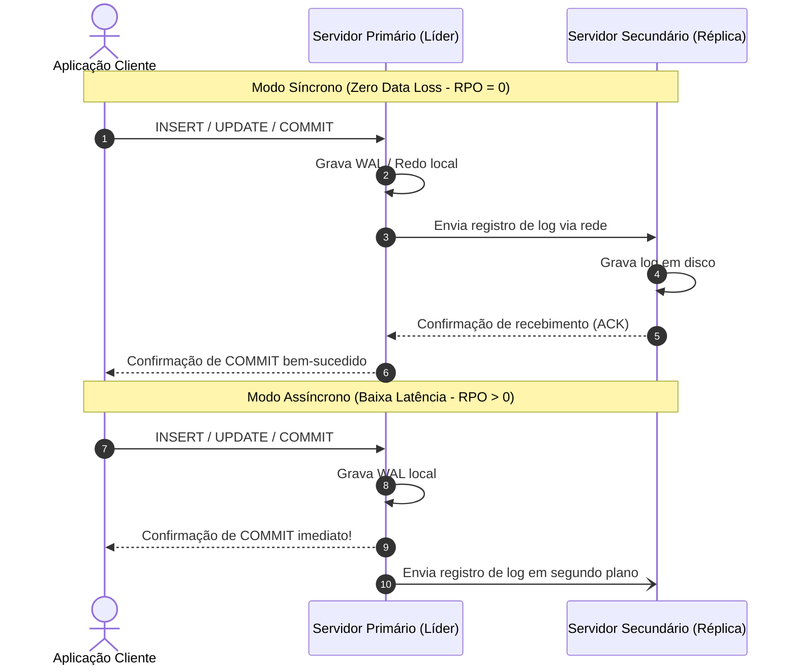
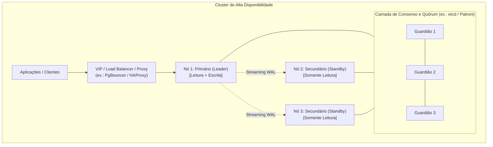
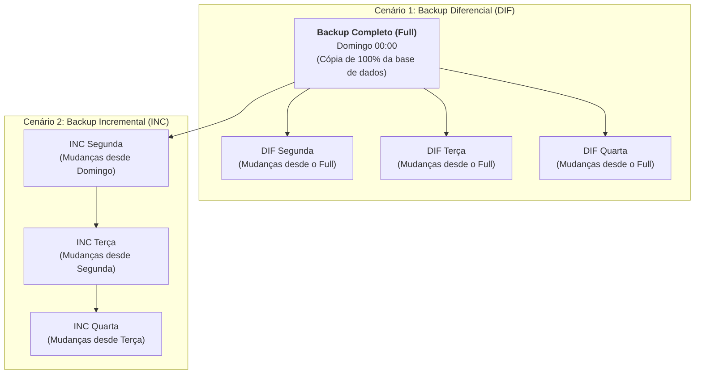
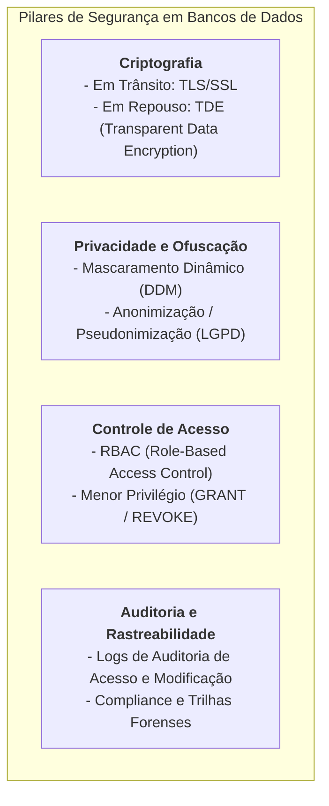

# 06 - Replicação, Alta Disponibilidade, Backup e Segurança

> **Matéria:** Banco de Dados  
> **Cargo:** B02 – Técnico de Controle Externo – Especialidade: Tecnologia da Informação  
> **Arquivo:** `06_replicacao_alta_disponibilidade_backup_e_seguranca.md`  

---

## 📌 Ementa / Itens do Edital
- Replicação de dados: síncrona vs. assíncrona; topologias Master-Replica e Multi-Master
- Alta Disponibilidade (HA), clustering e mecanismos de Failover
- Estratégias de backup: Físico vs. Lógico; Completo, Diferencial e Incremental
- Recuperação e PITR (Point-in-Time Recovery)
- Métricas de continuidade: RPO (Recovery Point Objective) e RTO (Recovery Time Objective)
- Segurança de dados: Criptografia (TDE), mascaramento dinâmico, controle de acesso e governança de dados (LGPD)

---

## 🌳 Classificação Hierárquica

```text
6. Continuidade Operacional, Resiliência e Segurança em Bancos de Dados
├── 6.1 Replicação de Dados e Topologias Distribuídas
│   ├── 6.1.1 Modos de Sincronização:
│   │   ├── Replicação Síncrona: O nó primário só confirma o commit após a gravação em pelo menos um nó secundário (zero perda de dados, porém maior latência)
│   │   └── Replicação Assíncrona: O primário confirma o commit imediatamente; dados propagados em segundo plano (baixa latência, risco de perda em caso de falha imediata)
│   ├── 6.1.2 Topologias de Replicação:
│   │   ├── Master-Replica / Leader-Follower (Primário aceita escritas e leituras; secundários aceitam apenas consultas de leitura - Read Replicas)
│   │   └── Multi-Master / Multi-Leader (Múltiplos nós aceitam escritas simultaneamente; resolução de conflitos complexa)
│   └── 6.1.3 Replicação Física (streaming de blocos binários / WAL) vs. Replicação Lógica (streaming de eventos de comandos SQL / decodificação lógica)
├── 6.2 Alta Disponibilidade (HA) e Tolerância a Falhas
│   ├── 6.2.1 Conceitos: Clusters ativo-passivo vs. ativo-ativo
│   ├── 6.2.2 Failover: Processo de eleição de um novo nó primário quando o líder sofre pane
│   │   ├── Failover Manual vs. Failover Automático (detectores de batimento cardíaco / heartbeat, quórum e split-brain)
│   │   └── Ferramentas de HA: Patroni (com etcd) para PostgreSQL, Oracle Data Guard e Oracle RAC (Real Application Clusters com armazenamento compartilhado)
│   └── 6.2.3 Problema do Split-Brain: Situação em que uma quebra de rede faz dois nós acreditarem ser o primário simultaneamente, gerando corrupção de dados (prevenido por algoritmos de quórum como Raft/Paxos)
├── 6.3 Estratégias de Backup e Recuperação (Disaster Recovery)
│   ├── 6.3.1 Níveis de Backup:
│   │   ├── Backup Lógico: Exportação de comandos SQL (CREATE TABLE, INSERT) via ferramentas como pg_dump ou Oracle Data Pump (expdp)
│   │   └── Backup Físico: Cópia binária dos blocos de dados e arquivos de log (Oracle RMAN, pg_basebackup)
│   ├── 6.3.2 Periodicidade e Tipos de Backup:
│   │   ├── Backup Completo (Full): Cópia total da base de dados
│   │   ├── Backup Diferencial: Cópia de todos os dados modificados desde o ÚLTIMO BACKUP COMPLETO
│   │   └── Backup Incremental: Cópia dos dados modificados desde o ÚLTIMO BACKUP (seja completo ou incremental)
│   ├── 6.3.3 Point-in-Time Recovery (PITR):
│   │   └── Capacidade de restaurar o banco para um instante exato no passado (ex.: 1 segundo antes de um comando DROP TABLE acidental) aplicando um backup físico base + arquivos arquivados de log de transação (Archived WALs / Archive Redo Logs)
│   └── 6.3.4 Métricas Críticas de Continuidade de Negócios:
│       ├── RPO (Recovery Point Objective): Tolerância máxima aceitável de perda de dados medida em tempo (ex.: "podemos perder no máximo 15 minutos de dados")
│       └── RTO (Recovery Time Objective): Tempo máximo tolerável para restabelecer o sistema após o desastre (ex.: "o banco deve voltar ao ar em até 2 horas")
└── 6.4 Segurança, Governança e Proteção de Dados
    ├── 6.4.1 Criptografia:
    │   ├── Em Trânsito: Conexões seguras cliente-servidor e entre réplicas via TLS/SSL
    │   └── Em Repouso: Transparent Data Encryption (TDE) no nível de arquivo/tablespace
    ├── 6.4.2 Ofuscação e Privacidade:
    │   ├── Mascaramento Dinâmico de Dados (Dynamic Data Masking: oculta CPF ou cartão em tempo real de usuários sem privilégio)
    │   └── Anonimização e Pseudonimização para ambientes de teste e desenvolvimento
    ├── 6.4.3 Auditoria e Rastreabilidade: Logs de auditoria (Auditing) registrando quem acessou, modificou ou consultou dados sensíveis
    └── 6.4.4 Governança de Dados no Contexto de Tribunais de Contas: Catálogo de dados, linhagem de dados (data lineage) e conformidade com a LGPD
```

---

## 📖 Teoria Aprofundada & Conceitos Essenciais

### 1. Replicação de Dados: Modos e Topologias

A replicação consiste na manutenção sincronizada de cópias idênticas da base de dados em múltiplos servidores interconectados em rede, visando à redundância, alta disponibilidade e distribuição de carga de leitura.



#### 1.1 Replicação Síncrona vs. Assíncrona

| Dimensão | Replicação Síncrona | Replicação Assíncrona |
|---|---|---|
| **Confirmação de Commit** | O nó primário só responde à aplicação após receber confirmação de gravação de pelo menos um nó secundário. | O nó primário confirma o commit imediatamente após a persistência local em seu próprio log transacional. |
| **Garantia de RPO** | **RPO = 0** (perda zero de dados comprovada). | **RPO > 0** (risco de perda das últimas transações se o nó primário sofrer pane física antes da transmissão). |
| **Impacto no Desempenho** | **Maior latência** nas operações de escrita, dependendo do RTT (*Round Trip Time*) da rede. | **Mínima latência** nas escritas; vazão equivalente a um servidor isolado. |
| **Resiliência a Falhas de Rede** | Se o link cair ou a réplica travar, as transações de escrita no nó primário podem ficar suspensas. | O primário continua operando normalmente mesmo se a réplica estiver temporariamente inacessível. |

#### 1.2 Replicação Física vs. Lógica
- **Replicação Física (*Physical Streaming Replication*):** Transfere os blocos binários exatos e logs transacionais brutos (WAL/Redo Log) de baixo nível. As réplicas são clones exatos byte a byte do primário. Exige idêntica versão do SGBD e mesma arquitetura de hardware/SO.
- **Replicação Lógica (*Logical Replication*):** Decodifica os eventos transacionais no nível de instruções DML (inserções, atualizações e deleções por tupla). Permite replicar tabelas individuais de forma seletiva, entre versões distintas do SGBD ou entre esquemas heterogêneos.

---

### 2. Alta Disponibilidade (HA), Failover e o Problema do Split-Brain

A **Alta Disponibilidade (*High Availability - HA*)** garante a continuidade operacional do serviço de banco de dados mesmo na eventualidade de falhas graves de hardware, software ou rede.



#### 2.1 Conceitos Críticos de Failover e Switchover
- **Switchover:** Transição de papéis **planejada e ordenada** (ex.: manutenção programada do servidor físico). O nó primário transfere a liderança para a réplica de modo controlado e sem perda de dados.
- **Failover:** Transição emergencial **não planejada**, disparada automaticamente quando o nó primário sofre colapso abrupto. Uma das réplicas secundárias é promovida a novo líder.

#### 2.2 O Perigo Crítico do *Split-Brain* (Cérebro Dividido)
Ocorre quando uma falha no link de rede isola dois nós saudáveis de um cluster, fazendo com que cada um acredite que o outro faleceu:
- Ambos os nós assumem o papel de nó primário (*Master*) simultaneamente.
- Clientes distintos passam a enviar transações conflitantes para ambos os nós.
- **Consequência:** Corrupção severa e bifurcação irreparável da base de dados (*data divergence*).

#### Mecanismos de Prevenção do Split-Brain:
1. **Quórum Distribuído (Algoritmos Raft / Paxos):** O cluster exige maioria simples estrita ($\lfloor N/2 \rfloor + 1$) de votos para eleger um novo líder. Se um nó isolado mantiver contato com apenas 1 dos 3 nós, ele não atinge a maioria (2) e renuncia à liderança.
2. **Nó Testemunha (*Witness / Arbiter*):** Um terceiro nó leve sem dados adicionado unicamente para desempatar votações em clusters de dois servidores.
3. **STONITH (*Shoot The Other Node In The Head* / Fencing):** Desligamento elétrico forçado do nó suspeito via interfaces remotas de hardware (IPMI/iLO) antes de permitir a promoção do nó secundário.

---

### 3. Estratégias de Backup, PITR e Métricas de Continuidade

#### 3.1 Níveis de Backup: Físico vs. Lógico
- **Backup Lógico (`pg_dump`, `expdp` Data Pump):** Extrai a estrutura e os dados em comandos SQL legíveis (`CREATE TABLE`, `INSERT`) ou formato binário de exportação. Ideal para migração entre plataformas e restauração de tabelas isoladas, mas proibitivamente lento para bases corporativas multiterabyte.
- **Backup Físico (`pg_basebackup`, Oracle RMAN):** Cópia binária direta dos arquivos físicos de dados (*datafiles*), arquivos de controle e blocos em disco. É extraordinariamente veloz e constitui a base mandatória para o **PITR**.

#### 3.2 O Triângulo dos Tipos de Backup: Full, Diferencial e Incremental



| Tipo de Backup | O que é copiado? | Tempo / Espaço do Backup | Procedimento para Restaurar na Quarta-feira |
|---|---|---|---|
| **Completo (*Full*)** | A totalidade da base de dados | Lento; consome muito espaço em disco | Restaura apenas o arquivo do Full |
| **Diferencial** | Todos os dados modificados **desde o último backup COMPLETO (*Full*)** | Cresce a cada dia sucessivo da semana | **Apenas 2 arquivos:**<br/>`Full (Dom) + Diferencial (Qua)` |
| **Incremental** | Todos os dados modificados **desde o último backup de QUALQUER tipo** (Full ou Incremental) | Extremamente rápido; menor consumo de disco diário | **Todos os arquivos da cadeia:**<br/>`Full (Dom) + INC (Seg) + INC (Ter) + INC (Qua)` |

> ⭐ **IMPORTANTE / REGRA DE OURO:**  
> A FCC adora comparar o tempo e a complexidade de restauração (*Restore*):  
> - O **Incremental** é o mais rápido para *fazer o backup*, mas é o mais demorado e arriscado para *restaurar* (se um único arquivo da cadeia estiver corrompido, a restauração falha dali em diante).  
> - O **Diferencial** consome mais tempo/espaço no backup diário do que o incremental, mas exige apenas **2 etapas** para restaurar (`Full + Último Diferencial`).

#### 3.3 Point-in-Time Recovery (PITR)
O PITR é a técnica de recuperação contínua que combina:
1. A restauração de um **backup físico de base (*Base Backup*)** tirado no passado; com
2. A aplicação sequencial (*replay / roll-forward*) de todos os arquivos arquivados de log transacional (**Archived WALs** no PostgreSQL ou **Archived Redo Logs** no Oracle) até atingir um **ponto exato no tempo (timestamp)** ou número de alteração de sistema (**SCN**).

*Caso de Uso Clássico:* Se às 10h15m30s um desenvolvedor executa um `DROP TABLE PROCESSO` acidental, o PITR permite restaurar a base exatamente ao estado em que se encontrava às **10h15m29s**, recuperando todas as transações válidas e descartando a instrução destrutiva.

#### 3.4 Métricas Críticas: RPO vs. RTO


- **RPO (*Recovery Point Objective*):** Mede a perda máxima aceitável de dados expressa em tempo retroativo. Responde à pergunta: *"Até que ponto no passado nós toleramos perder transações?"*. Se uma organização realiza apenas backups diários às 23h00 e o banco cai às 18h00, foram perdidas 19 horas de trabalho ($RPO = 19h$). Para $RPO = 0$, exige-se **replicação síncrona**.
- **RTO (*Recovery Time Objective*):** Mede o tempo máximo tolerável de paralisação do serviço. Responde à pergunta: *"Quanto tempo a equipe tem para colocar o sistema de pé novamente?"*. Um $RTO$ de 10 minutos exige mecanismos automatizados de failover (*HA Clustering*).

---

### 4. Segurança de Banco de Dados, Criptografia e Governança



#### 4.1 Criptografia em Repouso: Transparent Data Encryption (TDE)
O **TDE (*Transparent Data Encryption*)** protege os dados gravados fisicamente em disco, criptografando os arquivos de dados (*datafiles*), arquivos de log (*redo/wal*) e backups utilizando algoritmos como AES-256.
- **Transparência:** A descriptografia e a criptografia ocorrem na memória em tempo de I/O de bloco pelo próprio SGBD. **Nenhuma alteração de código SQL ou na aplicação cliente é necessária**.
- **Gerenciamento de Chaves:** As chaves de criptografia são gerenciadas por um cofre seguro (*Oracle Wallet* ou serviços KMS), impedindo que um invasor que roube fisicamente o disco rígido ou as fitas de backup consiga ler as informações confidenciais.

#### 4.2 Mascaramento Dinâmico de Dados (*Dynamic Data Masking - DDM*)
O DDM intercepta consultas em tempo de execução e ofusca dados sensíveis (CPF, dados bancários, salários) para usuários sem privilégios explícitos.
- Os dados armazenados fisicamente no disco permanecem **completamente intactos e originais**.
- Um auditor com privilégio consulta o CPF e vê `123.456.789-00`; um atendente sem privilégio executa o mesmo `SELECT` e recebe `***.***.789-**`.

#### 4.3 Auditoria e Rastreabilidade
Mecanismos de auditoria nativos do SGBD registram em arquivos protegidos ou tabelas do sistema o autor, o endereço IP de origem, o instante exato e o comando SQL executado sobre objetos críticos, garantindo conformidade com a LGPD e subsidiações periciais para Tribunais de Contas.

---

## 🌐 Fontes Recomendadas na Internet

### 1. Documentação Oficial de Backup e Recuperação
- [PostgreSQL Documentation - Continuous Archiving & PITR](https://www.postgresql.org/docs/current/continuous-archiving.html): Manual oficial cobrindo arquitetura de arquivamento contínuo de logs (*WAL Archiving*), geração de cópias base físicas com `pg_basebackup` e recuperação para um ponto específico no tempo (*Point-in-Time Recovery*).
- [Oracle Database Backup and Recovery User's Guide (RMAN)](https://docs.oracle.com/en/database/oracle/oracle-database/): Referência técnica da Oracle sobre o Recovery Manager (*RMAN*), estratégias de backups incrementais cumulativos e diferenciais, e recuperação com *Archived Redo Logs*.
- [Patroni Documentation - High Availability for PostgreSQL](https://patroni.readthedocs.io/): Documentação da solução padrão da indústria para clusters de alta disponibilidade com eleição automatizada de líder via consenso distribuído (*etcd/Raft*) e prevenção de *split-brain*.

### 2. Normas de Continuidade de Negócios e Segurança
- [NIST Special Publication 800-34 Rev. 1 - Contingency Planning Guide](https://csrc.nist.gov/publications/detail/sp/800-34/rev-1/final): Padrão de planejamento de contingência definindo formalmente as métricas de RPO (*Recovery Point Objective*) e RTO (*Recovery Time Objective*).
- [Oracle Database Advanced Security Guide - Transparent Data Encryption](https://docs.oracle.com/en/database/oracle/oracle-database/): Manual sobre encriptação em repouso com TDE e uso do Oracle Wallet.

---

## 📝 Questões Comentadas & Exemplos (Padrão FCC)

### Questão 1 (FCC - Adaptada / TI - Estratégias de Backup e PITR)
Às 14h35 de uma terça-feira, um operador de banco de dados executou acidentalmente um comando `DROP TABLE FOLHA_PAGAMENTO` no ambiente de produção do tribunal. A política de backup da organização realiza um Backup Físico Completo (*Full*) todos os domingos às 00h00, backups diários incrementais às 23h00 e mantém o arquivamento contínuo de todos os logs de transação (*WAL / Archived Redo Logs*) em tempo real.

Para restaurar o banco de dados exatamente ao estado em que se encontrava às 14h34m59s (um segundo antes do comando destrutivo), com a menor perda de dados possível, a técnica que deve ser empregada é:
A) Restaurar apenas o backup completo de domingo, descartando todas as transações realizadas na segunda e terça-feira.  
B) O *Point-in-Time Recovery* (PITR), que consiste em restaurar a cópia física base (*base backup*) mais recente e aplicar sequencialmente os arquivos arquivados de log de transação até o carimbo de data/hora (*timestamp*) imediatamente anterior ao desastre.  
C) O *Backup Lógico Frio*, que reverte comandos DDL diretamente da memória RAM sem acessar os arquivos de log gravados em disco.  
D) Executar um `ROLLBACK` manual na sessão do usuário que executou o `DROP TABLE`, pois comandos DDL são puramente virtuais no PostgreSQL e Oracle.  
E) Restaurar apenas o backup incremental de segunda-feira, sendo impossível recuperar as transações ocorridas entre as 23h00 de segunda e as 14h35 de terça.

> **Gabarito: B**  
> **Comentário Analítico Passo a Passo:**  
> - **A está INCORRETA:** Restaurar unicamente o backup de domingo provocaria a perda inaceitável de quase dois dias inteiros de transações confirmadas legítimas.  
> - **B está CORRETA:** O **Point-in-Time Recovery (PITR)** é a técnica padrão da engenharia de banco de dados para esse exato propósito: restaura-se o backup físico base anterior e, em seguida, o utilitário de recuperação reaplica (*roll-forward / replay*) o fluxo ininterrupto de arquivos arquivados de log de transação (WAL/Redo Logs) até alcançar o carimbo de tempo especificado (`14:34:59`), interrompendo o processo milissegundos antes do comando `DROP TABLE` ser processado. O resultado é a restauração integral da tabela sem perda de nenhuma transação válida anterior.  
> - **C está INCORRETA:** Backups lógicos (`pg_dump` ou `expdp`) não têm integração nativa com o fluxo contínuo de logs transacionais para recuperação pontual contínua de segundo a segundo.  
> - **D está INCORRETA:** Comandos DDL alteram diretamente os metadados do catálogo de dados e geram commits implícitos na maioria dos motores, não sendo reversíveis por simples `ROLLBACK` de sessão após a conexão se encerrar.  
> - **E está INCORRETA:** O fluxo contínuo de arquivamento de logs de transação cobre com perfeição todas as operações efetuadas entre as 23h00 de segunda e as 14h35 de terça-feira.

---

### Questão 2 (FCC - Adaptada / TI - Métricas de Continuidade e Replicação)
Em um projeto de modernização do plano de continuidade de negócios de tecnologia da informação do TCE-GO, foram acordadas com a alta administração duas diretrizes:
1. Caso ocorra um desastre físico no datacenter principal, a perda máxima tolerável de dados fiscais é de **zero transações confirmadas**.
2. O tempo máximo aceitável para que a infraestrutura secundária assuma as operações e o sistema esteja plenamente funcional para os auditores é de **15 minutos**.

A respeito dessas métricas de resiliência e dos modelos de replicação, é correto afirmar:
A) A primeira diretriz refere-se ao *RTO* (Recovery Time Objective), e pode ser plenamente atendida com replicação puramente assíncrona baseada em fitas magnéticas semanais.  
B) A primeira diretriz define um *RPO* (Recovery Point Objective) igual a zero, exigindo replicação síncrona de dados para o nó secundário; enquanto a segunda diretriz define um *RTO* (Recovery Time Objective) de 15 minutos, demandando mecanismos automatizados de detecção de falha e *failover*.  
C) O fenômeno de *Split-Brain* ocorre quando o tempo de recuperação (RTO) excede 24 horas consecutivas.  
D) A replicação assíncrona garante perda zero de dados em qualquer cenário de desastre, pois o nó primário retém a confirmação do commit na memória até que o secundário responda.  
E) RPO e RTO são métricas financeiras exclusivas do modelo NoSQL, não se aplicando a bancos relacionais.

> **Gabarito: B**  
> **Comentário Analítico Passo a Passo:**  
> - **A está INCORRETA:** A primeira diretriz trata de perda de dados no tempo (**RPO**), e não de tempo de restauração do serviço (**RTO**). Ademais, fitas magnéticas semanais geram perdas de até uma semana ($RPO \approx 7 \text{ dias}$), violando frontalmente a diretriz de perda zero.  
> - **B está CORRETA:** 
>   1. O **RPO (*Recovery Point Objective*)** estabelece o limite de tolerância para perda de dados. Uma diretriz de *"zero transações confirmadas"* equivale a **$RPO = 0$**, o que exige obrigatoriamente a **Replicação Síncrona** (onde o commit só é confirmado após a gravação na réplica).
>   2. O **RTO (*Recovery Time Objective*)** estabelece o tempo máximo para restabelecer os serviços. Um prazo restrito de **15 minutos** exige monitoramento automatizado por batimento cardíaco (*heartbeat*) e rotinas ágeis ou automatizadas de **failover**.  
> - **C está INCORRETA:** *Split-Brain* é a anomalia de partição de rede em que dois servidores assumem a condição de nó primário simultaneamente, gerando divergência de dados; não guarda correlação com um limite arbitrário de 24 horas.  
> - **D está INCORRETA:** Na replicação assíncrona, o primário confirma o commit localmente antes de enviar os dados pela rede; se o servidor primário for destruído subitamente, todas as transações que ainda estavam na fila de transmissão da rede serão irremediavelmente perdidas ($RPO > 0$).  
> - **E está INCORRETA:** RPO e RTO são métricas canônicas globais de governança de TI e gestão de continuidade de negócios (*Disaster Recovery Planning*), aplicáveis universalmente a quaisquer sistemas.

---

### Questão 3 (FCC - Adaptada / TI - Backup Diferencial vs. Incremental na Restauração)
A equipe de infraestrutura de dados de um órgão público adotou a seguinte política semanal de backup:
- **Domingo às 02h00:** Backup Físico Completo (*Full*).
- **Segunda a Sábado às 22h00:** Backups diários.

Na manhã de quinta-feira, uma falha catastrófica de hardware nos discos do storage corrompeu totalmente a base de dados.

Sobre a rotina e os arquivos necessários para a recuperação da base na quinta-feira, é correto afirmar:
A) Se a política adotar backups **diferenciais**, a restauração exigirá o backup *Full* de domingo e exclusivamente o backup *Diferencial* de quarta-feira.  
B) Se a política adotar backups **incrementais**, a restauração exigirá apenas o backup *Full* de domingo e o backup *Incremental* de quarta-feira, sendo descartados os backups de segunda e terça.  
C) O backup diferencial copia apenas os blocos alterados desde o backup do dia anterior, tornando a restauração mais lenta que a do backup incremental.  
D) O backup incremental copia todos os blocos de dados alterados desde o último backup completo de domingo.  
E) A política de backup incremental exige mais espaço em disco e consome mais tempo de execução na janela noturna de quarta-feira do que a política diferencial.

> **Gabarito: A**  
> **Comentário Analítico Passo a Passo:**  
> - **A está CORRETA:** O backup **Diferencial** armazena cumulativamente todos os blocos de dados modificados **desde o último backup COMPLETO (*Full*)**. Portanto, o backup diferencial de quarta-feira já contém todas as modificações acumuladas de segunda, terça e quarta. Para restaurar o banco na quinta-feira de manhã, são necessários exatamente **dois arquivos**: o *Full* de domingo + o *Diferencial* de quarta-feira.  
> - **B está INCORRETA:** O backup **Incremental** grava apenas o que mudou em relação ao último backup de qualquer tipo. Para restaurar via incremental, é mandatório aplicar **toda a cadeia ininterrupta**: `Full (Domingo) + INC (Segunda) + INC (Terça) + INC (Quarta)`. Descartar segunda ou terça impossibilitaria a restauração.  
> - **C está INCORRETA:** Quem copia desde o dia anterior é o incremental; e a restauração do diferencial é mais **rápida** e menos arriscada porque requer apenas dois passos.  
> - **D está INCORRETA:** Quem copia desde o último backup completo de domingo é o backup **diferencial**, e não o incremental.  
> - **E está INCORRETA:** O backup incremental é justamente o mais rápido e compacto durante a janela noturna de backup, pois lida apenas com o delta do último dia; o diferencial é que cresce progressivamente ao longo da semana.

---

### Questão 4 (FCC - Adaptada / TI - Alta Disponibilidade: Quórum e Prevenção de Split-Brain)
Em um cluster de banco de dados distribuído composto por nós replicados geograficamente entre duas sedes, uma ruptura na fibra óptica submarina provocou o isolamento total de comunicação entre os dois datacenters, embora todos os servidores físicos tenham permanecido ligados e operantes.

A respeito desse cenário e dos mecanismos de consenso para mitigação de falhas, é correto afirmar:
A) O fenômeno de *Split-Brain* é prevenido naturalmente em clusters de 2 nós sem a necessidade de nós testemunhas (*arbiters*).  
B) O algoritmo de quórum baseado em maioria simples (como no Raft ou Paxos) assegura que apenas o lado da rede que reunir mais da metade dos nós do cluster continue autorizado a processar gravações, forçando o lado minoritário a entrar em modo somente-leitura ou suspender operações.  
C) A técnica STONITH (*Shoot The Other Node In The Head*) consiste em promover automaticamente todos os nós isolados a servidores primários para garantir escalabilidade infinita de escrita.  
D) A ocorrência de *Split-Brain* é inofensiva para a integridade dos dados, pois bancos relacionais unificam transações divergentes conflitantes automaticamente através de junções naturais.  
E) Para evitar o *Split-Brain*, deve-se sempre configurar clusters com um número estritamente par de nós com pesos de voto idênticos.

> **Gabarito: B**  
> **Comentário Analítico Passo a Passo:**  
> - **A está INCORRETA:** Clusters de 2 nós com pesos iguais são os mais vulneráveis ao *Split-Brain*. Quando o link é rompido, cada nó enxerga 1 voto de 2 (50%), não havendo maioria absoluta. É imprescindível um terceiro nó ou árbitro (*witness*) para viabilizar desempate.  
> - **B está CORRETA:** Algoritmos de consenso e quórum distribuído (como Raft e Paxos) exigem a conquista da **maioria simples estrita** ($\lfloor N/2 \rfloor + 1$) para legitimar a eleição e a operação de um nó primário. Se um cluster de 3 nós é cindido em uma partição com 2 nós e outra com 1 nó, a partição com 2 nós detém o quórum ($2 > 1.5$) e continua processando gravações, enquanto o nó solitário isolado reconhece a perda de quórum e se recusa a aceitar comandos DML de escrita, prevenindo a bifurcação dos dados.  
> - **C está INCORRETA:** A técnica **STONITH** (*Shoot The Other Node In The Head*) é um mecanismo drástico de isolamento (*fencing* de hardware) que força o desligamento da energia física do nó remoto suspeito via interface de gerenciamento (IPMI/iLO) para ter certeza absoluta de que ele não tentará gravar nada no storage.  
> - **D está INCORRETA:** O *Split-Brain* é uma das piores catástrofes em bancos de dados corporativos, gerando escritas divergentes e inconsistências severas irrecuperáveis por métodos automáticos.  
> - **E está INCORRETA:** Recomenda-se enfaticamente configurar clusters de alta disponibilidade com um número **ímpar** de nós (3, 5, 7) para garantir que sempre haja um lado com maioria estrita em caso de partição binária.

---

### Questão 5 (FCC - Adaptada / TI - Segurança de Banco de Dados: TDE e Dynamic Data Masking)
Com a vigência da Lei Geral de Proteção de Dados (LGPD) e as exigências de conformidade em órgãos de fiscalização pública, a equipe de segurança da informação implementou duas tecnologias no banco de dados corporativo:
1. Uma técnica que cifra os arquivos de dados físicos (*datafiles*), arquivos de log e backups em disco, de forma transparente para as consultas SQL e para os sistemas clientes que consom o banco.
2. Uma funcionalidade que, no momento em que um usuário realiza um `SELECT` sobre a coluna de CPF dos contribuintes, retorna o valor mascarado (`***.456.789-**`) caso o usuário não possua autorização específica de desmascaramento, embora o CPF original continue armazenado intacto nas tabelas.

As tecnologias 1 e 2 correspondem, respectivamente, a:
A) *Dynamic Data Masking* (DDM); e *Transparent Data Encryption* (TDE).  
B) *Transparent Data Encryption* (TDE); e *Dynamic Data Masking* (DDM).  
C) *Role-Based Access Control* (RBAC); e Hash Criptográfico SHA-512 irreversível.  
D) Criptografia Assimétrica RSA com chaves públicas embutidas no código SQL; e `DROP COLUMN`.  
E) *Point-in-Time Recovery* (PITR); e Anonimização definitiva em repouso.

> **Gabarito: B**  
> **Comentário Analítico Passo a Passo:**  
> - **A está INCORRETA:** Inverteu exatamente a ordem das duas tecnologias descritas.  
> - **B está CORRETA:** 
>   1. A tecnologia 1 descreve perfeitamente o **TDE (*Transparent Data Encryption*)**, recurso que criptografa os blocos de dados físicos em disco (*data-at-rest*) de forma transparente para a camada de aplicação, dispensando alterações nas consultas SQL e protegendo a base contra furto físico de arquivos ou cópias de backup.
>   2. A tecnologia 2 descreve com rigor o **Dynamic Data Masking (DDM)** (Mascaramento Dinâmico de Dados), mecanismo que ofusca dados sensíveis em tempo de execução para sessões sem privilégios apropriados, preservando os dados brutos originais inalterados no armazenamento físico do banco.  
> - **C está INCORRETA:** RBAC trata da concessão de permissões via papéis/funções (*roles*); e hash SHA-512 modificaria o dado gravado de modo irreversível, inviabilizando consultas do dado original por usuários autorizados.  
> - **D e E estão INCORRETAS:** Apresentam conceitos incompatíveis com a descrição funcional fornecida no enunciado.
