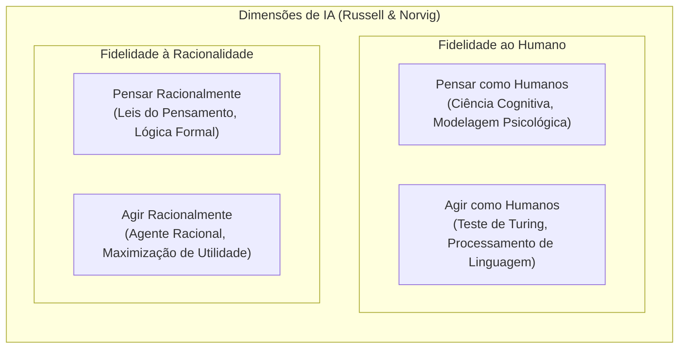
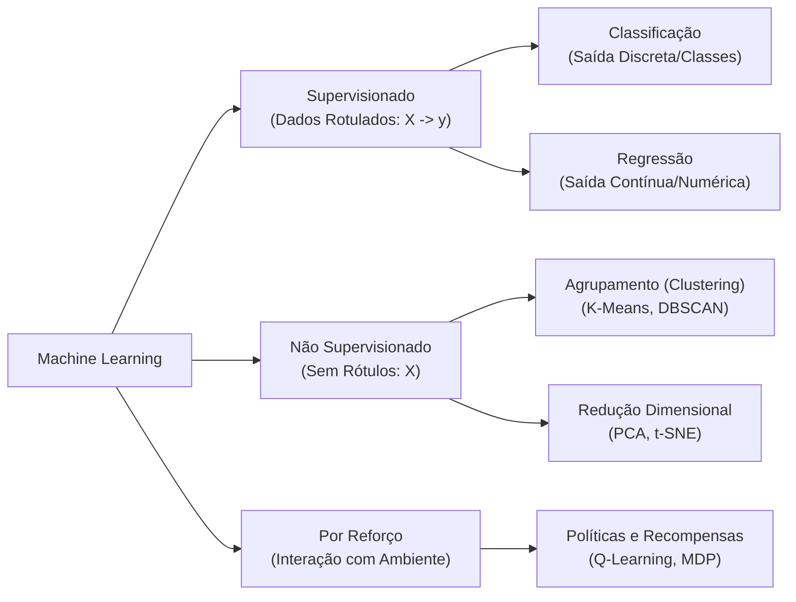
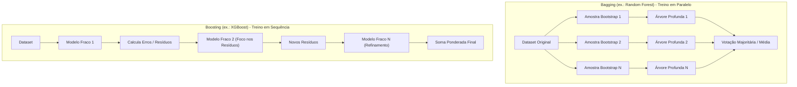
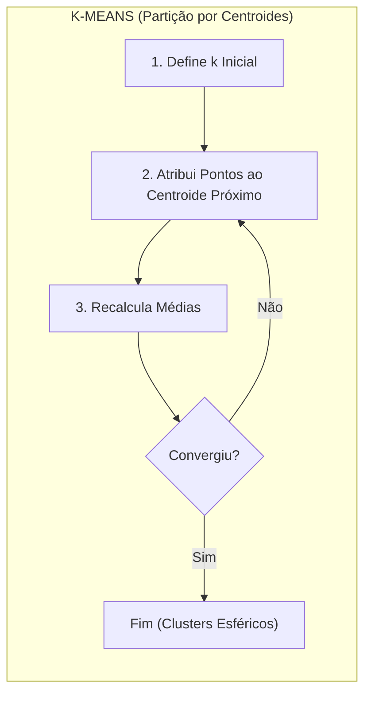
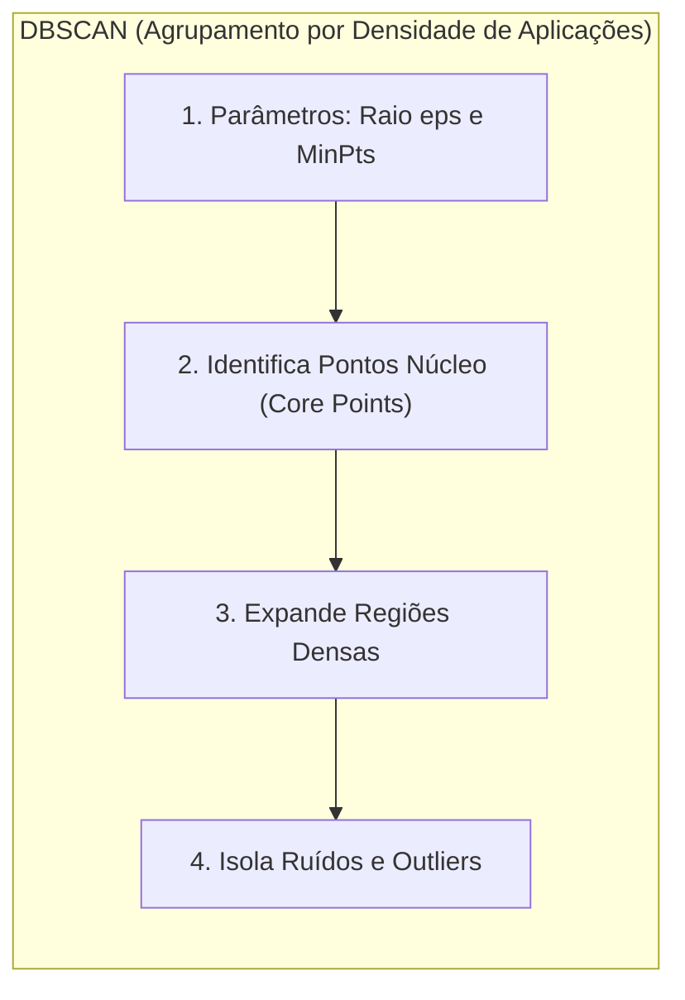
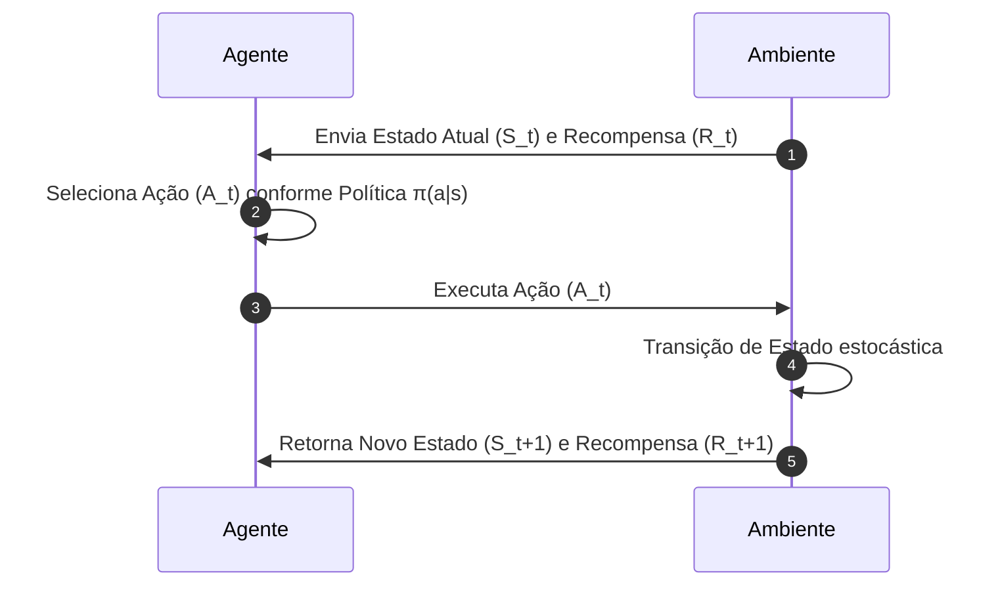
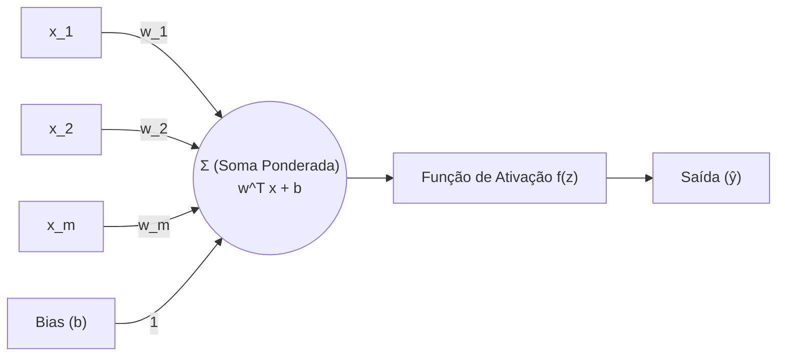
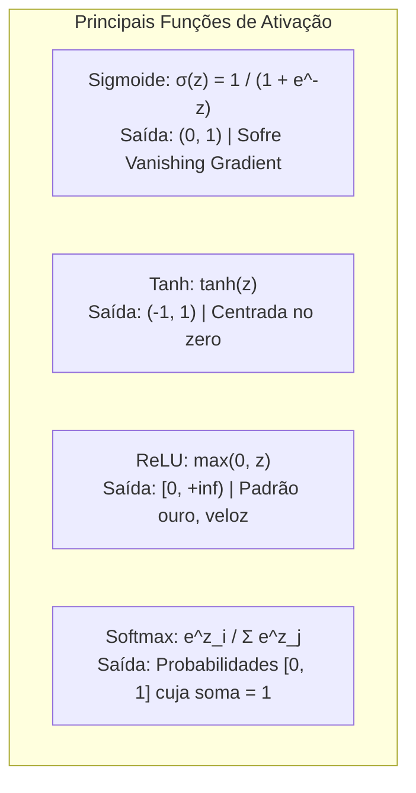
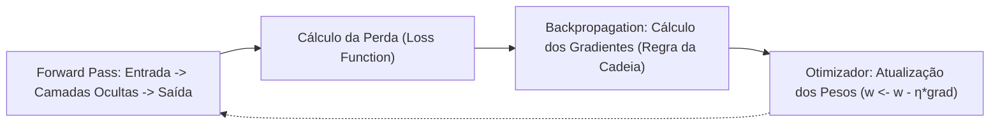

# 01 - Machine Learning, Redes Neurais e Deep Learning

> **Matéria:** Inteligência Artificial, Ciência de Dados e Automação  
> **Cargo:** B02 – Técnico de Controle Externo – Especialidade: Tecnologia da Informação  
> **Arquivo:** `01_fundamentos_ia_machine_learning_e_deep_learning.md`  

---

## 📌 Ementa / Itens do Edital
- Fundamentos e histórico da Inteligência Artificial
- Aprendizado de Máquina (Machine Learning):
  - Aprendizado Supervisionado (Classificação e Regressão)
  - Aprendizado Não Supervisionado (Agrupamento e Redução de Dimensionalidade)
  - Aprendizado por Reforço (Reinforcement Learning)
- Redes Neurais Artificiais (Arquitetura, Treinamento e Funções de Ativação)
- Noções de Aprendizado Profundo (Deep Learning)

---

## 🌳 Classificação Hierárquica

```text
1. Paradigmas de IA, Aprendizado de Máquina e Redes Neurais
├── 1.1 Fundamentos de Inteligência Artificial
│   ├── 1.1.1 Definição de IA: Sistemas que agem ou pensam como humanos vs. racionalmente (Russell & Norvig)
│   ├── 1.1.2 Teste de Turing, Quarto Chinês de Searle e IA Fraca (Narrow AI) vs. IA Geral (AGI)
│   └── 1.1.3 Paradigmas: IA Simbólica (Sistemas Especialistas, regras lógicas) vs. IA Conexionista (Estatística e Redes Neurais)
├── 1.2 Tipos de Aprendizado de Máquina (Machine Learning)
│   ├── 1.2.1 Aprendizado Supervisionado (Dados rotulados: entradas X e saídas esperadas y):
│   │   ├── Tarefas de Classificação (saídas discretas/classes):
│   │   │   ├── Regressão Logística (fronteira linear, função sigmoide)
│   │   │   ├── Árvores de Decisão (Critérios de divisão: Entropia / Ganho de Informação e Índice Gini)
│   │   │   ├── Random Forest e Gradient Boosting (XGBoost, LightGBM - métodos de ensemble: Bagging vs. Boosting)
│   │   │   ├── Support Vector Machines (SVM: Hiperplano ótimo de separação, margem máxima e truque do kernel)
│   │   │   ├── Naive Bayes (Classificador probabilístico baseado no Teorema de Bayes e independência condicional)
│   │   │   └── k-Nearest Neighbors (k-NN: Aprendizado baseado em instâncias / preguiçoso e cálculo de distâncias)
│   │   └── Tarefas de Regressão (saídas contínuas/numéricas):
│   │       ├── Regressão Linear Simples e Múltipla (Método dos Mínimos Quadrados Ordinários - OLS)
│   │       └── Regularização: Ridge (norma L2 - encolhe coeficientes) e Lasso (norma L1 - zera coeficientes / seleção de features)
│   ├── 1.2.2 Aprendizado Não Supervisionado (Dados não rotulados: descoberta de padrões intrínsecos):
│   │   ├── Algoritmos de Agrupamento (Clustering):
│   │   │   ├── K-Means: Particionamento baseado em centroides, critério da inércia e Método do Cotovelo (Elbow Method)
│   │   │   ├── DBSCAN: Agrupamento espacial baseado em densidade (detecta clusters de formatos arbitrários e ruídos/outliers)
│   │   │   └── Agrupamento Hierárquico (Dendrogramas, abordagens aglomerativa e divisiva)
│   │   └── Redução de Dimensionalidade:
│   │       ├── Análise de Componentes Principais (PCA: autovalores, autovetores e projeção em eixos ortogonais de máxima variância)
│   │       └── t-SNE e UMAP (técnicas não lineares para visualização em 2D/3D)
│   └── 1.2.3 Aprendizado por Reforço (Reinforcement Learning - RL):
│       ├── Componentes: Agente, Ambiente, Estado (S), Ação (A), Recompensa (R)
│       ├── Processos de Decisão de Markov (MDP) e Função de Valor
│       └── Dilema Exploração vs. Explotação (Exploration vs. Exploitation) e algoritmo Q-Learning
└── 1.3 Redes Neurais Artificiais e Deep Learning
    ├── 1.3.1 O Neurônio Artificial (Perceptron de Rosenblatt): Entradas ponderadas por pesos (w_i), viés (bias b), função de soma e função de ativação
    ├── 1.3.2 Redes Multicamadas (MLP - Multilayer Perceptron): Camada de entrada, camadas ocultas (hidden layers) e camada de saída
    ├── 1.3.3 Funções de Ativação Não Lineares:
    │   ├── Sigmoide: Saídas entre 0 e 1 (problema do desvanecimento do gradiente)
    │   ├── Tangente Hiperbólica (tanh): Saídas centradas em zero entre -1 e 1
    │   ├── ReLU (Rectified Linear Unit): Padrão na indústria, rápida e resolve desvanecimento para valores positivos
    │   └── Softmax: Converte vetor de saídas brutas em distribuição de probabilidades cuja soma é 1 (para classificação multiclasse)
    ├── 1.3.4 Processo de Treinamento e Otimização:
    │   ├── Função de Perda (Loss Function): Erro Quadrático Médio (MSE) para regressão; Entropia Cruzada (Cross-Entropy) para classificação
    │   ├── Algoritmo de Retropropagação (Backpropagation): Cálculo dos gradientes pela Regra da Cadeia
    │   └── Otimizadores de Gradiente Descendente: SGD (Stochastic Gradient Descent), Momentum, RMSprop e Adam
    └── 1.3.5 Principais Arquiteturas de Deep Learning:
        ├── Redes Neurais Convolucionais (CNNs): Convolução, Pooling e filtros (visão computacional, reconhecimento de imagens)
        ├── Redes Neurais Recorrentes (RNNs) e LSTM / GRU: Células com portas para retenção de memória sequencial temporal
        └── Arquitetura Transformer: Atenção pura sem recorrência (base dos modelos de linguagem modernos)
```

---

## 📖 Teoria Aprofundada

### 1. Paradigmas de Inteligência Artificial

A Inteligência Artificial (IA) é historicamente categorizada sob a taxonomia clássica de Stuart Russell e Peter Norvig segundo duas dimensões: o foco do processo (pensamento vs. comportamento) e o critério de sucesso (fidelidade humana vs. racionalidade ideal).



- **Agir como humanos:** Avaliado operacionalmente pelo clássico **Teste de Turing** (1950), onde um interrogador humano tenta distinguir se as respostas textuais advêm de um humano ou de uma máquina.
- **Pensar como humanos:** Requer desvendar o funcionamento empírico da mente humana por meio de experimentos psicológicos e neuroimagem (ciência cognitiva).
- **Pensar racionalmente:** Alicerçado na lógica dedutiva formal (silogismos aristotélicos). Limitação: dificuldade em codificar incerteza e conhecimento informal do mundo real.
- **Agir racionalmente (Abordagem de Agentes Racionais):** Paradigma predominante na ciência da computação contemporânea. Um **agente racional** é aquele que opera de modo a alcançar o melhor resultado esperado, considerando suas percepções e seu conhecimento prévio.

> ⭐ **IMPORTANTE / REGRA DE OURO:**  
> Nos concursos de alto nível (FCC/FGV), a definição contemporânea mais aceita de IA é a de **Agente Racional**: uma entidade computacional autônoma que percebe seu ambiente através de sensores, processa essas informações matematicamente e atua sobre o ambiente por meio de atuadores para **maximizar a sua medida de desempenho esperada**.

#### IA Estreita (Narrow AI) vs. IA Geral (AGI) vs. Superinteligência
- **IA Estreita / Fraca (Narrow / Weak AI):** Sistemas projetados e treinados para realizar uma tarefa específica (ex.: reconhecimento facial, detecção de fraude tributária, diagnóstico por imagem, jogos como xadrez e Go). Toda a IA existente no mercado hoje é Narrow AI.
- **IA Geral / Forte (AGI - Artificial General Intelligence):** Sistema hipotético dotado de flexibilidade cognitiva ampla equivalente à humana, capaz de aprender, raciocinar, transferir conhecimento entre domínios distintos e solucionar problemas inéditos sem retreinamento específico.
- **Superinteligência Artificial (ASI):** Estágio hipotético em que o intelecto computacional supera as capacidades combinadas da totalidade dos cérebros humanos em praticamente todos os campos (científico, criativo, social).

#### Paradigmas Históricos: Simbólico vs. Conexionista
- **IA Simbólica (GOFAI - Good Old-Fashioned AI):** Baseada na manipulação de símbolos e regras lógicas determinísticas (*top-down*). Destacam-se os **Sistemas Especialistas** e motores de inferência (décadas de 1970–1980). Vantagens: total interpretabilidade e rastreabilidade (*white box*). Desvantagem: fragilidade perante ruído, ambiguidade e dados não estruturados (*knowledge acquisition bottleneck*).
- **IA Conexionista / Subsimbólica:** Inspirada na estrutura neurobiológica (*bottom-up*). Modela o conhecimento através de pesos sinápticos distribuídos em redes de nós interconectados (redes neurais artificiais e modelos estatísticos). Aprende diretamente dos dados por otimização numérica. Vantagens: robustez a ruído e capacidade ímpar de generalização em alta dimensionalidade (imagens, áudio, texto). Desvantagem: comportamento de "caixa-preta" (*black box*) e alta demanda computacional e de dados.

---

### 2. Aprendizado de Máquina (Machine Learning)

O Aprendizado de Máquina é o subcampo da IA voltado ao desenvolvimento de algoritmos que melhoram seu desempenho $P$ em determinada classe de tarefas $T$ a partir da experiência empírica $E$, formalizado pela definição de Tom Mitchell ($P, T, E$).



---

### 2.1 Aprendizado Supervisionado

No aprendizado supervisionado, o conjunto de dados de treino é composto por pares ordenados de entrada e saída $\{(x_1, y_1), (x_2, y_2), \dots, (x_n, y_n)\}$, onde o algoritmo busca aprender uma função preditiva $f(x) \approx y$.

#### A) Classificação (Rótulos Categóricos / Discretos)
- **Regressão Logística:** Apesar do nome "regressão", é um algoritmo de **classificação linear**. Modela a probabilidade de um evento binário por meio da função logística (sigmoide):
  $P(y=1|x) = \sigma(w^T x + b) = \frac{1}{1 + e^{-(w^T x + b)}}$
  A fronteira de decisão gerada é linear ($w^T x + b = 0$). O treinamento minimiza a função de perda de Entropia Cruzada Binária (*Log-Loss*).

- **Árvores de Decisão (Decision Trees):** Modelos hierárquicos não paramétricos que particionam iterativamente o espaço de características.
  - **Algoritmo ID3 / C4.5:** Utiliza a **Entropia** para quantificar a incerteza e escolhe o atributo que maximiza o **Ganho de Informação** (*Information Gain*):
    $\text{Entropia}(S) = - \sum_{i=1}^{c} p_i \log_2(p_i)$
  - **Algoritmo CART (Classification and Regression Trees):** Utiliza o **Índice de Impureza Gini**:
    $\text{Gini}(S) = 1 - \sum_{i=1}^{c} p_i^2$
  - Árvores puras sem restrição de profundidade sofrem severamente de **overfitting** (alta variância). Métodos de prevenção: poda prévia (*pre-pruning* via profundidade máxima ou número mínimo de amostras por folha) e poda posterior (*post-pruning* via *cost-complexity pruning*).

- **Support Vector Machines (SVM):** Procura encontrar o **hiperplano ótimo** que separa as classes com a **margem máxima** de separação.
  - **Vetores de Suporte:** Pontos de dados mais próximos do hiperplano que definem a margem. Apenas esses pontos determinam a posição do hiperplano; os demais pontos podem ser removidos sem alterar a fronteira.
  - **Margem Suave (Soft Margin):** Introduz variáveis de folga ($\xi_i$) e um hiperparâmetro de regularização $C$ para tolerar pontos mal classificados ou dentro da margem. Um $C$ alto penaliza erros com rigor (risco de overfitting); um $C$ baixo aceita mais violações para gerar margens mais largas (maior viés).
  - **Truque do Kernel (Kernel Trick):** Mapeia implicitamente os dados de entrada de um espaço original não separável linearmente para um espaço de dimensão superior onde a separação linear se torna possível, sem calcular explicitamente as coordenadas de alta dimensão. Kernels comuns: Linear, Polinomial e RBF Gaussiano (*Radial Basis Function*).

- **Naive Bayes:** Classificador probabilístico baseado no Teorema de Bayes:
  $P(y|X) = \frac{P(X|y) \cdot P(y)}{P(X)}$
  Adota a suposição "ingênua" (*naive*) de que todas as características $x_i$ são **estatisticamente independentes entre si, dado o rótulo da classe $y$**:
  $P(X|y) = \prod_{i=1}^{d} P(x_i|y)$
  Apesar de violada na vida real, apresenta excelente desempenho computacional em tarefas como filtragem de spam e categorização textual.

- **k-Nearest Neighbors (k-NN):** Algoritmo **baseado em instâncias** (*instance-based*) e classificado como **aprendizado preguiçoso** (*lazy learner*), pois não constrói um modelo discriminativo explícito na fase de treino; limita-se a memorizar os dados. A classificação de um novo ponto calcula as distâncias (Euclidiana, Manhattan ou Minkowski) até todos os pontos de treino e atribui a classe majoritária dentre os $k$ vizinhos mais próximos. Sofre severamente com a **maldição da dimensionalidade** (*curse of dimensionality*).

#### B) Métodos de Ensemble (Comitês de Modelos)
Combinam múltiplos estimadores base (*weak learners*) para construir um preditor composto mais robusto e acurado.

| Característica | Bagging (Bootstrap Aggregating) | Boosting |
| :--- | :--- | :--- |
| **Construção dos Modelos** | **Paralela** e independente. | **Sequencial** e adaptativa. |
| **Amostragem dos Dados** | Reamostragem com reposição (*Bootstrap*) aleatória uniforme. | Reamostragem ponderada; instâncias erradas ganham maior peso residual. |
| **Foco de Otimização** | Reduzir a **variância** (combater overfitting). | Reduzir o **viés** (combater underfitting) e aumentar precisão. |
| **Agregação da Saída** | Média simples (regressão) ou votação majoritária (classificação). | Combinação ponderada baseada no desempenho de cada estimador. |
| **Exemplos Canônicos** | **Random Forest**, Extra Trees. | **AdaBoost, Gradient Boosting, XGBoost, LightGBM, CatBoost**. |
| **Complexidade dos Estimadores Base** | Árvores profundas (alta variância, baixo viés). | Árvores rasas / *stumps* (baixo custo, alto viés). |

> 🚨 **ALERTA DE PROVA / PEGADINHA FCC:**  
> A FCC frequentemente tenta inverter os objetivos do Bagging e do Boosting:
> - O **Random Forest (Bagging)** treina árvores completas e profundas em **paralelo** em subconjuntos aleatórios de dados e de *features* (*feature subsampling*), visando derrubar a **variância** do modelo!
> - O **Boosting** treina estimadores fracos em **série sequencial**, onde cada modelo subsequente foca em **minimizar os erros residuais** dos modelos que o antecederam, atuando precipuamente na redução do **viés**!



#### C) Regressão e Técnicas de Regularização
Na regressão, a variável de resposta $y$ é contínua. O modelo de Regressão Linear Clássico minimiza a soma dos quadrados dos resíduos pelo método de Mínimos Quadrados Ordinários (OLS - *Ordinary Least Squares*). Quando o número de variáveis é elevado ou há alta colinearidade entre preditores, o OLS sofre de instabilidade numérica e sobreajuste. A regularização adiciona um termo de penalidade à função de perda:

$$\mathcal{L}_{\text{regularizada}} = \text{MSE} + \lambda \cdot \Omega(w)$$

| Técnica | Penalidade $\Omega(w)$ | Propriedades Matemáticas | Comportamento dos Coeficientes |
| :--- | :--- | :--- | :--- |
| **Ridge Regression** | Norma $L_2$: $\sum_{j=1}^{p} w_j^2$ | Diferenciável em zero; penaliza coeficientes proporcionalmente à sua magnitude ao quadrado. | **Encolhe** (*shrinks*) os coeficientes em direção a zero, mas **nunca zera nenhum estritamente**. Excelente contra multicolinearidade. |
| **Lasso Regression** | Norma $L_1$: $\sum_{j=1}^{p} |w_j|$ | Não diferenciável na origem ($w=0$); geometria pontiaguda nos eixos coordenados. | Força coeficientes irrelevantes a se tornarem **exatamente zero**. Realiza **seleção automática de atributos** (*feature selection*) gerando modelos esparsos. |
| **Elastic Net** | Combinação convexa: $\alpha L_1 + (1-\alpha) L_2$ | Une a esparsidade do Lasso com a estabilidade do Ridge para grupos de variáveis correlacionadas. | Seleciona variáveis mantendo grupos de preditores fortemente correlacionados juntos. |

---

### 2.2 Aprendizado Não Supervisionado

Opera sobre conjuntos de dados sem anotação prévia ou rótulos de classe, descobrindo correlações, agrupamentos naturais ou projeções latentes de baixa dimensionalidade.

#### A) Algoritmos de Agrupamento (Clustering)





- **K-Means:**
  - Minimiza a variação intra-cluster (soma dos quadrados intra-cluster - WCSS, também chamada de inércia):
    $\text{WCSS} = \sum_{k=1}^{K} \sum_{x_i \in C_k} ||x_i - \mu_k||^2$
  - Exige a definição explícita prévia do número de grupos $k$. O valor ótimo de $k$ costuma ser determinado empiricamente pelo **Método do Cotovelo** (*Elbow Method*) ou pelo **Coeficiente de Silhueta** (que varia de $-1$ a $+1$).
  - Limitações: Assume clusters convexos (esféricos) e de variância similar; altamente sensível à inicialização de centroides (mitigado pelo *K-Means++*) e à presença de *outliers*.
- **DBSCAN (Density-Based Spatial Clustering of Applications with Noise):**
  - Baseia-se na densidade local de pontos delimitada por dois hiperparâmetros fundamentais: $\varepsilon$ (*eps*, distância máxima de vizinhança) e *min_samples* (número mínimo de vizinhos em um raio $\varepsilon$).
  - Classificação dos pontos:
    1. **Ponto Núcleo (Core Point):** Possui pelo menos *min_samples* vizinhos em sua vizinhança $\varepsilon$.
    2. **Ponto de Borda (Border Point):** Não é núcleo, mas está na vizinhança $\varepsilon$ de um ponto núcleo.
    3. **Ruído / Anomalia (Noise / Outlier):** Não é núcleo nem borda; cai em regiões de baixa densidade.
  - Vantagens capitais: **Não requer definição prévia de $k$**, detecta agrupamentos com geometrias arbitrárias/alongadas e classifica dados isolados explicitamente como **ruído**, sendo amplamente utilizado para detecção de fraudes.
- **Agrupamento Hierárquico:**
  - Gera uma árvore de agrupamentos denominada **Dendrograma**.
  - Abordagem **Aglomerativa** (*bottom-up*): cada ponto inicia como um cluster unitário e pares são fundidos iterativamente.
  - Abordagem **Divisiva** (*top-down*): todos os pontos iniciam em um único cluster global que é iterativamente biparticionado.
  - Métodos de ligação (*linkage*): *Single* (distância mínima), *Complete* (distância máxima), *Average* (distância média) e *Ward* (minimiza o aumento da variância total interna).

#### B) Redução de Dimensionalidade
- **PCA (Principal Component Analysis - Análise de Componentes Principais):**
  - Técnica **linear e não supervisionada** que projeta os dados em um novo sistema de eixos ortogonais não correlacionados denominados **Componentes Principais**.
  - O primeiro componente principal captura a direção de **máxima variância** dos dados; o segundo componente captura a segunda maior variância sujeito à restrição de ortogonalidade em relação ao primeiro, e assim por diante.
  - Baseia-se na decomposição espectral (autovalores e autovetores) da matriz de covariância dos dados padronizados ou em decomposição em valores singulares (SVD).
- **t-SNE (t-Distributed Stochastic Neighbor Embedding) e UMAP (Uniform Manifold Approximation and Projection):**
  - Técnicas **não lineares** projetadas primordialmente para redução de alta dimensionalidade para 2D ou 3D com a finalidade de visualização. Preservam com rigor as estruturas de vizinhança local entre as instâncias.

---

### 2.3 Aprendizado por Reforço (Reinforcement Learning)

No Aprendizado por Reforço, um **Agente** interage ativamente com um **Ambiente** estocástico ao longo do tempo discreto $t = 0, 1, 2, \dots$. A cada passo, o agente observa um **Estado** $S_t$, executa uma **Ação** $A_t$ e recebe uma **Recompensa** escalar $R_{t+1}$, transicionando para o próximo estado $S_{t+1}$.



- **Formalismo Matemático:** Processo de Decisão de Markov (MDP), formalizado pela 5-tupla $(S, A, P, R, \gamma)$, onde $\gamma \in [0, 1)$ é o fator de desconto temporal de recompensas futuras.
- **Função de Valor e Equação de Bellman:** O objetivo do agente é aprender uma **Política** $\pi(a|s)$ ótima que maximize o retorno acumulado descontado esperado:
  $Q^*(s, a) = R(s, a) + \gamma \sum_{s'} P(s'|s, a) \max_{a'} Q^*(s', a')$
- **Dilema Exploração vs. Explotação (Exploration vs. Exploitation):** O agente deve balancear o ato de explorar ações inéditas para descobrir recompensas potencialmente maiores (*exploration*) e o ato de executar a melhor ação já conhecida para garantir pontuação (*exploitation*). Estratégia típica: política $\varepsilon$-greedy.
- **Q-Learning:** Algoritmo clássico de aprendizado por diferença temporal (*Temporal Difference*) classificado como **off-policy** e livre de modelo (*model-free*), que atualiza iterativamente uma tabela de valores $Q(s, a)$.

---

### 3. Redes Neurais Artificiais e Deep Learning

#### 3.1 O Neurônio Artificial (Perceptron)
Concebido por Frank Rosenblatt (1958), o Perceptron realiza o produto escalar entre o vetor de entradas $x = [x_1, x_2, \dots, x_m]$ e o vetor de pesos sinápticos $w = [w_1, w_2, \dots, w_m]$, adicionando um termo linear de viés (*bias* $b$), passando a soma por uma função de ativação $f$:

$$z = \sum_{i=1}^{m} w_i x_i + b = w^T x + b, \quad \hat{y} = f(z)$$

O Perceptron simples só é capaz de resolver problemas linearmente separáveis, falhando na resolução de operações lógicas elementares não lineares como o **XOR** (Exclusive OR), limitação formalmente comprovada por Minsky e Papert em 1969.



#### 3.2 Redes Multicamadas (MLP - Multilayer Perceptron)
Ao intercalar camadas ocultas (*hidden layers*) dotadas de funções de ativação **não lineares** entre a camada de entrada e a camada de saída, as MLPs tornam-se capazes de aproximar qualquer função contínua arbitrária (Teorema da Aproximação Universal de Cybenko e Hornik).

#### 3.3 Funções de Ativação Não Lineares



| Função de Ativação | Expressão Matemática | Faixa de Saída (*Range*) | Vantagens | Desvantagens / Patologias |
| :--- | :--- | :--- | :--- | :--- |
| **Sigmoide** | $\sigma(z) = \frac{1}{1 + e^{-z}}$ | $(0, 1)$ | Interpretação probabilística direta para classificação binária. | Satura para valores extremos ($|z| \gg 0$), provocando **desvanecimento do gradiente** (*vanishing gradient*); saída não centrada em zero. |
| **Tangente Hiperbólica (tanh)** | $\tanh(z) = \frac{e^z - e^{-z}}{e^z + e^{-z}}$ | $(-1, 1)$ | Saída **centrada em zero**, facilitando a convergência do gradiente em comparação à sigmoide. | Também satura nas caudas e sofre de desvanecimento de gradientes em redes profundas. |
| **ReLU (Rectified Linear Unit)** | $f(z) = \max(0, z)$ | $[0, +\infty)$ | Não satura para valores positivos; gradiente constante ($=1$ para $z>0$); cálculo computacionalmente ultrarrápido; padrão ouro em camadas ocultas. | Problema do neurônio morto (*Dying ReLU*): se $z \le 0$, o neurônio emite saída zero e gradiente zero, podendo nunca mais se recuperar no treino. |
| **Softmax** | $\text{Softmax}(z)_i = \frac{e^{z_i}}{\sum_{j=1}^{K} e^{z_j}}$ | $(0, 1)$, com $\sum_{i=1}^K \text{Softmax}(z)_i = 1$ | Converte o vetor de números reais não normalizados (*logits*) em uma **distribuição de probabilidade categórica bem definida**. | Utilizada quase que **exclusivamente na camada de saída** em tarefas de classificação multiclasse mutualmente exclusivas. |

> ⭐ **IMPORTANTE / REGRA DE OURO:**  
> A função **Softmax** nunca deve ser utilizada como função de ativação em camadas ocultas intermediárias. Ela pertence à **camada de saída** de problemas de classificação multiclasse. Para camadas ocultas em Deep Learning contemporâneo, a escolha primária padrão é a família **ReLU** (ReLU, Leaky ReLU, Parametric ReLU ou GeLU).

#### 3.4 Treinamento, Otimização e Regularização

O treinamento de uma rede neural profunda ocorre em duas etapas complementares coordenadas:
1. **Passo Direto (Forward Pass):** Os dados fluem da entrada pelas camadas intermediárias até a saída, onde a predição $\hat{y}$ é comparada ao rótulo real $y$ através de uma **Função de Perda** ($\mathcal{L}$).
   - Para Regressão: Erro Quadrático Médio ($\text{MSE} = \frac{1}{n}\sum(y - \hat{y})^2$).
   - Para Classificação Binária: Entropia Cruzada Binária ($\text{BCE} = - [y \log \hat{y} + (1-y)\log(1-\hat{y})]$).
   - Para Classificação Multiclasse: Entropia Cruzada Categórica ($\text{CCE} = - \sum y_i \log \hat{y}_i$).
2. **Retropropagação (Backpropagation):** Algoritmo que calcula as derivadas parciais da perda em relação a cada peso e viés da rede ($\frac{\partial \mathcal{L}}{\partial w}$), propagando os erros da camada final de volta para as camadas iniciais através da aplicação rigorosa da **Regra da Cadeia** do cálculo diferencial.
3. **Atualização dos Pesos (Gradiente Descendente):** Os pesos são atualizados no sentido oposto ao vetor gradiente para minimizar a perda:
   $w \leftarrow w - \eta \cdot \frac{\partial \mathcal{L}}{\partial w}$
   onde $\eta$ é a **taxa de aprendizado** (*learning rate*).



- **Otimizadores Modernos:**
  - **SGD (Stochastic Gradient Descent):** Atualiza pesos por amostra individual ou minilote (*mini-batch*); sujeito a oscilações ruidosas.
  - **Momentum:** Adiciona uma fração da atualização anterior para acelerar em vales de gradiente constante e amortecer oscilações.
  - **RMSprop:** Ajusta a taxa de aprendizado individual de cada peso dividindo o gradiente pela raiz da média móvel quadrática recente.
  - **Adam (Adaptive Moment Estimation):** Combina os conceitos de **Momentum** (primeiro momento: média dos gradientes) e **RMSprop** (segundo momento: média dos gradientes ao quadrado). É o otimizador padrão mais utilizado em modelos profundos.

- **Técnicas de Regularização em Deep Learning:**
  - **Dropout:** Durante o treino, desativa aleatoriamente uma fração $p$ (ex.: $20\%$ a $50\%$) dos neurônios a cada iteração. Evita a coadaptação excessiva entre neurônios vizinhos e atua virtualmente como um *ensemble* de múltiplas sub-redes.
  - **Normalização em Lote (Batch Normalization):** Normaliza as entradas de cada camada oculta para média zero e variância unitária ao longo do minilote, acelerando o treinamento e estabilizando a propagação de gradientes.
  - **Parada Antecipada (Early Stopping):** Monitora a perda no conjunto de validação e interrompe o treinamento assim que o erro de validação passa a subir consecutivamente, prevenindo o *overfitting*.

#### 3.5 Arquiteturas Especializadas de Deep Learning
- **Redes Neurais Convolucionais (CNNs - Convolutional Neural Networks):**
  - Projetadas especificamente para processamento de matrizes e tensores espaciais (imagens e vídeos).
  - Componentes essenciais:
    1. **Camadas Convolucionais:** Aplicam filtros matemáticos (*kernels*) deslizantes que extraem características locais (bordas, texturas, formas geométricas), mantendo a **invariância à translação espacial** e reduzindo drasticamente o número de parâmetros pelo compartilhamento de pesos.
    2. **Camadas de Pooling (Subamostragem):** Reduzem a resolução espacial das matrizes (*Max Pooling* seleciona o valor máximo; *Average Pooling* calcula a média local), diminuindo a dimensionalidade e tornando a representação robusta a pequenas deformações.
    3. **Camada Totalmente Conectada (Dense/Fully Connected):** Camada final após o achatamento (*Flatten*) para realizar a classificação definitiva.
- **Redes Neurais Recorrentes (RNNs) e LSTM / GRU:**
  - Projetadas para dados sequenciais e séries temporais com dependência cronológica (áudio, texto, previsões temporais).
  - RNNs convencionais sofrem criticamente com o desvanecimento e explosão do gradiente ao processar sequências longas.
  - **LSTM (Long Short-Term Memory):** Introduz uma célula de memória interna protegida por portas lógicas não lineares:
    - *Forget Gate* (Porta de Esquecimento): decide o que descartar da memória antiga.
    - *Input Gate* (Porta de Entrada): decide quais novas informações registrar.
    - *Output Gate* (Porta de Saída): decide qual porção do estado da célula será emitida na saída oculta atual.
  - **GRU (Gated Recurrent Unit):** Variante simplificada da LSTM que combina as portas de esquecimento e entrada em uma única porta de atualização (*update gate*), demandando menor custo computacional.
- **Transformers:**
  - Introduzidos no artigo *"Attention Is All You Need"* (Vaswani et al., 2017). Substituíram as RNNs e LSTMs em NLP.
  - Eliminam completamente a recorrência sequencial em favor de mecanismos de **Autoatenção** (*Self-Attention*) e Atenção Multi-Cabeça (*Multi-Head Attention*).
  - Permitem paralelização massiva no treinamento de grandes volumes de texto e capturam dependências de longo alcance em documentos extensos sem degradação informacional.

---

## 🌐 Fontes Recomendadas na Internet

1. [Deep Learning Book (Goodfellow, Bengio & Courville - MIT Press)](https://www.deeplearningbook.org/): Referência bibliográfica definitiva global para a fundamentação teórica de redes profundas, otimização e modelos generativos.
2. [Scikit-Learn Machine Learning Documentation](https://scikit-learn.org/stable/user_guide.html): Guia oficial documentando minuciosamente algoritmos clássicos de machine learning supervisionado e não supervisionado com implementações em Python.
3. [CS231n: Deep Learning for Computer Vision (Stanford University)](https://cs231n.github.io/): Notas de aula clássicas de Stanford detalhando a mecânica analítica de redes convolucionais, backpropagation e funções de ativação.
4. [3Blue1Brown - Neural Networks Series](https://www.3blue1brown.com/topics/neural-networks): Demonstração visual e rigorosa de cálculo multivariável aplicado ao ajuste de pesos via gradiente descendente.

---

## 📝 Questões Comentadas (Padrão FCC)

### Questão 1 (FCC - Adaptada / SEFAZ - Auditoria de TI - Métodos de Ensemble e Trade-off Viés-Variância)
Uma equipe de auditores fiscais da Secretaria da Fazenda está desenvolvendo modelos preditivos para classificar notas fiscais eletrônicas em duas categorias: idôneas ou fraudulentas. Para otimizar o desempenho do comitê de modelos, a equipe debate as propriedades teóricas e práticas das técnicas de *Bagging* (como o *Random Forest*) e de *Boosting* (como o *XGBoost* e o *LightGBM*). 

A respeito dos métodos de *Ensemble Learning*, assinale a alternativa correta:
A) O *Random Forest* emprega o princípio do *Boosting*, treinando árvores de decisão em sequência direta onde cada árvore subsequente foca exclusivamente em reduzir o viés gerado pelas árvores precedentes.  
B) O *Bagging* constrói múltiplos estimadores em paralelo a partir de amostras geradas com reposição (*bootstrap*), sendo seu principal objetivo matemático a redução da variância do modelo global sem aumentar substancialmente o seu viés.  
C) Os algoritmos de *Boosting* treinam estimadores de base complexos e profundos de forma estritamente independente e paralela, visando primordialmente diminuir a variância por meio do voto da maioria simples.  
D) No *Random Forest*, a técnica de amostragem aleatória restringe-se exclusivamente às linhas (instâncias de treino), sendo terminantemente vedada a seleção aleatória de subconjuntos de atributos (*features*) para a divisão dos nós das árvores.  
E) O *AdaBoost* atribui pesos idênticos e constantes a todas as observações ao longo de todas as iterações de treino, ignorando completamente se uma instância foi classificada de forma correta ou incorreta pelos estimadores anteriores.

> **Gabarito: B**  
> **Comentário Analítico Passo a Passo:**  
> - **A está INCORRETA:** O *Random Forest* é um algoritmo baseado no paradigma de **Bagging** (*Bootstrap Aggregating*), e não de *Boosting*. No *Random Forest*, as árvores são construídas de forma **independente e paralela**, visando derrubar a alta variância das árvores individuais profundas.  
> - **B está CORRETA:** O *Bagging* gera múltiplos subconjuntos de treino mediante amostragem com reposição (*bootstrap*). Cada modelo base (tipicamente uma árvore profunda com baixo viés e alta variância) é treinado em paralelo. A agregação final (média em regressão ou votação em classificação) reduz drasticamente a **variância** do ensemble sem prejudicar o baixo viés conquistado pelas árvores individuais.  
> - **C está INCORRETA:** O *Boosting* opera de maneira **sequencial (em série)**, e não em paralelo ou independente. Além disso, utiliza estimadores base intencionalmente simples (*weak learners*, como árvores muito rasas chamadas *decision stumps*) e seu objetivo primordial é reduzir o **viés** do modelo acumulado.  
> - **D está INCORRETA:** Uma das inovações fundamentais do *Random Forest* em relação ao Bagging convencional de árvores é justamente o **subespaço aleatório de atributos** (*feature subsampling*): ao avaliar cada divisão de nó, o algoritmo sorteia aleatoriamente um subconjunto de características (comumente $\sqrt{p}$ para classificação), o que descorrelaciona as árvores geradas e maximiza a redução de variância.  
> - **E está INCORRETA:** O cerne do *AdaBoost* (*Adaptive Boosting*) é justamente o ajuste adaptativo de pesos das instâncias: as observações que foram **classificadas incorretamente** pelo estimador atual recebem pesos significativamente maiores na próxima iteração, forçando o estimador seguinte a se concentrar nas instâncias mais difíceis.

---

### Questão 2 (FCC - Adaptada / Tribunal de Contas - Auditoria de Controle Externo - Agrupamento e Detecção de Fraudes)
Durante uma auditoria contínua de contratos governamentais, um auditor necessita aplicar técnicas de Aprendizado Não Supervisionado (*Clustering*) para segmentar os pagamentos emitidos e identificar desvios operacionais atípicos. O conjunto de dados apresenta densidades heterogêneas, ruídos espúrios e agrupamentos cujas fronteiras não são convexas (possuem formatos geométricos orgânicos e alongados). Além disso, a auditoria não possui uma estimativa prévia de quantos grupos naturais existem no conjunto de dados.

Nesse cenário, o algoritmo mais adequado para essa tarefa e sua respectiva justificativa técnica é o:
A) K-Means, pois particiona os dados garantindo a descoberta exata de grupos de qualquer formato geométrico não esférico, sem exigir a definição do parâmetro $k$ a priori.  
B) PCA, pois trata-se de um algoritmo de particionamento estocástico que divide a base em grupos convexos através do cálculo direto dos autovetores da matriz de confusão.  
C) DBSCAN, pois identifica clusters baseando-se na densidade local de pontos delimitada por raio e quantidade mínima de vizinhos, não requer o fornecimento prévio do número de clusters e classifica pontos em regiões rarefeitas explicitamente como ruído (*outliers*).  
D) Regressão Logística, pois dispensa o uso de rótulos prévios de classe para calcular a fronteira linear que separa automaticamente anomalias de dados regulares.  
E) Agrupamento Hierárquico Divisivo com método de ligação simples (*Single Linkage*), pois exige obrigatoriamente a definição de centroides esféricos pré-fixados para evitar o efeito de encadeamento (*chaining*).

> **Gabarito: C**  
> **Comentário Analítico Passo a Passo:**  
> - **A está INCORRETA:** O *K-Means* possui duas restrições que o inviabilizam no cenário proposto: (1) exige a definição mandatória e antecipada do número de grupos $k$; (2) assume que os grupos são esféricos e de variância similar, falhando completamente na identificação de formatos orgânicos, não convexos ou com geometrias arbitrárias. Além disso, é altamente sensível a ruídos, atribuindo todo e qualquer ponto a algum cluster.  
> - **B está INCORRETA:** O PCA (*Principal Component Analysis*) não é um algoritmo de agrupamento (*clustering*), mas sim uma técnica de **redução de dimensionalidade linear**. Além disso, o PCA calcula a decomposição espectral da matriz de covariância (ou correlação) dos dados, e não de uma "matriz de confusão" (que pertence à avaliação de modelos supervisionados).  
> - **C está CORRETA:** O **DBSCAN** (*Density-Based Spatial Clustering of Applications with Noise*) é perfeitamente aderente aos requisitos: utiliza os hiperparâmetros $\varepsilon$ (*raio*) e *min_samples* (*densidade mínima*); **não necessita da especificação prévia do número de grupos**; descobre agrupamentos de geometrias arbitrárias e complexas; e rotula pontos isolados em regiões de baixa densidade diretamente como **ruído** (anomalias/outliers), característica ideal para detecção de fraudes.  
> - **D está INCORRETA:** A Regressão Logística é um modelo de aprendizado **supervisionado** que exige rigorosamente dados previamente rotulados com classes binárias ou multivariadas para ajustar seus coeficientes.  
> - **E está INCORRETA:** O agrupamento aglomerativo com ligação simples (*Single Linkage*) sofre severamente do chamado efeito de encadeamento (*chaining effect*), unindo clusters distintos caso haja uma linha tênue de pontos intermediários. Ademais, o agrupamento hierárquico não emprega "centroides esféricos pré-fixados".

---

### Questão 3 (FCC - Adaptada / TRT - Analista Judiciário - TI - Redes Neurais e Funções de Ativação)
Em arquiteturas de Redes Neurais Artificiais profundas (*Deep Learning*), as funções de ativação não lineares são elementos indispensáveis para viabilizar a modelagem de fronteiras complexas e a representação de dados não lineares.

A respeito das funções de ativação e dos fenômenos que ocorrem durante o treinamento de redes neurais multicamadas, assinale a alternativa correta:
A) A função de ativação ReLU (*Rectified Linear Unit*), definida por $f(z) = \max(0, z)$, resolve inteiramente o desvanecimento de gradientes para valores positivos ($z > 0$), porém pode apresentar o problema do "neurônio morto" (*Dying ReLU*) quando as entradas $z$ são negativas, caso em que o neurônio passa a ter saída e gradiente nulos.  
B) A função Sigmoide é a escolha recomendada para todas as camadas intermediárias (ocultas) de redes neurais profundas com mais de cinquenta camadas, pois suas derivadas nunca se aproximam de zero, impedindo a ocorrência de *vanishing gradient*.  
C) A função de ativação *Softmax* pode ser aplicada indistintamente em qualquer camada oculta intermediária de uma rede convolucional para acelerar a convolução de tensores espaciais.  
D) A função Tangente Hiperbólica ($\tanh$) gera saídas no intervalo estrito de $0$ a $+1$, comportando-se de maneira idêntica à função degrau de Heaviside utilizada no Perceptron clássico de Rosenblatt.  
E) A retropropagação (*Backpropagation*) dispensa a regra da cadeia e utiliza apenas a média aritmética simples dos erros da camada de saída para atualizar os pesos de todas as camadas ocultas.

> **Gabarito: A**  
> **Comentário Analítico Passo a Passo:**  
> - **A está CORRETA:** A ReLU ($f(z) = \max(0, z)$) possui derivada constante igual a $1$ para qualquer valor positivo ($z > 0$), eliminando o desvanecimento do gradiente nessa região e viabilizando o treino veloz de redes profundas. Contudo, para valores negativos ($z \le 0$), tanto sua saída quanto seu gradiente tornam-se rigorosamente zero. Se um neurônio for empurrado por um gradiente desfavorável para um estado em que gere saídas negativas para quase todas as amostras do dataset, seus pesos deixarão de ser atualizados, tornando-o um "neurônio inerte/morto" (*Dying ReLU*).  
> - **B está INCORRETA:** A função Sigmoide sofre exatamente do fenômeno inverso: para valores moderadamente positivos ou negativos de $z$, a curva da sigmoide atinge platôs horizontais onde a derivada $\sigma'(z) = \sigma(z)(1 - \sigma(z))$ converge a valores próximos de zero. Ao multiplicar esses gradientes minúsculos em redes profundas (com várias dezenas de camadas), o gradiente se desvanece (*vanishing gradient*) antes de alcançar as camadas iniciais, inviabilizando o treino.  
> - **C está INCORRETA:** A função *Softmax* normaliza os valores dos neurônios transformando-os em probabilidades que somam $1$. Sua utilidade destina-se quase que **exclusivamente à camada de saída** em problemas de classificação multiclasse mutualmente exclusivos. Aplicá-la em camadas ocultas intermediárias destrói a dinâmica de representação e impõe um custo computacional desnecessário.  
> - **D está INCORRETA:** A função Tangente Hiperbólica mapeia os valores reais para o intervalo aberto entre **$-1$ e $+1$** (sendo centrada em zero), e não entre $0$ e $1$. A função com saídas entre $0$ e $1$ é a Sigmoide.  
> - **E está INCORRETA:** O algoritmo de *Backpropagation* é alicerçado estritamente na **Regra da Cadeia** (*Chain Rule*) do cálculo diferencial multivariável para computar o gradiente analítico da função de perda em relação a cada peso em cada camada da rede neural.

---

### Questão 4 (FCC - Adaptada / SEFAZ - Auditoria Fiscal - Regularização em Modelos Lineares)
Um cientista de dados está construindo um modelo de regressão para estimar a arrecadação tributária setorial a partir de duzentas variáveis macroeconômicas e fiscais. Identificou-se que muitas dessas variáveis apresentam correlação entre si e que diversas delas não possuem relevância estatística real para a previsão. O analista deseja utilizar uma técnica de regularização que execute **seleção automática de atributos**, zerando expressamente os coeficientes das variáveis irrelevantes e gerando um modelo parcimonioso e esparso.

A técnica de modelagem que atende estritamente ao requisito de zerar coeficientes e sua correspondente penalização matemática é:
A) Regressão Ridge, que utiliza uma penalidade baseada na norma $L_2$ (soma dos quadrados dos coeficientes).  
B) Mínimos Quadrados Ordinários (OLS), que utiliza a restrição de posto pleno para zerar covariáveis linearmente dependentes.  
C) Regressão Lasso (*Least Absolute Shrinkage and Selection Operator*), que utiliza uma penalidade baseada na norma $L_1$ (soma dos valores absolutos dos coeficientes).  
D) Regressão Logística Multinomial com regularização nula, que elimina preditores correlacionados por meio da convergência da matriz Hessiana.  
E) Análise Discriminante Linear, que zera coeficientes eliminando diretamente autovalores inferiores à unidade.

> **Gabarito: C**  
> **Comentário Analítico Passo a Passo:**  
> - **A está INCORRETA:** A Regressão **Ridge** penaliza a função de perda pela soma dos quadrados dos coeficientes (norma $L_2$: $\sum w_j^2$). A geometria da penalidade $L_2$ (esférica/circular suave) encolhe continuamente a magnitude dos coeficientes em direção a zero, mas **nunca força nenhum coeficiente a se tornar exatamente zero**. Logo, o Ridge não realiza seleção de atributos (*feature selection*).  
> - **B está INCORRETA:** O método OLS tradicional não possui termo de regularização. Quando há variáveis correlacionadas, o OLS pode produzir estimativas com variância altíssima e coeficientes instáveis sem zerar preditores de forma esparsa.  
> - **C está CORRETA:** A Regressão **Lasso** penaliza a função de perda pela soma dos valores absolutos dos coeficientes (norma $L_1$: $\sum |w_j|$). Devido aos vértices pontiagudos da região de restrição em formato de losango na norma $L_1$, a solução ótima atinge frequentemente os eixos onde certos coeficientes são **rigorosamente iguais a zero**. Dessa forma, o Lasso realiza simultaneamente encolhimento de parâmetros e **seleção de variáveis**, resultando em um modelo esparso ideal para o problema narrado.  
> - **D está INCORRETA:** A regressão com regularização nula não penaliza nem reduz parâmetros; se houver alta colinearidade, a matriz Hessiana torna-se quase singular (mal condicionada), prejudicando a otimização por métodos de Newton-Raphson.  
> - **E está INCORRETA:** A Análise Discriminante Linear (LDA) é um modelo supervisionado de classificação e redução de dimensionalidade baseado na razão da dispersão inter-classes e intra-classes, não correspondendo a um modelo de regressão com penalidade esparsa para seleção de variáveis.

---

### Questão 5 (FCC - Adaptada / TRF - Analista Judiciário - Informática - Arquiteturas de Deep Learning)
No contexto de arquiteturas de Aprendizado Profundo (*Deep Learning*), diferentes redes neurais especializadas foram desenvolvidas para lidar com dados de imagens, dados sequenciais e processamento de linguagem natural.

Sobre as propriedades estruturais dessas arquiteturas, assinale a alternativa correta:
A) As Redes Neurais Convolucionais (CNNs) utilizam filtros deslizantes com compartilhamento de pesos nas camadas convolucionais, garantindo a extração de padrões espaciais invariantes à translação e reduzindo significativamente a quantidade de parâmetros em comparação com redes totalmente conectadas.  
B) As camadas de *Max Pooling* em uma rede convolucional aumentam a resolução espacial das matrizes de características para expandir o número de parâmetros ajustáveis na retropropagação.  
C) As Redes Neurais Recorrentes (RNNs) padrão conseguem reter dependências contextuais de longuíssimo alcance sem sofrer atenuação ou explosão de gradientes, tornando o uso de células LSTM ou GRU completamente obsoleto.  
D) A arquitetura *Transformer* baseia-se exclusivamente em convoluções bidimensionais com filtros causais e descarta por completo mecanismos de atenção entre tokens.  
E) As células LSTM (*Long Short-Term Memory*) eliminam qualquer tipo de porta lógica, substituindo todo o fluxo de gradiente por uma única camada densa Perceptron sem função de ativação.

> **Gabarito: A**  
> **Comentário Analítico Passo a Passo:**  
> - **A está CORRETA:** As **CNNs** foram idealizadas para dados multidimensionais como imagens. O emprego de núcleos convolucionais (*kernels*) que deslizam sobre a imagem com **compartilhamento de pesos** (*weight sharing*) e conexões locais confere a propriedade de **invariância à translação espacial** (um elemento visual como uma assinatura ou carimbo é reconhecido independentemente de sua posição na página) e reduz drasticamente a contagem de parâmetros livres frente a uma rede totalmente conectada (MLP).  
> - **B está INCORRETA:** O propósito das camadas de pooling (*Max Pooling* ou *Average Pooling*) é realizar a **subamostragem** (*downsampling*), ou seja, **reduzir** as dimensões espaciais (largura e altura) dos mapas de características. Isso diminui a dimensionalidade, atenua o custo computacional e confere tolerância a pequenas rotações e deformações.  
> - **C está INCORRETA:** As RNNs convencionais sofrem gravemente do problema do **desvanecimento do gradiente** (*vanishing gradient*) decorrente da multiplicação sequencial de matrizes de pesos ao longo de muitas etapas temporais (*Backpropagation Through Time - BPTT*), impedindo a retenção de dependências distantes. Por esse exato motivo, as arquiteturas **LSTM** e **GRU** foram desenvolvidas com mecanismos de portas para mitigar essa deficiência.  
> - **D está INCORRETA:** A arquitetura *Transformer* (Vaswani et al., 2017) fundamenta-se precipuamente no mecanismo de **Autoatenção** (*Self-Attention / Multi-Head Attention*), abandonando tanto a recorrência sequencial das RNNs quanto as convoluções tradicionais no núcleo de processamento linguístico.  
> - **E está INCORRETA:** A arquitetura LSTM baseia-se fundamentalmente em **portas reguladoras** (*gates*) controladas por funções sigmoides e tangentes hiperbólicas: a porta de esquecimento (*forget gate*), a porta de entrada (*input gate*) e a porta de saída (*output gate*), que governam a leitura, escrita e retenção na célula de estado de memória.
