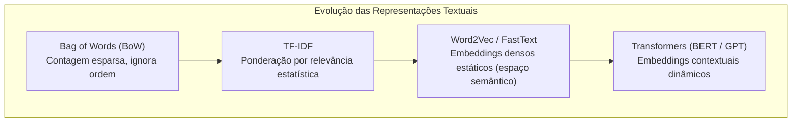
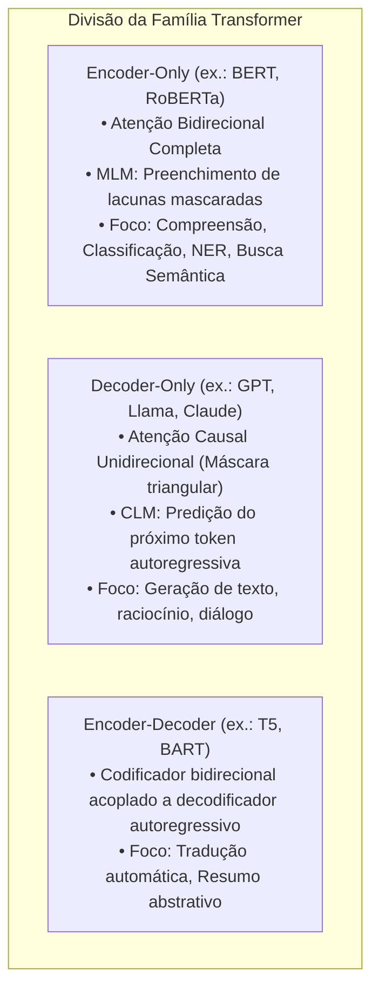
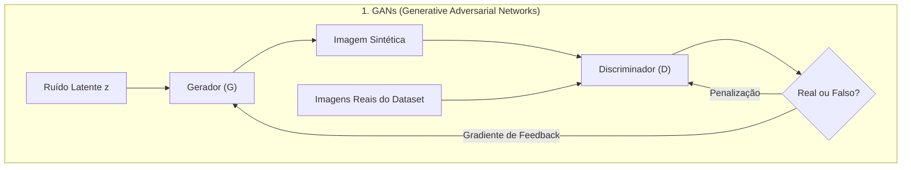
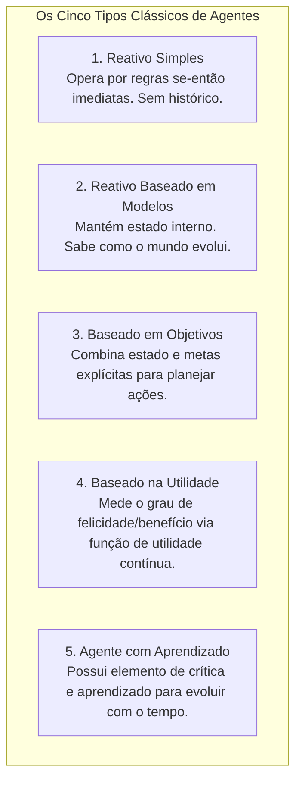
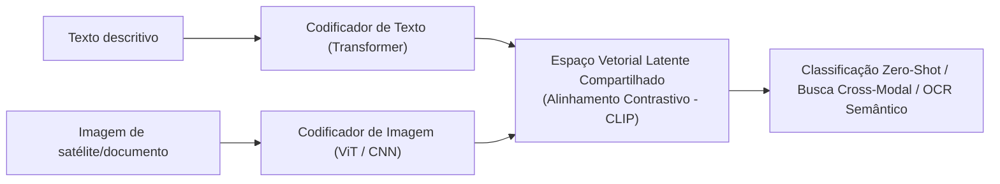

# 02 - PLN, IA Generativa, Agentes Inteligentes e Multimodalidade

> **Matéria:** Inteligência Artificial, Ciência de Dados e Automação  
> **Cargo:** B02 – Técnico de Controle Externo – Especialidade: Tecnologia da Informação  
> **Arquivo:** `02_nlp_ia_generativa_agentes_e_multimodalidade.md`  

---

## 📌 Ementa / Itens do Edital
- Processamento de Linguagem Natural (PLN / NLP)
- Inteligência Artificial Generativa: Fundamentos e aplicações
- Tipos e arquiteturas de Agentes Inteligentes
- Modelos Multimodais (texto, visão, áudio e vídeo)

---

## 🌳 Classificação Hierárquica

```text
2. Processamento de Linguagem Natural, IA Generativa e Modelos Multimodais
├── 2.1 Processamento de Linguagem Natural (PLN / NLP)
│   ├── 2.1.1 Pré-processamento Textual Clássico:
│   │   ├── Limpeza, remoção de caracteres especiais e minúsculas (lowercasing)
│   │   ├── Tokenização: Quebra do texto em palavras, subpalavras (BPE - Byte-Pair Encoding, WordPiece) ou caracteres
│   │   ├── Remoção de Stopwords (palavras funcionais de alta frequência sem peso semântico isolado: "de", "a", "o")
│   │   ├── Normalização Morfológica: Stemming (corte heurístico de afixos - algoritmo de Porter) vs. Lemmatization (redução ao lema dicionarizado considerando classe gramatical)
│   │   └── Análise Linguística: Marcação de partes do discurso (POS Tagging) e Reconhecimento de Entidades Nomeadas (NER)
│   ├── 2.1.2 Representação Numérica de Texto:
│   │   ├── Saco de Palavras (Bag of Words - BoW): Vetores de contagem de frequência esparsos
│   │   ├── TF-IDF (Term Frequency - Inverse Document Frequency): Ponderação que valoriza termos frequentes no documento local mas raros na coleção global
│   │   └── Embeddings Densos Estáticos: Word2Vec (arquiteturas Skip-Gram e CBOW), GloVe e FastText
│   └── 2.1.3 Modelos Contextuais Baseados em Transformers:
│       ├── Modelos Codificadores Bidirecionais: BERT (Masked Language Modeling - MLM; ideal para classificação, NER e busca semântica)
│       └── Modelos Decodificadores Autoregressivos: Família GPT, Llama, Claude, Gemini (Causal Language Modeling; previsão do próximo token)
├── 2.2 Inteligência Artificial Generativa
│   ├── 2.2.1 Conceito: Modelos capazes de aprender a distribuição de probabilidade subjacente de dados de treinamento (P(X)) para sintetizar novos conteúdos inéditos e realistas
│   ├── 2.2.2 Arquiteturas Generativas Principais:
│   │   ├── Redes Adversárias Generativas (GANs - Generative Adversarial Networks): O Gerador compete com o Discriminador em jogo de minimax
│   │   ├── Modelos de Difusão (Diffusion Models): Processo progressivo de adição e remoção de ruído gaussiano (Stable Diffusion, Midjourney)
│   │   └── Modelos Autoregressivos de Linguagem (LLMs): Geração probabilística de texto token a token
│   └── 2.2.3 Modalidades de Geração: Geração de texto para texto (resumo, tradução), texto para código, texto para imagem e texto para áudio/voz
├── 2.3 Agentes Inteligentes
│   ├── 2.3.1 Conceito de Agente (Russell & Norvig): Entidade que percebe seu ambiente por meio de sensores e atua sobre ele por atuadores
│   ├── 2.3.2 Ambientes de Tarefa (Framework PEAS): Performance (Desempenho), Environment (Ambiente), Actuators (Atuadores), Sensors (Sensores)
│   ├── 2.3.3 Propriedades dos Ambientes: Totalmente vs. parcialmente observável; determinístico vs. estocástico; episódico vs. sequencial; estático vs. dinâmico; discreto vs. contínuo; agente único vs. multiagente
│   └── 2.3.4 Classificação Clássica dos Agentes:
│       ├── Agentes Reativos Simples: Operam estritamente por regras condição-ação (if -> then) baseadas no estado atual imediato
│       ├── Agentes Reativos Baseados em Modelos: Mantêm estado interno representando aspectos do mundo não observáveis no momento
│       ├── Agentes Baseados em Objetivos (Goal-Based): Combinam estado com metas para avaliar ações que conduzem ao objetivo final
│       ├── Agentes Baseados na Utilidade (Utility-Based): Avaliam uma função de utilidade para escolher a ação que maximiza o benefício
│       └── Agentes com Aprendizado: Componente de aprendizado e elemento de crítica para evoluir o comportamento
└── 2.4 Modelos Multimodais
    ├── 2.4.1 Definição: Modelos treinados conjuntamente para processar e alinhar dados de múltiplos tipos e modalidades sensoriais (Texto, Imagem, Áudio, Vídeo)
    ├── 2.4.2 Alinhamento Semântico Multimodal (ex.: CLIP - Contrastive Language-Image Pretraining): Espaço vetorial compartilhado onde a imagem de um objeto fica geometricamente próxima da descrição textual do mesmo objeto
    └── 2.4.3 Aplicações de Visão-Linguagem (VLMs) no Setor Público: OCR inteligente de documentos digitalizados e contratos antigos, auditoria de notas fiscais digitalizadas e inspeção visual de obras públicas por satélite/drones
```

---

## 📖 Teoria Aprofundada

### 1. Processamento de Linguagem Natural (PLN / NLP)

O Processamento de Linguagem Natural (PLN) engloba o conjunto de teorias computacionais, algoritmos e métodos de inteligência artificial voltados à compreensão, interpretação, representação e síntese da linguagem humana por máquinas.


---

### 1.1 O Pipeline Clássico de Pré-Processamento Textual

1. **Limpeza e Normalização:** Conversão para minúsculas (*lowercasing*), remoção de tags HTML, eliminação de caracteres de controle invisíveis, pontuação e normalização Unicode (conversão de acentuações e diacríticos via formas de decomposição NFC/NFD).
2. **Tokenização:** Processo de fragmentação de um fluxo contínuo de caracteres em unidades semânticas elementares (*tokens*).
   - *Por palavra:* Separação ingênua por espaços em branco e pontuações. Falha em lidar com contrações e palavras compostas.
   - *Por caracteres:* Quebra letra a letra. Elimina palavras fora do vocabulário, mas alonga desproporcionalmente o tamanho da sequência e degrada o significado contextual.
   - *Por subpalavras (Subword Tokenization):* Abordagem padrão no processamento moderno com Transformers. Algoritmos como **BPE (Byte-Pair Encoding)**, **WordPiece** e **SentencePiece** começam no nível de caracteres e fundem iterativamente os pares de símbolos mais frequentes na base de treino. Permitem que palavras conhecidas permaneçam inteiras, enquanto termos raros ou neologismos sejam decompostos em fragmentos conhecidos (ex.: "desregulamentação" $\rightarrow$ "des" + "regula" + "mentação"), erradicando o problema de termos fora do vocabulário (*Out-Of-Vocabulary - OOV*).
3. **Remoção de Stopwords:** Expurgamento de palavras funcionais que possuem altíssima frequência estatística no idioma, mas baixo teor discriminativo isolado (preposições, artigos, conjunções como "de", "em", "para", "que", "o", "a").
   > ⭐ **IMPORTANTE / REGRA DE OURO:**  
   > A remoção de *stopwords* é mandatória em modelos estatísticos tradicionais de recuperação de informação (*Bag of Words*, TF-IDF) para diminuir a dimensionalidade e o ruído. Contudo, em modelos de linguagem baseados em **Transformers contextuais (BERT, GPT)**, as *stopwords* **NÃO** devem ser removidas, pois a presença de pronomes, preposições e conectivos é essencial para o cálculo da atenção contextual e do significado relacional das orações.
4. **Normalização Morfológica: Stemming vs. Lemmatization**

| Característica | Stemming (Troncamento / Radicalização) | Lemmatization (Lematização) |
| :--- | :--- | :--- |
| **Abordagem Operacional** | Heurística, algorítmica e mecânica. Baseada no corte bruto de sufixos e prefixos. | Linguística, sintática e estrutural. Consulta léxicos, dicionários morfológicos e corpora formais. |
| **Considera Classe Gramatical?** | **Não**. Aplica as mesmas regras de supressão sem analisar a função sintática da palavra no contexto. | **Sim**. Identifica se a palavra funciona como verbo, substantivo ou adjetivo na oração para extrair a forma correta. |
| **Resultado Produzido** | Um **radical** (*stem*) que **frequentemente não é uma palavra válida** no dicionário da língua. | Um **lema** (*lemma*), que é **obrigatoriamente uma palavra canônica e válida** do vocabulário oficial (ex.: verbos no infinitivo). |
| **Exemplo de Aplicação** | "Auditoria", "auditores", "auditar" $\rightarrow$ **"audit"** (termo truncado). | "Melhores" $\rightarrow$ **"bom"**; "foram" $\rightarrow$ **"ir"** ou **"ser"** (a depender do contexto morfossintático). |
| **Custo Computacional** | Extremamente rápido e leve em termos de memória. | Mais lento; consome mais memória e requer recursos gramaticais robustos (ex.: spaCy, NLTK com WordNet). |
| **Algoritmos Canônicos** | Algoritmo de Porter, Algoritmo Snowball, Algoritmo RSLP (para Língua Portuguesa). | Lematizador baseado em WordNet, modelos baseados em spaCy / Universal Dependencies. |

5. **Análise Linguística Avançada:**
   - **POS Tagging (Part-of-Speech Tagging):** Atribuição de classes gramaticais (Substantivo, Verbo, Adjetivo, Advérbio) a cada token da oração com base em sua sintaxe imediata.
   - **NER (Named Entity Recognition - Reconhecimento de Entidades Nomeadas):** Identificação e classificação de menções no texto em categorias pré-definidas (Pessoa, Organização, Local, CNPJ, CPF, Data, Valor Monetário). Comumente utiliza notação de marcação estruturada **BIO** (*Beginning, Inside, Outside*).

---

### 1.2 Representação Numérica de Texto (Vetorização)

Computadores não processam símbolos alfanuméricos puros; os textos precisam ser mapeados em tensores numéricos.



- **Bag of Words (BoW):** Constrói um vocabulário global de tamanho $V$. Cada documento é representado por um vetor de dimensão $V$ contendo a frequência de contagem de cada palavra.
  - *Limitações:* Esparsidade extrema (a imensa maioria das entradas é zero), alta dimensionalidade e **perda total da ordem e da sintaxe das palavras** (efeito "saco de palavras").
- **TF-IDF (Term Frequency - Inverse Document Frequency):** Modula a contagem de frequência pela raridade global do termo em toda a base documental.

$$\text{TF-IDF}(t, d, D) = \text{TF}(t, d) \times \text{IDF}(t, D)$$

$$\text{IDF}(t, D) = \log\left(\frac{N}{|\{d \in D : t \in d\}|}\right)$$

onde $N = |D|$ é a quantidade total de documentos na coleção, e $|\{d \in D : t \in d\}|$ é o número de documentos que contêm o termo $t$ (frequência documental).
  - Termos que aparecem em quase todos os documentos terão razão interna próxima de $1$, resultando em $\text{IDF} \approx \log(1) = 0$. Assim, palavras genéricas são naturalmente silenciadas.
  - Termos técnicos ou específicos da fiscalização que ocorrem muitas vezes em poucos processos terão TF alto e IDF expressivo, recebendo alta pontuação.
- **Embeddings Estáticos Densos (Word2Vec, GloVe, FastText):**
  - Mapeiam cada palavra para um vetor numérico denso contínuo de dimensão fixa (tipicamente $d \in [100, 300]$).
  - Baseados na **Hipótese Distribucional** de Firth (1957): *"Você conhecerá uma palavra pela companhia que ela mantém"*. Palavras que ocorrem em contextos similares situam-se geometricamente próximas no espaço vetorial.
  - **Word2Vec (Mikolov et al., 2013):**
    - *CBOW (Continuous Bag of Words):* Prevê a palavra alvo com base no contexto circundante (janela de palavras vizinhas). Mais rápido no treinamento e ligeiramente melhor para termos comuns.
    - *Skip-Gram:* Prevê as palavras de contexto circundante a partir de uma palavra central alvo. Apresenta desempenho superior para bases com vocabulário amplo e termos raros.
  - **FastText (Bojanowski et al., Facebook):** Extensão do Word2Vec que representa cada palavra como um conjunto de **n-gramas de caracteres**. Permite capturar raízes morfológicas e gerar vetores consistentes para palavras raras e termos fora do vocabulário de treino (*OOV*).
- **Embeddings Contextuais (Modelos Transformers):**
  - Modelos estáticos geram um único vetor fixo por vocábulo. Em Word2Vec, a palavra *"manga"* terá exatamente as mesmas coordenadas numéricas quer se refira à fruta doce, quer à manga de uma camisa.
  - Modelos baseados em Transformers geram representações dinâmicas: o vetor de *"banco"* muda dependendo se a frase for *"o banco concedeu empréstimo"* ou *"o auditor sentou no banco da praça"*.

---

### 1.3 A Revolução dos Transformers em NLP

Introduzidos por Vaswani et al. (2017), os Transformers dispensam estruturas recorrentes (RNNs) e convolucionais, estruturando-se no mecanismo de **Atenção Escalada por Produto Escalar** (*Scaled Dot-Product Attention*):

$$\text{Attention}(Q, K, V) = \text{softmax}\left(\frac{Q K^T}{\sqrt{d_k}}\right) V$$

onde $Q$ são as Consultas (*Queries*), $K$ são as Chaves (*Keys*), $V$ são os Valores (*Values*) e $d_k$ é a dimensão das chaves utilizada como fator de escalonamento para estabilizar os gradientes da função softmax.



> 🚨 **ALERTA DE PROVA / PEGADINHA FCC:**  
> A FCC adora confrontar a arquitetura do **BERT** com a da família **GPT**:
> - O **BERT** é um modelo **Encoder-Only Bidirecional**: ao processar uma palavra, ele olha simultaneamente para todos os tokens à esquerda E à direita na sentença. Seu treinamento envolve *Masked Language Modeling* (MLM - adivinhar palavras ocultas por `[MASK]`). Ele é excelente para **entendimento**, extração e classificação.
> - O **GPT** é um modelo **Decoder-Only Autoregressivo (Causal)**: ele só pode enxergar os tokens precedentes (à esquerda), porque sua missão é prever o próximo token sucessivo (*Next Token Prediction*). Ele é projetado especificamente para **geração** de conteúdo contínuo!

---

### 2. Inteligência Artificial Generativa

A IA Generativa compreende modelos estatísticos e redes neurais profundas projetadas para aprender a distribuição de probabilidade implícita $P(X)$ sobre um conjunto massivo de dados empíricos, permitindo amostrar dessa distribuição para sintetizar instâncias inteiramente inéditas, fidedignas e contextualmente consistentes (textos, imagens, código-fonte, áudio).

#### 2.1 Principais Arquiteturas Generativas



- **Redes Adversárias Generativas (GANs - Ian Goodfellow, 2014):**
  - Compostas por duas redes neurais treinadas em oposição direta em um **jogo de minimax de soma zero**:
    1. **Gerador ($G$):** Recebe um vetor de ruído estocástico aleatório $z$ e tenta mapeá-lo para uma amostra sintética que se assemelhe aos dados reais.
    2. **Discriminador ($D$):** Atua como um perito classificador binário, recebendo tanto amostras reais do dataset quanto amostras forjadas pelo gerador, tentando determinar a probabilidade de a entrada ser genuína.
  - *Função Objetivo:*
    $$\min_G \max_D V(D, G) = \mathbb{E}_{x \sim p_{\text{data}}}[\log D(x)] + \mathbb{E}_{z \sim p_z}[\log(1 - D(G(z)))]$$
  - *Dificuldades Críticas de Treinamento:* Desvanecimento de gradientes quando o discriminador se torna perfeito muito rápido; instabilidade de convergência; e **Colapso de Modo (*Mode Collapse*)**, situação patológica em que o gerador descobre uma única amostra (ou um número diminuto de variações) capaz de enganar o discriminador e passa a produzir repetidamente sempre aquela mesma saída, ignorando a diversidade do espaço amostral.
- **Modelos de Difusão (Diffusion Models):**
  - Paradigma moderno dominante na geração de imagens e mídia contínua (ex.: DALL-E 3, Midjourney, Stable Diffusion).
  - Operam em dois processos estocásticos complementares:
    1. **Processo Direto (*Forward Diffusion Process*):** Degrada iterativamente uma imagem real ao longo de $T$ passos discretos, adicionando sucessivas frações de ruído branco gaussiano até que o dado original se transforme inteiramente em ruído puro não correlacionado.
    2. **Processo Reverso (*Reverse Diffusion Process*):** Uma rede neural profunda (geralmente uma arquitetura U-Net) é treinada para predizer e remover incrementalmente a fração de ruído adicionada em cada passo, reconvertendo ruído caótico em imagens nítidas de alta definição condicionadas por texto (*Text-to-Image* via embeddings de texto CLIP/T5).
  - *Vantagens sobre GANs:* Treinamento estritamente estável, sem dinâmica adversarial, sem colapso de modo e com cobertura completa da distribuição de probabilidade.
- **Modelos Autoregressivos de Linguagem (LLMs):**
  - Decomposição da probabilidade conjunta de uma sequência de $T$ tokens por meio da regra da cadeia da probabilidade:
    $$P(w_1, w_2, \dots, w_T) = \prod_{t=1}^T P(w_t \mid w_1, w_2, \dots, w_{t-1})$$
  - Durante a inferência, a geração token a token pode ser controlada por estratégias de amostragem:
    - *Greedy Search:* Escolhe determinística e monotonamente o token de maior probabilidade imediata. Gera textos repetitivos e sem fluidez.
    - *Temperatura ($T$):* Parâmetro que divide os logits antes da aplicação da função Softmax. Uma temperatura baixa ($T \to 0$) aproxima a distribuição de um pico determinístico (respostas rígidas e lógicas); uma temperatura alta ($T > 1$) aplaina a curva de probabilidades, conferindo maior variabilidade e criatividade textual.
    - *Top-$k$ Sampling:* Restringe a amostragem exclusivamente aos $k$ tokens mais prováveis.
    - *Top-$p$ (Nucleus Sampling):* Restringe a amostragem ao menor conjunto de tokens cuja soma cumulativa de probabilidades atinja o limiar $p$ (ex.: $p = 0.90$).

---

### 3. Agentes Inteligentes

Segundo Stuart Russell e Peter Norvig, um **Agente** é qualquer entidade computacional capaz de perceber seu ambiente através de **Sensores** e atuar sobre esse ambiente por intermédio de **Atuadores**.


#### 3.1 O Framework PEAS (Ambiente de Tarefas)
Para projetar e avaliar formalmente um agente inteligente, define-se a 4-tupla **PEAS**:
- **P (Performance / Medida de Desempenho):** O critério formal objetivo que avalia o quão bem-sucedido é o comportamento do agente.
- **E (Environment / Ambiente):** O contexto externo, base de dados ou mundo físico no qual o agente opera.
- **A (Actuators / Atuadores):** Os mecanismos pelos quais o agente executa ações que modificam o ambiente.
- **S (Sensors / Sensores):** Os instrumentos ou interfaces de entrada pelos quais o agente recolhe percepções do estado do ambiente.

*Exemplo Prático em Auditoria Fiscal Automatizada:*
- **P:** Taxa de identificação de fraudes fiscais confirmadas, minimização de falsos positivos e recuperação de receitas.
- **E:** Base de Notas Fiscais Eletrônicas (NF-e), cadastros de CNPJ, sistemas bancários conveniados e malha fiscal.
- **A:** Emissão automática de intimações fiscais, bloqueio preventivo de emissão e envio de alertas aos auditores.
- **S:** Web services da Receita, leitores de XML de NF-e, consultas a bancos de dados SQL/NoSQL.

#### 3.2 Taxonomia das Propriedades dos Ambientes
A complexidade de engenharia de um agente é estritamente condicionada pelas propriedades do seu ambiente de tarefa:
1. **Totalmente Observável vs. Parcialmente Observável:** Se os sensores fornecem acesso ao estado completo e total do ambiente a cada instante no tempo (ex.: Xadrez é totalmente observável; auditoria de empresas e trânsito são parcialmente observáveis).
2. **Determinístico vs. Estocástico:** Se o próximo estado do ambiente é rigorosamente determinado pelo estado atual e pela ação imediata executada pelo agente (se houver incerteza ou ruído não controlado, é estocástico).
3. **Episódico vs. Sequencial:** No ambiente episódico, a experiência divide-se em episódios atômicos independentes, onde a ação presente não influencia as decisões dos episódios futuros (ex.: classificação isolada de peças em esteira). No ambiente sequencial, a decisão atual impacta decisivamente todos os estados futuros (ex.: xadrez, direção defensiva).
4. **Estático vs. Dinâmico:** O ambiente é estático se não se altera enquanto o agente delibera; é dinâmico se evolui com o passar do tempo enquanto o agente calcula sua ação.
5. **Discreto vs. Contínuo:** Se o número de estados, percepções e ações for finito e contável (ex.: casas do tabuleiro de xadrez) ou contínuo no tempo e espaço (ex.: velocidade e coordenadas de um veículo).
6. **Agente Único vs. Multiagente:** Se o ambiente contém apenas um agente deliberando ou múltiplos agentes interagindo em regime cooperativo ou competitivo.

#### 3.3 Classificação Clássica dos Agentes de Russell & Norvig



| Tipo de Agente | Mecanismo Central de Decisão | Capacidade de Memória / Estado | Adequação a Ambientes Parcialmente Observáveis |
| :--- | :--- | :--- | :--- |
| **Reativo Simples** | Regras de Condição-Ação diretas ($if \text{ condição } then \text{ ação}$). | **Nenhuma**. Responde exclusivamente à percepção atual. | **Péssima**. Entra facilmente em *loops* infinitos se houver oclusão sensorial. |
| **Reativo Baseado em Modelo** | Avalia regras considerando tanto a percepção atual quanto um modelo do mundo. | **Possui Estado Interno**, que rastreia histórico e aspectos invisíveis do ambiente. | **Boa**. Consegue manter coerência inferindo o que não está diretamente no sensor. |
| **Baseado em Objetivos (Goal-Based)** | Busca e planejamento de trajetórias que conduzem a um estado meta pré-definido. | Possui estado interno associado a descrições formais de metas futuras desejadas. | Alta. Consegue reconfigurar planos se o ambiente mudar durante a execução. |
| **Baseado na Utilidade (Utility-Based)** | Avalia as ações através de uma **função de utilidade** escalar ($U(s)$) para balancear *trade-offs*. | Modela estados e quantifica o nível numérico de "desejabilidade" ou preferência de cada um. | Ótima. Permite escolher a ação ótima sob múltiplos objetivos conflitantes e incerteza probabilística. |
| **Agente com Aprendizado** | Divide-se em: Elemento de Desempenho, Elemento de Aprendizado, Crítica e Gerador de Problemas. | Armazena conhecimento histórico e atualiza seus próprios parâmetros de decisão. | Evolutiva. Transcende o conhecimento pré-programado de seus desenvolvedores originais. |

---

### 4. Modelos Multimodais

A Multimodalidade refere-se à capacidade de um sistema de inteligência artificial de ingerir, alinhar, interpretar e sintetizar dados provenientes de múltiplos canais sensoriais e formatos de representação distintos (texto, visão computacional, áudio, séries temporais e vídeo).



#### 4.1 Alinhamento Semântico Multimodal e CLIP
- **CLIP (Contrastive Language-Image Pre-training - Radford et al., OpenAI):**
  - Marco fundamental do aprendizado multimodal moderno.
  - Treinado em centenas de milhões de pares $(texto, imagem)$ coletados da web.
  - Possui dois codificadores paralelos: um codificador de texto e um codificador visual (Vision Transformer - ViT ou ResNet).
  - Em vez de tentar predizer as palavras exatas da legenda, o modelo é otimizado através de uma **Função de Perda Contrastiva** (*InfoNCE Loss*):
    - Maximiza a similaridade de cosseno entre o vetor da imagem $I_i$ e o vetor do seu texto correspondente $T_i$ (pares positivos).
    - Minimiza a similaridade entre $I_i$ e todos os outros textos incorretos $T_j$ no mesmo lote (pares negativos).
  - *Propriedade Notável:* Permite **classificação de imagens sem treinamento prévio (*Zero-Shot Classification*)**, comparando o embedding da imagem aos embeddings dos nomes de classes embutidos em prompts como *"uma foto de um [objeto]"*.

#### 4.2 Aplicações Práticas no Setor Público e Tribunais de Contas
1. **Auditoria de Obras e Vistorias Fiscais:** Uso de Modelos de Linguagem e Visão (VLMs) para cruzar automaticamente relatórios de medição de engenharia com fotos tiradas por drones ou imagens de satélite multiespectrais, identificando incompatibilidades de cronograma físico-financeiro.
2. **OCR Inteligente e Extração de Documentos Legados:** Conversão de processos digitalizados antigos, certidões manuscritas e notas fiscais com baixa qualidade gráfica, onde o modelo utiliza o contexto semântico do texto para corrigir imperfeições na leitura ótica de caracteres.
3. **Cruzamento de Evidências Multimodais:** Agentes capazes de relacionar gravações de audiências em áudio (transcritas via modelos como Whisper), documentos contratuais em PDF e imagens anexadas em denúncias de corrupção.

---

## 🌐 Fontes Recomendadas na Internet

1. [Hugging Face NLP Course](https://huggingface.co/learn/nlp-course/): Guia prático de referência detalhando arquiteturas de Transformers, tokenização subpalavra (BPE/WordPiece) e fine-tuning.
2. [What are Diffusion Models? (Lilian Weng - OpenAI)](https://lilianweng.github.io/posts/2021-07-11-diffusion-models/): Revisão analítica completa sobre os fundamentos matemáticos dos modelos de difusão reversa estocástica.
3. [Research Paper - CLIP: Connecting Text and Images (Radford et al., OpenAI)](https://arxiv.org/abs/2103.00020): Artigo canônico original que introduziu o treinamento contrastivo multimodal e a classificação zero-shot.
4. [AIMA - Artificial Intelligence: A Modern Approach (Russell & Norvig)](https://aima.cs.berkeley.edu/): Estrutura formal canônica dos Agentes Inteligentes, ambientes PEAS e estratégias de busca em IA.

---

## 📝 Questões Comentadas (Padrão FCC)

### Questão 1 (FCC - Adaptada / Analista de TI - Tribunais - Processamento de Linguagem Natural e Tokenização)
Durante o desenvolvimento de um pipeline de Processamento de Linguagem Natural (PLN) para indexação e análise semântica de decisões colegiadas em um tribunal, os analistas debatem os procedimentos adequados de pré-processamento textual e representação vetorial.

A respeito das técnicas de normalização e vetorização textual, assinale a alternativa correta:
A) O *Stemming* consiste na identificação da classe gramatical de cada termo em um dicionário estruturado para retornar exclusivamente o infinitivo canônico do vocábulo, ao passo que a *Lematização* descarta a gramática e remove sufixos de modo heurístico através de expressões regulares mecânicas.  
B) O algoritmo de tokenização por subpalavras *Byte-Pair Encoding* (BPE) inicia com um vocabulário fixo de palavras longas completas e as divide sucessivamente até isolar os caracteres individuais, gerando um vetor BoW esparso e invariante à escala.  
C) Em modelos de recuperação da informação clássicos baseados em TF-IDF, a remoção de *stopwords* visa reduzir a dimensionalidade e expurgar palavras frequentes de baixo teor semântico discriminativo; contudo, em modelos contextuais modernos baseados em Transformers (como o BERT), a remoção de *stopwords* é desaconselhada, pois a conectividade sintática de artigos e preposições é necessária para o cálculo da atenção contextual.  
D) O cálculo do componente IDF (*Inverse Document Frequency*) na matriz TF-IDF confere peso máximo a termos que ocorrem em cem por cento dos documentos do corpus, pois palavras ubíquas são estatisticamente as melhores representantes do domínio temático da base.  
E) O modelo *Word2Vec* gera representações vetoriais dinâmicas que alteram as coordenadas espaciais de uma mesma palavra conforme as diferentes sentenças em que ela se encontra, superando a rigidez estática dos modelos contextuais BERT e GPT.

> **Gabarito: C**  
> **Comentário Analítico Passo a Passo:**  
> - **A está INCORRETA:** Os conceitos estão invertidos. A **Lematização** (*Lemmatization*) é quem analisa a morfologia e a classe sintática da palavra no contexto para extrair o lema canônico de dicionário. O **Stemming** é o processo heurístico mecânico que aplica cortes brutos de sufixos sem recorrer a regras sintáticas ou léxicos dicionarizados.  
> - **B está INCORRETA:** O *Byte-Pair Encoding* (BPE) opera na direção **oposta** (*bottom-up*): ele parte de um vocabulário inicial composto pelos caracteres individuais e, iterativamente, agrupa e funde os pares de símbolos mais frequentes observados no corpus até atingir o tamanho de vocabulário desejado.  
> - **C está CORRETA:** Perfeita contextualização técnica. Em abordagens tradicionais baseadas em contagem e frequências esparsas (*Bag of Words*, TF-IDF), eliminar *stopwords* é crucial para aliviar a dimensionalidade e evitar ruídos estocásticos. No entanto, em modelos de *Deep Learning* fundamentados em mecanismos de **Autoatenção dos Transformers** (como BERT e GPT), a presença de palavras funcionais (pronomes, conectivos, preposições) é imperativa para que as cabeças de atenção capturem a interdependência sintática e o encadeamento semântico exato da proposição.  
> - **D está INCORRETA:** A fórmula do IDF é $\log(N / df)$. Se um termo aparece em todos os documentos ($df = N$), a razão torna-se $N/N = 1$, e seu logaritmo resulta em $\log(1) = 0$. Portanto, o peso atribuído a termos ubíquos pelo IDF é **nulo**, e não máximo.  
> - **E está INCORRETA:** O *Word2Vec* produz embeddings **estáticos**: uma dada palavra sempre recebe o mesmíssimo vetor unidimensional fixo, independentemente da oração em que apareça. São os modelos baseados em Transformers (BERT, RoBERTa, GPT) que geram embeddings **contextuais e dinâmicos**, onde as representações numéricas variam de acordo com as palavras circunvizinhas.

---

### Questão 2 (FCC - Adaptada / SEFAZ - Auditoria Fiscal - Teoria e Tipologia dos Agentes Inteligentes)
A teoria clássica de Inteligência Artificial formalizada por Stuart Russell e Peter Norvig estrutura os sistemas autônomos em torno do conceito de agentes racionais situados em determinados ambientes de tarefas caracterizados pelo framework PEAS (*Performance, Environment, Actuators, Sensors*).

A respeito da tipologia e do comportamento dos agentes inteligentes, assinale a alternativa correta:
A) Os *Agentes Reativos Simples* baseiam suas decisões no planejamento em profundidade de cenários futuros contingenciais e armazenam um histórico detalhado de todas as percepções passadas recebidas desde sua inicialização.  
B) Os *Agentes Reativos Baseados em Modelos* mantêm um estado interno dependente do histórico de percepções, o que lhes permite operar de maneira eficaz em ambientes parcialmente observáveis, refletindo aspectos do mundo que não estão visíveis no instante da decisão.  
C) Os *Agentes Baseados em Objetivos* utilizam uma função contínua de utilidade escalar para balancear matematicamente a compensação entre objetivos conflitantes quando nenhum resultado perfeito puder ser alcançado.  
D) O ambiente de auditoria fiscal de uma Secretaria da Fazenda é tecnicamente classificado no framework PEAS como *totalmente observável* e *estático*, já que a totalidade das transações econômicas do Estado pode ser capturada simultaneamente pelos sensores fiscais sem qualquer latência ou incerteza.  
E) Um agente racional é definido exclusivamente como aquele que emula com perfeita fidelidade as falhas cognitivas e o processo psicológico intuitivo do cérebro humano, descartando a maximização formal de medidas de desempenho esperadas.

> **Gabarito: B**  
> **Comentário Analítico Passo a Passo:**  
> - **A está INCORRETA:** Os Agentes Reativos Simples não realizam planejamento nem possuem memória de percepções anteriores; eles agem estritamente por regras de condição-ação atreladas apenas à percepção imediata do momento presente ($if \text{ condição atual } then \text{ ação imediata}$).  
> - **B está CORRETA:** O **Agente Reativo Baseado em Modelos** possui uma estrutura de **estado interno** que encapsula o conhecimento sobre "como o mundo evolui" e "como as ações do agente afetam o mundo". Essa capacidade de reter representações de variáveis latentes permite ao agente superar as limitações de sensores que não conseguem capturar o ambiente por completo, viabilizando decisões coerentes em ambientes **parcialmente observáveis**.  
> - **C está INCORRETA:** Quem utiliza uma função contínua de utilidade escalar para ponderar múltiplos objetivos conflitantes, riscos e graus de desejabilidade é o **Agente Baseado na Utilidade** (*Utility-Based Agent*). O Agente Baseado em Objetivos (*Goal-Based Agent*) opera com distinções binárias de sucesso (atingir ou não atingir a meta pré-fixada), sem quantificar formalmente a escala de satisfação entre trajetórias alternativas.  
> - **D está INCORRETA:** O ambiente de fiscalização e governança tributária é comprovadamente **parcialmente observável** (sonegações, fraudes e operações clandestinas não são visíveis imediatamente aos sistemas) e **dinâmico** (o mercado e os contribuintes continuam transacionando continuamente enquanto o auditor ou algoritmo executa análises).  
> - **E está INCORRETA:** A definição acadêmica canônica de Agente Racional (paradigma do *Agir Racionalmente*) determina que ele é a entidade que age de maneira a **maximizar o valor esperado de sua medida de desempenho**, com base nas evidências fornecidas por suas percepções e em seu conhecimento embutido, não se limitando à modelagem ou mimetização de falhas biológicas humanas.

---

### Questão 3 (FCC - Adaptada / TCE - Auditor de Controle Externo - TI - Modelos Transformers e Atenção)
A arquitetura *Transformer* revolucionou a Inteligência Artificial ao estabelecer um mecanismo de atenção pura capaz de computar dependências de longo alcance em sequências informacionais sem a necessidade de recorrência temporal. A partir dessa arquitetura basilar, surgiram duas famílias dominantes de modelos de linguagem: os modelos baseados no Codificador (*Encoder*) e os baseados no Decodificador (*Decoder*).

A respeito das distinções estruturais entre os modelos BERT e GPT, assinale a afirmativa correta:
A) O modelo BERT utiliza uma arquitetura baseada exclusivamente no Decodificador do Transformer, empregando máscaras causais triangulares para impedir que tokens futuros influenciem a classificação do texto presente.  
B) O modelo GPT fundamenta-se na porção Codificadora do Transformer e processa a sentença em regime estritamente bidirecional, sendo treinado originariamente para reconstruir sentenças com palavras aleatoriamente mascaradas (*Masked Language Modeling*).  
C) O modelo BERT processa as sequências textuais de forma bidirecional no treinamento e infere representações ricas de contexto global, sendo amplamente adotado em tarefas de classificação, reconhecimento de entidades nomeadas e busca semântica; enquanto os modelos da família GPT são decodificadores autoregressivos unidirecionais voltados precipuamente à geração generativa contínua do próximo token.  
D) O mecanismo de *Self-Attention* empregado no Transformer divide os pesos da atenção pelo cubo da dimensão espacial das matrizes para garantir que o gradiente da camada convolucional exploda na fase de retropropagação.  
E) Tanto o BERT quanto o GPT dispensam qualquer etapa de pré-treinamento não supervisionado, sendo ajustados desde a primeira iteração exclusivamente por aprendizado supervisionado com dados rotulados por especialistas humanos.

> **Gabarito: C**  
> **Comentário Analítico Passo a Passo:**  
> - **A está INCORRETA:** O BERT é um modelo baseado no **Codificador (*Encoder-Only*)**, e não no decodificador. Ele **não** utiliza máscaras causais restritivas; pelo contrário, seu princípio operacional é permitir que a atenção flua livremente em ambos os sentidos (*bidirecional*).  
> - **B está INCORRETA:** A família GPT (*Generative Pre-trained Transformer*) baseia-se na estrutura do **Decodificador (*Decoder-Only*)** e opera em regime causal (unidirecional da esquerda para a direita), treinada para a modelagem causal de linguagem (*Causal Language Modeling - CLM*), que consiste em adivinhar o próximo token. Quem foi treinado com palavras mascaradas (*MLM*) foi o BERT.  
> - **C está CORRETA:** Síntese perfeita da distinção arquitetural:
>   - **BERT (Encoder-Only):** Acesso simultâneo aos contextos à esquerda e à direita dos tokens. Especializado em representações latentes profundas para compreensão textual, *Named Entity Recognition* (NER), classificação de documentos e buscas vetoriais.
>   - **GPT (Decoder-Only):** Arquitetura autoregressiva que prevê sequencialmente a probabilidade condicional do próximo token ($P(w_t \mid w_{<t})$), ideal para síntese criativa, conversação e geração autônoma de texto.  
> - **D está INCORRETA:** O mecanismo de autoatenção escalada divide o produto escalar das matrizes de Consulta e Chave pela **raiz quadrada** da dimensão dos vetores de chave ($\sqrt{d_k}$), com o propósito matemático explícito de **evitar que os produtos atinjam magnitudes excessivas** em altas dimensões, o que empurraria a função Softmax para regiões com gradientes infinitesimais (*vanishing gradient*).  
> - **E está INCORRETA:** Ambos os modelos consolidaram o paradigma do pré-treinamento auto-supervisionado em massivas bases não rotuladas (milhões de documentos públicos da web), seguido de etapas de *fine-tuning* supervisionado ou alinhamento com feedback humano (RLHF).

---

### Questão 4 (FCC - Adaptada / TRF - Analista Judiciário - Informática - IA Generativa e Modelos de Difusão)
Com o advento da Inteligência Artificial Generativa, diferentes paradigmas de redes neurais profundas foram consolidados para síntese de imagens, áudio e representações multidimensionais realistas. Entre as principais abordagens, destacam-se as Redes Adversárias Generativas (GANs) e os Modelos de Difusão (*Diffusion Models*).

A respeito das características operacionais dessas arquiteturas generativas, assinale a alternativa correta:
A) As GANs consistem em um jogo de minimax competitivo no qual o Gerador busca mapear vetores latentes em amostras verossímeis para enganar o Discriminador, sendo o fenômeno de colapso de modo (*mode collapse*) uma patologia clássica em que o Gerador passa a emitir saídas repetitivas de variedade extremamente restrita.  
B) Os Modelos de Difusão operam treinando simultaneamente um Gerador e um Discriminador em soma zero para calcular a divergência de Wasserstein entre matrizes convolucionais estáticas.  
C) O processo reverso dos Modelos de Difusão consiste na adição contínua de ruído branco gaussiano aos dados até a sua completa destruição aleatória, dispensando o uso de redes neurais para reconstrução da imagem.  
D) As GANs são reconhecidas internacionalmente pela garantia matemática de estabilidade irrestrita de convergência de gradientes durante o treinamento, sendo imunes a problemas de pontos de sela ou desvanecimento de derivadas.  
E) Modelos Variacionais Autoencoders (VAEs) e Modelos de Difusão são incapazes de lidar com ruídos estocásticos, razão pela qual foram inteiramente substituídos por tabelas de busca estáticas baseadas no algoritmo k-NN.

> **Gabarito: A**  
> **Comentário Analítico Passo a Passo:**  
> - **A está CORRETA:** A formulação clássica das GANs (Goodfellow et al., 2014) estrutura-se em duas redes adversárias em um jogo de minimax. O **Colapso de Modo (*Mode Collapse*)** é um dos maiores desafios de estabilidade no treino de GANs: ocorre quando o Gerador se especializa em sintetizar um único tipo específico de amostra que engana com sucesso o Discriminador, passando a produzir sempre aquela mesma imagem (ou um conjunto irrisório de alternativas) e falhando em capturar a diversidade e amplitude de todo o conjunto de dados.  
> - **B está INCORRETA:** A descrição do jogo de soma zero entre Gerador e Discriminador pertence às GANs, e não aos Modelos de Difusão. Os Modelos de Difusão baseiam-se em equações diferenciais estocásticas de adição e remoção paramétrica de ruído.  
> - **C está INCORRETA:** A adição sucessiva de ruído gaussiano até a destruição da imagem constitui o **Processo Direto (*Forward Process*)**. O **Processo Reverso (*Reverse Process*)** é o caminho inverso, no qual uma rede neural profunda (geralmente uma U-Net) é rigorosamente treinada para **remover passo a passo o ruído** e regenerar uma imagem límpida e detalhada a partir do padrão estocástico.  
> - **D está INCORRETA:** O treinamento de GANs é notoriamente complexo e instável devido à delicada dinâmica de equilíbrio de Nash entre as duas redes; desbalanços nos gradientes podem facilmente gerar divergência, colapso de modo ou saturação do discriminador.  
> - **E está INCORRETA:** Tanto VAEs quanto Modelos de Difusão têm no tratamento probabilístico do ruído estocástico a base matemática de sua modelagem de distribuições contínuas, mantendo-se no estado da arte da geração multimídia.

---

### Questão 5 (FCC - Adaptada / TRT - Analista Judiciário - Especialidade TI - Modelos Multimodais e CLIP)
Em um projeto de transformação digital no setor público, planeja-se integrar ferramentas de visão computacional e processamento textual para realizar vistorias prediais e auditoria documental de certidões escaneadas. Para viabilizar a busca cruzada entre fotos das obras e relatórios descritivos de engenharia, a equipe avalia o modelo multimodal CLIP (*Contrastive Language-Image Pre-training*).

Sobre os princípios de funcionamento e os benefícios do modelo CLIP, assinale a afirmativa correta:
A) O CLIP opera exclusivamente por meio de OCR sequencial baseado em regras léxicas, sendo incapaz de processar tensores visuais que contenham fotografias sem textos impressos explicitamente.  
B) O treinamento contrastivo do CLIP projeta os embeddings do codificador de imagem e do codificador de texto em um espaço latente compartilhado, maximizando a similaridade de cosseno entre pares correspondentes (imagem e legenda correta) e minimizando a similaridade de pares desacoplados.  
C) O CLIP exige que todas as tarefas de classificação passem por um novo retreinamento supervisionado completo de sua arquitetura (*fine-tuning* denso de todos os parâmetros), não permitindo a predição em regime *zero-shot*.  
D) O codificador visual do CLIP descarta matrizes vetoriais, convertendo diretamente cada pixel da imagem em um arquivo de áudio compactado antes da extração da legenda.  
E) O alinhamento semântico multimodal requer obrigatoriamente que as imagens e os textos possuam exatamente as mesmas dimensões espaciais de largura e altura matricial em pixels.

> **Gabarito: B**  
> **Comentário Analítico Passo a Passo:**  
> - **A está INCORRETA:** O CLIP não é um software mecânico de OCR baseado em regras. Trata-se de uma rede neural profunda multimodal composta por um codificador visual (ViT ou ResNet) e um codificador de texto baseados em Transformers, capaz de compreender conceitos visuais abstratos, objetos, animais, paisagens e estilos fotográficos, mesmo sem qualquer texto impresso na imagem.  
> - **B está CORRETA:** O cerne metodológico do **CLIP** (Radford et al., OpenAI) é o **Aprendizado Contrastivo**: ele treina em paralelo um codificador de imagem e um codificador de texto de modo que as representações de uma imagem e de seu respectivo texto descritivo sejam mapeadas para vetores muito próximos (alta similaridade de cosseno) em um **espaço vetorial latente compartilhado**, enquanto imagens e legendas que não formam um par são afastadas geometricamente no hiperespaço vetorial.  
> - **C está INCORRETA:** Uma das principais inovações do CLIP é exatamente a sua fantástica capacidade de **classificação Zero-Shot**: ele é capaz de classificar novas imagens sem nenhum treino supervisionado adicional, bastando comparar o vetor da nova imagem aos vetores de textos contendo rótulos candidatos estruturados como *"uma foto de [classe]"*.  
> - **D está INCORRETA:** O codificador visual do CLIP opera no domínio puramente imagético (extraindo representações matriciais densas via convoluções ou autoatenção em patches de imagens com Vision Transformers), sem conversão para arquivos de áudio.  
> - **E está INCORRETA:** O alinhamento semântico multimodal ocorre no nível de projeção latente (espaço de representação vetorial em dimensão fixa, ex.: 512 ou 768 dimensões numéricas), inexistindo qualquer restrição absurda de correspondência de "dimensões espaciais de largura e altura de pixels" entre uma imagem e uma sentença de texto.
