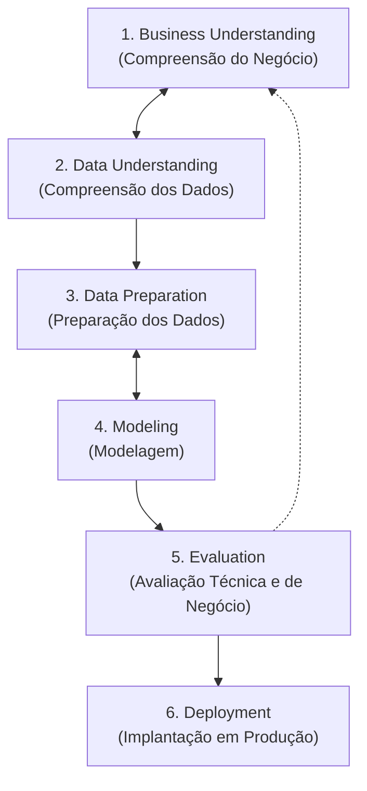
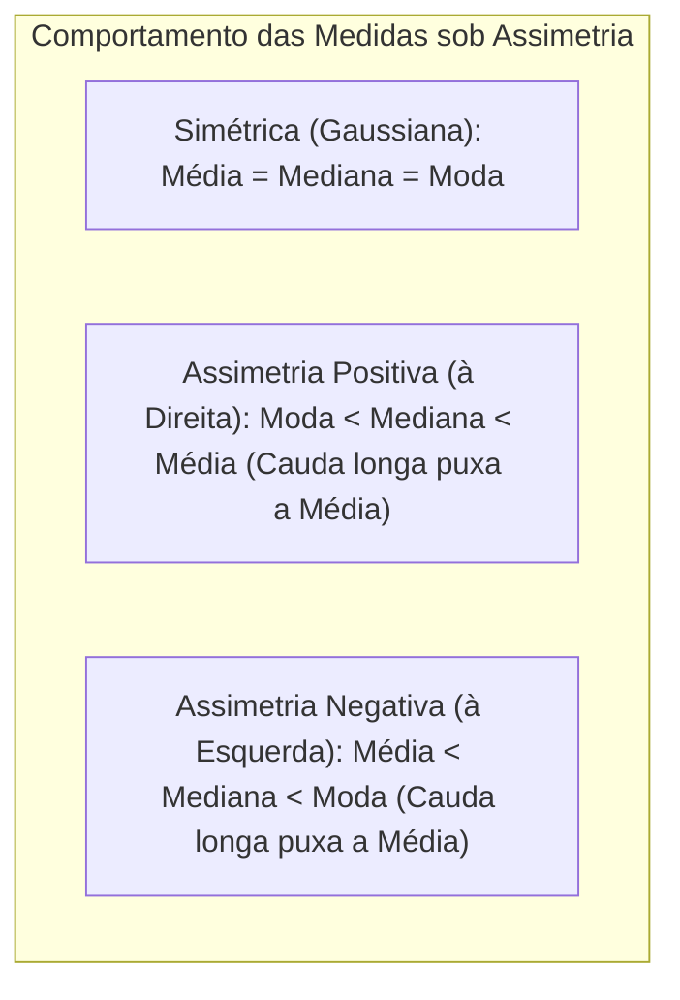
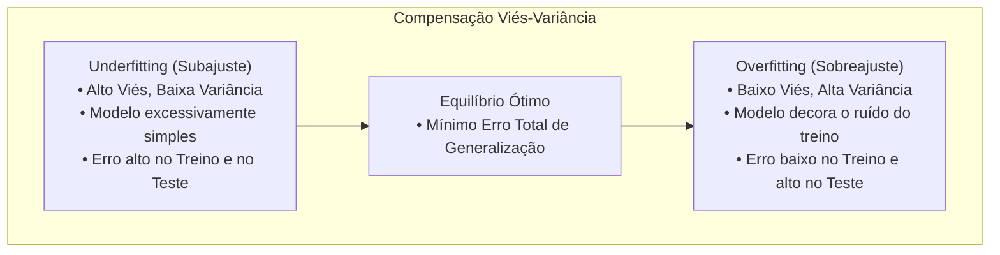
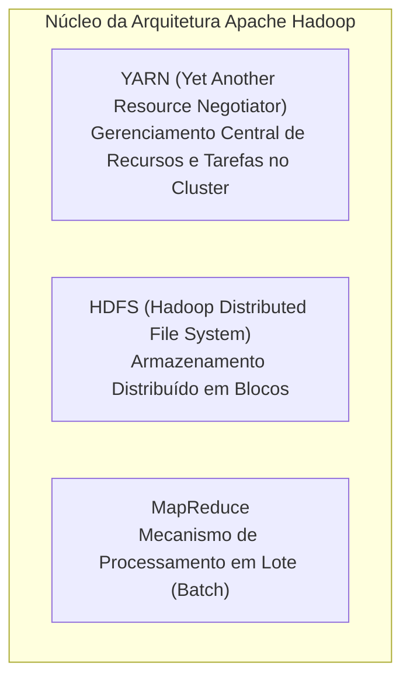
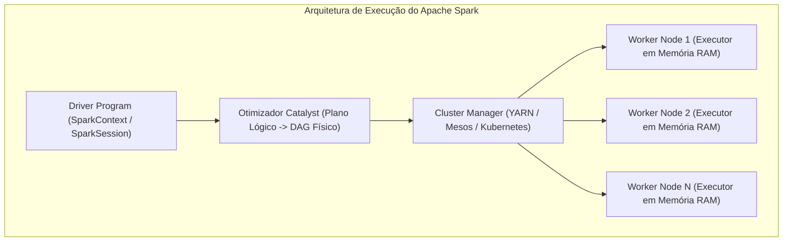

# 04 - Ciência de Dados, Estatística Aplicada e Big Data

> **Matéria:** Inteligência Artificial, Ciência de Dados e Automação  
> **Cargo:** B02 – Técnico de Controle Externo – Especialidade: Tecnologia da Informação  
> **Arquivo:** `04_ciencia_de_dados_estatistica_e_big_data.md`  

---

## 📌 Ementa / Itens do Edital
- Fundamentos de Ciência de Dados e metodologia CRISP-DM
- Pipeline de dados: Coleta, preparação, limpeza, transformação e análise exploratória (EDA)
- Noções de estatística aplicada e probabilidades
- Métricas e avaliação de modelos preditivos (Classificação e Regressão)
- Fundamentos de Big Data: Os 3 Vs clássicos (Volume, Velocidade, Variedade) e processamento distribuído (Hadoop e Apache Spark)

---

## 🌳 Classificação Hierárquica

```text
4. Ciclo de Vida dos Dados, Métricas de Avaliação e Ecossistema Big Data
├── 4.1 Metodologia e Pipeline de Ciência de Dados
│   ├── 4.1.1 O Ciclo Metodológico CRISP-DM:
│   │   ├── 1. Business Understanding (Compreensão do Negócio e definição de objetivos)
│   │   ├── 2. Data Understanding (Coleta inicial, exploração e verificação de qualidade)
│   │   ├── 3. Data Preparation (Limpeza, seleção de atributos, enriquecimento e transformação)
│   │   ├── 4. Modeling (Seleção e calibração de algoritmos preditivos)
│   │   ├── 5. Evaluation (Avaliação do modelo frente aos critérios de sucesso do negócio)
│   │   └── 6. Deployment (Implantação em produção, monitoramento e manutenção)
│   ├── 4.1.2 Limpeza e Pré-processamento de Dados:
│   │   ├── Tratamento de Valores Ausentes (Missing Values): Eliminação (Drop) vs. Imputação (Média, Mediana, Moda, KNN Imputer)
│   │   ├── Identificação e Tratamento de Outliers (Valores Discrepantes): Intervalo Interquartil (IQR: Q1 - 1,5*IQR a Q3 + 1,5*IQR) e escore Z (Z-score)
│   │   ├── Transformação de Escala: Normalização Min-Max ([0, 1]) vs. Padronização (Z = (X - μ) / σ, média 0 e desvio padrão 1)
│   │   └── Codificação de Variáveis Categóricas: One-Hot Encoding (cria colunas binárias) vs. Label / Ordinal Encoding (atribui inteiros sequenciais)
│   └── 4.1.3 Análise Exploratória de Dados (EDA): Estatísticas descritivas, gráficos de dispersão, histogramas, boxplots e matriz de correlação (Pearson vs. Spearman)
├── 4.2 Estatística Aplicada e Probabilidade
│   ├── 4.2.1 Medidas de Tendência Central: Média aritmética, Média ponderada, Mediana (resistente a outliers) e Moda
│   ├── 4.2.2 Medidas de Dispersão / Variabilidade: Amplitude, Variância (σ²), Desvio Padrão (σ) e Coeficiente de Variação (CV)
│   ├── 4.2.3 Distribuições de Probabilidade: Distribuição Normal (Gaussiana - Regra empírica 68-95-99.7%), Binomial e Poisson
│   └── 4.2.4 Inferência Estatística e Testes de Hipóteses: Hipótese Nula (H0), Hipótese Alternativa (H1), Erro Tipo I (α), Erro Tipo II (β), Nível de Significância e p-valor (p < 0,05 => rejeita-se H0)
├── 4.3 Avaliação de Modelos de Machine Learning
│   ├── 4.3.1 O Trade-off Viés vs. Variância (Bias-Variance Tradeoff):
│   │   ├── Underfitting (Alto Viés): O modelo é simples demais e não aprende o padrão
│   │   └── Overfitting (Alta Variância): O modelo decora o ruído do treino e não generaliza para novos dados (mitigado por regularização e validação cruzada)
│   ├── 4.3.2 Técnicas de Validação: Hold-out (Treino/Validação/Teste) e Validação Cruzada k-Fold (Stratified k-Fold para dados desbalanceados)
│   ├── 4.3.3 Métricas de Classificação (Matriz de Confusão):
│   │   ├── VP (Verdadeiro Positivo), VN (Verdadeiro Negativo), FP (Falso Positivo), FN (Falso Negativo)
│   │   ├── Acurácia: (VP + VN) / Total (enganosa em classes desbalanceadas!)
│   │   ├── Precisão: VP / (VP + FP) (das previsões positivas, quantas estavam certas?)
│   │   ├── Revocação / Sensibilidade (Recall): VP / (VP + FN) (dos casos reais positivos, quantos o modelo encontrou?)
│   │   ├── F1-Score: Média harmônica entre Precisão e Recall (2 * (P * R) / (P + R))
│   │   └── Curva ROC e Métrica AUC-ROC (Área sob a curva: capacidade de discriminação entre classes)
│   └── 4.3.4 Métricas de Regressão: MAE (Erro Médio Absoluto), MSE (Erro Quadrático Médio), RMSE (Raiz do MSE) e R² (Coeficiente de Determinação)
└── 4.4 Fundamentos de Big Data e Processamento Distribuído
    ├── 4.4.1 As Características dos Dados (Os Vs do Big Data):
    │   ├── Volume (Escala massiva de terabytes a petabytes)
    │   ├── Velocidade (Fluxo contínuo de geração e necessidade de processamento em tempo real)
    │   ├── Variedade (Heterogeneidade: dados estruturados, semiestruturados e não estruturados)
    │   └── Vs Estendidos: Veracidade (confiabilidade dos dados) e Valor (relevância para a tomada de decisão)
    ├── 4.4.2 Ecossistema Hadoop:
    │   ├── HDFS (Hadoop Distributed File System): Arquitetura NameNode (mestre) e DataNodes (escravos), blocos de 128 MB e fator de replicação padrão (3x)
    │   ├── MapReduce: Paradigma de processamento em lote em duas etapas (Map e Reduce)
    │   └── YARN (Yet Another Resource Negotiator): Gerenciamento de recursos do cluster
    └── 4.4.3 Apache Spark:
        ├── Processamento em Memória RAM (até 100x mais veloz que o MapReduce para algoritmos iterativos)
        ├── Abstrações Fundamentais: RDDs (Resilient Distributed Datasets), DataFrames e Datasets
        ├── Operações: Transformações (preguiçosas / Lazy Evaluation - map, filter) e Ações (count, collect)
        └── Módulos: Spark SQL, Spark Streaming, MLlib (Machine Learning distribuído) e GraphX
```

---

## 📖 Teoria Aprofundada

### 1. Metodologia e Pipeline de Ciência de Dados

#### 1.1 O Ciclo Metodológico CRISP-DM
O **CRISP-DM** (*Cross-Industry Standard Process for Data Mining*) é o framework canônico e agnóstico de tecnologia mais adotado internacionalmente para orientar o ciclo de vida de projetos de Ciência de Dados e Mineração de Dados. Ele estrutura o desenvolvimento em seis fases iterativas e interdependentes:



1. **Business Understanding (Compreensão do Negócio):** Traduz os objetivos estratégicos organizacionais em metas formais de ciência de dados e elabora o plano preliminar do projeto.
2. **Data Understanding (Compreensão dos Dados):** Coleta os dados brutos, avalia a sua qualidade, identifica inconsistências e formula hipóteses exploratórias iniciais.
3. **Data Preparation (Preparação dos Dados):** Fase que consome tipicamente a maior parte do esforço do projeto (cerca de 70% a 80%). Engloba limpeza, seleção de tabelas e atributos, fusão de bases de dados, tratamento de valores nulos e engenharia de *features*.
4. **Modeling (Modelagem):** Seleção de algoritmos preditivos (árvores, regressões, redes neurais), divisão dos dados em treino e teste, e calibração de hiperparâmetros. A seta bidirecional com a fase de Preparação evidencia que a modelagem frequentemente exige novas transformações de dados.
5. **Evaluation (Avaliação):** Julga os modelos à luz das metas institucionais formuladas na primeira fase (*Business Understanding*). Verifica se existem lacunas no modelo antes da homologação final.
6. **Deployment (Implantação):** Coloca o modelo em produção (APIs, serviços em lote ou dashboards de auditoria), estabelecendo rotinas de monitoramento contínuo de desempenho e degradação (*data drift* / *model drift*).

#### 1.2 Limpeza e Pré-Processamento de Dados
- **Tratamento de Valores Ausentes (*Missing Values*):**
  - *Mecanismos de Perda:*
    - **MCAR (*Missing Completely at Random*):** A ausência é puramente aleatória e independente de qualquer variável observada ou não observada.
    - **MAR (*Missing at Random*):** A ausência depende sistematicamente de variáveis observadas na base (ex.: homens respondem menos a determinada pergunta do que mulheres), mas não do próprio valor ausente.
    - **MNAR (*Missing Not at Random*):** A probabilidade de o dado faltar relaciona-se diretamente com o próprio valor ausente não registrado (ex.: contribuintes com maior patrimônio sonegado recusam-se a informar o valor).
  - *Métodos de Tratamento:*
    - *Remoção:* Deleção de instâncias (*Listwise Deletion*) ou de colunas. Inviável se o volume de perdas for expressivo ou a amostra for reduzida.
    - *Imputação Simples:* Substituição pela Média (para distribuições simétricas sem outliers), pela Mediana (robusta à assimetria e valores extremos) ou pela Moda (obrigatória para dados categóricos).
    - *Imputação Avançada:* **KNN Imputer** (imputa pelo valor médio dos $k$ vizinhos mais próximos) e **MICE** (*Multivariate Imputation by Chained Equations*), que modela cada variável ausente em função das demais.
- **Detecção e Tratamento de Outliers (Valores Discrepantes):**
  - **Critério do Intervalo Interquartil (IQR - *Interquartile Range*):**
    $$\text{IQR} = Q_3 - Q_1$$
    $$\text{Limite Inferior} = Q_1 - 1{,}5 \cdot \text{IQR}, \quad \text{Limite Superior} = Q_3 + 1{,}5 \cdot \text{IQR}$$
    Pontos fora dessa faixa são classificados como *outliers* leves. Se o multiplicador for $3{,}0$, são considerados *outliers* extremos.
  - **Critério do Escore Z (*Z-Score*):** Mede a quantos desvios padrões uma observação se distancia da média amostral:
    $$Z = \frac{x - \mu}{\sigma}$$
    Valores onde $|Z| > 3$ costumam ser sinalizados como anomalias sob o pressuposto de normalidade dos dados.
- **Transformação de Escala das Variáveis Numéricas:**
  - **Normalização Min-Max:** Redimensiona os dados para um intervalo estrito, geralmente $[0, 1]$:
    $$X_{\text{norm}} = \frac{X - X_{\min}}{X_{\max} - X_{\min}}$$
    *Atenção:* É extremamente sensível à presença de *outliers*, que distorcem os limites mínimo e máximo.
  - **Padronização (StandardScaler / Escore Z):** Transforma os dados de modo a apresentarem média zero ($\mu = 0$) e desvio padrão unitário ($\sigma = 1$):
    $$X_{\text{pad}} = \frac{X - \mu}{\sigma}$$
    *Vantagem:* Não delimita um intervalo artificial fechado e é robusta em algoritmos baseados em cálculo de gradiente e distâncias (SVM, Redes Neurais, PCA).
- **Codificação de Variáveis Categóricas:**
  - **One-Hot Encoding:** Converte uma variável categórica com $K$ categorias em $K$ colunas binárias indicadoras ($0$ ou $1$). Essencial para dados nominais sem ordem intrínseca (ex.: Estados da Federação). Em modelos lineares, remove-se uma coluna ($K-1$) para evitar a **armadilha das variáveis dummy** (multicolinearidade exata).
  - **Label / Ordinal Encoding:** Mapeia cada categoria para um número inteiro sequencial ($0, 1, 2, \dots$). Indicado estritamente para atributos com ordenação natural (ex.: Nível de Escolaridade: Fundamental $=1$, Médio $=2$, Superior $=3$).

---

### 2. Estatística Aplicada e Probabilidade

#### 2.1 Medidas de Tendência Central e Assimetria de Distribuições
- **Média Aritmética ($\bar{x}$):** Centro de gravidade dos dados ($\bar{x} = \frac{1}{n}\sum x_i$). Altamente sensível a valores extremos (*outliers*).
- **Mediana ($Md$):** O valor central que divide a amostra ordenada em duas metades com exatamente $50\%$ das observações. É uma medida de posição **resistente e não paramétrica**, inalterada por *outliers* remotos.
- **Moda ($Mo$):** O valor que ocorre com a maior frequência na distribuição.



> ⭐ **IMPORTANTE / REGRA DE OURO:**  
> A FCC adora cobrar a relação de ordem entre Média, Mediana e Moda sob distribuições assimétricas unimodais:
> - Na distribuição com **Assimetria Positiva (à Direita)** (típica de rendas, salários e faturamento empresarial): $\text{Moda} < \text{Mediana} < \text{Média}$.
> - Na distribuição com **Assimetria Negativa (à Esquerda)**: $\text{Média} < \text{Mediana} < \text{Moda}$.

#### 2.2 Medidas de Dispersão e Variabilidade
- **Variância Amostral ($s^2$):** Mede a dispersão dos pontos em relação à média aritmética com correção de Bessel ($n-1$ no denominador para eliminar viés amostral):
  $$s^2 = \frac{1}{n-1}\sum_{i=1}^{n} (x_i - \bar{x})^2$$
- **Desvio Padrão ($s$):** Raiz quadrada da variância ($s = \sqrt{s^2}$). Retorna a dispersão para a mesma unidade de medida da variável original.
- **Coeficiente de Variação (CV):** Medida adimensional de dispersão relativa expressa em percentual:
  $$\text{CV} = \frac{s}{\bar{x}} \times 100\%$$
  Permite comparar a variabilidade de duas variáveis com ordens de grandeza distintas (ex.: variabilidade de salários em reais vs. peso em quilos).

#### 2.3 Distribuições Canônicas e Testes de Hipóteses
- **Distribuição Normal (Gaussiana):** Formato clássico em sino, perfeitamente simétrica em torno da média $\mu$. Caracterizada pela **Regra Empírica (68-95-99.7%)**:
  - Aprox. $68{,}27\%$ dos dados concentram-se no intervalo $\mu \pm 1\sigma$.
  - Aprox. $95{,}45\%$ dos dados situam-se no intervalo $\mu \pm 2\sigma$.
  - Aprox. $99{,}73\%$ dos dados encontram-se no intervalo $\mu \pm 3\sigma$.
- **Distribuição Binomial:** Modela o número de sucessos $k$ em $n$ ensaios de Bernoulli independentes com probabilidade individual de sucesso $p$. Média $E[X] = np$, Variância $\text{Var}(X) = np(1-p)$.
- **Distribuição de Poisson:** Modela a contagem de ocorrências de eventos raros que acontecem independentemente a uma taxa média constante $\lambda$ em um intervalo contínuo de tempo ou espaço. Propriedade chave: **Média $=$ Variância $=\lambda$**.
- **Inferência Estatística e Testes de Hipóteses:**
  - **Hipótese Nula ($H_0$):** Hipótese de ausência de efeito, igualdade ou conformidade que se deseja testar.
  - **Hipótese Alternativa ($H_1$):** Hipótese de presença de efeito, diferença ou anomalia.
  - **Erro Tipo I ($\alpha$):** Rejeitar a hipótese nula $H_0$ quando ela é, na realidade, **verdadeira** (Falso Positivo estatístico). A probabilidade máxima admitida de cometer esse erro é o **Nível de Significância** ($\alpha$, comumente $5\%$).
  - **Erro Tipo II ($\beta$):** Não rejeitar $H_0$ quando ela é **falsa** (Falso Negativo estatístico). O **Poder do Teste** estatístico é dado por $1 - \beta$.
  - **$p$-valor:** Probabilidade de observar um resultado amostral tão ou mais extremo do que o obtido, assumindo que $H_0$ seja estritamente verdadeira. Se $p\text{-valor} \le \alpha$, a evidência amostral é forte o suficiente para **rejeitar $H_0$**.

---

### 3. Avaliação de Modelos de Machine Learning

#### 3.1 Trade-off Viés vs. Variância (Bias-Variance Tradeoff)



$$\text{Erro Total} = \text{Viés}^2 + \text{Variância} + \sigma_{\text{irredutível}}^2$$

- **Viés (*Bias*):** Erro oriundo de suposições excessivamente simplistas no algoritmo (ex.: impor uma reta linear sobre um fenômeno parabólico). Provoca **Underfitting**.
- **Variância (*Variance*):** Sensibilidade excessiva do modelo às flutuações e ruídos estocásticos do conjunto de treino específico (ex.: árvore de decisão sem poda). Provoca **Overfitting**.
- **Mitigação do Overfitting:** Regularização ($L_1/L_2$), aumento da quantidade de dados de treino, poda de árvores (*pruning*), redução da complexidade da arquitetura, *Dropout* e validação cruzada robusta.

#### 3.2 Matriz de Confusão e Métricas de Classificação

| | Condição Real Positiva ($y = 1$) | Condição Real Negativa ($y = 0$) |
| :--- | :--- | :--- |
| **Previsto Positivo ($\hat{y} = 1$)** | **Verdadeiro Positivo (VP)** | **Falso Positivo (FP)** (Erro Tipo I) |
| **Previsto Negativo ($\hat{y} = 0$)** | **Falso Negativo (FN)** (Erro Tipo II) | **Verdadeiro Negativo (VN)** |

- **Acurácia (Accuracy):**
  $$\text{Acurácia} = \frac{\text{VP} + \text{VN}}{\text{VP} + \text{VN} + \text{FP} + \text{FN}}$$
  > 🚨 **ALERTA DE PROVA / PEGADINHA FCC:**  
  > Em conjuntos de dados com **classes desbalanceadas** (como auditoria fiscal, onde $99{,}5\%$ das notas fiscais são idôneas e apenas $0{,}5\%$ são fraudulentas), a **Acurácia é uma métrica enganosa e inútil**! Um modelo trivial que simplesmente classifique todas as transações como "idôneas" obterá $99{,}5\%$ de acurácia, mas terá detectado zero fraudes ($0\%$ de sensibilidade). Em dados desbalanceados, exige-se o uso de **F1-Score**, **Precisão-Recall (PR-AUC)** ou **AUC-ROC**.

- **Precisão (Precision / Valor Preditivo Positivo):**
  $$\text{Precisão} = \frac{\text{VP}}{\text{VP} + \text{FP}}$$
  Indica a confiabilidade das previsões positivas: das instâncias que o modelo classificou como fraudulentas, quantas eram fraudes de fato? Prioriza-se quando o **Falso Positivo tem custo operacional altíssimo** (ex.: bloquear judicialmente a conta bancária de um cidadão inocente).
- **Sensibilidade / Recall / Revocação (True Positive Rate - TPR):**
  $$\text{Recall} = \frac{\text{VP}}{\text{VP} + \text{FN}}$$
  Mede a capacidade do modelo de capturar todos os casos positivos reais: do universo total de fraudes existentes no mundo real, qual percentual o modelo conseguiu interceptar? Prioriza-se quando o **Falso Negativo é catastrófico** (ex.: deixar um esquema milionário de lavagem de dinheiro passar impune).
- **F1-Score:**
  $$F_1 = 2 \cdot \frac{\text{Precisão} \times \text{Recall}}{\text{Precisão} + \text{Recall}}$$
  É a **média harmônica** entre Precisão e Recall. A média harmônica penaliza severamente classificadores desequilibrados que apresentam um valor exorbitante em uma métrica às custas da destruição da outra.
- **Curva ROC e Métrica AUC-ROC:**
  - A Curva ROC (*Receiver Operating Characteristic*) mapeia a taxa de Verdadeiros Positivos (Sensibilidade, Eixo Y) contra a taxa de Falsos Positivos ($\text{FPR} = \frac{\text{FP}}{\text{FP} + \text{VN}} = 1 - \text{Especificidade}$, Eixo X) para todos os limiares de probabilidade de corte (*thresholds*) de $0$ a $1$.
  - A **AUC-ROC** mede a área geométrica sob a curva:
    - $\text{AUC} = 0{,}5$: Classificador aleatório (equivalente ao lançamento de moeda).
    - $\text{AUC} = 1{,}0$: Classificador com discriminação perfeita entre classes.

#### 3.3 Métricas de Regressão
- **MAE (Mean Absolute Error):** Média dos valores absolutos dos resíduos ($\frac{1}{n}\sum |y - \hat{y}|$). Trata todos os desvios linearmente, sendo robusto a *outliers*.
- **MSE (Mean Squared Error):** Média dos quadrados dos resíduos ($\frac{1}{n}\sum (y - \hat{y})^2$). Como eleva o erro ao quadrado, penaliza drasticamente desvios grandes.
- **RMSE (Root Mean Squared Error):** Raiz quadrada do MSE ($\sqrt{\text{MSE}}$). Mantém a forte penalização sobre grandes distorções, preservando a unidade métrica original da variável resposta.
- **$R^2$ (Coeficiente de Determinação):** Percentual da variabilidade total da variável dependente explicada pelo conjunto de variáveis preditoras do modelo:
  $$R^2 = 1 - \frac{\sum (y_i - \hat{y}_i)^2}{\sum (y_i - \bar{y})^2}$$

---

### 4. Big Data e Processamento Distribuído

#### 4.1 As Características do Big Data (Os 5 Vs)
1. **Volume:** Escala astronômica de armazenamento físico, inviabilizando discos rígidos locais únicos (terabytes a petabytes).
2. **Velocidade:** Taxa acelerada e contínua de ingestão e processamento de dados (transações financeiras, sensores IoT, logs web em tempo real).
3. **Variedade:** Pluralidade estrutural de formatos: estruturados (tabelas SQL), semiestruturados (XML, JSON, logs) e não estruturados (PDFs, vídeos, imagens).
4. **Veracidade:** Confiabilidade, autenticidade, consistência e integridade das fontes de dados ingeridas.
5. **Valor:** Conversão do dado bruto em insights estratégicos aplicáveis que justifiquem o investimento em infraestrutura.

#### 4.2 O Ecossistema Apache Hadoop
O Apache Hadoop é o framework de código aberto pioneiro para armazenamento confiável e processamento distribuído massivo em clusters de hardware comum (*commodity hardware*).



- **HDFS (Hadoop Distributed File System):**
  - Adota o paradigma Mestre-Trabalhador (*Master-Slave*):
    - **NameNode (Mestre):** Gerencia o sistema de arquivos (*namespace*), a árvore de diretórios e o mapa que indica em quais máquinas cada bloco de cada arquivo está armazenado. Mantém essas estruturas na **memória RAM** para garantir velocidade.
    - **DataNodes (Trabalhadores/Escravos):** Servidores de armazenamento físico que guardam os blocos de dados reais em seus discos rígidos locais e atendem a requisições de leitura e escrita.
  - *Divisão em Blocos:* Arquivos são fragmentados em grandes blocos sequenciais (tamanho padrão de **128 MB** ou **256 MB**).
  - *Tolerância a Falhas e Replicação:* Cada bloco é replicado automaticamente pelo cluster (o fator de replicação padrão é de **$3\times$**). O Hadoop aplica a política de conhecimento de rack (*rack awareness*): dois blocos são guardados no mesmo rack (em nós distintos) e o terceiro bloco é alocado em um rack fisicamente apartado, prevenindo perdas causadas por falhas na alimentação ou na rede do rack.
- **YARN (Yet Another Resource Negotiator):**
  - Desacoplou a alocação de recursos físicos da execução do MapReduce no Hadoop 2.x.
  - Componentes: **ResourceManager** (gerencia os recursos globais de CPU e memória do cluster) e **NodeManagers** (agentes locais instalados em cada nó para monitorar contêineres).
- **MapReduce:**
  - Modelo de programação paralela em lote composto por duas funções fundamentais:
    1. **Map:** Lê registros brutos e produz pares intermediários no padrão $(chave, valor)$.
    2. **Shuffle and Sort:** Agrupa e ordena via rede todos os valores associados à mesma chave intermediária.
    3. **Reduce:** Agrega, sintetiza ou computa cálculos sobre os valores agrupados por chave.
  - *Limitação Crítica:* Grava obrigatoriamente os dados intermediários em disco rígido ao final de cada fase, impondo severos gargalos de I/O em pipelines de múltiplos passos.

#### 4.3 Apache Spark e Processamento em Memória
O Apache Spark surgiu para superar os limites de desempenho do MapReduce, viabilizando o processamento distribuído prioritariamente em **memória RAM**, atingindo velocidades até $100\times$ superiores para cargas iterativas (como algoritmos de Machine Learning e grafos).



- **Abstrações Centrais de Dados:**
  - **RDD (Resilient Distributed Dataset):** Coleção imutável, particionada e distribuída de registros em memória. É resiliente a falhas porque registra o seu **Grafo de Linhagem** (*Lineage Graph*): caso um nó quebre, o Spark recalcula estritamente a partição perdida a partir da linhagem de transformações.
  - **DataFrame:** Abstração moderna de nível superior que organiza dados em colunas nomeadas, similar a uma tabela relacional. Beneficia-se do motor de otimização **Catalyst** e do gerador de código binário **Tungsten**.
  - **Dataset:** Extensão tipada dos DataFrames disponível em linguagens como Scala e Java.
- **Tipos de Operações no Apache Spark:**

| Tipo de Operação | Comportamento de Execução | Exemplos de Funções | Características Técnicas |
| :--- | :--- | :--- | :--- |
| **Transformações (*Transformations*)** | **Preguiçosas (*Lazy Evaluation*)**. | `map()`, `filter()`, `select()`, `distinct()`, `groupBy()`, `join()` | **Não disparam execução imediata**. O Spark limita-se a acrescentar a instrução ao Grafo Acíclico Direcionado (DAG) otimizado. |
| **Ações (*Actions*)** | **Imediatas e Eager**. | `count()`, `collect()`, `show()`, `take()`, `first()`, `saveAsTextFile()` | **Disparam a compilação do DAG** e o processamento físico real nos nós executores, devolvendo um resultado ao *Driver* ou gravando em disco. |

- **Transformações Narrow vs. Wide:**
  - **Transformação Narrow (Estreita):** Cada partição de entrada contribui para no máximo uma partição de saída, dispensando movimentação de dados pela rede física (*sem shuffle*, ex.: `map()`, `filter()`).
  - **Transformação Wide (Ampla):** Múltiplas partições dependem de dados espalhados em outros nós, exigindo redistribuição massiva de dados pela rede (*com shuffle*, ex.: `groupByKey()`, `join()`, `reduceByKey()`).

---

## 🌐 Fontes Recomendadas na Internet

1. [CRISP-DM 1.0 - Step-by-Step Data Mining Guide (Wirth & Hipp)](https://www.the-modeling-agency.com/crisp-dm.pdf): O documento fundador original que estabeleceu a metodologia das 6 fases do ciclo de vida de projetos analíticos.
2. [Scikit-Learn Model Evaluation Guide](https://scikit-learn.org/stable/modules/model_evaluation.html): Manual analítico detalhando matrizes de confusão, cálculo de métricas de classificação, curvas ROC/PR e validação cruzada.
3. [Apache Spark Official Documentation](https://spark.apache.org/docs/latest/): Arquitetura completa da computação em memória, Lazy Evaluation, otimizador Catalyst e módulos Spark SQL e MLlib.
4. [Apache Hadoop HDFS Architecture Guide](https://hadoop.apache.org/docs/stable/hadoop-project-dist/hadoop-hdfs/HdfsDesign.html): Estrutura técnica oficial do HDFS, papéis de NameNode e DataNodes, política de replicação e tolerância a falhas.

---

## 📝 Questões Comentadas (Padrão FCC)

### Questão 1 (FCC - Adaptada / Analista de TI - Tribunais - Matriz de Confusão e Métricas com Classes Desbalanceadas)
Um Tribunal de Contas implantou um algoritmo de aprendizado de máquina para triagem de prestações de contas municipais. Em uma amostra de teste com 10.000 processos auditados, sabe-se que 200 processos continham irregularidades graves (positivos) e 9.800 eram processos estritamente regulares (negativos). 

Após a execução do classificador, os resultados observados na matriz de confusão foram:
- Verdadeiros Positivos (VP) = 160
- Falsos Positivos (FP) = 40
- Falsos Negativos (FN) = 40
- Verdadeiros Negativos (VN) = 9.760

Avaliando o desempenho desse modelo para o controle externo, assinale a afirmativa correta:
A) A Sensibilidade (Recall) do classificador é de 80%, a Precisão é de 80% e o F1-Score é exatamente 80%.  
B) A Acurácia simples é de 80%, comprovando que ela é a métrica mais apropriada para atestar a detecção de fraudes em ambientes com alta desproporção de classes.  
C) O classificador apresenta uma Sensibilidade de 99,2%, calculada pela divisão dos Verdadeiros Negativos pela soma dos casos regulares.  
D) Em problemas de detecção de fraudes em compras governamentais, deve-se buscar a redução do Recall e o aumento deliberado de Falsos Negativos para reduzir a carga de trabalho dos auditores.  
E) Um modelo fictício ingênuo que classificasse todas as 10.000 prestações de contas como regulares apresentaria uma Acurácia de 0%, revelando a sensibilidade dessa métrica ao desbalanceamento.

> **Gabarito: A**  
> **Comentário Analítico Passo a Passo:**  
> - **Cálculos Matemáticos Formais:**
>   - **Precisão ($P$):** Das vezes em que o modelo previu irregularidade ($VP + FP = 160 + 40 = 200$), qual fração estava correta?  
>     $P = \frac{VP}{VP + FP} = \frac{160}{160 + 40} = \frac{160}{200} = 0{,}80\text{ (ou } 80\%)$  
>   - **Sensibilidade / Recall ($R$):** Do total real de prestações com irregularidades graves existentes ($VP + FN = 160 + 40 = 200$), qual proporção o modelo detectou?  
>     $R = \frac{VP}{VP + FN} = \frac{160}{160 + 40} = \frac{160}{200} = 0{,}80\text{ (ou } 80\%)$  
>   - **F1-Score:** Média harmônica entre Precisão e Recall:  
>     $F_1 = 2 \cdot \frac{P \cdot R}{P + R} = 2 \cdot \frac{0{,}80 \cdot 0{,}80}{0{,}80 + 0{,}80} = \frac{1{,}28}{1{,}60} = 0{,}80\text{ (ou } 80\%)$
> - **A está CORRETA:** Todas as três métricas essenciais resultam com precisão em $80\%$.  
> - **B está INCORRETA:** A Acurácia global é $\frac{VP + VN}{\text{Total}} = \frac{160 + 9760}{10000} = \frac{9920}{10000} = 99{,}2\%$. A acurácia não é de 80% e é sabidamente ilusória para conjuntos desbalanceados.  
> - **C está INCORRETA:** $99{,}2\%$ é o valor da Especificidade ($\frac{VN}{VN + FP} = \frac{9760}{9800} \approx 99{,}59\%$) ou da Acurácia, e não da Sensibilidade ($80\%$).  
> - **D está INCORRETA:** Reduzir o recall e aumentar Falsos Negativos significa permitir que fraudes graves passem despercebidas pela fiscalização, colidindo com a missão institucional do Tribunal de Contas.  
> - **E está INCORRETA:** Um modelo cego que previsse "regular" para todos os 10.000 casos acertaria exatamente os 9.800 casos negativos, ostentando uma espetacular acurácia de $98\%$, apesar de capturar zero fraudes (reforçando a ineficiência da acurácia isolada em classes desbalanceadas).

---

### Questão 2 (FCC - Adaptada / SEFAZ - Auditoria Fiscal - Processamento Distribuído com Apache Spark)
Durante o processamento em lote de dezenas de milhões de documentos fiscais eletrônicos em um cluster com Apache Spark, um analista escreveu o seguinte trecho de código:

```python
df_filtrado = df_notas.filter(df_notas["valor"] > 100000)
df_selecionado = df_filtrado.select("chave_nfe", "cnpj_emitente", "valor")
total_notas = df_selecionado.count()
```

Considerando a arquitetura interna e o paradigma computacional do Apache Spark, assinale a alternativa correta:
A) As instruções `filter()` e `select()` são Ações imperativas que executam o processamento físico no cluster imediatamente no instante em que as linhas de código são lidas pelo interpretador Python.  
B) O conceito de Avaliação Preguiçosa (*Lazy Evaluation*) do Spark determina que as Transformações, tais como `filter()` e `select()`, não processam dados reais de imediato; elas apenas registram as etapas em um Grafo Acíclico Direcionado (DAG) otimizado, sendo a computação real disparada apenas quando a Ação `count()` é invocada.  
C) O método `count()` é uma Transformação com dependência estrita (*narrow dependency*), não provocando qualquer comunicação entre os nós executores e o programa *Driver*.  
D) O Spark armazena obrigatoriamente todas as partições intermediárias em arquivos físicos de texto no disco rígido do nó mestre, impedindo o reaproveitamento de dados em memória RAM.  
E) A tolerância a falhas no Spark é garantida pela gravação redundante de sete cópias de cada partição em fitas magnéticas secundárias.

> **Gabarito: B**  
> **Comentário Analítico Passo a Passo:**  
> - **A está INCORRETA:** `filter()` e `select()` são **Transformações**, e não Ações. Sob a avaliação preguiçosa (*Lazy Evaluation*), nenhuma leitura de blocos de dados ou consumo de ciclos de CPU nos trabalhadores ocorre nessas duas primeiras linhas.  
> - **B está CORRETA:** O fundamento basilar do **Apache Spark** é a **Lazy Evaluation**: as transformações apenas constroem e concatenam o plano de linhagem lógica no Grafo Acíclico Direcionado (DAG). O mecanismo de otimização *Catalyst* analisa esse DAG para combinar filtros e seleções (como *predicate pushdown* e *column pruning*). A computação física de dados só é efetivamente disparada quando uma **Ação** (`count()`, `collect()`, `show()`) é requisitada.  
> - **C está INCORRETA:** `count()` é uma **Ação** categórica que agrega as contagens parciais dos nós trabalhadores e envia o escalar resultante de volta ao programa condutor (*Driver*).  
> - **D está INCORRETA:** O grande diferencial arquitetural do Spark em relação ao Hadoop MapReduce é a computação **em memória RAM** (*In-Memory Computing*), evitando leituras e gravações desnecessárias em disco rígido entre operações encadeadas.  
> - **E está INCORRETA:** A resiliência e tolerância a falhas nos RDDs e DataFrames é garantida pelo **Grafo de Linhagem** (*Lineage Graph*), que registra a sequência de transformações necessária para recomputar qualquer partição perdida sem necessidade de replicação massiva em mídias físicas externas.

---

### Questão 3 (FCC - Adaptada / TCE - Auditor de Controle Externo - TI - Metodologia CRISP-DM e Tratamento de Outliers)
No desenvolvimento de um projeto de ciência de dados estruturado sob a metodologia CRISP-DM para análise de superfaturamento em contratos de obras públicas, os analistas estão executando a etapa de *Data Preparation*. Durante a identificação de valores discrepantes no custo unitário do metro quadrado de asfalto, a equipe optou pela técnica do Intervalo Interquartil (IQR). 

A base de dados indicou que o primeiro quartil ($Q_1$) foi apurado em R$ 200,00 e o terceiro quartil ($Q_3$) foi apurado em R$ 350,00.

A respeito da metodologia CRISP-DM e dos critérios de pré-processamento de outliers, assinale a afirmativa correta:
A) O Intervalo Interquartil (IQR) é de R$ 550,00, e qualquer valor acima de R$ 900,00 será classificado como valor regular.  
B) O IQR é de R$ 150,00 ($350 - 200$), o Limite Inferior é de R$ -25,00 ($200 - 1{,}5 \times 150$) e o Limite Superior é de R$ 575,00 ($350 + 1{,}5 \times 150$), configurando como outlier qualquer custo unitário superior a R$ 575,00.  
C) Na metodologia CRISP-DM, a fase de *Business Understanding* sucede a fase de *Deployment*, visto que o entendimento dos objetivos de negócio só pode ocorrer após a solução estar em produção.  
D) A técnica de Padronização (*Z-Score*) deve ser evitada em modelos baseados em gradiente descendente, sendo imperativo o uso exclusivo do One-Hot Encoding para variáveis puramente numéricas.  
E) A metodologia CRISP-DM proíbe expressamente qualquer retorno ou iteração entre a fase de Modelagem (*Modeling*) e a fase de Preparação de Dados (*Data Preparation*).

> **Gabarito: B**  
> **Comentário Analítico Passo a Passo:**  
> - **Cálculo Matemático do Intervalo Interquartil:**
>   - $\text{IQR} = Q_3 - Q_1 = 350 - 200 = 150$
>   - $\text{Limite Superior} = Q_3 + 1{,}5 \cdot \text{IQR} = 350 + 1{,}5 \cdot 150 = 350 + 225 = 575$
>   - $\text{Limite Inferior} = Q_1 - 1{,}5 \cdot \text{IQR} = 200 - 1{,}5 \cdot 150 = 200 - 225 = -25$
> - **B está CORRETA:** Demonstra com rigor aritmético o critério de Tukey para identificação de outliers pelo boxplot: contratos com custo por metro quadrado superior a R$ 575,00 situam-se acima do limite superior e são qualificados como discrepantes (*outliers*).  
> - **A está INCORRETA:** O IQR é a diferença ($Q_3 - Q_1 = 150$), e não a soma ($550$).  
> - **C está INCORRETA:** *Business Understanding* é a **primeira** fase do CRISP-DM, e o *Deployment* é a **última** (sexta).  
> - **D está INCORRETA:** A padronização é altamente indicada para algoritmos baseados em descida de gradiente (redes neurais, regressão logística com penalidade), e *One-Hot Encoding* é uma técnica exclusiva para variáveis **categóricas**, e não para variáveis contínuas numéricas.  
> - **E está INCORRETA:** O CRISP-DM é um processo intrinsecamente iterativo; a transição entre *Data Preparation* e *Modeling* possui explicitamente uma seta de vai-e-vem cíclico.

---

### Questão 4 (FCC - Adaptada / TRF - Analista Judiciário - Estatística Aplicada e Assimetria de Distribuições)
Na análise estatística dos salários praticados por fornecedores contratados pelo setor público, observou-se que a distribuição de rendimentos apresenta uma acentuada **Assimetria Positiva (à direita)**, decorrente da existência de uma minoria de executivos com salários desproporcionalmente vultosos em comparação com o grande contingente de operários.

Considerando o comportamento das medidas de tendência central e os conceitos de inferência estatística, assinale a alternativa correta:
A) Em uma distribuição contínua unimodal com assimetria positiva, a relação de ordem observada entre as medidas de posição é: $\text{Moda} < \text{Mediana} < \text{Média}$.  
B) Em uma distribuição perfeitamente simétrica gaussiana, a Média é estritamente superior à Mediana, e a Moda assume obrigatoriamente valor nulo.  
C) O Erro Tipo I em um teste de hipóteses ocorre quando o auditor decide não rejeitar a hipótese nula $H_0$, mesmo sendo ela flagrantemente falsa.  
D) Um $p$-valor de $0{,}001$ obtido em um teste estatístico indica que se deve aceitar a hipótese nula $H_0$ sob o nível de significância padrão de $\alpha = 0{,}05$.  
E) O desvio padrão amostral de uma variável não se altera quando todos os valores observados na amostra são multiplicados por uma constante real não nula.

> **Gabarito: A**  
> **Comentário Analítico Passo a Passo:**  
> - **A está CORRETA:** Em uma distribuição unimodal com **assimetria positiva (à direita)**, a longa cauda direita de valores elevados puxa a **Média** para cima. A **Moda** permanece no ponto de maior densidade (pico), e a **Mediana** posiciona-se no centro ordinal resistente. Portanto, vigora a clássica ordenação: $\text{Moda} < \text{Mediana} < \text{Média}$.  
> - **B está INCORRETA:** Na distribuição perfeitamente simétrica (como a Normal), as três medidas coincidem no ponto central: $\text{Média} = \text{Mediana} = \text{Moda}$.  
> - **C está INCORRETA:** Não rejeitar $H_0$ quando $H_0$ é falsa é o **Erro Tipo II** ($\beta$). O **Erro Tipo I** ($\alpha$) consiste em **rejeitar** $H_0$ quando ela é verdadeira.  
> - **D está INCORRETA:** A regra de decisão é: se $p\text{-valor} \le \alpha$, a hipótese nula $H_0$ é **rejeitada**. Com $p = 0{,}001$ e $\alpha = 0{,}05$, temos $0{,}001 \le 0{,}05$, o que impõe a imediata rejeição de $H_0$.  
> - **E está INCORRETA:** Se multiplicarmos todos os dados por uma constante $c$, o desvio padrão é multiplicado pelo módulo dessa constante ($s_{novo} = |c| \cdot s$).

---

### Questão 5 (FCC - Adaptada / TRT - Analista Judiciário - TI - Ecossistema Hadoop e HDFS)
No âmbito do armazenamento e processamento distribuído de grandes volumes de dados governamentais com o ecossistema Apache Hadoop, assinale a afirmativa correta a respeito da arquitetura do HDFS (*Hadoop Distributed File System*):
A) O *NameNode* atua como o nó mestre do cluster e armazena os metadados do sistema de arquivos e a localização dos blocos prioritariamente em memória RAM, enquanto os *DataNodes* funcionam como nós de trabalho que guardam fisicamente os blocos de dados em seus sistemas de disco locais.  
B) O tamanho padrão de um bloco de dados no HDFS é de 512 bytes, tamanho idêntico aos setores de discos rígidos convencionais para agilizar o particionamento de pequenos arquivos de texto.  
C) A perda de qualquer *DataNode* no HDFS acarreta a destruição imediata e irrecuperável de todo o cluster, visto que o Hadoop não contempla mecanismos de replicação de blocos.  
D) O componente *YARN* foi inteiramente descontinuado na versão Hadoop 2.x por ser incompatível com sistemas operacionais corporativos de código aberto.  
E) O paradigma MapReduce realiza todo o processamento analítico estritamente na memória volátil dos nós, dispensando por completo gravações intermediárias em disco rígido entre as fases de Map e Reduce.

> **Gabarito: A**  
> **Comentário Analítico Passo a Passo:**  
> - **A está CORRETA:** O HDFS adota rigorosamente a arquitetura mestre-escravo: o **NameNode** é a autoridade central que mantém os metadados (árvore de diretórios, permissões e mapeamento de onde cada bloco reside) na memória principal para acesso ultrarrápido; já os **DataNodes** são as máquinas distribuídas que armazenam os blocos físicos de dados em disco e atendem às requisições de leitura e escrita.  
> - **B está INCORRETA:** O HDFS foi concebido para arquivos maciços; seu tamanho padrão de bloco é de **128 MB** (ou 256 MB), milhões de vezes superior ao setor convencional de disco de 512 bytes, reduzindo a sobrecarga de metadados no NameNode.  
> - **C está INCORRETA:** A principal virtude do HDFS é a **tolerância a falhas** nativa através do mecanismo de replicação automática de blocos (fator de replicação padrão de $3\times$), suportando a perda rotineira de DataNodes sem prejuízo informacional.  
> - **D está INCORRETA:** O **YARN** foi justamente **introduzido** no Hadoop 2.x para desacoplar o gerenciamento de recursos do MapReduce, permitindo que múltiplos motores de computação (como Spark, Tez e Flink) compartilhem o mesmo cluster.  
> - **E está INCORRETA:** O grande limitador de performance do MapReduce é exatamente a necessidade compulsória de **gravar os resultados intermediários em disco rígido** (*spill to disk*) na transição entre o Map e o Reduce, provocando elevado gargalo de entrada e saída (I/O).
