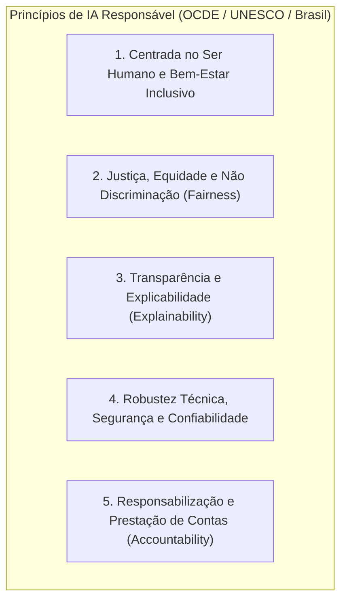
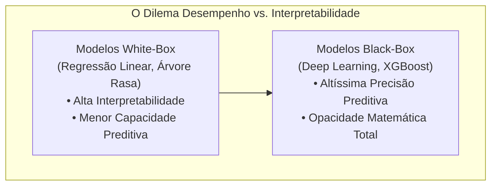
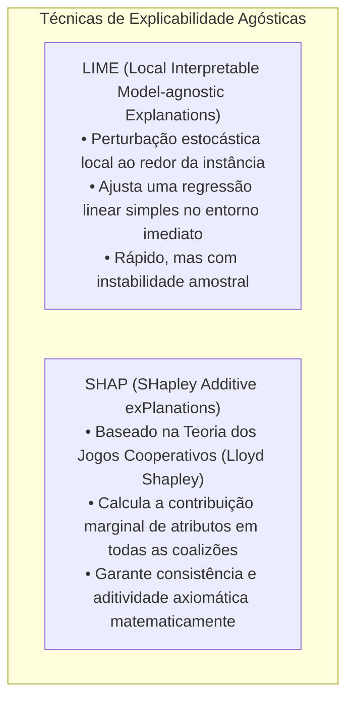
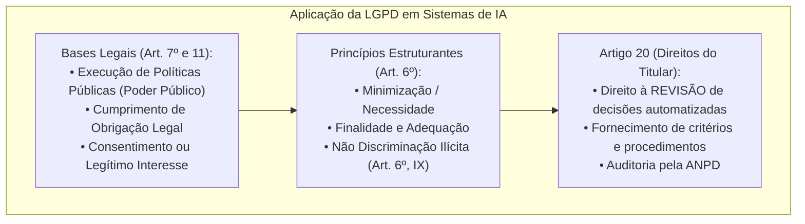
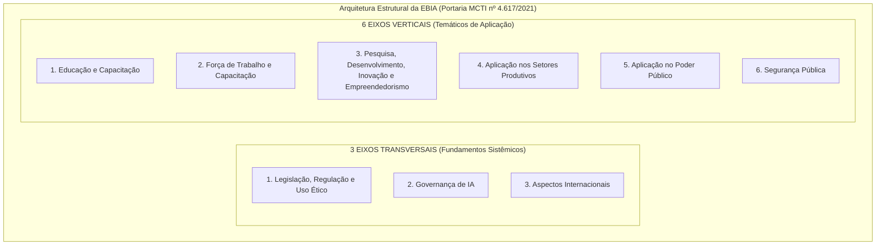

# 05 - Ética, IA Responsável, LGPD e Estratégia Brasileira de IA (EBIA)

> **Matéria:** Inteligência Artificial, Ciência de Dados e Automação  
> **Cargo:** B02 – Técnico de Controle Externo – Especialidade: Tecnologia da Informação  
> **Arquivo:** `05_etica_ia_responsavel_ebia_e_lgpd.md`  

---

## 📌 Ementa / Itens do Edital
- Ética em inteligência artificial e princípios de IA Responsável
- Explicabilidade e interpretabilidade algorítmica (XAI - Explainable AI)
- Governança de IA no setor público
- Aplicação da Lei Geral de Proteção de Dados (LGPD - Lei nº 13.709/2018) à IA e decisões automatizadas
- Estratégia Brasileira de Inteligência Artificial (EBIA - Portaria MCTI nº 4.617/2021)

---

## 🌳 Classificação Hierárquica

```text
5. Ética Algorítmica, Explicabilidade, LGPD e Governança Nacional de IA
├── 5.1 Princípios de IA Responsável e Ética Algorítmica
│   ├── 5.1.1 Princípios Internacionais (Recomendações da OCDE e UNESCO):
│   │   ├── Beneficência e não maleficência (IA centrada no ser humano e no bem comum)
│   │   ├── Justiça, Equidade e Não Discriminação (Fairness): Prevenção e mitigação de vieses históricos em dados de treino
│   │   ├── Transparência e Explicabilidade: Direito dos cidadãos de compreender a lógica que motivou uma decisão algorítmica
│   │   ├── Responsabilização e Prestação de Contas (Accountability): Atribuição clara de responsabilidade jurídica aos desenvolvedores e gestores públicos
│   │   └── Segurança, Robustez e Proteção à Privacidade
│   └── 5.1.2 Riscos Sociais da IA: Vieses de gênero e raciais em modelos preditivos, vigilância em massa e opacidade institucional
├── 5.2 Explicabilidade e Interpretabilidade de IA (XAI - Explainable AI)
│   ├── 5.2.1 O Dilema Precisão vs. Interpretabilidade: Modelos Intrinsicamente Interpretáveis (Regressão Linear, Árvores de Decisão) vs. Modelos Caixa-Preta (Deep Learning, Ensembles complexos)
│   ├── 5.2.2 Métodos de Interpretação Post-Hoc Agósticos ao Modelo:
│   │   ├── SHAP (SHapley Additive exPlanations): Baseado na Teoria dos Jogos Cooperativos de Lloyd Shapley; calcula a contribuição marginal de cada atributo para a previsão
│   │   └── LIME (Local Interpretable Model-agnostic Explanations): Aproximação local do modelo complexo por um modelo linear simples ao redor da instância analisada
│   └── 5.2.3 Importância no Controle Externo: Justificativa técnica e motivada para auditorias e acórdãos emitidos com suporte algorítmico
├── 5.3 Aplicação da LGPD (Lei nº 13.709/2018) à Inteligência Artificial
│   ├── 5.3.1 Bases Legais para Treinamento de Modelos: Consentimento, Cumprimento de Obrigação Legal e Execução de Políticas Públicas pelo Poder Público (Art. 7º, III)
│   ├── 5.3.2 Tratamento de Dados Pessoais Sensíveis (Art. 11 da LGPD) e Proibição de Discriminação Ilícita ou Abusiva (Art. 6º, IX)
│   ├── 5.3.3 O Artigo 20 da LGPD (Revisão de Decisões Automatizadas):
│   │   ├── O titular dos dados tem direito a solicitar a REVISÃO de decisões tomadas unicamente com base em tratamento automatizado de dados pessoais que afetem seus interesses
│   │   ├── Dever do controlador de fornecer informações claras e adequadas a respeito dos critérios e dos procedimentos utilizados para a decisão automatizada
│   │   └── Auditoria pela ANPD (Autoridade Nacional de Proteção de Dados) em caso de recusa baseada em segredo comercial/industrial
│   └── 5.3.4 Relatório de Impacto à Proteção de Dados Pessoais (RIPD) em Projetos de IA de Alto Risco
└── 5.4 Estratégia Brasileira de Inteligência Artificial (EBIA)
    ├── 5.4.1 Marco Regulatório e Institucional: Portaria MCTI nº 4.617/2021
    ├── 5.4.2 Objetivos Gerais: Potencializar o uso de IA no Brasil, promover investimentos em P&D, formar talentos, garantir ética e posicionar o país internacionalmente
    ├── 5.4.3 Os Três Eixos Transversais da EBIA:
    │   ├── 1. Legislação, Regulação e Uso Ético
    │   ├── 2. Governança de IA (participação multissetorial)
    │   └── 3. Aspectos Internacionais (alinhamento com OCDE e cooperação global)
    └── 5.4.4 Os Seis Eixos Verticais / Temáticos da EBIA:
        ├── 1. Educação e Capacitação (formação de profissionais e alfabetização em IA)
        ├── 2. Força de Trabalho e Capacitação (requalificação profissional e impactos no emprego)
        ├── 3. Pesquisa, Desenvolvimento, Inovação e Empreendedorismo
        ├── 4. Aplicação nos Setores Produtivos (indústria, agricultura e serviços)
        ├── 5. Aplicação no Poder Público (Governo Digital, eficiência de serviços e transparência)
        └── 6. Segurança Pública (investigação criminal, controle e defesa cibernética)
```

---

## 📖 Teoria Aprofundada

### 1. Princípios de IA Responsável e Ética Algorítmica

À medida que sistemas automatizados de inteligência artificial assumem papéis críticos na alocação de recursos públicos, concessão de benefícios sociais e fiscalização tributária, impõe-se a observância de postulados éticos e diretrizes normativas internacionais para mitigar riscos à dignidade da pessoa humana e ao Estado Democrático de Direito.



#### 1.1 Os Princípios Fundamentais Internacionais
- **Beneficência e Centralidade Humana (*Human-Centric AI*):** A IA deve operar como ferramenta de ampliação das capacidades humanas e promoção do bem-estar social, da sustentabilidade e dos direitos fundamentais, sendo vedada a criação de sistemas voltados à desumanização ou manipulação comportamental subliminar.
- **Justiça, Equidade e Não Discriminação (*Fairness*):**
  - Modelos matemáticos aprendem diretamente de dados históricos. Se uma base histórica contiver discriminações estruturais contra minorias, o modelo tenderá a perpetuar e amplificar esses preconceitos (*bias in, bias out*).
  - *Tipologias de Viés Algorítmico:*
    1. **Viés Histórico (*Historical Bias*):** Decorre de disparidades preexistentes na sociedade (ex.: disparidades salariais entre homens e mulheres em bases de crédito).
    2. **Viés de Representação (*Representation Bias*):** Sub-representação estatística de determinado estrato populacional na base de treino (ex.: sistemas de reconhecimento facial treinados predominantemente com rostos de pele clara).
    3. **Viés de Medição (*Measurement Bias*):** Escolha infeliz de variáveis como substitutas (*proxies*) de um atributo não mensurável diretamente (ex.: usar número de prisões como *proxy* de criminalidade, embutindo o viés de policiamento direcionado).
  - *Métricas Formais de Equidade:* **Paridade Demográfica** (proporção idêntica de aprovações entre grupos protegidos) e **Igualdade de Oportunidades** (taxa equivalente de Verdadeiros Positivos entre subgrupos).
- **Transparência e Explicabilidade:** O cidadão e o órgão de controle possuem a prerrogativa de saber quando estão interagindo com um sistema automatizado e de compreender as razões factuais e os parâmetros que conduziram a uma decisão desfavorável.
- **Responsabilização e Prestação de Contas (*Accountability*):** Sistemas de IA não possuem personalidade jurídica própria nem respondem civil ou penalmente. A responsabilidade jurídica recai sempre sobre as pessoas naturais e jurídicas que projetam, homologam, implantam e operam a tecnologia. Exige-se a manutenção de **trilhas de auditoria (*audit trails*)** e registros de logs imutáveis.
- **Supervisão Humana (*Human Oversight*):**
  - **Human-in-the-Loop (HITL):** O algoritmo gera recomendações ou subsídios, mas a decisão final é **obrigatoriamente validada e executada por um ser humano**. Modelo imperativo para concessão de benefícios, demissões, decisões penais e lançamentos fiscais de débitos.
  - **Human-on-the-Loop (HOTL):** O sistema opera de forma autônoma em tempo real, porém sob o **monitoramento constante de um operador humano** que possui a prerrogativa técnica de intervir, vetar ou acionar um botão de emergência (*kill switch*) a qualquer instante.
  - **Human-in-Command (HIC):** A supervisão humana define as diretrizes estratégicas gerais, as regras de conformidade e as metas do sistema autônomo, avaliando seu impacto socioeconômico global.

---

### 2. Explicabilidade e Interpretabilidade Algorítmica (XAI)

O dilema clássico entre complexidade estatística e transparência operacional desafia a governança de IA no setor público.



#### 2.1 Modelos Intrínsecos vs. Modelos Caixa-Preta
- **Modelos Intrinsecamente Interpretáveis (*Glass-Box / White-Box*):**
  - Regressões Lineares e Logísticas: o impacto de cada variável é diretamente mensurado pelo seu coeficiente angular ($\beta_j$).
  - Árvores de Decisão Rasas: o caminho percorrido da raiz até a folha constitui uma regra lógica se-então (*if-then*) plenamente legível por humanos.
  - *Limitação:* Apresentam capacidade limitada para modelar relações não lineares complexas, tensores de imagem e linguagem natural.
- **Modelos Caixa-Preta (*Black-Box*):**
  - Ensembles avançados (*Random Forest, XGBoost, CatBoost*) e Redes Neurais Profundas (*Deep Learning*).
  - Realizam bilhões de transformações matriciais não lineares em espaços de alta dimensionalidade, tornando impossível inspecionar intuitivamente como um neurônio individual condicionou o resultado final.

#### 2.2 Métodos de Interpretação Post-Hoc Agósticos ao Modelo
Para atender aos mandamentos constitucionais de publicidade e motivação dos atos administrativos (Art. 37 e Art. 93, IX da CF/88), a ciência de dados utiliza técnicas de explicabilidade *post-hoc* que funcionam externamente a qualquer algoritmo.



- **SHAP (SHapley Additive exPlanations - Lundberg & Lee, 2017):**
  - Fundamenta-se formalmente no conceito de **Valores de Shapley** da Teoria dos Jogos Cooperativos, pelo qual se distribui o ganho total de uma coalizão entre os jogadores segundo sua contribuição marginal média.
  - No contexto de IA: os atributos (*features*) são os jogadores, a previsão do modelo é o ganho da coalizão, e a contribuição marginal de cada variável é calculada considerando **todas as permutações possíveis de subconjuntos de variáveis**:
    $$\phi_i = \sum_{S \subseteq F \setminus \{i\}} \frac{|S|!(|F| - |S| - 1)!}{|F|!} \left[ f(S \cup \{i\}) - f(S) \right]$$
  - *Propriedades Axiomáticas Únicas do SHAP:*
    1. **Eficiência / Aditividade Local:** A soma dos valores SHAP de todas as variáveis é rigorosamente igual à diferença entre a predição da instância $\hat{y}$ e a predição média base do conjunto de dados $\mathbb{E}[f(x)]$:
       $$f(x) = \phi_0 + \sum_{i=1}^{M} \phi_i$$
    2. **Simetria:** Duas variáveis que contribuem de forma idêntica para todas as coalizões recebem o mesmo valor de Shapley.
    3. **Jogador Nulo (*Dummy*):** Uma variável que não altera o valor da previsão em nenhuma coalizão recebe valor de Shapley estritamente zero ($\phi_i = 0$).
    4. **Consistência:** Se um modelo é alterado de modo que a contribuição de uma variável aumente ou permaneça a mesma, seu valor de Shapley nunca diminui.
  - Oferece tanto explicações locais (*Force Plot, Waterfall Plot*) quanto globais (*Summary Plot / Beeswarm*).
- **LIME (Local Interpretable Model-agnostic Explanations - Ribeiro et al., 2016):**
  - Explica uma decisão individual isolada criando perturbações artificiais ao redor do ponto de dados alvo e consultando as predições do modelo caixa-preta para esses vizinhos.
  - Pondera essas amostras perturbadas pela sua proximidade geométrica em relação ao ponto original (usando uma função de kernel exponencial) e treina um **modelo linear substituto simples e esparso** sobre esse microambiente.
  - A reta linear ajustada localmente indica quais atributos puxaram a decisão para a classe positiva ou negativa naquela observação específica.

---

### 3. Aplicação da LGPD (Lei nº 13.709/2018) à Inteligência Artificial

A Lei Geral de Proteção de Dados Pessoais regula o tratamento de dados de pessoas naturais, incidindo diretamente nas fases de coleta, pré-processamento, treinamento e inferência de sistemas de IA.



#### 3.1 O Princípio da Não Discriminação (Art. 6º, IX)
A LGPD estabelece expressamente como princípio vinculante a *"impossibilidade de realização do tratamento para fins discriminatórios ilícitos ou abusivos"*. Em IA, isso impõe aos órgãos e empresas o dever proativo de testar e auditar seus modelos para garantir que correlações espúrias não excluam cidadãos com base em raça, gênero, religião, origem geográfica ou orientação sexual.

#### 3.2 O Artigo 20 da LGPD: Revisão de Decisões Automatizadas
O Artigo 20 da Lei nº 13.709/2018 é o dispositivo legal central relativo à Inteligência Artificial no ordenamento jurídico pátrio:

> **Art. 20.** O titular dos dados tem direito a solicitar a **revisão de decisões tomadas unicamente com base em tratamento automatizado** de dados pessoais que afetem seus interesses, incluídas as decisões destinadas a definir o seu perfil pessoal, profissional, de consumo e de crédito ou os aspectos de sua personalidade.  
> **§ 1º** O controlador deverá fornecer, sempre que solicitadas, **informações claras e adequadas a respeito dos critérios e dos procedimentos** utilizados para a decisão automatizada, observados os segredos comercial e industrial.  
> **§ 2º** Em caso de não oferecimento de informações de que trata o § 1º deste artigo baseado na alegação de segredo comercial e industrial, a **autoridade nacional poderá realizar auditoria** para verificação de eventuais aspectos discriminatórios em tratamento automatizado de dados pessoais.

> 🚨 **ALERTA DE PROVA / PEGADINHA FCC:**  
> Fique atento à literalidade do Artigo 20 da LGPD:
> 1. O texto original aprovado pelo Congresso em 2018 exigia expressamente que a revisão fosse feita *"por pessoa natural"*. Contudo, esse termo foi **VETADO** pelo Presidente da República e mantido pelo Congresso na Lei nº 13.853/2019! Portanto, na letra fria da lei em vigor, o titular tem direito à **"revisão de decisões"**, sem o acréscimo obrigatório da expressão "por pessoa natural" no texto do caput!
> 2. O controlador **não pode simplesmente recusar a explicação** alegando segredo comercial ou industrial: caso invoque sigilo tecnológico perante o cidadão, a **ANPD tem poder legal de deflagrar auditoria técnica direta** para periciar o código e os dados e checar a ocorrência de discriminações abusivas!

#### 3.3 Relatório de Impacto à Proteção de Dados Pessoais (RIPD / DPIA)
Nos termos do Art. 38 da LGPD, a ANPD pode determinar ao controlador a elaboração de um **Relatório de Impacto à Proteção de Dados Pessoais (RIPD)** para operações de tratamento que gerem alto risco às liberdades civis e aos direitos fundamentais dos titulares. Projetos de IA que envolvam biometria, reconhecimento facial, perfilamento (*profiling*) automatizado em massa ou tratamento de dados sensíveis enquadram-se categoricamente na hipótese de elaboração mandatória do RIPD.

---

### 4. Estratégia Brasileira de Inteligência Artificial (EBIA)

Instituída formalmente por meio da **Portaria MCTI nº 4.617, de 6 de abril de 2021**, a **EBIA** consolida as diretrizes da política pública federal para orientar ações do Estado, do setor produtivo e da comunidade acadêmica no ecossistema de inteligência artificial.



#### 4.1 Os Três Eixos Transversais da EBIA
Constituem os alicerces institucionais que permeiam todos os setores:
1. **Legislação, Regulação e Uso Ético:** Promoção de um ambiente regulatório favorável à inovação e à segurança jurídica, evitando regras draconianas antecipadas que sufoquem startups, e assegurando princípios éticos centrados no ser humano e nos direitos humanos.
2. **Governança de IA:** Estruturação de mecanismos multissetoriais de governança democrática, definindo parâmetros técnicos de transparência, interoperabilidade, segurança cibernética e participação social.
3. **Aspectos Internacionais:** Inserção ativa do Brasil nas discussões internacionais em fóruns multilaterais (como OCDE, UNESCO, G20 e Mercosul), harmonizando padrões e impulsionando a cooperação científica e tecnológica transfronteiriça.

#### 4.2 Os Seis Eixos Verticais (Temáticos) da EBIA
Direcionam ações e investimentos em áreas concretas da sociedade:
1. **Educação e Capacitação:** Foco na formação de base em raciocínio computacional, atração e formação de cientistas de dados e engenheiros de IA, e letramento em inteligência artificial para a sociedade em geral.
2. **Força de Trabalho e Capacitação:** Requalificação profissional contínua (*reskilling* e *upskilling*) para adaptar os trabalhadores às novas exigências do mercado e atenuar os impactos socioeconômicos da substituição de ocupações pela automação.
3. **Pesquisa, Desenvolvimento, Inovação e Empreendedorismo:** Fortalecimento dos Centros de Pesquisas Aplicadas (CPAs) em IA, fomento ao capital semente para startups (*deep techs*) e atração de investimentos privados para laboratórios nacionais.
4. **Aplicação nos Setores Produtivos:** Aceleração da difusão tecnológica da IA na agropecuária de precisão (Agritech), na indústria manufatureira (Indústria 4.0), nos serviços financeiros (Fintechs) e na medicina de precisão (Healthtechs).
5. **Aplicação no Poder Público:** Transformação digital dos serviços públicos (Governo Digital), otimização de fluxos tributários e aduaneiros, maior transparência e modernização do Controle Externo e da auditoria de políticas públicas.
6. **Segurança Pública:** Aplicação legítima de modelos analíticos em perícia forense, identificação de crimes financeiros, controle de fronteiras e proteção de infraestruturas críticas nacionais, sempre com observância estrita aos direitos fundamentais e supervisão judicial.

---

## 🌐 Fontes Recomendadas na Internet

1. [Estratégia Brasileira de Inteligência Artificial - EBIA (Gov.br / MCTI)](https://www.gov.br/mcti/pt-br/acompanhe-o-mcti/transformacaodigital/inteligencia-artificial): Texto oficial integral da política nacional aprovada pela Portaria MCTI nº 4.617/2021.
2. [Lei Geral de Proteção de Dados Pessoais - Lei nº 13.709/2018 (Portal da Legislação)](https://www.planalto.gov.br/ccivil_03/_ato2015-2018/2018/lei/l13709.htm): Texto oficial da lei, enfatizando o Art. 6º (não discriminação) e Art. 20 (revisão de decisões automatizadas).
3. [OECD AI Principles - Organização para a Cooperação e Desenvolvimento Econômico](https://oecd.ai/en/ai-principles): Os cinco princípios intergovernamentais canônicos sobre sistemas de IA confiáveis e responsáveis ratificados pelo Brasil.
4. [Explainable AI: SHAP Documentation and Mathematical Papers](https://shap.readthedocs.io/): Referência técnica sobre cálculo de valores de Shapley, axiomas da teoria dos jogos e gráficos explicativos locais e globais.

---

## 📝 Questões Comentadas (Padrão FCC)

### Questão 1 (FCC - Adaptada / Analista de TI - Tribunais - Estrutura Canônica da EBIA)
A Estratégia Brasileira de Inteligência Artificial (EBIA), aprovada formalmente por meio da Portaria MCTI nº 4.617/2021, foi instituída com a missão de orientar o desenvolvimento ético, sustentável e inovador da IA no território brasileiro, organizando-se em eixos estruturais complementares.

A respeito da taxonomia e da divisão temática dos eixos da EBIA, assinale a afirmativa correta:
A) A EBIA divide-se estritamente em 3 Eixos Transversais (Legislação, Regulação e Uso Ético; Governança de IA; e Aspectos Internacionais) e 6 Eixos Verticais (Educação e Capacitação; Força de Trabalho e Capacitação; Pesquisa, Desenvolvimento, Inovação e Empreendedorismo; Aplicação nos Setores Produtivos; Aplicação no Poder Público; e Segurança Pública).  
B) O documento proíbe categoricamente qualquer iniciativa de pesquisa em IA no Poder Público para evitar interferências em rotinas burocráticas consolidadas.  
C) Os Eixos Transversais da EBIA são: Finanças Corporativas, Mineração de Criptomoedas e Automação de Jogos Eletrônicos.  
D) A EBIA impõe que todo modelo de inteligência artificial comercializado no Brasil obtenha autorização ministerial prévia com homologação em cartório de títulos e documentos antes de qualquer fase de teste.  
E) A EBIA determina que a substituição de empregos decorrente da automação dispensa programas de capacitação ou requalificação profissional por parte do Estado.

> **Gabarito: A**  
> **Comentário Analítico Passo a Passo:**  
> - **A está CORRETA:** Reflete com fidelidade ímpar a arquitetura oficial estabelecida pela Portaria MCTI nº 4.617/2021:
>   - **3 Eixos Transversais:** (1) Legislação, Regulação e Uso Ético; (2) Governança de IA; e (3) Aspectos Internacionais.
>   - **6 Eixos Verticais:** (1) Educação e Capacitação; (2) Força de Trabalho e Capacitação; (3) Pesquisa, Desenvolvimento, Inovação e Empreendedorismo; (4) Aplicação nos Setores Produtivos; (5) Aplicação no Poder Público; e (6) Segurança Pública.  
> - **B está INCORRETA:** A aplicação no Poder Público é um dos eixos de destaque justamente para promover o Governo Digital e a eficiência administrativa.  
> - **C está INCORRETA:** Os eixos transversais são Legislação/Ética, Governança e Aspectos Internacionais, nada tendo a ver com mineração de criptomoedas ou jogos.  
> - **D está INCORRETA:** A EBIA preconiza um ambiente de segurança jurídica sem amarras burocráticas desproporcionais, incentivando abordagens experimentais como os ambientes regulatórios controlados (*regulatory sandboxes*).  
> - **E está INCORRETA:** O eixo "Força de Trabalho e Capacitação" trata exatamente da requalificação e formação contínua dos trabalhadores para enfrentar as transições trazidas pela automação.

---

### Questão 2 (FCC - Adaptada / SEFAZ - Auditoria Fiscal - LGPD, Decisões Automatizadas e Atuação da ANPD)
Um contribuinte teve sua certidão negativa de débitos fiscais cancelada de forma imediata e sumária por um módulo autônomo de inteligência artificial de uma Secretaria da Fazenda. O sistema tomou a decisão com base em cruzamentos algorítmicos automatizados de notas fiscais eletrônicas de terceiros. Ao solicitar esclarecimentos formais sobre os critérios adotados na autuação, o contribuinte recebeu como resposta de que a decisão era fruto de processamento fechado e protegido por sigilo tecnológico interno, nada havendo a ser esclarecido.

À luz da Lei Geral de Proteção de Dados (Lei nº 13.709/2018 - LGPD), assinale a alternativa correta:
A) O controlador agiu de forma estritamente legal, pois a LGPD não prevê qualquer prerrogativa de revisão para decisões tomadas com base em tratamento automatizado de dados pessoais.  
B) Nos termos do Artigo 20 da LGPD, o titular dos dados tem o direito de solicitar a revisão de decisões tomadas unicamente com base em tratamento automatizado de dados pessoais que afetem seus interesses, tendo o controlador a obrigação de prestar informações claras e adequadas a respeito dos critérios e dos procedimentos utilizados.  
C) A alegação de sigilo comercial e industrial por parte do controlador cessa qualquer possibilidade de auditoria pelo Estado, extinguindo as competências da Autoridade Nacional de Proteção de Dados (ANPD).  
D) As decisões tomadas por algoritmos no setor público prescindem de motivação legal, dada a presunção jurídica de infalibilidade dos cálculos matemáticos.  
E) A LGPD autoriza expressamente a discriminação ilícita ou abusiva quando esta for executada por algoritmos de aprendizado profundo (*deep learning*).

> **Gabarito: B**  
> **Comentário Analítico Passo a Passo:**  
> - **A está INCORRETA:** O Artigo 20 da LGPD consagra formalmente o direito à **revisão de decisões tomadas unicamente com base em tratamento automatizado**.  
> - **B está CORRETA:** Enuncia precisamente o teor do Art. 20, caput e § 1º, da Lei nº 13.709/2018. O titular tem o direito de questionar a decisão unicamente automatizada, e o órgão estatal (controlador) possui o dever vinculado de informar claramente quais foram os critérios e parâmetros processados.  
> - **C está INCORRETA:** Conforme o § 2º do Art. 20 da LGPD, se o controlador deixar de fornecer as informações com base na alegação de segredo comercial ou industrial, a **ANPD poderá realizar auditoria direta** para averiguar se o modelo cometeu violações ou discriminações abusivas.  
> - **D está INCORRETA:** A Constituição Federal consagra os princípios da impessoalidade, legalidade, publicidade e o dever republicano de motivação dos atos administrativos (Art. 37 e Art. 93, IX), sendo nula a decisão administrativa sem motivação clara.  
> - **E está INCORRETA:** O princípio da Não Discriminação (Art. 6º, IX da LGPD) veda categoricamente qualquer tratamento de dados para fins discriminatórios ilícitos ou abusivos.

---

### Questão 3 (FCC - Adaptada / TCE - Auditor de Controle Externo - TI - Explicabilidade XAI: SHAP vs. LIME)
Em auditorias de controle externo com uso intensivo de modelos de aprendizado de máquina supervisionados para detecção de conluio em licitações públicas, a explicabilidade técnica dos algoritmos é pré-requisito indispensável para a sustentação jurídica dos relatórios periciais. Dois dos métodos agósticos de explicação mais consolidados na literatura são o SHAP (*SHapley Additive exPlanations*) e o LIME (*Local Interpretable Model-agnostic Explanations*).

A respeito dos fundamentos matemáticos e características do SHAP e do LIME, assinale a afirmativa correta:
A) O SHAP baseia-se na Teoria dos Jogos Cooperativos formulada por Lloyd Shapley, garantindo propriedades axiomáticas de consistência, simetria e aditividade local ao mensurar a contribuição marginal de cada variável para a predição.  
B) O LIME é um método estritamente global que só é capaz de explicar o comportamento de modelos lineares de regressão, sendo incapaz de processar redes neurais ou árvores de decisão.  
C) O SHAP descarta as permutações de coalizões de atributos e atribui pesos aleatórios aos dados com base em uma função de densidade de Poisson uniforme.  
D) O método LIME calcula o valor exato de todas as coalizões de atributos em nível populacional global com garantia matemática de aditividade exata, enquanto o SHAP restringe-se a perturbações empíricas pontuais.  
E) Ambos os métodos exigem acesso obrigatório e exclusivo aos códigos-fonte proprietários dos compiladores para operar, sendo proibido seu uso em bibliotecas abertas como Scikit-Learn.

> **Gabarito: A**  
> **Comentário Analítico Passo a Passo:**  
> - **A está CORRETA:** O **SHAP** (Lundberg & Lee, 2017) é a única abordagem de explicabilidade ancorada rigorosamente na **Teoria dos Jogos Cooperativos** (Nobel de Economia de Lloyd Shapley). O cálculo dos Valores de Shapley avalia a contribuição marginal média de cada variável ao longo de todas as possíveis coalizões de preditores, satisfazendo a um conjunto de axiomas matemáticos canônicos: Eficiência/Aditividade Local, Simetria, Jogador Nulo (*Dummy*) e Consistência.  
> - **B está INCORRETA:** O LIME (*Local Interpretable Model-agnostic Explanations*) é uma técnica **agóstica** ao modelo (funciona com qualquer modelo caixa-preta, incluindo redes neurais convolucionais, LLMs e gradient boosting) e atua na escala **local** (explica uma instância por vez por meio de perturbação no entorno).  
> - **C está INCORRETA:** O SHAP baseia-se exatamente na média ponderada das contribuições marginais calculadas sobre as **combinações e permutações de coalizões** de atributos, sem atribuição aleatória de pesos por Poisson.  
> - **D está INCORRETA:** Os papéis conceituais foram invertidos. Quem gera perturbações estocásticas locais ao redor do ponto e treina um modelo linear aproximado é o **LIME**. Quem possui fundamentação teórica formal com garantia de aditividade exata através dos Valores de Shapley é o **SHAP**.  
> - **E está INCORRETA:** Tanto LIME quanto SHAP são pacotes agósticos de código aberto (*open-source*) amplamente integrados ao ecossistema Python (Scikit-Learn, PyTorch, TensorFlow).

---

### Questão 4 (FCC - Adaptada / TRT - Analista Judiciário - TI - Governança, Equidade e Supervisão Humana)
Ao implantar um sistema inteligente de triagem automática de processos trabalhistas e recursos judiciais, o Tribunal estabeleceu diretrizes éticas para impedir vieses algorítmicos e assegurar a adequada governança institucional sobre as decisões automatizadas.

A respeito dos conceitos de equidade (*fairness*) e dos modelos de supervisão humana em sistemas de inteligência artificial, assinale a afirmativa correta:
A) O modelo *Human-in-the-Loop* (HITL) caracteriza-se pela completa ausência de supervisores humanos na esteira operacional, permitindo que a IA tome decisões definitivas de maneira 100% autônoma e irrecorrível.  
B) O viés de representação (*representation bias*) ocorre quando determinadas classes ou grupos sociais estão insuficientemente representados ou ausentes da base amostral de treinamento do modelo, o que pode provocar degradação de desempenho e maior taxa de erros contra esses grupos.  
C) O princípio da Não Discriminação é plenamente atendido pela simples eliminação formal do atributo "gênero" ou "raça" da tabela, sendo impossível que outras variáveis presentes (como CEP ou ocupação) funcionem como variáveis substitutas (*proxies*) indiretas.  
D) O modelo *Human-on-the-Loop* (HOTL) exige que o magistrado humano execute manualmente todos os cálculos matriciais de tensores antes de autorizar o processamento do algoritmo.  
E) A equidade algorítmica é um conceito puramente comercial sem relevância para os órgãos públicos do Poder Judiciário e Tribunais de Contas.

> **Gabarito: B**  
> **Comentário Analítico Passo a Passo:**  
> - **A está INCORRETA:** O modelo **Human-in-the-Loop (HITL)** exige obrigatoriamente a presença e intervenção ativa de uma **pessoa humana no ciclo decisório**: o algoritmo fornece subsídios analíticos, mas a decisão final é submetida ao crivo e chancela do operador humano.  
> - **B está CORRETA:** O **Viés de Representação (*Representation Bias*)** advém de um desbalanceamento populacional na amostragem original de treino. Se determinados grupos populacionais contarem com pouquíssimas amostras, os padrões específicos desse grupo não serão devidamente aprendidos pela rede, levando o modelo a emitir taxas substancialmente maiores de erros e classificações desfavoráveis para essas pessoas.  
> - **C está INCORRETA:** Essa é uma falácia clássica de equidade (*Fairness through Unawareness*). Simplesmente ocultar uma coluna de dado sensível (ex.: raça) não elimina a discriminação, pois algoritmos avançados capturam facilmente variáveis correlacionadas que funcionam como **proxies indiretos** (ex.: bairro de residência, escola frequentada, histórico salarial).  
> - **D está INCORRETA:** O modelo *Human-on-the-Loop (HOTL)* consiste na supervisão contínua em tempo real pelo operador humano, que mantém a prerrogativa técnica de intervir, vetar ou desativar o sistema caso detecte comportamento errático, sem necessidade de calcular matrizes manualmente.  
> - **E está INCORRETA:** A equidade é pilar central de governança pública e garantia constitucional contra a discriminação no âmbito do Estado Democrático de Direito.

---

### Questão 5 (FCC - Adaptada / TRF - Analista Judiciário - Governança Pública de IA e Relatório de Impacto)
O Tribunal Regional Federal da 1ª Região planeja adotar um sistema de inteligência artificial de reconhecimento facial e perfilamento preditivo para segurança e triagem de acessos aos prédios da Justiça Federal.

Considerando as normas de governança e proteção de dados estabelecidas na LGPD e as recomendações internacionais da OCDE, assinale a alternativa correta:
A) O uso de biometria facial e perfilamento em larga escala qualifica-se como tratamento de dados pessoais sensíveis com potencial de elevado risco aos direitos fundamentais, justificando a realização de um Relatório de Impacto à Proteção de Dados Pessoais (RIPD) e a adoção de medidas reforçadas de segurança e mitigação de falsos positivos.  
B) A LGPD isenta expressamente qualquer órgão do Poder Judiciário da elaboração de Relatórios de Impacto à Proteção de Dados Pessoais (RIPD), mesmo quando envolver inteligência artificial e dados sensíveis.  
C) Os princípios da OCDE sobre IA preconizam a exclusão sumária de qualquer mecanismo de auditoria algorítmica para garantir a proteção irrestrita da propriedade intelectual de desenvolvedores privados.  
D) O princípio da Minimização de Dados impõe que o órgão público colete a maior quantidade possível de dados pessoais irrelevantes para alimentar a memória do algoritmo sem finalidade específica.  
E) Sistemas de IA aplicados à segurança pública prescindem de qualquer controle de precisão técnica ou teste de estresse de segurança cibernética.

> **Gabarito: A**  
> **Comentário Analítico Passo a Passo:**  
> - **A está CORRETA:** Dados biométricos de reconhecimento facial são expressamente classificados pela LGPD como **dados pessoais sensíveis** (Art. 11, II, "a"). A sua utilização combinada com perfilamento e inteligência artificial acarreta riscos expressivos a direitos civis e liberdades individuais (como risco de prisões ou bloqueios indevidos por falsos positivos em minorias). Portanto, é cogente a elaboração prévia do **Relatório de Impacto à Proteção de Dados Pessoais (RIPD)** (Art. 38), documentando salvaguardas técnicas e mecanismos de mitigação.  
> - **B está INCORRETA:** O Poder Público, inclusive os órgãos do Poder Judiciário, submete-se expressamente às obrigações da LGPD (Art. 23 e ss.), não havendo isenção generalizada de elaboração do RIPD para tratamentos de alto risco.  
> - **C está INCORRETA:** Os princípios da OCDE determinam categoricamente a transparência, a auditabilidade e a prestação de contas (*accountability*) como pilares centrais de sistemas confiáveis de inteligência artificial.  
> - **D está INCORRETA:** O princípio da Minimização de Dados (*Princípio da Necessidade*, Art. 6º, III da LGPD) determina exatamente o **oposto**: a limitação do tratamento ao mínimo necessário para a realização de suas finalidades específicas, vedada a coleta indiscriminada de dados supérfluos.  
> - **E está INCORRETA:** A segurança pública com IA demanda o mais alto rigor técnico de robustez, confiabilidade, resiliência contra ataques adversariais e taxas controladas de erro.
