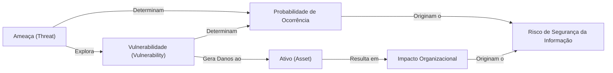
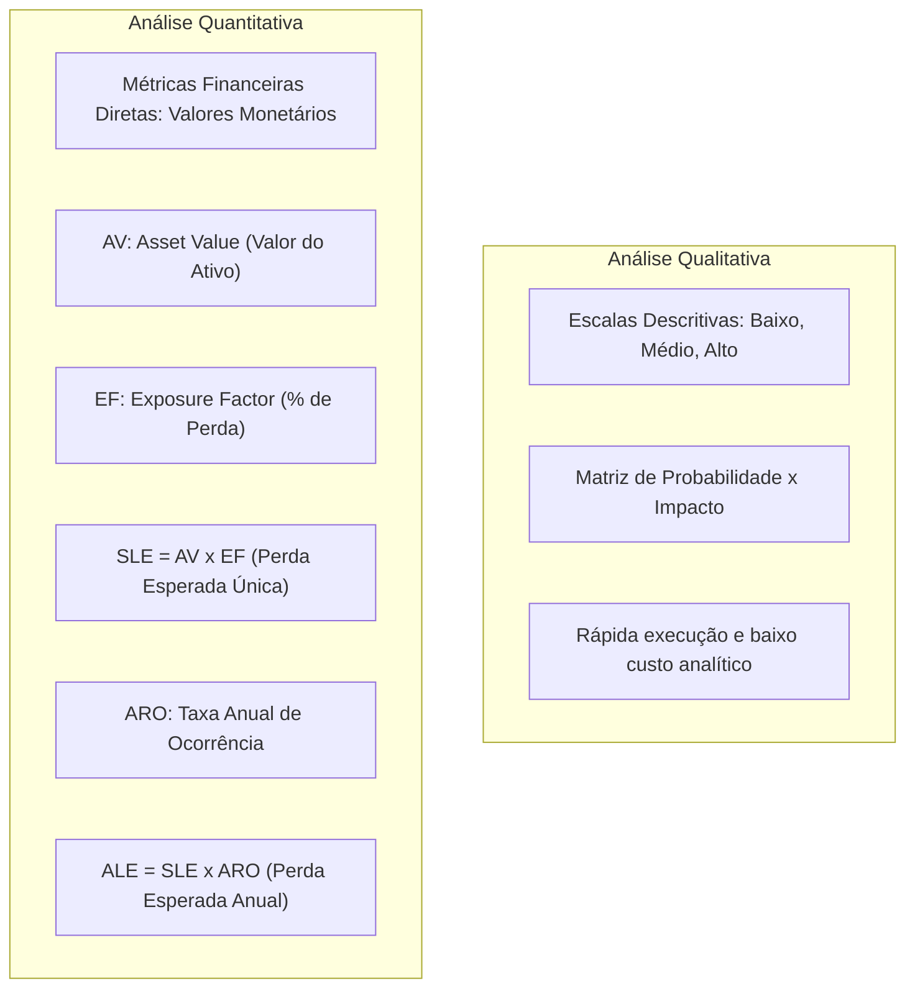
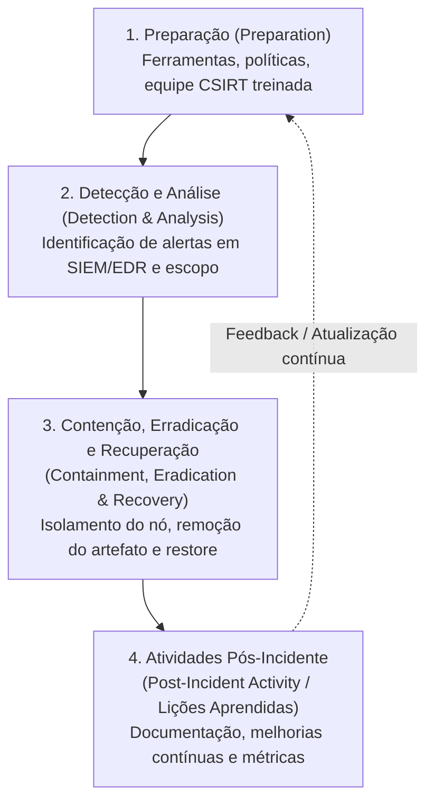
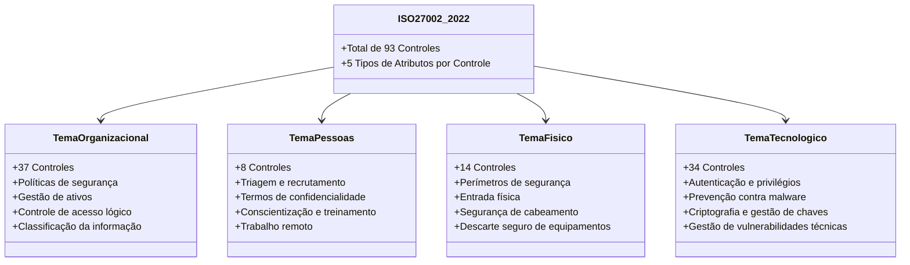

# 01 - Princípios, Gestão de Riscos e Normas ISO/IEC 27000

> **Matéria:** Segurança da Informação  
> **Cargo:** B02 – Técnico de Controle Externo – Especialidade: Tecnologia da Informação  
> **Arquivo:** `01_principios_gestao_de_riscos_e_normas_iso_27000.md`  

---

## 📌 Ementa / Itens do Edital
- Princípios fundamentais da segurança da informação: Confidencialidade, Integridade, Disponibilidade, Autenticidade e Não Repúdio (CIDAN)
- Classificação da informação e rotulagem
- Gestão de riscos de segurança da informação (avaliação e tratamento)
- Gestão de vulnerabilidades e resposta a incidentes de segurança
- Família de normas ABNT NBR ISO/IEC 27000 (com ênfase em ISO/IEC 27001, 27002 e 27005)

---

## 🌳 Classificação Hierárquica

```text
1. Princípios da Segurança, Governança de Riscos e Família ISO 27000
├── 1.1 Princípios Básicos da Segurança da Informação (CIDAN)
│   ├── 1.1.1 Confidencialidade: Garantia de que a informação não está disponível nem é revelada a pessoas, entidades ou processos não autorizados
│   ├── 1.1.2 Integridade: Salvaguarda da exatidão e completeza da informação e dos métodos de processamento (proteção contra alteração não autorizada)
│   ├── 1.1.3 Disponibilidade: Garantia de que os usuários autorizados têm acesso à informação e aos ativos correspondentes sempre que necessário
│   ├── 1.1.4 Autenticidade: Garantia da veracidade da identidade alegada da fonte ou do autor da informação
│   ├── 1.1.5 Não Repúdio (Irretratabilidade): Garantia de que o autor de uma ação ou transação não pode negar falsamente tê-la praticado perante terceiros
│   └── 1.1.6 Outros Atributos Complementares: Legalidade, Privacidade e Auditorabilidade (Accountability)
├── 1.2 Classificação e Rotulagem da Informação
│   ├── 1.2.1 Critérios de Sensibilidade e Impacto: Valor da informação, criticidade para o negócio e prejuízo decorrente de vazamento
│   ├── 1.2.2 Graus de Sigilo no Setor Público (Lei de Acesso à Informação - LAI / Lei nº 12.527/2011):
│   │   ├── Ultrassecreta (prazo máximo de restrição: 25 anos)
│   │   ├── Secreta (prazo máximo de restrição: 15 anos)
│   │   └── Reservada (prazo máximo de restrição: 5 anos)
│   └── 1.2.3 Classificação Corporativa Comum: Pública, Interna, Confidencial e Restrita/Secreta
├── 1.3 Gestão de Riscos de Segurança da Informação
│   ├── 1.3.1 Conceitos Elementares:
│   │   ├── Ativo (Asset): O que tem valor para a organização (dados, hardware, pessoas)
│   │   ├── Ameaça (Threat): Causa potencial de um incidente indesejado (hackers, desastres, erros humanos)
│   │   ├── Vulnerabilidade (Vulnerability): Fragilidade ou brecha de um ativo explorável por uma ameaça
│   │   └── Risco: A probabilidade de uma ameaça explorar uma vulnerabilidade vezes o impacto resultante (Risco = Probabilidade x Impacto)
│   ├── 1.3.2 Análise de Riscos: Qualitativa (matrizes de probabilidade x impacto: Alto, Médio, Baixo) vs. Quantitativa (SLE - Single Loss Expectancy, ARO - Annualized Rate of Occurrence, ALE - Annualized Loss Expectancy: ALE = SLE x ARO)
│   └── 1.3.3 Opções de Tratamento do Risco:
│       ├── Mitigar / Reduzir (implementar controles de segurança)
│       ├── Aceitar / Reter (assumir o risco residual formalmente)
│       ├── Transferir / Compartilhar (contratar seguros, terceirizar para nuvem especializada)
│       └── Evitar / Eliminar (descontinuar a atividade ou recurso que gera o risco)
├── 1.4 Gestão de Vulnerabilidades e Resposta a Incidentes
│   ├── 1.4.1 Ciclo de Gestão de Vulnerabilidades: Descoberta, categorização por severidade (CVSS - Common Vulnerability Scoring System), remediação (patches) e verificação
│   └── 1.4.2 Gestão de Incidentes de Segurança:
│       ├── Fases: Preparação, Detecção e Análise, Contenção, Erradicação, Recuperação e Atividades Pós-Incidente (Lições Aprendidas)
│       └── Equipes de Resposta a Incidentes de Segurança Cibernética (CSIRT / CERT)
└── 1.5 A Família de Normas ABNT NBR ISO/IEC 27000
    ├── 1.5.1 ISO/IEC 27000: Visão geral e vocabulário padrão da segurança da informação
    ├── 1.5.2 ISO/IEC 27001 (Requisitos do SGSI - Sistema de Gestão de Segurança da Informação):
    │   ├── Norma auditável e certificável; estrutura de alto nível (Anexo SL: Contexto, Liderança, Planejamento, Suporte, Operação, Avaliação de Desempenho e Melhoria)
    │   └── Ciclo PDCA (Plan, Do, Check, Act) aplicado à melhoria contínua da segurança
    ├── 1.5.3 ISO/IEC 27002 (Código de Práticas / Controles de Segurança - Edição Atualizada):
    │   ├── Estrutura moderna dividida em 4 temas de controles:
    │   │   ├── Controles Organizacionais (políticas, gestão de ativos, governança)
    │   │   ├── Controles de Pessoas (recrutamento, conscientização, trabalho remoto)
    │   │   ├── Controles Físicos (perímetro de segurança, salas seguras, cabos)
    │   │   └── Controles Tecnológicos (autenticação, controle de acesso, criptografia, logs)
    │   └── A Declaração de Aplicabilidade (SoA - Statement of Applicability)
    └── 1.5.4 ISO/IEC 27005: Diretrizes específicas para a gestão de riscos de segurança da informação
```

---

## 📖 Teoria Aprofundada & Pontos-Chave

### 1.1 Princípios Básicos da Segurança da Informação (CIDAN e Atributos Complementares)

A segurança da informação é definida pelas normas internacionais (ISO/IEC 27000) e pela literatura clássica como a preservação de propriedades essenciais aplicadas aos ativos de informação da organização. O mnemônico canônico adotado pela FCC é **CIDAN**:

1. **Confidencialidade (Confidentiality):**
   - Propriedade de que a informação não seja disponibilizada ou divulgada a indivíduos, entidades ou processos não autorizados.
   - *Ameaças típicas:* Espionagem industrial, interceptação de pacotes (*sniffing*), vazamento intencional ou acidental de dados, engenharia social.
   - *Mecanismos de defesa:* Criptografia simétrica/assimétrica, controle de acesso lógico estrito, mascaramento de dados (*data masking*).

2. **Integridade (Integrity):**
   - Propriedade de salvaguardar a exatidão e a completude dos ativos de informação e dos métodos de processamento. Protege a informação contra modificações, alterações, inserções ou exclusões não autorizadas ou acidentais.
   - *Ameaças típicas:* Adulteração maliciosa de registros em bases de dados fiscais/contábeis, injeção de dados corrompidos por malware (*tampering*), erros de transmissão em redes sem controle de erro.
   - *Mecanismos de defesa:* Funções de resumo criptográfico (*hashes* como SHA-256), assinaturas digitais, códigos de autenticação de mensagem (HMAC), somas de verificação (*checksums*).

3. **Disponibilidade (Availability):**
   - Propriedade de estar acessível e utilizável sob demanda por uma entidade autorizada sempre que necessário.
   - *Ameaças típicas:* Ataques de negação de serviço (DoS / DDoS), falhas físicas de hardware, incêndios em datacenters, pane elétrica, interrupção de enlaces de telecomunicações.
   - *Mecanismos de defesa:* Redundância de hardware e enlaces (alta disponibilidade - HA), clustering, balanceamento de carga, nobreaks e geradores, planos de recuperação de desastres (DRP) e backups periódicos.

4. **Autenticidade (Authenticity):**
   - Propriedade que assegura que uma entidade, mensagem ou recurso é de fato aquilo que alega ser. Confirma a legitimidade da autoria ou da origem da informação.
   - *Ameaças típicas:* Falsificação de remetente (*spoofing* de e-mail ou de IP), personificação de usuários legítimos (*impersonation*).
   - *Mecanismos de defesa:* Certificados digitais X.509, autenticação multifator (MFA), chaves criptográficas assimétricas.

5. **Não Repúdio / Irretratabilidade (Non-Repudiation):**
   - Capacidade de comprovar a ocorrência de um evento ou de uma ação e seus autores originários, de modo que o evento ou ação não possa ser negado perante terceiros ou instâncias jurídicas.
   - *Ameaças típicas:* Negação de autoria no envio de uma transação financeira, assinatura de ato administrativo contestada posteriormente.
   - *Mecanismos de defesa:* Assinatura digital ICP-Brasil com chave privada de uso exclusivo, carimbo do tempo (*timestamping* por ACT autorizada) e trilhas de auditoria imutáveis.

#### Atributos Complementares Frequentes em Provas:
- **Conformidade / Legalidade:** Aderência a leis, decretos, marcos regulatórios vigentes (ex.: LGPD, Marco Civil da Internet).
- **Auditorabilidade / Responsabilização (*Accountability*):** Capacidade de rastrear inequivocamente as ações executadas em um sistema até a entidade ou usuário responsável, por meio de logs de eventos cronológicos confiáveis.
- **Privacidade:** Garantia de que os dados pessoais de indivíduos sejam tratados em estrita observância à autodeterminação informativa e ao consentimento legal.

| Princípio | Pergunta Central de Segurança | O que previne/bloqueia? | Mecanismo Primário |
|---|---|---|---|
| **Confidencialidade** | *Quem tem permissão para ler?* | Visualização/leitura indevida | Criptografia, ACLs, DLP |
| **Integridade** | *O dado continua exato e original?* | Adulteração/modificação oculta | Hashes, HMAC, Assinatura Digital |
| **Disponibilidade** | *O recurso está operando quando solicitado?* | Paralisação, indisponibilidade | Redundância, HA, Backups, Anti-DDoS |
| **Autenticidade** | *A identidade alegada é verdadeira?* | Falsificação de autoria, Spoofing | Certificados Digitais, MFA |
| **Não Repúdio** | *O autor pode negar formalmente o envio?* | Alegação de repúdio posterior | Assinatura Digital + Carimbo do Tempo |

> ⭐ **IMPORTANTE / REGRA DE OURO:**  
> A FCC adora cobrar a distinção entre **Autenticidade** e **Não Repúdio**:
> - *Autenticidade* garante a **certeza de quem produziu** o dado.
> - *Não Repúdio* assegura que o autor **não pode negar juridicamente** ter produzido aquele dado (exige prova cabal que inviabiliza a contestação posterior).

---

### 1.2 Classificação e Rotulagem da Informação

A classificação da informação atribui rótulos aos dados com base em seu valor, criticidade legal e impacto em caso de divulgação indevida, permitindo que a organização aplique controles de proteção proporcionais.

#### No Setor Público Brasileiro (Lei de Acesso à Informação - Lei nº 12.527/2011)
A regra geral na Administração Pública é a **publicidade**; o sigilo é a **exceção**. As informações passíveis de restrição de acesso por colocarem em risco a segurança da sociedade e do Estado são classificadas em três graus solenes (Art. 24 da LAI):

| Grau de Sigilo | Prazo Máximo de Restrição | Competência Originária para Classificar (Exemplos) | Prorrogação |
|---|---|---|---|
| **Ultrassecreta** | **25 anos** | Presidente da República, Vice-Presidente, Ministros de Estado, Comandantes das Forças Armadas | Prorrogável **uma única vez**, por igual período, pela CMRI (Comissão Mista de Reavaliação de Informações) |
| **Secreta** | **15 anos** | Titulares de autarquias, fundações e órgãos sob a mesma alçada legal | Não prorrogável além de 15 anos |
| **Reservada** | **5 anos** | Autoridades que exerçam funções de direção, comando ou chefia | Não prorrogável além de 5 anos |

> 🚨 **ALERTA DE PROVA / PEGADINHA FCC:**  
> Guarde a sequência decrescente dos prazos da LAI: **25 anos (Ultrassecreta)** $\rightarrow$ **15 anos (Secreta)** $\rightarrow$ **5 anos (Reservada)**.  
> Uma pegadinha clássica da FCC é inverter os prazos de Secreta (15) e Reservada (5), ou inventar prazos inexistentes como 10 ou 20 anos.  
> Lembre-se também: informações pessoais relativas à intimidade, vida privada, honra e imagem têm restrição de acesso máxima de **até 100 anos** a contar da data de sua produção (Art. 31 da LAI), não se confundindo com os prazos de segurança de Estado.

#### No Ambiente Corporativo Geral (Padrão ISO 27002):
- **Pública:** Divulgação irrestrita sem danos à instituição (ex.: editais, relatórios anuais).
- **Interna:** Uso restrito aos servidores e colaboradores; vazamento gera transtorno mínimo.
- **Confidencial:** Dados estratégicos corporativos restritos a grupos funcionais específicos; vazamento gera dano financeiro ou operacional expressivo.
- **Restrita / Secreta:** Nível máximo de proteção confidencial; vazamento gera danos catastróficos imediatos ao negócio.

---

### 1.3 Gestão de Riscos de Segurança da Informação

A tríade de elementos conceituais que compõem o risco em segurança da informação é:
- **Ativo (*Asset*):** Qualquer item tangível ou intangível que tenha valor para a organização (servidores, dados de contribuintes, aplicações, credibilidade, colaboradores).
- **Ameaça (*Threat*):** Causa potencial de um incidente indesejado que pode resultar em dano a um ativo ou organização (invasores, malware, enchentes, quedas de energia, erro operacional humano).
- **Vulnerabilidade (*Vulnerability*):** Fraqueza, fragilidade ou falha em um ativo ou controle que pode ser explorada por uma ou mais ameaças (software sem atualização de segurança, configuração padrão com senha em branco, ausência de treinamento de pessoal).
- **Impacto (*Impact*):** Consequência adversa resultante da concretização de uma ameaça sobre um ativo.
- **Probabilidade / Verossimilhança (*Likelihood*):** Chance avaliada de que uma ameaça explore com sucesso uma dada vulnerabilidade.

O risco é formalizado pela relação:
$$\text{Risco} = f(\text{Probabilidade}, \text{Impacto})$$



#### Risco Inerente vs. Risco Residual
- **Risco Inerente (*Inherent Risk*):** Nível de risco existente em seu estado bruto, antes da implementação de qualquer controle de segurança mitigador.
- **Risco Residual (*Residual Risk*):** Nível de risco remanescente após o projeto, implementação e operação dos controles de segurança selecionados. A organização deve assegurar que o risco residual esteja dentro de seu **Apetite a Risco** (*Risk Appetite*).

#### Análise Qualitativa vs. Análise Quantitativa



#### Fórmulas da Análise Quantitativa:
1. **SLE (*Single Loss Expectancy* - Expectativa de Perda Única):**
   $$\text{SLE} = \text{AV} \times \text{EF}$$
   Onde:
   - $\text{AV}$ (*Asset Value*): Valor financeiro do ativo.
   - $\text{EF}$ (*Exposure Factor*): Fator de exposição (porcentagem do valor do ativo perdida em um único evento adverso, variando de 0% a 100%).
2. **ALE (*Annualized Loss Expectancy* - Expectativa de Perda Anual):**
   $$\text{ALE} = \text{SLE} \times \text{ARO}$$
   Onde:
   - $\text{ARO}$ (*Annualized Rate of Occurrence*): Frequência anual estimada da ocorrência do incidente (ex.: se ocorre 1 vez a cada 4 anos, $\text{ARO} = 0{,}25$; se ocorre 2 vezes ao ano, $\text{ARO} = 2$).
3. **Análise Custo-Benefício do Controle (CBA - *Cost-Benefit Analysis*):**
   $$\text{Valor do Controle} = (\text{ALE}_{\text{antes}} - \text{ALE}_{\text{depois}}) - \text{ACS}$$
   Onde $\text{ACS}$ (*Annualized Cost of Safeguard*) é o custo anual de manutenção do controle de segurança. Se o valor for positivo, o investimento é economicamente viável.

#### Opções Canônicas de Tratamento do Risco (ISO/IEC 27005):
1. **Mitigar / Reduzir (*Risk Mitigation / Reduction*):** Implementar controles de segurança (técnicos, administrativos ou físicos) para reduzir a probabilidade e/ou o impacto do risco até um nível aceitável.
2. **Aceitar / Reter (*Risk Acceptance / Retention*):** Manter o risco no nível atual sem controles adicionais, após aprovação formal fundamentada da alta administração, quando o custo da salvaguarda for superior à perda potencial.
3. **Transferir / Compartilhar (*Risk Transfer / Sharing*):** Repassar parte da responsabilidade financeira ou operacional do impacto para um terceiro (ex.: contratação de apólice de seguro cibernético ou contratação de serviço em nuvem com SLA estrito).
4. **Evitar / Eliminar (*Risk Avoidance*):** Descontinuar a atividade, processo ou ativo que dá origem ao risco (ex.: desativar um sistema legado excessivamente vulnerável).

---

### 1.4 Gestão de Vulnerabilidades e Ciclo de Resposta a Incidentes

#### Sistema de Pontuação de Vulnerabilidades (CVSS - Common Vulnerability Scoring System)
O padrão CVSS avalia a gravidade técnica de vulnerabilidades de segurança da informação em uma escala de 0,0 a 10,0 dividida em três grupos de métricas:
- **Métricas de Base (*Base Metrics*):** Qualidades intrínsecas constantes ao longo do tempo e em diferentes ambientes (Vetor de Ataque - AV, Complexidade do Ataque - AC, Privilégios Exigidos - PR, Interação do Usuário - UI, Escopo - S, Impactos na Confidencialidade - C, Integridade - I e Disponibilidade - A).
- **Métricas Temporais (*Temporal Metrics*):** Características que mudam no decorrer do tempo (disponibilidade de exploit, nível de remediação oficial).
- **Métricas Ambientais (*Environmental Metrics*):** Peculiaridades do ambiente específico de TI da organização.

Faixas de Severidade CVSS v3.1:
- **None:** 0.0
- **Low (Baixa):** 0.1 a 3.9
- **Medium (Média):** 4.0 a 6.9
- **High (Alta):** 7.0 a 8.9
- **Critical (Crítica):** 9.0 a 10.0

#### Ciclo de Vida de Resposta a Incidentes de Segurança (NIST SP 800-61 Rev. 2)



1. **Preparação:** Criação e capacitação da equipe de resposta a incidentes (CSIRT/CERT), elaboração de planos de comunicação, implantação de ferramentas de monitoramento e análise forense.
2. **Detecção e Análise:** Monitoramento contínuo de logs, alertas de IDS/IPS/SIEM, determinação dos vetores de ataque e confirmação do incidente.
3. **Contenção, Erradicação e Recuperação:**
   - *Contenção:* Isolar sistemas comprometidos (ex.: desconectar da rede) para evitar proliferação do ataque.
   - *Erradicação:* Eliminar os artefatos maliciosos (remover malwares, fechar portas, sanear contas violadas).
   - *Recuperação:* Restaurar sistemas para operação normal a partir de backups confiáveis, validando a integridade.
4. **Atividades Pós-Incidente (Lições Aprendidas):** Reunião formal para discutir o que funcionou e o que falhou, alimentando a fase de preparação para incidentes futuros.

---

### 1.5 Família de Normas ABNT NBR ISO/IEC 27000

A família ISO/IEC 27000 provê um arcabouço internacionalmente reconhecido para a gestão da segurança da informação:
- **ISO/IEC 27000:** Visão geral da família e vocabulário formal com termos padronizados.
- **ISO/IEC 27001 (Requisitos do SGSI):** Norma formal de **requisitos**. É a **única norma auditável e certificável** da família para organizações.
- **ISO/IEC 27002 (Código de Práticas):** Conjunto de diretrizes e boas práticas para implementação dos controles de segurança da informação selecionados no Anexo A da ISO 27001. **Não é certificável isoladamente.**
- **ISO/IEC 27005:** Fornece diretrizes e técnicas para o processo de **gestão de riscos** de segurança da informação no contexto de um SGSI.

#### Estrutura de Alto Nível da ISO/IEC 27001 (Anexo SL)
A norma adota a estrutura harmonizada das normas de gestão ISO (Cláusulas 4 a 10):
- Cláusula 4: Contexto da Organização
- Cláusula 5: Liderança e Comprometimento
- Cláusula 6: Planejamento (Ações para riscos e oportunidades, objetivos de segurança)
- Cláusula 7: Apoio (Recursos, competência, conscientização, comunicação)
- Cláusula 8: Operação (Planejamento operacional e avaliação/tratamento de riscos)
- Cláusula 9: Avaliação de Desempenho (Monitoramento, medição, auditoria interna e análise crítica pela direção)
- Cláusula 10: Melhoria (Não conformidades, ações corretivas e melhoria contínua)

#### A Nova Estrutura da ISO/IEC 27002 (Edição 2022)
A versão anterior (2013) possuía 114 controles distribuídos em 14 domínios. A nova versão consolidou os controles em **93 controles**, agrupados em apenas **4 grandes temas**:



#### A Declaração de Aplicabilidade (SoA - *Statement of Applicability*)
Documento formal obrigatório exigido pela norma ISO/IEC 27001 no qual a organização lista:
1. Todos os controles de segurança do Anexo A avaliados;
2. Se cada controle foi considerado aplicável ou não ao escopo do SGSI da organização;
3. As justificativas técnicas/negociais para inclusão de cada controle aplicável;
4. O estado atual de implementação dos controles aplicáveis;
5. A justificativa formal para a eventual exclusão de qualquer controle.

---

## 🌐 Fontes Recomendadas na Internet

### 1. Padrões Internacionais e Normativos de Segurança
- [ISO/IEC 27001:2022 & 27002:2022 Overview (ISO.org)](https://www.iso.org/standard/27001): Visão geral oficial sobre a estrutura do Sistema de Gestão de Segurança da Informação (SGSI), cláusulas do Anexo SL e os 4 domínios de controles da nova ISO 27002 (*Organizacionais*, *Pessoas*, *Físicos* e *Tecnológicos*).
- [NIST Special Publication 800-61 Rev. 2 - Computer Security Incident Handling Guide](https://csrc.nist.gov/publications/detail/sp/800-61/rev-2/final): Padrão de referência do NIST definindo as 4 fases do ciclo de vida de resposta a incidentes de segurança cibernética.
- [Lei de Acesso à Informação - Lei nº 12.527/2011 (Planalto)](https://www.planalto.gov.br/ccivil_03/_ato2011-2014/2011/lei/l12527.htm): Texto legal oficial que estipula no Art. 24 a classificação da informação em graus de sigilo: reservada (5 anos), secreta (15 anos) e ultrassecreta (25 anos).

### 2. Guias Práticos Nacionais e frameworks
- [Cartilha de Segurança para a Internet (CERT.br / NIC.br)](https://cartilha.cert.br/): Material didático oficial nacional cobrindo os pilares de segurança da informação (CIDAN), boas práticas de proteção e resposta a incidentes.
- [FIRST - CVSS v3.1 Specification Guide](https://www.first.org/cvss/v3.1/specification-document): Especificação técnica oficial das métricas e fórmulas de cálculo de severidade de vulnerabilidades.

---

## 📝 Questões Comentadas & Exemplos

### Questão 1 (FCC - Adaptada / TI - Princípios Básicos de Segurança da Informação)
Durante uma auditoria de conformidade em um sistema eletrônico de protocolo processual do Tribunal de Contas, os auditores avaliaram a eficácia de diferentes mecanismos de segurança da informação.

Relacione as situações práticas descritas a seguir com o princípio fundamental de segurança correspondente (CIDAN):
1. Garantir que um documento processual contábil emitido por um conselheiro não tenha seu conteúdo adulterado ou corrompido durante a transmissão na rede.
2. Garantir que dados fiscais sigilosos de contribuintes sob sigilo legal não sejam visualizados por servidores públicos não autorizados.
3. Garantir que o remetente de um ofício eletrônico assinado com certificado digital ICP-Brasil não possa negar falsamente, perante a administração e a justiça, a autoria do envio daquele documento.

As situações 1, 2 e 3 correspondem, respectivamente, aos princípios de:
A) Autenticidade; Disponibilidade; e Confidencialidade.  
B) Integridade; Confidencialidade; e Não Repúdio (Irretratabilidade).  
C) Confidencialidade; Integridade; e Autenticidade.  
D) Disponibilidade; Legalidade; e Não Repúdio.  
E) Integridade; Autenticidade; e Disponibilidade.

> **Gabarito: B**  
> **Comentário Analítico Passo a Passo:**  
> - **Análise da Situação 1:** Trata da preservação da exatidão e da completude do documento contábil, impedindo adulteração ou corrupção de conteúdo. Esse é o conceito exato de **Integridade**.  
> - **Análise da Situação 2:** Trata do impedimento de visualização e leitura por pessoas não autorizadas, mantendo o sigilo legal dos dados. Esse é o conceito exato de **Confidencialidade**.  
> - **Análise da Situação 3:** Trata da impossibilidade jurídica e técnica de o autor negar a emissão do ato praticado perante terceiros. Trata-se do princípio de **Não Repúdio** (ou Irretratabilidade).  
> 
> **Análise das Alternativas:**  
> - **A está INCORRETA:** Confunde a situação 1 com Autenticidade (que atesta quem é o autor, e não a integridade do conteúdo) e a situação 2 com Disponibilidade (que diz respeito ao sistema estar no ar).  
> - **B está CORRETA:** Mapeia com rigor e precisão as três propriedades fundamentais: 1 = Integridade, 2 = Confidencialidade e 3 = Não Repúdio.  
> - **C está INCORRETA:** Inverteu as situações 1 e 2 (colocou Confidencialidade no lugar de Integridade) e associou erroneamente a situação 3 a Autenticidade em vez de Não Repúdio.  
> - **D está INCORRETA:** Aponta Disponibilidade para a situação 1 e introduz Legalidade para a situação 2, desvirtuando o mnemônico clássico CIDAN.  
> - **E está INCORRETA:** Embora acerte a primeira situação (Integridade), erra a segunda e a terceira, associando-as respectivamente a Autenticidade e Disponibilidade.

---

### Questão 2 (FCC - Adaptada / TI - Gestão de Riscos e Normas ISO/IEC 27000)
A respeito dos conceitos de gestão de riscos e da família de normas ABNT NBR ISO/IEC 27000, assinale a afirmativa correta:
A) Uma vulnerabilidade é o agente externo causador do dano (como um invasor ou uma tempestade), enquanto a ameaça é a falha ou brecha interna de um sistema.  
B) A norma ABNT NBR ISO/IEC 27001 é um padrão certificável que define os requisitos para estabelecer, implementar, manter e melhorar continuamente um Sistema de Gestão de Segurança da Informação (SGSI), estruturado nas cláusulas de alto nível harmonizadas e no ciclo PDCA.  
C) A edição atualizada da norma ISO/IEC 27002 organiza seus controles em 14 domínios tecnológicos idênticos aos da versão de 2005, proibindo expressamente o tratamento de controles organizacionais e de pessoas.  
D) O cálculo do risco quantitativo Annualized Loss Expectancy (ALE) é obtido somando-se a taxa anual de ocorrência (ARO) com a metade do patrimônio líquido da organização.  
E) A opção de tratamento de risco denominada "Aceitação" consiste em instalar firewalls redundantes e sistemas IPS para zerar o risco residual.

> **Gabarito: B**  
> **Comentário Analítico Passo a Passo:**  
> - **A está INCORRETA:** A FCC inverteu os conceitos nucleares de análise de riscos: a **vulnerabilidade** é a fraqueza interna ou brecha explorável do ativo (ex.: sistema desatualizado); a **ameaça** é o agente ou evento externo que tem o potencial de explorar essa fragilidade (ex.: hacker, raio, terremoto).  
> - **B está CORRETA:** A **ABNT NBR ISO/IEC 27001** é o padrão formal que prescreve os **requisitos** do SGSI (*Sistema de Gestão de Segurança da Informação*). É a única norma da família 27000 passível de certificação formal para organizações, apoiando-se no ciclo PDCA e no Anexo SL.  
> - **C está INCORRETA:** A norma ISO/IEC 27002:2022 consolidou os antigos 14 domínios em **4 temas integrados**: Organizacionais (37 controles), Pessoas (8 controles), Físicos (14 controles) e Tecnológicos (34 controles), totalizando 93 controles.  
> - **D está INCORRETA:** A fórmula da análise quantitativa é a multiplicação: $\text{ALE} = \text{SLE} \times \text{ARO}$ (*Single Loss Expectancy* multiplicada pelo *Annualized Rate of Occurrence*), e não uma soma envolvendo o patrimônio líquido.  
> - **E está INCORRETA:** A aceitação do risco (*Risk Acceptance*) não adiciona controles técnicos nem visa zerar riscos; ela consiste na decisão formal e consciente da administração de assumir o risco residual sem novas salvaguardas quando o custo de mitigação supera as perdas esperadas.

---

### Questão 3 (FCC - Adaptada / TI - Análise Quantitativa de Riscos)
Durante o processo de avaliação quantitativa de riscos de um banco de dados do Tribunal de Contas avaliado em R$ 400.000,00, a equipe de segurança apurou que um ataque cibernético de ransomware causaria uma perda direta de 40% sobre o valor desse ativo. O histórico de segurança do órgão e os relatórios de inteligência de ameaças apontam que a taxa anual estimada de ocorrência desse tipo de incidente para órgãos do mesmo porte é de 0,25 vezes por ano (isto é, 1 incidente a cada 4 anos).

Com base nas métricas clássicas de análise quantitativa de risco ($\text{SLE}$, $\text{ARO}$ e $\text{ALE}$), assinale a opção que apresenta, respectivamente, o valor da Expectativa de Perda Única ($\text{SLE}$) e da Expectativa de Perda Anual ($\text{ALE}$):
A) R$ 160.000,00 e R$ 40.000,00.  
B) R$ 40.000,00 e R$ 160.000,00.  
C) R$ 240.000,00 e R$ 60.000,00.  
D) R$ 100.000,00 e R$ 25.000,00.  
E) R$ 160.000,00 e R$ 80.000,00.

> **Gabarito: A**  
> **Comentário Analítico Passo a Passo:**  
> - **1. Identificação das variáveis fornecidas pelo enunciado:**
>   - Valor do Ativo ($\text{AV}$ - *Asset Value*) = R$ 400.000,00
>   - Fator de Exposição ($\text{EF}$ - *Exposure Factor*) = 40% = $0{,}40$
>   - Taxa Anual de Ocorrência ($\text{ARO}$ - *Annualized Rate of Occurrence*) = $0{,}25$
> - **2. Cálculo da Expectativa de Perda Única (SLE):**  
>   $\text{SLE} = \text{AV} \times \text{EF} = 400.000 \times 0{,}40 = 160.000,00$ (ou seja, R$ 160.000,00)  
> - **3. Cálculo da Expectativa de Perda Anual (ALE):**  
>   $\text{ALE} = \text{SLE} \times \text{ARO} = 160.000 \times 0{,}25 = 40.000,00$ (ou seja, R$ 40.000,00)  
> 
> **Análise das Alternativas:**  
> - **A está CORRETA:** Apresenta com exatidão $\text{SLE} =$ R$ 160.000,00 e $\text{ALE} =$ R$ 40.000,00. Isso significa que o tribunal não deve gastar anualmente mais do que R$ 40.000,00 em controles projetados exclusivamente para mitigar essa ameaça específica.  
> - **B está INCORRETA:** Inverteu os valores de $\text{SLE}$ e $\text{ALE}$.  
> - **C está INCORRETA:** Calculou o valor residual do ativo após o ataque (R$ 240.000,00, correspondente a 60%) em vez do valor da perda efetiva ($\text{EF} = 40\%$).  
> - **D está INCORRETA:** Utilizou incorretamente 25% para o cálculo do $\text{SLE}$, confundindo a porcentagem com o valor do $\text{ARO}$.  
> - **E está INCORRETA:** Acertou o $\text{SLE}$ (R$ 160.000,00), mas errou o cálculo do $\text{ALE}$, aplicando um $\text{ARO}$ hipotético de 0,50 em vez de 0,25.

---

### Questão 4 (FCC - Adaptada / TI - Classificação da Informação e Prazos da LAI)
A Lei Federal nº 12.527/2011 (Lei de Acesso à Informação - LAI) dispõe sobre os procedimentos a serem observados pela União, Estados, DF e Municípios com o fim de garantir o acesso a informações públicas, estabelecendo regras para a classificação e proteção de dados que exijam restrição de acesso por motivos de segurança da sociedade ou do Estado.

Considere as seguintes assertivas sobre os graus de sigilo e prazos previstos na LAI:
I. A classificação de uma informação como reservada impõe restrição de acesso pelo prazo máximo de 5 anos.  
II. A informação classificada como secreta possui prazo máximo de restrição de 15 anos, sendo admitida prorrogação automática e ilimitada por sucessivos períodos de 10 anos.  
III. O prazo máximo de restrição de acesso à informação ultrassecreta é de 25 anos, podendo ser prorrogado uma única vez, por igual período, por decisão privativa da Comissão Mista de Reavaliação de Informações (CMRI).

Está correto o que se afirma em:
A) I, apenas.  
B) I e II, apenas.  
C) I e III, apenas.  
D) II e III, apenas.  
E) I, II e III.

> **Gabarito: C**  
> **Comentário Analítico Passo a Passo:**  
> - **Item I (Correto):** O Art. 24, § 1º, inciso III da LAI estabelece que o prazo máximo de restrição para a informação classificada no grau **reservado** é de **5 anos**.  
> - **Item II (Incorreto):** O Art. 24, § 1º, inciso II da LAI fixa o prazo máximo de **15 anos** para o grau **secreto**. Contudo, a lei **não admite prorrogação automática e ilimitada**; prazos de sigilo devem ser rigorosamente temporários e delimitados para assegurar a publicidade como regra geral.  
> - **Item III (Correto):** Conforme o Art. 24, § 1º, inciso I c/c o Art. 35, § 1º da LAI, a informação **ultrassecreta** submete-se ao prazo de **25 anos**, podendo ser prorrogada **por uma única vez e por igual período** (até 50 anos no total) exclusivamente pela CMRI.  
> 
> **Análise das Alternativas:**  
> - **A está INCORRETA:** O Item III também é rigorosamente verdadeiro.  
> - **B está INCORRETA:** O Item II comete grave erro doutrinário ao afirmar a existência de prorrogações automáticas e ilimitadas.  
> - **C está CORRETA:** Identifica com precisão que os itens I e III estão corretos, enquanto o item II está incorreto.  
> - **D está INCORRETA:** Inclui o Item II, que é flagrantemente falso.  
> - **E está INCORRETA:** Considera os três itens corretos, ignorando a impropriedade jurídica contida no Item II.

---

### Questão 5 (FCC - Adaptada / TI - Resposta a Incidentes de Segurança / NIST SP 800-61)
De acordo com o guia de boas práticas para tratamento de incidentes de segurança cibernética do NIST (NIST SP 800-61 Rev. 2) e as diretrizes da norma ISO/IEC 27035, um incidente cibernético confirmado deve ser processado segundo um ciclo estruturado de fases operacionais.

Ao detectar a proliferação acelerada de um malware em sua rede corporativa, a equipe de segurança da informação procedeu imediatamente com o isolamento físico dos servidores comprometidos através do desligamento das portas de switch correspondentes, com o intuito de conter a ameaça e evitar que outros nós fossem atingidos.

A referida ação operacional executada pela equipe insere-se formalmente na fase de:
A) Preparação.  
B) Detecção e Análise.  
C) Contenção.  
D) Atividades Pós-Incidente (Lições Aprendidas).  
E) Classificação de Ativos.

> **Gabarito: C**  
> **Comentário Analítico Passo a Passo:**  
> - **Fase 1: Preparação:** Envolve atividades prévias ao incidente (treinamento, aquisição de ferramentas, definição de políticas e criação do CSIRT). Não envolve a ação em tempo real descrita.  
> - **Fase 2: Detecção e Análise:** Trata da coleta e avaliação de evidências (análise de alertas, logs do SIEM, tráfego de rede) para confirmar a existência do incidente e estimar seu escopo.  
> - **Fase 3: Contenção, Erradicação e Recuperação:**  
>   - A **Contenção (*Containment*)** visa frear o avanço do dano e impedir que o incidente se alastre para outros ativos (ex.: segmentar a rede, bloquear portas de switch, isolar hosts infectados).  
>   - A *Erradicação* consiste em eliminar o malware dos hosts afetados.  
>   - A *Recuperação* restaura os sistemas ao estado produtivo normal.  
> - **Fase 4: Atividades Pós-Incidente:** Foco na análise de lições aprendidas após o encerramento do evento.  
> 
> **Análise das Alternativas:**  
> - **A está INCORRETA:** A preparação é uma fase preliminar de prontidão defensiva, que antecede a ocorrência do ataque.  
> - **B está INCORRETA:** A detecção e análise já haviam ocorrido previamente, pois o malware já havia sido detectado e seu avanço constatado.  
> - **C está CORRETA:** A atitude de isolar sistemas comprometidos, bloquear portas de switch ou desconectar cabos de rede é a essência da **Contenção**, cujo objetivo primário é estancar a disseminação e limitar a área de impacto (*blast radius*) do ataque.  
> - **D está INCORRETA:** As lições aprendidas ocorrem somente após a recuperação completa do incidente, para documentar melhorias no processo.  
> - **E está INCORRETA:** Classificação de ativos é um processo de governança de riscos, não integrando as fases do ciclo de resposta a incidentes do NIST.
