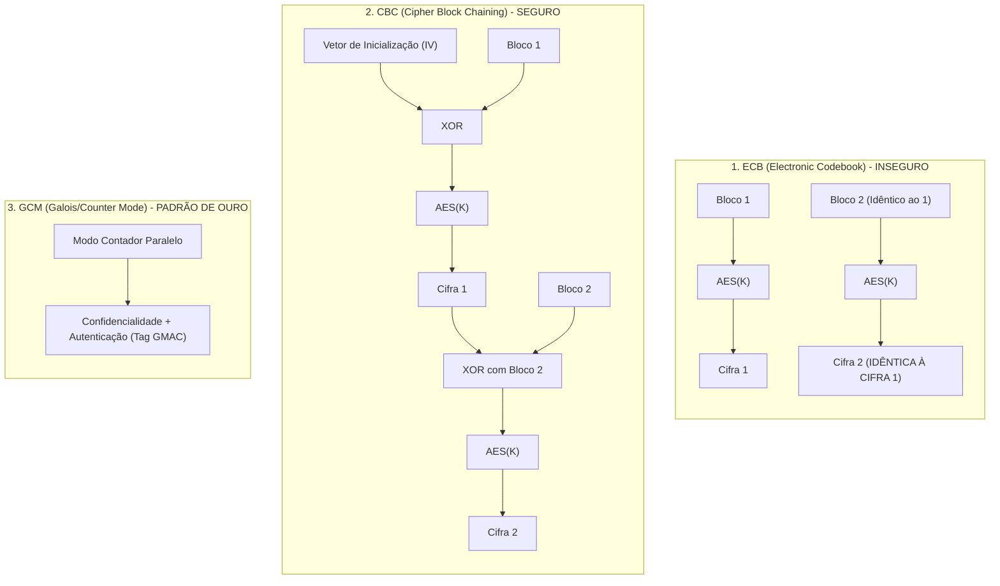
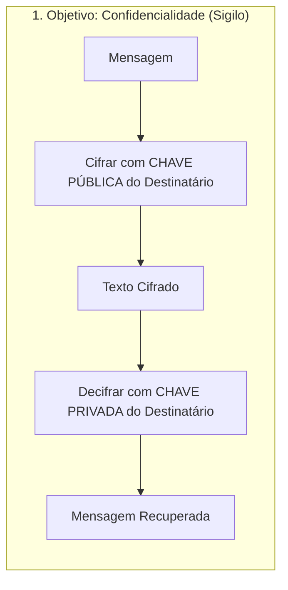
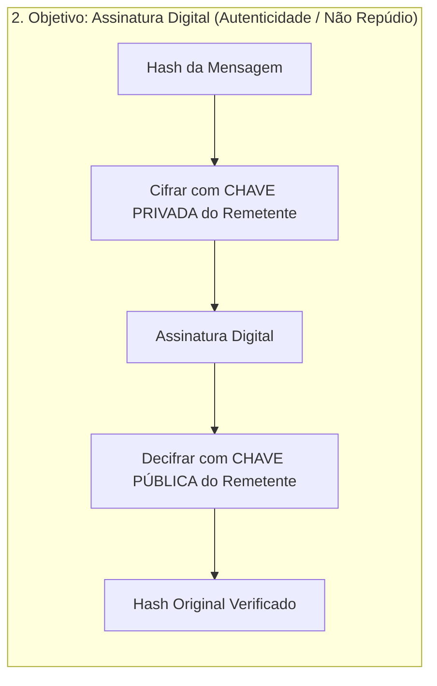
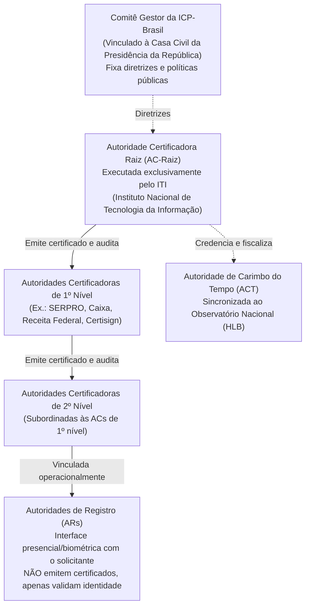
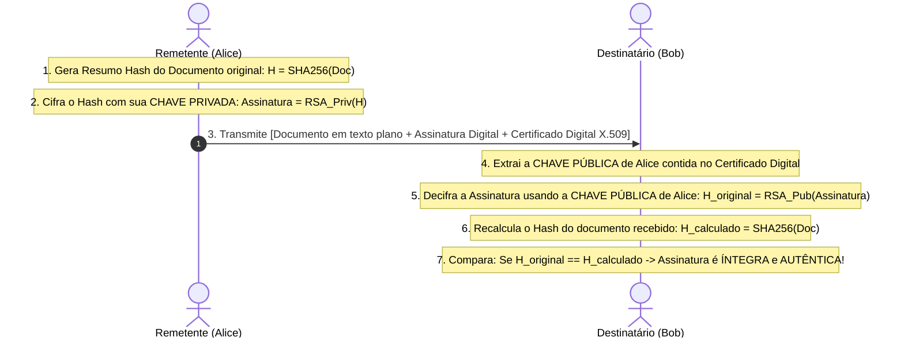

# 02 - Criptografia, ICP-Brasil e Assinatura Digital

> **Matéria:** Segurança da Informação  
> **Cargo:** B02 – Técnico de Controle Externo – Especialidade: Tecnologia da Informação  
> **Arquivo:** `02_criptografia_icp_brasil_e_assinatura_digital.md`  

---

## 📌 Ementa / Itens do Edital
- Criptografia Simétrica (algoritmos e modos de operação)
- Criptografia Assimétrica (par de chaves pública e privada)
- Funções de dispersão criptográfica (Hash)
- Infraestrutura de Chaves Públicas (PKI / ICP-Brasil)
- Certificados Digitais padrão X.509
- Mecanismo, validade jurídica e padrões de Assinatura Digital

---

## 🌳 Classificação Hierárquica

```text
2. Criptografia Aplicada, Infraestrutura de Chaves Públicas e Assinatura Digital
├── 2.1 Criptografia Simétrica (Chave Secreta Compartilhada)
│   ├── 2.1.1 Princípio: A mesma chave secreta é utilizada tanto para cifrar quanto para decifrar a mensagem
│   ├── 2.1.2 Vantagens e Desafios: Extremamente rápida e eficiente para grandes volumes de dados; problema da distribuição segura de chaves (N(N-1)/2 chaves necessárias para N usuários)
│   ├── 2.1.3 Cifras de Bloco (Block Ciphers):
│   │   ├── AES (Advanced Encryption Standard: Rijndael - tamanhos de chave de 128, 192 e 256 bits; padrão moderno)
│   │   ├── DES (56 bits - obsoleto/inseguro) e 3DES (Triple DES)
│   │   └── Modos de Operação de Bloco:
│   │       ├── ECB (Electronic Codebook): Inseguro; blocos idênticos geram cifras idênticas (vaza padrões)
│   │       ├── CBC (Cipher Block Chaining): Usa vetor de inicialização (IV) e encadeia blocos anteriores com XOR
│   │       └── GCM (Galois/Counter Mode): Fornece criptografia autenticada com integridade (AEAD) em alta velocidade
│   └── 2.1.4 Cifras de Fluxo (Stream Ciphers): Cifra bit a bit (ex.: ChaCha20, RC4 - obsoleto)
├── 2.2 Criptografia Assimétrica (Chave Pública)
│   ├── 2.2.1 Princípio: Utiliza um par de chaves matematicamente correlacionadas:
│   │   ├── Chave Pública: Amplamente divulgada; qualquer um pode usar para cifrar ou verificar assinaturas
│   │   └── Chave Privada: Mantida sob sigilo absoluto do titular; usada para decifrar ou gerar assinaturas
│   ├── 2.2.2 Algoritmos Assimétricos Principais:
│   │   ├── RSA (Rivest-Shamir-Adleman): Baseado na dificuldade matemática de fatorar o produto de dois grandes números primos
│   │   ├── Criptografia de Curva Elíptica (ECC - Elliptic Curve Cryptography): Proporciona o mesmo nível de segurança do RSA com chaves muito menores (ex.: 256 bits de ECC ≈ 3072 bits de RSA)
│   │   └── Diffie-Hellman (DH / ECDH): Protocolo de acordo e troca segura de chaves simétricas sobre canal inseguro
│   └── 2.2.3 Criptografia Híbrida: O melhor dos dois mundos (o algoritmo assimétrico negocia uma chave de sessão simétrica efêmera, e os dados massivos são transmitidos cifrados com AES)
├── 2.3 Funções de Resumo Criptográfico (Hash)
│   ├── 2.3.1 Propriedades Fundamentais:
│   │   ├── Tamanho de saída fixo (independente do tamanho da entrada)
│   │   ├── Unidirecionalidade (dado o hash, é computacionalmente inviável encontrar a mensagem original)
│   │   ├── Efeito Avalanche (uma alteração mínima de 1 bit na entrada muda drasticamente o hash resultante)
│   │   └── Resistência a Colisões (inviável encontrar duas entradas diferentes que gerem o mesmo hash)
│   └── 2.3.2 Algoritmos: SHA-2 (SHA-256, SHA-512), SHA-3 e algoritmos vulneráveis a colisões descontinuados (MD5, SHA-1)
├── 2.4 Infraestrutura de Chaves Públicas e ICP-Brasil
│   ├── 2.4.1 Modelo de Confiança e Estrutura Hierárquica da ICP-Brasil (Medida Provisória nº 2.200-2/2001):
│   │   ├── Comitê Gestor da ICP-Brasil: Formulação de políticas e diretrizes
│   │   ├── Autoridade Certificadora Raiz (AC-Raiz): Executada pelo Instituto Nacional de Tecnologia da Informação (ITI)
│   │   ├── Autoridades Certificadoras (ACs de 1º e 2º nível): Emitem, suspendem e revogam certificados
│   │   └── Autoridades de Registro (ARs): Entidades de atendimento que validam presencialmente/biometricamente a identidade física do titular
│   ├── 2.4.2 Certificados Digitais Padrão X.509 v3:
│   │   ├── Campos do Certificado: Versão, número de série, algoritmo, emissor (Issuer), período de validade, titular (Subject), chave pública do titular e assinatura da AC
│   │   ├── Validação: Cadeia de confiança até a raiz e checagem de revogação via LCR (Lista de Certificados Revogados) ou OCSP (Online Certificate Status Protocol)
│   │   └── Tipos de Certificados na ICP-Brasil:
│   │       ├── Série A (Assinatura): A1 (arquivo de software, validade 1 ano) vs. A3 (dispositivo criptográfico físico - smartcard ou token USB / HSM, validade até 5 anos)
│   │       └── Série S (Sigilo) e Série T (Tempo / Carimbo do Tempo)
│   └── 2.5 Assinatura Digital
│       ├── 2.5.1 Mecânica Técnica de Geração e Verificação:
│       │   ├── Geração: Remetente calcula o Hash do documento -> Criptografa o Hash com sua CHAVE PRIVADA -> Anexa o resultado ao documento
│       │   └── Verificação: Destinatário decifra o hash usando a CHAVE PÚBLICA do remetente -> Recalcula o hash do documento -> Se os hashes forem idênticos, a assinatura é válida
│       ├── 2.5.2 Princípios Garantidos pela Assinatura Digital: Integridade, Autenticidade e Não Repúdio (NÃO garante confidencialidade por si só, a menos que o documento também seja cifrado!)
│       ├── 2.5.3 Padrões de Assinatura Avançada: CAdES (binário genérico), XAdES (baseado em XML) e PAdES (embutido nativamente em PDF)
│       └── 2.5.4 Carimbo do Tempo (Timestamp): Prova cronológica incontestável emitida por uma Autoridade de Carimbo do Tempo (ACT) de que o documento existia em determinado instante
```

---

## 📖 Teoria Aprofundada & Pontos-Chave

### 2.1 Criptografia Simétrica (Chave Secreta)

A criptografia simétrica fundamenta-se no princípio de que uma **única chave secreta** é compartilhada entre as partes, sendo utilizada tanto para a cifragem (encriptação) quanto para a decifragem (decriptação) da mensagem.

#### Vantagens e Limitações
- **Vantagem:** Desempenho computacional elevadíssimo, consumindo poucos ciclos de CPU e permitindo cifragem de grandes volumes de dados (gigabytes a terabytes) em tempo real, com suporte a aceleração por hardware (ex.: instruções Intel AES-NI).
- **Limitação (O Problema da Distribuição de Chaves):** Para que $N$ usuários se comuniquem aos pares de forma segura e confidencial, são necessárias:
  $$K = \frac{N(N - 1)}{2} \text{ chaves secretas distintas}$$
  Para 1.000 usuários, seriam necessárias 499.500 chaves secretas distribuídas previamente por canal seguro, o que se torna logisticamente inviável sem criptografia assimétrica.

#### Cifras de Bloco vs. Cifras de Fluxo
- **Cifras de Bloco (*Block Ciphers*):** Quebram o texto claro em blocos de tamanho fixo (ex.: 128 bits no AES; 64 bits no DES) e processam cada bloco aplicando permutações e substituições por várias rodadas.
  - **AES (Advanced Encryption Standard - Rijndael):** Padrão mundial oficial (FIPS 197). Opera com blocos fixos de 128 bits e suporta chaves de 128 bits (10 rodadas), 192 bits (12 rodadas) e 256 bits (14 rodadas). Atualmente é considerado inquebrável contra ataques analíticos práticos.
  - **DES (Data Encryption Standard):** Bloco de 64 bits e chave efetiva de apenas 56 bits. Obsoleto e vulnerável a ataques de força bruta em minutos.
  - **3DES (Triple DES):** Aplica o DES três vezes na sequência Cifrar-Decifrar-Cifrar (EDE - *Encrypt-Decrypt-Encrypt*). Chave de 112 ou 168 bits. Seguro contra força bruta simples, mas lento e com bloco de 64 bits suscetível a colisões (*Sweet32*).
- **Cifras de Fluxo (*Stream Ciphers*):** Processam o texto claro bit a bit ou byte a byte continuamente, combinando os dados com uma sequência pseudoaleatória (*keystream*) via operação lógica XOR ($\oplus$). Exemplo: ChaCha20 (moderno e seguro) e RC4 (antigo e descontinuado por vieses estatísticos).

#### Modos de Operação de Cifras de Bloco



| Modo de Operação | Como Opera? | Vantagens | Desvantagens / Riscos (FCC) |
|---|---|---|---|
| **ECB** (*Electronic Codebook*) | Cada bloco de 128 bits é cifrado de forma independente com a mesma chave. | Simples e paralelizável. | **EXTREMAMENTE INSEGURO.** Blocos idênticos geram saídas idênticas, preservando padrões visuais e contextuais do dado original. |
| **CBC** (*Cipher Block Chaining*) | Cada bloco de texto claro passa por XOR com o bloco cifrado anterior antes de ser encriptado. O primeiro bloco usa um IV (*Initialization Vector*) aleatório. | Esconde padrões repousados; blocos idênticos geram cifras totalmente diferentes. | Não é paralelizável na encriptação; suscetível a ataques de preenchimento (*Padding Oracle*) se desprotegido. |
| **CTR** (*Counter Mode*) | Cifra um valor de contador incremental (IV + contador) e faz XOR com o texto claro. | Transforma cifra de bloco em fluxo; totalmente paralelizável na cifragem e decifragem; alto desempenho. | Reutilização do par Chave/Nonce quebra a segurança. Não provê integridade por si só. |
| **GCM** (*Galois/Counter Mode*) | Combina o modo CTR para confidencialidade com autenticação de Galois (GMAC) para integridade (AEAD). | **Padrão de excelência da indústria (TLS 1.3 / IPsec).** Provê confidencialidade, autenticidade e integridade em alta velocidade com suporte a aceleração por hardware. | Não tolera repetição de IV com a mesma chave. |

> 🚨 **ALERTA DE PROVA / PEGADINHA FCC:**  
> A FCC adora cobrar o modo **ECB**: afirmativas que dizem que o ECB é recomendado para confidencialidade de grandes volumes de dados são **FALSAS**! O ECB vaza padrões textuais e de imagem (o famoso *pinguim do Linux*, cujos contornos permanecem visíveis mesmo cifrados em ECB).

---

### 2.2 Criptografia Assimétrica (Chaves Públicas)

A criptografia de chave pública utiliza um par de chaves matematicamente correlacionadas por funções unidirecionais com alçapão (*trapdoor one-way functions*):
- **Chave Pública:** Disponibilizada abertamente para todo o público.
- **Chave Privada:** Mantida sob sigilo rigoroso e de posse exclusiva do titular.

#### As Duas Operações Fundamentais da Chave Assimétrica:
1. **Para Prover Confidencialidade (Sigilo):**
   - O remetente cifra a mensagem usando a **Chave PÚBLICA do Destinatário**.
   - Somente o destinatário legítimo conseguirá decifrar, pois apenas ele possui a **Chave PRIVADA do Destinatário**.
2. **Para Prover Autenticidade, Integridade e Não Repúdio (Assinatura Digital):**
   - O remetente cifra o hash da mensagem usando a sua **própria Chave PRIVADA**.
   - Qualquer pessoa no mundo pode conferir a validade usando a **Chave PÚBLICA do Remetente**.





#### Principais Algoritmos Assimétricos:
- **RSA (Rivest, Shamir, Adleman):** Baseado na complexidade computacional da **fatoração de inteiros** (produto de dois números primos gigantescos $p$ e $q$). Tamanhos típicos de chave: 2048 a 4096 bits.
- **ECC (Criptografia de Curva Elíptica):** Baseado na dificuldade do problema do **logaritmo discreto sobre curvas elípticas**. Proporciona segurança equivalente ou superior ao RSA com chaves significativamente menores:
  - Uma chave de **ECC de 256 bits** oferece segurança comparável a uma chave de **RSA de 3072 bits**.
  - Consome muito menos memória, bateria e largura de banda, sendo o padrão preferencial para dispositivos móveis, smartcards e TLS moderno (ECDSA, ECDH).
- **Diffie-Hellman (DH / ECDH):** Protocolo matemático projetado especificamente para permitir que duas entidades cheguem a um **acordo sobre uma chave secreta compartilhada** através de um canal de comunicação público e inseguro, sem que bisbilhoteiros consigam deduzi-la.

#### Criptografia Híbrida: A Prática do Mundo Real
A criptografia assimétrica é cerca de 1.000 vezes mais lenta que a simétrica. Por isso, sistemas como HTTPS (TLS), SSH, PGP e S/MIME utilizam o modelo **híbrido**:
1. Utiliza-se criptografia assimétrica (ou Diffie-Hellman efêmero) apenas no início para autenticar as partes e negociar uma chave simétrica temporária chamada **Chave de Sessão** (*Session Key*).
2. Em seguida, todo o tráfego pesado de dados da sessão é cifrado utilizando criptografia simétrica de alta velocidade (ex.: AES-256-GCM).

---

### 2.3 Funções de Resumo Criptográfico (Hash)

Uma função de hash criptográfica $h = H(M)$ mapeia uma mensagem $M$ de comprimento arbitrário em uma sequência de bits de **comprimento fixo** chamada *digest*, *resumo* ou *hash*.

#### As Quatro Propriedades Matemáticas Fundamentais:
1. **Comprimento Fixo e Determinismo:** A mesma mensagem sempre produzirá exatamente o mesmo hash. Uma mensagem de 1 byte ou um arquivo de 10 terabytes gerarão um hash com o mesmo número de bits (ex.: SHA-256 sempre gera exatamente 256 bits / 32 bytes).
2. **Unidirecionalidade (*Pre-image Resistance*):** Dado um resumo $h$, é computacionalmente inviável encontrar a mensagem original $M$ tal que $H(M) = h$ (função de sentido único).
3. **Resistência à Segunda Pré-Imagem (*Weak Collision Resistance*):** Dada uma mensagem conhecida $M_1$, é computacionalmente inviável encontrar outra mensagem diferente $M_2 \neq M_1$ tal que $H(M_1) = H(M_2)$.
4. **Resistência Forte a Colisões (*Strong Collision Resistance*):** É computacionalmente inviável encontrar quaisquer dois textos distintos $M_1$ e $M_2$ tais que $H(M_1) = H(M_2)$.
5. **Efeito Avalanche (*Avalanche Effect*):** Qualquer alteração mínima na entrada (mesmo a inversão de um único bit) deve provocar uma alteração drástica e aleatória em aproximadamente 50% dos bits do resumo gerado.

| Algoritmo | Tamanho do Resumo | Estado de Segurança | Observações para Provas FCC |
|---|---|---|---|
| **MD5** | 128 bits | **VULNERÁVEL / QUEBRADO** | Sofre de colisões práticas geradas em segundos. Não deve ser usado para segurança. |
| **SHA-1** | 160 bits | **VULNERÁVEL / DESCONTINUADO** | Colisão demonstrada em 2017 (ataque SHAttered). Banido de certificados digitais. |
| **SHA-2** | 224, 256, 384, 512 bits | **SEGURO / PADRÃO ATUAL** | Família mais utilizada mundialmente. SHA-256 é o padrão da ICP-Brasil. |
| **SHA-3** | 224, 256, 384, 512 bits | **SEGURO / MODERNO** | Baseado na arquitetura esponja (*sponge* - algoritmo Keccak), estruturalmente diferente do SHA-2. |

---

### 2.4 Infraestrutura de Chaves Públicas e a ICP-Brasil

Uma PKI (*Public Key Infrastructure*) resolve o problema da autenticidade da chave pública: como saber se uma chave pública pertence de fato à pessoa ou instituição que ela alega representar? A solução é a emissão de um **Certificado Digital** assinado por uma Autoridade Certificadora confiável.

#### Estrutura Hierárquica da ICP-Brasil (MP nº 2.200-2/2001)



- **Comitê Gestor da ICP-Brasil:** Colegiado vinculado à Casa Civil da Presidência da República que formula a política de certificação digital no Brasil.
- **Autoridade Certificadora Raiz (AC-Raiz):** Operada pelo **ITI** (*Instituto Nacional de Tecnologia da Informação*). É o único ente que possui certificado autoassinado na cadeia. Não emite certificados diretamente para cidadãos finais; emite apenas certificados para as ACs de nível subsequente.
- **Autoridade Certificadora (AC):** Entidade (pública ou privada) responsável por emitir, expedir, renovar, suspender e revogar certificados digitais, além de publicar a Lista de Certificados Revogados (LCR/CRL).
- **Autoridade de Registro (AR):** Entidade responsável pelo atendimento ao usuário, confirmação presencial ou biométrica de documentos e identificação do solicitante. **Atenção:** a AR **não emite certificados e não possui chave de autoridade de assinatura de certificados**; ela apenas valida os dados e envia a requisição formal para a AC emitir.
- **Autoridade de Carimbo do Tempo (ACT):** Emite atestados cronológicos (*timestamps*) comprovando data e hora oficial legal de Brasília, sincronizada à Hora Legal Brasileira (HLB) mantida pelo Observatório Nacional.

#### Certificados Digitais Padrão X.509 v3
O padrão ITU-T X.509 v3 define os seguintes campos obrigatórios de um certificado digital:
1. **Version:** Versão do padrão (atualmente v3).
2. **Serial Number:** Número de série exclusivo atribuído pela AC emissora.
3. **Signature Algorithm ID:** Identificador do algoritmo criptográfico usado pela AC (ex.: `sha256WithRSAEncryption`).
4. **Issuer:** Nome distinto (DN) da Autoridade Certificadora emissora.
5. **Validity Period:** Intervalo de tempo (*Not Before* e *Not After*) no qual o certificado é válido.
6. **Subject:** Nome distinto (DN) do titular detentor do certificado.
7. **Subject Public Key Info:** A chave pública do titular e o algoritmo associado.
8. **Extensions:** Extensões de uso de chave (*Key Usage*, *Subject Alternative Name - SAN*).
9. **Certificate Signature Value:** Assinatura digital gerada pela chave privada da AC sobre os dados do certificado.

#### Verificação de Revogação de Certificados
- **LCR / CRL (*Certificate Revocation List*):** Arquivo assinado periodicamente pela AC contendo a lista dos números de série de todos os certificados revogados antes da expiração. Desvantagem: pode ficar desatualizado entre publicações e crescer muito de tamanho.
- **OCSP (*Online Certificate Status Protocol* - RFC 6960):** Protocolo de consulta em tempo real no qual o cliente envia o número de série do certificado ao servidor OCSP Responder da AC e recebe uma resposta imediata sobre o estado: *Good* (bom), *Revoked* (revogado) ou *Unknown* (desconhecido).

#### Tipos de Certificados na ICP-Brasil

| Tipo | Mídia de Armazenamento | Geração do Par de Chaves | Nível de Segurança | Validade Típica |
|---|---|---|---|---|
| **A1** | Software (arquivo `.pfx` ou `.p12` no computador) | Gerado por software no computador local | Menor (chave privada pode ser exportada ou copiada se o computador for invadido) | **1 ano** |
| **A3** | Hardware seguro (Smart Card com chip criptográfico, Token USB ou HSM) | Gerado diretamente dentro do hardware criptográfico | Alto (chave privada **não exportável** e inviolável; operações criptográficas ocorrem dentro do chip) | **Até 3 a 5 anos** |

---

### 2.5 Assinatura Digital e Validade Jurídica

A assinatura digital é uma tecnologia criptográfica que associa de forma unívoca uma pessoa ou entidade a um documento digital.

#### Mecânica Operacional Passo a Passo



#### Propriedades Garantidas pela Assinatura Digital:
- **Autenticidade:** Certeza de que o documento foi gerado pelo legítimo titular da chave privada correspondente à chave pública utilizada no teste.
- **Integridade:** Certeza matemática de que o conteúdo não foi alterado em nenhum caractere ou bit após a aposição da assinatura.
- **Não Repúdio (Irretratabilidade):** O titular não pode negar perante a justiça que assinou a mensagem, pois apenas ele possuía a chave privada sob sua guarda exclusiva.
- **E a Confidencialidade?**  
  > 🚨 **ALERTA DE PROVA / PEGADINHA FCC:**  
  > A assinatura digital **NÃO PROVÊ CONFIDENCIALIDADE!** O documento assinado transita em texto puro legível. Se o enunciado da FCC disser que a assinatura digital impede a leitura por terceiros, a assertiva está **ERRADA**! Para garantir sigilo, o documento precisa ser assinado E criptografado com a chave pública do destinatário.

#### Padrões de Assinatura Avançada (CAdES, XAdES, PAdES)
- **CAdES (*CMS Advanced Electronic Signatures*):** Padrão binário estruturado sobre a RFC 5652 (CMS). Utilizado para assinar arquivos de qualquer formato genérico.
- **XAdES (*XML Advanced Electronic Signatures*):** Estruturado sobre XML Digital Signature. Permite assinar partes específicas de um documento XML, mantendo a estrutura navegável.
- **PAdES (*PDF Advanced Electronic Signatures*):** Padrão desenhado especificamente para documentos em formato PDF (ISO 32000-1), incorporando a assinatura e os dados de validação diretamente nos metadados do próprio arquivo PDF.

---

## 🌐 Fontes Recomendadas na Internet

### 1. Legislação Oficial e Documentos Governamentais
- [Estrutura da ICP-Brasil e Legislação (ITI / Gov.br)](https://www.gov.br/iti/pt-br/assuntos/icp-brasil): Portal oficial do Instituto Nacional de Tecnologia da Informação detalhando a hierarquia da cadeia de certificação brasileira, o papel da AC-Raiz, normas de credenciamento de ACs e ARs e padrões de assinatura digital.
- [Medida Provisória nº 2.200-2/2001 (Planalto)](https://www.planalto.gov.br/ccivil_03/mpv/2200-2.htm): Diploma legal basilar que instituiu a ICP-Brasil, garantindo a presunção legal de veracidade aos documentos eletrônicos assinados com certificados digitais emitidos no âmbito da infraestrutura nacional.
- [Cartilha de Criptografia do CERT.br](https://cartilha.cert.br/fasciculos/criptografia/): Fascículo oficial explicando o funcionamento de algoritmos simétricos (AES), assimétricos (RSA, ECC), resumos criptográficos (SHA-256) e certificados digitais.

### 2. Padrões Técnicos Internacionais
- [RFC 5280 - Internet X.509 Public Key Infrastructure Certificate Profile](https://datatracker.ietf.org/doc/html/rfc5280): Especificação técnica formal dos campos do certificado X.509 v3, listas de certificados revogados (LCR / CRL) e caminhos de certificação.
- [NIST SP 800-38D - Recommendation for Block Cipher Modes of Operation: GCM](https://csrc.nist.gov/publications/detail/sp/800-38d/final): Padrão de especificação formal do modo Galois/Counter Mode (GCM).

---

## 📝 Questões Comentadas & Exemplos

### Questão 1 (FCC - Adaptada / TI - Mecânica e Propriedades da Assinatura Digital)
Em um sistema de processo eletrônico do Tribunal de Contas, um auditor emite e assina digitalmente um relatório de inspeção contábil utilizando seu par de chaves criptográficas assimétricas.

A respeito do processo técnico de assinatura digital e das garantias proporcionadas, assinale a afirmativa correta:
A) Para gerar a assinatura digital, o auditor utiliza a chave pública do destinatário para cifrar o documento na íntegra, garantindo a confidencialidade do relatório.  
B) A assinatura digital é obtida calculando-se o resumo criptográfico (*hash*) do documento e cifrando esse resumo com a chave privada do remetente (auditor); o destinatário verifica a validade decifrando o valor da assinatura com a chave pública do remetente e comparando o resultado com o hash recalculado do documento.  
C) A assinatura digital garante isoladamente o princípio da confidencialidade, tornando impossível que qualquer pessoa não autorizada leia o teor do documento assinado.  
D) A chave privada do remetente deve ser anexada ao documento em texto claro para que o destinatário possa decifrar a assinatura digital sem intermediários.  
E) A alteração de um único caractere no documento original após a assinatura não afeta o resultado da verificação, permanecendo a assinatura perfeitamente válida.

> **Gabarito: B**  
> **Comentário Analítico Passo a Passo:**  
> - **Análise do Mecanismo Técnico:** A assinatura digital baseia-se na aplicação de uma função hash unidirecional sobre o documento para gerar um digest de tamanho fixo, seguida da cifragem desse digest pela **chave privada do remetente**. Na outra ponta, o receptor decifra a assinatura com a **chave pública do remetente** e compara com o digest recalculado do documento recebido. Se forem idênticos, confirma-se que o documento não foi alterado e emanou do dono daquela chave privada.  
> 
> **Análise das Alternativas:**  
> - **A está INCORRETA:** Cifrar o documento na íntegra com a chave pública do destinatário é o procedimento padrão para prover **confidencialidade/sigilo**, e não assinatura digital.  
> - **B está CORRETA:** Descreve de forma impecável as etapas de geração e conferência da assinatura digital e o emprego correto do par de chaves assimétricas.  
> - **C está INCORRETA:** Pegadinha clássica em provas da FCC! A assinatura digital provê **Integridade, Autenticidade e Não Repúdio**, mas **NÃO garante Confidencialidade**. O documento assinado transita legível em texto claro, podendo ser lido por qualquer pessoa.  
> - **D está INCORRETA:** A chave privada é estritamente confidencial e pessoal; anexá-la a uma mensagem constituiria quebra catastrófica de segurança. Quem é anexado ou disponibilizado publicamente é o certificado contendo a chave pública.  
> - **E está INCORRETA:** Em virtude do efeito avalanche das funções hash, a modificação de um único bit ou caractere gera um hash totalmente divergente, invalidando imediatamente a verificação da assinatura.

---

### Questão 2 (FCC - Adaptada / TI - Infraestrutura de Chaves Públicas e ICP-Brasil)
No que tange à arquitetura hierárquica da Infraestrutura de Chaves Públicas Brasileira (ICP-Brasil), instituída pela MP nº 2.200-2/2001, e aos tipos de certificados digitais X.509, analise as seguintes afirmativas:

I. O Instituto Nacional de Tecnologia da Informação (ITI) desempenha as funções operacionais de Autoridade Certificadora Raiz (AC-Raiz) da ICP-Brasil, sendo a entidade máxima encarregada de emitir os certificados das Autoridades Certificadoras de primeiro nível.  
II. As Autoridades de Registro (ARs) são entidades operacionais responsáveis pela identificação do solicitante e validação presencial ou biométrica de documentos, não possuindo competência para assinar nem emitir diretamente os certificados digitais.  
III. O certificado digital ICP-Brasil do tipo A1 possui seu par de chaves criptográficas gerado e armazenado diretamente em mídia física segura inviolável (como cartão inteligente ou token criptográfico USB), enquanto o certificado do tipo A3 é gerado e armazenado em software no disco rígido do computador.

Está correto o que se afirma em:
A) I, apenas.  
B) I e II, apenas.  
C) II e III, apenas.  
D) I e III, apenas.  
E) I, II e III.

> **Gabarito: B**  
> **Comentário Analítico Passo a Passo:**  
> - **Item I (Correto):** O Art. 3º da MP nº 2.200-2/2001 estabelece que o ITI é a autarquia federal que atua como **AC-Raiz** da ICP-Brasil, executando as políticas públicas formuladas pelo Comitê Gestor e emitindo os certificados das ACs de nível subsequente.  
> - **Item II (Correto):** As **Autoridades de Registro (ARs)** são braços operacionais de atendimento na ponta da cadeia: recebem o usuário, recolhem a biometria, conferem documentos e encaminham a solicitação aprovada para a AC; a AR **não emite e não assina certificados**.  
> - **Item III (Incorreto):** A assertiva inverteu a clássica diferenciação entre certificados A1 e A3:
>   - **A1:** Gerado e armazenado em **software** (arquivo local com extensão `.pfx` ou `.p12`), com validade típica de **1 ano**.  
>   - **A3:** Gerado e armazenado diretamente em **mídia criptográfica física** (smart card, token USB ou módulo HSM), com chave privada não exportável e validade de até **5 anos**.  
> 
> **Análise das Alternativas:**  
> - **A está INCORRETA:** O Item II também está rigorosamente correto.  
> - **B está CORRETA:** Identifica com precisão que I e II são verdadeiros e III é falso.  
> - **C está INCORRETA:** Inclui o Item III, que comete inversão conceitual.  
> - **D está INCORRETA:** Omite a correção do Item II e inclui o Item III.  
> - **E está INCORRETA:** Julga os três itens verdadeiros, desconsiderando o erro do Item III.

---

### Questão 3 (FCC - Adaptada / TI - Criptografia Simétrica e Modos de Operação)
Em relação aos algoritmos e modos de operação da criptografia simétrica, considere o cenário em que uma organização pública necessita proteger o armazenamento e a transmissão de grandes volumes de informações sigilosas.

Assinale a afirmativa correta sobre o tema:
A) O modo de operação ECB (*Electronic Codebook*) é o mais seguro e recomendado para cifragem de bancos de dados massivos, pois realiza o encadeamento de blocos via XOR com um vetor de inicialização.  
B) O algoritmo AES (*Advanced Encryption Standard*) é uma cifra de bloco que opera exclusivamente com chaves de 64 bits e blocos de 56 bits, tendo sido considerado obsoleto devido a ataques de força bruta.  
C) Para que um grupo de 20 analistas se comunique de forma sigilosa utilizando criptografia puramente simétrica, de modo que cada par de analistas possua uma chave exclusiva e compartilhada apenas entre si, são necessárias 190 chaves secretas distintas.  
D) As cifras de fluxo (*stream ciphers*) dividem a mensagem em blocos de 256 bits e processam cada bloco individualmente através de 14 rodadas de substituição.  
E) O modo de operação GCM (*Galois/Counter Mode*) foi descontinuado pelos padrões modernos da IETF por não suportar criptografia autenticada com dados associados (AEAD).

> **Gabarito: C**  
> **Comentário Analítico Passo a Passo:**  
> - **Análise da Fórmula de Chaves Simétricas:** O número de chaves secretas necessárias para que $N$ entidades se comuniquem aos pares de forma independente é dado por $K = \frac{N(N - 1)}{2}$.  
>   Para $N = 20$: $K = \frac{20 \times (20 - 1)}{2} = \frac{20 \times 19}{2} = \frac{380}{2} = 190\text{ chaves}$.
> 
> **Análise das Alternativas:**  
> - **A está INCORRETA:** O **ECB** não realiza encadeamento nem usa vetor de inicialização (quem faz isso é o CBC). No ECB, blocos idênticos geram textos cifrados idênticos, tornando o modo extremamente inseguro e vulnerável à análise de padrões.  
> - **B está INCORRETA:** Quem operava com chave de 56 bits e bloco de 64 bits era o **DES** (obsoleto). O **AES** opera com bloco de 128 bits e chaves de 128, 192 ou 256 bits, sendo o padrão moderno altamente seguro.  
> - **C está CORRETA:** Aplica perfeitamente a fórmula combinatorial da distribuição de chaves simétricas: $\frac{20 \times 19}{2} = 190$. Esse crescimento quadrático exemplifica o gargalo logístico da criptografia simétrica para grandes comunidades.  
> - **D está INCORRETA:** Cifras que operam em blocos fixos são **cifras de bloco** (*block ciphers*). As **cifras de fluxo** (*stream ciphers*) operam bit a bit ou byte a byte continuamente via XOR.  
> - **E está INCORRETA:** O **GCM** é justamente o padrão de ouro e o algoritmo preferencial recomendado em padrões modernos como TLS 1.3 e IPsec por prover AEAD (*Authenticated Encryption with Associated Data*).

---

### Questão 4 (FCC - Adaptada / TI - Funções de Resumo Criptográfico / Hash)
Funções de resumo criptográfico (*hashes*) desempenham um papel central em protocolos de segurança, integridade de arquivos e assinaturas digitais.

A respeito das propriedades matemáticas e características das funções hash, assinale a afirmativa correta:
A) O algoritmo MD5 gera resumos de 512 bits e continua sendo o padrão criptográfico prioritário recomendado pela ICP-Brasil para emissão de certidões eletrônicas.  
B) O efeito avalanche (*avalanche effect*) é uma vulnerabilidade indesejável em que a alteração de poucos bits no texto original não provoca nenhuma mudança perceptível no resumo de saída.  
C) A propriedade da unidirecionalidade (*pre-image resistance*) assegura que, dado um resumo hash $h$, seja computacionalmente inviável recuperar ou deduzir a mensagem de entrada $M$ que o gerou.  
D) As funções hash geram resumos criptográficos cujo tamanho em bytes é diretamente proporcional e idêntico ao tamanho do arquivo de entrada processado.  
E) A resistência a colisões forte significa que é impossível que duas mensagens distintas venham a ter o mesmo hash em qualquer cenário matemático teórico.

> **Gabarito: C**  
> **Comentário Analítico Passo a Passo:**  
> - **Conceito de Unidirecionalidade:** É a propriedade essencial que classifica a função como "de mão única": é fácil calcular $h = H(M)$, mas computacionalmente impraticável inverter o processo para descobrir $M$ a partir de $h$.  
> 
> **Análise das Alternativas:**  
> - **A está INCORRETA:** O **MD5** gera saídas de **128 bits** e é considerado **completamente quebrado e inseguro** devido a ataques práticos de colisão, sendo expressamente banido pela ICP-Brasil.  
> - **B está INCORRETA:** O efeito avalanche é uma propriedade **positiva e desejável**, e afirma o oposto: uma pequena alteração na entrada (como alterar 1 bit) deve alterar drasticamente (cerca de 50%) os bits do hash resultante.  
> - **C está CORRETA:** Define com rigor conceitual a **unidirecionalidade** (*pre-image resistance*), propriedade basilar para garantia de integridade e armazenamento seguro de senhas.  
> - **D está INCORRETA:** O resumo gerado por uma função hash possui **comprimento fixo** pré-determinado pelo algoritmo (ex.: SHA-256 sempre gera 256 bits), independentemente de o arquivo original possuir 1 kilobyte ou 10 gigabytes.  
> - **E está INCORRETA:** Matematicamente, pelo Princípio da Casa dos Pombos (*Pigeonhole Principle*), colisões sempre existem teoricamente (pois as entradas possíveis são infinitas e o espaço de saída é finito). A propriedade de resistência afirma que encontrar uma colisão é **computacionalmente inviável**, e não matematicamente impossível.

---

### Questão 5 (FCC - Adaptada / TI - Certificados Digitais X.509 e Revogação)
Na gestão de uma infraestrutura PKI corporativa baseada no padrão X.509 v3, a verificação do ciclo de vida e validade dos certificados digitais apresentados por clientes e servidores é indispensável para impedir acessos não autorizados.

Sobre os campos do certificado X.509 v3 e os mecanismos de revogação de certificados, assinale a afirmativa correta:
A) O protocolo OCSP (*Online Certificate Status Protocol*) exige que o cliente faça o download de um arquivo monolítico contendo a totalidade de todos os certificados já revogados pela AC desde sua fundação histórica.  
B) A Lista de Certificados Revogados (LCR / CRL) é uma estrutura assinada periodicamente pela Autoridade Certificadora que relaciona os números de série dos certificados que foram cancelados ou revogados antes da data original de expiração.  
C) O certificado X.509 v3 armazena a chave privada do titular no campo *Subject Public Key Info* para permitir a conferência pública de assinaturas por terceiros.  
D) A data de expiração de um certificado digital é perpétua no padrão X.509, dependendo exclusivamente da solicitação manual de revogação pelo titular para deixar de operar.  
E) Caso um certificado digital esteja presente na LCR da autoridade emissora, o sistema de controle de acesso deve considerá-lo plenamente confiável e válido até o término do ano corrente.

> **Gabarito: B**  
> **Comentário Analítico Passo a Passo:**  
> - **Mecanismos de Revogação:**  
>   - A **LCR (Lista de Certificados Revogados)** é a lista periódica assinada pela AC contendo os números de série dos certificados revogados precocemente.  
>   - O **OCSP (Online Certificate Status Protocol)** permite consultar o status de um certificado específico em tempo real por meio de requisição pontual ao servidor responder.  
> 
> **Análise das Alternativas:**  
> - **A está INCORRETA:** O protocolo que exige o download da lista completa em lote é a **LCR (CRL)**. O **OCSP** envia requisições pontuais leves para saber o status em tempo real de um certificado específico, sem precisar baixar listas monolíticas.  
> - **B está CORRETA:** Define com absoluta exatidão o conceito e a finalidade da **LCR/CRL**: documento assinado pela AC que relaciona os números de série dos certificados cujo vínculo de confiança foi rompido antes do término regular de sua vigência.  
> - **C está INCORRETA:** O campo *Subject Public Key Info* contém a **chave pública** do titular, jamais a privada. A chave privada nunca integra o certificado digital.  
> - **D está INCORRETA:** Todo certificado X.509 possui um período de validade delimitado e obrigatório definido nos campos *Not Before* (válido a partir de) e *Not After* (válido até).  
> - **E está INCORRETA:** Se o certificado constar na LCR, significa que ele foi revogado e perdeu imediatamente sua validade jurídica e técnica; deve ser rejeitado de pronto pelas aplicações.
