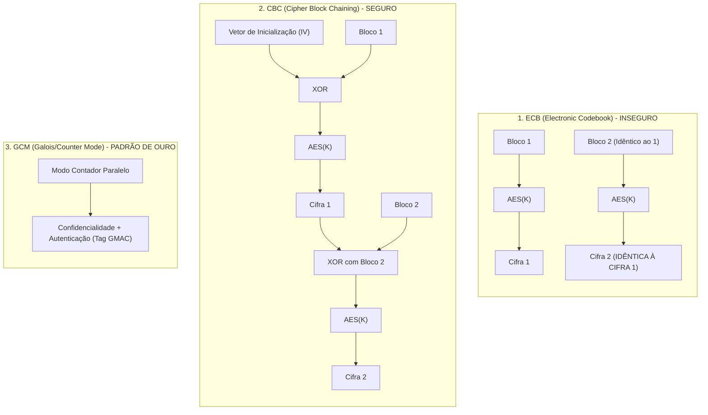
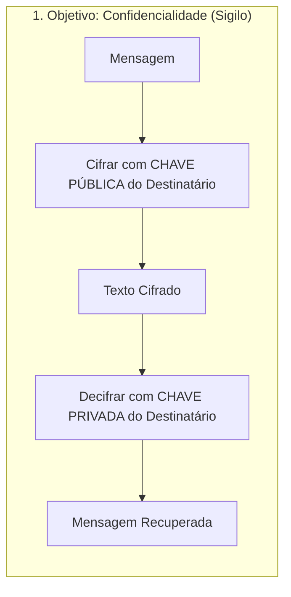
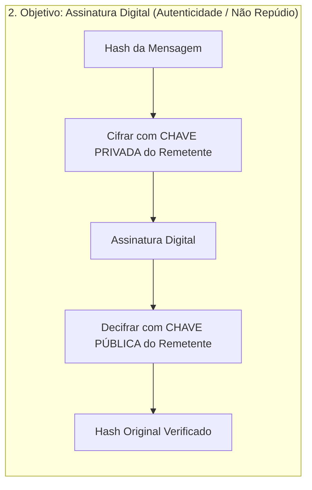
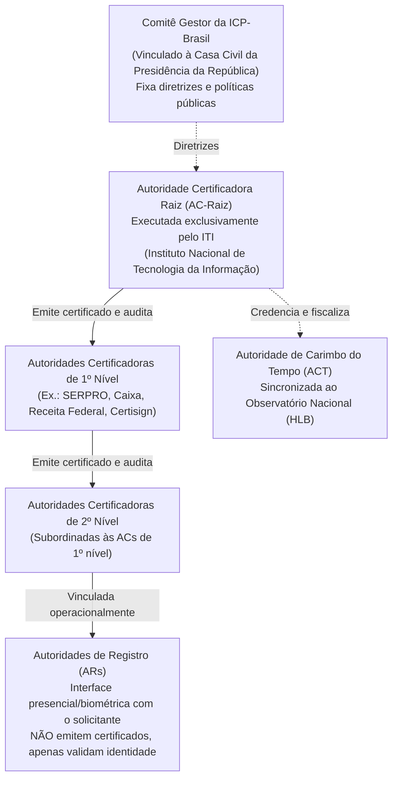
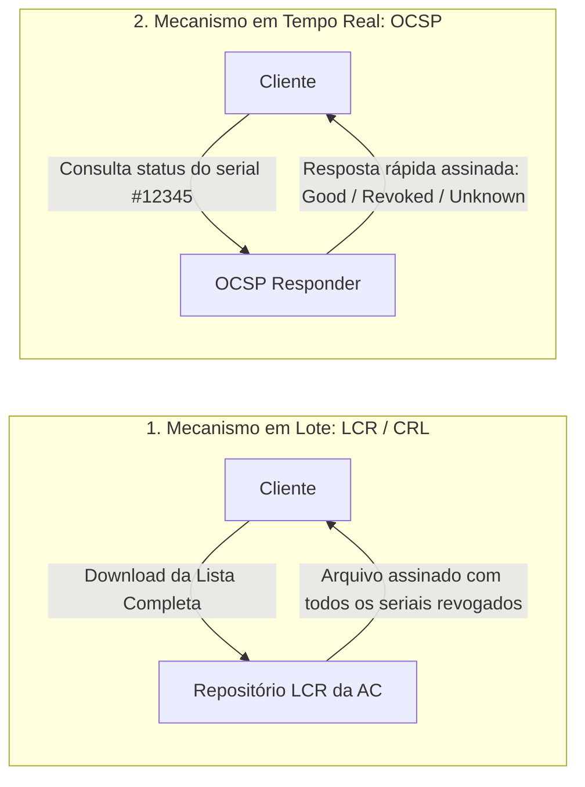
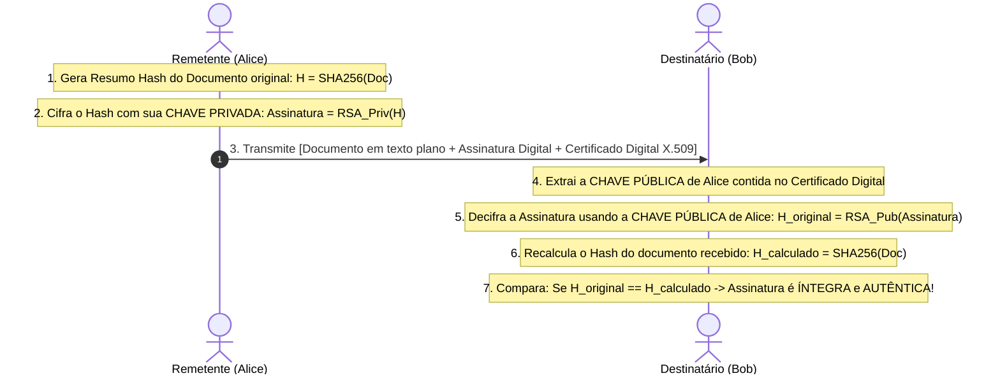

# 02 - Criptografia, ICP-Brasil e Assinatura Digital

> **Matéria:** Segurança da Informação  
> **Cargo:** B02 – Técnico de Controle Externo – Especialidade: Tecnologia da Informação  
> **Arquivo:** `02_criptografia_icp_brasil_e_assinatura_digital.md`  

---

## 📌 Ementa / Itens do Edital
- Criptografia Simétrica (algoritmos e modos de operação)
- Criptografia Assimétrica (par de chaves pública e privada)
- Funções de dispersão criptográfica (Hash)
- Infraestrutura de Chaves Públicas (PKI / ICP-Brasil)
- Certificados Digitais padrão X.509
- Mecanismo, validade jurídica e padrões de Assinatura Digital

---

## 🧭 Sumário
- [1. Criptografia Simétrica (Chave Secreta Compartilhada)](#1-criptografia-simetrica-chave-secreta-compartilhada)
    - [1.1 Fundamentos, Vantagens e o Problema da Distribuição de Chaves](#11-fundamentos-vantagens-e-o-problema-da-distribuicao-de-chaves)
    - [1.2 Cifras de Bloco vs. Cifras de Fluxo (AES, DES, 3DES, ChaCha20)](#12-cifras-de-bloco-vs-cifras-de-fluxo-aes-des-3des-chacha20)
    - [1.3 Modos de Operação de Bloco (ECB, CBC, CTR, GCM e AEAD)](#13-modos-de-operacao-de-bloco-ecb-cbc-ctr-gcm-e-aead)
- [2. Criptografia Assimétrica (Chaves Públicas)](#2-criptografia-assimetrica-chaves-publicas)
    - [2.1 Princípios Matemáticos e as Duas Operações Fundamentais](#21-principios-matematicos-e-as-duas-operacoes-fundamentais)
    - [2.2 Algoritmos Assimétricos Principais (RSA, ECC, Diffie-Hellman)](#22-algoritmos-assimetricos-principais-rsa-ecc-diffie-hellman)
    - [2.3 Criptografia Híbrida na Prática](#23-criptografia-hibrida-na-pratica)
- [3. Funções de Resumo Criptográfico (Hash)](#3-funcoes-de-resumo-criptografico-hash)
    - [3.1 Propriedades Matemáticas Essenciais e Princípio do Pombal](#31-propriedades-matematicas-essenciais-e-principio-do-pombal)
    - [3.2 Algoritmos Seguros vs. Vulneráveis (SHA-2, SHA-3, MD5, SHA-1)](#32-algoritmos-seguros-vs-vulneraveis-sha-2-sha-3-md5-sha-1)
- [4. Infraestrutura de Chaves Públicas e a ICP-Brasil](#4-infraestrutura-de-chaves-publicas-e-a-icp-brasil)
    - [4.1 Estrutura Organizacional e Hierarquia Legal (MP nº 2.200-2/2001)](#41-estrutura-organizacional-e-hierarquia-legal-mp-no-2200-22001)
    - [4.2 Certificados Digitais Padrão X.509 v3 e Ciclo de Vida](#42-certificados-digitais-padrao-x509-v3-e-ciclo-de-vida)
    - [4.3 Mecanismos de Revogação: LCR / CRL vs. OCSP](#43-mecanismos-de-revogacao-lcr-crl-vs-ocsp)
    - [4.4 Tipos de Certificados na ICP-Brasil (A1 vs. A3, Séries S e T)](#44-tipos-de-certificados-na-icp-brasil-a1-vs-a3-series-s-e-t)
- [5. Assinatura Digital e Validade Jurídica](#5-assinatura-digital-e-validade-juridica)
    - [5.1 Mecânica Operacional Passo a Passo (Geração e Verificação)](#51-mecanica-operacional-passo-a-passo-geracao-e-verificacao)
    - [5.2 Propriedades Garantidas vs. Ausência de Confidencialidade](#52-propriedades-garantidas-vs-ausencia-de-confidencialidade)
    - [5.3 Padrões de Assinatura Avançada (CAdES, XAdES, PAdES) e Carimbo do Tempo](#53-padroes-de-assinatura-avancada-cades-xades-pades-e-carimbo-do-tempo)
- [6. Fontes Recomendadas na Internet](#6-fontes-recomendadas-na-internet)
- [7. Questões Comentadas & Exemplos Práticos](#7-questoes-comentadas-exemplos-praticos)

---

## 1. Criptografia Simétrica (Chave Secreta Compartilhada)

### 1.1 Fundamentos, Vantagens e o Problema da Distribuição de Chaves

A criptografia simétrica fundamenta-se no princípio de que uma **única chave secreta** é compartilhada entre as partes, sendo utilizada tanto para a operação de cifragem (encriptação) quanto para a operação de decifragem (decriptação) da mensagem.

#### Vantagens e Limitações
- **Vantagem de Desempenho:** Desempenho computacional extraordinariamente elevado. Consome poucos ciclos de processamento e viabiliza a cifragem de grandes volumes de dados (gigabytes a terabytes) em tempo real. Além disso, conta com suporte nativo a aceleração por hardware nos processadores modernos (como o conjunto de instruções Intel AES-NI).
- **Limitação (O Problema da Distribuição de Chaves):** Para que um conjunto de $N$ usuários ou entidades se comuniquem aos pares de forma independente, estritamente sigilosa e sem compartilhamento mútuo da mesma chave, o total de chaves secretas necessárias cresce de forma quadrática segundo a combinação simples de $N$ tomados 2 a 2:
  $$K = \frac{N(N - 1)}{2}$$

> **Exemplo Prático para Concursos:**  
> Se uma organização conta com $N = 20$ analistas e cada par precisa de uma chave simétrica exclusiva, o número total de chaves exigidas é:
> $$K = \frac{20 \times (20 - 1)}{2} = \frac{20 \times 19}{2} = \frac{380}{2} = 190 \text{ chaves secretas}$$
> Se o grupo aumentar para 1.000 usuários, o sistema exigirá 499.500 chaves secretas. Esse crescimento exponencial inviabiliza a criptografia puramente simétrica em ambientes abertos e na Internet, exigindo canais seguros prévios de distribuição de chaves ou o suporte de sistemas assimétricos.

---

### 1.2 Cifras de Bloco vs. Cifras de Fluxo (AES, DES, 3DES, ChaCha20)

Os algoritmos simétricos dividem-se em duas grandes categorias estruturais segundo a forma como processam a massa de dados:

#### Cifras de Bloco (*Block Ciphers*)
Quebram o texto claro em blocos de tamanho fixo pré-definido e processam cada bloco individualmente aplicando rodadas consecutivas de permutações (*P-boxes*) e substituições (*S-boxes*):

- **AES (Advanced Encryption Standard - Rijndael):** Padrão mundial oficial regulamentado pelo NIST (FIPS 197). Opera com blocos fixos de **128 bits** e suporta três comprimentos de chave:
    - Chave de 128 bits: processada em 10 rodadas.
    - Chave de 192 bits: processada em 12 rodadas.
    - Chave de 256 bits: processada em 14 rodadas.
  Atualmente, o AES é considerado criptograficamente inquebrável contra ataques analíticos práticos, sendo o algoritmo padrão adotado por governos e órgãos de controle.
- **DES (Data Encryption Standard):** Criado na década de 1970, opera com blocos de **64 bits** e uma chave efetiva de apenas **56 bits** (8 bits eram reservados para paridade). É considerado **obsoleto e inseguro**, suscetível a ataques de força bruta concluídos em poucas horas ou minutos por equipamentos comuns.
- **3DES (Triple DES):** Aplica o algoritmo DES três vezes consecutivas na sequência Cifrar-Decifrar-Cifrar (EDE - *Encrypt-Decrypt-Encrypt*) utilizando duas ou três chaves independentes (112 ou 168 bits de força de chave). Embora resista à força bruta simples, é excessivamente lento em software e vulnerável a colisões de blocos de 64 bits em grandes transferências (ataque *Sweet32*).

#### Cifras de Fluxo (*Stream Ciphers*)
Processam o texto claro de maneira contínua, **bit a bit** ou **byte a byte**. Uma função geradora produz uma sequência de bits pseudoaleatórios chamada fluxo de chave (*keystream*), que é combinada com o texto claro por meio da operação lógica OU Exclusivo (**XOR** - $\oplus$):

- **ChaCha20:** Cifra de fluxo moderna de alta performance, padrão da IETF (RFC 8439), extremamente rápida em processadores sem aceleração criptográfica dedicada (como smartphones e dispositivos embarcados).
- **RC4:** Cifra de fluxo histórica que já equipou os protocolos WEP e SSL/TLS, porém descontinuada mundialmente após a descoberta de sérios vieses estatísticos nos primeiros bytes gerados.

---

### 1.3 Modos de Operação de Bloco (ECB, CBC, CTR, GCM e AEAD)

Uma cifra de bloco por si só só cifra um único bloco de tamanho fixo (ex.: 128 bits). Para processar arquivos e mensagens de qualquer extensão, aplicam-se **Modos de Operação**:

| Modo de Operação | Mecânica de Funcionamento | Vantagens | Desvantagens / Pegadinhas FCC |
|---|---|---|---|
| **ECB** (*Electronic Codebook*) | Cada bloco de 128 bits do texto claro é cifrado de maneira totalmente isolada com a mesma chave. | Simples e permite paralelismo pleno em leitura e escrita. | **EXTREMAMENTE INSEGURO.** Blocos de entrada idênticos geram blocos de saída rigorosamente idênticos. Revela a estrutura estatística e o contorno de imagens e documentos. |
| **CBC** (*Cipher Block Chaining*) | Cada bloco de texto claro passa por XOR com o bloco cifrado imediatamente anterior antes da encriptação. O primeiro bloco usa um Vetor de Inicialização (**IV**) aleatório. | Elimina a repetição de padrões visuais; blocos de texto idênticos produzem saídas cifradas completamente distintas. | A cifragem é sequencial e não pode ser paralelizada. Exige preenchimento (*padding*, ex.: PKCS#7) e é vulnerável a ataques de oráculo de preenchimento (*Padding Oracle*) se não houver verificação de integridade. |
| **CTR** (*Counter Mode*) | Cifra um valor incremental composto por um *nonce* e um contador, fazendo XOR do resultado com o bloco de texto claro. | Transforma a cifra de bloco em uma cifra de fluxo. Permite processamento 100% paralelo na cifragem e na decifragem e acesso aleatório a qualquer bloco. | A reutilização do par chave/nonce quebra irremediavelmente a segurança. Por si só, não provê verificação de integridade. |
| **GCM** (*Galois/Counter Mode*) | Combina a cifragem do modo CTR com a autenticação de Galois (GMAC), gerando uma tag de autenticação vinculada aos dados cifrados. | **Padrão de excelência da indústria (TLS 1.3, IPsec, SSH).** Provê **AEAD** (*Authenticated Encryption with Associated Data*): confidencialidade, autenticidade e integridade simultâneas com altíssima taxa de vazão e aceleração por hardware. | A reutilização de um mesmo IV com a mesma chave compromete catastrófica e irreversivelmente a chave de autenticação. |

> 🚨 **ALERTA DE PROVA / PEGADINHA FCC:**  
> A banca FCC frequentemente tenta induzir o candidato ao erro afirmando que o modo **ECB** é o mais eficiente e recomendado para proteger grandes bases de dados confidenciais devido à independência dos blocos. A afirmativa é **FALSA**! O ECB é formalmente contraindicado para confidencialidade porque preserva padrões repetitivos dos dados originais (o clássico contorno do mascote Tux do Linux permanece legível mesmo após a cifragem com ECB).

---

## 2. Criptografia Assimétrica (Chaves Públicas)

### 2.1 Princípios Matemáticos e as Duas Operações Fundamentais

A criptografia de chave pública baseia-se na existência de **problemas matemáticos unidirecionais com alçapão** (*trapdoor one-way functions*): operações que são triviais de serem calculadas em um sentido, mas computacionalmente inviáveis de serem revertidas sem uma informação secreta privilegiada (o "alçapão"). Cada usuário possui um par de chaves complementares:

- **Chave Pública:** Disponibilizada irrestritamente a qualquer pessoa ou sistema.
- **Chave Privada:** Mantida sob custódia e sigilo exclusivo de seu titular.

#### Regra Prática de Uso das Chaves:
1. **Para garantir Sigilo / Confidencialidade:** O remetente utiliza a **Chave PÚBLICA do Destinatário**. Apenas a **Chave PRIVADA do Destinatário** poderá abrir a mensagem.
2. **Para garantir Autenticidade / Integridade / Não Repúdio (Assinatura Digital):** O remetente utiliza a sua **própria Chave PRIVADA**. Qualquer terceiro com acesso à **Chave PÚBLICA do Remetente** pode conferir a assinatura e comprovar a autoria.

---

### 2.2 Algoritmos Assimétricos Principais (RSA, ECC, Diffie-Hellman)

- **RSA (Rivest, Shamir e Adleman):** Fundamenta-se na complexidade computacional da **fatoração de números inteiros compostos gigantescos** formados pelo produto de dois números primos $p$ e $q$. Tamanhos recomendados atualmente: no mínimo 2048 bits, preferencialmente 4096 bits.
- **ECC (*Elliptic Curve Cryptography* - Criptografia de Curvas Elípticas):** Baseia-se no problema do **logaritmo discreto sobre curvas elípticas**. Proporciona a mesma segurança matemática do RSA com chaves drasticamente menores:
    - Uma chave de **ECC de 256 bits** oferece segurança computacional equivalente a uma chave de **RSA de 3072 bits**.
    - O menor tamanho de chave resulta em menor consumo de largura de banda, menor latência de rede e baixíssimo consumo energético em chips, sendo o padrão preferencial de TLS moderno, cartões inteligentes e dispositivos móveis (ex.: curvas Ed25519, NIST P-256).
- **Diffie-Hellman (DH / ECDH):** Protocolo criptográfico criado especificamente para a **troca e acordo seguro de chaves secretas** através de um canal desprotegido. Não é concebido originariamente para cifragem geral de arquivos nem para assinatura direta de documentos, mas sim para que duas entidades conversem em canal aberto e cheguem a uma chave simétrica comum secreta sem que terceiros consigam calculá-la.

---

### 2.3 Criptografia Híbrida na Prática

Os algoritmos assimétricos realizam cálculos matemáticos pesados e complexos envolvendo exponenciações modulares e curvas, sendo aproximadamente 1.000 vezes mais lentos do que cifras simétricas.

Para contornar esse gargalo, protocolos de segurança como HTTPS (TLS), SSH, PGP e S/MIME operam no modelo **híbrido**:

1. O algoritmo assimétrico (ou o protocolo Diffie-Hellman efêmero autenticado) é executado apenas na fase inicial do aperto de mão (*handshake*) para verificar as identidades e estabelecer com segurança uma chave simétrica temporária, denominada **Chave de Sessão** (*Session Key*).
2. Em seguida, a transmissão de dados pesados e contínuos da sessão é executada exclusivamente por uma cifra simétrica de alta velocidade (como AES-GCM ou ChaCha20-Poly1305).

---

## 3. Funções de Resumo Criptográfico (Hash)

### 3.1 Propriedades Matemáticas Essenciais e Princípio do Pombal

Uma função de dispersão criptográfica (função hash) $h = H(M)$ é um algoritmo determinístico que aceita como entrada uma mensagem $M$ de comprimento arbitrário e produz uma sequência de bits de **comprimento rigorosamente fixo**, chamada de resumo criptográfico (*message digest* ou *hash*).

#### Propriedades Obrigatórias:
1. **Comprimento Fixo:** A saída sempre possui exatamente o mesmo número de bits, independentemente do volume do dado de entrada (seja um texto de 3 caracteres ou um banco de dados de 500 terabytes).
2. **Determinismo Pleno:** A mesma entrada $M$ submetida à mesma função resultará sempre, invariavelmente, no mesmo hash $h$.
3. **Unidirecionalidade (*Pre-image Resistance* / Resistência à Primeira Pré-Imagem):** Dado um resumo $h$, é computacionalmente inviável calcular ou descobrir a mensagem de entrada $M$ tal que $H(M) = h$. Trata-se de uma função estritamente de "mão única".
4. **Resistência à Segunda Pré-Imagem (*Weak Collision Resistance*):** Conhecendo-se uma entrada específica $M_1$, é computacionalmente inviável encontrar uma entrada diferente $M_2 \neq M_1$ tal que $H(M_1) = H(M_2)$.
5. **Resistência Forte a Colisões (*Strong Collision Resistance*):** É computacionalmente inviável localizar qualquer par arbitrário de mensagens distintas $M_1 \neq M_2$ que gerem o mesmo resumo hash $H(M_1) = H(M_2)$.
6. **Efeito Avalanche (*Avalanche Effect*):** Qualquer alteração mínima na entrada (a inversão de um único bit ou caractere) deve produzir um hash de saída totalmente divergente e imprevisível, alterando cerca de 50% dos bits do resumo.

> 🚨 **ALERTA DE PROVA / PEGADINHA FCC:**  
> A FCC já cobrou assertivas questionando se a resistência a colisões significa que é *matematicamente impossível* existirem duas mensagens com o mesmo hash. A assertiva é **ERRADA**! Matematicamente, como o espaço de possíveis entradas é infinito e o espaço de saídas é finito (por exemplo, exatamente $2^{256}$ combinações no SHA-256), colisões **necessariamente existem** pelo **Princípio da Casa dos Pombos** (*Pigeonhole Principle*). A segurança criptográfica garante apenas que encontrar tais colisões é **computacionalmente inviável**, e não que elas sejam inexistentes.

---

### 3.2 Algoritmos Seguros vs. Vulneráveis (SHA-2, SHA-3, MD5, SHA-1)

| Algoritmo | Tamanho do Resumo | Situação de Segurança | Relevância para Concursos (FCC) |
|---|---|---|---|
| **MD5** | 128 bits | **Vulnerável / Quebrado** | Colisões práticas podem ser forjadas em milissegundos por computadores comuns. Banido expressamente da ICP-Brasil e de padrões seguros. |
| **SHA-1** | 160 bits | **Vulnerável / Descontinuado** | Colisão prática demonstrada publicamente em 2017 (ataque *SHAttered*). Descontinuado em assinaturas e certificados digitais. |
| **SHA-2** | 224, 256, 384 e 512 bits | **Seguro / Padrão Vigente** | Família predominante na arquitetura mundial de TI. O **SHA-256** é o algoritmo de hash obrigatório e padrão adotado pela ICP-Brasil. |
| **SHA-3** | 224, 256, 384 e 512 bits | **Seguro / Próxima Geração** | Vencedor da competição do NIST baseado no algoritmo Keccak. Emprega a arquitetura esponja (*sponge construction*), servindo de alternativa estrutural independente ao SHA-2. |

---

## 4. Infraestrutura de Chaves Públicas e a ICP-Brasil

### 4.1 Estrutura Organizacional e Hierarquia Legal (MP nº 2.200-2/2001)

A Infraestrutura de Chaves Públicas Brasileira (**ICP-Brasil**) foi formalmente criada pela **Medida Provisória nº 2.200-2, de 24 de agosto de 2001**, com o propósito de garantir a autenticidade, a integridade e a validade jurídica de documentos em forma eletrônica, bem como a realização de transações eletrônicas seguras.

A ICP-Brasil adota uma **estrutura hierárquica estrita com raiz única**:

#### Papéis dos Entes da Estrutura:
1. **Comitê Gestor da ICP-Brasil:** Colegiado vinculado à Casa Civil da Presidência da República, composto por membros do governo e da sociedade civil, com a atribuição de deliberar normas, políticas públicas e padrões técnicos da certificação digital no Brasil.
2. **Autoridade Certificadora Raiz (AC-Raiz):** Operada exclusivamente pelo **Instituto Nacional de Tecnologia da Informação (ITI)**, uma autarquia federal. É a primeira autoridade da cadeia. Possui o único certificado autoassinado (*self-signed*) da infraestrutura. A AC-Raiz **não emite certificados para usuários finais** (cidadãos ou empresas); sua função restringe-se a emitir certificados para as Autoridades Certificadoras de primeiro nível credenciadas, auditá-las e fiscalizá-las.
3. **Autoridades Certificadoras (ACs de 1º e 2º nível):** Entidades públicas (ex.: SERPRO, Receita Federal, Caixa Econômica) ou privadas credenciadas que emitem, renovam, suspendem e revogam certificados digitais para pessoas físicas e jurídicas, além de manterem e assinarem as Listas de Certificados Revogados (LCR).
4. **Autoridades de Registro (ARs):** Entidades operacionais que realizam o atendimento direto ao solicitante. Têm a função de verificar presencialmente ou por biometria os documentos do titular, confirmar sua identidade e encaminhar as solicitações para a AC emissora.  
   > 🚨 **ALERTA DE PROVA / PEGADINHA FCC:**  
   > As ARs **NÃO emitem certificados digitais** e **NÃO assinam certificados**. Elas atuam como intermediárias de validação cadastral e identificação física.
5. **Autoridade de Carimbo do Tempo (ACT):** Entidade encarregada de emitir carimbos do tempo vinculados à Hora Legal Brasileira (HLB), mantida pelo Observatório Nacional.

---

### 4.2 Certificados Digitais Padrão X.509 v3 e Ciclo de Vida

O certificado digital é um documento eletrônico assinado digitalmente por uma Autoridade Certificadora, vinculando a chave pública de uma entidade à sua verdadeira identidade civil ou corporativa.

O padrão internacional adotado é a norma **ITU-T X.509 versão 3** (normatizada na IETF pela RFC 5280).

#### Campos Obrigatórios do Certificado X.509 v3:
1. **Versão (*Version*):** Versão do padrão (geralmente `v3`).
2. **Número de Série (*Serial Number*):** Identificador numérico inteiro e positivo, exclusivo atribuído pela AC para aquele certificado.
3. **Identificador do Algoritmo de Assinatura (*Signature Algorithm ID*):** Identificador do algoritmo de hash e cifra utilizado pela AC para assinar o certificado (ex.: `sha256WithRSAEncryption`).
4. **Emissor (*Issuer*):** Nome distinto (*Distinguished Name* - DN) da AC que emitiu e assinou o documento.
5. **Período de Validade (*Validity Period*):** Intervalo temporal obrigatório composto pelas datas *Not Before* (início da vigência) e *Not After* (termo final de validade).
6. **Titular (*Subject*):** Nome distinto (*DN*) do indivíduo, servidor público, organização ou servidor web ao qual a chave pertence.
7. **Informações da Chave Pública do Titular (*Subject Public Key Info*):** Contém a **Chave Pública** propriamente dita e os parâmetros do algoritmo associado (RSA, ECDSA). A chave privada do titular **jamais** integra o certificado.
8. **Identificador Exclusivo do Emissor/Titular (*Issuer/Subject Unique Identifier*):** Opcionais a partir da versão 2.
9. **Extensões (*Extensions* - exclusivas da v3):** Informações adicionais como *Key Usage* (finalidade autorizada da chave), *Basic Constraints* (indicação de permissão para atuar como AC) e *Subject Alternative Name* (SAN - nomes de domínio adicionais e e-mails).
10. **Assinatura Digital da AC (*Certificate Signature Value*):** Cifragem do hash de todo o conteúdo do certificado realizada com a **Chave Privada da AC**, assegurando sua inviolabilidade e autenticidade.

---

### 4.3 Mecanismos de Revogação: LCR / CRL vs. OCSP

Um certificado digital pode perder a validade antes do término de seu período regular devido a comprometimento da chave privada, exoneração de servidor público, alteração contratual ou fraude. Existem dois mecanismos normatizados para validação do status:

- **LCR (*Lista de Certificados Revogados*) ou CRL (*Certificate Revocation List*):** Arquivo digital assinado e publicado periodicamente pela AC contendo a lista dos números de série de todos os certificados que foram revogados antes do prazo de validade.  
    - *Desvantagens:* Pode demorar horas ou dias para ser republicada (janela de vulnerabilidade) e gera tráfego excessivo de rede, pois o cliente precisa baixar a lista inteira mesmo para consultar apenas um certificado.
- **OCSP (*Online Certificate Status Protocol* - RFC 6960):** Protocolo leve no modelo cliente-servidor em que a aplicação consulta pontualmente um servidor denominado *OCSP Responder*. O cliente envia unicamente o número de série do certificado sob suspeita e recebe em milissegundos uma resposta assinada com o status atual: `Good` (ativo/válido), `Revoked` (revogado) ou `Unknown` (desconhecido).

---

### 4.4 Tipos de Certificados na ICP-Brasil (A1 vs. A3, Séries S e T)

A ICP-Brasil organiza os certificados em diferentes categorias segundo o uso e o grau de segurança física do armazenamento da chave privada:

#### Classificação por Aplicação:
- **Série A (Assinatura Digital):** Destinados à autenticação de usuários e assinatura digital de documentos com presunção de autoria e integridade.
- **Série S (Sigilo / Confidencialidade):** Destinados à cifragem de documentos sensíveis, e-mails e bases de dados.
- **Série T (Tempo / Carimbo do Tempo):** Destinados à aposição de marcas temporais oficiais por Autoridades de Carimbo do Tempo.

#### Comparativo Detalhado: Certificados A1 vs. A3 (O Mais Cobrado pela FCC)

| Critério | Certificado Tipo A1 | Certificado Tipo A3 |
|---|---|---|
| **Mídia de Armazenamento** | **Software:** Arquivo digital gravado no computador ou servidor (extensões `.pfx` ou `.p12`). | **Hardware Criptográfico Seguro:** Cartão inteligente (*smart card*), *Token* USB criptográfico ou módulo HSM (*Hardware Security Module*). |
| **Geração das Chaves** | Gerado por aplicativo em software no próprio computador do usuário. | Gerado **internamente** dentro do chip criptográfico do hardware (inviolável). |
| **Exportação da Chave Privada** | **Permite exportação** e cópia do arquivo para outros computadores mediante senha. | **Não permite exportação.** A chave privada é fisicamente impossibilitada de sair do chip. |
| **Processamento Criptográfico** | Realizado pela CPU e memória RAM do computador hospedeiro. | Realizado diretamente pelo processador interno do chip criptográfico. |
| **Nível de Segurança** | Menor (vulnerável caso o computador seja infectado por malware ou roubado). | Alto (altíssima resistência a extração física e invasões lógicas). |
| **Prazo de Validade Máximo** | **1 ano** | **Até 3 a 5 anos** |

---

## 5. Assinatura Digital e Validade Jurídica

### 5.1 Mecânica Operacional Passo a Passo (Geração e Verificação)

A assinatura digital baseia-se na conjugação entre **funções hash criptográficas** e **criptografia assimétrica**. Ela vincula de forma matemática irrefutável o conteúdo do documento ao titular do certificado.

#### Passo a Passo da Geração da Assinatura (Alice):
1. Alice calcula o resumo criptográfico (hash) da mensagem utilizando um algoritmo seguro (ex.: SHA-256).
2. Alice cifra esse valor de hash utilizando a sua **própria Chave PRIVADA**. O resultado dessa operação é a **Assinatura Digital**.
3. Alice transmite ao destinatário a mensagem em texto claro acompanhada da Assinatura Digital e do seu Certificado Digital X.509 (que contém a sua Chave Pública).

#### Passo a Passo da Verificação da Assinatura (Bob):
1. Bob recebe o documento, a assinatura e o certificado digital de Alice.
2. Bob utiliza a **Chave PÚBLICA de Alice** (obtida no certificado) para decifrar a assinatura digital, recuperando o valor original do hash calculado por Alice ($H_{original}$).
3. Bob calcula de forma independente um novo hash diretamente sobre o arquivo recebido utilizando a mesma função hash ($H_{calculado}$).
4. Bob compara os dois valores: se $H_{original} == H_{calculado}$, a assinatura é válida; caso haja qualquer discrepância de 1 bit sequer, a assinatura é sumariamente rejeitada.

---

### 5.2 Propriedades Garantidas vs. Ausência de Confidencialidade

A assinatura digital provê formalmente as seguintes propriedades:

- **Autenticidade:** Garantia incontestável da autoria do documento, vinculando-o ao titular da chave privada.
- **Integridade:** Certeza de que o documento não sofreu nenhuma modificação, corrupção ou inserção após o instante em que foi assinado.
- **Não Repúdio (Irretratabilidade):** O autor da assinatura não pode negar perante autoridades legais ou judiciais a autoria do ato praticado com sua chave privada exclusiva.
- **Validade Jurídica Plena:** No Brasil, o art. 10 da MP 2.200-2/2001 confere aos documentos eletrônicos assinados no âmbito da ICP-Brasil a **presunção legal de veracidade e equivalência a documentos públicos com assinatura física reconhecida em cartório**.

> 🚨 **ALERTA DE PROVA / PEGADINHA FCC:**  
> A assinatura digital **NÃO GARANTE CONFIDENCIALIDADE!** Por padrão, o documento assinado transita legível em texto claro e pode ser lido por qualquer operador de rede ou intermediário. Se a questão de concurso afirmar que "ao assinar digitalmente um documento, o remetente impede que indivíduos não autorizados leiam o seu teor", a afirmativa está **INCORRETA**. Para obter confidencialidade juntamente com assinatura digital, é indispensável cifrar o documento com a **chave pública do destinatário**.

---

### 5.3 Padrões de Assinatura Avançada (CAdES, XAdES, PAdES) e Carimbo do Tempo

Para uniformizar a aplicação de assinaturas digitais em formatos padronizados, a ICP-Brasil e os órgãos de controle adotam as normas internacionais de Assinatura Eletrônica Avançada:

- **CAdES (*CMS Advanced Electronic Signatures*):** Padrão binário estruturado sobre a RFC 5652 (CMS). É agnóstico quanto ao tipo de mídia e permite assinar qualquer tipo de arquivo bruto (imagens, áudio, vídeos, binários executáveis).
- **XAdES (*XML Advanced Electronic Signatures*):** Estruturado sobre as especificações XMLDSig do W3C. Permite a assinatura de documentos no formato XML, oferecendo grande granularidade (é possível assinar nós ou seções individuais do arquivo XML, mantendo a legibilidade estrutural do XML).
- **PAdES (*PDF Advanced Electronic Signatures*):** Desenvolvido especificamente para arquivos no formato **PDF** (ISO 32000-1). A assinatura digital, a cadeia de certificação e os metadados de auditoria são incorporados diretamente na estrutura interna do arquivo `.pdf`, permitindo visualização gráfica e conferência direta em leitores de PDF convencionais.
- **Carimbo do Tempo (*Timestamp*):** Atestado digital emitido por uma Autoridade de Carimbo do Tempo (ACT) credenciada pela ICP-Brasil, sincronizada com o relógio atômico do Observatório Nacional. Prova com fé pública que determinado documento e sua respectiva assinatura digital já existiam e eram válidos em uma data e hora específicas no passado, resguardando a validade jurídica mesmo após o certificado do autor ter expirado anos mais tarde.

---

## 6. Fontes Recomendadas na Internet

#### 1. Legislação Oficial e Documentos Governamentais
- [Estrutura da ICP-Brasil e Legislação (ITI / Gov.br)](https://www.gov.br/iti/pt-br/assuntos/icp-brasil): Portal oficial do Instituto Nacional de Tecnologia da Informação detalhando a hierarquia da cadeia de certificação brasileira, o papel da AC-Raiz, normas de credenciamento de ACs e ARs e padrões de assinatura digital.
- [Medida Provisória nº 2.200-2/2001 (Planalto)](https://www.planalto.gov.br/ccivil_03/mpv/antigas_2001/2200-2.htm): Diploma legal basilar que instituiu a ICP-Brasil, garantindo a presunção legal de veracidade aos documentos eletrônicos assinados com certificados digitais emitidos no âmbito da infraestrutura nacional.
- [Lei nº 14.063/2020 — Assinaturas Eletrônicas no Setor Público (Planalto)](https://www.planalto.gov.br/ccivil_03/_ato2019-2022/2020/lei/l14063.htm): Marco legal que dispõe sobre o uso de assinaturas eletrônicas (simples, avançada e qualificada via ICP-Brasil) em interações com entes públicos.

#### 2. Padrões Técnicos Internacionais
- [RFC 5280 - Internet X.509 Public Key Infrastructure Certificate Profile](https://datatracker.ietf.org/doc/html/rfc5280): Especificação técnica formal dos campos do certificado X.509 v3, listas de certificados revogados (LCR / CRL) e caminhos de certificação.
- [NIST SP 800-38D - Recommendation for Block Cipher Modes of Operation: GCM](https://csrc.nist.gov/publications/detail/sp/800-38d/final): Padrão de especificação formal do modo Galois/Counter Mode (GCM) para criptografia autenticada (AEAD).

#### 3. Referências Bibliográficas Clássicas (Padrão ABNT)
* STALLINGS, William. **Criptografia e Segurança de Redes: Princípios e Práticas**. 6. ed. São Paulo: Pearson Education do Brasil, 2015. (Cap. 3, 6, 9, 11 e 14 — Cifras Simétricas AES/Modos de Operação, Criptografia Assimétrica RSA/ECC, Funções Hash SHA e Certificados X.509).
* PAAR, Christof; PELZL, Jan. **Understanding Cryptography: A Textbook for Students and Practitioners**. Berlin: Springer, 2010. (Cap. 4, 7, 11 e 12 — Advanced Encryption Standard, RSA, Hash Functions e Digital Signatures).
* MENEZES, Alfred J.; VAN OORSCHOT, Paul C.; VANSTONE, Scott A. **Handbook of Applied Cryptography**. Boca Raton: CRC Press, 1996. (Cap. 7 a 13 — Block Ciphers, Public-Key Encryption, Hash Functions, Digital Signatures e Key Management).

---

## 7. Questões Comentadas & Exemplos Práticos

### Questão 1 (FCC - Adaptada / TI - Mecânica e Propriedades da Assinatura Digital)
Em um sistema de processo eletrônico do Tribunal de Contas, um auditor emite e assina digitalmente um relatório de inspeção contábil utilizando seu par de chaves criptográficas assimétricas.

A respeito do processo técnico de assinatura digital e das garantias proporcionadas, assinale a afirmativa correta:

* **A)** Para gerar a assinatura digital, o auditor utiliza a chave pública do destinatário para cifrar o documento na íntegra, garantindo a confidencialidade do relatório.
* **B)** A assinatura digital é obtida calculando-se o resumo criptográfico (*hash*) do documento e cifrando esse resumo com a chave privada do remetente (auditor); o destinatário verifica a validade decifrando o valor da assinatura com a chave pública do remetente e comparando o resultado com o hash recalculado do documento.
* **C)** A assinatura digital garante isoladamente o princípio da confidencialidade, tornando impossível que qualquer pessoa não autorizada leia o teor do documento assinado.
* **D)** A chave privada do remetente deve ser anexada ao documento em texto claro para que o destinatário possa decifrar a assinatura digital sem intermediários.
* **E)** A alteração de um único caractere no documento original após a assinatura não afeta o resultado da verificação, permanecendo a assinatura perfeitamente válida.

> **Comentário Detalhado:**
>
> - **A)** Incorreta. Cifrar o documento na íntegra com a chave pública do destinatário é a operação destinada a prover confidencialidade (sigilo), e não assinatura digital.
> - **B)** Correta. A assinatura digital baseia-se na aplicação de uma função hash unidirecional sobre o documento para gerar um resumo fixo, seguida da cifragem desse resumo pela chave privada do remetente. O destinatário confere a validade decifrando a assinatura com a chave pública do remetente e comparando o resultado obtido com o hash recalculado do texto recebido.
> - **C)** Incorreta. A assinatura digital provê autenticidade, integridade e não repúdio, mas não assegura confidencialidade. O documento assinado transita em texto legível.
> - **D)** Incorreta. A chave privada é estritamente confidencial e de posse exclusiva do titular. Quem acompanha o documento assinado é o certificado contendo a chave pública.
> - **E)** Incorreta. Em decorrência do efeito avalanche característico das funções hash criptográficas, a modificação de um único bit gera um hash totalmente divergente, tornando a assinatura imediatamente inválida.
> 
> **Gabarito: B**

---

### Questão 2 (FCC - Adaptada / TI - Infraestrutura de Chaves Públicas e ICP-Brasil)
No que tange à arquitetura hierárquica da Infraestrutura de Chaves Públicas Brasileira (ICP-Brasil), instituída pela MP nº 2.200-2/2001, e aos tipos de certificados digitais X.509, analise as seguintes afirmativas:

I. O Instituto Nacional de Tecnologia da Informação (ITI) desempenha as funções operacionais de Autoridade Certificadora Raiz (AC-Raiz) da ICP-Brasil, sendo a entidade máxima encarregada de emitir os certificados das Autoridades Certificadoras de primeiro nível.  

II. As Autoridades de Registro (ARs) são entidades operacionais responsáveis pela identificação do solicitante e validação presencial ou biométrica de documentos, não possuindo competência para assinar nem emitir diretamente os certificados digitais.  

III. O certificado digital ICP-Brasil do tipo A1 possui seu par de chaves criptográficas gerado e armazenado diretamente em mídia física segura inviolável (como cartão inteligente ou token criptográfico USB), enquanto o certificado do tipo A3 é gerado e armazenado em software no disco rígido do computador.  

Está correto o que se afirma em:

* **A)** I, apenas.
* **B)** I e II, apenas.
* **C)** II e III, apenas.
* **D)** I e III, apenas.
* **E)** I, II e III.

> **Comentário Detalhado:**
>
> - **A)** Incorreta. O item II também está integralmente correto, tornando a opção incompleta.
> - **B)** Correta. O Item I é verdadeiro porque a MP 2.200-2/2001 estabelece o ITI como AC-Raiz da cadeia nacional. O Item II é verdadeiro porque as Autoridades de Registro (ARs) atuam na validação da identidade dos titulares, sem possuir autoridade para assinar ou emitir certificados digitais. O Item III é falso por inversão de conceitos: A1 é armazenado em software (validade 1 ano) e A3 é armazenado em hardware seguro inviolável (validade até 5 anos).
> - **C)** Incorreta. Julga verdadeiro o Item III, que contém grave erro de inversão de conceitos.
> - **D)** Incorreta. Omite a veracidade do Item II e inclui o Item III que é incorreto.
> - **E)** Incorreta. Desconsidera a incorreção patente do Item III.
> 
> **Gabarito: B**

---

### Questão 3 (FCC - Adaptada / TI - Criptografia Simétrica e Modos de Operação)
Em relação aos algoritmos e modos de operação da criptografia simétrica, considere o cenário em que uma organização pública necessita proteger o armazenamento e a transmissão de grandes volumes de informações sigilosas.

Assinale a afirmativa correta sobre o tema:

* **A)** O modo de operação ECB (*Electronic Codebook*) é o mais seguro e recomendado para cifragem de bancos de dados massivos, pois realiza o encadeamento de blocos via XOR com um vetor de inicialização.
* **B)** O algoritmo AES (*Advanced Encryption Standard*) é uma cifra de bloco que opera exclusivamente com chaves de 64 bits e blocos de 56 bits, tendo sido considerado obsoleto devido a ataques de força bruta.
* **C)** Para que um grupo de 20 analistas se comunique de forma sigilosa utilizando criptografia puramente simétrica, de modo que cada par de analistas possua uma chave exclusiva e compartilhada apenas entre si, são necessárias 190 chaves secretas distintas.
* **D)** As cifras de fluxo (*stream ciphers*) dividem a mensagem em blocos de 256 bits e processam cada bloco individualmente através de 14 rodadas de substituição.
* **E)** O modo de operação GCM (*Galois/Counter Mode*) foi descontinuado pelos padrões modernos da IETF por não suportar criptografia autenticada com dados associados (AEAD).

> **Comentário Detalhado:**
>
> - **A)** Incorreta. O modo ECB não realiza encadeamento nem utiliza vetor de inicialização (quem faz isso é o CBC). No ECB, blocos idênticos geram textos cifrados idênticos, preservando padrões visuais e contextuais dos dados.
> - **B)** Incorreta. Quem operava com blocos de 64 bits e chave de 56 bits era o padrão obsoleto DES. O AES opera com blocos de 128 bits e suporta chaves de 128, 192 e 256 bits.
> - **C)** Correta. O cálculo de chaves simétricas independentes para $N$ usuários é dado por $K = \frac{N(N-1)}{2}$. Para $N = 20$: $K = \frac{20 \times 19}{2} = \frac{380}{2} = 190$ chaves secretas distintas.
> - **D)** Incorreta. Algoritmos que dividem os dados em blocos de tamanho fixo são denominados cifras de bloco (*block ciphers*). Cifras de fluxo operam continuamente bit a bit ou byte a byte.
> - **E)** Incorreta. O modo GCM é o algoritmo de ouro recomendado em protocolos modernos como TLS 1.3 justamente por prover AEAD (*Authenticated Encryption with Associated Data*).
> 
> **Gabarito: C**

---

### Questão 4 (FCC - Adaptada / TI - Funções de Resumo Criptográfico / Hash)
Funções de resumo criptográfico (*hashes*) desempenham um papel central em protocolos de segurança, integridade de arquivos e assinaturas digitais.

A respeito das propriedades matemáticas e características das funções hash, assinale a afirmativa correta:

* **A)** O algoritmo MD5 gera resumos de 512 bits e continua sendo o padrão criptográfico prioritário recomendado pela ICP-Brasil para emissão de certidões eletrônicas.
* **B)** O efeito avalanche (*avalanche effect*) é uma vulnerabilidade indesejável em que a alteração de poucos bits no texto original não provoca nenhuma mudança perceptível no resumo de saída.
* **C)** A propriedade da unidirecionalidade (*pre-image resistance*) assegura que, dado um resumo hash $h$, seja computacionalmente inviável recuperar ou deduzir a mensagem de entrada $M$ que o gerou.
* **D)** As funções hash geram resumos criptográficos cujo tamanho em bytes é diretamente proporcional e idêntico ao tamanho do arquivo de entrada processado.
* **E)** A resistência a colisões forte significa que é impossível que duas mensagens distintas venham a ter o mesmo hash em qualquer cenário matemático teórico.

> **Comentário Detalhado:**
>
> - **A)** Incorreta. O MD5 gera resumos de 128 bits e é considerado inseguro e vulnerável a colisões práticas, sendo expressamente banido pela ICP-Brasil. O padrão adotado é o SHA-256.
> - **B)** Incorreta. O efeito avalanche é uma característica essencial e altamente desejável segundo a qual a menor modificação no texto de entrada altera dramaticamente cerca de 50% dos bits do hash de saída.
> - **C)** Correta. A unidirecionalidade (*pre-image resistance*) define que a função opera em mão única: é simples calcular o resumo a partir do dado de entrada, mas computacionalmente inviável inverter o processo para recuperar a mensagem original a partir do hash.
> - **D)** Incorreta. O comprimento da saída de uma função hash é fixo e pré-determinado pelo algoritmo (ex.: 256 bits no SHA-256), independentemente de a entrada conter 10 bytes ou 10 terabytes.
> - **E)** Incorreta. Teoricamente, pelo Princípio da Casa dos Pombos, colisões sempre existem porque o domínio de entrada é infinito e a imagem de saída é finita. A propriedade de resistência assegura que encontrar tais colisões é computacionalmente inviável.
> 
> **Gabarito: C**

---

### Questão 5 (FCC - Adaptada / TI - Certificados Digitais X.509 e Revogação)
Na gestão de uma infraestrutura PKI corporativa baseada no padrão X.509 v3, a verificação do ciclo de vida e validade dos certificados digitais apresentados por clientes e servidores é indispensável para impedir acessos não autorizados.

Sobre os campos do certificado X.509 v3 e os mecanismos de revogação de certificados, assinale a afirmativa correta:

* **A)** O protocolo OCSP (*Online Certificate Status Protocol*) exige que o cliente faça o download de um arquivo monolítico contendo a totalidade de todos os certificados já revogados pela AC desde sua fundação histórica.
* **B)** A Lista de Certificados Revogados (LCR / CRL) é uma estrutura assinada periodicamente pela Autoridade Certificadora que relaciona os números de série dos certificados que foram cancelados ou revogados antes da data original de expiração.
* **C)** O certificado X.509 v3 armazena a chave privada do titular no campo *Subject Public Key Info* para permitir a conferência pública de assinaturas por terceiros.
* **D)** A data de expiração de um certificado digital é perpétua no padrão X.509, dependendo exclusivamente da solicitação manual de revogação pelo titular para deixar de operar.
* **E)** Caso um certificado digital esteja presente na LCR da autoridade emissora, o sistema de controle de acesso deve considerá-lo plenamente confiável e válido até o término do ano corrente.

> **Comentário Detalhado:**
>
> - **A)** Incorreta. O mecanismo que exige o download da lista monolítica em lote é a LCR/CRL. O protocolo OCSP realiza consultas pontuais leves em tempo real sobre o número de série do certificado.
> - **B)** Correta. A Lista de Certificados Revogados (LCR / CRL) é a estrutura digital assinada periodicamente pela Autoridade Certificadora que relaciona os números de série dos certificados revogados antes do termo regular de vigência.
> - **C)** Incorreta. O campo *Subject Public Key Info* armazena exclusivamente a chave pública do titular. A chave privada jamais integra o certificado digital.
> - **D)** Incorreta. Todo certificado X.509 v3 possui obrigatoriamente um período de validade delimitado nos campos *Not Before* e *Not After*.
> - **E)** Incorreta. Se o certificado constar na LCR, significa que foi revogado e perdeu imediatamente sua validade jurídica e técnica, devendo ser sumariamente rejeitado pelo sistema.
> 
> **Gabarito: B**
