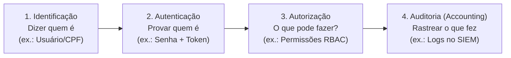
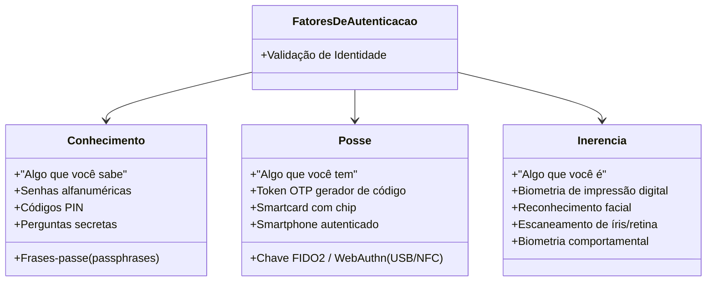
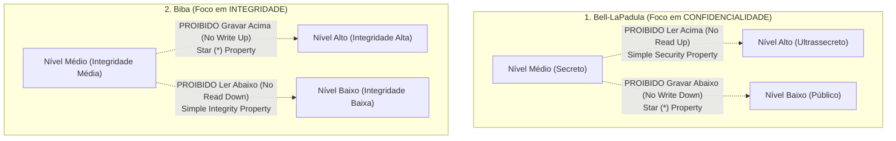
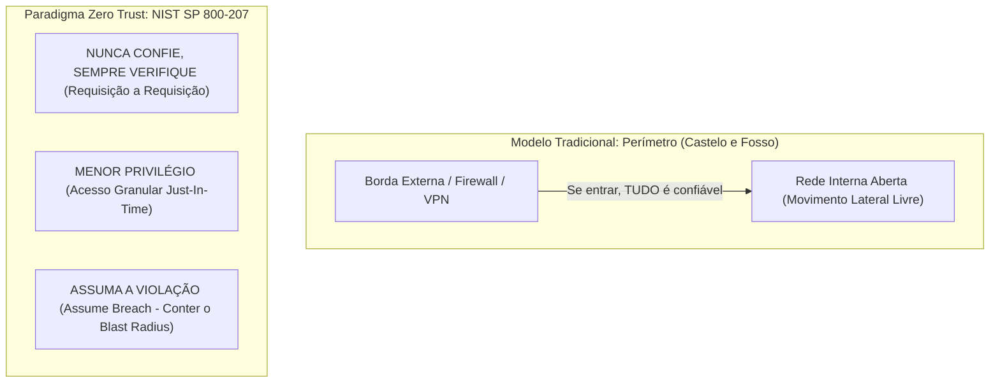
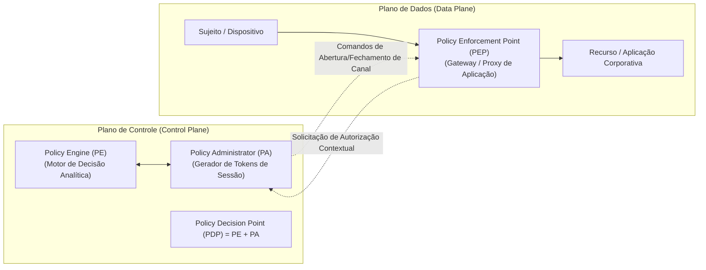

# 03 - Controle de Acesso, IAM e Arquitetura Zero Trust

> **Matéria:** Segurança da Informação  
> **Cargo:** B02 – Técnico de Controle Externo – Especialidade: Tecnologia da Informação  
> **Arquivo:** `03_controle_de_acesso_iam_e_arquitetura_zero_trust.md`  

---

## 📌 Ementa / Itens do Edital
- Controle de acesso lógico: Autenticação, Autorização e Auditoria (AAA)
- Fatores de autenticação e Autenticação Multifator (MFA)
- Modelos clássicos de controle de acesso: DAC, MAC, RBAC e ABAC
- Gestão de Identidades e Acessos (IAM - Identity and Access Management)
- Arquitetura de Confiança Zero (Zero Trust: princípios, pilares e microsegmentação)

---

## 🌳 Classificação Hierárquica

```text
3. Controle de Acesso, Identidade Corporativa e Paradigma Zero Trust
├── 3.1 Mecanismos de Autenticação e MFA
│   ├── 3.1.1 O Processo de Identificação vs. Autenticação vs. Autorização
│   ├── 3.1.2 Os Três Fatores de Autenticação Clássicos:
│   │   ├── Fator de Conhecimento ("O que você sabe"): Senhas, frases-passe, PINs
│   │   ├── Fator de Posse ("O que você tem"): Cartões inteligentes, tokens geradores de OTP (TOTP/HOTP), chaves de segurança FIDO2 / WebAuthn, smartphones
│   │   └── Fator de Inerência ("O que você é"): Biometria física (impressão digital, reconhecimento facial, íris) ou comportamental (cadência de digitação)
│   ├── 3.1.3 Autenticação Multifator (MFA / 2FA): Exigência mandatória de pelo menos dois fatores de categorias DIFERENTES
│   └── 3.1.4 Vulnerabilidades de Autenticação: Ataques de força bruta, dicionário, credential stuffing, interceptação de SMS e fadiga de MFA (MFA bombing)
├── 3.2 Modelos de Controle de Acesso Lógico
│   ├── 3.2.1 DAC (Discretionary Access Control - Controle de Acesso Discricionário):
│   │   ├── O proprietário (criador) do recurso tem o poder discricionário de conceder ou revogar permissões a outros usuários
│   │   └── Mecanismo: Listas de Controle de Acesso (ACLs) em sistemas de arquivos tradicionais (Windows NTFS, Linux)
│   ├── 3.2.2 MAC (Mandatory Access Control - Controle de Acesso Obrigatório):
│   │   ├── O sistema impõe regras rígidas de segurança baseadas em rótulos de sensibilidade da informação e credenciais do usuário
│   │   └── Modelos Formais: Bell-LaPadula (foco em Confidencialidade - "No read up, no write down") e Biba (foco em Integridade - "No read down, no write up"); implementado em SELinux
│   ├── 3.2.3 RBAC (Role-Based Access Control - Baseado em Papéis / Funções):
│   │   ├── As permissões são associadas a cargos/papéis corporativos (ex.: "Auditor", "Técnico de TI"), e os usuários são associados aos papéis
│   │   └── Padrão na grande maioria dos sistemas corporativos e bancos de dados modernos
│   └── 3.2.4 ABAC (Attribute-Based Access Control - Baseado em Atributos):
│       ├── Concessão dinâmica de acesso baseada na avaliação de atributos do sujeito, do recurso, da ação e do ambiente (horário, localização geográfica, dispositivo, nível de risco)
│       └── Padrão aberto: XACML (eXtensible Access Control Markup Language)
├── 3.3 Gestão de Identidades e Acessos (IAM)
│   ├── 3.3.1 Ciclo de Vida da Identidade: Entrada (Onboarding / Provisionamento), Movimentação (Mudança de cargo) e Saída (Offboarding / Desprovisionamento imediato)
│   ├── 3.3.2 Governança de Acessos e Princípio do Menor Privilégio (PoLP - Principle of Least Privilege): Usuário recebe estritamente os privilégios necessários para suas tarefas atuais
│   ├── 3.3.3 Gestão de Acessos Privilegiados (PAM - Privileged Access Management): Cofre de senhas, sessões gravadas e elevação de privilégios temporária (Just-In-Time) para contas administrativas
│   └── 3.3.4 Federação de Identidades e Single Sign-On (SSO): Protocolos SAML 2.0, OpenID Connect e servidores de diretório corporativo (Active Directory / LDAP)
└── 3.4 Arquitetura Zero Trust (Confiança Zero - NIST SP 800-207)
    ├── 3.4.1 Fim do Modelo Tradicional "Castelo e Fosso" (Perímetro tradicional de rede): Violações ocorrem tanto de fora quanto de dentro
    ├── 3.4.2 Princípios Norteadores do Zero Trust:
    │   ├── 1. "Nunca Confie, Sempre Verifique" (Never Trust, Always Verify): Todo acesso, interno ou externo, é considerado potencialmente hostil e deve ser autenticado e autorizado continuamente
    │   ├── 2. "Conceda Acesso com Menor Privilégio" (Least Privilege Access): Limite de acesso granular e Just-In-Time
    │   └── 3. "Assuma a Violação" (Assume Breach): Minimize a área de impacto caso o atacante já esteja na rede interna
    ├── 3.4.3 Pilares Fundamentais: Identidades, Dispositivos (Device Health), Redes, Aplicações e Cargas de Trabalho, Dados
    ├── 3.4.4 Microsegmentação de Rede: Criação de zonas de segurança isoladas e perímetros definidos por software para impedir o movimento lateral de atacantes
    └── 3.4.5 Componentes Lógicos: Policy Engine (PE - motor de decisão), Policy Administrator (PA - controle de sessão) e Policy Enforcement Point (PEP - ponto de aplicação na ponta)
```

---

## 📖 Teoria Aprofundada & Pontos-Chave

### 3.1 Mecanismos de Autenticação e MFA

O controle de acesso lógico é estruturado em etapas sequenciais frequentemente associadas ao modelo **AAA (Authentication, Authorization, Accounting)**:
1. **Identificação:** O sujeito alega quem ele é perante o sistema (ex.: informa o nome de usuário ou CPF).
2. **Autenticação:** O sistema valida a veracidade da identidade alegada por meio da apresentação de credenciais e fatores de prova.
3. **Autorização:** Uma vez autenticado, o sistema verifica quais permissões e privilégios específicos aquele usuário tem sobre determinados recursos ou operações.
4. **Auditoria / Responsabilização (*Accounting / Accountability*):** Registro cronológico em logs de todas as ações executadas pelo usuário durante sua sessão.



#### Os Três Fatores de Autenticação Clássicos
A autenticação moderna classifica os elementos de validação em três categorias conceituais primárias:



1. **Fator de Conhecimento ("O que você sabe"):**
   - Baseia-se em informações mantidas na memória do usuário (senhas, códigos PIN, respostas a perguntas pessoais).
   - *Fragilidade:* Vulnerável a ataques de força bruta, interceptação, vazamentos e engenharia social.
2. **Fator de Posse ("O que você tem"):**
   - Baseia-se na custódia de um dispositivo ou objeto físico exclusivo (smart card, token gerador de senhas de uso único TOTP/HOTP, aplicativo autenticador no smartphone, chave criptográfica física FIDO2/U2F).
   - *Fragilidade:* Risco de perda física, furto ou ataques de clonagem/SIM swapping (quando se usa SMS).
3. **Fator de Inerência ("O que você é"):**
   - Baseia-se em características biológicas, fisiológicas ou comportamentais exclusivas do indivíduo (impressão digital, padrão vascular, mapa de íris, reconhecimento facial; ou ritmo de digitação).
   - *Fragilidade:* Falsos positivos e falsos negativos; dados biométricos não podem ser "revogados" ou alterados caso vazem.

> 🚨 **ALERTA DE PROVA / PEGADINHA FCC:**  
> A FCC adora tentar enganar o candidato com afirmativas do tipo:  
> *"O sistema utiliza autenticação multifator porque exige que o usuário digite sua senha de rede de 10 dígitos e, em seguida, um código PIN de 4 números."*  
> **ISSO ESTÁ ERRADO!** Senha e PIN pertencem à **mesma categoria conceitual: Conhecimento** ("o que você sabe"). Trata-se apenas de autenticação de fator único fortalecido. Para ser tecnicamente categorizado como **MFA (ou 2FA)**, é **obrigatória** a conjunção de elementos pertencentes a **categorias conceituais DIFERENTES** (ex.: Senha [Conhecimento] + Token OTP [Posse]).

---

### 3.2 Modelos Clássicos de Controle de Acesso Lógico

| Modelo | Definição e Filosofia | Quem controla as permissões? | Implementação Típica | Foco Principal |
|---|---|---|---|---|
| **DAC** (*Discretionary Access Control*) | Controle discricionário. O criador/proprietário do recurso tem liberdade para delegar ou revogar permissões a outros usuários a seu critério. | O proprietário (*Owner*) do objeto. | ACLs em sistemas de arquivos (NTFS no Windows, permissões `rwx` no Linux). | Flexibilidade e descentralização. |
| **MAC** (*Mandatory Access Control*) | Controle obrigatório. O sistema central impõe regras estritas e invioláveis baseadas em rótulos de classificação do dado e credenciais (*clearance*) do usuário. O usuário não pode repassar permissões. | O Administrador Central do Sistema / Política de Segurança do S.O. | Sistemas militares e de alta segurança (SELinux, AppArmor, TrustedBSD). | Alta segurança e proteção contra vazamento. |
| **RBAC** (*Role-Based Access Control*) | Baseado em Papéis/Funções. As permissões são associadas a papéis funcionais corporativos (ex.: "Auditor Fiscal", "Contador"), e os usuários são associados aos papéis. | Administrador de segurança corporativo. | Bancos de dados relacionais (PostgreSQL, Oracle), ERPs, sistemas de gestão pública. | Governança corporativa, menor privilégio e facilidade de escala. |
| **ABAC** (*Attribute-Based Access Control*) | Baseado em Atributos. Avalia dinamicamente atributos do sujeito, do objeto, da ação solicitada e do contexto ambiental (horário, local, dispositivo, risco) via regras booleanas. | Motor central de políticas de acesso (padrão XACML). | Ambientes em nuvem (AWS IAM Policies), arquiteturas modernas de microsserviços e Zero Trust. | Decisões contextuais granulares em tempo real. |

#### Modelos Formais de Segurança Multinível (MAC): Bell-LaPadula vs. Biba



- **Modelo Bell-LaPadula (Confidencialidade):**
  - **Propriedade da Segurança Simples (*Simple Security Property* - ss-property):** Um sujeito em um determinado nível de segurança não pode ler um objeto de nível superior (*No Read Up*). Evita espionagem não autorizada.
  - **Propriedade Estrela (*\*-Property* / Star-Property):** Um sujeito em um nível de segurança não pode gravar ou transferir dados para um objeto de nível inferior (*No Write Down*). Evita vazamento intencional ou acidental de informações sigilosas para locais públicos.
- **Modelo Biba (Integridade):**
  - **Propriedade da Integridade Simples (*Simple Integrity Property*):** Um sujeito não pode ler objetos com nível de integridade inferior ao seu (*No Read Down*). Evita contaminação do sujeito por dados corrompidos ou não confiáveis.
  - **Propriedade Estrela de Integridade (*\*-Property*):** Um sujeito não pode gravar dados em objetos de nível de integridade superior (*No Write Up*). Evita que sujeitos não confiáveis corrompam dados de alta integridade.

---

### 3.3 Gestão de Identidades e Acessos (IAM) e PAM

O IAM (*Identity and Access Management*) compreende processos, políticas e tecnologias para gerenciar todo o ciclo de vida das identidades digitais:
1. **Provisionamento (*Onboarding*):** Criação da conta e concessão inicial das permissões estritamente necessárias para a função desempenhada.
2. **Movimentação / Transição:** Ajuste imediato dos privilégios quando o colaborador muda de setor, cargo ou projeto, revogando privilégios antigos para evitar o acúmulo de acessos residuais (*Privilege Creep*).
3. **Desprovisionamento (*Offboarding*):** Revogação imediata e total de todos os acessos lógicos e físicos no momento da exoneração, demissão ou encerramento do contrato de trabalho.

#### Princípios Fundamentais de Governança de Acessos
- **Princípio do Menor Privilégio (*Principle of Least Privilege* - PoLP):** O usuário deve dispor exclusivamente do conjunto mínimo de privilégios indispensáveis para a realização de suas tarefas rotineiras, durante o menor período de tempo possível.
- **Separação de Funções / Deveres (*Separation of Duties* - SoD):** Divisão de processos críticos em etapas atribuídas a pessoas distintas, de modo que nenhuma pessoa isolada possua poder total para executar e aprovar uma transação com impacto financeiro ou fiscal.

#### Gestão de Acessos Privilegiados (PAM - *Privileged Access Management*)
Contas administrativas (como `root`, `Administrator`, `sa`) representam os alvos prioritários de invasores. As soluções de PAM mitigam esse risco por meio de:
- **Cofre de Senhas (*Vault*):** Armazenamento seguro e centralizado das credenciais com rotação automática periódica e geração de senhas aleatórias de uso único (*one-time passwords*).
- **Acesso Just-In-Time (JIT):** Elevação temporária de privilégios concedida pontualmente para a realização de uma manutenção específica, com revogação automática ao término da janela.
- **Gravação e Auditoria de Sessões:** Monitoramento e gravação em vídeo/texto de tudo o que os administradores executam nos servidores corporativos.

#### Federação de Identidades e Protocolos Modernos
- **SSO (*Single Sign-On*):** Mecanismo que permite ao usuário autenticar-se uma única vez e obter acesso autorizado a múltiplos sistemas e aplicações independentes.
- **SAML 2.0 (*Security Assertion Markup Language*):** Padrão aberto baseado em XML amplamente utilizado para federação corporativa entre Identity Providers (IdP) e Service Providers (SP).
- **OpenID Connect (OIDC):** Camada de autenticação moderna construída sobre o protocolo de autorização OAuth 2.0, utilizando tokens estruturados em JSON Web Token (JWT) e transporte REST/HTTPS.

---

### 3.4 Arquitetura Zero Trust (NIST SP 800-207)

O modelo tradicional de segurança baseava-se na analogia do **"Castelo e Fosso"** (*Perimeter-based Security*): erguia-se uma muralha rígida de firewalls na borda da rede. Uma vez que o usuário superava a borda (seja conectando-se ao cabo no escritório ou logando em uma VPN), ele era considerado confiável e podia navegar livremente pela rede local.

Esse paradigma faliu devido à mobilidade de colaboradores, à computação em nuvem e à sofisticação de malwares que realizam **movimento lateral** após comprometerem um único endpoint.



#### Os Três Princípios Fundamentais do Zero Trust (NIST SP 800-207):
1. **Nunca Confie, Sempre Verifique (*Never Trust, Always Verify*):**
   - Não existe "rede interna confiável". Qualquer requisição de acesso a qualquer dado ou sistema, venha ela de dentro do escritório ou da Internet, deve ser autenticada, autorizada e criptografada explicitamente com base em múltiplos atributos em tempo real.
2. **Conceda Acesso com Menor Privilégio (*Use Least Privilege Access*):**
   - Restrinja o acesso ao estritamente necessário utilizando políticas adaptativas dinâmicas (*Just-In-Time* e *Just-Enough-Access*), limitando a superfície de exposição.
3. **Assuma a Violação (*Assume Breach*):**
   - Projete a infraestrutura partindo da premissa de que o invasor já está operando dentro da rede corporativa. Adote **microsegmentação** rígida para impedir movimentação lateral e inspecione 100% das comunicações de ponta a ponta.

#### Componentes Lógicos da Arquitetura Zero Trust (NIST SP 800-207)



- **Policy Engine (PE - Motor de Políticas):** O "cérebro" analítico do sistema. Avalia as políticas organizacionais, sinais de risco, saúde do dispositivo e inteligência contra ameaças para **decidir** se concede ou nega a requisição.
- **Policy Administrator (PA - Administrador de Políticas):** O componente que executa a decisão do PE: instrui o PEP a abrir ou encerrar o canal de comunicação seguro e emite os tokens de sessão necessários. Juntos, o PE e o PA formam o **Policy Decision Point (PDP)**.
- **Policy Enforcement Point (PEP - Ponto de Aplicação de Políticas):** O componente de borda posicionado diretamente no plano de dados (gateway, proxy reverso, agente local) responsável por **interceptar, aplicar e encerrar** as conexões autorizadas entre sujeitos e recursos corporativos.

---

## 🌐 Fontes Recomendadas na Internet

### 1. Padrões Internacionais do NIST e CISA
- [NIST Special Publication 800-207 - Zero Trust Architecture](https://csrc.nist.gov/publications/detail/sp/800-207/final): Publicação oficial definitiva que formalizou os princípios norteadores do Zero Trust (*Never Trust, Always Verify* e *Assume Breach*), componentes lógicos de controle (*Policy Engine*, *Policy Administrator* e *Policy Enforcement Point*) e abordagens de microsegmentação.
- [CISA Zero Trust Maturity Model (cisa.gov)](https://www.cisa.gov/zero-trust-maturity-model): Roteiro de maturidade da Agência de Segurança Cibernética e de Infraestrutura dos EUA cobrindo os 5 pilares: Identidade, Dispositivos, Redes, Cargas de Trabalho e Dados.
- [NIST Special Publication 800-63B - Digital Identity Guidelines](https://pages.nist.gov/800-63-3/sp800-63b.html): Diretrizes de autenticação eletrônica detalhando os três fatores fundamentais (conhecimento, posse e inerência) e requisitos de proteção contra ataques de repetição e phishing.

### 2. Normas e Padrões de Controle de Acesso
- [OASIS XACML Standard](https://www.oasis-open.org/committees/xacml/): Padrão aberto oficial para definição de políticas granulares de controle de acesso baseado em atributos (ABAC).

---

## 📝 Questões Comentadas & Exemplos

### Questão 1 (FCC - Adaptada / TI - Fatores de Autenticação e MFA)
Em um projeto de reforço da segurança cibernética dos sistemas internos do Tribunal de Contas, a política de senhas estabeleceu a exigência de Autenticação Multifator (MFA) para todos os servidores com acesso a bases fiscais e contábeis.

A respeito dos fatores clássicos de autenticação e dos princípios de MFA, assinale a afirmativa correta:
A) O fornecimento obrigatório de uma senha alfanumérica de 12 dígitos combinada com uma segunda senha numérica (código PIN) configura formalmente uma Autenticação de Dois Fatores (2FA), pois são duas senhas distintas.  
B) Para que um mecanismo seja tecnicamente categorizado como Autenticação Multifator (MFA), exige-se a apresentação combinada de elementos pertencentes a pelo menos duas categorias conceituais diferentes: Algo que você sabe (conhecimento, ex.: senha/PIN), Algo que você tem (posse, ex.: token OTP físico/aplicativo ou chave FIDO2) e Algo que você é (inerência, ex.: biometria digital/facial).  
C) O fator de posse é caracterizado pela memorização de palavras secretas e respostas a perguntas de segurança sobre fatos da vida do usuário.  
D) A biometria comportamental (como o ritmo de digitação ou dinâmica de assinatura) é classificada formalmente como um fator de conhecimento puro.  
E) O uso de MFA elimina a necessidade de controle de autorização e revoga automaticamente o princípio do menor privilégio.

> **Gabarito: B**  
> **Comentário Analítico Passo a Passo:**  
> - **Conceito de MFA:** A Autenticação Multifator exige a combinação obrigatória de dois ou mais fatores pertencentes a classes distintas: Conhecimento, Posse e Inerência. O uso de dois elementos da mesma classe não perfaz MFA.  
> 
> **Análise das Alternativas:**  
> - **A está INCORRETA:** Pegadinha clássica em concursos da FCC! Exigir uma senha alfanumérica + um código PIN é exigir **duas instâncias do mesmo fator** ("algo que você sabe" - conhecimento). Trata-se de autenticação de fator único fortalecido, e **NÃO é 2FA/MFA**.  
> - **B está CORRETA:** Define com impecável rigor técnico o princípio do MFA: combinação de elementos de pelo menos duas categorias conceituais distintas entre conhecimento, posse e inerência.  
> - **C está INCORRETA:** Perguntas de segurança e palavras secretas baseiam-se em memória cognitiva, integrando o fator de **conhecimento**. O fator de posse exige o controle físico ou lógico de um dispositivo ou objeto tangível.  
> - **D está INCORRETA:** Biometria (seja fisiológica como íris/digital, seja comportamental como padrão de digitação) pertence exclusivamente à categoria de **inerência** ("algo que você é/faz").  
> - **E está INCORRETA:** Autenticação (provar quem é) não substitui autorização (o que tem direito a acessar); o princípio do menor privilégio continua rigorosamente essencial após a autenticação bem-sucedida.

---

### Questão 2 (FCC - Adaptada / TI - Modelos Formais de Controle de Acesso / MAC)
Os modelos teóricos de controle de acesso obrigatório (MAC) Bell-LaPadula e Biba foram desenvolvidos para garantir formalmente propriedades específicas de segurança em sistemas computacionais multiníveis.

Sobre o funcionamento desses dois modelos, assinale a afirmativa correta:
A) O modelo Bell-LaPadula tem como foco principal garantir a integridade dos dados, aplicando a regra de que nenhum usuário pode ler dados com nível de integridade inferior ao seu.  
B) No modelo Bell-LaPadula, a Propriedade da Segurança Simples (*Simple Security Property*) determina que um usuário não pode ler informações em um nível de sensibilidade superior ao seu (*No Read Up*), enquanto a Propriedade Estrela (*\*-Property*) proíbe que ele grave dados em níveis inferiores (*No Write Down*).  
C) O modelo Biba foi projetado para assegurar confidencialidade, autorizando que usuários leiam documentos ultrassecretos mesmo possuindo credencial pública.  
D) No modelo Biba, a propriedade de integridade simples autoriza que sujeitos leiam dados de níveis de integridade inferiores sem restrições (*Read Down livre*).  
E) Ambos os modelos Bell-LaPadula e Biba operam sob a filosofia de controle discricionário (DAC), na qual o criador do arquivo detém total autonomia para conceder privilégios a terceiros.

> **Gabarito: B**  
> **Comentário Analítico Passo a Passo:**  
> - **Bell-LaPadula:** Foco estrito em **Confidencialidade**. Regras:
>   - *Simple Security Property:* Sem leitura para cima (*No Read Up*) $\rightarrow$ evita ler segredos alheios.
>   - *\*-Property:* Sem escrita para baixo (*No Write Down*) $\rightarrow$ evita que alguém com acesso a dados confidenciais copie essas informações para um arquivo público.  
> - **Biba:** Foco estrito em **Integridade**. Regras:
>   - *Simple Integrity Property:* Sem leitura para baixo (*No Read Down*) $\rightarrow$ evita contaminação com dados de baixa qualidade.
>   - *\*-Property:* Sem escrita para cima (*No Write Up*) $\rightarrow$ evita adulterar dados de alta integridade.  
> 
> **Análise das Alternativas:**  
> - **A está INCORRETA:** Bell-LaPadula tem foco em **Confidencialidade**, e não integridade; o modelo com foco em integridade é o Biba.  
> - **B está CORRETA:** Enuncia com precisão cirúrgica as duas regras centrais do modelo Bell-LaPadula: *No Read Up* (Propriedade Simples) e *No Write Down* (Propriedade Estrela).  
> - **C está INCORRETA:** Biba foca em **integridade**, e nenhum modelo de segurança aceita leitura de dados ultrassecretos por credenciais públicas.  
> - **D está INCORRETA:** No modelo Biba, ler dados de integridade inferior é terminantemente proibido (*No Read Down*), para evitar que processos de alta integridade sejam poluídos por dados espúrios.  
> - **E está INCORRETA:** Tanto Bell-LaPadula quanto Biba são implementações de **MAC (Mandatory Access Control)**, e não DAC. As regras são obrigatórias e fixadas pelo sistema operacional.

---

### Questão 3 (FCC - Adaptada / TI - Arquitetura Zero Trust / Princípios Norteadores)
A equipe de infraestrutura e segurança da informação de um tribunal deliberou sobre a substituição do seu antigo modelo de segurança perimetral baseado em VPN ("castelo e fosso") por uma Arquitetura Zero Trust alinhada à norma NIST SP 800-207.

A respeito dos princípios fundamentais que regem o paradigma Zero Trust, assinale a afirmativa correta:
A) O modelo assume como premissa que todas as máquinas conectadas à rede cabeada interna da sede do órgão são seguras e não exigem monitoramento contínuo de tráfego.  
B) O princípio *"Never Trust, Always Verify"* determina que toda tentativa de conexão, originada de dentro ou de fora da rede física da organização, deve ser autenticada, autorizada e criptografada explicitamente e de forma contínua em cada requisição.  
C) O princípio *"Assume Breach"* orienta os gestores a abandonar os mecanismos de microsegmentação de rede, dado que a invasão já é tratada como inevitável.  
D) A arquitetura Zero Trust baseia suas concessões de acesso exclusivamente no endereço IP de origem do usuário, dispensando a avaliação do estado do dispositivo e da identidade.  
E) No Zero Trust, após a primeira autenticação realizada com sucesso no início da jornada de trabalho, o usuário obtém acesso irrestrito a todas as aplicações corporativas pelo período contínuo de 30 dias.

> **Gabarito: B**  
> **Comentário Analítico Passo a Passo:**  
> - **Fundamentos do Zero Trust:** O Zero Trust rompe com o modelo baseado em localização física (rede interna vs externa). Seus pilares canônicos são: *Nunca confie, sempre verifique* (verificação contínua); *Menor privilégio* (acesso granular JIT); e *Assuma a violação* (microsegmentação e minimização do raio de explosão).  
> 
> **Análise das Alternativas:**  
> - **A está INCORRETA:** Essa é a falha elementar do modelo legado de perímetro que o Zero Trust combate. No Zero Trust, a rede interna do escritório é tratada com o mesmo nível de desconfiança de uma rede Wi-Fi pública.  
> - **B está CORRETA:** Expressa com perfeição a regra áurea do Zero Trust: não conceder confiança implícita por estar na rede local, exigindo validação dinâmica contínua em nível de requisição individual.  
> - **C está INCORRETA:** "Assumir a violação" (*Assume Breach*) significa que o sistema de defesa deve projetar controles (especialmente **microsegmentação** e criptografia ponta a ponta) para impedir que o atacante se mova lateralmente caso invada um computador.  
> - **D está INCORRETA:** Endereço IP é um atributo frágil e facilmente falsificável; o Zero Trust fundamenta-se primordialmente na **identidade forte**, integridade do dispositivo (*health compliance*) e análise comportamental.  
> - **E está INCORRETA:** Concessão irrestrita e duradoura é a antítese do Zero Trust, que prega avaliação contínua e acessos pontuais *Just-In-Time*.

---

### Questão 4 (FCC - Adaptada / TI - Componentes Lógicos do Zero Trust / NIST SP 800-207)
A publicação técnica especial NIST SP 800-207 divide a Arquitetura Zero Trust em componentes lógicos fundamentais distribuídos entre o Plano de Controle (*Control Plane*) e o Plano de Dados (*Data Plane*).

Assinale a opção que descreve corretamente o papel e a função desses componentes lógicos:
A) O Policy Enforcement Point (PEP) é o cérebro central responsável por redigir e tomar a decisão analítica final sobre conceder ou revogar o acesso a um recurso corporativo.  
B) O Policy Decision Point (PDP) é composto logicamente pela união do Policy Engine (PE), responsável pela decisão de autorização, e do Policy Administrator (PA), responsável por comandar o estabelecimento ou encerramento da sessão de comunicação.  
C) O Policy Engine (PE) é um dispositivo de rede passivo que apenas encaminha os pacotes TCP sem aplicar nenhuma regra de segurança.  
D) O Policy Administrator (PA) atua no plano de dados interceptando fisicamente o tráfego de dados sensíveis entre o usuário e o banco de dados.  
E) A arquitetura Zero Trust do NIST veda expressamente o uso de PEPs intermediários entre o dispositivo do usuário e as aplicações de negócio.

> **Gabarito: B**  
> **Comentário Analítico Passo a Passo:**  
> - **Arquitetura Lógica NIST SP 800-207:**  
>   - **Policy Engine (PE):** Cérebro de decisão. Avalia regras e decide se o acesso é deferido ou indeferido.  
>   - **Policy Administrator (PA):** Mecanismo de comando. Envia ordens ao PEP para abrir ou fechar o túnel seguro.  
>   - A união de **PE + PA** forma o **PDP (Policy Decision Point)** no Plano de Controle.  
>   - O **PEP (Policy Enforcement Point)** é o guarda da ponta no Plano de Dados, responsável por aplicar e fiscalizar a conexão.  
> 
> **Análise das Alternativas:**  
> - **A está INCORRETA:** Quem toma a decisão de autorização é o **Policy Engine (PE)**; o PEP apenas aplica (*enforces*) a decisão que recebeu do plano de controle.  
> - **B está CORRETA:** Reflete com fidelidade diagramática a definição do NIST SP 800-207: o PDP é composto pelo PE (que decide) e pelo PA (que administra a concessão/encerramento da conexão).  
> - **C está INCORRETA:** O PE é o motor inteligente de avaliação de políticas de acesso, não sendo um simples roteador passivo.  
> - **D está INCORRETA:** O PA atua no **Plano de Controle**, e não no Plano de Dados. O componente que intercepta as conexões no plano de dados é o **PEP**.  
> - **E está INCORRETA:** O PEP intermediário (gateway/proxy reverso) é componente obrigatório no modelo do NIST para garantir que nenhum usuário fale diretamente com recursos sem validação.

---

### Questão 5 (FCC - Adaptada / TI - IAM, PAM e Governança de Privilégios)
Em uma auditoria de governança de TI em um órgão fazendário estadual, verificou-se que servidores transferidos de setor mantinham ativas as permissões de acesso aos sistemas do departamento anterior, e que administradores de banco de dados utilizavam senhas compartilhadas estáticas de superusuário (`sa`) diretamente em suas estações de trabalho.

Considerando os princípios de Governança de Identidades (IAM) e de Gestão de Acessos Privilegiados (PAM), assinale a prática recomendada para sanear essas não conformidades:
A) Adotar o acúmulo irrestrito de permissões (*Privilege Creep*) como política oficial, garantindo que servidores acumulem direitos ao longo da carreira para acelerar o atendimento ao público.  
B) Implementar uma solução de PAM (*Privileged Access Management*) baseada em cofre seguro de senhas com rotação periódica automatizada, sessões administrativas gravadas e elevação de privilégios temporária *Just-In-Time* (JIT); associada a revisões periódicas de acesso no IAM para revogar imediatamente permissões incompatíveis com a nova lotação do servidor.  
C) Desativar os logs de auditoria do sistema IAM para otimizar o espaço em disco do servidor de diretórios LDAP.  
D) Substituir o desprovisionamento automático de contas inativas pela concessão vitalícia de privilégios administrativos a todos os prestadores de serviço terceirizados.  
E) Padronizar o uso de contas genéricas e senhas únicas para todos os membros da equipe de sustentação de infraestrutura.

> **Gabarito: B**  
> **Comentário Analítico Passo a Passo:**  
> - **Diagnóstico dos Problemas Identificados:**  
>   1. Servidores mantendo privilégios anteriores incorrem no fenômeno do acúmulo indevido de privilégios (*Privilege Creep*), violando o Princípio do Menor Privilégio (PoLP). Solução: recertificação periódica de acessos e desprovisionamento na movimentação.  
>   2. Uso de contas de superusuário compartilhadas viola o princípio da auditorabilidade/responsabilização (*accountability*). Solução: implantação de ferramentas de PAM com cofre de senhas, gravação de sessão e privilégios JIT (*Just-In-Time*).  
> 
> **Análise das Alternativas:**  
> - **A está INCORRETA:** O *Privilege Creep* é uma falha grave de segurança que amplia enormemente a superfície de ataque e deve ser terminantemente combatido.  
> - **B está CORRETA:** Apresenta o conjunto de melhores práticas consagradas de IAM e PAM para saneamento integral das falhas reportadas.  
> - **C está INCORRETA:** Desativar logs de auditoria quebra o princípio da responsabilização (*accountability*) e inviabiliza perícias forenses.  
> - **D está INCORRETA:** Concessão vitalícia e ausência de desprovisionamento violam os preceitos mais básicos do ciclo de vida de identidades digitais.  
> - **E está INCORRETA:** Contas genéricas impedem a identificação individual de quem realizou alterações nos sistemas, violando o princípio do não repúdio e da rastreabilidade.
