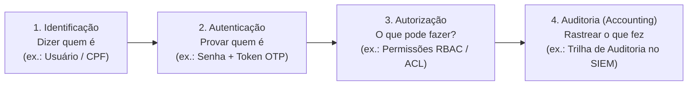
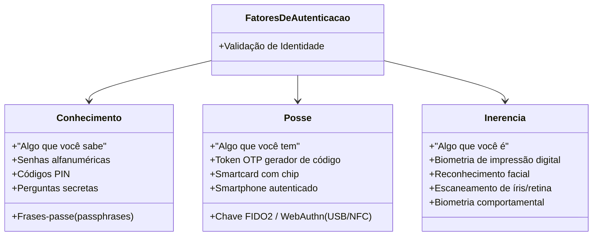
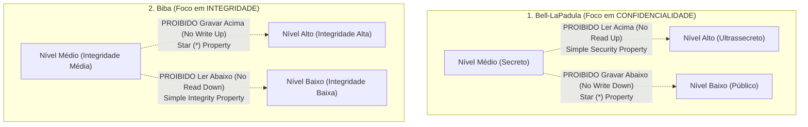
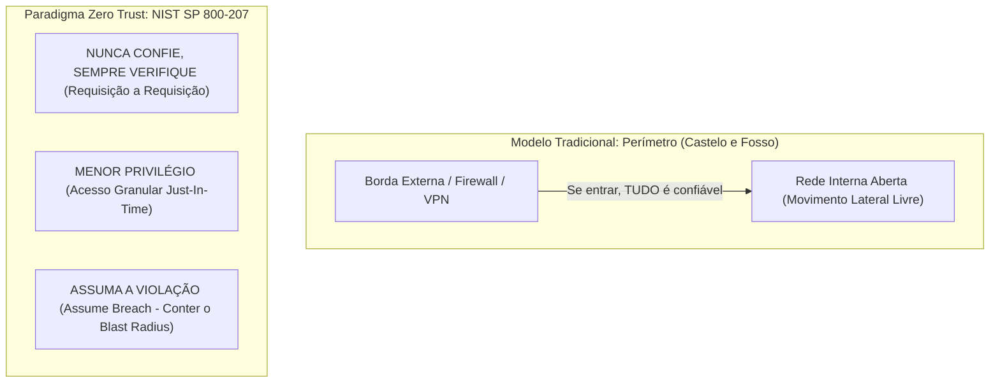
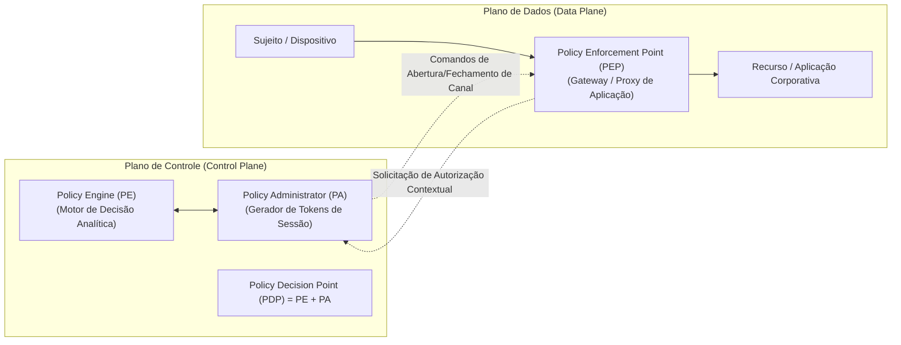

# 03 - Controle de Acesso, IAM e Arquitetura Zero Trust

> **Matéria:** Segurança da Informação  
> **Cargo:** B02 – Técnico de Controle Externo – Especialidade: Tecnologia da Informação  
> **Arquivo:** `03_controle_de_acesso_iam_e_arquitetura_zero_trust.md`  

---

## 📌 Ementa / Itens do Edital
- Controle de acesso lógico: Autenticação, Autorização e Auditoria (AAA)
- Fatores de autenticação e Autenticação Multifator (MFA)
- Modelos clássicos de controle de acesso: DAC, MAC, RBAC e ABAC
- Gestão de Identidades e Acessos (IAM - Identity and Access Management)
- Arquitetura de Confiança Zero (Zero Trust: princípios, pilares e microsegmentação)

---

## 🧭 Sumário

1. [Controle de Acesso Lógico e Mecanismos de Autenticação](#1-controle-de-acesso-logico-e-mecanismos-de-autenticacao)
    1. [O Modelo AAA (Authentication, Authorization, Accounting)](#11-o-modelo-aaa-authentication-authorization-accounting)
    2. [Teste 377](#Teste-377)
    3. [Os Três Fatores Clássicos de Autenticação](#12-os-tres-fatores-classicos-de-autenticacao)
    4. [Autenticação Multifator (MFA / 2FA) e Regras Mandatórias](#13-autenticacao-multifator-mfa-2fa-e-regras-mandatorias)
    5. [Teste 378](#Teste-378)
    6. [Ameaças e Vetores de Ataque contra Credenciais](#14-ameacas-e-vetores-de-ataque-contra-credenciais)
    7. [Teste 379](#Teste-379)
2. [Modelos Clássicos de Controle de Acesso Lógico](#2-modelos-classicos-de-controle-de-acesso-logico)
    1. [Visão Geral e Comparativo dos Modelos (DAC, MAC, RBAC, ABAC)](#21-visao-geral-e-comparativo-dos-modelos-dac-mac-rbac-abac)
    2. [DAC (Discretionary Access Control) e Listas de Controle de Acesso](#22-dac-discretionary-access-control-e-listas-de-controle-de-acesso)
    3. [MAC (Mandatory Access Control) e Modelos Multiníveis Formais: Bell-LaPadula vs. Biba](#23-mac-mandatory-access-control-e-modelos-multiniveis-formais-bell-lapadula-vs-biba)
    4. [Teste 380](#Teste-380)
    5. [RBAC (Role-Based Access Control) na Governança Corporativa](#24-rbac-role-based-access-control-na-governanca-corporativa)
    6. [Teste 381](#Teste-381)
    7. [ABAC (Attribute-Based Access Control) e a Norma XACML](#25-abac-attribute-based-access-control-e-a-norma-xacml)
    8. [Teste 382](#Teste-382)
3. [Gestão de Identidades e Acessos (IAM) e PAM](#3-gestao-de-identidades-e-acessos-iam-e-pam)
    1. [Ciclo de Vida da Identidade (Onboarding, Movimentação e Offboarding)](#31-ciclo-de-vida-da-identidade-onboarding-movimentacao-e-offboarding)
    2. [Menor Privilégio (PoLP) vs. Acúmulo Indevido (Privilege Creep)](#32-menor-privilegio-polp-vs-acumulo-indevido-privilege-creep)
    3. [Gestão de Acessos Privilegiados (PAM): Cofre, JIT e Sessões Gravadas](#33-gestao-de-acessos-privilegiados-pam-cofre-jit-e-sessoes-gravadas)
    4. [Teste 383](#Teste-383)
    5. [Federação de Identidades e Single Sign-On (SSO, SAML 2.0, OpenID Connect)](#34-federacao-de-identidades-e-single-sign-on-sso-saml-20-openid-connect)
    6. [Teste 384](#Teste-384)
4. [Arquitetura Zero Trust (Confiança Zero - NIST SP 800-207)](#4-arquitetura-zero-trust-confianca-zero-nist-sp-800-207)
    1. [O Colapso da Segurança de Borda Tradicional ("Castelo e Fosso")](#41-o-colapso-da-seguranca-de-borda-tradicional-castelo-e-fosso)
    2. [Os Três Princípios Norteadores Oficiais do Zero Trust](#42-os-tres-principios-norteadores-oficiais-do-zero-trust)
    3. [Teste 385](#Teste-385)
    4. [Pilares Fundamentais da Confiança Zero](#43-pilares-fundamentais-da-confianca-zero)
    5. [Microsegmentação e Contenção do Movimento Lateral](#44-microsegmentacao-e-contencao-do-movimento-lateral)
    6. [Teste 386](#Teste-386)
    7. [Componentes Lógicos: Policy Engine (PE), Policy Administrator (PA) e Policy Enforcement Point (PEP)](#45-componentes-logicos-policy-engine-pe-policy-administrator-pa-e-policy-enforcement-point-pep)
    8. [Teste 387](#Teste-387)
5. [Fontes Recomendadas na Internet](#5-fontes-recomendadas-na-internet)

---

## 1. Controle de Acesso Lógico e Mecanismos de Autenticação

### 1.1 O Modelo AAA (Authentication, Authorization, Accounting)

O controle de acesso lógico é a barreira de segurança primordial de qualquer sistema de tecnologia da informação. Ele disciplina e audita a interação entre entidades ativas (**sujeitos**, como usuários humanos, rotinas de código ou microsserviços) e os bens protegidos (**objetos**, como arquivos, bancos de dados ou servidores).

A operação do controle de acesso desdobra-se em quatro fases conceituais sequenciais, historicamente consolidadas no modelo **AAA (acrescido da etapa de identificação preliminar)**:

1. **Identificação:** O sujeito declara perante o sistema quem ele alega ser (fornecendo um nome de usuário, login, endereço de e-mail institucional ou CPF).
2. **Autenticação:** O sistema exige e confere elementos probatórios para atestar a veracidade da identidade alegada (como conferência de credenciais criptográficas).
3. **Autorização:** Uma vez que a autenticidade foi comprovada, o sistema consulta as matrizes de permissão para definir os privilégios exatos e as ações que aquele sujeito específico está legalmente autorizado a executar sobre os recursos.
4. **Auditoria / Responsabilização (*Accounting / Accountability*):** Registro sistemático, cronológico e imutável de todas as ações, requisições de acesso e alterações realizadas pelo sujeito durante sua sessão, viabilizando rastreabilidade forense integral e atribuição de responsabilidades.

---

### Teste 377
**(FGV - TRT / Analista Judiciário - TI - O Modelo AAA em Segurança da Informação)**
O Modelo AAA (*Authentication, Authorization, Accounting*) é o framework arquitetural clássico utilizado para disciplinar a governança e o controle de acesso de usuários e sistemas em redes corporativas.

A respeito da distinção e das atribuições de cada um dos três pilares do modelo AAA, assinale a afirmativa correta:

* **A)** A Autorização (*Authorization*) ocorre antes da Autenticação e consiste na digitação do login e senha pelo usuário.
* **B)** A Autenticação (*Authentication*) verifica a veracidade da identidade alegada pelo sujeito; a Autorização (*Authorization*) determina quais recursos específicos e permissões (leitura, escrita, exclusão) esse sujeito autenticado tem direito de acessar; e a Auditoria (*Accounting/Auditing*) rastreia e registra as ações executadas e o consumo de recursos para fins de responsabilização e conformidade.
* **C)** O pilar de *Accounting* é dispensável em órgãos públicos porque auditorias violam o direito de privacidade funcional dos servidores.
* **D)** A Autorização garante que a identidade nunca será contestada perante um tribunal judicial.
* **E)** Todos os três pilares são executados exclusivamente através de cartões magnéticos sem uso de software ou logs de sistema.

---

> **Comentário Detalhado:**
>
> - **A)** Incorreta. A ordem lógica cronológica e mandatória do modelo AAA é: 1º **Identificação**, 2º **Autenticação** (provar que é quem diz ser), 3º **Autorização** (conceder os privilégios específicos) e 4º **Auditoria/Accounting** (monitorar e registrar).
> - **B)** **CORRETA.** Definição ontológica precisa do **Modelo AAA**:
>   1. **Authentication (Autenticação):** Processo de validação das credenciais para confirmar que a entidade é realmente quem afirma ser (*"Você é quem diz ser?"*).
>   2. **Authorization (Autorização):** Definição das políticas e concessão de privilégios com base na identidade validada (*"O que você tem permissão para fazer?"*).
>   3. **Accounting (Contabilização / Auditoria):** Registro cronológico e detalhado de todas as atividades, conexões, comandos e recursos acessados (*"O que você efetivamente fez e quando?"*), garantindo a responsabilização (*non-repudiation / accountability*).
> - **C)** Incorreta. A auditoria e prestação de contas (*Accounting*) é dever constitucional basilar da administração pública.
> - **D)** Incorreta. Essa propriedade refere-se ao Não Repúdio (*Non-Repudiation*), viabilizado por assinaturas e trilhas seguras.
> - **E)** Incorreta. O modelo AAA é implementado por protocolos modernos como RADIUS, TACACS+, Diameter, LDAP e plataformas de IAM.
> 
> **Gabarito: B**

---

### 1.2 Os Três Fatores Clássicos de Autenticação

Para comprovar a identidade declarada pelo usuário, a ciência da computação agrupa os métodos de prova em três categorias conceituais essenciais:

1. **Fator de Conhecimento ("O que você sabe"):**
    - Baseia-se exclusivamente na retenção mnemônica de informações secretas pelo usuário (senhas alfanuméricas, frases-passe, números PIN, perguntas secretas).
    - *Vulnerabilidades:* Suscetível a ataques de força bruta, tabelas arco-íris (*rainbow tables*), interceptações por *keyloggers*, ataques de repetição e técnicas de engenharia social (phishing).

2. **Fator de Posse ("O que você tem"):**
    - Baseia-se na custódia e no controle físico ou lógico de um artefato tangível exclusivo (cartões inteligentes com chip, *tokens* geradores de códigos de uso único OTP baseados em tempo TOTP ou em evento HOTP, chaves criptográficas físicas FIDO2/U2F conectadas via USB/NFC, ou smartphones autenticados).
    - *Vulnerabilidades:* Riscos de perda material, roubo do hardware, ataques de interceptação via clonagem de chip/número (*SIM swapping*) quando códigos são enviados por SMS.

3. **Fator de Inerência ("O que você é"):**
    - Baseia-se em traços biológicos intrínsecos e únicos do indivíduo:
    - *Biometria Fisiológica:* Padrão de impressões digitais, mapeamento venoso da palma da mão, geometria facial tridimensional, escaneamento de íris ou retina.
    - *Biometria Comportamental:* Cadência e ritmo de digitação no teclado (*keystroke dynamics*), dinâmica da assinatura manual ou modulação vocal.
    - *Vulnerabilidades:* Ocorrência estatística de taxas de Falsa Aceitação (FAR - *False Acceptance Rate*) e Falsa Rejeição (FRR - *False Rejection Rate*). Adicionalmente, dados biométricos vazados não podem ser alterados ou cancelados como uma senha comum.

---

### 1.3 Autenticação Multifator (MFA / 2FA) e Regras Mandatórias

A **Autenticação Multifator (MFA - *Multi-Factor Authentication*)**, que engloba a Autenticação em Dois Fatores (2FA), é a técnica de segurança que condiciona o sucesso do logon à apresentação mandatória de pelo menos dois elementos pertencentes a categorias conceituais **DIFERENTES**.

> 🚨 **ALERTA DE PROVA / PEGADINHA FCC:**  
> A Fundação Carlos Chagas cobra com muita frequência pegadinhas em que um sistema exige, sucessivamente:  
>
> - Uma senha alfanumérica de 10 caracteres; E  
> - Um código PIN numérico de 4 dígitos ou a resposta a uma pergunta secreta.  
> A banca afirma que "trata-se de Autenticação Multifator (MFA)".  
> **ESSA AFIRMATIVA É FALSA!**  
> Senha, código PIN e perguntas secretas são todos elementos baseados na memória do indivíduo, integrando a **mesma categoria conceitual: Conhecimento ("o que você sabe")**. Isso constitui apenas *autenticação de fator único fortalecido*.  
> Para ser tecnicamente classificado como **MFA**, é imperativo conjugar categorias distintas, como:
>
> - Senha (*Conhecimento*) + Token OTP em aplicativo móvel (*Posse*); OU  
> - Smartcard físico (*Posse*) + Leitura de impressão digital (*Inerência*).

---

### Teste 378
**(FCC - Adaptada / TI - Fatores de Autenticação e MFA)**
Em um projeto de reforço da segurança cibernética dos sistemas internos do Tribunal de Contas, a política de senhas estabeleceu a exigência de Autenticação Multifator (MFA) para todos os servidores com acesso a bases fiscais e contábeis.

A respeito dos fatores clássicos de autenticação e dos princípios de MFA, assinale a afirmativa correta:

* **A)** O fornecimento obrigatório de uma senha alfanumérica de 12 dígitos combinada com uma segunda senha numérica (código PIN) configura formalmente uma Autenticação de Dois Fatores (2FA), pois são duas senhas distintas.
* **B)** Para que um mecanismo seja tecnicamente categorizado como Autenticação Multifator (MFA), exige-se a apresentação combinada de elementos pertencentes a pelo menos duas categorias conceituais diferentes: Algo que você sabe (conhecimento, ex.: senha/PIN), Algo que você tem (posse, ex.: token OTP físico/aplicativo ou chave FIDO2) e Algo que você é (inerência, ex.: biometria digital/facial).
* **C)** O fator de posse é caracterizado pela memorização de palavras secretas e respostas a perguntas de segurança sobre fatos da vida do usuário.
* **D)** A biometria comportamental (como o ritmo de digitação ou dinâmica de assinatura) é classificada formalmente como um fator de conhecimento puro.
* **E)** O uso de MFA elimina a necessidade de controle de autorização e revoga automaticamente o princípio do menor privilégio.

---

> **Comentário Detalhado:**
>
> - **A)** Incorreta. Exigir uma senha alfanumérica e um código PIN constitui o fornecimento de duas instâncias da mesma classe conceitual: conhecimento ("algo que você sabe"). Trata-se de autenticação de fator único fortalecido, e não MFA.
> - **B)** Correta. A Autenticação Multifator exige formalmente a combinação de fatores de pelo menos duas categorias conceituais distintas entre conhecimento, posse e inerência.
> - **C)** Incorreta. Palavras secretas e respostas a perguntas baseiam-se em memória cognitiva, caracterizando o fator de conhecimento, e não de posse.
> - **D)** Incorreta. Qualquer biometria (seja física ou comportamental) pertence à classe da inerência ("algo que você é/faz").
> - **E)** Incorreta. Autenticar com MFA não elimina a necessidade da autorização nem do menor privilégio; provar a identidade é apenas a segunda etapa do ciclo AAA.
> 
> **Gabarito: B**

---

### 1.4 Ameaças e Vetores de Ataque contra Credenciais

Os mecanismos de autenticação enfrentam vetores de ataque específicos no cenário de segurança cibernética:

- **Ataque de Força Bruta (*Brute Force*):** Tentativas exaustivas de todas as combinações alfanuméricas possíveis até encontrar o valor correto. Mitiga-se com políticas de bloqueio temporário de conta após $N$ tentativas incorretas (*account lockout*) e introdução de atrasos progressivos.
- **Ataque de Dicionário:** Testes automatizados baseados em listas pré-compiladas com as palavras, nomes e senhas mais comuns utilizadas por usuários.
- **Preenchimento de Credenciais (*Credential Stuffing*):** Uso automatizado de listas com pares de login e senha vazados em incidentes de segurança de empresas terceiras, explorando o hábito generalizado dos usuários de reutilizar a mesma senha em múltiplos portais e serviços.
- **Fadiga de MFA (*MFA Bombing* / *Push Fatigue*):** O atacante, tendo obtido a senha do usuário, dispara dezenas de solicitações de notificação *push* para o aplicativo autenticador no smartphone da vítima de forma ininterrupta, até que o usuário, exausto ou confuso, clique em "Autorizar". Mitiga-se com a exigência de correspondência de número (*number matching*), onde o usuário precisa digitar no app o número que aparece na tela do sistema.

---

### Teste 379
**(FCC - TRT / Analista Judiciário - TI - Vetores de Ataque contra Credenciais: Spraying vs. Stuffing)**
Ataques cibernéticos direcionados a identidades e mecanismos de autenticação representam o principal vetor de invasão a redes corporativas de tribunais e órgãos governamentais.

Dois ataques comuns e sofisticados que burlam políticas tradicionais de bloqueio de conta por tentativas consecutivas são o **Password Spraying** e o **Credential Stuffing**. A distinção técnica precisa entre essas duas modalidades de ataque consiste em:

* **A)** No *Credential Stuffing*, o atacante testa milhões de senhas em uma única conta até forçar a quebra; ao passo que no *Password Spraying*, ele infecta o roteador com um worm.
* **B)** No **Password Spraying**, o atacante testa uma única senha comum e fraca (como `Tribunal@2024`) contra milhares de nomes de usuários corporativos distintos em intervalos espaçados para evitar o disparo de regras de bloqueio de conta por excesso de falhas; enquanto no **Credential Stuffing**, o atacante utiliza listas automatizadas de pares de e-mail/senha vazados de outros serviços e violações prévias na internet, explorando o hábito generalizado dos usuários de reutilizarem as mesmas credenciais em múltiplos portais.
* **C)** Ambos os ataques utilizam exclusivamente redes sem fio Bluetooth a curta distância para interceptar senhas em tempo real.
* **D)** O *Password Spraying* é um ataque físico que arromba as fechaduras do datacenter.
* **E)** A autenticação multifator (MFA) é ineficaz contra esses ataques, pois os robôs conseguem clonar biometria física à distância.

---

> **Comentário Detalhado:**
>
> - **A)** Incorreta. Testar milhões de senhas em uma única conta é um ataque tradicional de **Força Bruta (*Brute Force*)**, facilmente contido por bloqueio de conta após 3 a 5 tentativas erradas.
> - **B)** **CORRETA.** Distinção precisa dos vetores de ataque modernos a credenciais:
>   - **Password Spraying (Pulverização de Senhas):** Inverte o eixo da força bruta. Em vez de testar muitas senhas em uma conta (o que trava a conta), o atacante testa **uma ou duas senhas prováveis em centenas ou milhares de contas diferentes** com pausas temporais. Como há apenas 1 tentativa por conta por hora, as regras de bloqueio por tentativas falhas não são acionadas.
>   - **Credential Stuffing (Preenchimento de Credenciais):** Ataque automatizado em massa que consome bases de dados de credenciais vazadas em brechas públicas (*dumps* da Dark Web). O atacante parte do pressuposto estatístico de que muitos usuários reutilizam a mesma senha do e-mail pessoal ou redes sociais no e-mail corporativo.
>   - **Mitigação Principal:** Adoção obrigatória de **Autenticação Multifator (MFA)** resistente a phishing (FIDO2/WebAuthn), detecção comportamental de anomalias de login e análise contínua de senhas comprometidas.
> - **C)** Incorreta. São ataques realizados remotamente via protocolos web/API ou serviços de diretório.
> - **D)** Incorreta. Trata-se de ameaça lógica a credenciais.
> - **E)** Incorreta. A autenticação multifator (MFA) é precisamente o controle mais eficaz para neutralizar o impacto de ambos os ataques.
> 
> **Gabarito: B**

---

## 2. Modelos Clássicos de Controle de Acesso Lógico

### 2.1 Visão Geral e Comparativo dos Modelos (DAC, MAC, RBAC, ABAC)

| Modelo | Definição Central | Quem Controla os Privilégios? | Aplicações Típicas | Vantagens / Desvantagens |
|---|---|---|---|---|
| **DAC** (*Discretionary Access Control*) | Controle Discricionário. O criador ou proprietário do objeto tem autonomia total para conceder, delegar ou revogar permissões a outros usuários. | O proprietário (*Owner*) do objeto. | Sistemas de arquivos tradicionais (permissões NTFS no Windows, `chmod`/`chown` no Linux). | Alta flexibilidade e operação descentralizada. Desvantagem: baixa governança e vulnerável a vazamentos causados por erros de usuários. |
| **MAC** (*Mandatory Access Control*) | Controle Obrigatório. O sistema central impõe regras invioláveis baseadas em rótulos de sensibilidade da informação e credenciais formais de segurança do usuário. | Administrador Central do Sistema / Política global do kernel. | Ambientes militares, de inteligência e servidores de altíssima segurança (SELinux, AppArmor). | Rigidez máxima contra vazamento e cavalos de troia. Desvantagem: complexidade extrema de configuração e pouca flexibilidade. |
| **RBAC** (*Role-Based Access Control*) | Controle Baseado em Papéis. Os privilégios são vinculados a cargos ou perfis funcionais (ex.: "Auditor Fiscal", "Operador"), e os usuários são associados aos papéis. | Administrador de Segurança Corporativo. | Bancos de dados relacionais (PostgreSQL, Oracle), sistemas ERP, processos eletrônicos de tribunais. | Alinhamento com a estrutura administrativa da organização, simplificação da auditoria e facilidade de escala. |
| **ABAC** (*Attribute-Based Access Control*) | Controle Baseado em Atributos. Avalia dinamicamente atributos do sujeito, do recurso, da ação solicitada e do ambiente (horário, local, dispositivo, risco) via regras booleanas. | Motor de Políticas Centralizado (ex.: XACML). | Ambientes em nuvem (AWS IAM), microsserviços modernos e arquiteturas Zero Trust. | Concessão granular, dinâmica e sensível ao contexto em tempo real. Desvantagem: maior custo de processamento. |

---

### 2.2 DAC (Discretionary Access Control) e Listas de Controle de Acesso

No modelo discricionário, a segurança gira em torno da figura do **proprietário** (*owner*). Quando um usuário cria um documento, planilha ou banco de dados, o sistema operacional atribui a ele a titularidade do objeto. O titular possui discricionariedade absoluta para:

- Conceder leitura, escrita ou execução para colegas de equipe.
- Modificar permissões através de Listas de Controle de Acesso (**ACLs** - *Access Control Lists*).

#### Limitação Crítica do DAC:
Se um usuário mal-intencionado convencer o proprietário de um arquivo sigiloso a conceder-lhe permissão de leitura, esse segundo usuário poderá copiar os dados para um novo arquivo de sua propriedade e disponibilizá-lo publicamente, sem que o sistema consiga bloquear o vazamento.

---

### 2.3 MAC (Mandatory Access Control) e Modelos Multiníveis Formais: Bell-LaPadula vs. Biba

No modelo obrigatório, **nenhum usuário individual tem poder discricionário** sobre suas permissões. Todos os sujeitos e objetos recebem rótulos estritos de segurança impostos pela autoridade central.

Para formalizar matematicamente esses controles em sistemas multiníveis, foram desenvolvidos dois modelos clássicos de referência acadêmica e de concursos:

#### Modelo Bell-LaPadula (Foco Exclusivo em CONFIDENCIALIDADE):
Projetado na década de 1970 para as forças armadas dos EUA para impedir que dados secretos vazem para níveis inferiores:

1. **Propriedade da Segurança Simples (*Simple Security Property* - ss-property):**  
   Um sujeito em determinado nível de classificação não pode ler um objeto com nível de sensibilidade superior ao seu (**"No Read Up"** - Proibido ler para cima). *Objetivo:* Evita que um analista com credencial "Secreto" leia documentos "Ultrassecretos".
2. **Propriedade Estrela (*\*-Property* / Star-Property):**  
   Um sujeito em determinado nível não pode gravar ou transferir dados para um objeto de nível de sensibilidade inferior ao seu (**"No Write Down"** - Proibido escrever para baixo). *Objetivo:* Evita que um usuário com acesso a dados "Ultrassecretos" copie inadvertidamente ou maliciosamente informações para um documento "Público".

#### Modelo Biba (Foco Exclusivo em INTEGRIDADE):
Desenvolvido em contraposição ao Bell-LaPadula, com foco estrito na preservação da correção e confiabilidade dos dados:

1. **Propriedade da Integridade Simples (*Simple Integrity Property*):**  
   Um sujeito não pode ler objetos com nível de integridade inferior ao seu (**"No Read Down"** - Proibido ler para baixo). *Objetivo:* Evita que um processo de alta integridade seja contaminado por dados corrompidos ou não confiáveis.
2. **Propriedade Estrela de Integridade (*\*-Property*):**  
   Um sujeito não pode gravar dados em objetos que possuam nível de integridade superior ao seu (**"No Write Up"** - Proibido escrever para cima). *Objetivo:* Impede que um usuário com baixa credencial corrompa ou altere arquivos vitais do sistema.

> 🚨 **ALERTA DE PROVA / PEGADINHA FCC:**  
> Memorize este mnemônico simples para nunca errar em provas:  
>
> - **Bell-LaPadula:** Foco em **Confidencialidade** $\rightarrow$ *No Read Up* e *No Write Down*.  
> - **Biba:** Foco em **Integridade** $\rightarrow$ *No Read Down* e *No Write Up*.  
> A FCC adora trocar as propriedades entre os dois modelos ou inverter o foco em Confidencialidade versus Integridade!

---

### Teste 380
**(FCC - Adaptada / TI - Modelos Formais de Controle de Acesso / MAC)**
Os modelos teóricos de controle de acesso obrigatório (MAC) Bell-LaPadula e Biba foram desenvolvidos para garantir formalmente propriedades específicas de segurança em sistemas computacionais multiníveis.

Sobre o funcionamento desses dois modelos, assinale a afirmativa correta:

* **A)** O modelo Bell-LaPadula tem como foco principal garantir a integridade dos dados, aplicando a regra de que nenhum usuário pode ler dados com nível de integridade inferior ao seu.
* **B)** No modelo Bell-LaPadula, a Propriedade da Segurança Simples (*Simple Security Property*) determina que um usuário não pode ler informações em um nível de sensibilidade superior ao seu (*No Read Up*), enquanto a Propriedade Estrela (*\*-Property*) proíbe que ele grave dados em níveis inferiores (*No Write Down*).
* **C)** O modelo Biba foi projetado para assegurar confidencialidade, autorizando que usuários leiam documentos ultrassecretos mesmo possuindo credencial pública.
* **D)** No modelo Biba, a propriedade de integridade simples autoriza que sujeitos leiam dados de níveis de integridade inferiores sem restrições (*Read Down livre*).
* **E)** Ambos os modelos Bell-LaPadula e Biba operam sob a filosofia de controle discricionário (DAC), na qual o criador do arquivo detém total autonomia para conceder privilégios a terceiros.

---

> **Comentário Detalhado:**
>
> - **A)** Incorreta. O modelo Bell-LaPadula tem como foco primordial a garantia da confidencialidade, e não da integridade (o modelo com foco em integridade é o Biba).
> - **B)** Correta. O modelo Bell-LaPadula define que para preservar a confidencialidade aplicam-se a Propriedade de Segurança Simples (*No Read Up* - não ler acima) e a Propriedade Estrela (*No Write Down* - não escrever abaixo, impedindo que segredos sejam vazados para níveis públicos).
> - **C)** Incorreta. Biba foi desenvolvido com foco exclusivo em integridade, e não confidencialidade.
> - **D)** Incorreta. No modelo Biba, ler dados de integridade inferior é vedado (*No Read Down*), para evitar que sujeitos ou processos de alta integridade sejam contaminados por informações espúrias.
> - **E)** Incorreta. Bell-LaPadula e Biba são modelos formais clássicos de Controle de Acesso Obrigatório (MAC), e não discricionário (DAC).
> 
> **Gabarito: B**

---

### 2.4 RBAC (Role-Based Access Control) na Governança Corporativa

No modelo **RBAC**, o controle de acesso é desacoplado dos usuários individuais e atribuído a **Papéis (*Roles*)** correspondentes a funções de negócio da organização (ex.: `Auditor`, `Gestor de Contratos`, `DBA`).

#### Dinâmica de Funcionamento:
1. As permissões de leitura, inserção, alteração e exclusão sobre tabelas e sistemas são associadas diretamente aos **Papéis**.
2. Os **Usuários** são associados a um ou mais papéis.
3. Quando um colaborador é promovido ou assume nova atribuição, basta alterar sua filiação de papéis, sem necessidade de reconfigurar milhares de tabelas e pastas individualmente.

#### Variações Normatizadas (NIST RBAC):
- **RBAC0 (Básico):** Mapeamento direto entre usuários, papéis e permissões.
- **RBAC1 (Hierárquico):** Suporta herança hierárquica entre papéis (ex.: o papel `Auditor-Chefe` herda automaticamente todas as permissões do papel `Auditor-Assistente`).
- **RBAC2 (Restrições):** Adiciona regras de Separação de Deveres (*Separation of Duties* - SoD), como impedir que o mesmo usuário pertença simultaneamente ao papel de `Solicitante de Pagamento` e `Aprovador de Pagamento`.
- **RBAC3 (Consolidado):** Combina hierarquia (RBAC1) com restrições de separação de deveres (RBAC2).

---

### Teste 381
**(FGV - TRT / Analista Judiciário - TI - Controle de Acesso RBAC e Variações NIST)**
O modelo de Controle de Acesso Baseado em Papéis (*Role-Based Access Control - RBAC*), formalizado pelo NIST (norma ANSI/INCITS 359-2004), é o padrão mais amplamente implementado em sistemas corporativos governamentais.

A respeito das variações normativas da família RBAC do NIST, assinale a afirmativa correta:

* **A)** O RBAC0 é a forma mais complexa do modelo, exigindo inteligência artificial quântica para alocação de usuários.
* **B)** O **RBAC1** adiciona o conceito de **Hierarquia de Papéis** (*Role Hierarchy*), no qual papéis seniores herdam automaticamente todas as permissões concedidas aos papéis juniores; e o **RBAC2** introduz restrições formais de **Separação de Funções** (*Separation of Duties - SoD*), divididas em SoD Estática (SSD, impedindo que um usuário pertença a papéis conflitantes) e SoD Dinâmica (DSD, permitindo a titularidade dos papéis, mas impedindo que sejam ativados simultaneamente na mesma sessão).
* **C)** O RBAC2 proíbe que um auditor possua mais de uma função em toda a sua vida profissional.
* **D)** O RBAC3 é a simplificação mínima que revoga todos os privilégios de todos os usuários corporativos.
* **E)** O modelo RBAC atribui permissões diretamente aos nomes de pessoas físicas, proibindo a criação de papéis ou perfis intermediários.

---

> **Comentário Detalhado:**
>
> - **A)** Incorreta. O **RBAC0** (*Core RBAC*) é o modelo elementar básico (usuários, papéis, permissões e sessões), sem hierarquia ou restrições.
> - **B)** **CORRETA.** Taxonomia formal do **NIST RBAC**:
>   - **RBAC0 (Core):** Conjuntos de Usuários, Papéis (*Roles*) e Permissões. Permissões são associadas a papéis, e usuários são vinculados a papéis.
>   - **RBAC1 (Hierarchical):** Adiciona herança de papéis ($RBAC0 + \text{Hierarquia}$). Um papel superior (ex.: Diretor de Auditoria) herda todos os privilégios do papel subordinado (Auditor Fiscal).
>   - **RBAC2 (Constraint):** Adiciona regras de Separação de Funções ($RBAC0 + \text{Restrições SoD}$). A SoD Estática (*SSD*) impede a atribuição de papéis conflitantes (ex.: quem cria empenho não pode ser do papel que aprova pagamento); a SoD Dinâmica (*DSD*) restringe a ativação na mesma sessão.
>   - **RBAC3 (Unified):** Combina simultaneamente hierarquia e restrições de separação de funções ($RBAC1 + RBAC2$).
> - **C)** Incorreta. O SoD restringe conflitos de interesse específicos entre papéis críticos, não a carreira do profissional.
> - **D)** Incorreta. O RBAC3 é o modelo unificado completo.
> - **E)** Incorreta. A definição basilar do RBAC é justamente **desacoplar** usuários de permissões diretas por meio de papéis.
> 
> **Gabarito: B**

---

### 2.5 ABAC (Attribute-Based Access Control) e a Norma XACML

O **ABAC** é a evolução dinâmica do controle de acesso, projetado para resolver a explosão desordenada de papéis (*role explosion*) do RBAC em organizações gigantescas. Em vez de verificar um cargo fixo, o sistema processa expressões booleanas sobre quatro conjuntos de **atributos**:

1. **Atributos do Sujeito:** Cargo, departamento, autorização de segurança, antiguidade.
2. **Atributos do Recurso/Objeto:** Classificação da informação, projeto vinculado, proprietário do dado.
3. **Atributos da Ação:** Leitura, gravação, exclusão, exportação via API.
4. **Atributos do Ambiente / Contexto:** Horário da solicitação, geolocalização física (país/cidade), se a conexão parte da VPN institucional ou rede aberta, conformidade de segurança do dispositivo (*health status*).

#### Norma XACML (eXtensible Access Control Markup Language):
Padrão internacional aberto formulado pela OASIS que define a linguagem XML/JSON e a arquitetura para processamento de políticas ABAC, servindo de fundação para os componentes lógicos de controle de acesso moderno.

---

### Teste 382
**(FCC - TRT / Analista Judiciário - TI - Controle de Acesso ABAC e a Arquitetura XACML)**
Em ambientes corporativos complexos com requisitos dinâmicos de auditoria, o Controle de Acesso Baseado em Atributos (*Attribute-Based Access Control - ABAC*) supera as limitações do RBAC ao avaliar atributos do sujeito, do recurso, da ação e do contexto ambiental (como horário, localização IP e nível de ameaça).

Na implementação padrão do ABAC segundo a norma **XACML** (*eXtensible Access Control Markup Language* da OASIS), o componente de software que atua como o ponto de decisão, avaliando as políticas de acesso e emitindo a decisão autorizativa (*Permit* ou *Deny*), é denominado:

* **A)** Policy Enforcement Point (PEP).
* **B)** Policy Decision Point (PDP).
* **C)** Policy Administration Point (PAP).
* **D)** Policy Information Point (PIP).
* **E)** Security Assertion Markup Language (SAML).

---

> **Comentário Detalhado:**
>
> - **A)** Incorreta. O **PEP (Policy Enforcement Point)** é o ponto de interceptação e aplicação que intercepta a requisição do usuário, repassa ao PDP e aplica a decisão (*bloqueia ou libera*).
> - **B)** **CORRETA.** Arquitetura canônica de referência do **XACML / ABAC**:
>   - **PDP (Policy Decision Point):** O "cérebro" avaliador. Recebe a solicitação do PEP, busca os atributos necessários no PIP, confronta as regras e políticas vindas do PAP e profere a decisão lógica (*Permit*, *Deny*, *NotApplicable* ou *Indeterminate*).
>   - **PEP (Policy Enforcement Point):** O interceptador e executor no plano de dados.
>   - **PAP (Policy Administration Point):** O repositório administrativo onde os administradores criam, gerenciam e armazenam as políticas XACML.
>   - **PIP (Policy Information Point):** A fonte de atributos que fornece dados sobre o sujeito, recurso ou ambiente (ex.: Active Directory, servidores de geolocalização).
> - **C)** Incorreta. O PAP apenas gerencia e armazena os arquivos de políticas.
> - **D)** Incorreta. O PIP é a fonte de dados que provê os valores dos atributos.
> - **E)** Incorreta. SAML é um padrão de asserção de identidade para federação, não o motor de decisão do XACML.
> 
> **Gabarito: B**

---

## 3. Gestão de Identidades e Acessos (IAM) e PAM

### 3.1 Ciclo de Vida da Identidade (Onboarding, Movimentação e Offboarding)

O **IAM (*Identity and Access Management*)** gerencia as identidades digitais desde o ingresso do colaborador até sua desvinculação definitiva da instituição:

1. **Provisionamento (*Onboarding* / Entrada):** Criação da identidade digital corporativa e concessão automática das permissões mínimas indispensáveis para o exercício da função comissionada ou cargo de concurso.
2. **Movimentação / Transição:** Ajuste imediato e automatizado das permissões quando o servidor é transferido de setor ou assume novas funções de chefia. Privilégios que eram necessários na unidade antiga devem ser revogados imediatamente.
3. **Desprovisionamento (*Offboarding* / Saída):** Revogação imediata, integral e irrevogável de todos os acessos lógicos (contas de e-mail, VPN, acessos a bancos de dados) e físicos (crachás magnéticos) no exato instante da exoneração, demissão ou término do contrato.

---

### 3.2 Menor Privilégio (PoLP) vs. Acúmulo Indevido (Privilege Creep)

- **Princípio do Menor Privilégio (*Principle of Least Privilege* - PoLP):** Diretriz de ouro segundo a qual toda entidade (usuário ou processo) deve receber estritamente o conjunto mínimo de permissões indispensável para a conclusão de suas tarefas regulamentares, pelo menor período de tempo necessário.
- **Acúmulo Indevido de Privilégios (*Privilege Creep*):** Fenômeno patológico e extremamente comum em órgãos públicos e empresas privadas onde o servidor muda sucessivamente de lotação ao longo dos anos, recebendo novas permissões a cada transferência sem que os acessos dos setores anteriores sejam excluídos. Ao final de uma década, o usuário acumula privilégios desmesurados, transformando-se em um vetor de risco crítico caso sua credencial seja comprometida.  
  *Mitigação:* Realização de campanhas obrigatórias periódicas de **Recertificação de Acessos** (*Access Review*), onde chefias imediatas devem aprovar formalmente a continuidade de cada permissão ativa.

---

### 3.3 Gestão de Acessos Privilegiados (PAM): Cofre, JIT e Sessões Gravadas

Contas que detêm privilégios administrativos elevados (tais como `root` no Linux, `Domain Admins` no Active Directory e `SYS`/`sa` em bancos de dados) constituem o alvo preferencial de cibercriminosos e malwares avançados. As ferramentas de **PAM (*Privileged Access Management*)** eliminam o uso descontrolado dessas credenciais:

- **Cofre Seguro de Senhas (*Password Vault*):** As senhas de superusuário ficam guardadas em um cofre criptografado central. Nenhum administrador humano conhece a senha real; o sistema altera as senhas automaticamente após cada utilização (senhas descartáveis de uso único).
- **Acesso Just-In-Time (JIT):** Princípio em que permissões privilegiadas não permanecem ativas continuamente. O administrador solicita acesso para realizar uma manutenção pré-agendada; o sistema concede os privilégios com prazo de expiração automático estrito (ex.: 2 horas), revogando-os ao final.
- **Gravação e Auditoria de Sessões Privilegiadas:** Toda conexão administrativa é intermediada por um proxy seguro que grava em vídeo e em texto todos os comandos digitados pelo administrador, garantindo responsabilização irrefutável (*non-repudiation*).

---

### Teste 383
**(FCC - Adaptada / TI - IAM, PAM e Governança de Privilégios)**
Em uma auditoria de governança de TI em um órgão fazendário estadual, verificou-se que servidores transferidos de setor mantinham ativas as permissões de acesso aos sistemas do departamento anterior, e que administradores de banco de dados utilizavam senhas compartilhadas estáticas de superusuário (`sa`) diretamente em suas estações de trabalho.

Considerando os princípios de Governança de Identidades (IAM) e de Gestão de Acessos Privilegiados (PAM), assinale a prática recomendada para sanear essas não conformidades:

* **A)** Adotar o acúmulo irrestrito de permissões (*Privilege Creep*) como política oficial, garantindo que servidores acumulem direitos ao longo da carreira para acelerar o atendimento ao público.
* **B)** Implementar uma solução de PAM (*Privileged Access Management*) baseada em cofre seguro de senhas com rotação periódica automatizada, sessões administrativas gravadas e elevação de privilégios temporária *Just-In-Time* (JIT); associada a revisões periódicas de acesso no IAM para revogar imediatamente permissões incompatíveis com a nova lotação do servidor.
* **C)** Desativar os logs de auditoria do sistema IAM para otimizar o espaço em disco do servidor de diretórios LDAP.
* **D)** Substituir o desprovisionamento automático de contas inativas pela concessão vitalícia de privilégios administrativos a todos os prestadores de serviço terceirizados.
* **E)** Padronizar o uso de contas genéricas e senhas únicas para todos os membros da equipe de sustentação de infraestrutura.

---

> **Comentário Detalhado:**
>
> - **A)** Incorreta. O acúmulo indevido de permissões (*Privilege Creep*) é uma vulnerabilidade crítica decorrente de falhas no processo de gestão de mudanças de cargo e deve ser estritamente erradicado.
> - **B)** Correta. Soluções de PAM com cofre de senhas, privilégios temporários JIT e sessões gravadas saneiam o uso indevido de contas privilegiadas compartilhadas, enquanto campanhas periódicas de recertificação de acessos combatem o acúmulo residual de privilégios.
> - **C)** Incorreta. A desativação de logs de auditoria viola diretamente o princípio da responsabilização (*accountability*) e inviabiliza investigações e auditorias de controle externo.
> - **D)** Incorreta. A concessão vitalícia e a ausência de desprovisionamento violam os preceitos mandatórios de segurança do ciclo de vida de identidades.
> - **E)** Incorreta. O uso de contas genéricas compartilhadas destrói o princípio do não repúdio e da rastreabilidade individual das operações de TI.
> 
> **Gabarito: B**

---

### 3.4 Federação de Identidades e Single Sign-On (SSO, SAML 2.0, OpenID Connect)

Para mitigar a fadiga de senhas e a dispersão de credenciais entre múltiplos portais, adotam-se soluções de identidade federada:

- **SSO (*Single Sign-On*):** Mecanismo de autenticação centralizada que permite a um usuário realizar logon uma única vez e obter acesso autorizado a múltiplos sistemas e portais sem redigitar credenciais.
- **SAML 2.0 (*Security Assertion Markup Language*):** Padrão aberto baseado em asserções XML assinado digitalmente, muito utilizado na comunicação corporativa entre o Provedor de Identidade (**IdP** - *Identity Provider*) e o Provedor de Serviços (**SP** - *Service Provider*).
- **OpenID Connect (OIDC):** Camada de autenticação moderna de identidade construída sobre a infraestrutura REST/HTTPS do protocolo OAuth 2.0. Emprega tokens de identidade codificados em **JSON Web Token (JWT)**, sendo amplamente adotada em aplicações web móveis e microsserviços em nuvem.

---

### Teste 384
**(FGV - TRT / Analista Judiciário - TI - Federação de Identidades e SSO: SAML vs. OpenID Connect)**
A federação de identidades permite que os servidores de um tribunal acessem múltiplos sistemas governamentais integrados utilizando uma única conta corporativa com o mecanismo de *Single Sign-On* (SSO).

A respeito dos protocolos padronizados de autenticação e autorização federada, assinale a afirmativa correta:

* **A)** O protocolo SAML 2.0 utiliza tokens ultraleves em formato JSON, enquanto o OpenID Connect é baseado em mensagens pesadas em XML.
* **B)** O **OAuth 2.0** é estritamente um framework de **Autorização** (concessão de permissões via tokens de acesso delegados), ao passo que o **OpenID Connect (OIDC)** é uma camada de **Autenticação** construída no topo do OAuth 2.0, que introduz o token de identidade padronizado (*ID Token*) no formato JSON Web Token (JWT) para comprovar quem é o usuário.
* **C)** No protocolo SAML 2.0, o Provedor de Identidade (IdP) e o Provedor de Serviço (SP) operam sem qualquer chave pública ou certificado X.509.
* **D)** O OpenID Connect exige compulsoriamente o envio da senha em texto claro do usuário para todas as aplicações de terceiros conectadas.
* **E)** O mecanismo de Single Sign-On obriga o usuário a digitar sua senha novamente a cada novo clique em uma página do portal.

---

> **Comentário Detalhado:**
>
> - **A)** Incorreta. Inverteu os padrões: o **SAML 2.0** é baseado em asserções estruturadas e pesadas em **XML** assinadas com certificados X.509; o **OpenID Connect** é moderno, baseado em REST/JSON e tokens JWT (*JSON Web Tokens*).
> - **B)** **CORRETA.** Relação arquitetural fundamental entre **OAuth 2.0 e OIDC**:
>   - **OAuth 2.0 (RFC 6749):** Framework de autorização delegado (*delegated authorization*). Emite `Access Tokens` que dizem a uma API o que o cliente pode acessar, mas **não é um protocolo de autenticação** (não diz à aplicação cliente quem é o usuário nem como ele se autenticou).
>   - **OpenID Connect (OIDC):** Estende o OAuth 2.0 para adicionar a camada de autenticação que faltava. Emite um **ID Token** (formato JWT assinado digitalmente contendo asserções de identidade ou *claims*, como `sub`, `iss`, `email`, `auth_time`), permitindo que a aplicação cliente valide a identidade do sujeito com segurança em aplicações web e mobile.
> - **C)** Incorreta. SAML 2.0 requer certificados X.509 em ambas as pontas para assinar e cifrar as asserções XML.
> - **D)** Incorreta. Em federação, a aplicação cliente **jamais vê a senha do usuário**; a autenticação ocorre exclusivamente no Provedor de Identidade (IdP).
> - **E)** Incorreta. O propósito basilar do SSO (*Single Sign-On*) é autenticar o usuário uma única vez e permitir acesso transparente a múltiplos sistemas durante a sessão.
> 
> **Gabarito: B**

---

## 4. Arquitetura Zero Trust (Confiança Zero - NIST SP 800-207)

### 4.1 O Colapso da Segurança de Borda Tradicional ("Castelo e Fosso")

Historicamente, as organizações estruturavam sua segurança no modelo do **"Castelo e Fosso"** (*Perimeter-based Security*):

- Erguia-se uma muralha rígida na borda da rede composta por firewalls perimetrais e concentradores VPN.
- Dividia-se a rede em "Externa (Hostil)" e "Interna (Confiável)".
- Uma vez que o colaborador acessava a rede local (conectando o cabo de rede na sede do órgão ou autenticando-se na VPN), ele passava a gozar de **confiança implícita**, podendo navegar livremente por dezenas de servidores e sub-redes.

Esse modelo faliu tecnicamente por três razões contemporâneas:

1. **Dissolução do Perímetro Físico:** Usuários trabalham em regime remoto e as aplicações residem em nuvens públicas diversas (SaaS, IaaS, multicloud).
2. **Ameaças Internas (*Insider Threats*):** Funcionários descontentes ou credenciais internas legítimas roubadas por phishing.
3. **Movimento Lateral de Malwares:** Uma vez infectado um único terminal de entrada (ex.: computador da recepção), o ransomware explora a confiança implícita da rede interna para se espalhar horizontalmente até servidores centrais de banco de dados e controladores de domínio.

---

### 4.2 Os Três Princípios Norteadores Oficiais do Zero Trust

Normatizada pelo Instituto Nacional de Padrões e Tecnologia dos EUA através do documento **NIST SP 800-207**, a Arquitetura Zero Trust substitui a confiança baseada em topologia física por verificações dinâmicas contínuas alicerçadas em três princípios centrais:

1. **Nunca Confie, Sempre Verifique (*Never Trust, Always Verify*):**
    - Não existe zona de confiança implícita, mesmo para conexões originadas do prédio sede da corporação ou de computadores patrimoniados. Toda e qualquer requisição de acesso deve ser autenticada, autorizada e criptografada explicitamente, avaliando em tempo real o contexto da sessão.

2. **Conceda Acesso com Menor Privilégio (*Use Least Privilege Access*):**
    - Limite a exposição de dados concedendo acesso apenas ao recurso exato demandado, utilizando controles adaptativos como *Just-In-Time* (JIT) e *Just-Enough-Access* (JEA).

3. **Assuma a Violação (*Assume Breach*):**
    - Projete os sistemas partindo da certeza de que o adversário já conseguiu comprometer algum elemento da infraestrutura. Reduza ao máximo o "raio de explosão" (*blast radius*) do ataque por meio de **microsegmentação**, inspeção detalhada de todo o tráfego e criptografia de dados em trânsito e em repouso.

---

### Teste 385
**(FCC - Adaptada / TI - Arquitetura Zero Trust / Princípios Norteadores)**
A equipe de infraestrutura e segurança da informação de um tribunal deliberou sobre a substituição do seu antigo modelo de segurança perimetral baseado em VPN ("castelo e fosso") por uma Arquitetura Zero Trust alinhada à norma NIST SP 800-207.

A respeito dos princípios fundamentais que regem o paradigma Zero Trust, assinale a afirmativa correta:

* **A)** O modelo assume como premissa que todas as máquinas conectadas à rede cabeada interna da sede do órgão são seguras e não exigem monitoramento contínuo de tráfego.
* **B)** O princípio *"Never Trust, Always Verify"* determina que toda tentativa de conexão, originada de dentro ou de fora da rede física da organização, deve ser autenticada, autorizada e criptografada explicitamente e de forma contínua em cada requisição.
* **C)** O princípio *"Assume Breach"* orienta os gestores a abandonar os mecanismos de microsegmentação de rede, dado que a invasão já é tratada como inevitável.
* **D)** A arquitetura Zero Trust baseia suas concessões de acesso exclusivamente no endereço IP de origem do usuário, dispensando a avaliação do estado do dispositivo e da identidade.
* **E)** No Zero Trust, após a primeira autenticação realizada com sucesso no início da jornada de trabalho, o usuário obtém acesso irrestrito a todas as aplicações corporativas pelo período contínuo de 30 dias.

---

> **Comentário Detalhado:**
>
> - **A)** Incorreta. A falha central combatida pelo Zero Trust é justamente tratar redes internas como confiáveis. Nenhuma zona de rede é implicitamente segura.
> - **B)** Correta. O princípio fundamental do Zero Trust preconiza que não há confiança implícita para nenhuma solicitação; toda requisição deve ser explicitamente autenticada, autorizada e criptografada a cada acesso.
> - **C)** Incorreta. Assumir a violação (*Assume Breach*) exige a implantação vigorosa de microsegmentação e criptografia para conter o raio de alcance da invasão e deter movimentos laterais.
> - **D)** Incorreta. O Zero Trust baseia-se na validação contínua da identidade, na integridade do dispositivo e em políticas de contexto adaptativo, tratando endereços IP como parâmetros secundários e de baixa confiança.
> - **E)** Incorreta. Concessões perenes e irrestritas são antagônicas ao Zero Trust, que prega avaliação dinâmica contínua e concessão pontual de privilégios *Just-In-Time*.
> 
> **Gabarito: B**

---

### 4.3 Pilares Fundamentais da Confiança Zero

Conforme estabelecido pela CISA (*Cybersecurity and Infrastructure Security Agency*), o Zero Trust estrutura-se sobre cinco pilares técnicos interligados:

- **Identidade:** Garantia de identificação inequívoca de usuários e contas de serviço com MFA resistente a phishing e análise de risco contextual.
- **Dispositivos:** Avaliação rigorosa da integridade física e lógica dos endpoints (sistema operacional atualizado, presença de EDR ativo, criptografia de disco ativa).
- **Redes:** Fim de redes planas; adoção de isolamento estrito e perímetros definidos por software (SDP).
- **Aplicações e Cargas de Trabalho (*Workloads*):** Proteção direta em nível de aplicação e microsserviços (containers, APIs), com validações contínuas de segurança.
- **Dados:** Classificação, inventário e cifragem de informações confidenciais onde quer que residam.

---

### 4.4 Microsegmentação e Contenção do Movimento Lateral

A **microsegmentação** é o componente de rede estrutural do Zero Trust. Consiste em dividir a rede corporativa e os datacenters em pequenas zonas de isolamento de segurança granulares, muitas vezes descendo até o nível de uma máquina virtual ou container individual.

Diferente dos firewalls tradicionais que filtram apenas tráfego norte-sul (entrada e saída da Internet), a microsegmentação aplica regras rigorosas ao **tráfego leste-oeste** (comunicação entre servidores internos). Assim, caso um servidor web seja invadido, o atacante é impedido de realizar movimento lateral para alcançar o banco de dados contábil que reside na mesma rede física.

---

### Teste 386
**(FGV - TRT / Analista Judiciário - TI - Arquitetura Zero Trust: Microsegmentação de Rede)**
A publicação especial NIST SP 800-207 consolida a Arquitetura Zero Trust (ZTA), superando o modelo obsoleto de segurança de perímetro baseado em "castelo e fosso", adotando o lema: *"Nunca Confie, Sempre Verifique"*.

Dentre os pilares técnicos fundamentais do Zero Trust, a técnica de **Microsegmentação** de rede tem por finalidade primordial:

* **A)** Unificar todas as redes, estações de trabalho e bancos de dados em uma única VLAN plana sem roteadores.
* **B)** Dividir o datacenter corporativo em zonas lógicas de segurança altamente granulares e isoladas no nível de carga de trabalho (*workload*), aplicando políticas estritas de comunicação L7 que inspecionam o tráfego leste-oeste (*East-West traffic*), com o propósito específico de conter e impedir a **movimentação lateral** de atacantes em caso de comprometimento de um nó da rede.
* **C)** Garantir que todos os pacotes de rede sejam transmitidos sem criptografia para facilitar o monitoramento passivo.
* **D)** Aumentar a área de broadcast da rede para acelerar transmissões de vídeo em alta resolução.
* **E)** Eliminar completamente o uso de firewalls e sistemas de controle de acesso nos servidores centrais.

---

> **Comentário Detalhado:**
>
> - **A)** Incorreta. Uma rede plana (sem segmentação) é a antítese do Zero Trust, permitindo que um atacante que invada uma máquina tenha livre acesso a todos os servidores do tribunal.
> - **B)** **CORRETA.** Fundamentos da **Microsegmentação no Zero Trust**:
>   - No modelo tradicional, o firewall de borda protegia o tráfego norte-sul (entrada e saída da internet), mas o interior da rede era considerado confiável (tráfego leste-oeste livre).
>   - Na ZTA (NIST SP 800-207), assume-se a premissa de comprometimento prévio (*Assume Breach*). A **microsegmentação** cria perímetros de segurança microscópicos e dinâmicos ao redor de cada serviço, contêiner ou máquina virtual.
>   - Mesmo que um invasor comprometa uma estação de trabalho de um estagiário ou um servidor web na DMZ, ele fica enclausurado naquele microsegmento isolado, **sendo bloqueado em qualquer tentativa de movimento lateral (*lateral movement*)** em direção ao banco de dados ou controladores de domínio.
> - **C)** Incorreta. O Zero Trust exige criptografia em trânsito ponta a ponta (mTLS) em toda comunicação interna.
> - **D)** Incorreta. A microsegmentação elimina domínios de broadcast amplos.
> - **E)** Incorreta. Ela multiplica a aplicação de regras granulares de filtragem lógica em cada nó.
> 
> **Gabarito: B**

---

### 4.5 Componentes Lógicos: Policy Engine (PE), Policy Administrator (PA) e Policy Enforcement Point (PEP)

O NIST SP 800-207 divide formalmente os componentes lógicos da Arquitetura Zero Trust em dois planos de operação:

#### No Plano de Controle (*Control Plane*):
- **Policy Engine (PE - Motor de Políticas):** É o cérebro decisório central. Avalia as políticas organizacionais, sinais de telemetria de segurança, reputação de risco e integridade do cliente para **tomar a decisão final** de permitir, negar ou revogar o acesso solicitado.
- **Policy Administrator (PA - Administrador de Políticas):** É o componente executor das decisões do PE. Se o PE aprova a requisição, o PA envia os comandos técnicos ao PEP para que este abra o canal de comunicação seguro, emitindo as credenciais ou tokens de sessão.  
  *(A união conceitual entre o PE e o PA forma o **Policy Decision Point - PDP**)*.

#### No Plano de Dados (*Data Plane*):
- **Policy Enforcement Point (PEP - Ponto de Aplicação de Políticas):** É o componente de fronteira posicionado diretamente no fluxo de tráfego (gateway seguro, proxy reverso ou agente instalado no dispositivo). O PEP **intercepta, fiscaliza, permite ou encerra** as conexões diretas entre o usuário e o recurso, acatando cegamente as ordens recebidas do PA.

---

### Teste 387
**(FCC - Adaptada / TI - Componentes Lógicos do Zero Trust / NIST SP 800-207)**
A publicação técnica especial NIST SP 800-207 divide a Arquitetura Zero Trust em componentes lógicos fundamentais distribuídos entre o Plano de Controle (*Control Plane*) e o Plano de Dados (*Data Plane*).

Assinale a opção que descreve corretamente o papel e a função desses componentes lógicos:

* **A)** O Policy Enforcement Point (PEP) é o cérebro central responsável por redigir e tomar a decisão analítica final sobre conceder ou revogar o acesso a um recurso corporativo.
* **B)** O Policy Decision Point (PDP) é composto logicamente pela união do Policy Engine (PE), responsável pela decisão de autorização, e do Policy Administrator (PA), responsável por comandar o estabelecimento ou encerramento da sessão de comunicação.
* **C)** O Policy Engine (PE) é um dispositivo de rede passivo que apenas encaminha os pacotes TCP sem aplicar nenhuma regra de segurança.
* **D)** O Policy Administrator (PA) atua no plano de dados interceptando fisicamente o tráfego de dados sensíveis entre o usuário e o banco de dados.
* **E)** A arquitetura Zero Trust do NIST veda expressamente o uso de PEPs intermediários entre o dispositivo do usuário e as aplicações de negócio.

---

> **Comentário Detalhado:**
>
> - **A)** Incorreta. Quem toma a decisão de acesso é o Policy Engine (PE); o PEP limita-se a executar e impor (*enforce*) a decisão recebida.
> - **B)** Correta. Na arquitetura NIST SP 800-207, o Policy Decision Point (PDP) agrega logicamente o Policy Engine (PE - cérebro decisório) e o Policy Administrator (PA - coordenador de sessões e emissor de comandos ao PEP).
> - **C)** Incorreta. O Policy Engine é o motor analítico de inteligência que processa regras contextuais de autorização, não se confundindo com switches ou roteadores passivos.
> - **D)** Incorreta. O Policy Administrator atua estritamente no Plano de Controle. Quem intercepta fisicamente a comunicação no Plano de Dados é o Policy Enforcement Point (PEP).
> - **E)** Incorreta. O PEP é elemento mandatório posicionado entre o cliente e os recursos corporativos para interceptar e controlar o fluxo de dados.
> 
> **Gabarito: B**

---

## 6. Fontes Recomendadas na Internet

* [NIST SP 800-207 - Zero Trust Architecture](https://csrc.nist.gov/pubs/sp/800/207/final) - Publicação seminal do NIST definindo os princípios e a arquitetura oficial Zero Trust.
* [NIST SP 800-63B - Digital Identity Guidelines: Authentication and Lifecycle Management](https://pages.nist.gov/800-63-3/sp800-63b.html) - Diretrizes técnicas de autenticação de usuários, políticas de senhas e autenticação multifator (MFA).
* [IETF RFC 6749 - The OAuth 2.0 Authorization Framework](https://datatracker.ietf.org/doc/html/rfc6749) - Especificação oficial do framework de autorização e concessão de tokens OAuth 2.0.
* [OWASP Access Control Cheat Sheet](https://cheatsheetseries.owasp.org/cheatsheets/Access_Control_Cheat_Sheet.html) - Guia prático de implementação e validação de controles de acesso RBAC e ABAC.
* [Decreto nº 10.543/2020 (Níveis de Autenticação e Assinatura Eletrônica)](https://www.planalto.gov.br/ccivil_03/_ato2019-2022/2020/decreto/d10543.htm) - Dispõe sobre o uso das assinaturas eletrônicas e níveis de confiabilidade (bronze, prata e ouro) no âmbito da administração pública.
* KUROSE, James F.; ROSS, Keith W. **Redes de Computadores e a Internet: Uma Abordagem Top-Down**. 7. ed. São Paulo: Pearson Education do Brasil, 2017. (Cap. 8 - Segurança em Redes de Computadores: Autenticação e Controle de Acesso).
* STALLINGS, William. **Criptografia e Segurança de Redes: Princípios e Práticas**. 7. ed. São Paulo: Pearson Education do Brasil, 2018. (Cap. 15 - Controle de Acesso de Usuários).
