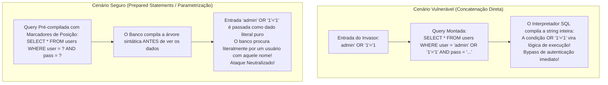
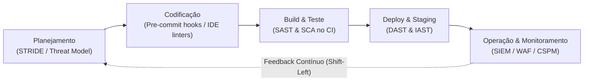
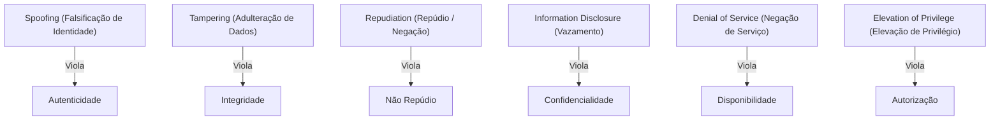
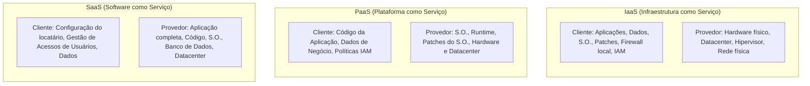

# 04 - Segurança em Aplicações, OWASP Top 10 e DevSecOps

> **Matéria:** Segurança da Informação  
> **Cargo:** B02 – Técnico de Controle Externo – Especialidade: Tecnologia da Informação  
> **Arquivo:** `04_seguranca_em_aplicacoes_owasp_top_10_e_devsecops.md`  

---

## 📌 Ementa / Itens do Edital
- Segurança no ciclo de vida de aplicações
- Projeto OWASP Top 10 (vulnerabilidades críticas em aplicações web)
- Boas práticas de codificação segura e abordagem DevSecOps (Shift-Left)
- Ferramentas de testes de segurança de software: SAST, DAST, IAST e SCA
- Segurança específica em APIs, em contêineres e em ambientes de nuvem

---

## 🌳 Classificação Hierárquica

```text
4. Segurança em Software, Projeto OWASP e Práticas DevSecOps
├── 4.1 O Projeto OWASP Top 10 (Vulnerabilidades Críticas)
│   ├── 4.1.1 A01: Broken Access Control (Quebra de Controle de Acesso - #1):
│   │   ├── Vetores: Violação do princípio do menor privilégio, IDOR (Insecure Direct Object References), bypass de verificações de permissão
│   │   └── Mitigação: Negar por padrão (Deny by default), validação de autorização no servidor em todas as requisições
│   ├── 4.1.2 A02: Cryptographic Failures (Falhas Criptográficas):
│   │   ├── Vetores: Transmissão em texto claro (HTTP), uso de algoritmos obsoletos (MD5, DES, SHA1), geração fraca de números aleatórios
│   │   └── Mitigação: Criptografia de ponta a ponta com TLS 1.3, AES-GCM, funções de hash seguras para senhas (Argon2, bcrypt)
│   ├── 4.1.3 A03: Injection (Injeção de Código e Comandos):
│   │   ├── SQL Injection (SQLi): Manipulação de consultas via concatenação de dados não sanitizados
│   │   ├── Cross-Site Scripting (XSS: Stored, Reflected, DOM-based): Injeção de scripts maliciosos no navegador de usuários
│   │   ├── Command Injection e LDAP/OS Injection
│   │   └── Mitigação: Uso obrigatório de Consultas Parametrizadas (Prepared Statements), ORMs e sanitização/encoding de saídas
│   ├── 4.1.4 A04: Insecure Design (Design Inseguro): Falhas arquiteturais e ausência de modelagem de ameaças antes do código
│   ├── 4.1.5 A05: Security Misconfiguration (Configuração Incorreta de Segurança):
│   │   ├── Vetores: Senhas padrão mantidas, mensagens de erro detalhadas expondo stack traces, portas desnecessárias abertas
│   │   └── Mitigação: Hardening automatizado de sistemas e desativação de recursos supérfluos
│   ├── 4.1.6 A06: Vulnerable and Outdated Components (Componentes Vulneráveis e Obsoletos): Uso de bibliotecas de terceiros com CVEs conhecidas
│   ├── 4.1.7 A07: Identification and Authentication Failures (Falhas de Autenticação): Ausência de proteção contra força bruta, senhas fracas, falhas de sessão
│   ├── 4.1.8 A08: Software and Data Integrity Failures (Falhas de Integridade): Desserialização insegura de dados e supply chain compromises
│   ├── 4.1.9 A09: Security Logging and Monitoring Failures (Falhas de Monitoramento e Logs): Ausência de logs de auditoria permitindo ataques silenciosos
│   └── 4.1.10 A10: Server-Side Request Forgery (SSRF): A aplicação é induzida pelo atacante a fazer requisições contra recursos internos protegidos
├── 4.2 Abordagem DevSecOps e Cultura Shift-Left
│   ├── 4.2.1 Conceito: Integração da segurança da informação em todas as fases do ciclo DevOps ("Shift-Left" - deslocar a segurança para a esquerda/início)
│   ├── 4.2.2 Modelagem de Ameaças (Threat Modeling): Metodologia STRIDE (Spoofing, Tampering, Repudiation, Information Disclosure, Denial of Service, Elevation of Privilege)
│   └── 4.2.3 Automação de Segurança no Pipeline de CI/CD:
│       ├── SAST (Static Application Security Testing): Análise estática do código-fonte sem executá-lo (SonarQube, Semgrep)
│       ├── DAST (Dynamic Application Security Testing): Teste dinâmico executando ataques contra a aplicação rodando (OWASP ZAP)
│       ├── SCA (Software Composition Analysis): Varredura automatizada de dependências e bibliotecas vulneráveis (Snyk, Dependabot, Trivy)
│       └── IAST (Interactive Application Security Testing): Agente instrumentado em runtime que combina vantagens de SAST e DAST
└── 4.3 Segurança em APIs, Contêineres e Ambientes de Nuvem
    ├── 4.3.1 Segurança em APIs (OWASP API Security Top 10):
    │   ├── BOLA (Broken Object Level Authorization - vulnerabilidade #1 de APIs)
    │   ├── Broken Authentication, Mass Assignment e Lack of Resources/Rate Limiting (ataques de negação por consumo excessivo)
    │   └── Uso de API Gateways para validação estrita de esquemas OpenAPI e limitação de taxa
    ├── 4.3.2 Segurança em Contêineres:
    │   ├── Não executar contêineres como usuário root (diretiva USER nonroot)
    │   ├── Uso de imagens mínimas (Distroless / Alpine) para reduzir a superfície de ataque
    │   ├── Escaneamento de vulnerabilidades em imagens Docker antes do deploy
    │   └── Restrição de capacidades do Linux (drop ALL capabilities) e sistemas de arquivos somente leitura (read-only root filesystem)
    └── 4.3.3 Segurança em Nuvem (Cloud Security):
        ├── Modelo de Responsabilidade Compartilhada (Shared Responsibility Model: Provedor vs. Cliente)
        ├── Gestão de Postura de Segurança na Nuvem (CSPM - Cloud Security Posture Management)
        └── Proteção de Metadados de Nuvem (mitigação de SSRF acessando http://169.254.169.254)
```

---

## 📖 Teoria Aprofundada & Pontos-Chave

### 4.1 O Projeto OWASP Top 10 (Vulnerabilidades Críticas)

O *Open Web Application Security Project* (OWASP) publica periodicamente o ranking de consenso global das dez vulnerabilidades mais críticas em aplicações web. Na edição em vigor, a ordem e os destaques conceituais cobrados pela FCC são:

| Posição | Categoria OWASP | Descrição do Risco | Exemplos Práticos / Vetores de Ataque | Mitigação Primária |
|---|---|---|---|---|
| **A01** | **Broken Access Control** *(#1 do Ranking)* | Falha na imposição de regras de autorização, permitindo que usuários ajam fora dos limites de suas permissões. | **IDOR** (trocar `id=100` por `id=101` na URL para ver dado alheio); acesso direto a URLs administrativas sem autenticação; bypass de verificação de permissão. | *Deny by default*; validar autorização no lado do servidor em todas as requisições; tokens de sessão opacos. |
| **A02** | **Cryptographic Failures** *(antigo Sensitive Data Exposure)* | Falhas na proteção de dados sensíveis em repouso (*at rest*) ou em trânsito (*in transit*). | Uso de cifras obsoletas (MD5, DES, RC4); transmissão em HTTP sem TLS; chaves hardcoded no código; senhas salvas sem salt. | TLS 1.3 com HSTS obrigatório; AES-GCM para dados em repouso; hashing de senhas com algoritmos lentos (Argon2, bcrypt, PBKDF2). |
| **A03** | **Injection** | Dados não confiáveis fornecidos pelo usuário são interpretados como comandos ou comandos pelo interpretador. | **SQL Injection (SQLi)**; **Cross-Site Scripting (XSS)**; Command Injection (OS); LDAP/NoSQL Injection. | Consultas Parametrizadas (*Prepared Statements* com *bind variables*); ORMs; codificação sensível ao contexto (*context-aware encoding*); WAF. |
| **A04** | **Insecure Design** *(Categoria Nova)* | Falhas estruturais de concepção e arquitetura antes mesmo de o código ser escrito. | Ausência de modelagem de ameaças; regras de negócio sem limitação de taxa (ex.: compras infinitas com cupom); falta de design seguro. | Modelagem de ameaças (metodologia STRIDE); arquitetura de defesa em profundidade; princípios de *Secure by Design*. |
| **A05** | **Security Misconfiguration** | Configuração inadequada ou negligente dos componentes da pilha de software. | Contas e senhas padrão de fábrica mantidas; mensagens de erro detalhadas expondo *stack traces*; portas de depuração abertas; cabeçalhos de segurança ausentes. | Processo automatizado de *hardening*; desinstalação de utilitários desnecessários; desativação de mensagens detalhadas de erro para o cliente. |
| **A06** | **Vulnerable and Outdated Components** | Uso de bibliotecas, frameworks ou dependências de terceiros com falhas de segurança conhecidas. | Uso de versões antigas do Apache Log4j (falha *Log4Shell* - CVE-2021-44228); bibliotecas JavaScript com bugs públicos. | Análise de Composição de Software (SCA contínuo); monitoramento de boletins CVE/NVD; geração de SBOM (*Software Bill of Materials*). |
| **A07** | **Identification and Authentication Failures** | Falhas na verificação da identidade do usuário e gerenciamento de sessão. | Ausência de MFA; tolerância a senhas fracas; vulnerabilidade a *credential stuffing* e ataques de dicionário; sessões que não expiram após logout. | MFA obrigatório; bloqueio de contas após múltiplas tentativas falhas; controle de complexidade de senhas; cookies com flags `Secure`, `HttpOnly` e `SameSite`. |
| **A08** | **Software and Data Integrity Failures** *(Categoria Nova)* | Código ou infraestrutura que não protege contra violações de integridade em pipelines e dependências. | Desserialização insegura de objetos serializados não confiáveis (*Insecure Deserialization*); atualizações sem assinatura digital; contaminação de dependências (*supply chain*). | Assinatura digital em artefatos de build; verificação de integridade de dependências; evitar desserialização de formatos genéricos de dados não confiáveis. |
| **A09** | **Security Logging and Monitoring Failures** | Falha em registrar, monitorar e alertar tempestivamente sobre eventos suspeitos e incidentes. | Tentativas de login falhas não registradas; logs mantidos apenas localmente permitindo que o invasor os apague; ausência de integração com SIEM. | Centralização de logs imutáveis em SIEM; alertas automatizados em tempo quase real; retenção em conformidade com regulamentos. |
| **A10** | **Server-Side Request Forgery (SSRF)** | A aplicação web é induzida a realizar requisições HTTP arbitrárias a um destino fornecido pelo usuário. | O servidor vulnerável faz requisição contra serviços de metadados em nuvem (`http://169.254.169.254`) ou sistemas internos atrás do firewall. | Validação estrita de URLs de destino; lista permitida (*allowlist*) de domínios; isolamento de rede do servidor de aplicação. |

#### Destaque: SQL Injection vs. Prepared Statements
O SQL Injection ocorre quando dados inseridos pelo usuário são interpolados como texto diretamente na consulta SQL.



- **Código Vulnerável:**
  ```python
  # O atacante altera a árvore de execução sintática do SQL
  query = f"SELECT * FROM servidores WHERE cpf = '{cpf_input}'"
  cursor.execute(query)
  ```
- **Código Seguro (Prepared Statements com Parâmetros Vinculados):**
  ```python
  # O motor do banco de dados trata a entrada estritamente como dado literal
  query = "SELECT * FROM servidores WHERE cpf = %s"
  cursor.execute(query, (cpf_input,))
  ```

#### Modalidades de Cross-Site Scripting (XSS):
1. **Stored XSS (Persistente):** O script malicioso injetado é salvo permanentemente no banco de dados da aplicação (ex.: em um campo de comentários ou fórum) e é executado automaticamente no navegador de qualquer usuário que visualizar aquela página.
2. **Reflected XSS (Refletido):** O script malicioso não é armazenado no banco; ele é inserido em um link forjado (parâmetro de URL) e refletido imediatamente na resposta HTTP pelo servidor sem sanitização.
3. **DOM-based XSS:** A vulnerabilidade existe inteiramente no lado do cliente (navegador). O código JavaScript da página lê dados inseguros da URL (como `window.location.hash`) e os insere perigosamente no DOM (via `document.write` ou `innerHTML`), sem que a requisição precise passar pelo servidor.

---

### 4.2 Abordagem DevSecOps e a Cultura Shift-Left

No modelo tradicional em cascata ou nos primeiros estágios do DevOps, a segurança da informação era conduzida como uma etapa de auditoria tardia e isolada, realizada pouco antes do lançamento em produção (comportamento de "guardião" que gerava atrito e atrasos).

A abordagem **DevSecOps** prega a integração da segurança como responsabilidade compartilhada em todas as etapas da esteira contínua de entrega de software (*Continuous Integration / Continuous Delivery - CI/CD*).



#### O Princípio do *Shift-Left* (Deslocar para a Esquerda)
Deslocar a segurança para a "esquerda" da linha temporal de desenvolvimento significa antecipar a identificação e correção de defeitos de segurança para as fases iniciais de especificação, design arquitetural e codificação.
- Corrigir uma vulnerabilidade durante a fase de design ou codificação inicial é **dezenas de vezes mais barato** e rápido do que corrigir a mesma falha após a aplicação estar em produção.

#### A Metodologia STRIDE de Modelagem de Ameaças (Microsoft)



| Ameaça STRIDE | Ação Maliciosa do Invasor | Propriedade de Segurança Violada |
|---|---|---|
| **S**poofing | Falsificar a identidade de um usuário ou serviço legítimo. | **Autenticidade** |
| **T**ampering | Modificar dados em trânsito ou em repouso sem autorização. | **Integridade** |
| **R**epudiation | Negar formalmente a realização de uma transação ou ação. | **Não Repúdio** |
| **I**nformation Disclosure | Expor dados confidenciais a pessoas ou sistemas não autorizados. | **Confidencialidade** |
| **D**enial of Service | Derrubar ou sobrecarregar recursos para indisponibilizar o serviço. | **Disponibilidade** |
| **E**levation of Privilege | Obter permissões administrativas superiores às concedidas originalmente. | **Autorização** |

#### Ferramentas Automatizadas de Teste de Segurança de Aplicações

| Sigla | Nome Completo | Modo de Teste | Quando Executa? | O que analisa? | Vantagens e Limitações |
|---|---|---|---|---|---|
| **SAST** | *Static Application Security Testing* | Caixa-Branca (*White-Box*) | No início do pipeline (fase de commit/build), **sem executar a aplicação**. | Código-fonte, sintaxe e bytecode da aplicação desenvolvida internamente. | Encontra a linha exata do código vulnerável; alto índice de falsos positivos; não analisa ambiente de execução. |
| **DAST** | *Dynamic Application Security Testing* | Caixa-Preta (*Black-Box*) | No final do pipeline (fase de staging/deploy), **com a aplicação em execução**. | Aplicação compilada rodando em servidor; ataca as portas HTTP/HTTPS externas simulando um invasor. | Não requer acesso ao código-fonte; detecta erros de configuração de infraestrutura; não aponta a linha exata do código. |
| **SCA** | *Software Composition Analysis* | Caixa-Branca / Inventário | No build do CI/CD através de manifestos e lockfiles. | Bibliotecas de terceiros, pacotes open source e dependências indiretas. | Mapeia CVEs conhecidas e licenças legais de software; essencial para segurança de supply chain. |
| **IAST** | *Interactive Application Security Testing* | Híbrido Instrumentado | Durante a execução de testes funcionais automatizados ou manuais. | Agente instalado dentro da aplicação (JVM, .NET, Node) analisando o comportamento interno em runtime. | Alta precisão com baixíssimos falsos positivos; exige instrumentação específica da linguagem. |

---

### 4.3 Segurança em APIs, Contêineres e Ambientes de Nuvem

#### Segurança em APIs (OWASP API Security Top 10)
- **BOLA (*Broken Object Level Authorization* - Vulnerabilidade #1 de APIs):** Ocorre quando uma rota de API recebe o identificador do recurso na URL (ex.: `/api/v1/contratos/8493`) e não valida no backend se o usuário logado possui direito legal de acessar o contrato `8493`.
- **API Gateways:** Componentes indispensáveis de proteção perimetral para APIs, responsáveis por:
  - Limitação de taxa (*Rate Limiting / Throttling*) para proteção contra negação de serviço e força bruta;
  - Validação rigorosa de esquemas de payload (OpenAPI/JSON Schema);
  - Centralização de autenticação e validação de tokens JWT (assinatura, emissor e expiração).

#### Segurança em Contêineres (Docker / Kubernetes)
1. **Não executar contêineres como `root`:** Por padrão, o processo dentro de um contêiner Docker roda com UID 0 (`root`), herdando capacidades de privilégio do kernel hospedeiro. A boa prática manda declarar explicitamente no Dockerfile:
   ```dockerfile
   USER 10001:10001
   ```
2. **Imagens mínimas (*Distroless* ou *Alpine*):** Não incluir utilitários desnecessários como compiladores, gerenciadores de pacote (`apt`, `apk`) ou editores (`curl`, `bash`), reduzindo drasticamente a superfície de ataque e o volume de CVEs.
3. **Sistemas de arquivos somente leitura:** Configurar a inicialização do contêiner com `--read-only`, impedindo que invasores gravem ferramentas maliciosas nos diretórios de sistema.
4. **Restrição de Capacidades Linux:** Descartar todas as capacidades padrão (`--cap-drop=ALL`) e adicionar estritamente as necessárias.

#### Segurança em Nuvem: Modelo de Responsabilidade Compartilhada
A divisão de responsabilidades de segurança entre o provedor de computação em nuvem (CSP) e a organização cliente varia segundo o modelo de serviço:



> ⭐ **IMPORTANTE / REGRA DE OURO:**  
> Independentemente do modelo adotado (IaaS, PaaS ou SaaS), a **responsabilidade pelos dados, pela classificação da informação e pela governança de identidades e acessos é SEMPRE e EXCLUSIVAMENTE do cliente**!

---

## 🌐 Fontes Recomendadas na Internet

### 1. Projetos Oficiais da Fundação OWASP
- [OWASP Top 10 Web Application Security Risks](https://owasp.org/www-project-top-ten/): Documentação oficial do projeto de referência mundial classificando as 10 vulnerabilidades mais críticas em aplicações web, encabeçadas por *A01: Broken Access Control*, *A02: Cryptographic Failures* e *A03: Injection*.
- [OWASP API Security Top 10](https://owasp.org/www-project-api-security/): Padrão específico para segurança de interfaces de programação, destacando a vulnerabilidade *BOLA (Broken Object Level Authorization)* e falhas de autenticação.
- [OWASP Cheat Sheet Series - SQL Injection Prevention](https://cheatsheetseries.owasp.org/cheatsheets/SQL_Injection_Prevention_Cheat_Sheet.html): Guia canônico de codificação segura com exemplos práticos de uso de consultas parametrizadas (*Prepared Statements*).

### 2. Normas de Desenvolvimento Seguro
- [NIST Special Publication 800-218 - Secure Software Development Framework (SSDF)](https://csrc.nist.gov/pubs/sp/800/218/final): Framework oficial do governo americano para integrar práticas seguras em todas as fases do ciclo de vida de desenvolvimento de software (DevSecOps e cultura *Shift-Left*).
- [Center for Internet Security (CIS) Docker & Kubernetes Benchmarks](https://www.cisecurity.org/cis-benchmarks): Diretrizes de hardening para ambientes de contêineres e orquestradores.

---

## 📝 Questões Comentadas & Exemplos

### Questão 1 (FCC - Adaptada / TI - OWASP Top 10 e Injeção de SQL)
Um desenvolvedor de sistemas do Tribunal de Contas implementou a seguinte rotina de autenticação em uma API de consulta processual:

```python
# Trecho de código implementado
query = "SELECT id, nome, perfil FROM auditores WHERE login = '" + login_input + "' AND senha = '" + senha_input + "'"
cursor.execute(query)
usuario = cursor.fetchone()
```

Considerando a classificação de vulnerabilidades do **OWASP Top 10** e os princípios de codificação segura, assinale a afirmativa correta:
A) O código é imune a ataques cibernéticos, visto que a linguagem Python trata strings concatenadas como números binários criptografados.  
B) O código apresenta grave vulnerabilidade de Injeção de SQL (*SQL Injection* - A03 do OWASP), pois concatena dados fornecidos pelo usuário diretamente na instrução SQL; para solucionar definitivamente a falha, o desenvolvedor deve utilizar consultas parametrizadas (*Prepared Statements*), delegando a separação entre código e dados ao driver do banco de dados.  
C) A vulnerabilidade apresentada é classificada como *Cross-Site Scripting (XSS)*, e sua única forma de mitigação consiste em desativar o firewall de aplicação web (WAF).  
D) A vulnerabilidade *Broken Access Control* (A01) foi abolida da lista da OWASP, não se aplicando mais ao desenvolvimento de aplicações modernas em nuvem.  
E) O uso de parâmetros vinculados (*bind variables*) em consultas parametrizadas é desaconselhado pela OWASP por provocar vazamento de memória na máquina hospedeira.

> **Gabarito: B**  
> **Comentário Analítico Passo a Passo:**  
> - **Diagnóstico da Vulnerabilidade:** A interpolação de strings via concatenação (`+ login_input +`) permite que um atacante insira metacaracteres de controle SQL (como `' OR '1'='1' --`), adulterando a estrutura lógica da consulta e obtendo acesso administrativo sem saber a senha.  
> 
> **Análise das Alternativas:**  
> - **A está INCORRETA:** Python não criptografa strings concatenadas; a concatenação gera uma consulta SQL perigosa e totalmente vulnerável.  
> - **B está CORRETA:** Identifica com rigor técnico o problema (SQL Injection, pertencente à categoria A03) e indica a contramedida canônica definitiva preconizada universalmente pela OWASP: **Consultas Parametrizadas (*Prepared Statements*)**, nas quais os parâmetros são tratados como literais puros pelo compilador do banco de dados.  
> - **C está INCORRETA:** O ataque afeta a camada do banco de dados (SQL Injection), enquanto XSS envolve injeção de scripts (como JavaScript) para execução no navegador do cliente.  
> - **D está INCORRETA:** *Broken Access Control* (A01) não foi abolida; ao contrário, assumiu a **primeira posição absoluta (#1)** do ranking do OWASP Top 10 atual.  
> - **E está INCORRETA:** O uso de *bind variables* é o padrão de ouro da indústria de software seguro para neutralizar injeções de SQL.

---

### Questão 2 (FCC - Adaptada / TI - Práticas DevSecOps e Ferramentas de Teste)
Na esteira de Integração e Entrega Contínua (CI/CD) de uma instituição pública que adota a filosofia DevSecOps e o princípio de *Shift-Left* (deslocar a segurança para o início do ciclo de vida), a equipe de segurança inseriu diferentes tipos de testes automatizados de segurança.

A respeito das ferramentas e abordagens de testes de segurança de software, assinale a afirmativa correta:
A) O teste estático (SAST - *Static Application Security Testing*) exige que a aplicação esteja completamente implantada e em execução em um servidor de homologação para que requisições HTTP maliciosas sejam enviadas contra ela por fora.  
B) O teste dinâmico (DAST - *Dynamic Application Security Testing*) analisa exclusivamente o código-fonte em repouso sem executar o software, mapeando o fluxo de dados em árvores sintáticas para identificar variáveis não inicializadas.  
C) A Análise de Composição de Software (SCA - *Software Composition Analysis*) tem como objetivo primordial mapear a árvore de dependências e bibliotecas de terceiros (código aberto) utilizadas pelo projeto, identificando versões desatualizadas e componentes associados a vulnerabilidades conhecidas (CVEs).  
D) O princípio do *Shift-Left* preceitua que as análises de segurança da informação devem ser adiadas para a última semana anterior à entrada em produção, para evitar atrasos aos desenvolvedores.  
E) Ferramentas de SAST e DAST tornam dispensáveis a modelagem de ameaças e o controle de acesso lógico nas aplicações.

> **Gabarito: C**  
> **Comentário Analítico Passo a Passo:**  
> - **Tipologia de Ferramentas DevSecOps:**  
>   - **SAST:** Análise estática de código-fonte em repouso (*white-box*, sem rodar o app).  
>   - **DAST:** Teste dinâmico executando ataques por fora contra a aplicação em execução (*black-box*).  
>   - **SCA:** Inspeção de dependências e bibliotecas externas para encontrar vulnerabilidades conhecidas (CVEs).  
> 
> **Análise das Alternativas:**  
> - **A está INCORRETA:** Essa é a definição do teste dinâmico (DAST). O **SAST** atua sobre o código estático em repouso, sem precisar compilar ou rodar o software.  
> - **B está INCORRETA:** Essa é a definição do SAST. O **DAST** requer a aplicação rodando em um servidor e simula um invasor externo disparando requisições contra a interface de rede.  
> - **C está CORRETA:** Define com exatidão a missão das ferramentas de **SCA** (como Snyk, Dependabot, OWASP Dependency-Check): gerenciar riscos de supply chain através da identificação de vulnerabilidades conhecidas (CVEs) em bibliotecas de terceiros.  
> - **D está INCORRETA:** O princípio *Shift-Left* estabelece exatamente o oposto: puxar a segurança para o início da esteira (planejamento, design e codificação), e não deixá-la para a véspera do deploy.  
> - **E está INCORRETA:** Ferramentas automáticas são complementares e não substituem modelagem de ameaças (STRIDE) nem a arquitetura segura de regras de negócio.

---

### Questão 3 (FCC - Adaptada / TI - OWASP Top 10 / Broken Access Control e IDOR)
Um analista de sistemas realizou um teste de penetração em um portal web fazendário e constatou que, ao autenticar-se como um contribuinte comum e acessar a URL:
`https://sefaz.gov.br/api/certidoes?id_requerimento=1050`
bastava alterar manualmente o parâmetro da requisição para:
`https://sefaz.gov.br/api/certidoes?id_requerimento=1051`
para visualizar e baixar a certidão fiscal de outro contribuinte, sem que o sistema realizasse qualquer validação sobre a titularidade do documento solicitado.

No contexto das vulnerabilidades catalogadas pelo **OWASP Top 10**, essa falha é tecnicamente classificada como:
A) Server-Side Request Forgery (SSRF - A10).  
B) Insecure Direct Object References (IDOR), inserida na categoria de Broken Access Control (A01).  
C) Cryptographic Failures (A02), originada pelo uso incorreto do protocolo HTTPS.  
D) Security Logging and Monitoring Failures (A09).  
E) SQL Injection cego (Blind SQLi - A03).

> **Gabarito: B**  
> **Comentário Analítico Passo a Passo:**  
> - **Análise da Vulnerabilidade Exposta:** O caso narrado demonstra uma referência direta e previsível a um objeto no banco de dados (`id_requerimento=1051`) exposta diretamente na interface de chamada, associada à ausência de verificação de permissão no backend para conferir se o usuário autenticado é o dono legítimo daquele registro.  
> 
> **Análise das Alternativas:**  
> - **A está INCORRETA:** O SSRF ocorre quando o servidor é manipulado para enviar requisições contra serviços internos da sua própria rede, não se confundindo com leitura de dados de outros usuários por manipulação de parâmetro.  
> - **B está CORRETA:** Trata-se do clássico **IDOR (*Insecure Direct Object References*)**, a mais notória manifestação de **Broken Access Control (A01)**, a vulnerabilidade número 1 do OWASP Top 10.  
> - **C está INCORRETA:** A conexão utilizava HTTPS e não havia quebra criptográfica; a falha residia no controle de permissão e autorização lógica do backend.  
> - **D está INCORRETA:** Refere-se à deficiência de logs e monitoramento de eventos, não ao bypass de autorização na URL.  
> - **E está INCORRETA:** A manipulação decorreu de um identificador sequencial direto sem validação de autorização, e não de injeção de comandos SQL com alteração de sintaxe do banco de dados.

---

### Questão 4 (FCC - Adaptada / TI - Modelagem de Ameaças / Metodologia STRIDE)
No planejamento arquitetural de um novo módulo de pagamentos do Tribunal de Contas, os engenheiros de segurança conduziram uma sessão de modelagem de ameaças adotando o framework metodológico **STRIDE**.

A respeito do mapeamento entre as categorias de ameaça do modelo STRIDE e os princípios clássicos de segurança da informação violados, assinale a afirmativa correta:
A) A categoria *Spoofing* (Falsificação de Identidade) viola diretamente o princípio da Disponibilidade.  
B) A categoria *Tampering* (Adulteração de Dados) atenta contra o princípio da Integridade.  
C) A categoria *Repudiation* (Repúdio) atenta contra o princípio da Confidencialidade.  
D) A categoria *Information Disclosure* (Divulgação Indevida) viola o princípio da Legalidade estrita.  
E) A categoria *Denial of Service* (Negação de Serviço) viola o princípio do Não Repúdio.

> **Gabarito: B**  
> **Comentário Analítico Passo a Passo:**  
> - **Mapeamento do Framework STRIDE:**  
>   - **S**poofing $\rightarrow$ Viola a **Autenticidade** (falsificar identidade).  
>   - **T**ampering $\rightarrow$ Viola a **Integridade** (adulterar informações).  
>   - **R**epudiation $\rightarrow$ Viola o **Não Repúdio / Irretratabilidade** (negar ter praticado a ação).  
>   - **I**nformation Disclosure $\rightarrow$ Viola a **Confidencialidade** (vazamento de dados).  
>   - **D**enial of Service $\rightarrow$ Viola a **Disponibilidade** (derrubar o sistema).  
>   - **E**levation of Privilege $\rightarrow$ Viola a **Autorização** (obter privilégios indevidos).  
> 
> **Análise das Alternativas:**  
> - **A está INCORRETA:** *Spoofing* viola o princípio da **Autenticidade**.  
> - **B está CORRETA:** *Tampering* consiste na modificação ou adulteração maliciosa de dados, violando frontalmente a **Integridade**.  
> - **C está INCORRETA:** *Repudiation* atenta contra o princípio do **Não Repúdio**.  
> - **D está INCORRETA:** *Information Disclosure* atenta contra a **Confidencialidade**.  
> - **E está INCORRETA:** *Denial of Service* atenta contra a **Disponibilidade**.

---

### Questão 5 (FCC - Adaptada / TI - Segurança em Nuvem e Contêineres)
Em relação às boas práticas de segurança na execução de contêineres Docker e ao Modelo de Responsabilidade Compartilhada na computação em nuvem, assinale a afirmativa correta:
A) Em soluções de Infraestrutura como Serviço (IaaS), o provedor de nuvem é integralmente responsável pela aplicação periódica de patches de segurança e atualizações do sistema operacional convidado (*guest OS*) das máquinas virtuais do cliente.  
B) A execução de contêineres em ambientes produtivos deve utilizar por padrão o usuário `root` (UID 0) com capacidades administrativas completas para assegurar a portabilidade do serviço.  
C) Independentemente do modelo de contratação em nuvem adotado (IaaS, PaaS ou SaaS), a responsabilidade pela classificação, governança e proteção dos dados corporativos permanece de forma irrenunciável com a organização cliente.  
D) A vulnerabilidade SSRF (*Server-Side Request Forgery*) é inofensiva em ambientes de nuvem, haja vista a inexistência de endpoints de serviços de metadados em plataformas como AWS, Azure ou GCP.  
E) O uso de imagens de contêiner do tipo *Distroless* é contraindicado pelas normas do CIS (*Center for Internet Security*), por dificultar o trabalho de manutenção ao remover pacotes supérfluos.

> **Gabarito: C**  
> **Comentário Analítico Passo a Passo:**  
> - **Regra de Ouro do Modelo de Responsabilidade Compartilhada:** Não importa se a solução é IaaS, PaaS ou SaaS: a **posse, classificação e responsabilidade sobre os DADOS e sobre o controle de acessos (identidades)** pertencem **sempre ao cliente**.  
> 
> **Análise das Alternativas:**  
> - **A está INCORRETA:** Em **IaaS**, o provedor cuida apenas da infraestrutura física e do hipervisor; a instalação, configuração e aplicação de patches no Sistema Operacional da VM é **responsabilidade integral do cliente**.  
> - **B está INCORRETA:** Rodar contêineres como `root` é uma grave má prática; a diretiva correta é criar e definir um usuário sem privilégios (`USER nonroot`).  
> - **C está CORRETA:** Enuncia a regra basilar da computação em nuvem: a guarda, conformidade e governança dos dados e das identidades nunca são transferidas ao provedor, permanecendo sempre sob a alçada da entidade cliente.  
> - **D está INCORRETA:** SSRF em nuvem é extremamente perigoso, pois o invasor pode fazer o servidor vulnerável consultar o serviço interno de metadados (ex.: `http://169.254.169.254/latest/meta-data/`) para roubar credenciais temporárias do IAM da máquina.  
> - **E está INCORRETA:** O uso de imagens *Distroless* (ou mínimas) é expressamente recomendado pelo CIS Benchmarks, exatamente porque reduz drasticamente a superfície de ataque ao eliminar binários e utilitários desnecessários.
