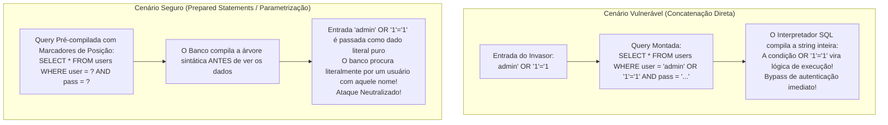
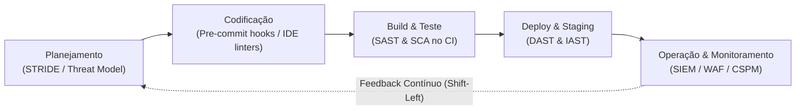
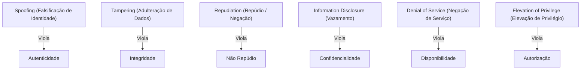
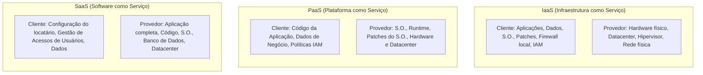

# 04 - Segurança em Aplicações, OWASP Top 10 e DevSecOps

> **Matéria:** Segurança da Informação  
> **Cargo:** B02 – Técnico de Controle Externo – Especialidade: Tecnologia da Informação  
> **Arquivo:** `04_seguranca_em_aplicacoes_owasp_top_10_e_devsecops.md`  

---

## 📌 Ementa / Itens do Edital
- Segurança no ciclo de vida de aplicações
- Projeto OWASP Top 10 (vulnerabilidades críticas em aplicações web)
- Boas práticas de codificação segura e abordagem DevSecOps (Shift-Left)
- Ferramentas de testes de segurança de software: SAST, DAST, IAST e SCA
- Segurança específica em APIs, em contêineres e em ambientes de nuvem

---

## 🧭 Sumário
- [1. O Projeto OWASP Top 10 e Vulnerabilidades Críticas em Software Web](#1-o-projeto-owasp-top-10-e-vulnerabilidades-criticas-em-software-web)
    - [1.1 Visão Geral e Categorias Oficiais do OWASP Top 10](#11-visao-geral-e-categorias-oficiais-do-owasp-top-10)
    - [1.2 Broken Access Control (#1) e Insecure Direct Object References (IDOR)](#12-broken-access-control-1-e-insecure-direct-object-references-idor)
    - [1.3 Cryptographic Failures (#2) e Proteção de Dados](#13-cryptographic-failures-2-e-protecao-de-dados)
    - [1.4 Injection (#3): SQL Injection vs. Consultas Parametrizadas e Modalidades de XSS](#14-injection-3-sql-injection-vs-consultas-parametrizadas-e-modalidades-de-xss)
    - [1.5 Demais Categorias Críticas: Insecure Design, Misconfiguration, SSRF e Supply Chain](#15-demais-categorias-criticas-insecure-design-misconfiguration-ssrf-e-supply-chain)
- [2. Abordagem DevSecOps e a Cultura Shift-Left](#2-abordagem-devsecops-e-a-cultura-shift-left)
    - [2.1 Princípios do DevSecOps e Economia da Correção Precoce (Shift-Left)](#21-principios-do-devsecops-e-economia-da-correcao-precoce-shift-left)
    - [2.2 Modelagem de Ameaças com a Metodologia STRIDE](#22-modelagem-de-ameacas-com-a-metodologia-stride)
    - [2.3 Ferramentas Automatizadas de Teste de Segurança (SAST, DAST, IAST, SCA)](#23-ferramentas-automatizadas-de-teste-de-seguranca-sast-dast-iast-sca)
- [3. Segurança em APIs, Contêineres e Ambientes de Nuvem](#3-seguranca-em-apis-conteineres-e-ambientes-de-nuvem)
    - [3.1 Segurança em APIs: OWASP API Security Top 10 e BOLA](#31-seguranca-em-apis-owasp-api-security-top-10-e-bola)
    - [3.2 Boas Práticas e Hardening em Contêineres Docker e Kubernetes](#32-boas-praticas-e-hardening-em-conteineres-docker-e-kubernetes)
    - [3.3 Segurança em Nuvem: Modelo de Responsabilidade Compartilhada e Proteção de Metadados](#33-seguranca-em-nuvem-modelo-de-responsabilidade-compartilhada-e-protecao-de-metadados)
- [4. Fontes Recomendadas na Internet](#4-fontes-recomendadas-na-internet)

---

## 1. O Projeto OWASP Top 10 e Vulnerabilidades Críticas em Software Web

### 1.1 Visão Geral e Categorias Oficiais do OWASP Top 10

O *Open Web Application Security Project* (**OWASP**) é uma comunidade internacional sem fins lucrativos que lidera o consenso técnico global sobre a segurança no desenvolvimento de software. Seu principal documento de referência é o **OWASP Top 10**, uma publicação periódica que sintetiza as dez vulnerabilidades mais perigosas e frequentes em aplicações web em âmbito mundial.

| Posição | Categoria OWASP | Descrição do Risco | Exemplos Práticos / Vetores de Ataque | Mitigação Primária |
|---|---|---|---|---|
| **A01** | **Broken Access Control** *(#1 do Ranking)* | Falha na imposição de regras de autorização no backend, permitindo que usuários ajam fora dos limites de suas permissões. | **IDOR** (trocar `id=100` por `id=101` na URL para ver dado alheio); acesso direto a URLs administrativas sem autenticação; bypass de verificação de permissão. | *Deny by default*; validar autorização no lado do servidor em todas as requisições; tokens de sessão opacos. |
| **A02** | **Cryptographic Failures** *(antigo Sensitive Data Exposure)* | Falhas na proteção de dados sensíveis em repouso (*at rest*) ou em trânsito (*in transit*). | Uso de cifras obsoletas (MD5, DES, RC4); transmissão em HTTP sem TLS; chaves hardcoded no código; senhas salvas sem salt. | TLS 1.3 com HSTS obrigatório; AES-GCM para dados em repouso; hashing de senhas com algoritmos lentos (Argon2, bcrypt, PBKDF2). |
| **A03** | **Injection** | Dados não confiáveis fornecidos pelo usuário são interpretados como comandos ou instruções pelo interpretador. | **SQL Injection (SQLi)**; **Cross-Site Scripting (XSS)**; Command Injection (OS); LDAP/NoSQL Injection. | Consultas Parametrizadas (*Prepared Statements* com *bind variables*); ORMs; codificação sensível ao contexto (*context-aware encoding*); WAF. |
| **A04** | **Insecure Design** *(Categoria Nova)* | Falhas estruturais de concepção e arquitetura antes mesmo de o código ser escrito. | Ausência de modelagem de ameaças; regras de negócio sem limitação de taxa (ex.: compras infinitas com cupom); falta de design seguro. | Modelagem de ameaças (metodologia STRIDE); arquitetura de defesa em profundidade; princípios de *Secure by Design*. |
| **A05** | **Security Misconfiguration** | Configuração inadequada ou negligente dos componentes da pilha de software. | Contas e senhas padrão de fábrica mantidas; mensagens de erro detalhadas expondo *stack traces*; portas de depuração abertas; cabeçalhos de segurança ausentes. | Processo automatizado de *hardening*; desinstalação de utilitários desnecessários; desativação de mensagens detalhadas de erro para o cliente. |
| **A06** | **Vulnerable and Outdated Components** | Uso de bibliotecas, frameworks ou dependências de terceiros com falhas de segurança conhecidas. | Uso de versões antigas do Apache Log4j (falha *Log4Shell* - CVE-2021-44228); bibliotecas JavaScript com bugs públicos. | Análise de Composição de Software (SCA contínuo); monitoramento de boletins CVE/NVD; geração de SBOM (*Software Bill of Materials*). |
| **A07** | **Identification and Authentication Failures** | Falhas na verificação da identidade do usuário e gerenciamento de sessão. | Ausência de MFA; tolerância a senhas fracas; vulnerabilidade a *credential stuffing* e ataques de dicionário; sessões que não expiram após logout. | MFA obrigatório; bloqueio de contas após múltiplas tentativas falhas; controle de complexidade de senhas; cookies com flags `Secure`, `HttpOnly` e `SameSite`. |
| **A08** | **Software and Data Integrity Failures** *(Categoria Nova)* | Código ou infraestrutura que não protege contra violações de integridade em pipelines e dependências. | Desserialização insegura de objetos serializados não confiáveis (*Insecure Deserialization*); atualizações sem assinatura digital; contaminação de dependências (*supply chain*). | Assinatura digital em artefatos de build; verificação de integridade de dependências; evitar desserialização de formatos genéricos de dados não confiáveis. |
| **A09** | **Security Logging and Monitoring Failures** | Falha em registrar, monitorar e alertar tempestivamente sobre eventos suspeitos e incidentes. | Tentativas de login falhas não registradas; logs mantidos apenas localmente permitindo que o invasor os apague; ausência de integração com SIEM. | Centralização de logs imutáveis em SIEM; alertas automatizados em tempo quase real; retenção em conformidade com regulamentos. |
| **A10** | **Server-Side Request Forgery (SSRF)** | A aplicação web é induzida a realizar requisições HTTP arbitrárias a um destino fornecido pelo usuário. | O servidor vulnerável faz requisição contra serviços de metadados em nuvem (`http://169.254.169.254`) ou sistemas internos atrás do firewall. | Validação estrita de URLs de destino; lista permitida (*allowlist*) de domínios; isolamento de rede do servidor de aplicação. |

---

### 1.2 Broken Access Control (#1) e Insecure Direct Object References (IDOR)

Na edição atual do OWASP Top 10, **Broken Access Control assumiu a 1ª posição absoluta**, sendo identificada em 94% das aplicações testadas.

Essa falha ocorre quando a aplicação não valida no lado do servidor se o usuário autenticado possui os privilégios necessários para executar determinada ação ou acessar determinado recurso.

#### O Caso Clássico do IDOR (*Insecure Direct Object References*):
Ocorre quando a aplicação expõe diretamente um identificador de banco de dados na URL ou no corpo da requisição:

```text
https://tribunal.gov.br/api/processo?id=1050
```

Se o usuário simplesmente alterar o valor na barra de endereços para `id=1051` e o sistema exibir o processo sigiloso de outro cidadão, configura-se um **IDOR**, espécie notória de *Broken Access Control*.

- **Mitigação Mandatória:** O servidor deve SEMPRE verificar na camada de aplicação:  
  *O `usuario_autenticado` é o proprietário legítimo ou possui autorização formal no RBAC/ABAC para acessar o recurso `id=1051`?* Se não, a requisição deve ser bloqueada com código HTTP `403 Forbidden`.

---

### Questão 01 (FCC - Adaptada / TI - OWASP Top 10 / Broken Access Control e IDOR)
Um analista de sistemas realizou um teste de penetração em um portal web fazendário e constatou que, ao autenticar-se como um contribuinte comum e acessar a URL:  
`https://sefaz.gov.br/api/certidoes?id_requerimento=1050`  
bastava alterar manualmente o parâmetro da requisição para:  
`https://sefaz.gov.br/api/certidoes?id_requerimento=1051`  
para visualizar e baixar a certidão fiscal de outro contribuinte, sem que o sistema realizasse qualquer validação sobre a titularidade do documento solicitado.

No contexto das vulnerabilidades catalogadas pelo **OWASP Top 10**, essa falha é tecnicamente classificada como:

* **A)** Server-Side Request Forgery (SSRF - A10).
* **B)** Insecure Direct Object References (IDOR), inserida na categoria de Broken Access Control (A01).
* **C)** Cryptographic Failures (A02), originada pelo uso incorreto do protocolo HTTPS.
* **D)** Security Logging and Monitoring Failures (A09).
* **E)** SQL Injection cego (Blind SQLi - A03).

> **Comentário Detalhado:**
>
> - **A)** Incorreta. O SSRF envolve induzir o servidor a realizar requisições maliciosas contra alvos da rede interna ou metadados de nuvem.
> - **B)** Correta. Trata-se da clássica vulnerabilidade **IDOR (*Insecure Direct Object References*)**, pertencente à categoria **Broken Access Control (A01)**, caracterizada pela ausência de verificação no servidor sobre os direitos do usuário de acessar um identificador de registro direto recebido na requisição.
> - **C)** Incorreta. O problema não tem correlação com protocolos de criptografia em trânsito, mas sim com a falha lógica de verificação de permissões do usuário logado.
> - **D)** Incorreta. Trata-se de falha de autorização e controle de acesso, e não de deficiência de geração de logs de eventos.
> - **E)** Incorreta. O cenário retrata uma alteração pontual de parâmetro numérico sem injeção de cláusulas SQL maliciosas.
> 
> **Gabarito: B**

---


### 1.3 Cryptographic Failures (#2) e Proteção de Dados

Anteriormente denominada *Sensitive Data Exposure*, essa categoria concentra-se em deficiências relacionadas ao uso incorreto ou à ausência de criptografia:

- **Dados em Trânsito:** Omissão do protocolo HTTPS/TLS 1.3, tráfego de dados sensíveis (senhas, CPF, informações de saúde) em texto puro HTTP, ausência do cabeçalho HSTS (*HTTP Strict Transport Security*).
- **Dados em Repouso:** Armazenamento de dados críticos em bases de dados sem criptografia de ponta a ponta (AES-256-GCM); armazenamento de senhas com funções hash rápidas e vulneráveis (MD5, SHA-1) ou sem a devida adição de valor aleatório de *salt* individualizado.
- **Mitigação:** Emprego obrigatório de cifras simétricas robustas com modos autenticados (AES-GCM), protocolos seguros de transporte e funções de derivação de chaves projetadas especificamente para senhas com custo de processamento ajustável (Argon2, bcrypt, PBKDF2).

---

### 1.4 Injection (#3): SQL Injection vs. Consultas Parametrizadas e Modalidades de XSS

A **Injeção (A03)** ocorre quando dados fornecidos por fontes externas não confiáveis são concatenados diretamente a interpretadores de comandos ou linguagens de consulta.

#### Injeção de SQL (SQLi)
Ocorre quando comandos SQL são montados via interpolação ou concatenação direta de strings:



- **Código Vulnerável:**

```python
# O atacante altera a árvore de execução sintática do SQL
query = f"SELECT * FROM servidores WHERE cpf = '{cpf_input}'"
cursor.execute(query)
```

- **Código Seguro (Prepared Statements com Parâmetros Vinculados):**

```python
# O motor do banco de dados trata a entrada estritamente como dado literal puro
query = "SELECT * FROM servidores WHERE cpf = %s"
cursor.execute(query, (cpf_input,))
```

> 🚨 **ALERTA DE PROVA / PEGADINHA FCC:**  
> A FCC adora afirmar que funções de substituição manual de caracteres (como trocar aspas por barras) são a solução ideal para injeção de SQL. **ERRADO!** Filtros manuais baseados em listas de bloqueio (*denylists*) são historicamente burláveis por diversas técnicas de codificação. A **única defesa definitiva e prioritária recomendada pela OWASP são as Consultas Parametrizadas (*Prepared Statements* com parâmetros vinculados / *bind variables*)**.

---

### Questão 02 (FCC - Adaptada / TI - OWASP Top 10 e Injeção de SQL)
Um desenvolvedor de sistemas do Tribunal de Contas implementou a seguinte rotina de autenticação em uma API de consulta processual:

```python
# Trecho de código implementado
query = "SELECT id, nome, perfil FROM auditores WHERE login = '" + login_input + "' AND senha = '" + senha_input + "'"
cursor.execute(query)
usuario = cursor.fetchone()
```

Considerando a classificação de vulnerabilidades do **OWASP Top 10** e os princípios de codificação segura, assinale a afirmativa correta:

* **A)** O código é imune a ataques cibernéticos, visto que a linguagem Python trata strings concatenadas como números binários criptografados.
* **B)** O código apresenta grave vulnerabilidade de Injeção de SQL (*SQL Injection* - A03 do OWASP), pois concatena dados fornecidos pelo usuário diretamente na instrução SQL; para solucionar definitivamente a falha, o desenvolvedor deve utilizar consultas parametrizadas (*Prepared Statements*), delegando a separação entre código e dados ao driver do banco de dados.
* **C)** A vulnerabilidade apresentada é classificada como *Cross-Site Scripting (XSS)*, e sua única forma de mitigação consiste em desativar o firewall de aplicação web (WAF).
* **D)** A vulnerabilidade *Broken Access Control* (A01) foi abolida da lista da OWASP, não se aplicando mais ao desenvolvimento de aplicações modernas em nuvem.
* **E)** O uso de parâmetros vinculados (*bind variables*) em consultas parametrizadas é desaconselhado pela OWASP por provocar vazamento de memória na máquina hospedeira.

> **Comentário Detalhado:**
>
> - **A)** Incorreta. O interpretador Python trata a operação como concatenação literal de caracteres, montando uma consulta SQL vulnerável e desprotegida.
> - **B)** Correta. A concatenação de dados não sanitizados permite que metacaracteres modifiquem a lógica sintática da consulta (Injeção de SQL - A03). O remédio canônico definitivo recomendado pela OWASP consiste na adoção obrigatória de consultas parametrizadas (*Prepared Statements*), onde o banco de dados compila previamente a instrução e trata as variáveis estritamente como literais de dados.
> - **C)** Incorreta. A vulnerabilidade afeta a base de dados relacional (SQL Injection), ao passo que XSS afeta o navegador do cliente com a execução de scripts maliciosos.
> - **D)** Incorreta. *Broken Access Control* (A01) não foi abolida; ao contrário, lidera o ranking oficial como a vulnerabilidade número 1 em aplicações web modernas.
> - **E)** Incorreta. O uso de parâmetros vinculados (*bind variables*) é a melhor prática recomendada internacionalmente para desenvolvimento de software seguro.
> 
> **Gabarito: B**

---


#### Modalidades de Cross-Site Scripting (XSS):
O XSS consiste na injeção de scripts maliciosos (geralmente JavaScript) que serão executados dentro da sessão do navegador da vítima:

1. **Stored XSS (Persistente):** O script malicioso injetado é salvo de forma definitiva no banco de dados da aplicação (ex.: em um campo de cadastro, mensagem de fórum ou parecer de processo) e é executado automaticamente no navegador de qualquer usuário que visualizar aquela página posteriormente.
2. **Reflected XSS (Refletido):** O script malicioso não é salvo no banco de dados; ele é transportado na própria requisição HTTP (em um parâmetro da URL ou formulário de busca) e refletido imediatamente na página de resposta pelo servidor sem sanitização prévia.
3. **DOM-based XSS:** A vulnerabilidade reside inteiramente no código JavaScript do lado do cliente (*client-side*). O script da página processa dados inseguros obtidos do navegador (como `document.location` ou `window.location.hash`) e os injeta perigosamente no DOM via propriedades como `innerHTML` ou `document.write`, sem que o payload malicioso precise transitar pelo servidor backend.

---

### 1.5 Demais Categorias Críticas: Insecure Design, Misconfiguration, SSRF e Supply Chain

- **A04: Insecure Design (Design Inseguro):** Categoria nova que diferencia falhas de implementação (bugs de código) de **falhas de concepção e arquitetura**. Se o sistema de compras do órgão não possui uma regra arquitetural de limitação de compras por minuto, o código pode estar perfeitamente escrito e livre de falhas de injeção, mas o design é vulnerável a abusos lógicos de negócio.
- **A05: Security Misconfiguration (Configuração Incorreta de Segurança):** Envolve a manutenção de contas, logins e senhas padrão de fábrica em bancos de dados e servidores web; mensagens de erro detalhadas expondo *stack traces* e versões internas de bibliotecas aos usuários finais; portas de depuração abertas em produção e falta de políticas de segurança HTTP (*Content-Security-Policy*).
- **A08: Software and Data Integrity Failures:** Foco na segurança da cadeia de suprimentos (*supply chain*). Envolve a ingestão de dependências e pacotes sem verificação de assinatura digital e a **desserialização insegura (*Insecure Deserialization*)**, onde objetos serializados em XML, JSON ou binários recebidos de usuários remotos são recriados na memória sem validação, viabilizando execução remota de código (RCE).
- **A10: Server-Side Request Forgery (SSRF):** Ocorre quando um atacante consegue induzir o servidor de aplicação a disparar requisições HTTP arbitrárias para recursos internos protegidos pela rede interna. Em ambientes de nuvem pública, o vetor mais crítico de SSRF é forçar o servidor a ler a URL local de metadados (`http://169.254.169.254/latest/meta-data/`), expondo tokens temporários de credenciais administrativas da máquina virtual.

---

## 2. Abordagem DevSecOps e a Cultura Shift-Left

### 2.1 Princípios do DevSecOps e Economia da Correção Precoce (Shift-Left)

No modelo tradicional em cascata ou nas primeiras iterações do modelo DevOps, a segurança da informação atuava como um comitê de auditoria tardio e isolado, acionado somente no encerramento do projeto, imediatamente antes do deploy em produção. Esse modelo de "porteira de segurança" gerava atrito constante, retrabalho massivo e atrasos nas entregas.

A filosofia **DevSecOps** une as áreas de Desenvolvimento (**Dev**), Segurança (**Sec**) e Operações de Infraestrutura (**Ops**), transformando a segurança cibernética em uma responsabilidade intrínseca e compartilhada por todos os profissionais da equipe ao longo de todo o ciclo de vida do software.



#### O Conceito de *Shift-Left* (Deslocar para a Esquerda)
Na linha cronológica da esteira de entrega contínua (CI/CD), a extremidade esquerda representa o planejamento e a codificação, enquanto a direita representa o deploy e a operação em produção.

**Deslocar a segurança para a esquerda (*Shift-Left*)** significa introduzir verificações e controles de segurança o mais cedo possível:

- Identificar e corrigir uma falha arquitetural ou de código durante a modelagem de ameaças ou na digitação na IDE é **dezenas de vezes mais barato** e rápido do que corrigir a mesma falha após a aplicação ter sido implantada em ambiente produtivo.

---

### 2.2 Modelagem de Ameaças com a Metodologia STRIDE

Criada por pesquisadores da Microsoft, a metodologia **STRIDE** é uma estrutura conceitual de modelagem de ameaças adotada no planejamento de sistemas para identificar potenciais riscos antes de qualquer linha de código ser produzida:



| Categoria STRIDE | Significado da Ameaça | Propriedade de Segurança Violada |
|---|---|---|
| **S**poofing | Falsificar a identidade de um usuário, processo ou componente legítimo. | **Autenticidade** |
| **T**ampering | Modificar ou corromper dados em trânsito, em memória ou em repouso. | **Integridade** |
| **R**epudiation | Negar formalmente a autoria de uma operação ou transação realizada. | **Não Repúdio** |
| **I**nformation Disclosure | Divulgar dados sigilosos a pessoas ou sistemas não autorizados. | **Confidencialidade** |
| **D**enial of Service | Esgotar recursos de rede, CPU ou memória para degradar ou derrubar o sistema. | **Disponibilidade** |
| **E**levation of Privilege | Obter privilégios superiores àqueles originalmente atribuídos à conta. | **Autorização** |

---

### Questão 03 (FCC - Adaptada / TI - Modelagem de Ameaças / Metodologia STRIDE)
No planejamento arquitetural de um novo módulo de pagamentos do Tribunal de Contas, os engenheiros de segurança conduziram uma sessão de modelagem de ameaças adotando o framework metodológico **STRIDE**.

A respeito do mapeamento entre as categorias de ameaça do modelo STRIDE e os princípios clássicos de segurança da informação violados, assinale a afirmativa correta:

* **A)** A categoria *Spoofing* (Falsificação de Identidade) viola diretamente o princípio da Disponibilidade.
* **B)** A categoria *Tampering* (Adulteração de Dados) atenta contra o princípio da Integridade.
* **C)** A categoria *Repudiation* (Repúdio) atenta contra o princípio da Confidencialidade.
* **D)** A categoria *Information Disclosure* (Divulgação Indevida) viola o princípio da Legalidade estrita.
* **E)** A categoria *Denial of Service* (Negação de Serviço) viola o princípio do Não Repúdio.

> **Comentário Detalhado:**
>
> - **A)** Incorreta. *Spoofing* (falsificação de identidade) atenta contra o princípio da Autenticidade.
> - **B)** Correta. A categoria *Tampering* refere-se à modificação não autorizada de informações e códigos em trânsito ou em repouso, violando frontalmente a Integridade dos dados.
> - **C)** Incorreta. *Repudiation* consiste em negar falsamente a prática de uma ação, violando o princípio do Não Repúdio (irretratabilidade).
> - **D)** Incorreta. *Information Disclosure* corresponde à divulgação não autorizada de dados sigilosos, violando o princípio da Confidencialidade.
> - **E)** Incorreta. *Denial of Service* visa interromper a prestação de serviços computacionais, violando o princípio da Disponibilidade.
> 
> **Gabarito: B**

---


### 2.3 Ferramentas Automatizadas de Teste de Segurança (SAST, DAST, IAST, SCA)

A automação do pipeline de CI/CD integra quatro famílias primárias de ferramentas de testes de segurança de software:

| Categoria | Nome Completo | Tipo de Teste | Momento da Execução | O que inspeciona? | Principais Prós e Contras |
|---|---|---|---|---|---|
| **SAST** | *Static Application Security Testing* | Caixa-Branca (*White-Box*) | No início do pipeline (fase de commit/build), **sem executar o código**. | Código-fonte, sintaxe, árvores de sintaxe abstrata (AST) e bytecode interno da aplicação. | **Pró:** Aponta a linha exata e o arquivo com a falha.<br>**Contra:** Gera elevado índice de falsos positivos; não detecta falhas de infraestrutura ou erros de runtime. |
| **DAST** | *Dynamic Application Security Testing* | Caixa-Preta (*Black-Box*) | No final do pipeline (staging/deploy), **com a aplicação rodando em servidor**. | Comportamento externo da aplicação web através de requisições HTTP simuladas. | **Pró:** Agnóstico de linguagem; testa configurações reais de ambiente de execução.<br>**Contra:** Não aponta a linha do código; não tem visibilidade da lógica interna. |
| **SCA** | *Software Composition Analysis* | Caixa-Branca / Inventário | Durante o build através de arquivos de manifesto (`package.json`, `pom.xml`, `requirements.txt`). | Dependências de código aberto, bibliotecas de terceiros e frameworks. | **Pró:** Mapeia vulnerabilidades públicas catalogadas (CVEs) e analisa riscos de conformidade de licenças legais de software livre. |
| **IAST** | *Interactive Application Security Testing* | Híbrido Instrumentado | Durante a execução de testes funcionais automatizados ou manuais em runtime. | Agente instalado dentro da máquina virtual da aplicação (JVM, .NET, Node.js). | **Pró:** Combina a precisão do SAST com a visão contextual do DAST, com baixíssimo índice de falsos positivos.<br>**Contra:** Requer instrumentação específica e consome recursos da aplicação em teste. |

---

### Questão 04 (FCC - Adaptada / TI - Práticas DevSecOps e Ferramentas de Teste)
Na esteira de Integração e Entrega Contínua (CI/CD) de uma instituição pública que adota a filosofia DevSecOps e o princípio de *Shift-Left* (deslocar a segurança para o início do ciclo de vida), a equipe de segurança inseriu diferentes tipos de testes automatizados de segurança.

A respeito das ferramentas e abordagens de testes de segurança de software, assinale a afirmativa correta:

* **A)** O teste estático (SAST - *Static Application Security Testing*) exige que a aplicação esteja completamente implantada e em execução em um servidor de homologação para que requisições HTTP maliciosas sejam enviadas contra ela por fora.
* **B)** O teste dinâmico (DAST - *Dynamic Application Security Testing*) analisa exclusivamente o código-fonte em repouso sem executar o software, mapeando o fluxo de dados em árvores sintáticas para identificar variáveis não inicializadas.
* **C)** A Análise de Composição de Software (SCA - *Software Composition Analysis*) tem como objetivo primordial mapear a árvore de dependências e bibliotecas de terceiros (código aberto) utilizadas pelo projeto, identificando versões desatualizadas e componentes associados a vulnerabilidades conhecidas (CVEs).
* **D)** O princípio do *Shift-Left* preceitua que as análises de segurança da informação devem ser adiadas para a última semana anterior à entrada em produção, para evitar atrasos aos desenvolvedores.
* **E)** Ferramentas de SAST e DAST tornam dispensáveis a modelagem de ameaças e o controle de acesso lógico nas aplicações.

> **Comentário Detalhado:**
>
> - **A)** Incorreta. Essa é a definição operacional do teste dinâmico (DAST). O SAST inspeciona o código estático em repouso, sem compilação nem execução da aplicação.
> - **B)** Incorreta. Essa é a definição do SAST. O DAST necessita da aplicação rodando plenamente para simular ataques externos via protocolo HTTP.
> - **C)** Correta. As ferramentas de SCA (como Snyk, Dependabot e OWASP Dependency-Check) realizam o inventário contínuo de dependências externas para detectar vulnerabilidades catalogadas (CVEs) e violações de licenças de software livre.
> - **D)** Incorreta. O princípio *Shift-Left* orienta exatamente o inverso: antecipar a segurança para o início do ciclo de vida do desenvolvimento (planejamento, design e codificação inicial).
> - **E)** Incorreta. Testes automatizados são ferramentas complementares de apoio e não substituem o design seguro de regras de negócio e a modelagem formal de ameaças.
> 
> **Gabarito: C**

---


## 3. Segurança em APIs, Contêineres e Ambientes de Nuvem

### 3.1 Segurança em APIs: OWASP API Security Top 10 e BOLA

Diferente das aplicações web tradicionais baseadas em renderização no servidor, as interfaces modernas expõem diretamente APIs REST/GraphQL para clientes móveis e frontends em JavaScript. Para esse ecossistema, o projeto formulou o **OWASP API Security Top 10**, destacando:

- **BOLA (*Broken Object Level Authorization* - Vulnerabilidade #1 de APIs):** Equivalente ao IDOR em APIs. A rota recebe o ID do recurso no endpoint (`/api/v1/contratos/{id}`) e o backend retorna os dados sem verificar se o token de autorização do solicitante permite acessar aquele ID em particular.
- **Mass Assignment (Atribuição em Massa):** A API aceita o JSON enviado pelo cliente e o vincula diretamente a objetos de banco de dados internos. O atacante envia campos adicionais no payload (ex.: `"is_admin": true` ou `"saldo": 999999`), e o backend salva os valores sem filtragem.
- **Falta de Limitação de Recursos e Taxa (*Lack of Resources & Rate Limiting*):** Ausência de limites de requisições por segundo ou tamanho de payload, permitindo ataques de exaustão de memória e CPU.
- **API Gateways:** Componentes perimetrais que centralizam a autenticação, aplicam *rate limiting* e efetuam a validação estrita de esquemas de dados (OpenAPI Specification / JSON Schema) antes de encaminhar o tráfego aos microsserviços internos.

---

### 3.2 Boas Práticas e Hardening em Contêineres Docker e Kubernetes

A execução de microsserviços em contêineres exige práticas rigorosas de isolamento para evitar fugas para o sistema hospedeiro (*container breakout*):

1. **Não Executar Contêineres como `root`:** Por padrão, o processo dentro de um contêiner Docker roda como usuário com UID 0 (`root`). É mandatória a especificação de um usuário comum sem privilégios no `Dockerfile`:

```dockerfile
USER 10001:10001
```

2. **Utilizar Imagens Mínimas (*Distroless* ou *Alpine*):** Imagens base compactas eliminam utilitários desnecessários do sistema operacional (como gerenciadores de pacotes `apt`/`apk`, interpretadores `bash` e ferramentas de rede `curl`), reduzindo drasticamente a superfície de ataque e o número de CVEs presentes na imagem.
3. **Sistemas de Arquivos Somente Leitura (*Read-Only Root Filesystem*):** Inicializar o contêiner com a flag `--read-only`, impedindo que invasores ou scripts maliciosos gravem arquivos executáveis em diretórios do sistema.
4. **Descarte de Capacidades do Linux (*Drop Capabilities*):** Configurar o contêiner para descartar todas as capacidades administrativas padrão do kernel Linux (`--cap-drop=ALL`), adicionando estritamente aquelas indispensáveis para a operação do serviço.

---

### 3.3 Segurança em Nuvem: Modelo de Responsabilidade Compartilhada e Proteção de Metadados

A computação em nuvem opera sob o **Modelo de Responsabilidade Compartilhada (*Shared Responsibility Model*)**, no qual as responsabilidades são distribuídas de acordo com o modelo de serviço contratado:



> 🚨 **ALERTA DE PROVA / REGRA DE OURO FCC:**  
> Independentemente do modelo adotado (IaaS, PaaS ou SaaS), a **responsabilidade pela classificação, governança e proteção dos DADOS e pelo controle de IDENTIDADES e acessos é SEMPRE e EXCLUSIVAMENTE do cliente**! O provedor nunca assume a responsabilidade pelas autorizações concedidas pelo próprio cliente dentro de suas contas.

---

### Questão 05 (FCC - Adaptada / TI - Segurança em Nuvem e Contêineres)
Em relação às boas práticas de segurança na execução de contêineres Docker e ao Modelo de Responsabilidade Compartilhada na computação em nuvem, assinale a afirmativa correta:

* **A)** Em soluções de Infraestrutura como Serviço (IaaS), o provedor de nuvem é integralmente responsável pela aplicação periódica de patches de segurança e atualizações do sistema operacional convidado (*guest OS*) das máquinas virtuais do cliente.
* **B)** A execução de contêineres em ambientes produtivos deve utilizar por padrão o usuário `root` (UID 0) com capacidades administrativas completas para assegurar a portabilidade do serviço.
* **C)** Independentemente do modelo de contratação em nuvem adotado (IaaS, PaaS ou SaaS), a responsabilidade pela classificação, governança e proteção dos dados corporativos permanece de forma irrenunciável com a organização cliente.
* **D)** A vulnerabilidade SSRF (*Server-Side Request Forgery*) é inofensiva em ambientes de nuvem, haja vista a inexistência de endpoints de serviços de metadados em plataformas como AWS, Azure ou GCP.
* **E)** O uso de imagens de contêiner do tipo *Distroless* é contraindicado pelas normas do CIS (*Center for Internet Security*), por dificultar o trabalho de manutenção ao remover pacotes supérfluos.

> **Comentário Detalhado:**
>
> - **A)** Incorreta. No modelo IaaS, o provedor responsabiliza-se somente pela infraestrutura física e camada de virtualização; o sistema operacional convidado, sua configuração e a aplicação de patches cabem com exclusividade ao cliente.
> - **B)** Incorreta. A execução de contêineres como superusuário `root` eleva severamente o risco de invasões e quebras de isolamento (*container breakout*). A recomendação padrão é adotar usuários sem privilégios (`USER nonroot`).
> - **C)** Correta. No modelo de responsabilidade compartilhada, a custódia, a governança e a segurança sobre os dados e sobre os privilégios das identidades concedidas são de responsabilidade plena e exclusiva do cliente em todos os cenários (IaaS, PaaS e SaaS).
> - **D)** Incorreta. O ataque SSRF em instâncias de nuvem é altamente crítico porque viabiliza a extração indevida de tokens do serviço de metadados (`169.254.169.254`).
> - **E)** Incorreta. As imagens mínimas (*Distroless*) são explicitamente recomendadas pelas diretrizes do CIS Benchmarks exatamente por diminuírem a superfície de ataque ao eliminar binários e pacotes dispensáveis.
> 
> **Gabarito: C**

---


## 6. Fontes Recomendadas na Internet

* [OWASP Top 10:2021 Official](https://owasp.org/Top10/) - Documentação oficial dos 10 riscos mais críticos em aplicações web.
* [OWASP API Security Top 10](https://owasp.org/API-Security/) - Classificação oficial de riscos de segurança voltados a interfaces de programação (APIs).
* [OWASP REST Security Cheat Sheet](https://cheatsheetseries.owasp.org/cheatsheets/REST_Security_Cheat_Sheet.html) - Guia oficial de mitigação e análise de vulnerabilidades em serviços RESTful.
* [OWASP Vulnerable Dependency Management Cheat Sheet](https://cheatsheetseries.owasp.org/cheatsheets/Vulnerable_Dependency_Management_Cheat_Sheet.html) - Guia oficial de mitigação e análise de componentes vulneráveis de terceiros (SCA).
* [NIST SP 800-218 - Secure Software Development Framework (SSDF) Version 1.1](https://csrc.nist.gov/pubs/sp/800/218/final) - Framework oficial do NIST para integração de práticas de segurança no ciclo de desenvolvimento de software (DevSecOps).
* MCGRAW, Gary. **Software Security: Building Security In**. Boston: Addison-Wesley Professional, 2006. (Cap. 1 a 5 - Práticas de Engenharia de Segurança de Software).
* KIM, Gene; HUMBLE, Jez; DEBOIS, Patrick; WILLIS, John. **Manual de DevOps: Como Obter Agilidade, Confiabilidade e Segurança em Organizações Tecnológicas**. Rio de Janeiro: Alta Books, 2018. (Parte IV - Integrando Segurança da Informação, Controle de Mudança e Conformidade).
