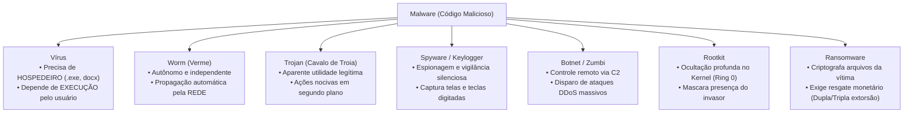
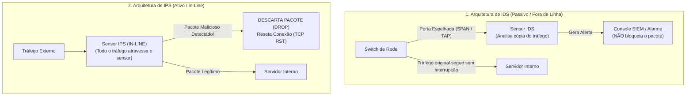
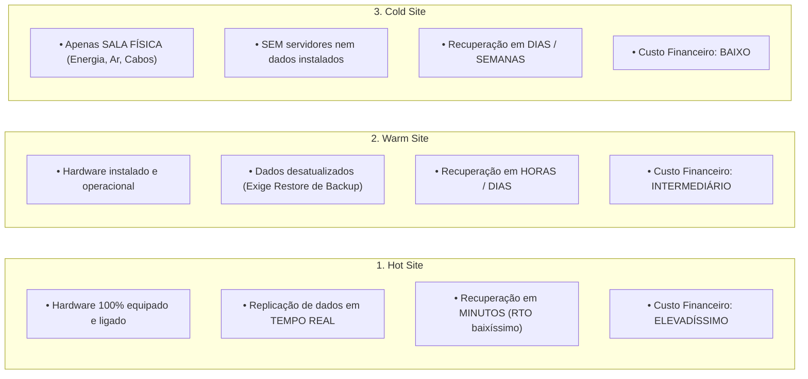

# 05 - Ameaças, Malware, Engenharia Social e Defesa de Redes

> **Matéria:** Segurança da Informação  
> **Cargo:** B02 – Técnico de Controle Externo – Especialidade: Tecnologia da Informação  
> **Arquivo:** `05_ameacas_malware_engenharia_social_e_defesa_de_redes.md`  

---

## 📌 Ementa / Itens do Edital
- Engenharia social e ataques centrados no fator humano (Phishing e variações)
- Códigos maliciosos (Malware): Vírus, Worms, Trojans, Spyware, Botnets e Ransomware
- Dispositivos de defesa perimetral: Firewalls (Packet Filtering, Stateful, NGFW), Antivírus/EDR e IDS/IPS
- Testes de Invasão (PenTest) e Análise de Vulnerabilidades
- Continuidade de Negócios (PCN), Análise de Impacto no Negócio (BIA) e Recuperação de Desastres (DRP)

---

## 🌳 Classificação Hierárquica

```text
5. Ameaças Cibernéticas, Defesa em Profundidade e Continuidade de Negócios
├── 5.1 Engenharia Social e Golpes Digitais
│   ├── 5.1.1 Princípio: Manipulação psicológica de pessoas para que executem ações ou divulguem informações confidenciais
│   ├── 5.1.2 Modalidades de Phishing:
│   │   ├── Phishing Genérico: Disparo massivo de e-mails falsificados simulando bancos ou tribunais
│   │   ├── Spear Phishing: Ataque altamente direcionado e personalizado a um indivíduo ou órgão específico
│   │   └── Whaling: Ataque direcionado à alta cúpula executiva (Presidentes, Ministros, Diretores de TI)
│   ├── 5.1.3 Canais Alternativos: Vishing (voz / telefone), Smishing (SMS) e QRishing (QR Codes maliciosos)
│   └── 5.1.4 Outras Técnicas de Engenharia Social: Pretexting (criação de cenário falso), Baiting (isca física - pendrives infectados deixados no estacionamento), Shoulder Surfing e Dumpster Diving
├── 5.2 Códigos Maliciosos (Malware)
│   ├── 5.2.1 Vírus: Programa malicioso que necessita de um arquivo hospedeiro para se propagar e depende de ação explícita do usuário para execução
│   ├── 5.2.2 Worms (Vermes): Códigos autônomos que se propagam automaticamente pela rede explorando vulnerabilidades sem intervenção humana e sem hospedeiro
│   ├── 5.2.3 Cavalos de Troia (Trojans): Programas aparentemente legítimos e úteis que executam secretamente funções maliciosas em segundo plano
│   ├── 5.2.4 Spyware e Keyloggers: Softwares espiões que monitoram atividades, capturam toques no teclado e dados sensíveis
│   ├── 5.2.5 Botnets e Zumbis: Redes de computadores infectados controlados remotamente por um atacante (Command & Control) para disparar ataques DDoS massivos
│   ├── 5.2.6 Rootkits: Conjunto de ferramentas que se ocultam nas camadas mais profundas do sistema operacional (nível de Kernel/Ring 0) mascarando a presença do invasor
│   └── 5.2.7 Ransomware:
│       ├── Mecânica: Criptografia sequestradora de arquivos locais e compartilhamentos de rede com exigência de resgate em criptomoedas
│       ├── Extorsão Dupla e Tripla: Criptografia dos dados + ameaça de vazamento público + contato direto com clientes/órgãos reguladores
│       └── Medidas de Defesa: Backups imutáveis offline (regra 3-2-1), segmentação e rápida contenção de rede
├── 5.3 Tecnologias de Defesa em Profundidade (Defense-in-Depth)
│   ├── 5.3.1 Firewalls:
│   │   ├── Packet Filtering (Filtragem de Pacotes sem estado - Stateless): Analisa apenas cabeçalhos de camada 3 e 4 (IP e porta)
│   │   ├── Stateful Inspection (Inspeção com Estado): Rastreia o estado da conexão TCP na tabela de estados (permite retornos legítimos automaticamente)
│   │   ├── Proxy de Aplicação / Firewall de Camada 7: Intermedia conexões inspecionando o conteúdo da aplicação
│   │   └── Next-Generation Firewall (NGFW): Combina inspeção com estado, inspeção profunda de pacotes (DPI), controle de aplicações e antivírus integrado
│   ├── 5.3.2 Sistemas de Detecção e Prevenção de Intrusão:
│   │   ├── IDS (Intrusion Detection System): Passivo; monitora tráfego em modo promíscuo (span port) e gera alertas de incidentes
│   │   ├── IPS (Intrusion Prevention System): Ativo; opera em linha (in-line) bloqueando pacotes maliciosos em tempo real
│   │   └── Métodos de Detecção: Baseado em Assinatura (reconhecimento de padrões conhecidos) vs. Baseado em Anomalia / Comportamento (detecta desvios da linha de base de tráfego)
│   └── 5.3.3 Antivírus Tradicional vs. EDR (Endpoint Detection and Response) / XDR (Extended Detection and Response)
├── 5.4 Testes de Invasão (PenTest) e Análise de Vulnerabilidades
│   ├── 5.4.1 Varredura de Vulnerabilidades: Ferramentas automatizadas que identificam falhas conhecidas sem explorá-las (Nessus, OpenVAS)
│   ├── 5.4.2 Teste de Intrusão (Penetration Testing): Avaliação ativa simulando ataques reais para explorar brechas
│   ├── 5.4.3 Modalidades de Teste:
│   │   ├── Black-Box: Sem conhecimento prévio da infraestrutura do alvo
│   │   ├── White-Box: Conhecimento total prévio (código-fonte, arquitetura, credenciais)
│   │   └── Gray-Box: Conhecimento parcial concedido
│   └── 5.4.4 Metodologias Padronizadas: PTES (Penetration Testing Execution Standard) e OSSTMM
└── 5.5 Continuidade de Negócios e Recuperação de Desastres
    ├── 5.5.1 Plano de Continuidade de Negócios (PCN / BCP - Business Continuity Plan): Foco na sustentação das operações críticas da organização durante uma crise
    ├── 5.5.2 Análise de Impacto no Negócio (BIA - Business Impact Analysis): Identificação de processos vitais e estimativa de perdas operacionais e financeiras
    ├── 5.5.3 Plano de Recuperação de Desastres (DRP - Disaster Recovery Plan): Foco técnico no restabelecimento dos sistemas de TI e infraestrutura
    ├── 5.5.4 Tipos de Centros de Recuperação Alternativos (Disaster Recovery Sites):
    │   ├── Hot Site: Ambiente plenamente equipado, com servidores ligados e dados sincronizados em tempo real (recuperação imediata em minutos)
    │   ├── Warm Site: Equipamentos instalados e prontos, mas exige restauração de dados a partir de backups (recuperação em horas)
    │   └── Cold Site: Apenas espaço físico com refrigeração e energia, sem servidores pré-configurados (recuperação em dias ou semanas)
    └── 5.5.5 A Regra de Ouro de Backup 3-2-1: 3 cópias dos dados, em 2 mídias diferentes, sendo pelo menos 1 cópia armazenada fora do local (Offsite/Imutável)
```

---

## 📖 Teoria Aprofundada & Pontos-Chave

### 5.1 Engenharia Social e Ataques Centrados no Fator Humano

A engenharia social explora fraquezas psicológicas (como curiosidade, medo, autoridade, urgência e confiança) para manipular indivíduos e induzi-los a quebrar procedimentos de segurança ou divulgar credenciais e dados sigilosos.

#### Modalidades de Phishing e Golpes Eletrônicos:
- **Phishing Genérico:** Disparo indiscriminado e massivo de e-mails fraudulentos que simulam instituições de grande porte (bancos, tribunais, órgãos da Receita). O objetivo é capturar credenciais pelo volume de cliques.
- **Spear Phishing:** Ataque de phishing **altamente direcionado e customizado** para uma organização ou pessoa específica. Os invasores pesquisam previamente a vida do alvo em redes sociais para formular mensagens convincentes e contextualizadas.
- **Whaling (*Caça à Baleia*):** Subcategoria de Spear Phishing direcionada exclusivamente ao topo da hierarquia executiva (ministros, desembargadores, governadores, CEOs, diretores financeiros).
- **Vishing (*Voice Phishing*):** Aplicação de engenharia social por telefone convencional ou voz sobre IP (VoIP), onde o golpista se passa por suporte técnico ou gerente bancário.
- **Smishing (*SMS Phishing*):** Phishing conduzido por meio de mensagens curtas de texto (SMS) contendo links fraudulentos.
- **QRishing:** Uso de QR Codes maliciosos afixados em locais físicos ou enviados digitalmente que redirecionam a vítima para páginas falsas ou downloads nocivos.

#### Outras Técnicas Clássicas de Engenharia Social:
- **Pretexting:** Criação de um pretexto fictício elaborado para convencer a vítima a entregar dados (ex.: simular uma auditoria interna emergencial).
- **Baiting (*Isca*):** Exploração da curiosidade ou ganância através da oferta de um brinde ou dispositivo físico (ex.: abandonar pendrives infectados com o rótulo "Folha de Pagamento - Confidencial" no estacionamento da instituição).
- **Shoulder Surfing:** Espionagem física direta por cima do ombro da vítima enquanto ela digita sua senha ou código PIN em teclados ou caixas eletrônicos.
- **Dumpster Diving:** Vasculhamento de lixeiras ou caçambas de descarte em busca de papéis, memorandos, listagens de servidores ou relatórios contendo informações sigilosas.

---

### 5.2 Códigos Maliciosos (Malware)

Os códigos maliciosos são programas concebidos especificamente para executar ações danosas ou não autorizadas em computadores e redes.



| Categoria de Malware | Precisa de Hospedeiro? | Propagação Autônoma? | Ação Típica de Ataque | Ponto-Chave para Provas FCC |
|---|---|---|---|---|
| **Vírus** | **SIM** (anexa-se a outro arquivo) | **NÃO** (exige que o usuário execute o arquivo infectado) | Corrompe arquivos, destrói dados, infecta novos executáveis locais. | Não se espalha sozinho; precisa de um hospedeiro e da intervenção do usuário para ser executado. |
| **Worm (Verme)** | **NÃO** (é um programa completo autônomo) | **SIM** (explora vulnerabilidades de rede automaticamente) | Consome largura de banda, esgota recursos do sistema, instala backdoors. | Não precisa de hospedeiro nem de clique do usuário; autorreplicante pela rede. |
| **Cavalo de Troia (Trojan)** | Pode ser independente | **NÃO** (propaga-se por engano/engenharia social) | Abre portas de comunicação (*backdoors*), baixa outros malwares, rouba senhas. | Disfarça-se de programa útil e inofensivo (ex.: protetor de tela, gerador de PDF) para iludir a vítima. |
| **Spyware / Keylogger** | Não necessariamente | Não | Monitora navegação, registra toques de teclas (*keylogger*) ou cliques de mouse (*screenlogger*). | Viola estritamente a **Confidencialidade** de forma silenciosa e prolongada. |
| **Botnet / Zumbi** | Varia | Sim (geralmente via worms) | Hosts controlados remotamente por um servidor C&C (*Command and Control*). | Utilizados prioritariamente para disparo coordenado de ataques massivos de negação de serviço (**DDoS**). |
| **Rootkit** | Varia | Não | Altera chamadas de sistema no núcleo do S.O. (*Kernel / Ring 0*), omitindo arquivos, portas e processos do invasor. | Foco primário na **ocultação e persistência** do invasor; mascara sua presença diante de comandos como `ps`, `netstat` e ferramentas antivírus comuns. |
| **Ransomware** | Varia | Comumente integrado a worms | Criptografa arquivos com AES e cifra a chave com RSA, tornando impossível a recuperação sem o resgate. | Ameaça clássica à **Disponibilidade** e Confidencialidade (extorsão dupla: criptografia + vazamento público de dados). |

> 🚨 **ALERTA DE PROVA / PEGADINHA FCC:**  
> A FCC adora trocar os conceitos de **Vírus** e **Worm**:  
> - O **Vírus** precisa de **arquivo hospedeiro** e precisa de **ação humana** para ser executado.  
> - O **Worm** é um programa **completo e autônomo**, que se propaga **sozinho pela rede**, explorando vulnerabilidades sem depender de clique ou execução do usuário.

---

### 5.3 Tecnologias de Defesa em Profundidade (*Defense-in-Depth*)

A defesa em profundidade postula a implantação de camadas defensivas sobrepostas, garantindo que a falha de um controle não resulte no comprometimento imediato de todo o ambiente institucional.

#### Evolução das Gerações de Firewalls:
1. **Firewall de Filtragem de Pacotes (*Stateless Packet Filtering*):**
   - Inspeciona cada pacote de forma isolada nas camadas 3 (Rede) e 4 (Transporte). Avalia exclusivamente: IP de origem/destino, porta de origem/destino e protocolo (TCP, UDP, ICMP).
   - *Limitação:* Não guarda o histórico de conexões anteriores. Portas dinâmicas altas precisam ser abertas permanentemente, expondo o ambiente.
2. **Firewall de Inspeção com Estado (*Stateful Inspection*):**
   - Mantém uma **Tabela de Estados (*State Table*)** em memória que rastreia o ciclo de vida completo de cada conexão TCP/UDP (Handshake SYN-SYN/ACK-ACK).
   - Se uma conexão de saída foi iniciada legitimamente por um host interno, os pacotes de retorno correspondentes são permitidos automaticamente sem necessidade de regras estáticas abertas.
3. **Firewall de Aplicação / Proxy (Camada 7):**
   - Atua como intermediário terminando a conexão do cliente e estabelecendo uma nova conexão com o servidor de destino, inspecionando o payload completo de protocolos como HTTP, FTP e SMTP.
4. **Next-Generation Firewall (NGFW):**
   - Consolida inspeção com estado, inspeção profunda de pacotes (*Deep Packet Inspection* - DPI), identificação e controle de aplicações em camada 7 (App-ID, independente da porta utilizada), inspeção de tráfego TLS/SSL descriptografado, controle de usuários baseado em identidade (User-ID) e mecanismos integrados de IPS e antivírus de rede.

#### IDS vs. IPS: Diferenças Arquiteturais



| Critério | IDS (*Intrusion Detection System*) | IPS (*Intrusion Prevention System*) |
|---|---|---|
| **Posicionamento na Rede** | Fora do fluxo direto de pacotes (*out-of-band* / modo promíscuo conectado a uma porta SPAN/TAP do switch). | Diretamente no caminho do fluxo (*in-line* / inline-mode); os pacotes são forçados a atravessar o dispositivo. |
| **Ação Perante o Ataque** | **Passivo:** Emite alertas para os analistas e gera registros de log, mas **não bloqueia** o pacote malicioso em trânsito. | **Ativo:** **Bloqueia e descarta (*drop*)** os pacotes em tempo real, podendo reconfigurar regras de firewall ou emitir pacotes TCP RST para resetar a conexão. |
| **Impacto de Falso Positivo** | Gera alarmes espúrios que sobrecarregam a equipe de monitoramento (ruído operacional). | Interrompe comunicações comerciais ou processuais legítimas, causando indisponibilidade de serviço (*DoS involuntário*). |
| **Latência Adicionada** | Zero latência para a rede de produção. | Adiciona pequena latência de processamento aos pacotes legítimos. |

#### Métodos de Detecção: Assinatura vs. Anomalia
- **Detecção Baseada em Assinaturas:** Compara o tráfego com um banco de dados de impressões digitais conhecidas de ataques passados. Vantagem: baixíssima taxa de falsos positivos. Desvantagem: totalmente cego a ataques de dia zero (*zero-day*) e variações polimórficas.
- **Detecção Baseada em Anomalias / Comportamento:** Estabelece uma linha de base (*baseline*) do tráfego usual e alerta quando identifica desvios estatísticos significativos (ex.: pico incomum de conexões SYN). Vantagem: detecta novos ataques desconhecidos. Desvantagem: elevada taxa de falsos positivos.

---

### 5.4 Testes de Invasão (PenTest) e Modalidades

O Teste de Intrusão (*Penetration Testing*) consiste em uma avaliação ativa de segurança defensiva, autorizada contratual e formalmente, que simula o comportamento de cibercriminosos reais para encontrar e explorar brechas de segurança.

#### As Três Modalidades Clássicas de PenTest:
1. **Black-Box (Caixa-Preta):**
   - O auditor/pentester não recebe nenhuma informação prévia sobre a infraestrutura interna do alvo (apenas o nome do domínio ou bloco de IPs públicos). Simula um invasor externo não privilegiado que precisa mapear e descobrir os alvos do zero.
2. **White-Box (Caixa-Branca):**
   - O auditor recebe amplo conhecimento prévio do ambiente, incluindo esquemas de arquitetura de rede, credenciais com múltiplos níveis de privilégio, documentação e até o código-fonte das aplicações. Proporciona a avaliação mais profunda e exaustiva possível.
3. **Gray-Box (Caixa-Cinza):**
   - Modalidade intermediária onde o pentester recebe informações parciais (ex.: credenciais de um usuário padrão ou diagramas de alto nível). Simula cenários realistas de ameaça interna (*insider threat*) ou invasor externo que já comprometeu um nó de borda.

---

### 5.5 Continuidade de Negócios e Recuperação de Desastres

A continuidade de negócios engloba estratégias corporativas para sustentar as atividades operacionais críticas de uma instituição governamental ou empresarial durante e após sinistros graves (incêndios, apagões, ataques maciços de ransomware, desastres naturais).

#### Instrumentos e Métricas Norteadoras:
- **Plano de Continuidade de Negócios (PCN / BCP - *Business Continuity Plan*):** Abrangência ampla e estratégica. Foco na sustentação contínua de todo o negócio e das pessoas durante a crise.
- **Análise de Impacto no Negócio (BIA - *Business Impact Analysis*):** Processo analítico de identificação dos processos de negócio mais críticos e quantificação das perdas operacionais, jurídicas e financeiras decorrentes de paralisações temporárias.
- **Plano de Recuperação de Desastres (DRP - *Disaster Recovery Plan*):** Foco estritamente tecnológico e operacional. Detalha os procedimentos para restabelecer os serviços de infraestrutura de TI, bancos de dados, servidores e telecomunicações após uma catástrofe.

#### Métricas Temporais Fundamentais (RTO, RPO e MTD)
- **RTO (*Recovery Time Objective* - Objetivo de Tempo de Recuperação):** O tempo máximo aceitável que um serviço ou sistema de TI pode permanecer fora do ar antes de ser restabelecido.
- **RPO (*Recovery Point Objective* - Objetivo de Ponto de Recuperação):** A quantidade máxima tolerável de dados perdidos medida no tempo (ex.: se a política exige backups a cada 2 horas, o RPO é de até 2 horas de transações perdidas).
- **MTD (*Maximum Tolerable Downtime*):** O limite absoluto de tempo que a organização consegue sobreviver sem que o serviço crítico volte à atividade, sob risco de falência ou colapso irreversível.

#### Centros Alternativos de Recuperação de Desastres (*Disaster Recovery Sites*)



#### A Regra de Backup 3-2-1
A salvaguarda definitiva contra incidentes catastróficos e ransomwares é a **Regra 3-2-1**:
- **3** Cópias distintas de todos os dados críticos (1 produção + 2 backups);
- **2** Tipos de mídias de armazenamento físicas diferentes (ex.: armazenamento em array de discos SSD locais e cópia em fita magnética LTO ou armazenamento de objetos em nuvem);
- **1** Cópia armazenada **fora do local físico principal (*Offsite*)**, mantida isolada da rede corporativa (*Air-Gapped*) ou em repositório **imutável** (*WORM - Write Once, Read Many*), tornando impossível que criminosos excluam ou criptografem as versões de backup durante um ataque.

---

## 🌐 Fontes Recomendadas na Internet

### 1. Guias Oficiais do CERT.br e NIC.br
- [Cartilha de Segurança para a Internet - Códigos Maliciosos (CERT.br)](https://cartilha.cert.br/fasciculos/codigo-malicioso/): Guia canônico nacional dissecando as diferenças comportamentais entre vírus, vermes (*worms*), cavalos de troia (*trojans*), *spywares*, *botnets* e *ransomwares*.
- [Cartilha de Segurança para a Internet - Golpes na Internet (CERT.br)](https://cartilha.cert.br/fasciculos/golpes/): Detalhamento das técnicas de engenharia social, modalidades de *phishing* (*spear phishing*, *whaling*), *smishing* e engenharia social presencial.

### 2. Normas Internacionais do NIST e Metodologias de Segurança
- [NIST Special Publication 800-34 Rev. 1 - Contingency Planning Guide](https://csrc.nist.gov/publications/detail/sp/800-34/rev-1/final): Padrão de planejamento de contingência cobrindo BIA (*Business Impact Analysis*), DRP (*Disaster Recovery Plan*) e centros alternativos (*Hot*, *Warm* e *Cold Sites*).
- [NIST Special Publication 800-94 - Guide to IDPS](https://csrc.nist.gov/publications/detail/sp/800-94/final): Manual técnico sobre sistemas de detecção e prevenção de intrusão, arquitetura *in-line* vs *promiscuous mode*, e abordagens baseadas em assinaturas vs anomalias.
- [Penetration Testing Execution Standard (PTES)](http://www.pentest-standard.org/): Metodologia aberta de referência para planejamento e execução de testes de intrusão (*PenTest*) nas modalidades *Black-Box*, *White-Box* e *Gray-Box*.

---

## 📝 Questões Comentadas & Exemplos

### Questão 1 (FCC - Adaptada / TI - Códigos Maliciosos / Malware)
Em uma inspeção de segurança da informação nos computadores do tribunal, a equipe técnica de resposta a incidentes (CSIRT) deparou-se com dois incidentes cibernéticos:
1. Um código malicioso que se propagou rapidamente por centenas de servidores da rede interna em poucos minutos, sem necessitar de qualquer ação ou clique de usuários e sem se anexar a arquivos executáveis existentes, explorando diretamente uma vulnerabilidade em um serviço de compartilhamento de arquivos do sistema operacional.
2. Um arquivo que se apresentava como um visualizador de planilhas de cálculo institucional legítimo enviado por e-mail, mas que, ao ser executado pelo servidor, abriu discretamente portas de comunicação para controle remoto da máquina por criminosos.

Essas duas pragas virtuais são classificadas tecnicamente, respectivamente, como:
A) Vírus de macro; e Spyware.  
B) Worm (Verme); e Cavalo de Troia (Trojan).  
C) Botnet; e Ransomware.  
D) Rootkit; e Adware.  
E) Vírus de boot; e Worm.

> **Gabarito: B**  
> **Comentário Analítico Passo a Passo:**  
> - **Análise do Incidente 1:** Trata-se de um software autônomo, autorreplicante e que se propaga pela rede explorando vulnerabilidades sem precisar de arquivo hospedeiro e sem requerer clique humano. Essa é a definição exata de **Worm (Verme)**.  
> - **Análise do Incidente 2:** Trata-se de um arquivo disfarçado de software legítimo e aparentemente útil (visualizador de planilhas), que esconde funcionalidades maliciosas operando em segundo plano (abertura de backdoor). Essa é a definição exata de **Cavalo de Troia (Trojan)**.  
> 
> **Análise das Alternativas:**  
> - **A está INCORRETA:** O incidente 1 não é vírus de macro (que exige arquivo hospedeiro do Office e interação do usuário) e o incidente 2 não é spyware (que visa espionar passivamente, enquanto abrir portas para controle remoto é a assinatura do Trojan/Backdoor).  
> - **B está CORRETA:** Identifica com rigor a sequência clássica e inconfundível: Worm no primeiro caso e Trojan no segundo.  
> - **C está INCORRETA:** O incidente 1 é o método de infecção (worm); botnet é a rede zumbi estruturada sob comando central. O incidente 2 não realizou sequestro de dados com exigência de resgate (ransomware).  
> - **D está INCORRETA:** Rootkit atua no núcleo do S.O. para ocultar arquivos e processos de invasores; Adware é focado na veiculação abusiva de anúncios publicitários.  
> - **E está INCORRETA:** Vírus de boot necessita de gravação no setor de inicialização do disco e intervenção ao ligar a máquina; inverteu a lógica do segundo incidente.

---

### Questão 2 (FCC - Adaptada / TI - Dispositivos de Defesa e Continuidade de Negócios)
A respeito das tecnologias de proteção perimetral de rede e das estratégias de continuidade de negócios para contingência de desastres, considere as afirmativas a seguir:

I. O Sistema de Detecção de Intrusão (IDS) opera em modo passivo, monitorando uma cópia do tráfego de rede para emitir alertas e registros de eventos sem possuir a capacidade de descartar diretamente os pacotes maliciosos em tempo real; enquanto o Sistema de Prevenção de Intrusão (IPS) é posicionado em linha (*in-line*), inspecionando o fluxo de rede em trânsito e descartando ativamente o tráfego que viole as regras de segurança.  
II. No âmbito do Plano de Recuperação de Desastres (DRP), um *Hot Site* é um centro de processamento alternativo plenamente operacional, dotado de hardware, software, conectividade e dados atualizados em tempo quase real, permitindo restabelecer serviços críticos em poucos minutos após um sinistro no datacenter principal.  
III. O *Cold Site* é um ambiente de recuperação imediata que mantém cópias espelhadas ativas de todos os bancos de dados em memória RAM, dispensando qualquer esforço de instalação física de servidores após uma catástrofe.

Está correto o que se afirma em:
A) I, apenas.  
B) I e II, apenas.  
C) II e III, apenas.  
D) I e III, apenas.  
E) I, II e III.

> **Gabarito: B**  
> **Comentário Analítico Passo a Passo:**  
> - **Item I (Correto):** O IDS atua fora de linha (*out-of-band*), monitorando cópias de pacotes espelhados em portas SPAN e emitindo alertas sem interromper a transmissão. O IPS atua *in-line* (no caminho dos dados), interceptando e descartando (*dropping*) ativamente os pacotes nocivos em tempo real.  
> - **Item II (Correto):** O **Hot Site** é uma réplica pronta e espelhada do datacenter primário, com servidores ativos e replicação em tempo quase real, proporcionando um Objetivo de Tempo de Recuperação (RTO) reduzido a minutos.  
> - **Item III (Incorreto):** O **Cold Site** é apenas a infraestrutura predial bruta (sala física, energia, climatização e cabeamento), **sem servidores pré-configurados nem dados instalados**. A recuperação exige transporte físico e configuração de equipamentos, consumindo dias ou semanas.  
> 
> **Análise das Alternativas:**  
> - **A está INCORRETA:** O Item II também é verdadeiro.  
> - **B está CORRETA:** Identifica precisamente que I e II são corretos e III é falso.  
> - **C está INCORRETA:** Inclui o Item III, que descreve as características de um Hot Site sob o rótulo de Cold Site.  
> - **D está INCORRETA:** Omite a correção do Item II e inclui o Item III.  
> - **E está INCORRETA:** Considera os três itens corretos, ignorando a incorreção patente do Item III.

---

### Questão 3 (FCC - Adaptada / TI - Engenharia Social e Modalidades de Ataque)
Um auditor fiscal da Secretaria da Fazenda recebeu um telefonema de um suposto analista do Departamento de Suporte de TI do órgão. O interlocutor, demonstrando conhecer previamente a lotação do auditor, seu nome completo e o nome do seu superior imediato, alegou estar realizando uma intervenção técnica emergencial de saneamento no sistema de declaração tributária e solicitou que o auditor informasse o código de seis dígitos recém-recebido via aplicativo para que sua senha provisória fosse homologada.

De acordo com as técnicas de engenharia social, esse ataque é classificado como:
A) Dumpster Diving.  
B) Shoulder Surfing.  
C) Pretexting combinado com Vishing.  
D) Ataque de Força Bruta por dicionário.  
E) Zero-Day Exploit.

> **Gabarito: C**  
> **Comentário Analítico Passo a Passo:**  
> - **Análise dos Elementos do Golpe:**  
>   1. O canal utilizado foi a voz/ligação telefônica, configurando o **Vishing** (*Voice Phishing*).  
>   2. O atacante construiu um pretexto elaborado e verossímil (manutenção técnica de emergência no sistema de TI) valendo-se de dados pesquisados previamente sobre a vítima para dar credibilidade à farsa, caracterizando a técnica de **Pretexting**.  
> 
> **Análise das Alternativas:**  
> - **A está INCORRETA:** *Dumpster Diving* consiste na busca física de dados sensíveis descartados em lixeiras.  
> - **B está INCORRETA:** *Shoulder Surfing* consiste em espiar visualmente a digitação de senhas por cima do ombro da vítima.  
> - **C está CORRETA:** Mapeia os dois vetores empregados no cenário narrado: o pretexto fictício elaborado (**Pretexting**) e o canal telefônico de voz (**Vishing**).  
> - **D está INCORRETA:** Trata-se de um ataque centrado na manipulação psicológica de pessoas (engenharia social), e não de um algoritmo automatizado de adivinhação de senhas por dicionário computacional.  
> - **E está INCORRETA:** *Zero-Day Exploit* é a exploração de uma vulnerabilidade desconhecida no software, enquanto o caso relatado explora exclusivamente o fator humano.

---

### Questão 4 (FCC - Adaptada / TI - Tecnologias de Firewall e NGFW)
A respeito dos mecanismos de funcionamento das diferentes gerações de Firewalls utilizados na proteção perimetral corporativa, assinale a afirmativa correta:
A) Firewalls sem estado (*Stateless Packet Filtering*) mantêm em memória dinâmica uma tabela de estados que rastreia o ciclo de vida completo de cada sessão TCP, dispensando a abertura manual de portas.  
B) Um Firewall de Inspeção com Estado (*Stateful Inspection*) analisa pacotes considerando o contexto das conexões estabelecidas; ao identificar que um pacote de retorno pertence a uma sessão TCP iniciada legitimamente por um cliente interno, permite sua passagem automaticamente com base na tabela de estados.  
C) O Firewall de Próxima Geração (NGFW) opera estritamente nas camadas 2 e 3 do modelo OSI, sendo tecnicamente incapaz de realizar a identificação de aplicações em camada 7.  
D) Firewalls de filtragem de pacotes simples são imunes a ataques de falsificação de endereço IP (*IP Spoofing*), por validarem a integridade de dados via hash MD5.  
E) A tabela de estados de um firewall stateful é dispensável para o protocolo TCP, sendo empregada de modo exclusivo em transmissões de broadcast UDP.

> **Gabarito: B**  
> **Comentário Analítico Passo a Passo:**  
> - **Funcionamento do Firewall Stateful:** O firewall de inspeção com estado cria e atualiza uma tabela dinâmica de conexões. Quando um host interno envia um pacote inicial com flag SYN para um servidor externo e recebe um pacote de retorno SYN-ACK, o firewall verifica que aquele pacote pertence a uma conexão legítima já registrada e autoriza sua entrada de forma automática e segura.  
> 
> **Análise das Alternativas:**  
> - **A está INCORRETA:** Quem mantém a tabela de estados em memória é o firewall **com estado (*Stateful*)**. O firewall *Stateless* avalia cada pacote isoladamente sem memória de contexto.  
> - **B está CORRETA:** Expressa com exatidão científica o princípio operacional dos firewalls *Stateful Inspection*: aproveitamento da tabela de conexões para reconhecer fluxos de retorno autorizados.  
> - **C está INCORRETA:** O NGFW diferencia-se exatamente por atuar na **camada 7 (Aplicação)**, realizando controle de aplicações (App-ID), inspeção profunda de pacotes (DPI) e controle de usuários.  
> - **D está INCORRETA:** Firewalls de filtragem simples (*stateless*) são altamente vulneráveis a *IP Spoofing*, pois analisam apenas o cabeçalho IP sem validar se a conexão foi previamente estabelecida.  
> - **E está INCORRETA:** O protocolo TCP, orientado à conexão com estados formais bem definidos (SYN, ESTABLISHED, FIN), é o principal beneficiário e elemento central monitorado na tabela de estados de um firewall.

---

### Questão 5 (FCC - Adaptada / TI - Testes de Invasão e Estratégia de Backups)
No âmbito da segurança ofensiva e defensiva de um Tribunal de Contas, a equipe de TI contratou um Teste de Intrusão (PenTest) e revisou sua política de cópias de segurança contra ataques de Ransomware.

A respeito das modalidades de PenTest e das salvaguardas de recuperação, assinale a afirmativa correta:
A) Na modalidade de teste de intrusão *White-Box*, os auditores não recebem nenhuma informação sobre o ambiente-alvo, simulando a perspectiva de um atacante externo que desconhece a infraestrutura do órgão.  
B) O PenTest na modalidade *Black-Box* disponibiliza previamente aos auditores as credenciais de administrador de domínio, os diagramas detalhados de rede e o código-fonte de todos os sistemas internos.  
C) A modalidade *Gray-Box* pressupõe que os testadores recebam um nível intermediário de conhecimento prévio ou acesso preliminar ao sistema, permitindo avaliar cenários de ameaças internas ou de comprometimento parcial de credenciais.  
D) A política de backup recomendada para proteção contra ransomware dispensa o armazenamento de cópias fora do datacenter principal (*offsite*), bastando salvar arquivos no mesmo servidor compartilhado de produção.  
E) A regra de backup 3-2-1 preconiza a manutenção de 1 única cópia de dados, dividida em 2 servidores locais, sem qualquer mídia externa.

> **Gabarito: C**  
> **Comentário Analítico Passo a Passo:**  
> - **Classificação das Modalidades de PenTest:**  
>   - **Black-Box:** Zero conhecimento prévio (visão de hacker externo).  
>   - **White-Box:** Conhecimento prévio total (visão de arquiteto interno / auditor pleno).  
>   - **Gray-Box:** Conhecimento prévio parcial (visão de usuário legítimo ou atacante com acesso preliminar).  
> - **Proteção contra Ransomware:** Exige a Regra 3-2-1 com pelo menos 1 cópia *offsite* e imutável (*WORM* / *Air-Gapped*), impedindo contaminação da fita/repositório durante a proliferação do ataque.  
> 
> **Análise das Alternativas:**  
> - **A está INCORRETA:** A modalidade descrita é o **Black-Box**. No White-Box, o auditor recebe todas as informações e documentações prévias.  
> - **B está INCORRETA:** O teste que disponibiliza credenciais completas e código-fonte é o **White-Box**, e não Black-Box.  
> - **C está CORRETA:** Define perfeitamente a abordagem **Gray-Box**: simulação orientada por privilégios ou conhecimentos parciais para investigar o impacto de brechas intermediárias.  
> - **D está INCORRETA:** Manter backups na mesma rede ou servidor de produção é catastrófico; ransomwares modernos apagam ou criptografam volumes de backup mapeados. É essencial ter cópias externas imutáveis (*offsite* / *offline*).  
> - **E está INCORRETA:** A Regra 3-2-1 exige **3 cópias**, em **2 mídias diferentes**, com **1 cópia fora do local (*offsite*)**.
