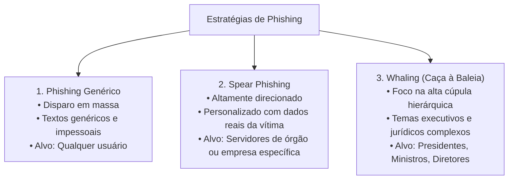
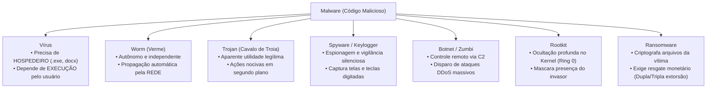
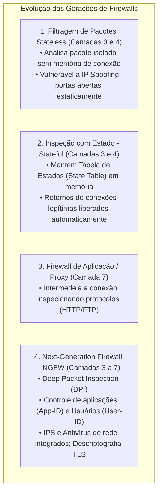
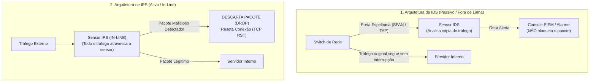
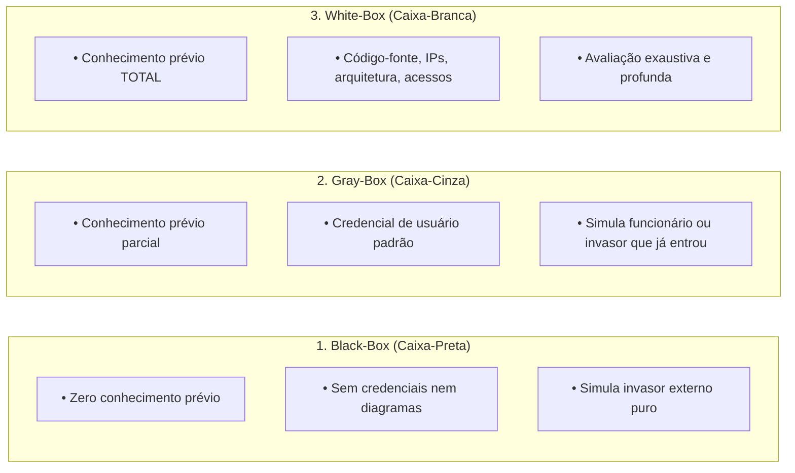
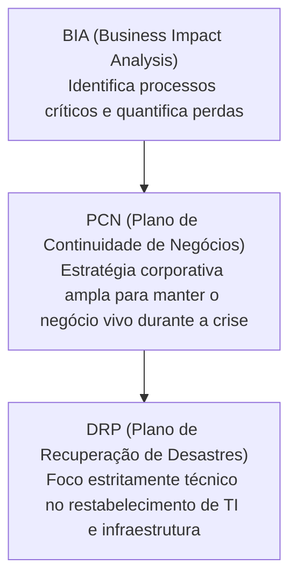
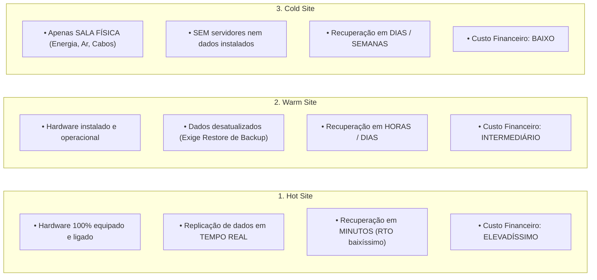

# 05 - Ameaças, Malware, Engenharia Social e Defesa de Redes

> **Matéria:** Segurança da Informação  
> **Cargo:** B02 – Técnico de Controle Externo – Especialidade: Tecnologia da Informação  
> **Arquivo:** `05_ameacas_malware_engenharia_social_e_defesa_de_redes.md`  

---

## 📌 Ementa / Itens do Edital
- Engenharia social e ataques centrados no fator humano (Phishing e variações)
- Códigos maliciosos (Malware): Vírus, Worms, Trojans, Spyware, Botnets e Ransomware
- Dispositivos de defesa perimetral: Firewalls (Packet Filtering, Stateful, NGFW), Antivírus/EDR e IDS/IPS
- Testes de Invasão (PenTest) e Análise de Vulnerabilidades
- Continuidade de Negócios (PCN), Análise de Impacto no Negócio (BIA) e Recuperação de Desastres (DRP)

---

## 🧭 Sumário

1. [Engenharia Social e Ataques Centrados no Fator Humano](#1-engenharia-social-e-ataques-centrados-no-fator-humano)
    1. [Princípios Psicológicos e Mecânica de Manipulação](#11-principios-psicologicos-e-mecanica-de-manipulacao)
    2. [Modalidades de Phishing (Genérico, Spear Phishing e Whaling)](#12-modalidades-de-phishing-generico-spear-phishing-e-whaling)
    3. [Canais Alternativos e Golpes Físicos (Vishing, Smishing, Pretexting e Baiting)](#13-canais-alternativos-e-golpes-fisicos-vishing-smishing-pretexting-e-baiting)
    4. [Teste 399](#Teste-399)
    5. [Teste 400](#Teste-400)
2. [Códigos Maliciosos (Malware) e Vetores de Infecção](#2-codigos-maliciosos-malware-e-vetores-de-infeccao)
    1. [Taxonomia dos Malwares: Vírus vs. Worms vs. Trojans](#21-taxonomia-dos-malwares-virus-vs-worms-vs-trojans)
    2. [Spyware, Keyloggers e Botnets (Redes Zumbis)](#22-spyware-keyloggers-e-botnets-redes-zumbis)
    3. [Rootkits e Ocultação em Nível de Kernel](#23-rootkits-e-ocultacao-em-nivel-de-kernel)
    4. [Ransomware: Criptografia, Dupla/Tripla Extorsão e Defesa](#24-ransomware-criptografia-duplatripla-extorsao-e-defesa)
    5. [Teste 401](#Teste-401)
    6. [Teste 402](#Teste-402)
    7. [Teste 403](#Teste-403)
3. [Tecnologias de Defesa em Profundidade (Defense-in-Depth)](#3-tecnologias-de-defesa-em-profundidade-defense-in-depth)
    1. [Gerações de Firewalls: Stateless vs. Stateful vs. NGFW](#31-geracoes-de-firewalls-stateless-vs-stateful-vs-ngfw)
    2. [IDS vs. IPS: Arquiteturas Passiva vs. In-Line](#32-ids-vs-ips-arquiteturas-passiva-vs-in-line)
    3. [Métodos de Detecção: Assinaturas vs. Anomalias](#33-metodos-de-deteccao-assinaturas-vs-anomalias)
    4. [Antivírus Tradicional vs. EDR e XDR](#34-antivirus-tradicional-vs-edr-e-xdr)
    5. [Teste 404](#Teste-404)
    6. [Teste 405](#Teste-405)
    7. [Teste 406](#Teste-406)
4. [Testes de Invasão (PenTest) e Análise de Vulnerabilidades](#4-testes-de-invasao-pentest-e-analise-de-vulnerabilidades)
    1. [Varredura de Vulnerabilidades vs. PenTest](#41-varredura-de-vulnerabilidades-vs-pentest)
    2. [Modalidades de Teste: Black-Box, White-Box e Gray-Box](#42-modalidades-de-teste-black-box-white-box-e-gray-box)
    3. [Metodologias Padronizadas (PTES e OSSTMM)](#43-metodologias-padronizadas-ptes-e-osstmm)
    4. [Teste 407](#Teste-407)
5. [Continuidade de Negócios e Recuperação de Desastres](#5-continuidade-de-negocios-e-recuperacao-de-desastres)
    1. [Governança de Continuidade: PCN vs. BIA vs. DRP](#51-governanca-de-continuidade-pcn-vs-bia-vs-drp)
    2. [Métricas de Continuidade: RTO, RPO e MTD](#52-metricas-de-continuidade-rto-rpo-e-mtd)
    3. [Centros de Recuperação Alternativos: Hot Site, Warm Site e Cold Site](#53-centros-de-recuperacao-alternativos-hot-site-warm-site-e-cold-site)
    4. [A Regra de Ouro de Backup 3-2-1 e Imutabilidade](#54-a-regra-de-ouro-de-backup-3-2-1-e-imutabilidade)
    5. [Teste 408](#Teste-408)
    6. [Teste 409](#Teste-409)
6. [Fontes Recomendadas na Internet](#6-fontes-recomendadas-na-internet)

---

## 1. Engenharia Social e Ataques Centrados no Fator Humano

### 1.1 Princípios Psicológicos e Mecânica de Manipulação

A **engenharia social** é a arte de manipular psicologicamente pessoas para que elas executem ações voluntárias ou involuntárias que comprometam a segurança, violem políticas institucionais ou divulguem informações sigilosas.

Os cibercriminosos exploram gatilhos emocionais e fraquezas cognitivas universais do ser humano:

- **Autoridade:** Fingir ser um diretor, juiz, auditor-chefe ou técnico do suporte de TI para impor obediência cega.
- **Urgência e Medo:** Alegar o cancelamento imediato de um benefício, processo disciplinar iminente ou bloqueio de contas judiciais caso o destinatário não clique no link imediatamente.
- **Curiosidade e Ganância:** Prometer acesso antecipado a listas secretas, promoções falsas ou planilhas de salários e bônus da instituição.
- **Solidariedade / Confiança:** Simular ser um colega em apuros precisando de ajuda urgente fora do horário comercial.

### 1.2 Modalidades de Phishing (Genérico, Spear Phishing e Whaling)

O **Phishing** é o vetor de ataque inicial mais comum em invasões corporativas mundiais. Divide-se em três modalidades fundamentais de acordo com a sofisticação e o público-alvo:

1. **Phishing Genérico:** Disparos automatizados e maciços de e-mails falsificados fingindo ser de grandes bancos, empresas de entrega ou órgãos públicos gerais (ex.: Receita Federal). O texto é padronizado e impessoal ("Prezado Cliente"), esperando que uma pequena porcentagem clique por engano.
2. **Spear Phishing (*Pesca com Arpão*):** Ataque altamente direcionado e customizado contra um indivíduo, setor ou organização específica. O atacante realiza reconhecimento prévio minucioso em redes sociais (como LinkedIn) e portais da transparência para descobrir o nome de colegas, chefias, projetos em andamento e termos técnicos reais do órgão, produzindo uma mensagem extremamente convincente.
3. **Whaling (*Caça à Baleia*):** Vertente executiva de Spear Phishing direcionada estritamente às autoridades do topo da pirâmide institucional (Ministros de Estado, Desembargadores, Conselheiros de Tribunais de Contas, Presidentes de estatais e Diretores Financeiros/CFOs). Utiliza pretextos corporativos de altíssimo impacto (intimações judiciais de varas federais, fusões sigilosas ou transferências cambiais de grande vulto).

### 1.3 Canais Alternativos e Golpes Físicos (Vishing, Smishing, Pretexting e Baiting)

- **Vishing (*Voice Phishing*):** Aplicação de engenharia social através de ligações de voz (telefone convencional ou celular/VoIP). O invasor simula a voz de operadores de suporte técnico, centrais antifraude de bancos ou auditores internos, orientando a vítima a ditar senhas, tokens OTP ou instalar softwares de acesso remoto.
- **Smishing (*SMS Phishing*):** Disparo de mensagens de texto via SMS contendo links curtos fraudulentos alegando compras suspeitas ou pendências cadastrais imediatas.
- **QRishing (*QR Code Phishing*):** Afixação de adesivos com QR Codes maliciosos sobre QR Codes legítimos em totens de atendimento, mesas de restaurantes ou guias de pagamento, redirecionando o pagamento ou o download para páginas forjadas.
- **Pretexting:** Criação de um pretexto fictício elaborado e envolvente para ludibriar a vítima. O criminoso estuda os hábitos da instituição para sustentar um diálogo complexo e obter informações restritas.
- **Baiting (*Uso de Iscas*):** Exploração da curiosidade ou cupidez física. O atacante abandona dispositivos USB (pendrives) infectados no estacionamento, refeitório ou banheiros do órgão, rotulados com títulos provocantes como *"Folha de Pagamento - Confidencial"* ou *"Inspeção Especial 2026"*. O funcionário que insere o pendrive na máquina de trabalho instala o malware na rede corporativa.
- **Shoulder Surfing:** Técnica de espionagem física direta por observação visual (olhar por cima do ombro) enquanto o servidor digita sua senha de rede, PIN de cartão ou código de acesso no teclado.
- **Dumpster Diving:** Prática física de vasculhar caçambas de descarte e lixeiras de órgãos públicos e empresas em busca de mídias ópticas quebradas, discos descartados, listagens impressas de servidores com matrículas, relatórios gerenciais e notas de serviços de TI.

---

### Teste 399
**(FGV – TJ-AP – Analista Judiciário (TI) – 2023)**  
A empresa de consultoria de segurança Y emitiu um comunicado

aos seus clientes sobre um golpe na Internet. O golpe consistia no

seguinte:

- Os clientes recebem mensagens por e-mail com links maliciosos,

abordando temas como aproveitar ofertas de um determinado

produto;

- O link redireciona para uma página  falsa, semelhante ao site da

instituição dona do produto, e solicita dados (agência, conta, nº

do cartão, celular e senhas) para efetuar a compra;

- O impostor liga para a vítima;

- Durante a ligação, o impostor solicita que o cliente execute uma

atualização de segurança que será enviada;

- Após a atualização, o criminoso realiza transações em nome da

vítima.

O golpe descrito pela empresa Y aos seus clientes é:

* **A)** hoax;
* **B)** email spoofing;
* **C)** interceptação de tráfego;
* **D)** site de comércio eletrônico fraudulento;
* **E)** phishing.

---

> **Comentário Detalhado:**
>
> - **A)** Incorreta. Hoax é um boato falso disseminado na rede (correntes de e-mail), que visa gerar alarme ou desinformação sem necessariamente capturar dados bancários de imediato.
> - **B)** Incorreta. Email spoofing é a falsificação do cabeçalho de remetente (técnica auxiliar), mas o golpe completo com páginas clonadas e engenharia social telefônica configura phishing.
> - **C)** Incorreta. Interceptação de tráfego (sniffing/man-in-the-middle) atua na espionagem passiva do meio físico ou lógico.
> - **D)** Incorreta. Não se trata meramente de site comercial, mas de infraestrutura fraudulenta para roubo de identidade bancária.
> - **E)** Correta. O golpe descrito é uma modalidade clássica de Phishing (combinado com engenharia social via telefone - Vishing): uso de mensagens isca que direcionam a vítima para sites clonados falsos visando o roubo de credenciais bancárias e dados confidenciais.
>
> **Gabarito: E**

---

### Teste 400
**(FGV – TJ-AP – Analista Judiciário (TI) – 2023)**  
A equipe de resposta e tratamento de incidentes (ETIR) de um órgão público detectou, por meio de suas ferramentas de monitoramento da rede, um aumento no número de acessos a um determinado domínio de internet. Como resultado do processo de investigação de um possível incidente de segurança, a ETIR identificou que os usuários que acessaram o determinado domínio haviam recebido e -mails com orientação para trocarem suas senhas no sistema de Single Sign -On (SSO) do órgão. O domínio acessado continha uma página de internet, com características similares à página do SSO do órgão, porém, com domínio diferente, cujo objetivo era capturar as credenciais de acesso dos usuários. A ETIR identificou que o órgão sofreu um ataque do tipo:

* **A)** advanced fee fraud;
* **B)** phishing;
* **C)** email spoofing;
* **D)** scanning;
* **E)** snifing.

---

> **Comentário Detalhado:**
>
> - **A)** Incorreta. Advanced fee fraud é o golpe do bilhete premiado ou da herança nigeriana.
> - **B)** Correta. Trata-se de um ataque de Phishing direcionado (Spear Phishing), no qual atacantes utilizam comunicações específicas e contextuais simulando a autoridade interna do órgão (troca de senhas do sistema institucional de SSO) para induzir os colaboradores a acessarem domínios falsos que capturam suas credenciais corporativas.
> - **C)** Incorreta. Email spoofing é técnica acessória que mascara o campo From, mas o tipo de ataque de roubo de credenciais via site falso é phishing.
> - **D)** Incorreta. Scanning é o processo de varredura automatizada de portas e serviços na rede.
> - **E)** Incorreta. Sniffing é a captura passiva de pacotes na camada de rede.
>
> **Gabarito: B**

---

## 2. Códigos Maliciosos (Malware) e Vetores de Infecção

### 2.1 Taxonomia dos Malwares: Vírus vs. Worms vs. Trojans

Os códigos maliciosos (**Malwares**) diferenciam-se essencialmente pelo seu método de propagação, pela dependência de hospedeiros e pela interação com o usuário:

| Tipo de Malware | Necessita de Arquivo Hospedeiro? | Propaga-se Sozinho pela Rede? | Exige Ação do Usuário para Ativar? | Mecânica Primária de Operação |
|---|---|---|---|---|
| **Vírus** | **SIM** (anexa-se a arquivos executáveis `.exe`, bibliotecas `.dll` ou macros de documentos) | **NÃO** | **SIM** (o usuário precisa abrir ou executar o arquivo infectado) | Corrompe arquivos, destrói setores de disco e replica seu código inserindo-se em outros programas locais. |
| **Worm** *(Verme)* | **NÃO** (é um programa completo autossuficiente) | **SIM** (explora vulnerabilidades ativas em serviços de rede) | **NÃO** (propaga-se de máquina em máquina de forma autônoma) | Consome largura de banda, esgota memória e CPU de servidores e abre portas de conexão remota (*backdoors*). |
| **Cavalo de Troia** *(Trojan)* | Não necessariamente | **NÃO** | **SIM** (o usuário é induzido a executar o programa disfarçado) | Apresenta-se como um software legítimo e atraente (jogo, leitor de PDF, utilitário de sistema), mas executa secretamente rotinas destrutivas ou de espionagem em segundo plano. |

> 🚨 **ALERTA DE PROVA / PEGADINHA FCC:**  
> A banca FCC costuma colocar em enunciados afirmações como:  
> *"O código malicioso que se propaga sozinho pela rede institucional, sem precisar se anexar a nenhum arquivo e sem depender de cliques dos usuários, é classificado como um Vírus."*  
> **ISSO ESTÁ ERRADO!** Esse é o conceito exato de **Worm (Verme)**! O Vírus depende obrigatoriamente de um **arquivo hospedeiro** e da **execução pelo usuário**. O Worm é autônomo e trafega pela rede explorando vulnerabilidades ativas em portas de serviços (ex.: protocolos SMB ou RPC).

### 2.2 Spyware, Keyloggers e Botnets (Redes Zumbis)

- **Spyware:** Programa espião que coleta informações confidenciais sobre as atividades e hábitos do usuário sem o seu consentimento, enviando relatórios para servidores remotos. Viola diretamente o princípio da **Confidencialidade**.
- **Keylogger e Screenlogger:** Variações especializadas de spyware:
    - *Keylogger:* Registra silenciosamente todas as teclas digitadas no teclado físico da máquina (capturando senhas, números de cartão e mensagens).
    - *Screenlogger:* Captura imagens da tela da área de trabalho no momento exato em que o usuário clica com o mouse (técnica usada para burlar teclados virtuais bancários de clique em tela).
- **Botnet (*Rede de Zumbis*):** Uma vasta rede de computadores, servidores ou dispositivos de IoT (*Internet of Things*) previamente infectados por bots maliciosos. Essas máquinas (chamadas de **zumbis**) passam a obedecer cegamente a comandos remotos transmitidos por um atacante (*Botmaster*) através de um servidor de Comando e Controle (**C&C** - *Command and Control*). São utilizadas prioritariamente para:
    - Disparo coordenado de ataques de Negação de Serviço Distribuída (**DDoS**);
    - Disparo de bilhões de mensagens de spam e phishing;
    - Mineração não autorizada de criptomoedas (*cryptojacking*).

### 2.3 Rootkits e Ocultação em Nível de Kernel

O **Rootkit** é uma das ameaças mais perigosas da segurança cibernética. Não se trata necessariamente de um programa destruidor de dados, mas sim de um conjunto sofisticado de ferramentas projetado especificamente para **manter acesso privilegiado permanente e ocultar a presença do invasor** no sistema operacional:

- Opera nas camadas mais profundas e privilegiadas do sistema operacional (nível de **Kernel / Ring 0** ou firmware UEFI).
- **Mecanismo de Ocultação:** Intercepta as chamadas de sistema da API do kernel (*system calls*) para filtrar saídas: se o administrador digitar comandos de diagnóstico como `ps -ef`, `top`, `ls` ou `netstat` no Linux, ou abrir o Gerenciador de Tarefas no Windows, o Rootkit remove os seus próprios processos, arquivos e portas abertas da visualização. Ferramentas antivírus convencionais em modo de usuário (*Ring 3*) não conseguem detectá-lo.

### 2.4 Ransomware: Criptografia, Dupla/Tripla Extorsão e Defesa

O **Ransomware** é uma categoria devastadora de malware que visa sequestrar ativos digitais da organização, impedindo o acesso aos arquivos e cobrando vultosos valores de resgate (geralmente em criptomoedas como Bitcoin ou Monero):

#### Fases de um Ataque Moderno de Ransomware:
1. **Intrusão e Reconhecimento:** Entrada via phishing, exploração de vulnerabilidades de borda (VPNs desatualizadas) ou credenciais RDP roubadas.
2. **Movimento Lateral e Elevação:** Mapeamento do Active Directory e servidores de banco de dados, com destruição prévia dos pontos de restauração e tentativas de apagar cópias de backup conectadas à rede.
3. **Cifragem Híbrida em Lote:** O ransomware cifra os arquivos corporativos locais e em compartilhamentos de rede utilizando uma cifra simétrica rápida (como AES-256) e protege a chave simétrica cifrando-a com uma chave pública assimétrica (RSA-4096) controlada pelos criminosos.
4. **Nota de Resgate:** Exibição de instruções na tela para pagamento.

#### Modalidades de Extorsão:
- **Extorsão Simples:** Ameaça de perda definitiva dos dados caso o resgate não seja pago.
- **Dupla Extorsão (*Double Extortion*):** Antes de criptografar, os criminosos realizam o download furtivo (*exfiltração*) de gigabytes de dados confidenciais (processos sigilosos, auditorias, dados fiscais de contribuintes). Caso a entidade recupere os arquivos por backups próprios e se recuse a pagar, os bandidos ameaçam divulgar publicamente os documentos na *Dark Web*.
- **Tripla Extorsão (*Triple Extortion*):** Além da cifragem e do vazamento, os atacantes contactam diretamente clientes, contribuintes ou órgãos reguladores (LGPD/ANPD), ou desferem ataques DDoS simultâneos contra a organização para amplificar o pânico.

---

### Teste 401
**(Questão Inédita / Simulada Estilo FCC – Nível: Controle Externo / TI)**
Em uma inspeção de segurança da informação nos computadores do tribunal, a equipe técnica de resposta a incidentes (CSIRT) deparou-se com dois incidentes cibernéticos:

1. Um código malicioso que se propagou rapidamente por centenas de servidores da rede interna em poucos minutos, sem necessitar de qualquer ação ou clique de usuários e sem se anexar a arquivos executáveis existentes, explorando diretamente uma vulnerabilidade em um serviço de compartilhamento de arquivos do sistema operacional.
2. Um arquivo que se apresentava como um visualizador de planilhas de cálculo institucional legítimo enviado por e-mail, mas que, ao ser executado pelo servidor, abriu discretamente portas de comunicação para controle remoto da máquina por criminosos.

Essas duas pragas virtuais são classificadas tecnicamente, respectivamente, como:

* **A)** Vírus de macro; e Spyware.
* **B)** Worm (Verme); e Cavalo de Troia (Trojan).
* **C)** Botnet; e Ransomware.
* **D)** Rootkit; e Adware.
* **E)** Vírus de boot; e Worm.

---

> **Comentário Detalhado:**
>
> - **A)** Incorreta. O incidente 1 não é vírus de macro (que exige arquivo hospedeiro do Office e interação do usuário) e o incidente 2 não é spyware (que visa espionar passivamente, enquanto abrir portas para controle remoto é a assinatura do Trojan/Backdoor).
> - **B)** Correta. O primeiro caso descreve com exatidão um Worm: código malicioso autônomo e autorreplicante que se propaga pela rede explorando vulnerabilidades sem precisar de hospedeiro e sem requerer clique humano. O segundo caso descreve perfeitamente um Cavalo de Troia (Trojan): software que se disfarça de programa inofensivo e útil (leitor de planilhas) para executar secretamente comandos prejudiciais em segundo plano (abertura de portas de backdoor).
> - **C)** Incorreta. Botnet é a rede de máquinas zumbis sob comando centralizado, enquanto o incidente 1 é o vetor de infecção autônomo (worm). O incidente 2 não envolveu sequestro e extorsão de dados (ransomware).
> - **D)** Incorreta. O Rootkit visa à ocultação de processos no kernel do sistema operacional, e o Adware tem por finalidade exibir anúncios publicitários indesejados.
> - **E)** Incorreta. Vírus de boot infecta o setor inicial de inicialização de discos e exige reinicialização de mídia, invertendo também os conceitos do segundo incidente.
> 
> **Gabarito: B**

---

### Teste 402
**(FGV – TRT-13 – Analista Judiciário (TI) – 2022)**  
O software malicioso que toma como refém informações pessoais ou corporativas e que depende do pagamento de uma quantia em dinheiro ou bitcoins para a liberação desses se denomina

* **A)** swindling.
* **B)** rootkit.
* **C)** adware.
* **D)** ransomware.
* **E)** scareware.

---

> **Comentário Detalhado:**
>
> - **A)** Incorreta. Swindling é termo genérico para fraude ou estelionato.
> - **B)** Incorreta. Rootkit visa camuflar e manter privilégios administrativos no sistema operacional.
> - **C)** Incorreta. Adware é malware focado na exibição invasiva de anúncios publicitários indesejados.
> - **D)** Correta. Ransomware é o código malicioso que sequestra ativos digitais (normalmente mediante cifragem forte e irreversível de arquivos ou bloqueio total da máquina), exigindo o pagamento de um resgate (frequentemente em criptomoedas como Bitcoin) em troca da promessa de chave de decifragem.
> - **E)** Incorreta. Scareware é software que emite avisos alarmistas e falsos para induzir a vítima a comprar soluções fraudulentas.
>
> **Gabarito: D**

---

### Teste 403
**(Questão Inédita / Simulada Estilo FCC – Nível: Controle Externo / TI)**
Os ataques cibernéticos de **Ransomware** evoluíram de incidentes isolados de criptografia de arquivos para verdadeiras operações de extorsão corporativa multifacetada operadas sob o modelo *Ransomware-as-a-Service* (RaaS).

A respeito das modalidades contemporâneas de extorsão praticadas por grupos de Ransomware em ataques contra instituições públicas, assinale a afirmativa correta:

* **A)** Na **Dupla Extorsão** (*Double Extortion*), os invasores não apenas bloqueiam o acesso aos dados cifrando os arquivos e discos dos servidores, mas também **exfiltram dados confidenciais** antes da criptografia, ameaçando vazar e publicar documentos sigilosos na Dark Web caso a organização recupere seus sistemas através de backups e recuse o pagamento do resgate.
* **B)** O ransomware moderno decifra os arquivos gratuitamente caso o administrador responda ao e-mail pedindo desculpas formais. em conformidade com as diretrizes e padrões de arquitetura corporativa.
* **C)** Ataques de ransomware utilizam exclusivamente a cifra de César com deslocamento de 3 posições alfabéticas.
* **D)** Na Tripla Extorsão, os criminosos comprometem-se formalmente a doar 50% do valor do resgate para orfanatos locais.
* **E)** O isolamento físico de backups em fitas magnéticas facilita a propagação imediata do ransomware pela rede Wi-Fi.

---

> **Comentário Detalhado:**
>
> - **A)** **CORRETA.** A evolução tática das modalidades de extorsão por Ransomware:
>   1. **Extorsão Simples:** Criptografa os dados locais e exige resgate para fornecer a chave de decifragem. Foi combatida com sucesso por organizações que mantinham backups saudáveis.
>   2. **Dupla Extorsão (Double Extortion):** Os atacantes furtam/exfiltram gigabytes de dados sensíveis *antes* de rodar a criptografia. Se o tribunal restaurar a base pelos backups e se recusar a pagar, os criminosos chantageiam o órgão ameaçando vazar os dados em portais da Dark Web, gerando multas de LGPD e crise reputacional severa.
>   3. **Tripla Extorsão (Triple Extortion):** Agrega ataques de negação de serviço (DDoS) contra os serviços online do órgão e assédio direto por e-mail/telefone aos cidadãos, clientes ou colaboradores cujos dados foram expostos.
> - **B)** Incorreta. Trata-se de crime organizado internacional que visa lucro financeiro ilícito em criptomoedas.
> - **C)** Incorreta. Empregam criptografia híbrida de padrão militar inquebrável (AES-256 + RSA-4096 / ChaCha20).
> - **D)** Incorreta. A tripla extorsão envolve assédio direto às partes afetadas e ataques DDoS.
> - **E)** Incorreta. Backups físicos desconectados (*Air-Gapped*) são justamente a principal salvaguarda contra contaminação.
> 
> **Gabarito: A**

---

## 3. Tecnologias de Defesa em Profundidade (Defense-in-Depth)

### 3.1 Gerações de Firewalls: Stateless vs. Stateful vs. NGFW

O Firewall é o dispositivo de proteção que controla o fluxo de tráfego de rede entre zonas de confiança distintas, aplicando políticas de filtragem preestabelecidas.

1. **Firewall de Filtragem de Pacotes Sem Estado (*Stateless Packet Filtering*):**
    - Inspeciona cada pacote de forma estritamente individual nas camadas de Rede (IP) e Transporte (TCP/UDP).
    - Avalia apenas: IP de origem, IP de destino, porta de origem, porta de destino e protocolo.
    - *Desvantagem:* Não guarda contexto histórico. Se um cliente interno acessa a web na porta 80, o firewall precisa manter portas dinâmicas altas (1024 a 65535) permanentemente abertas para permitir os pacotes de volta, expondo a rede a invasões.

2. **Firewall de Inspeção com Estado (*Stateful Inspection*):**
    - Mantém uma **Tabela de Estados (*State Table*)** em memória RAM onde rastreia o ciclo de vida completo de cada sessão (estados do *three-way handshake* do TCP).
    - Quando um pacote de retorno atinge a interface externa, o firewall consulta sua tabela interna: se o pacote pertencer a uma sessão iniciada legitimamente por um host da rede interna, ele tem passagem concedida automaticamente, sem exigir regras estáticas vulneráveis.

3. **Firewall de Próxima Geração (*Next-Generation Firewall* - NGFW):**
    - Padrão moderno da indústria que unifica a inspeção com estado clássica com a **Inspeção Profunda de Pacotes (*Deep Packet Inspection* - DPI)**.
    - Reconhece e disciplina tráfego por **Aplicações (App-ID)** em vez de portas fixas (ex.: consegue bloquear transferências de arquivos pelo aplicativo WhatsApp mesmo que o tráfego utilize a porta padrão HTTPS 443).
    - Integra nativamente: Sistemas de Prevenção de Intrusão (IPS), antivírus de rede, controle de acessos atrelado a identidades do Active Directory (User-ID) e quebra/inspeção de fluxos criptografados TLS/SSL (*SSL Decryption*).

### 3.2 IDS vs. IPS: Arquiteturas Passiva vs. In-Line

Os sistemas de detecção e prevenção de intrusão monitoram o tráfego em busca de anomalias, explorações de vulnerabilidades e atividades maliciosas:

| Critério de Comparação | IDS (*Intrusion Detection System*) | IPS (*Intrusion Prevention System*) |
|---|---|---|
| **Topologia / Posicionamento** | **Fora de Linha (*Out-of-Band*):** Conectado a uma porta de espelhamento (*SPAN/Mirror port*) de um switch ou dispositivo TAP. Analisa apenas uma **cópia** do tráfego. | **Em Linha (*In-Line*):** Inserido diretamente no caminho físico dos cabos/links. Todo o tráfego de produção é forçado a atravessar o sensor. |
| **Comportamento Operacional** | **Passivo:** Quando identifica um ataque, gera um alerta (*log*, e-mail, evento SIEM), mas **não tem o poder de bloquear** os pacotes maliciosos em trânsito. | **Ativo:** Quando detecta um padrão malicioso, **bloqueia e descarta (*drop*)** o pacote imediatamente, impedindo que o exploit alcance o servidor de destino. |
| **Impacto de Falhas / Latência** | Adiciona zero latência ao tráfego de rede e, se travar, não interrompe a comunicação da organização. | Adiciona milissegundos de latência à rede e, caso trave sem bypass de hardware (*fail-open*), pode indisponibilizar a rede inteira. |
| **Consequência do Falso Positivo** | Apenas ruído de alerta desnecessário na tela dos analistas do SOC. | **Interrupção de negócios:** descarta pacotes de transações comerciais legítimas, causando negação de serviço involuntária. |

### 3.3 Métodos de Detecção: Assinaturas vs. Anomalias

Tanto IDS/IPS quanto antivírus utilizam dois paradigmas primários de detecção:

1. **Detecção Baseada em Assinaturas (Conhecimento):** Compara os pacotes e arquivos com uma base pré-compilada de sequências de bytes e impressões digitais de ameaças já catalogadas.
    - *Vantagem:* Altíssima precisão e baixíssimo índice de falsos positivos para pragas conhecidas.
    - *Desvantagem:* Totalmente ineficaz contra ataques de dia zero (*zero-day*), malwares polimórficos ou novas variações que alteraram sua assinatura.

2. **Detecção Baseada em Anomalias / Comportamento:** Cria um perfil de normalidade (*baseline*) estatístico do ambiente durante um período de aprendizado. Qualquer desvio substancial dessa linha de base (ex.: um servidor de impressão que repentinamente começa a disparar conexões SSH para 500 máquinas) aciona o alerta.
    - *Vantagem:* Capaz de identificar ameaças inéditas (*zero-day*).
    - *Desvantagem:* Elevado índice de alarmes falsos positivos gerados por comportamentos atípicos, porém legítimos, dos colaboradores.

### 3.4 Antivírus Tradicional vs. EDR e XDR

- **Antivírus Tradicional (EPP - *Endpoint Protection Platform*):** Baseado quase exclusivamente em assinaturas e heurística estática em arquivos locais. Atua de forma preventiva básica, mas não possui visibilidade sobre ataques silenciosos em memória (*fileless malware*).
- **EDR (*Endpoint Detection and Response*):** Agente avançado instalado nos endpoints que grava continuamente o comportamento do sistema operacional (criação de processos, alterações no Registro, conexões de rede em tempo real). Permite isolar remotamente a máquina da rede com um clique, realizar busca ativa de ameaças (*threat hunting*) e reverter alterações maliciosas.
- **XDR (*Extended Detection and Response*):** Evolução que correlaciona telemetria de múltiplos domínios (endpoints, redes corporativas, servidores de e-mail, identidades e nuvem pública) em uma única plataforma analítica automatizada por inteligência artificial.

---

### Teste 404
**(FGV – TJ-AP – Analista Judiciário (TI) – 2023)**  
A arquitetura de firewall da empresa APP.TI utiliza uma sub -rede para isolar a rede interna e a internet. Essa é uma arquitetura de firewall do tipo:

* **A)** Packet Filter;
* **B)** Screened Host;
* **C)** Screened Subnet;
* **D)** Dual-Homed Host;
* **E)** Stateful Inspection.

---

> **Comentário Detalhado:**
>
> - **A)** Incorreta. Packet filter é uma tecnologia de filtragem de pacotes com base em cabeçalhos (camadas 3 e 4), não uma arquitetura de topologia perimetral.
> - **B)** Incorreta. Screened Host utiliza um único roteador de filtragem combinado com um único bastion host interno, sem criar uma sub-rede perimetral isolada.
> - **C)** Correta. A arquitetura Screened Subnet (comumente conhecida como DMZ ou Zona Desmilitarizada) emprega dois roteadores de filtragem ou interfaces distintas que isolam uma sub-rede intermediária perimetral da rede interna corporativa e da internet pública, garantindo que servidores de serviços públicos (Web, DNS, E-mail) fiquem separados da LAN.
> - **D)** Incorreta. Dual-Homed Host é um computador com duas interfaces de rede que atua como barreira entre duas redes sem sub-rede isolada.
> - **E)** Incorreta. Stateful Inspection é o método de inspeção de estado de conexões na pilha TCP/IP.
>
> **Gabarito: C**

---

### Teste 405
**(FGV – TJ-AP – Analista Judiciário (TI) – 2023)**  
Walace foi contratado pelo Tribunal de Justiça do Am apá (TJAP) para verificar as configurações no firewall existente. Ele recebeu como reclamação que não se conseguia conectar via SSH nas máquinas que passavam pelo firewall. Outra demanda solicitada foi que o servidor do TJAP não deveria responder a ping, n ão deixando que ele entre, com o objetivo de evitar o ataque de Flooding. De forma a atender à demanda solicitada pelo Tribunal, Walace deverá implementar as regras, respectivamente:

* **A)** <1> # iptables -A INPUT -p tcp --dport 22 -j ACCEPT <2> # iptables -A OUTPUT -p icmp --icmp-type echo -request -j DROP;
* **B)** <1> # iptables -A INPUT -p tcp --dport 22 -j ACCEPT <2> # iptables -A INPUT -p icmp --icmp-type echo-request -j DROP;
* **C)** <1> # iptables -I INPUT 1 -i lo -j ACCEPT <2> # iptables -A INPUT -m mac --mac-source 00:12:A1:24:BB:0C -j ACCEPT;
* **D)** <1> # iptables -A INPUT -m state --state NEW -p tcp --dport 80 -j ACCEPT <2> # iptables -A OUTPUT -p tcp --dport 22 -j ACCEPT;
* **E)** <1> # iptables -A INPUT -m state --state NEW -m tcp -p tcp -- dport 5100:5150 -j ACCEPT <2> # iptables -A INPUT -p icmp -- icmp-type echo-request -j DROP. Tribunal de Justiça do Estado do Amapá FGV Conhecimento Analista Jud - Apo Esp - Tecnologia da Informação - Segurança da Informação  Tipo 1 ̶ Branca – Página 15

---

> **Comentário Detalhado:**
>
> - **A)** Incorreta. A regra de descarte de ICMP foi configurada na cadeia OUTPUT (saída), impedindo que o próprio servidor emitisse pings, e não no INPUT (entrada de tráfego externo).
> - **B)** Correta. Na sintaxe do firewall iptables (Linux Netfilter): a regra `<1> iptables -A INPUT -p tcp --dport 22 -j ACCEPT` libera o tráfego de entrada na porta de destino TCP 22 (serviço SSH); e a regra `<2> iptables -A INPUT -p icmp --icmp-type echo-request -j DROP` bloqueia os pacotes de solicitação de ping recebidos do exterior (echo-request) na cadeia INPUT, prevenindo ping flooding.
> - **C)** Incorreta. Regras de loopback e endereço MAC não tratam as portas de serviço e os protocolos solicitados.
> - **D)** Incorreta. A porta 80 corresponde a HTTP, e a regra SSH foi inserida na cadeia OUTPUT indevidamente.
> - **E)** Incorreta. A faixa de portas 5100:5150 não corresponde ao serviço SSH padrão (porta 22).
>
> **Gabarito: B**

---

### Teste 406
**(FCC – TRT-23 – Analista Judiciário (TI) – 2016)**  
Um Analista do TRT23 especificou e planejou a instalação de um IPS na LAN do Tribunal. Diferentemente dos serviços de monitoração de segurança, o IPS, para atuar corretamente, deve ser instalado

* **A)** juntamente com o servidor de arquivos.
* **B)** na DMZ do Firewall.
* **C)** juntamente com o servidor web.
* **D)** juntamente com o servidor que possui o antivírus.
* **E)** em uma máquina que fica entre a LAN e a WAN. Caderno de Prova ’H08’, Tipo 001 14 TRT23-An-Judiciário-Tecnol.Informação-H08 DISCURSIVA-REDAÇÃO Atenção: Conforme Edital do Concurso, Capítulo X, itens: “10.5. Será atribuída nota ZERO à Prova Discursiva − Redação que: a) fugir à modalidade de texto solicitada e/ou ao tema proposto; b) apresentar texto sob forma não articulada verbalmente (apenas com desenhos, números e palavras soltas ou em versos) ou qualquer fragmento de texto escrito fora do local apropriado; c) for assinada fora do local apropriado; d) apresentar qualquer sinal que, de alguma forma, possibilite a i dentificação do candidato; e) estiver em branco; f) apresentar letra ilegível e/ou incompreensível. 10.6. A folha para rascunho no Caderno de Provas será de preenchimento facultativo. Em hipótese alguma o rascunho elaborado pelo candidato será considerado na correção da Prova Discursiva − Redação pela Banca Examinadora. 10.7. Na Prova Discur- siva − Redação deverão ser rigorosamente observados os limites: mínimo de 20 (vinte) linhas e máximo de 30 (trinta) linhas, sob pena de perda de pontos a serem atribuídos à Redação. 10.8. A Prova Discursiva − Redação terá caráter eliminatório e classificatório e será avaliada na escala de 0 (zero) a 100 (cem) pontos, considerando-se hab ilitado o candidato que nela obtiver nota igual ou superior a 60 (sessenta).” Observação: − NÃO é necessária a colocação de título na Prova Discursiva − Redação. Atente para o texto seguinte: Não é de hoje que se pergunta se a existência do museu ainda faz sentido, por mais que os antigos e tradicionais museus continuem atraindo um bom público, ao passo que novos espaços não deixam de ser construídos. Contudo, à medida que a própria arte se modifica, com os quadros tradicionais cada vez mais dando lugar a instalações, a performances e aos grafites, parece crescer o número daqueles para quem, segundo Hal Foster, no artigo “Museus sem fim” (revista Piauí, edição 105, Junho/2015), “a contemplação estética é tediosa, a compreensão histórica é elitista e, mais do que isso, o museu é um lugar morto, um mausoléu”. Foster discorda: “Quando bem projetados e dotados de programação inteligente, os museus admitem tanto entretenimento quanto contemplação, e nesse processo promovem também alguma compreensão.” Assim, em lugar de propor que os museus permaneçam intocados, o que o historiador e crítico norte-americano propõe é torná-los capazes de nos transportar “para diferentes períodos e culturas − para diversos modos de perceber, pensar, representar e ser −, a fim de que possamos testá-los em relação a nossas próprias época e cultura, e vice-versa, e, nesse processo, quem sabe transformarmo-nos um pouco.” Escreva um texto dissertativo-argumentativo posicionando-se em relação às diferentes ideias expostas no texto acima. Caderno de Prova ’H08’, Tipo 001 TRT23-An-Judiciário-Tecnol.Informação-H08 15 DISCURSIVA-REDAÇÃO Caderno de Prova ’H08’, Tipo 001

---

> **Comentário Detalhado:**
>
> - **A)** Incorreta. Instalar em servidor de arquivos limitaria a visibilidade aos pacotes locais daquele nó específico.
> - **B)** Incorreta. A instalação exclusiva na DMZ não protegeria o tráfego que transita entre os segmentos LAN e WAN.
> - **C)** Incorreta. O IPS é um elemento de proteção de rede perimetral e segmentação, não um software restrito a servidor web.
> - **D)** Incorreta. Antivírus opera na camada de endpoint (servidor), enquanto o IPS atua no fluxo de rede.
> - **E)** Correta. Ao contrário de um IDS (que pode operar fora da rota em modo passivo via porta espelho/SPAN monitorando cópias de tráfego), o IPS (Intrusion Prevention System) atua em modo em linha (in-line), posicionado no caminho direto dos pacotes entre a rede local (LAN) e a rede externa (WAN), para permitir a análise em tempo real e o bloqueio automático de pacotes maliciosos antes que ingressem na infraestrutura.
>
> **Gabarito: E**

---

## 4. Testes de Invasão (PenTest) e Análise de Vulnerabilidades

### 4.1 Varredura de Vulnerabilidades vs. PenTest

- **Varredura de Vulnerabilidades (*Vulnerability Scanning*):** Procedimento passivo e predominantemente automatizado por ferramentas especializadas (como Tenable Nessus, OpenVAS, Qualys). O scanner varre as portas de rede, identifica versões de sistemas operacionais e serviços em execução e correlaciona com bases de dados públicas de vulnerabilidades conhecidas (CVEs). **Não há a exploração ativa da brecha** para tentar obter controle ou acesso administrativo.
- **Teste de Intrusão (*Penetration Testing* / PenTest):** Avaliação de segurança ativa e formalmente autorizada pela organização, conduzida por especialistas humanos (*pentesters*). O profissional não se limita a apontar vulnerabilidades: ele **explora ativamente as falhas**, encadeia vulnerabilidades, contorna defesas, quebra senhas e busca obter acesso privilegiado (*root/administrator*) ou exfiltrar dados sensíveis fictícios para comprovar o impacto no mundo real.

### 4.2 Modalidades de Teste: Black-Box, White-Box e Gray-Box

O PenTest classifica-se segundo a quantidade de informações prévias disponibilizadas aos auditores:

1. **Black-Box (Caixa-Preta):** O auditor não recebe nenhuma informação prévia interna sobre a infraestrutura ou o software do alvo (geralmente apenas o nome da empresa ou o bloco de endereços IP públicos). Simula com máxima fidelidade a perspectiva de um cibercriminoso externo que precisa realizar levantamento de informações (*reconnaissance*) do zero.
2. **White-Box (Caixa-Branca):** O auditor recebe antecipadamente a totalidade das informações técnicas do ambiente: diagramas topológicos de rede, listagens completas de ativos, credenciais de acesso em múltiplos níveis e até o código-fonte das aplicações. Proporciona a auditoria mais completa, precisa e profunda, cobrindo cenários que poderiam passar despercebidos no Black-Box.
3. **Gray-Box (Caixa-Cinza):** Modalidade híbrida onde o pentester recebe informações parciais ou privilégios limitados (por exemplo, uma credencial de acesso de um servidor público comum de nível inicial). Avalia o estrago potencial decorrente de ameaças internas (*insider threats*) ou o que um invasor externo conseguiria fazer logo após comprometer uma estação de trabalho inicial via phishing.

### 4.3 Metodologias Padronizadas (PTES e OSSTMM)

Para assegurar o profissionalismo, a ética e a reprodutibilidade dos testes de invasão, adotam-se frameworks internacionais estruturados:

- **PTES (*Penetration Testing Execution Standard*):** Divide o teste em 7 fases sequenciais bem delimitadas:
    1. Interações Pré-engajamento (*Pre-engagement Interactions* - escopo e regras contratuais);
    2. Coleta de Informações (*Intelligence Gathering*);
    3. Modelagem de Ameaças (*Threat Modeling*);
    4. Análise de Vulnerabilidades (*Vulnerability Analysis*);
    5. Exploração (*Exploitation*);
    6. Pós-Exploração (*Post-Exploitation* - persistência e movimentação lateral);
    7. Relatório Final (*Reporting*).

- **OSSTMM (*Open Source Security Testing Methodology Manual*):** Metodologia científica rigorosa focada na quantificação de métricas de segurança operacional.

---

### Teste 407
**(Questão Inédita / Simulada Estilo FCC – Nível: Controle Externo / TI)**
No âmbito da segurança ofensiva e defensiva de um Tribunal de Contas, a equipe de TI contratou um Teste de Intrusão (PenTest) e revisou sua política de cópias de segurança contra ataques de Ransomware.

A respeito das modalidades de PenTest e das salvaguardas de recuperação, assinale a afirmativa correta:

* **A)** Na modalidade de teste de intrusão *White-Box*, os auditores não recebem nenhuma informação sobre o ambiente-alvo, simulando a perspectiva de um atacante externo que desconhece a infraestrutura do órgão.
* **B)** O PenTest na modalidade *Black-Box* disponibiliza previamente aos auditores as credenciais de administrador de domínio, os diagramas detalhados de rede e o código-fonte de todos os sistemas internos.
* **C)** A modalidade *Gray-Box* pressupõe que os testadores recebam um nível intermediário de conhecimento prévio ou acesso preliminar ao sistema, permitindo avaliar cenários de ameaças internas ou de comprometimento parcial de credenciais.
* **D)** A política de backup recomendada para proteção contra ransomware dispensa o armazenamento de cópias fora do datacenter principal (*offsite*), bastando salvar arquivos no mesmo servidor compartilhado de produção.
* **E)** A regra de backup 3-2-1 preconiza a manutenção de 1 única cópia de dados, dividida em 2 servidores locais, sem qualquer mídia externa.

---

> **Comentário Detalhado:**
>
> - **A)** Incorreta. O teste com zero informação prévia é denominado **Black-Box**. No teste White-Box, o auditor recebe todo o detalhamento técnico e credenciais antecipadamente.
> - **B)** Incorreta. O teste que fornece documentação total, código-fonte e credenciais de administrador é o **White-Box**, e não Black-Box.
> - **C)** Correta. A modalidade **Gray-Box** atua em patamar intermediário, concedendo privilégios e informações parciais aos testadores para simular ataques internos ou invasões com credenciais comprometidas.
> - **D)** Incorreta. Backups mantidos no mesmo servidor de produção são sumariamente destruídos ou criptografados por ransomwares modernos; é mandatório ter cópias externas imutáveis (*offsite* / *air-gapped*).
> - **E)** Incorreta. A regra 3-2-1 preconiza rigorosamente **3 cópias**, em **2 mídias diferentes**, com **1 cópia fora do local (*offsite*)**.
> 
> **Gabarito: C**

---

## 5. Continuidade de Negócios e Recuperação de Desastres

### 5.1 Governança de Continuidade: PCN vs. BIA vs. DRP

A governança corporativa de TI deve assegurar a resiliência institucional perante incidentes disruptivos graves. Esses esforços são articulados em três instrumentos complementares regulamentados pela norma ISO 22301:

1. **BIA (*Business Impact Analysis* - Análise de Impacto no Negócio):** Estudo técnico preliminar que cataloga todos os processos de negócio da organização, identifica aqueles cuja paralisação causaria danos irreparáveis e quantifica os prejuízos financeiros, legais e de imagem causados pela interrupção ao longo do tempo. Serve de subsídio direto para fixar o RTO e o RPO de cada sistema.
2. **PCN / BCP (*Business Continuity Plan* - Plano de Continuidade de Negócios):** Plano estratégico de alto nível com abrangência corporativa integral. Define como a organização continuará prestando seus serviços essenciais (atendimento ao cidadão, folha de pagamento, fiscalizações urgentes) mesmo que a sede física seja destruída por um incêndio ou alagamento, contemplando pessoas, instalações físicas alternativas e comunicação com a imprensa.
3. **DRP (*Disaster Recovery Plan* - Plano de Recuperação de Desastres):** Plano operacional e estritamente técnico de TI. Trata do passo a passo detalhado para recuperar servidores, bancos de dados, redes de comunicação e dados a partir de backups e centros alternativos após uma pane catastrófica.

### 5.2 Métricas de Continuidade: RTO, RPO e MTD

- **RTO (*Recovery Time Objective* - Objetivo de Tempo de Recuperação):** O tempo máximo tolerável decorrido entre o instante do desastre e o momento em que o sistema ou serviço de TI deve estar restabelecido e operando novamente.
- **RPO (*Recovery Point Objective* - Objetivo de Ponto de Recuperação):** A quantidade máxima admissível de dados perdidos, mensurada em unidades de tempo. Se um sistema realiza backups automáticos a cada 1 hora, o RPO é de até 1 hora de transações que precisariam ser redigitadas em caso de pane.
- **MTD (*Maximum Tolerable Downtime* - Tempo Máximo de Paralisação Admissível):** O tempo total limite que um processo de negócio pode permanecer inoperante antes que a instituição sofra danos fatais ou colapso institucional irreversível ($MTD \ge RTO$).

### 5.3 Centros de Recuperação Alternativos: Hot Site, Warm Site e Cold Site

Quando o datacenter principal sofre um desastre físico, a operação é transferida para um centro de processamento alternativo:

| Categoria | Descrição da Infraestrutura | Estado dos Dados | Tempo de Recuperação (RTO) | Custo Financeiro |
|---|---|---|---|---|
| **Hot Site** | Ambiente espelhado idêntico à sede principal. Servidores operacionais, sistemas instalados e conectividade ativa ininterrupta. | **Sincronizados em tempo real** ou quase real via replicação remota de storage. | **Minutos ou segundos.** Praticamente transparente para o usuário. | **Extremamente Elevado.** Exige duplicação completa de hardware e links dedicados. |
| **Warm Site** | Infraestrutura com servidores físicos e storage montados e configurados em rede, aguardando ativação. | **Desatualizados.** Não há sincronismo contínuo; exige restauração de dados (*restore*) a partir das últimas fitas ou cópias de backup. | **Horas ou poucos dias.** | **Intermediário.** |
| **Cold Site** | Apenas o espaço físico predial bruto com suprimento elétrico (geradores), climatização e cabeamento de rede estruturado, sem nenhum servidor nem hardware computacional pré-instalado. | **Sem dados.** Não há dados nem servidores no local. | **Dias ou semanas.** Exige compra emergencial, transporte físico, instalação de hardware e restauração completa de sistemas. | **Baixo.** |

### 5.4 A Regra de Ouro de Backup 3-2-1 e Imutabilidade

A salvaguarda definitiva contra incidentes de sequestro de dados por ransomware e sinistros físicos é a aplicação rigorosa da **Regra 3-2-1**:

- **3 Cópias:** Manter sempre no mínimo três cópias completas de todos os dados essenciais (a cópia primária de produção em uso + duas cópias de segurança de backup).
- **2 Mídias Diferentes:** Armazenar as cópias em pelo menos dois tipos distintos de tecnologias físicas de armazenamento (por exemplo: um array de discos magnéticos/SSDs corporativos locais e uma biblioteca de fitas magnéticas LTO ou armazenamento de objetos na nuvem), mitigando riscos de falhas simultâneas do mesmo fabricante de discos.
- **1 Cópia Offsite / Imutável:** Manter obrigatoriamente pelo menos uma das cópias armazenada **fora do prédio físico principal (*Offsite*)**, em localidade geograficamente distante. Adicionalmente, essa cópia deve ser **imutável (*WORM - Write Once, Read Many*)** ou mantida em isolamento físico da rede corporativa (**Air-Gapped**), impedindo que malwares apaguem ou criptografem os arquivos de contingência durante o ataque.

---

### Teste 408
**(FCC – TRT-14 – Analista Judiciário (TI) – 2016)**  
Um Analista sugeriu corretamente instalar, como mecanismo de segurança da informação, um

* **A)** Servidor firewall à frente do VPN. O servidor firewall seria conectado à intranet e o VPN seria posicionado entre o servidor firewall e a internet para bloquear totalmente os acessos indevidos.
* **B)** Filtro de conteúdo, para analisar todo o tráfego que circula entre a rede local e a internet, impedindo o acesso a sites utilizando bloqueio por palavra-chave, por URL ou por horário.
* **C)** Sistema de Prevenção de Intrusão − IDS, um sistema passivo que examina o tráfego e informa sobre ameaças, após o firewall.
* **D)** Sistema de Detecção de Intrusão − IPS antes do firewall, para analisar ativamente o fluxo de tráfego que entra na rede e realizar ações de bloqueio automaticamente.
* **E)** Roteador IP com recurso de NAT no ponto de conexão entre a VPN e a internet, para converter endereços IPv6 de com- putadores da VPN em endereços IPv4 da internet.

---

> **Comentário Detalhado:**
>
> - **A)** Incorreta. O posicionamento de firewall e VPN descrito inverte a lógica de proteção perimetral segura.
> - **B)** Correta. Um filtro de conteúdo (Web Application / Content Proxy Filter) opera inspecionando o fluxo de dados na camada de aplicação, possibilitando aplicar políticas de bloqueio granular de páginas web baseadas em listas negras de URLs, palavras-chave em páginas não autorizadas e janelas de horário de funcionamento corporativo.
> - **C)** Incorreta. O IDS é Sistema de Detecção de Intrusão, enquanto IPS é Sistema de Prevenção; a sigla e a definição foram truncadas.
> - **D)** Incorreta. O IPS é Sistema de Prevenção de Intrusão, e não de Detecção.
> - **E)** Incorreta. A tradução NAT padrão para acesso à internet opera entre endereços IPv4 privados e públicos, não sendo essa a sua função primária de segurança em conexões VPN.
>
> **Gabarito: B**

---

### Teste 409
**(Questão Inédita / Simulada Estilo FCC – Nível: Controle Externo / TI)**
Na estruturação de um Plano de Continuidade de Negócios e Recuperação de Desastres (DRP) para proteger os bancos de dados do tribunal contra ataques catastróficos de ransomware com dupla extorsão, a equipe de TI deve adotar a consagrada **Regra de Backup 3-2-1** enriquecida com salvaguardas modernas de imutabilidade.

Assinale a afirmativa que expressa de forma correta e completa a aplicação dessa regra de ouro:

* **A)** Manter 3 cópias dos dados (a cópia primária de produção e mais 2 cópias de segurança adicionais), armazenadas em pelo menos 2 tipos de mídias de armazenamento diferentes (ex.: disco rígido/SSD e fita magnética LTO ou armazenamento em nuvem), com pelo menos 1 cópia mantida fora das instalações principais (*Offsite*) ou fisicamente/logicamente isolada da rede corporativa (*Air-Gapped / Imutável com política WORM - Write Once, Read Many*).
* **B)** Fazer backup apenas 3 vezes por ano, com 2 minutos de duração e em 1 único disquete de 3,5 polegadas.
* **C)** Armazenar 3 cópias na mesma pasta da mesma partição do mesmo servidor web para acelerar a leitura.
* **D)** A regra 3-2-1 proíbe o uso de fitas magnéticas e impede qualquer cópia fora do datacenter.
* **E)** Todos os backups devem permitir a exclusão imediata e sem autenticação por qualquer usuário que acesse a rede local via Wi-Fi..

---

> **Comentário Detalhado:**
>
> - **A)** **CORRETA.** A **Regra de Ouro de Backup 3-2-1** (desenvolvida por Peter Krogh e endossada pelo CISA e NIST):
>   - **3 Cópias dos Dados:** Ter pelo menos três cópias dos dados vitais (a cópia ativa de produção + duas cópias de backup).
>   - **2 Mídias Distintas:** Utilizar pelo menos duas tecnologias ou tipos de mídia de armazenamento diferentes (ex.: disco SAN/NAS + fitas magnéticas LTO ou armazenamento em nuvem de objetos) para evitar falhas de causa comum (como lote de hardware defeituoso ou falha de firmware).
>   - **1 Cópia Offsite / Imutável:** Manter ao menos uma cópia fora do datacenter principal (*Offsite*), em outra localidade geográfica, imune a incêndios ou inundações locais. Na era do ransomware, expande-se para **3-2-1-1-0** (com 1 cópia imutável WORM - *Write Once, Read Many*, na qual nem administradores com credenciais comprometidas conseguem deletar ou criptografar os dados antes do período de retenção expirar, e 0 erros de integridade testados periodicamente).
> - **B)** Incorreta. Frequência descabida e mídia obsoleta.
> - **C)** Incorreta. Viola todos os princípios de resiliência e redundância (ponto único de falha total).
> - **D)** Incorreta. Fitas magnéticas e repositórios fora do site são recomendados exatamente por sua resiliência e capacidade de isolamento da rede (*Air-Gap*).
> - **E)** Incorreta. A facilidade de exclusão permitiria ao invasor ou ransomware destruir os backups antes de detonar a carga maliciosa.
> 
> **Gabarito: A**

---

## 6. Fontes Recomendadas na Internet

#### 1. Guias Oficiais de Resposta a Incidentes e Segurança Cibernética
- [NIST Special Publication 800-61 Rev. 2 — Computer Security Incident Handling Guide](https://csrc.nist.gov/pubs/sp/800/61/r2/final): Guia normativo sobre detecção, análise e contenção de incidentes causados por malwares (worms, trojans, ransomwares, botnets) e ataques de engenharia social.
- [NIST Cybersecurity Framework (CSF 2.0)](https://www.nist.gov/cyberframework): Diretrizes estratégicas para defesa em profundidade, proteção perimetral, detecção contínua de anomalias e recuperação cibernética contra ataques de ransomware.
- [Governo Digital — Programa de Privacidade e Segurança da Informação (PPSI 2.0)](https://www.gov.br/governodigital/pt-br/privacidade-e-seguranca/ppsi-2.0): Controles e guias operacionais do Governo Federal voltados à proteção contra códigos maliciosos, cópias de segurança seguras (regra 3-2-1) e gestão de vulnerabilidades.

#### 2. Normas Internacionais de Defesa de Rede e Continuidade de Negócios
- [NIST Special Publication 800-34 Rev. 1 - Contingency Planning Guide for Federal Information Systems](https://csrc.nist.gov/publications/detail/sp/800-34/rev-1/final): Padrão técnico de planejamento de contingência cobrindo BIA (*Business Impact Analysis*), métricas RTO/RPO/MTD, DRP (*Disaster Recovery Plan*) e centros alternativos (*Hot*, *Warm* e *Cold Sites*).
- [NIST Special Publication 800-94 - Guide to Intrusion Detection and Prevention Systems (IDPS)](https://csrc.nist.gov/publications/detail/sp/800-94/final): Manual técnico sobre sistemas de detecção e prevenção de intrusão, arquiteturas passiva vs. *in-line* e métodos de detecção baseados em assinaturas vs. anomalias.

#### 3. Referências Bibliográficas Clássicas (Padrão ABNT)
* STALLINGS, William; BROWN, Lawrie. **Segurança de Computadores: Princípios e Práticas**. 2. ed. Rio de Janeiro: Elsevier, 2014. (Cap. 6, 8 e 9 — Software Malicioso, Sistemas de Detecção de Intrusão IDS/IPS e Firewalls).
* MITNICK, Kevin D.; SIMON, William L. **A Arte de Enganar: Ataques de Hackers: Controlando o Fator Humano na Segurança da Informação**. São Paulo: Pearson Makron Books, 2003. (Cap. 1 a 6 — Fundamentos de Engenharia Social, Pretexting, Phishing e Manipulação Psicológica).
* ASSOCIAÇÃO BRASILEIRA DE NORMAS TÉCNICAS. **ABNT NBR ISO 22301:2020 — Segurança e resiliência — Sistema de gestão de continuidade de negócios — Requisitos**. Rio de Janeiro: ABNT, 2020. (Seção 8 — Análise de Impacto nos Negócios BIA, Estratégias de Continuidade PCN e Planos de Recuperação de Desastres DRP).
