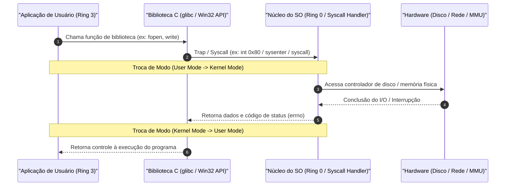
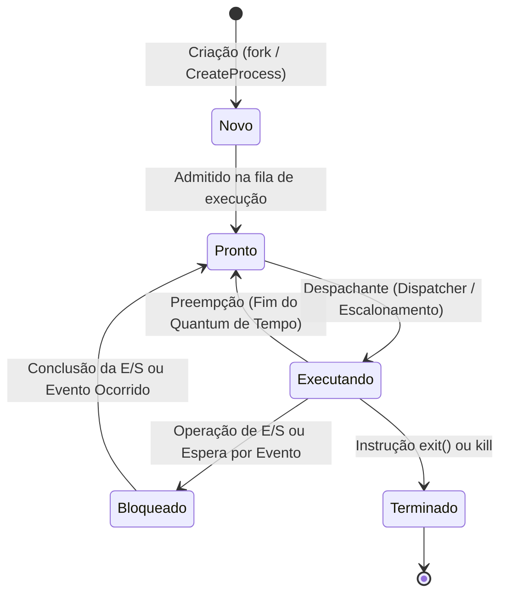
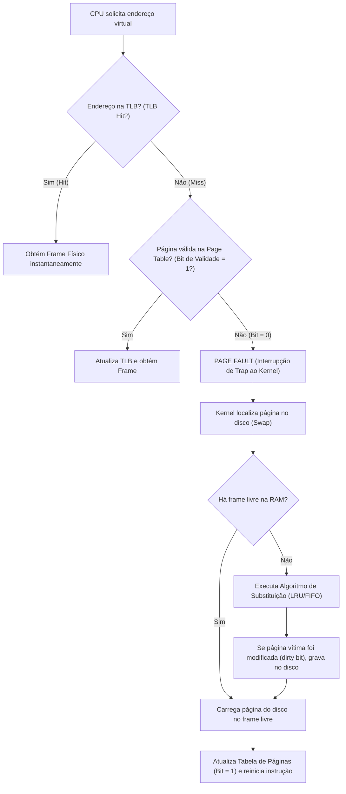
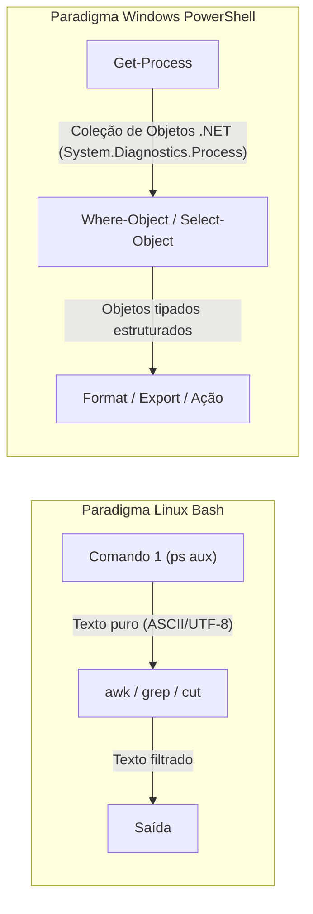

# 01 - Sistemas Operacionais: Linux e Windows

> **Matéria:** Sistemas Operacionais, Redes e Computação em Nuvem  
> **Cargo:** B02 – Técnico de Controle Externo – Especialidade: Tecnologia da Informação  
> **Arquivo:** `01_sistemas_operacionais_linux_e_windows.md`  

---

## 📌 Ementa / Itens do Edital
- Arquitetura de Sistemas Operacionais (Kernel, User Space, Syscalls)
- Gerenciamento de Processos, Threads e Escalonamento de CPU
- Gerenciamento de Memória (Memória Virtual, Paginação e Swapping)
- Sistemas de Arquivos (ext4, XFS, NTFS)
- Administração de Linux: comandos básicos de shell (Bash), permissões e automação por scripts
- Administração de Windows e Windows PowerShell: cmdlets e scripts

---

## 🌳 Classificação Hierárquica

```text
1. Arquitetura de Sistemas Operacionais, Administração Linux e Windows PowerShell
├── 1.1 Arquitetura e Conceitos Fundamentais de Sistemas Operacionais
│   ├── 1.1.1 Modos de Operação do Processador: Modo Usuário (User Mode / Ring 3) vs. Modo Núcleo/Kernel (Kernel Mode / Ring 0)
│   ├── 1.1.2 Chamadas de Sistema (System Calls - syscalls: `fork`, `execve`, `open`, `read`, `write`, `kill`, `mmap`)
│   └── 1.1.3 Tipos de Kernel: Monolítico (Linux), Microkernel (Mach, Minix) e Híbrido (Windows NT)
├── 1.2 Gerenciamento de Processos e Concorrência
│   ├── 1.2.1 Conceito de Processo vs. Thread (Processo Leve - compartilha espaço de endereçamento)
│   ├── 1.2.2 Ciclo de Vida e Estados de um Processo: Novo (New), Pronto (Ready), Executando (Running), Bloqueado / Espera (Waiting/Blocked) e Finalizado (Terminated)
│   ├── 1.2.3 Bloco de Controle de Processo (PCB - Process Control Block) e Troca de Contexto (Context Switch)
│   ├── 1.2.4 Algoritmos de Escalonamento de CPU:
│   │   ├── Não Preemptivos: FCFS (First-Come, First-Served) e SJF (Shortest Job First)
│   │   └── Preemptivos: Round Robin (com fatia de tempo / Quantum), Escalonamento por Prioridades e Filas Multinível com Realimentação
│   └── 1.2.5 Sincronização e Comunicação Interprocessos (IPC): Região crítica, exclusão mútua, Semáforos e Mutex
├── 1.3 Gerenciamento de Memória
│   ├── 1.3.1 Espaço de Endereçamento Lógico vs. Físico e papel da MMU (Memory Management Unit)
│   ├── 1.3.2 Memória Virtual e Paginação:
│   │   ├── Páginas lógicas e Molduras de página físicas (Frames)
│   │   ├── Tabela de Páginas e TLB (Translation Lookaside Buffer - cache de tradução rápida)
│   │   ├── Falta de Página (Page Fault): Interrupção gerada quando a página solicitada está no disco e precisa ser carregada na RAM
│   │   └── Algoritmos de Substituição de Páginas: FIFO, LRU (Least Recently Used) e Ótimo de Belady
│   └── 1.3.3 Swapping, Memória Swap e Thrashing (Hiperpaginação)
├── 1.4 Sistemas de Arquivos e Permissões
│   ├── 1.4.1 Conceitos: Blocos de dados, Superbloco e Inodos (Inodes no Linux: metadados, permissões, ponteiros; NÃO guarda o nome do arquivo)
│   ├── 1.4.2 Links no Linux: Hard Link (aponta diretamente para o mesmo Inode) vs. Symbolic Link / Soft Link (aponta para o caminho do arquivo)
│   ├── 1.4.3 Sistemas de Arquivos Linux: ext4 (journaling), XFS, Btrfs
│   ├── 1.4.4 Sistemas de Arquivos Windows: NTFS (New Technology File System: permissões ACL, cotas, compressão, criptografia EFS e journaling MFT) e FAT32
│   └── 1.4.5 Permissões no Linux (Modelo UGO: User, Group, Others):
│       ├── Leitura (r=4), Escrita (w=2), Execução (x=1)
│       ├── Representação Octal: `755` (rwxr-xr-x), `644` (rw-r--r--), comandos `chmod`, `chown`, `chgrp`, `umask`
│       └── Permissões Especiais: SUID (4000), SGID (2000) e Sticky Bit (1000)
├── 1.5 Administração e Shell Scripting no Linux
│   ├── 1.5.1 Comandos Essenciais:
│   │   ├── Navegação e Arquivos: `ls -la`, `cd`, `pwd`, `cp`, `mv`, `rm -rf`, `mkdir`, `touch`, `cat`, `less`, `head`, `tail -f`
│   │   ├── Busca e Filtros: `grep -rn`, `find /path -name`, `awk`, `sed`, `cut`, `sort`, `uniq`
│   │   ├── Processos e Recursos: `ps aux`, `top`, `htop`, `kill -9`, `pkill`, `free -m`, `df -h`, `du -sh`
│   │   └── Compactação e Rede: `tar -czvf`, `tar -xzvf`, `ip a`, `netstat` / `ss -tulpn`, `curl`, `wget`
│   ├── 1.5.2 Redirecionamento e Pipes: `>`, `>>`, `<`, `2>`, `2>&1` e pipe `|`
│   ├── 1.5.3 Gerenciamento de Serviços no Linux: `systemctl` (start, stop, restart, status, enable, disable) e logs com `journalctl -u`
│   └── 1.5.4 Automação com Scripts Bash: Variáveis (`$VAR`), parâmetros posicionais (`$1`, `$#`, `$?`), condicionais (`if [ ... ]; then`), laços (`for`, `while`) e agendador `cron` (`crontab -e`)
└── 1.6 Administração de Windows e Windows PowerShell
    ├── 1.6.1 Paradigma do PowerShell: Baseado em OBJETOS .NET (passagem de objetos estruturados pelo pipeline, e não texto puro)
    ├── 1.6.2 Nomenclatura de Cmdlets: Verbo-Substantivo (`Get-Process`, `Start-Service`, `Set-ExecutionPolicy`, `New-Item`)
    ├── 1.6.3 Cmdlets Administrativos Críticos:
    │   ├── Gestão de Processos e Serviços: `Get-Process`, `Stop-Process`, `Get-Service`, `Restart-Service`
    │   ├── Arquivos e Diretórios: `Get-ChildItem` (dir/ls), `Copy-Item`, `Remove-Item`, `Get-Content` (cat)
    │   └── Filtragem e Seleção no Pipeline: `Where-Object` (`?`), `Select-Object`, `ForEach-Object` (`%`)
    └── 1.6.4 Scripts PowerShell (`.ps1`) e Políticas de Execução (`Restricted`, `RemoteSigned`, `Unrestricted`, `Bypass`)
```

---

## 📖 Resumo Teórico & Conceitos Fundamentais

### 1.1 Arquitetura de Sistemas Operacionais e Modos de Operação

O Sistema Operacional atua como intermediário entre o hardware físico e os softwares aplicativos do usuário. Para assegurar integridade, estabilidade e isolamento de segurança, os processadores modernos utilizam anéis de proteção (*Protection Rings*):

1. **Modo Usuário (*User Mode* / Ring 3):**
   - As aplicações e processos de usuário executam com conjunto restrito de instruções.
   - Não possuem acesso direto aos dispositivos de entrada/saída (I/O), interrupções de hardware ou blocos arbitrários de memória física.
   - Qualquer tentativa de executar uma instrução privilegiada gera uma exceção/trap capturada pela CPU.
2. **Modo Núcleo / Kernel (*Kernel Mode* / Supervisor / Ring 0):**
   - O código do núcleo executa com privilégio irrestrito sobre o hardware, tabelas de memória e registradores de controle da CPU.
   - Controla o escalonamento, paginação e drivers de dispositivos.



#### Tipos de Kernel

| Modelo de Kernel | Características Arquiteturais | Vantagens | Desvantagens | Exemplos Reais |
| :--- | :--- | :--- | :--- | :--- |
| **Monolítico** | Todos os serviços essenciais (escalonador, memória, sistemas de arquivos, drivers de dispositivos) rodam no mesmo espaço de memória do Kernel (Ring 0). | Máximo desempenho em chamadas e trocas de mensagens (comunicação direta por ponteiros e funções). | Um bug em um driver de dispositivo ou módulo pode derrubar o sistema inteiro (*Kernel Panic*). | Linux, Unix tradicional, FreeBSD |
| **Microkernel** | Apenas as funções mínimas rodam no Kernel (IPC, gerenciamento básico de memória e escalonador). Drivers, sistemas de arquivos e rede rodam como servidores no Modo Usuário (Ring 3). | Alta modularidade, isolamento de falhas e segurança robusta (se o driver de rede travar, ele é reiniciado sem derrubar o SO). | Queda de desempenho devido ao overhead constante de troca de contexto e IPC por passagem de mensagens entre processos de usuário. | Mach, Minix, QNX |
| **Híbrido** | Combina a modularidade do microkernel com o desempenho do monolítico, executando subsistemas críticos e drivers gráficos/I/O no espaço do Kernel. | Equilíbrio entre flexibilidade arquitetural, facilidade de compatibilidade e velocidade de execução. | Complexidade interna elevada e maior superfície de ataque no Kernel. | Windows NT (10, 11, Server), macOS (XNU) |

> ⭐ **IMPORTANTE / REGRA DE OURO:**  
> A chamada de sistema `fork()` cria um processo filho que é uma **cópia exata** do processo pai (com exceção do PID e do valor de retorno de `fork`). Em sistemas modernos, utiliza-se a técnica **Copy-on-Write (COW)**: as páginas de memória física são compartilhadas entre pai e filho como somente-leitura até que um deles tente realizar uma escrita, momento no qual a página é efetivamente duplicada. A chamada `execve()` substitui a imagem de memória atual pelo novo binário a ser executado.

---

### 1.2 Gerenciamento de Processos, Threads e Escalonamento

#### Processo vs. Thread (Processo Leve)
- **Processo:** Programa em execução que possui seu próprio espaço de endereçamento virtual isolado, tabela de descritores de arquivo, PCB e contexto de segurança. A comunicação entre processos distintos exige mecanismos explícitos de IPC (*Inter-Process Communication*), como pipes, sockets, memória compartilhada ou filas de mensagens.
- **Thread:** Menor unidade de processamento escalonável pela CPU. Múltiplas threads do mesmo processo **compartilham**:
  - O mesmo espaço de endereçamento virtual (segmentos de Código, Dados Globais e Heap);
  - Os mesmos arquivos e sockets abertos;
  - Os mesmos sinais e permissões do processo pai.
  - **O que cada thread possui de forma EXCLUSIVA:** seu próprio Program Counter (PC), registradores de CPU e sua própria Pilha de Execução (*Stack* - variáveis locais e fluxo de chamadas).



#### Algoritmos de Escalonamento de CPU

| Algoritmo | Natureza | Mecânica de Funcionamento | Principais Desvantagens / Efeitos Colaterais |
| :--- | :--- | :--- | :--- |
| **FCFS (First-Come, First-Served)** | Não Preemptivo | Atende processos estritamente na ordem cronológica de chegada na fila de prontos. | **Efeito Comboio (*Convoy Effect*):** processos curtos ficam retidos atrás de um processo longo com carga intensiva de CPU. |
| **SJF (Shortest Job First)** | Não Preemptivo | Seleciona o processo com a menor rajada de CPU (*CPU burst*) estimada. Minimiza o tempo médio de espera. | Provoca **Inanição (*Starvation*)** de processos longos caso cheguem novos processos curtos ininterruptamente. Difícil prever a próxima rajada. |
| **SRTF (Shortest Remaining Time First)** | Preemptivo | Versão preemptiva do SJF: se um processo chega com tempo restante menor que o em execução, ocorre preempção. | Também sofre de inanição (*starvation*) e gera alto overhead de trocas de contexto. |
| **Round Robin (Alternância Circular)** | Preemptivo | Cada processo recebe uma fatia fixa de tempo de CPU denominada **Quantum**. Ao esgotar o quantum, sofre preempção e vai para o final da fila de prontos. | Se o quantum for **muito grande**, o algoritmo degenera em FCFS. Se for **muito pequeno**, a CPU perde rendimento útil com excesso de **Trocas de Contexto (*Context Switch*)**. |
| **Escalonamento por Prioridades** | Preemptivo ou Não | A CPU é alocada ao processo de maior prioridade numérica. | Inanição de processos de baixa prioridade. A solução canônica é o **Envelhecimento (*Aging*)**, que incrementa a prioridade do processo conforme ele espera na fila. |
| **Filas Multinível com Realimentação (MLFQ)** | Preemptivo | Processos movem-se entre diferentes filas com diferentes fatias de tempo. Processos I/O-bound ganham alta prioridade e quantum curto; CPU-bound caem para filas de menor prioridade com quantum longo. | Algoritmo mais complexo e configurável da engenharia de SO. |

> 🚨 **ALERTA DE PROVA / PEGADINHA FCC:**  
> A FCC frequentemente tenta confundir o candidato entre **Semáforo** e **Mutex**:
> - O **Mutex** (*Mutual Exclusion*) é um mecanismo de travamento binário que possui o conceito de **propriedade (ownership)**: apenas a thread que bloqueou o mutex pode desbloqueá-lo.
> - O **Semáforo** é uma variável inteira atômica sem conceito de posse: qualquer processo/thread pode invocar `signal()` / `post()` para incrementar o contador, servindo tanto para exclusão mútua (semáforo binário) quanto para sinalização e sincronização de eventos entre múltiplos processos.

---

### 1.3 Gerenciamento de Memória Virtual, Paginação e Swapping

A **Memória Virtual** desvincula o endereço lógico manipulado pelo programa do endereço físico na memória RAM.
- **MMU (*Memory Management Unit*):** Componente de hardware na CPU que traduz endereços lógicos (virtuais) em endereços físicos de memória através da **Tabela de Páginas (*Page Table*)**.
- **Páginas Lógicas (*Pages*) e Molduras Físicas (*Frames*):** Ambos possuem rigorosamente o **mesmo tamanho fixo** (tipicamente 4 KB na arquitetura x86/x64).
- **TLB (*Translation Lookaside Buffer*):** Cache associativa de hardware ultrarrápida que guarda as traduções recentes de página para frame.
  - *TLB Hit:* A tradução está na TLB, convertendo o endereço sem ler a RAM.
  - *TLB Miss:* A CPU precisa percorrer a tabela de páginas hierárquica na memória RAM (*page walk*).
- **Falta de Página (*Page Fault*):** Ocorre quando um processo acessa uma página lógica cujo bit de presença/validade está marcado como **0** (a página está na área de Swap em disco ou não foi alocada). Gera uma interrupção que aciona o Kernel para carregar o bloco do disco para a RAM.
- **Hiperpaginação (*Thrashing*):** Fenômeno em que o sistema gasta substancialmente mais tempo transferindo páginas de/para o disco (I/O de swap) do que executando instruções úteis. Ocorre quando a soma dos conjuntos de trabalho (*working sets*) de todos os processos ativos excede a memória RAM física disponível.



---

### 1.4 Sistemas de Arquivos e Permissões no Linux e Windows

#### A Estrutura do Inode (Linux)
O **Inode (*Index Node*)** é a estrutura de controle que descreve um arquivo ou diretório no Linux:
- **O que o Inode ARMAZENA:**
  - Modo do arquivo (tipo: regular, diretório, socket, pipe, link simbólico) e permissões de acesso (`rwx`);
  - Identificador do Dono (UID) e Grupo (GID);
  - Tamanho do arquivo em bytes;
  - Carimbos temporais: data de último acesso (`atime`), modificação de conteúdo (`mtime`) e mudança de metadados (`ctime`);
  - Contador de ligações diretas (*link count*);
  - Ponteiros para blocos de dados no disco (ponteiros diretos, indiretos simples, duplos e triplos).
- **O que o Inode NÃO ARMAZENA:**
  - **O nome do arquivo!**
  - **O caminho absoluto ou relativo!**
  - O nome e o número de inode ficam gravados nos blocos de dados do **diretório pai** (estrutura *dentry*).

#### Hard Link vs. Symbolic Link (Soft Link)

| Propriedade / Comportamento | Hard Link (`ln origem destino`) | Symbolic Link (`ln -s origem destino`) |
| :--- | :--- | :--- |
| **Referência de Inode** | Aponta diretamente para o **mesmo número de Inode** do arquivo original. | Possui um **novo Inode próprio** do tipo `l`, contendo o caminho textual do alvo. |
| **Cruzamento de Sistemas de Arquivos** | **NÃO** pode cruzar partições ou diferentes sistemas de arquivos. | **SIM**, pode cruzar discos, partições e montagens distintas. |
| **Apontamento para Diretórios** | Não permitido para usuários comuns (evita loops infinitos no grafo). | Permitido apontar para diretórios livremente. |
| **Exclusão do Arquivo Original** | O conteúdo **permanece íntegro** e acessível até que o contador de links caia para zero. | O link simbólico fica **quebrado / órfão (*dangling link*)**, apontando para um caminho inexistente. |
| **Tamanho do Arquivo** | Exatamente o mesmo tamanho e metadados do arquivo original. | Tamanho em bytes é igual ao número de caracteres da string do caminho de destino. |

#### Permissões Octais e Especiais no Linux

As permissões básicas dividem-se em Usuário Dono (`u`), Grupo (`g`) e Outros (`o`):
- Leitura (`r`) = $4$
- Escrita (`w`) = $2$
- Execução (`x`) = $1$

$$\text{Exemplo: } 754 \implies \text{Dono: } 4+2+1=7\,(rwx); \quad \text{Grupo: } 4+0+1=5\,(r-x); \quad \text{Outros: } 4+0+0=4\,(r--)$$

**Permissões Especiais:**
1. **SUID (*Set User ID* - 4000 / `rwsr-xr-x`):** Quando aplicado a um binário executável, faz com que qualquer usuário execute o programa com os privilégios do **proprietário do arquivo** (exemplo clássico: `/usr/bin/passwd`, que precisa alterar `/etc/shadow` de propriedade do `root`).
2. **SGID (*Set Group ID* - 2000 / `rwxr-sr-x`):** Em executáveis, roda com privilégios do grupo. Em diretórios, faz com que quaisquer novos arquivos ou pastas criados no seu interior **herdem automaticamente o grupo do diretório pai**, fundamental para compartilhamento departamental.
3. **Sticky Bit (1000 / `rwxrwxrwt`):** Aplicado a diretórios públicos (como `/tmp`). Impede que um usuário comum apague ou renomeie arquivos pertencentes a outros usuários, mesmo que o diretório tenha permissão de escrita geral ($777$). Somente o dono do arquivo ou o `root` pode excluí-lo.

---

### 1.5 Administração Linux: Shell, Comandos e Sinais POSIX

#### Principais Sinais POSIX (`kill`)
- `SIGKILL` (Sinal 9): Encerra o processo de forma incondicional e imediata. **Não pode ser capturado, tratado nem ignorado** pelo processo; o kernel finaliza a execução compulsoriamente.
- `SIGTERM` (Sinal 15): Sinal padrão do comando `kill`. Solicita a terminação graciosa do processo. Pode ser interceptado para salvar dados e fechar conexões antes de sair.
- `SIGHUP` (Sinal 1): Sinal de desligamento de terminal (*hangup*). Muito usado em daemons para recarregar arquivos de configuração sem reiniciar o serviço.
- `SIGSTOP` (Sinal 19): Pausa a execução do processo. Assim como o SIGKILL, **não pode ser interceptado nem ignorado**.
- `SIGCONT` (Sinal 18): Retoma a execução de um processo pausado.

#### Comandos Essenciais e Filtros
- `ps aux`: Lista todos os processos em execução no sistema (`a` = todos os usuários, `u` = formato detalhado com usuário, `x` = processos sem terminal associado).
- `grep -rn "padrao" /caminho`: Busca recursiva (`-r`) exibindo o número da linha (`-n`).
- `find /var/log -type f -name "*.log" -mtime -7`: Localiza arquivos regulares modificados nos últimos 7 dias.
- `systemctl [start|stop|restart|reload|status|enable|disable] <servico>`: Controle de serviços no systemd. O `enable` configura o início automático no boot, enquanto o `start` inicia imediatamente na sessão atual.

---

### 1.6 Administração Windows: Arquitetura PowerShell

Diferente do shell do Linux (Bash), cujo pipeline transmite uma cadeia unidimensional de caracteres de texto (*stream* de bytes), o **Windows PowerShell** opera sobre o pipeline do **Common Language Runtime (.NET)**.



#### Políticas de Execução de Scripts (`ExecutionPolicy`)
As políticas de execução controlam as condições sob as quais scripts `.ps1` podem ser executados:
1. `Restricted`: Padrão clássico do Windows cliente. Não permite a execução de nenhum script. Permite apenas comandos digitados interativamente.
2. `RemoteSigned`: Scripts criados localmente rodam livremente. Scripts baixados da Internet requerem assinatura digital de um editor confiável.
3. `AllSigned`: Todos os scripts (locais ou remotos) só executam se estiverem assinados digitalmente por uma autoridade confiável.
4. `Unrestricted`: Executa todos os scripts. Se o script vier da Internet, exibe apenas um aviso de confirmação.
5. `Bypass`: Nada é bloqueado e nenhum aviso é exibido.

> 🚨 **ALERTA DE PROVA / PEGADINHA FCC:**  
> A política de execução do PowerShell **NÃO é um limite de segurança perimetral**! Trata-se de uma salvaguarda para evitar que administradores executem scripts acidentalmente. Um usuário comum pode contorná-la chamando `powershell.exe -ExecutionPolicy Bypass -File script.ps1` sem violar os privilégios do SO.

---

## 🌐 Fontes Recomendadas na Internet

- [The Linux Kernel Documentation](https://docs.kernel.org/)
  - Documentação oficial da comunidade de desenvolvimento do Kernel Linux. Cobre a arquitetura do kernel, escalonadores CFS, chamadas de sistema e subsistemas de memória virtual.
- [GNU Bash Reference Manual](https://www.gnu.org/software/bash/manual/bash.html)
  - Manual oficial e exaustivo da Free Software Foundation sobre o interpretador de comandos Bash. Essencial para regras de sintaxe, expansões, redirecionamento de fluxos e controle de processos.
- [Linux man-pages Project (Michael Kerrisk - man7.org)](https://man7.org/linux/man-pages/)
  - Repositório online das páginas canônicas de manual do Linux. Referência para syscalls (`fork`, `execve`, `mmap`), sinais POSIX e comandos administrativos (`chmod`, `chown`).
- [Microsoft Learn - Documentação Oficial do PowerShell](https://learn.microsoft.com/pt-br/powershell/)
  - Portal oficial de documentação da Microsoft sobre o Windows PowerShell. Cobre a arquitetura baseada em objetos .NET, sintaxe de cmdlets, políticas de execução e pipeline estruturado.
- [Microsoft Learn - Visão Geral do Sistema de Arquivos NTFS](https://learn.microsoft.com/pt-br/windows-server/storage/file-server/ntfs-overview)
  - Detalha atributos corporativos do NTFS no Windows Server: permissões ACL (DACL e SACL), transações com journaling via MFT, cotas de disco e criptografia EFS.

---

## 📝 Questões Comentadas & Exemplos (Padrão FCC)

### Questão 1 (FCC - Adaptada / Analista de TI - Infraestrutura de Sistemas)
Considere um servidor Linux em ambiente de produção onde um analista precisa configurar os privilégios de acesso de um script administrativo crítico denominado `rotina_backup.sh`. Os requisitos de conformidade determinam que:
- O proprietário do arquivo tenha permissão total de leitura, escrita e execução;
- Os membros do grupo associado ao arquivo tenham apenas permissão de leitura e execução;
- Usuários externos e não autorizados (outros) não tenham qualquer privilégio de acesso (nem leitura, nem escrita, nem execução).

Adicionalmente, em uma sessão de monitoramento, o analista identificou um processo zumbi travado em loop fechado consumindo 100% de CPU com o identificador de processo PID 8192. Para mitigar o incidente, ele precisa emitir uma ordem de encerramento forçado que seja processada diretamente pelo núcleo do sistema operacional, sem que a aplicação tenha a faculdade de interceptar, bloquear ou postergar a terminação.

Assinale a alternativa que indica, correta e respectivamente, o comando para atribuir as permissões em notação octal e a linha de comando para a finalização compulsória do processo:

A) `chmod 750 rotina_backup.sh` e `kill -15 8192`  
B) `chmod 750 rotina_backup.sh` e `kill -9 8192`  
C) `chmod 754 rotina_backup.sh` e `kill -9 8192`  
D) `chmod 650 rotina_backup.sh` e `kill -KILL 8192`  
E) `chmod 755 rotina_backup.sh` e `kill -STOP 8192`  

> **Gabarito: B**  
> **Comentário Analítico Passo a Passo:**  
> - **Análise da Permissão Octal:**
>   - Usuário Dono (`u`): Leitura ($4$) + Escrita ($2$) + Execução ($1$) = $4 + 2 + 1 = 7$ ($rwx$).
>   - Grupo (`g`): Leitura ($4$) + Execução ($1$) = $4 + 1 = 5$ ($r-x$).
>   - Outros (`o`): Nenhum privilégio = $0$ ($---$).
>   - Portanto, a máscara octal combinada é rigorosamente `750`.
> - **Análise dos Sinais de Processo:**
>   - O sinal `SIGKILL` (representado numericamente por `9` ou `-s KILL`) é enviado diretamente ao kernel, o qual destrói o espaço de endereçamento e encerra o processo de forma compulsória e imediata, impossibilitando interceptação pela aplicação.
> - **Análise Detalhada das Alternativas:**
>   - **A (Incorreta):** O comando `kill -15 8192` envia o sinal `SIGTERM`, que pode ser interceptado, tratado ou solenemente ignorado pelo processo em loop.
>   - **B (Correta):** Combina perfeitamente a permissão `750` e o sinal de encerramento compulsório `kill -9 8192` (`SIGKILL`).
>   - **C (Incorreta):** A permissão `754` concederia privilégio de leitura ($r=4$) para a classe "Outros", violando a exigência de nenhum acesso.
>   - **D (Incorreta):** A permissão `650` não concede direito de execução ($x=1$) para o proprietário ($4+2=6$, resultando em $rw-$), impedindo-o de executar o script diretamente.
>   - **E (Incorreta):** Concede leitura e execução para Outros (`755`) e o comando `kill -STOP` apenas congela/pausa o processo, sem terminá-lo.

---

### Questão 2 (FCC - Adaptada / Analista de Sistemas - Suporte e Infraestrutura Windows)
No contexto de administração e automação de servidores Windows Server utilizando o Windows PowerShell, um administrador recebeu a demanda de auditar todos os serviços instalados cujo status operacional atual seja `Running`, extraindo um relatório contendo estritamente as propriedades relativas ao nome de sistema do serviço (`Name`) e seu nome legível para exibição (`DisplayName`).

Considerando a arquitetura interna do PowerShell, baseada na manipulação de coleções de objetos .NET estruturados ao longo do pipeline, assinale a linha de comando canônica e correta para a execução dessa tarefa:

A) `Get-Service | grep "Running" | cut -d " " -f 1,2`  
B) `Get-Service | Where-Object { $_.Status -eq 'Running' } | Select-Object -Property Name, DisplayName`  
C) `Get-Process | Where-Object { $_.State == 'Running' } | Out-String -Columns Name, DisplayName`  
D) `List-Service -Filter "Running" | Format-Table Name, DisplayName`  
E) `Get-Service | ForEach-Object { if ($_.State -eq 'Running') { Write-Host $_.Name } }`  

> **Gabarito: B**  
> **Comentário Analítico Passo a Passo:**  
> - **Funcionamento do Pipeline do PowerShell:** Ao executar `Get-Service`, o PowerShell não cospe linhas de texto no terminal; ele emite no pipeline uma coleção de instâncias da classe .NET `System.ServiceProcess.ServiceController`.
> - **Filtragem com `Where-Object`:** Avalia cada objeto recebido pela variável automática `$_` (ou `$PSItem`). A propriedade canônica que armazena a condição de execução é `Status` (cujo valor é um enumerador avaliado com o operador `-eq`).
> - **Projeção com `Select-Object`:** Isola apenas as propriedades declaradas (`Name`, `DisplayName`), gerando novos objetos personalizados para a saída.
> - **Análise Detalhada das Alternativas:**
>   - **A (Incorreta):** Aplica utilitários Unix clássicos de filtragem textual (`grep` e `cut`), ignorando o modelo de objetos .NET e gerando quebra de formato no PowerShell.
>   - **B (Correta):** Utiliza sintaxe canônica e moderna do PowerShell com filtragem estruturada de objetos e seleção precisa de atributos.
>   - **C (Incorreta):** Utiliza `Get-Process` (que inspeciona processos em execução, e não serviços do SO), operador de igualdade sintaticamente incorreto no PowerShell (`==` em vez de `-eq`) e propriedade inexistente (`State`).
>   - **D (Incorreta):** O cmdlet `List-Service` não existe no conjunto padrão de comandos do PowerShell.
>   - **E (Incorreta):** A propriedade correta da classe de serviços é `Status`, e não `State`. Além disso, o laço apenas imprime texto no console via `Write-Host`, sem manter o fluxo encadeado de objetos.

---

### Questão 3 (FCC - Adaptada / Analista de TI - Infraestrutura)
A respeito da arquitetura de sistemas de arquivos em ambientes baseados em Linux e da estrutura interna de inodes (*index nodes*), considere as seguintes afirmativas:

I. Cada inode armazena metadados fundamentais do arquivo, tais como tamanho, permissões de acesso, identificadores de usuário e grupo, carimbos temporais e ponteiros para os blocos de dados, mas não contém o nome do arquivo nem seu caminho absoluto.  
II. Um link rígido (*hard link*) cria uma entrada de diretório independente que aponta diretamente para o mesmo número de inode do arquivo de origem, podendo ser criado entre diferentes sistemas de arquivos e partições montadas.  
III. Caso o arquivo de origem de um link simbólico (*soft link*) seja excluído do disco, o link simbólico torna-se órfão (*dangling link*), pois ele armazena em seu próprio bloco de dados apenas o caminho textual para o arquivo de destino.  

Está correto o que se afirma em:

A) I e II, apenas.  
B) II e III, apenas.  
C) I e III, apenas.  
D) I, II e III.  
E) III, apenas.  

> **Gabarito: C**  
> **Comentário Analítico Passo a Passo:**  
> - **Item I (Correto):** O inode é agnóstico em relação à localização textual do arquivo na árvore de diretórios. O nome do arquivo e a correlação com o número do inode residem unicamente nos blocos de dados dos diretórios que o contêm.
> - **Item II (Incorreto):** Os números de inode são únicos **apenas dentro do escopo de um mesmo sistema de arquivos/partição**. Consequentemente, um *hard link* **jamais** pode cruzar sistemas de arquivos ou discos distintos, pois o número de inode colidiria com inodes de outros discos.
> - **Item III (Correto):** O link simbólico é um arquivo regular especial que possui seu próprio inode e contém apenas a string do caminho de destino. Se o arquivo original for excluído, o inode original é liberado, mas o ponteiro textual do link simbólico continua apontando para um caminho agora inexistente.
> - **Conclusão:** Os itens I e III estão estritamente corretos, justificando a alternativa C.

---

### Questão 4 (FCC - Adaptada / Técnico Judiciário - Tecnologia da Informação)
No gerenciamento de memória virtual por paginação sob demanda em sistemas operacionais modernos, um processo em execução gera uma solicitação de acesso a um determinado endereço lógico. Durante a operação de tradução conduzida pela unidade de gerenciamento de memória (MMU), identifica-se que o bit de validade correspondente na tabela de páginas está marcado como ausente (bit 0).

Nessa situação, o evento gerado pela arquitetura de hardware e a ação imediata subsequente realizada pelo sistema operacional são:

A) Uma interrupção de *Page Fault*, que transfere o controle ao núcleo do sistema operacional para buscar a página solicitada no armazenamento secundário e carregá-la em uma moldura livre da memória principal.  
B) Uma violação de segmento (*Segmentation Fault*), que resulta na terminação imediata e compulsória do processo por invasão de área de memória protegida.  
C) Um *TLB Hit*, no qual o processador busca o endereço diretamente na memória cache L1 sem consultar as tabelas do núcleo.  
D) Um procedimento de *Swapping* compulsório de todos os processos ativos para o disco, paralisando a CPU até que a memória RAM seja totalmente desfragmentada.  
E) Uma chamada de sistema `mmap`, solicitando que o processo usuário reconfigure o seu próprio bloco de controle de processo (PCB).  

> **Gabarito: A**  
> **Comentário Analítico Passo a Passo:**  
> - **O Conceito de Falta de Página (*Page Fault*):** Na paginação sob demanda (*demand paging*), as páginas de um programa não precisam estar todas simultaneamente na RAM. Quando o endereço solicitado possui bit de validade igual a zero, a MMU sinaliza uma falta de página por meio de uma interrupção/trap de hardware.
> - **Ciclo de Tratamento pelo SO:**
>   1. O processador salva o contexto do processo e transfere o controle para a rotina de tratamento de falta de página do kernel;
>   2. O kernel valida se o acesso foi legal (se pertencia ao espaço de endereçamento do processo);
>   3. Localiza a página no disco (área de swap ou binário executável);
>   4. Encontra uma moldura (*frame*) livre na RAM (executando substituição de páginas se a memória estiver cheia);
>   5. Realiza a leitura da página do disco para o frame;
>   6. Atualiza a tabela de páginas (bit de presença = 1) e reinicia exatamente a instrução que causou o trap.
> - **Análise Detalhada das Alternativas:**
>   - **A (Correta):** Descreve com fidelidade a ocorrência de *Page Fault* e o fluxo de recuperação pelo kernel.
>   - **B (Incorreta):** A violação de segmento (*segfault*) ocorre quando o processo tenta acessar um endereço fora de seu espaço permitido de endereçamento, e não quando uma página legal ainda está no disco.
>   - **C (Incorreta):** Se o bit de presença não estava ativo, houve um *TLB Miss* prévio e uma falta de página na tabela de páginas.
>   - **D (Incorreta):** O swapping de processos inteiros não ocorre a cada falta de página; apenas a página individual demandada é trazida para a memória.
>   - **E (Incorreta):** O processo de usuário não configura seu próprio PCB, tampouco a falta de página exige invocação manual de `mmap`.

---

### Questão 5 (FCC - Adaptada / Analista de Tecnologia da Informação - Sistemas)
Em relação aos conceitos de concorrência, processos, threads e algoritmos de escalonamento de processador em sistemas operacionais, assinale a afirmação correta:

A) No algoritmo de escalonamento *Round Robin* (Alternância Circular), caso o tamanho da fatia de tempo (*quantum*) seja definido com um valor excessivamente grande, o comportamento do sistema degenera e aproxima-se do algoritmo FCFS (*First-Come, First-Served*).  
B) O algoritmo de escalonamento SJF (*Shortest Job First*) em sua modalidade preemptiva impede a ocorrência do fenômeno de inanição (*starvation*), garantindo tempo de resposta equitativo para processos intensivos em CPU.  
C) As threads criadas no interior de um mesmo processo possuem espaços de endereçamento de memória virtual completamente isolados e independentes, exigindo o uso de pipes ou sockets para qualquer troca de variáveis.  
D) A troca de contexto (*context switch*) é uma operação puramente lógica que não impõe nenhum custo computacional de sobrecarga (*overhead*) para a CPU nem interfere no conteúdo das memórias cache.  
E) O algoritmo de escalonamento FCFS é classificado como estritamente preemptivo, interrompendo processos de longa duração sempre que um novo processo requisita acesso à CPU.  

> **Gabarito: A**  
> **Comentário Analítico Passo a Passo:**  
> - **A (Correta):** O algoritmo *Round Robin* atribui a cada processo uma fatia de tempo (*quantum*). Se esse quantum for maior do que o tempo de execução de qualquer processo ativo na fila de prontos, nenhum processo sofrerá preempção antes de concluir seu trabalho. Nesse cenário extremo, os processos executarão até o fim na ordem estrita de chegada, comportando-se exatamente como o algoritmo FCFS.
> - **B (Incorreta):** O SJF (seja preemptivo ou não) favorece desmedidamente processos com rajadas curtas de CPU. Se novos processos curtos continuarem chegando, processos de longa duração nunca ganham a CPU, sofrendo inanição severa (*starvation*).
> - **C (Incorreta):** Threads do mesmo processo **compartilham** o mesmo espaço de memória virtual (segmentos de código, dados globais e heap). A comunicação entre elas pode ocorrer diretamente por variáveis globais compartilhadas na memória.
> - **D (Incorreta):** A troca de contexto possui elevado custo de overhead: envolve salvar registradores, alternar mapas de tabelas de páginas, invalidar entradas de TLB e acarreta a perda de localidade espacial nas memórias cache da CPU.
> - **E (Incorreta):** O algoritmo FCFS é **não preemptivo** (*non-preemptive*): uma vez que a CPU é alocada ao processo, ele a retém até finalizar sua execução ou bloquear voluntariamente por uma operação de E/S.
