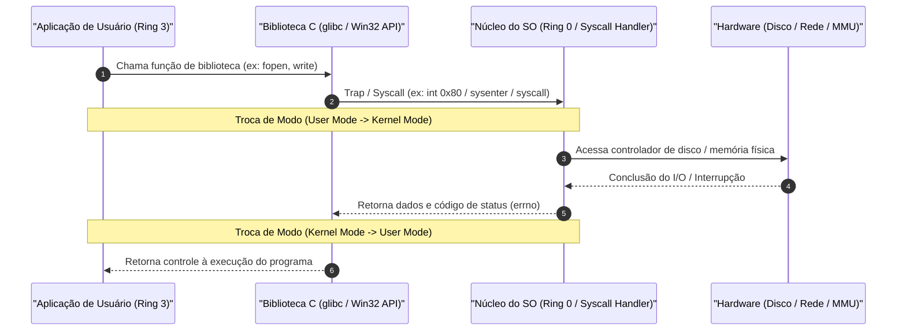
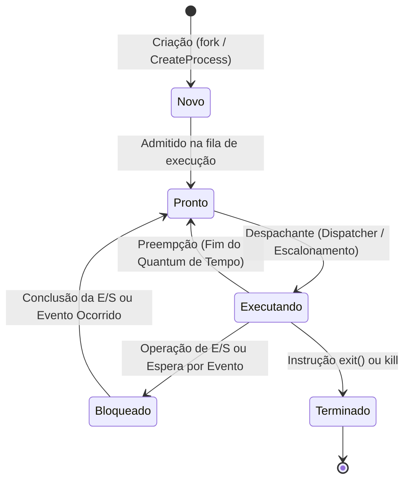
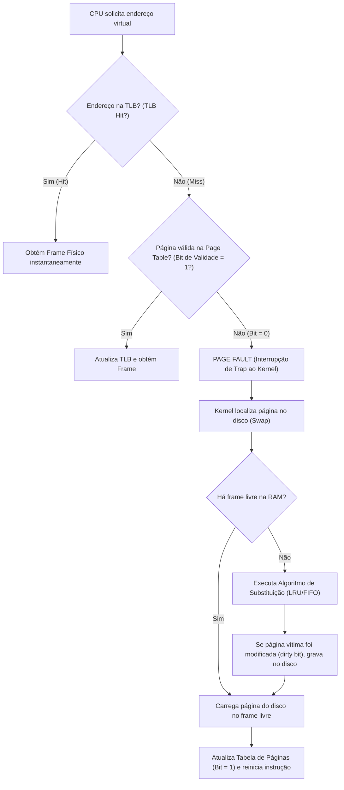
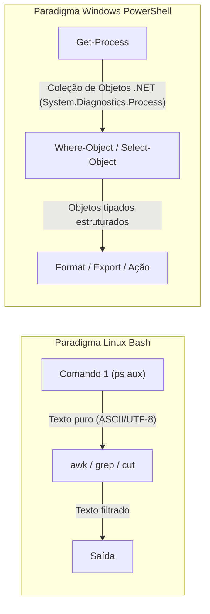

# 01 - Sistemas Operacionais: Linux e Windows

> **Matéria:** Sistemas Operacionais, Redes e Computação em Nuvem  
> **Cargo:** B02 – Técnico de Controle Externo – Especialidade: Tecnologia da Informação  
> **Arquivo:** `01_sistemas_operacionais_linux_e_windows.md`  


---


## 📌 Ementa / Itens do Edital
- Arquitetura de Sistemas Operacionais (Kernel, User Space, Syscalls)
- Gerenciamento de Processos, Threads e Escalonamento de CPU
- Gerenciamento de Memória (Memória Virtual, Paginação e Swapping)
- Sistemas de Arquivos (ext4, XFS, NTFS)
- Administração de Linux: comandos básicos de shell (Bash), permissões e automação por scripts
- Administração de Windows e Windows PowerShell: cmdlets e scripts


---


## 🧭 Sumário

1. [Arquitetura de Sistemas Operacionais e Modos de Operação](#1-arquitetura-de-sistemas-operacionais-e-modos-de-operacao)
    1. [Modos de Operação do Processador (User Mode vs. Kernel Mode)](#11-modos-de-operacao-do-processador-user-mode-vs-kernel-mode)
    2. [Teste 410](#Teste-410)
    3. [Chamadas de Sistema (Syscalls: fork, execve, mmap, kill)](#12-chamadas-de-sistema-syscalls-fork-execve-mmap-kill)
    4. [Tipos de Kernel: Monolítico, Microkernel e Híbrido](#13-tipos-de-kernel-monolitico-microkernel-e-hibrido)
2. [Gerenciamento de Processos, Concorrência e Escalonamento](#2-gerenciamento-de-processos-concorrencia-e-escalonamento)
    1. [Processo vs. Thread (Processo Leve e Compartilhamento de Memória)](#21-processo-vs-thread-processo-leve-e-compartilhamento-de-memoria)
    2. [Teste 411](#Teste-411)
    3. [Ciclo de Vida e Estados de um Processo](#22-ciclo-de-vida-e-estados-de-um-processo)
    4. [PCB e o Custo da Troca de Contexto (Context Switch)](#23-pcb-e-o-custo-da-troca-de-contexto-context-switch)
    5. [Algoritmos de Escalonamento de CPU (FCFS, SJF, SRTF, Round Robin, Prioridades)](#24-algoritmos-de-escalonamento-de-cpu-fcfs-sjf-srtf-round-robin-prioridades)
    6. [Teste 412](#Teste-412)
    7. [Sincronização e Concorrência: Mutex vs. Semáforos](#25-sincronizacao-e-concorrencia-mutex-vs-semaforos)
    8. [Teste 413](#Teste-413)
3. [Gerenciamento de Memória Virtual, Paginação e Swapping](#3-gerenciamento-de-memoria-virtual-paginacao-e-swapping)
    1. [Endereçamento Lógico vs. Físico e o Papel da MMU](#31-enderecamento-logico-vs-fisico-e-o-papel-da-mmu)
    2. [Paginação: Páginas, Molduras (Frames), Tabela de Páginas e TLB](#32-paginacao-paginas-molduras-frames-tabela-de-paginas-e-tlb)
    3. [Falta de Página (Page Fault) e Algoritmos de Substituição](#33-falta-de-pagina-page-fault-e-algoritmos-de-substituicao)
    4. [Teste 414](#Teste-414)
    5. [Swapping e Hiperpaginação (Thrashing)](#34-swapping-e-hiperpaginacao-thrashing)
    6. [Teste 415](#Teste-415)
4. [Sistemas de Arquivos e Permissões no Linux e Windows](#4-sistemas-de-arquivos-e-permissoes-no-linux-e-windows)
    1. [Estrutura do Inode no Linux: O que armazena e o que NÃO armazena](#41-estrutura-do-inode-no-linux-o-que-armazena-e-o-que-nao-armazena)
    2. [Links no Linux: Hard Link vs. Symbolic Link (Soft Link)](#42-links-no-linux-hard-link-vs-symbolic-link-soft-link)
    3. [Teste 416](#Teste-416)
    4. [Sistemas de Arquivos Linux (ext4, XFS) e Windows (NTFS, FAT32)](#43-sistemas-de-arquivos-linux-ext4-xfs-e-windows-ntfs-fat32)
    5. [Permissões Octais (UGO) e Permissões Especiais (SUID, SGID, Sticky Bit)](#44-permissoes-octais-ugo-e-permissoes-especiais-suid-sgid-sticky-bit)
    6. [Teste 417](#Teste-417)
5. [Administração e Shell Scripting no Linux](#5-administracao-e-shell-scripting-no-linux)
    1. [Sinais POSIX (SIGKILL, SIGTERM, SIGHUP, SIGSTOP, SIGCONT)](#51-sinais-posix-sigkill-sigterm-sighup-sigstop-sigcont)
    2. [Teste 418](#Teste-418)
    3. [Comandos Essenciais, Filtros e Redirecionamentos](#52-comandos-essenciais-filtros-e-redirecionamentos)
    4. [Gerenciamento de Serviços com systemd (systemctl e journalctl)](#53-gerenciamento-de-servicos-com-systemd-systemctl-e-journalctl)
    5. [Teste 419](#Teste-419)
6. [Administração de Windows e Windows PowerShell](#6-administracao-de-windows-e-windows-powershell)
    1. [Paradigma do PowerShell: Pipeline Baseado em Objetos .NET](#61-paradigma-do-powershell-pipeline-baseado-em-objetos-net)
    2. [Cmdlets Essenciais de Administração e Filtragem](#62-cmdlets-essenciais-de-administracao-e-filtragem)
    3. [Teste 420](#Teste-420)
    4. [Políticas de Execução de Scripts (ExecutionPolicy)](#63-politicas-de-execucao-de-scripts-executionpolicy)
7. [Fontes Recomendadas na Internet](#7-fontes-recomendadas-na-internet)

---


## 1. Arquitetura de Sistemas Operacionais e Modos de Operação

### 1.1 Modos de Operação do Processador (User Mode vs. Kernel Mode)

O Sistema Operacional atua como intermediário entre o hardware físico e os softwares aplicativos do usuário. Para assegurar integridade, estabilidade e isolamento de segurança, os processadores modernos utilizam anéis de proteção (*Protection Rings*):

1. **Modo Usuário (*User Mode* / Ring 3):**
    - As aplicações e processos de usuário executam com conjunto restrito de instruções.
    - Não possuem acesso direto aos dispositivos de entrada/saída (I/O), interrupções de hardware ou blocos arbitrários de memória física.
    - Qualquer tentativa de executar uma instrução privilegiada gera uma exceção/trap capturada pela CPU.

2. **Modo Núcleo / Kernel (*Kernel Mode* / Supervisor / Ring 0):**
    - O código do núcleo executa com privilégio irrestrito sobre o hardware, tabelas de memória e registradores de controle da CPU.
    - Controla o escalonamento, paginação e drivers de dispositivos.

---

### Teste 410
**(FGV - TRT / Analista Judiciário - TI - Modos de Operação do Processador: User vs. Kernel)**
A arquitetura de processadores modernos e sistemas operacionais de uso geral (como Linux e Windows) implementa anéis de proteção (*protection rings*) em hardware para segregar a execução de programas e garantir a estabilidade do sistema.

A respeito dos modos de operação do processador (**User Mode / Modo Usuário** e **Kernel Mode / Modo Núcleo**) e da transição entre eles, assinale a afirmativa correta:

* **A)** Softwares aplicativos de usuários comuns (como navegadores e suítes de escritório) rodam diretamente em Modo Núcleo (*Kernel Mode / Ring 0*), possuindo acesso irrestrito e direto a qualquer endereço físico de memória RAM e portas de I/O da máquina.
* **B)** A transição segura do Modo Usuário (*Ring 3*) para o Modo Núcleo (*Ring 0*) ocorre por meio de uma instrução especial de **Chamada de Sistema (*System Call / Trap*)**, na qual o hardware suspende a execução do processo, eleva o nível de privilégio e transfere o controle para um tratador específico (*Interrupt/Syscall Handler*) definido pelo kernel.
* **C)** No modo usuário, um programa tem autorização de hardware para desabilitar as interrupções de relógio da CPU e reconfigurar os registradores de controle de gerenciamento de memória.
* **D)** As chamadas de sistema dispensam qualquer troca de contexto de registradores na CPU, mantendo a pilha de execução inalterada.
* **E)** Sistemas operacionais modernos eliminaram o modo núcleo para rodar todo o código exclusivamente em máquinas virtuais JavaScript.


---

> **Comentário Detalhado:**
>
> - **A)** Incorreta. Aplicações de usuário rodam estritamente em **Modo Usuário (Ring 3)** com privilégios restritos; se tentarem executar instruções privilegiadas ou acessar memória do kernel diretamente, o processador dispara uma exceção de violação de proteção (*General Protection Fault* / *Segmentation Fault*).
> - **B)** **CORRETA.** Mecânica de isolamento e proteção de hardware:
>   - **Dual-Mode Operation:** Processadores x86/x64 implementam níveis de privilégio (sendo Ring 0 o mais privilegiado e Ring 3 o menos privilegiado).
>   - Para ler um arquivo, enviar um pacote de rede ou alocar memória física, o processo de usuário deve invocar uma **Chamada de Sistema (Syscall)**.
>   - O hardware aciona uma interrupção de software (*trap*), comuta o registrador de modo do processador de *User* para *Kernel*, salva o contexto da aplicação e salta para o endereço do despachante de chamadas de sistema na tabela do kernel, executando a operação com privilégios controlados antes de retornar o resultado ao modo usuário.
> - **C)** Incorreta. Instruções como `CLI` (desabilitar interrupções) são estritamente privilegiadas de Ring 0.
> - **D)** Incorreta. A transição exige salvar o contador de programa (PC), ponteiro de pilha (SP) e registradores na pilha do kernel.
> - **E)** Incorreta. O Kernel Mode permanece como pilar mandatório de qualquer arquitetura de computadores moderna.
> 
> **Gabarito: B**

---

### 1.2 Chamadas de Sistema (Syscalls: fork, execve, mmap, kill)

Para solicitar serviços privilegiados do hardware (leitura de disco, envio de pacotes pela placa de rede, criação de novos processos), o processo de usuário deve invocar uma **Chamada de Sistema (*System Call* / *Syscall*)**:



#### Principais Syscalls POSIX:
- `fork()`: Cria um novo processo filho que é cópia exata do processo pai (com novo PID). Utiliza a técnica **Copy-on-Write (COW)**: páginas de memória são compartilhadas como somente leitura até que haja uma escrita real, momento em que o frame é duplicado.
- `execve()`: Substitui a imagem atual de memória do processo por um novo programa binário executável.
- `mmap()`: Mapeia arquivos ou dispositivos diretamente no espaço de memória virtual do processo.
- `kill()`: Envia sinais para comunicação e controle de processos.

---

### 1.3 Tipos de Kernel: Monolítico, Microkernel e Híbrido

| Modelo de Kernel | Características Arquiteturais | Vantagens | Desvantagens | Exemplos Reais |
|---|---|---|---|---|
| **Monolítico** | Todos os serviços essenciais (escalonador, memória, sistemas de arquivos, drivers de dispositivos) rodam no mesmo espaço de memória do Kernel (Ring 0). | Máximo desempenho em chamadas e trocas de mensagens (comunicação direta por ponteiros e funções). | Um bug em um driver de dispositivo ou módulo pode derrubar o sistema inteiro (*Kernel Panic*). | Linux, Unix tradicional, FreeBSD |
| **Microkernel** | Apenas as funções mínimas rodam no Kernel (IPC, gerenciamento básico de memória e escalonador). Drivers, sistemas de arquivos e rede rodam como servidores no Modo Usuário (Ring 3). | Alta modularidade, isolamento de falhas e segurança robusta (se o driver de rede travar, ele é reiniciado sem derrubar o SO). | Queda de desempenho devido ao overhead constante de troca de contexto e IPC por passagem de mensagens entre processos de usuário. | Mach, Minix, QNX |
| **Híbrido** | Combina a modularidade do microkernel com o desempenho do monolítico, executando subsistemas críticos e drivers gráficos/I/O no espaço do Kernel. | Equilíbrio entre flexibilidade arquitetural, facilidade de compatibilidade e velocidade de execução. | Complexidade interna elevada e maior superfície de ataque no Kernel. | Windows NT (10, 11, Server), macOS (XNU) |


---


## 2. Gerenciamento de Processos, Concorrência e Escalonamento

### 2.1 Processo vs. Thread (Processo Leve e Compartilhamento de Memória)

- **Processo:** Programa em execução que possui seu próprio espaço de endereçamento virtual isolado, tabela de descritores de arquivo, PCB e contexto de segurança. A comunicação entre processos distintos exige mecanismos explícitos de IPC (*Inter-Process Communication*), como pipes, sockets, memória compartilhada ou filas de mensagens.
- **Thread:** Menor unidade de processamento escalonável pela CPU. Múltiplas threads do mesmo processo **compartilham**:
    - O mesmo espaço de endereçamento virtual (segmentos de Código, Dados Globais e Heap);
    - Os mesmos arquivos e sockets abertos;
    - Os mesmos sinais e permissões do processo pai.
    - **O que cada thread possui de forma EXCLUSIVA:** seu próprio Program Counter (PC), registradores de CPU e sua própria Pilha de Execução (*Stack* - variáveis locais e fluxo de chamadas).

---

### Teste 411
**(FCC - TRT / Analista Judiciário - TI - Processos vs. Threads)**
No gerenciamento de processos e concorrência em sistemas operacionais multitarefa preemptivos, diferencia-se o conceito de **Processo Pesado** do conceito de **Thread** (*Processo Leve*).

A respeito do compartilhamento de recursos entre múltiplas threads pertencentes a um mesmo processo, assinale a afirmativa correta:

* **A)** Múltiplas threads do mesmo processo possuem, cada uma, um espaço de endereçamento de memória virtual totalmente isolado e tabelas de páginas exclusivas sem nenhum dado compartilhado.
* **B)** Todas as threads pertencentes a um mesmo processo compartilham o **espaço de endereçamento de memória**, as seções de código (*text*), os dados globais (*data/BSS*), a área de alocação dinâmica (*heap*) e os descritores de arquivos abertos; contudo, cada thread possui compulsoriamente sua própria **Pilha de Execução (*Stack*)**, seu próprio ponteiro de instrução (*Program Counter - PC*) e seu próprio conjunto individual de **Registradores da CPU**.
* **C)** A criação e a troca de contexto entre threads consomem mais tempo de CPU do que a criação e a troca de contexto entre processos pesados distintos.
* **D)** Se uma thread de um processo trava por erro de divisão por zero, as outras threads daquele mesmo processo continuam operando normalmente sem que o processo seja finalizado.
* **E)** Threads não podem ser executadas em núcleos de processadores diferentes (*multicore*), sendo restritas a um único clock de CPU compartilhado.


---

> **Comentário Detalhado:**
>
> - **A)** Incorreta. Esse isolamento total de memória é a característica definidora entre **processos diferentes**, e não entre threads do mesmo processo.
> - **B)** **CORRETA.** Modelo canônico de processos e threads (Silberschatz / Tanenbaum):
>   - **Recursos Compartilhados (Nível do Processo):** Espaço de endereçamento virtual completo, código executável, variáveis globais e estáticas, *Heap*, descritores de arquivos abertos e conexões de rede. Isso viabiliza comunicação ultrarrápida entre threads via memória compartilhada sem necessidade de IPC pesado.
>   - **Recursos Exclusivos (Nível da Thread):** Cada thread precisa de independência de fluxo de execução; logo, possui seu próprio **ID de Thread (TID)**, seu próprio conjunto de **registradores da CPU**, seu próprio **Program Counter (PC)** para saber qual instrução está executando, e sua própria **Stack (Pilha)** para gerenciar variáveis locais e chamadas de função.
> - **C)** Incorreta. Troca de contexto entre threads do mesmo processo é muito mais rápida porque **não exige a troca da tabela de páginas na MMU** nem invalidação do cache TLB.
> - **D)** Incorreta. Como compartilham o mesmo espaço de memória, se uma thread provocar corrupção fatal de memória (*Segmentation Fault*), o sistema operacional encerra o processo inteiro, derrubando todas as threads associadas.
> - **E)** Incorreta. Threads de kernel podem ser distribuídas concorrentemente em múltiplos núcleos e sockets de CPU.
> 
> **Gabarito: B**

---

### 2.2 Ciclo de Vida e Estados de um Processo



- **Novo (*New*):** O processo está sendo criado e suas estruturas estão sendo alocadas.
- **Pronto (*Ready*):** O processo dispõe de todos os recursos necessários e aguarda na fila apenas a atribuição da CPU pelo escalonador.
- **Executando (*Running*):** As instruções do processo estão sendo ativamente processadas pela CPU.
- **Bloqueado / Espera (*Waiting* / *Blocked*):** O processo não pode executar porque aguarda a conclusão de uma operação externa de Entrada/Saída (leitura de disco, teclado) ou a liberação de um lock de sincronização.
- **Terminado (*Terminated*):** O processo encerrou sua execução e aguarda o processo pai recolher seu código de retorno (`wait()`). Se o pai não o recolhe, ele permanece temporariamente como processo *zumbi*.

---

### 2.3 PCB e o Custo da Troca de Contexto (Context Switch)

O **Bloco de Controle de Processo (PCB - *Process Control Block*)** é a estrutura de dados que armazena todas as informações do processo enquanto ele não está executando na CPU: estado, Program Counter (PC), registradores, informações de escalonamento, ponteiros de memória e descritores de arquivos abertos.

A **Troca de Contexto (*Context Switch*)** é o procedimento pelo qual a CPU interrompe um processo, salva seu contexto no PCB e carrega o contexto do próximo processo a executar. Trata-se de uma operação de **overhead puro** (a CPU não executa trabalho útil de aplicação durante a troca):

- Salva e restaura registradores;
- Altera tabelas de mapeamento de memória virtual na MMU;
- Invalida entradas de cache no TLB;
- Causa perda temporária de localidade nas memórias cache L1/L2/L3 da CPU.

---

### 2.4 Algoritmos de Escalonamento de CPU (FCFS, SJF, SRTF, Round Robin, Prioridades)

| Algoritmo | Natureza | Mecânica de Funcionamento | Principais Desvantagens / Efeitos Colaterais |
|---|---|---|---|
| **FCFS (First-Come, First-Served)** | Não Preemptivo | Atende processos estritamente na ordem cronológica de chegada na fila de prontos. | **Efeito Comboio (*Convoy Effect*):** processos curtos ficam retidos atrás de um processo longo com carga intensiva de CPU. |
| **SJF (Shortest Job First)** | Não Preemptivo | Seleciona o processo com a menor rajada de CPU (*CPU burst*) estimada. Minimiza o tempo médio de espera. | Provoca **Inanição (*Starvation*)** de processos longos caso cheguem novos processos curtos ininterruptamente. Difícil prever a próxima rajada. |
| **SRTF (Shortest Remaining Time First)** | Preemptivo | Versão preemptiva do SJF: se um processo chega com tempo restante menor que o em execução, ocorre preempção. | Também sofre de inanição (*starvation*) e gera alto overhead de trocas de contexto. |
| **Round Robin (Alternância Circular)** | Preemptivo | Cada processo recebe uma fatia fixa de tempo de CPU denominada **Quantum**. Ao esgotar o quantum, sofre preempção e vai para o final da fila de prontos. | Se o quantum for **muito grande**, o algoritmo degenera em FCFS. Se for **muito pequeno**, a CPU perde rendimento útil com excesso de **Trocas de Contexto (*Context Switch*)**. |
| **Escalonamento por Prioridades** | Preemptivo ou Não | A CPU é alocada ao processo de maior prioridade numérica. | Inanição de processos de baixa prioridade. A solução canônica é o **Envelhecimento (*Aging*)**, que incrementa a prioridade do processo conforme ele espera na fila. |
| **Filas Multinível com Realimentação (MLFQ)** | Preemptivo | Processos movem-se entre diferentes filas com diferentes fatias de tempo. Processos I/O-bound ganham alta prioridade e quantum curto; CPU-bound caem para filas de menor prioridade com quantum longo. | Algoritmo mais complexo e configurável da engenharia de SO. |

---

### Teste 412
**(FCC - Adaptada / Analista de Tecnologia da Informação - Sistemas)**
Em relação aos conceitos de concorrência, processos, threads e algoritmos de escalonamento de processador em sistemas operacionais, assinale a afirmação correta:

* **A)** No algoritmo de escalonamento *Round Robin* (Alternância Circular), caso o tamanho da fatia de tempo (*quantum*) seja definido com um valor excessivamente grande, o comportamento do sistema degenera e aproxima-se do algoritmo FCFS (*First-Come, First-Served*).
* **B)** O algoritmo de escalonamento SJF (*Shortest Job First*) em sua modalidade preemptiva impede a ocorrência do fenômeno de inanição (*starvation*), garantindo tempo de resposta equitativo para processos intensivos em CPU.
* **C)** As threads criadas no interior de um mesmo processo possuem espaços de endereçamento de memória virtual completamente isolados e independentes, exigindo o uso de pipes ou sockets para qualquer troca de variáveis.
* **D)** A troca de contexto (*context switch*) é uma operação puramente lógica que não impõe nenhum custo computacional de sobrecarga (*overhead*) para a CPU nem interfere no conteúdo das memórias cache.
* **E)** O algoritmo de escalonamento FCFS é classificado como estritamente preemptivo, interrompendo processos de longa duração sempre que um novo processo requisita acesso à CPU.


---

> **Comentário Detalhado:**
>
> - **A)** Correta. Se o *quantum* do Round Robin for superior à rajada de qualquer processo ativo, nenhum processo sofrerá preempção antes de concluir sua execução voluntariamente, passando a atender na ordem de chegada exatamente como o FCFS.
> - **B)** Incorreta. O SJF prioriza rajadas curtas de CPU, causando inanição severa (*starvation*) em processos longos com uso intensivo de CPU.
> - **C)** Incorreta. Threads pertencentes ao mesmo processo compartilham o mesmo espaço de memória virtual (segmentos de código, dados e heap), comunicando-se diretamente por variáveis compartilhadas.
> - **D)** Incorreta. A troca de contexto acarreta elevado overhead de processamento devido ao salvamento de registradores, troca de tabelas de páginas e invalidação de entradas nas memórias cache e TLB.
> - **E)** Incorreta. O algoritmo FCFS é categorizado como não preemptivo (*non-preemptive*), mantendo a CPU ocupada até a finalização do processo ou bloqueio por I/O.
> 
> **Gabarito: A**

---


### 2.5 Sincronização e Concorrência: Mutex vs. Semáforos

Quando múltiplos processos ou threads acessam variáveis e recursos compartilhados concorrentemente, podem ocorrer condições de corrida (*race conditions*). Para proteger a **Região Crítica**, utilizam-se primitivas de sincronização:

> 🚨 **ALERTA DE PROVA / PEGADINHA FCC:**  
> A FCC frequentemente cobra a distinção entre **Mutex** e **Semáforo**:  
>
> - O **Mutex** (*Mutual Exclusion*) é um mecanismo de travamento binário com **conceito de propriedade (*ownership*)**: estritamente a thread que adquiriu o lock é quem tem o direito de liberá-lo.  
> - O **Semáforo** é uma variável inteira atômica sem conceito de posse: qualquer processo ou thread pode executar a operação `signal()` / `post()` para incrementar o contador, prestando-se tanto à exclusão mútua (semáforo binário) quanto à sinalização e sincronização de eventos entre processos.

---

### Teste 413
**(FGV - TRT / Analista Judiciário - TI - Sincronização e Exclusão Mútua: Mutex vs. Semáforos)**
Em programação concorrente e em sistemas operacionais multithreaded, o acesso não coordenado a recursos compartilhados pode gerar **Condições de Corrida** (*Race Conditions*), corrompendo o estado da aplicação.

Para garantir a **Exclusão Mútua** na Região Crítica, utilizam-se primitivas de sincronização como **Mutex** (*Mutual Exclusion Lock*) e **Semáforos** (Dijkstra). A respeito da distinção conceitual e do funcionamento dessas primitivas, assinale a afirmativa correta:

* **A)** O Mutex é um mecanismo binário com conceito estrito de titularidade (*ownership*), no qual apenas a thread específica que adquiriu a trava (*Lock*) possui autorização para liberá-la (*Unlock*); ao passo que um **Semáforo Contador** gerencia um contador de recursos disponíveis, onde qualquer thread pode executar uma operação de sinalização (`signal` / `V()`) para incrementar o contador e desbloquear outra thread em espera, mesmo sem ter executado a operação de espera (`wait` / `P()`).
* **B)** Semáforos só podem assumir os valores 0 e 1, sendo proibido utilizá-los para controlar estoques de múltiplos recursos.
* **C)** O Mutex deve ser liberado compulsoriamente por qualquer thread da CPU que esteja ociosa no momento.
* **D)** A inversão de prioridades é um fenômeno que afeta exclusivamente semáforos contadores de números negativos.
* **E)** Bloqueios do tipo *Spinlock* colocam a thread para dormir no disco rígido enquanto o recurso estiver ocupado.


---

> **Comentário Detalhado:**
>
> - **A)** **CORRETA.** Distinção precisa entre Mutex e Semáforos:
>   - **Mutex (Mutual Exclusion Lock):** É um mecanismo de travamento com **propriedade (ownership)**. Se a Thread A executa `mutex.acquire()`, **somente a Thread A** tem autorização para executar `mutex.release()`. Se a Thread B tentar liberar o mutex, ocorrerá um erro. É ideal para proteger seções críticas exclusivas.
>   - **Semáforo (Counting Semaphore):** É um mecanismo de **sinalização** baseado em uma variável inteira protegida. A operação `P()` ou `wait()` decrementa o contador (bloqueando se o valor for $\le 0$); a operação `V()` ou `signal()` incrementa o contador. Não há conceito de titularidade: a Thread A pode aguardar a chegada de dados e a Thread B (produtora) pode emitir o sinal `signal()` para acordar a Thread A.
> - **B)** Incorreta. Semáforos contadores podem ser inicializados com qualquer valor inteiro positivo $N$ para disciplinar o acesso a um pool de $N$ recursos.
> - **C)** Incorreta. Mutex exige titularidade estrita da thread que o bloqueou.
> - **D)** Incorreta. A inversão de prioridades ocorre tipicamente com mutexes quando uma tarefa de baixa prioridade retém um recurso demandado por uma tarefa de alta prioridade.
> - **E)** Incorreta. *Spinlocks* realizam espera ocupada (*busy waiting*), consumindo 100% de CPU em loop contínuo testando o bit de trava, sem dormir.
> 
> **Gabarito: A**


---


## 3. Gerenciamento de Memória Virtual, Paginação e Swapping

### 3.1 Endereçamento Lógico vs. Físico e o Papel da MMU

A **Memória Virtual** desvincula o espaço de endereçamento lógico manipulado pelo programa da memória RAM física real. Isso permite que um programa execute mesmo que seu tamanho ultrapasse a memória RAM disponível:

- **Endereço Lógico (Virtual):** Gerado pelo processador durante a execução das instruções do código.
- **Endereço Físico:** Localização real dos bytes nos circuitos integrados dos módulos de memória RAM.
- **MMU (*Memory Management Unit*):** Chip integrado ao processador que converte endereços virtuais em endereços físicos em tempo de execução consultando a Tabela de Páginas.

---

### 3.2 Paginação: Páginas, Molduras (Frames), Tabela de Páginas e TLB

- **Páginas Lógicas (*Pages*):** Blocos de tamanho fixo em que a memória virtual do processo é dividida.
- **Molduras de Página Físicas (*Frames*):** Blocos de memória física RAM que possuem **rigorosamente o mesmo tamanho** das páginas lógicas (tipicamente 4 KB).
- **Tabela de Páginas (*Page Table*):** Matriz mantida pelo kernel que armazena o mapeamento entre o número da página virtual e o número do frame físico correspondente, além de bits de controle:
    - *Bit de Validade/Presença:* `1` indica que a página está carregada na RAM; `0` indica que está no disco (Swap) ou é inválida.
    - *Dirty Bit (Modificado):* `1` indica que a página foi alterada desde que foi lida do disco e precisará ser gravada de volta antes de ser descartada.
- **TLB (*Translation Lookaside Buffer*):** Cache associativa de hardware de altíssima velocidade que armazena as traduções recentes de página para frame. Evita que a CPU precise consultar a tabela de páginas na memória RAM a cada instrução (*TLB Hit*).

---

### 3.3 Falta de Página (Page Fault) e Algoritmos de Substituição



#### O Ciclo de Tratamento de Page Fault:
1. A CPU gera uma interrupção de falta de página (*Page Fault trap*) transferindo o controle ao kernel;
2. O kernel verifica se o endereço é válido e localiza a página no disco de swap;
3. Se não houver moldura livre na RAM, executa um algoritmo de substituição de páginas:
    - **FIFO (*First-In, First-Out*):** Substitui a página mais antiga na RAM (sofre da Anomalia de Belady, onde aumentar a RAM pode aumentar as faltas de página).
    - **LRU (*Least Recently Used*):** Substitui a página que não foi utilizada pelo maior intervalo de tempo no passado (aproximação do algoritmo ótimo teórico).

4. O frame é carregado do disco e a tabela de páginas é atualizada (bit = 1), reiniciando a instrução original.

---

### Teste 414
**(FCC - Adaptada / Técnico Judiciário - Tecnologia da Informação)**
No gerenciamento de memória virtual por paginação sob demanda em sistemas operacionais modernos, um processo em execução gera uma solicitação de acesso a um determinado endereço lógico. Durante a operação de tradução conduzida pela unidade de gerenciamento de memória (MMU), identifica-se que o bit de validade correspondente na tabela de páginas está marcado como ausente (bit 0).

Nessa situação, o evento gerado pela arquitetura de hardware e a ação imediata subsequente realizada pelo sistema operacional são:

* **A)** Uma interrupção de *Page Fault*, que transfere o controle ao núcleo do sistema operacional para buscar a página solicitada no armazenamento secundário e carregá-la em uma moldura livre da memória principal.
* **B)** Uma violação de segmento (*Segmentation Fault*), que resulta na terminação imediata e compulsória do processo por invasão de área de memória protegida.
* **C)** Um *TLB Hit*, no qual o processador busca o endereço diretamente na memória cache L1 sem consultar as tabelas do núcleo.
* **D)** Um procedimento de *Swapping* compulsório de todos os processos ativos para o disco, paralisando a CPU até que a memória RAM seja totalmente desfragmentada.
* **E)** Uma chamada de sistema `mmap`, solicitando que o processo usuário reconfigure o seu próprio bloco de controle de processo (PCB).


---

> **Comentário Detalhado:**
>
> - **A)** Correta. Quando o bit de validade é zero, a MMU sinaliza uma interrupção de falta de página (*Page Fault*), acionando a rotina do kernel que localiza a página no disco (área de swap) e a transfere para uma moldura livre na RAM.
> - **B)** Incorreta. Falta de página é uma ocorrência de rotina da memória virtual sob demanda, e não uma violação de segmento ilegal (*Segmentation Fault*).
> - **C)** Incorreta. Se o bit de presença não estava ativo, a página não estava mapeada na RAM, caracterizando um miss prévio e acionamento do tratador de faltas.
> - **D)** Incorreta. A falta de página envolve o carregamento individual da página demandada, e não a parada e swapping compulsório de todos os processos do sistema.
> - **E)** Incorreta. A resolução do evento é realizada pelo kernel de forma transparente à aplicação, sem requerer intervenção do processo no seu PCB.
> 
> **Gabarito: A**

---


### 3.4 Swapping e Hiperpaginação (Thrashing)

- **Swapping:** Movimentação de páginas ou de processos inteiros entre a memória RAM física e a partição/arquivo de troca no disco (**Swap**).
- **Hiperpaginação (*Thrashing*):** Ocorre quando o sistema passa substancialmente mais tempo realizando operações de I/O de leitura e escrita de páginas no disco do que executando instruções úteis dos programas. Decorre de uma sobrecarga onde a soma dos conjuntos de trabalho (*working sets*) dos processos ativos supera a capacidade física da memória RAM.

---

### Teste 415
**(FCC - TRT / Analista Judiciário - TI - Memória Virtual e Hiperpaginação / Thrashing)**
O subsistema de Memória Virtual permite que programas sejam executados mesmo quando seu espaço de endereçamento total excede a capacidade física de memória RAM instalada na máquina, transferindo blocos para a área de *Swap* em disco.

No entanto, quando a quantidade de memória RAM disponível torna-se criticamente insuficiente para acomodar o conjunto de trabalho (*Working Set*) de todos os processos ativos simultâneos, o sistema operacional pode entrar no colapso de desempenho denominado **Hiperpaginação (*Thrashing*)**.

A característica operacional que define formalmente o fenômeno do *Thrashing* consiste em:

* **A)** A CPU atinge 100% de utilização processando cálculos matemáticos puros sem nenhum acesso a disco.
* **B)** O sistema passa a maior parte do tempo transferindo páginas de memória de e para o disco rígido (alta taxa ininterrupta de *Page Faults* e saturação de I/O), enquanto a taxa de utilização útil da CPU cai drasticamente para níveis próximos de zero, travando a resposta aos usuários.
* **C)** A destruição física permanente dos módulos de memória RAM por superaquecimento.
* **D)** O fechamento imediato do sistema operacional sem emissão de qualquer log de evento.
* **E)** A conversão de todos os arquivos do disco para formato somente-leitura.


---

> **Comentário Detalhado:**
>
> - **A)** Incorreta. No *Thrashing*, a CPU fica quase ociosa aguardando operações lentas de leitura e escrita no subsistema de armazenamento.
> - **B)** **CORRETA.** Mecânica do **Thrashing (Hiperpaginação)** (Tanenbaum / Silberschatz):
>   1. Quando a soma dos conjuntos de trabalho (*Working Sets*) dos processos ativos supera a memória RAM física, a taxa de faltas de página (*Page Faults*) explode.
>   2. Cada processo que tenta rodar precisa de páginas que foram descarregadas para o disco de *Swap*. O processo é suspenso aguardando o I/O de disco.
>   3. Como a maioria dos processos entra em estado de espera (*Waiting/Blocked*), o escalonador do SO erroneamente detecta baixa utilização da CPU e pode tentar aumentar o grau de multiprogramação, agravando ainda mais a contenção.
>   4. O sistema entra em parafuso: **quase 100% do tempo do subsistema de disco é consumido trocando páginas entre RAM e Swap**, enquanto a utilização da CPU desaba e o computador para de responder. Soluções: reduzir o grau de multiprogramação (suspender processos) ou adicionar memória RAM física.
> - **C)** Incorreta. Trata-se de um problema puramente lógico de contenção de recursos de software e gerência de memória.
> - **D)** Incorreta. O SO não desliga, fica congelado em sobrecarga de I/O.
> - **E)** Incorreta. O sistema de arquivos não é alterado para somente-leitura.
> 
> **Gabarito: B**


---


## 4. Sistemas de Arquivos e Permissões no Linux e Windows

### 4.1 Estrutura do Inode no Linux: O que armazena e o que NÃO armazena

O **Inode (*Index Node*)** é a estrutura central de dados que descreve cada arquivo ou diretório em sistemas baseados em Unix/Linux:

- **O que o Inode ARMAZENA:**
    - Modo e tipo do arquivo (regular, diretório, socket, pipe, link simbólico);
    - Permissões de acesso (`rwx`);
    - Identificador do Dono (UID) e Grupo (GID);
    - Tamanho exato em bytes;
    - Carimbos temporais (`atime`, `mtime`, `ctime`);
    - Contador de ligações diretas (*link count*);
    - Ponteiros diretos e indiretos para os blocos de dados no disco.
- **O que o Inode NÃO ARMAZENA:**
    - **O NOME do arquivo!**
    - **O CAMINHO (path) do arquivo!**  
  > 🚨 **REGRA DE OURO FCC:** O nome do arquivo e o número do seu inode ficam armazenados nos blocos de dados do **diretório pai** (estrutura *dentry*), e não dentro do próprio inode.

---

### 4.2 Links no Linux: Hard Link vs. Symbolic Link (Soft Link)

| Propriedade / Comportamento | Hard Link (`ln origem destino`) | Symbolic Link (`ln -s origem destino`) |
|---|---|---|
| **Número de Inode** | Aponta diretamente para o **mesmo número de Inode** do arquivo original. | Possui um **novo Inode próprio** do tipo `l`, contendo o caminho textual de destino. |
| **Cruzamento de Partições** | **NÃO** pode cruzar partições ou sistemas de arquivos diferentes (inodes colidiriam). | **SIM**, pode cruzar discos, partições e pontos de montagem livremente. |
| **Apontamento para Diretórios** | Não permitido para usuários comuns (evita loops cíclicos). | Permitido apontar para diretórios livremente. |
| **Exclusão do Arquivo Original** | O conteúdo **permanece íntegro** e acessível até que o contador de links caia para zero. | O link simbólico fica **quebrado / órfão (*dangling link*)**, apontando para um caminho inexistente. |

---

### Teste 416
**(FCC - Adaptada / Analista de TI - Infraestrutura)**
A respeito da arquitetura de sistemas de arquivos em ambientes baseados em Linux e da estrutura interna de inodes (*index nodes*), considere as seguintes afirmativas:

I. Cada inode armazena metadados fundamentais do arquivo, tais como tamanho, permissões de acesso, identificadores de usuário e grupo, carimbos temporais e ponteiros para os blocos de dados, mas não contém o nome do arquivo nem seu caminho absoluto.  

II. Um link rígido (*hard link*) cria uma entrada de diretório independente que aponta diretamente para o mesmo número de inode do arquivo de origem, podendo ser criado entre diferentes sistemas de arquivos e partições montadas.  

III. Caso o arquivo de origem de um link simbólico (*soft link*) seja excluído do disco, o link simbólico torna-se órfão (*dangling link*), pois ele armazena em seu próprio bloco de dados apenas o caminho textual para o arquivo de destino.  

Está correto o que se afirma em:

* **A)** I e II, apenas.
* **B)** II e III, apenas.
* **C)** I e III, apenas.
* **D)** I, II e III.
* **E)** III, apenas.


---

> **Comentário Detalhado:**
>
> - **A)** Incorreta. Inclui o Item II, que comete grave erro conceitual ao afirmar que hard links podem cruzar partições.
> - **B)** Incorreta. Omite a veracidade do Item I e inclui o Item II que é falso.
> - **C)** Correta. O Item I é verdadeiro porque o inode é agnóstico ao nome textual e caminho do arquivo (que residem no bloco de dados do diretório pai). O Item II é falso porque números de inode são válidos estritamente dentro da mesma partição/sistema de arquivos, sendo impossível criar hard links entre sistemas de arquivos diferentes. O Item III é verdadeiro porque links simbólicos contêm apenas a string do caminho textual de destino, tornando-se órfãos se o original for apagado.
> - **D)** Incorreta. Julga todos os itens verdadeiros, desconsiderando a impossibilidade do Item II.
> - **E)** Incorreta. Omite a correção inequívoca do Item I.
> 
> **Gabarito: C**

---


### 4.3 Sistemas de Arquivos Linux (ext4, XFS) e Windows (NTFS, FAT32)

- **Linux ext4:** Sistema de arquivos padrão na maioria das distribuições Linux. Suporta **journaling** (diário de transações que previne corrupção de metadados em quedas de energia) com três modos (`journal`, `ordered`, `writeback`), alocação por extensões (*extents*) e volumes de até 1 Exabyte.
- **Linux XFS:** Sistema de arquivos escalável de 64 bits de altíssimo desempenho, padrão no RHEL, otimizado para operações paralelas e manipulação de arquivos gigantescos.
- **Windows NTFS (*New Technology File System*):** Padrão do Windows corporativo. Suporta listas de controle de acesso (ACLs - DACL e SACL), journaling via Master File Table (**MFT**), cotas de disco, compressão nativa de arquivos e criptografia no nível de arquivo via **EFS** (*Encrypting File System*).
- **FAT32:** Sistema legado com compatibilidade universal, mas limitado a arquivos individuais de no máximo **4 GB** e sem suporte nativo a permissões de segurança ACL.

---

### 4.4 Permissões Octais (UGO) e Permissões Especiais (SUID, SGID, Sticky Bit)

As permissões básicas dividem-se em Usuário Dono (`u`), Grupo (`g`) e Outros (`o`):

- Leitura (`r`) = $4$
- Escrita (`w`) = $2$
- Execução (`x`) = $1$

$$\text{Exemplo: } 750 \implies \text{Dono: } 4+2+1=7\,(rwx); \quad \text{Grupo: } 4+0+1=5\,(r-x); \quad \text{Outros: } 0\,(---)$$

#### Permissões Especiais:
1. **SUID (*Set User ID* - 4000 / `rwsr-xr-x`):** Executa o programa com os privilégios do **proprietário do arquivo**, e não de quem o chamou (ex.: `/usr/bin/passwd`).
2. **SGID (*Set Group ID* - 2000 / `rwxr-sr-x`):** Em diretórios, faz com que quaisquer novos arquivos ou subdiretórios criados **herdem automaticamente o grupo do diretório pai**.
3. **Sticky Bit (1000 / `rwxrwxrwt`):** Aplicado a diretórios públicos (como `/tmp`). Impede que um usuário exclua ou renomeie arquivos pertencentes a outros usuários, mesmo com permissão $777$.

---

### Teste 417
**(FCC - TRT / Analista Judiciário - TI - Permissões Octais e Especiais no Linux: SUID, SGID e Sticky Bit)**
Nos sistemas de arquivos de ambientes Linux/POSIX, a segurança de arquivos e diretórios é regida pela matriz de permissões associadas ao Proprietário (*User - u*), Grupo (*Group - g*) e Outros (*Others - o*), acrescida dos três bits de permissões especiais: **SUID**, **SGID** e **Sticky Bit**.

Considere um diretório compartilhado de auditoria `/var/auditoria_compartilhada` cujas permissões foram configuradas pelo administrador através do comando:

`chmod 1770 /var/auditoria_compartilhada`

A respeito do significado do primeiro dígito `1` (Sticky Bit) e dos efeitos práticos dessa configuração sobre o diretório, assinale a afirmativa correta:

* **A)** O bit 1 representa o SUID, permitindo que qualquer usuário execute o diretório como se fosse o usuário `root`.
* **B)** O bit 1 representa o **Sticky Bit** (representado pelo caractere `t` no final da string de permissões, ex.: `drwxrwx--t`); em um diretório com o Sticky Bit ativado, embora múltiplos usuários pertencentes ao grupo possam criar e editar arquivos no local, **apenas o proprietário de um arquivo específico (ou o superusuário root) tem permissão de renomear ou excluir o seu próprio arquivo**, impedindo que um usuário do grupo apague documentos criados por seus colegas.
* **C)** O bit 1 bloqueia o acesso de qualquer usuário ao diretório, tornando-o invisível no comando `ls`.
* **D)** O Sticky Bit força que todos os novos arquivos criados herdem compulsoriamente o grupo primário do diretório pai.
* **E)** As permissões 770 atribuem leitura, escrita e execução irrestrita para todos os usuários anônimos do mundo exterior (*others*).


---

> **Comentário Detalhado:**
>
> - **A)** Incorreta. O valor octal do SUID é **4** (ex.: 4755), enquanto o valor octal do Sticky Bit é **1**.
> - **B)** **CORRETA.** Aplicação canônica das **Permissões Especiais no Linux**:
>   - **Sticky Bit (Bit 1000 em octal):** Quando aplicado a um diretório (como `/tmp` ou pastas compartilhadas de trabalho), restringe a **exclusão e renomeação de arquivos**. Mesmo que a pasta tenha permissão de escrita de grupo (`770`), um membro do grupo NÃO pode deletar arquivos de outro membro; apenas o **dono do arquivo** e o **root** podem remover o item. Representado por `t` (ou `T` se não houver permissão `x`).
>   - **SGID (Bit 2000 em octal):** Em arquivos executáveis, executa com os privilégios do grupo do arquivo; em diretórios, faz com que novos arquivos criados herdem o grupo do diretório pai.
>   - **SUID (Bit 4000 em octal):** Em arquivos executáveis binários (como `/usr/bin/passwd`), faz com que o executável rode com os privilégios do proprietário do arquivo (`root`).
> - **C)** Incorreta. O diretório continua visível e acessível aos usuários autorizados.
> - **D)** Incorreta. Essa é a função do **SGID em diretórios** (bit 2000), e não do Sticky Bit.
> - **E)** Incorreta. O último dígito `0` proíbe expressamente qualquer permissão para *others* (`---`).
> 
> **Gabarito: B**


---


## 5. Administração e Shell Scripting no Linux

### 5.1 Sinais POSIX (SIGKILL, SIGTERM, SIGHUP, SIGSTOP, SIGCONT)

- `SIGKILL` (Sinal 9): Termina o processo imediatamente e de forma incondicional. **Não pode ser capturado, bloqueado nem ignorado** pelo processo; o kernel finaliza a execução compulsoriamente.
- `SIGTERM` (Sinal 15): Sinal padrão do comando `kill`. Solicita a terminação graciosa do processo, permitindo que ele feche conexões e salve dados antes de sair.
- `SIGHUP` (Sinal 1): Desconexão de terminal (*hangup*). Utilizado comumente para forçar *daemons* a recarregar arquivos de configuração sem reiniciar o serviço.
- `SIGSTOP` (Sinal 19): Pausa a execução do processo. **Não pode ser capturado nem ignorado**.
- `SIGCONT` (Sinal 18): Retoma a execução de um processo previamente pausado.

---

### Teste 418
**(FCC - Adaptada / Analista de TI - Infraestrutura de Sistemas)**
Considere um servidor Linux em ambiente de produção onde um analista precisa configurar os privilégios de acesso de um script administrativo crítico denominado `rotina_backup.sh`. Os requisitos de conformidade determinam que:

- O proprietário do arquivo tenha permissão total de leitura, escrita e execução;
- Os membros do grupo associado ao arquivo tenham apenas permissão de leitura e execução;
- Usuários externos e não autorizados (outros) não tenham qualquer privilégio de acesso (nem leitura, nem escrita, nem execução).

Adicionalmente, em uma sessão de monitoramento, o analista identificou um processo zumbi travado em loop fechado consumindo 100% de CPU com o identificador de processo PID 8192. Para mitigar o incidente, ele precisa emitir uma ordem de encerramento forçado que seja processada diretamente pelo núcleo do sistema operacional, sem que a aplicação tenha a faculdade de interceptar, bloquear ou postergar a terminação.

Assinale a alternativa que indica, correta e respectivamente, o comando para atribuir as permissões em notação octal e a linha de comando para a finalização compulsória do processo:

* **A)** `chmod 750 rotina_backup.sh` e `kill -15 8192`
* **B)** `chmod 750 rotina_backup.sh` e `kill -9 8192`
* **C)** `chmod 754 rotina_backup.sh` e `kill -9 8192`
* **D)** `chmod 650 rotina_backup.sh` e `kill -KILL 8192`
* **E)** `chmod 755 rotina_backup.sh` e `kill -STOP 8192`


---

> **Comentário Detalhado:**
>
> - **A)** Incorreta. O comando `kill -15` envia o sinal `SIGTERM`, que pode ser interceptado, tratado ou ignorado pela aplicação, violando a exigência de finalização compulsória imediata.
> - **B)** Correta. A permissão octal `750` concede `rwx` (7) para o Dono, `r-x` (5) para o Grupo e `---` (0) para Outros. O comando `kill -9` (`SIGKILL`) é processado diretamente pelo kernel sem possibilidade de interceptação pelo processo.
> - **C)** Incorreta. A máscara `754` concede permissão de leitura (4) para a classe Outros.
> - **D)** Incorreta. A máscara `650` não concede direito de execução (1) para o dono do arquivo ($4+2=6$, resultando em `rw-`).
> - **E)** Incorreta. Concede leitura e execução para Outros (`755`) e `kill -STOP` apenas congela temporariamente o processo, sem terminá-lo.
> 
> **Gabarito: B**

---


### 5.2 Comandos Essenciais, Filtros e Redirecionamentos

- `ps aux`: Lista processos detalhados de todos os usuários (`a`), com usuário associado (`u`) e sem terminal (`x`).
- `grep -rn "padrao" /caminho`: Busca recursiva (`-r`) exibindo a linha (`-n`).
- `find /var/log -type f -name "*.log" -mtime -7`: Localiza arquivos regulares modificados nos últimos 7 dias.
- **Redirecionadores de Fluxo:**
    - `>`: Sobrescreve a saída padrão (stdout / descritor 1).
    - `>>`: Anexa à saída padrão.
    - `2>`: Redireciona a saída de erros (stderr / descritor 2).
    - `2>&1`: Redireciona os erros para o mesmo destino da saída padrão.
    - `|` (Pipe): Conecta a saída padrão de um comando à entrada padrão do próximo.

---

### 5.3 Gerenciamento de Serviços com systemd (systemctl e journalctl)

O **systemd** é o sistema de inicialização padrão do Linux moderno:

- `systemctl start <servico>`: Inicia o serviço imediatamente na sessão corrente.
- `systemctl enable <servico>`: Configura o serviço para iniciar automaticamente no boot do SO.
- `systemctl status <servico>`: Exibe o estado operacional e os últimos logs do serviço.
- `journalctl -u <servico> -f`: Monitora os logs do serviço em tempo real.

---

### Teste 419
**(FGV - TRT / Analista Judiciário - TI - Gerenciamento de Serviços e Logs no Linux com systemd)**
O `systemd` consolidou-se como o sistema de inicialização (*init system*) e gerenciador de serviços padrão na esmagadora maioria das distribuições Linux empresariais modernas (RHEL, Debian, Ubuntu, Rocky Linux).

Para administrar serviços de rede (como o servidor web Apache/Nginx ou PostgreSQL) e inspecionar logs centralizados de auditoria no terminal Linux, os utilitários de linha de comando padronizados do `systemd` e seus respectivos comandos são:

* **A)** `service start apache` e `cat /var/log/messages` exclusivamente.
* **B)** O comando `systemctl` para gerenciar unidades de serviço (ex.: `systemctl start`, `systemctl enable` para inicialização automática no boot, e `systemctl status`); e o comando `journalctl` para consultar e filtrar os registros do diário estruturado indexado do systemd (ex.: `journalctl -u nome_servico -f` para seguir logs em tempo real).
* **C)** O comando `killall -9 kernel` para atualizar os serviços em produção.
* **D)** O systemd foi descontinuado do Linux e substituído pelo MS-DOS em 2023.
* **E)** Todos os serviços do systemd rodam sem arquivos de configuração em disco, dependendo de comandos de áudio no microfone.


---

> **Comentário Detalhado:**
>
> - **A)** Incorreta. O comando `service` é um script legado mantido apenas por compatibilidade com o antigo System V init; o padrão arquitetural nativo é o `systemctl`.
> - **B)** **CORRETA.** Os dois comandos fundamentais do ecossistema **systemd**:
>   1. **systemctl:** Gerencia o ciclo de vida das *Units* (serviços `.service`, montagens `.mount`, sockets `.socket`).
>      - `systemctl start servico`: Inicia o serviço na sessão corrente.
>      - `systemctl enable servico`: Cria os links simbólicos necessários para que o serviço seja iniciado automaticamente no boot da máquina.
>      - `systemctl status servico`: Exibe o estado de execução (ativo, falho), PID e últimas linhas de log.
>   2. **journalctl:** Interface de consulta ao *systemd-journald*. Coleta logs estruturados de boot, kernel e serviços em formato binário indexado, permitindo buscas filtradas eficientes por unidade (`-u servico`), por severidade (`-p err`) e em tempo real (*follow* `-f`).
> - **C)** Incorreta. Matar o processo do kernel causaria *Kernel Panic* imediato na máquina.
> - **D)** Incorreta. O systemd é o padrão absoluto e ativo do Linux empresarial moderno.
> - **E)** Incorreta. O systemd utiliza arquivos declarativos de configuração de unidade (*unit files*) armazenados em `/etc/systemd/system/` e `/lib/systemd/system/`.
> 
> **Gabarito: B**


---


## 6. Administração de Windows e Windows PowerShell

### 6.1 Paradigma do PowerShell: Pipeline Baseado em Objetos .NET

Diferente do Linux Bash, cujo pipeline transmite fluxos de texto puro (bytes ASCII/UTF-8), o **Windows PowerShell** opera sobre coleções de **objetos tipados do .NET**:



---

### 6.2 Cmdlets Essenciais de Administração e Filtragem

Os cmdlets seguem estritamente o padrão **Verbo-Substantivo**:

- `Get-Service`: Recupera a coleção de serviços do Windows.
- `Where-Object` (alias `?`): Filtra objetos no pipeline com base em expressões condicionais booleanas:

```powershell
Get-Service | Where-Object { $_.Status -eq 'Running' }
```

- `Select-Object`: Projeta e isola propriedades específicas dos objetos:

```powershell
Get-Service | Select-Object -Property Name, DisplayName
```

- `Get-Process` e `Stop-Process`: Gestão e encerramento de processos em execução.

---

### Teste 420
**(FCC - Adaptada / Analista de Sistemas - Suporte e Infraestrutura Windows)**
No contexto de administração e automação de servidores Windows Server utilizando o Windows PowerShell, um administrador recebeu a demanda de auditar todos os serviços instalados cujo status operacional atual seja `Running`, extraindo um relatório contendo estritamente as propriedades relativas ao nome de sistema do serviço (`Name`) e seu nome legível para exibição (`DisplayName`).

Considerando a arquitetura interna do PowerShell, baseada na manipulação de coleções de objetos .NET estruturados ao longo do pipeline, assinale a linha de comando canônica e correta para a execução dessa tarefa:

* **A)** `Get-Service | grep "Running" | cut -d " " -f 1,2`
* **B)** `Get-Service | Where-Object { $_.Status -eq 'Running' } | Select-Object -Property Name, DisplayName`
* **C)** `Get-Process | Where-Object { $_.State == 'Running' } | Out-String -Columns Name, DisplayName`
* **D)** `List-Service -Filter "Running" | Format-Table Name, DisplayName`
* **E)** `Get-Service | ForEach-Object { if ($_.State -eq 'Running') { Write-Host $_.Name } }`


---

> **Comentário Detalhado:**
>
> - **A)** Incorreta. Utiliza utilitários de texto puro do ecossistema Unix (`grep` e `cut`), contrariando o pipeline baseado em objetos do PowerShell.
> - **B)** Correta. O cmdlet `Get-Service` emite objetos .NET; `Where-Object` filtra os objetos com base na propriedade `Status` usando o operador de comparação `-eq`; e `Select-Object` projeta apenas as propriedades solicitadas (`Name`, `DisplayName`).
> - **C)** Incorreta. Utiliza `Get-Process` (processos e não serviços), operador inválido no PowerShell (`==`) e propriedade inexistente (`State`).
> - **D)** Incorreta. O cmdlet `List-Service` não existe na biblioteca nativa do PowerShell.
> - **E)** Incorreta. A propriedade correta da classe é `Status` (e não `State`) e o comando não preserva a saída em pipeline estruturado.
> 
> **Gabarito: B**

---


### 6.3 Políticas de Execução de Scripts (ExecutionPolicy)

As políticas de execução controlam as condições para execução de scripts `.ps1`:

- `Restricted`: Não executa nenhum script; permite apenas comandos interativos digitados no terminal.
- `RemoteSigned`: Scripts criados localmente rodam livremente; scripts baixados da Internet exigem assinatura digital confiável.
- `AllSigned`: Todos os scripts exigem assinatura digital confiável para rodar.
- `Unrestricted`: Executa todos os scripts, exibindo alerta apenas para arquivos baixados da Internet.
- `Bypass`: Nada é bloqueado e nenhum aviso é exibido.

> 🚨 **ALERTA DE PROVA / PEGADINHA FCC:**  
> A política de execução do PowerShell **NÃO é um mecanismo de segurança perimetral**! Trata-se de uma salvaguarda operacional contra execução acidental de scripts. Um usuário comum pode contorná-la facilmente adicionando o parâmetro `-ExecutionPolicy Bypass` ao invocar o executável do PowerShell.


---


## 6. Fontes Recomendadas na Internet

* [The Linux Kernel Admin-Guide Documentation](https://docs.kernel.org/admin-guide/index.html) - Documentação oficial da arquitetura do kernel Linux, gerenciamento de memória, processos e subsistemas essenciais.
* [Linux man-pages (Kernel.org) - Ciclo de Vida de Processos e Escalonamento no Linux](https://docs.kernel.org/process/index.html) - Referência oficial de comandos Unix/Linux de permissões de arquivos, processos e sinais.
* [Microsoft Learn - Conceitos e Arquitetura do Windows Server](https://learn.microsoft.com/pt-br/windows-server/administration/performance-tuning/) - Guia oficial de conceitos de arquitetura interna, gerenciamento de threads, I/O e desempenho do Windows.
* [Microsoft Learn - Gerenciamento de Processos e Serviços no Windows](https://learn.microsoft.com/pt-br/windows/win32/procthread/processes-and-threads) - Documentação de referência técnica da API Win32 para criação de processos, threads e sincronização.
* [NIST SP 800-123 - Guide to General Server Security](https://csrc.nist.gov/pubs/sp/800/123/final) - Recomendações oficiais de segurança, hardening e administração de sistemas operacionais de servidores.
* TANENBAUM, Andrew S.; BOS, Herbert. **Sistemas Operacionais Modernos**. 4. ed. São Paulo: Pearson Education do Brasil, 2016. (Cap. 2 - Processos e Threads; Cap. 3 - Gerenciamento de Memória; Cap. 10 - Estudo de Caso 1: Linux; Cap. 11 - Estudo de Caso 2: Windows).
* SILBERSCHATZ, Abraham; GALVIN, Peter B.; GAGNE, Greg. **Fundamentos de Sistemas Operacionais**. 9. ed. Rio de Janeiro: GEN LTC, 2015. (Cap. 3 - Processos; Cap. 4 - Threads; Cap. 7 - Impasses (Deadlocks)).
* NEMETH, Evi et al. **UNIX and Linux System Administration Handbook**. 5. ed. Boston: Addison-Wesley Professional, 2017. (Cap. 2 - Booting and System Management; Cap. 6 - File Systems).
