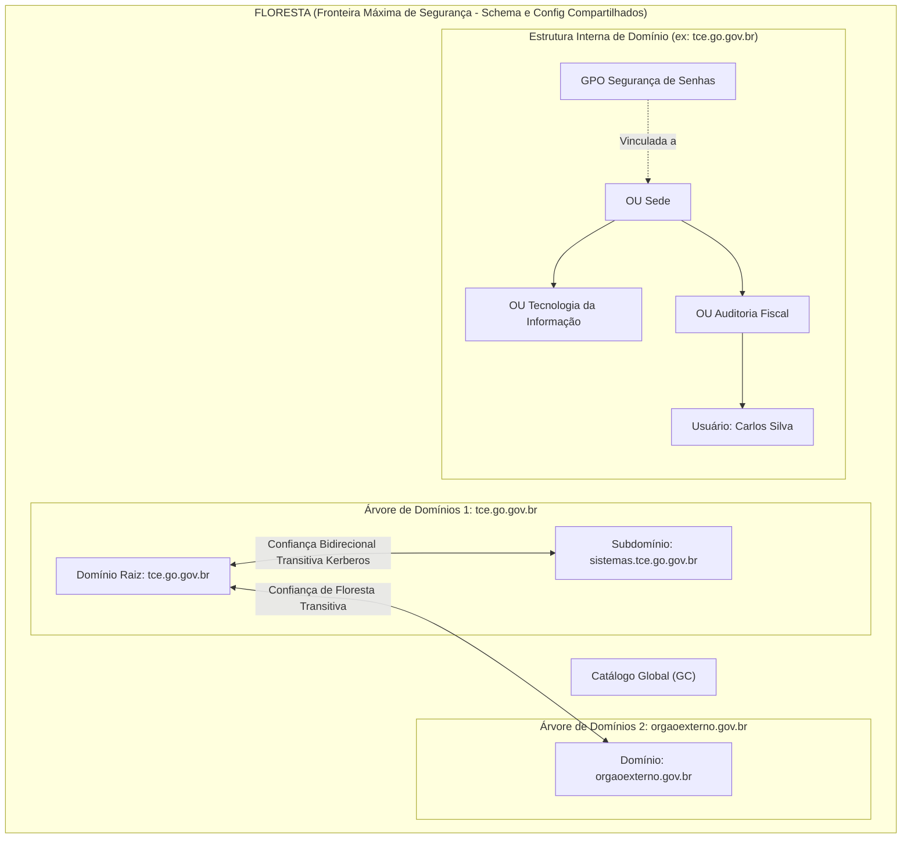
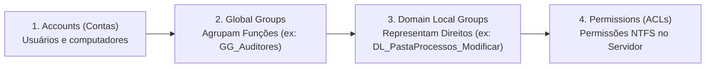
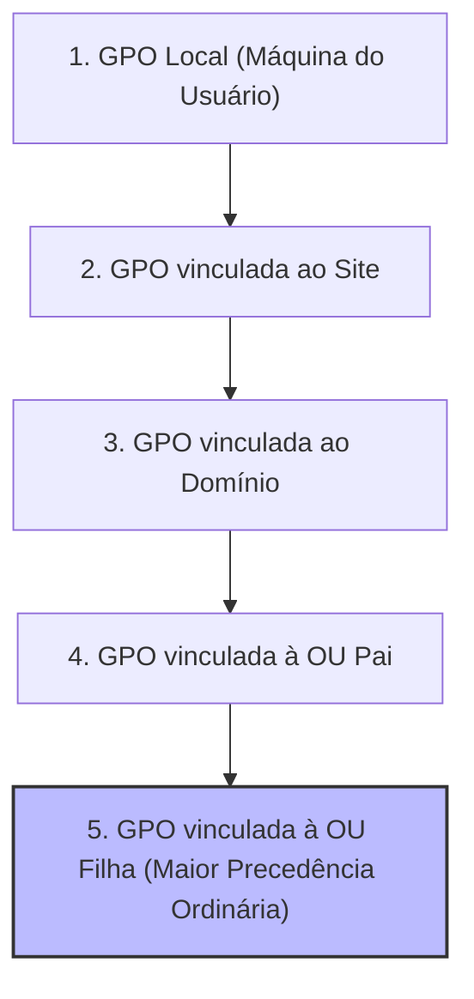

# 02 - Serviços de Diretório: Active Directory e LDAP

> **Matéria:** Sistemas Operacionais, Redes e Computação em Nuvem  
> **Cargo:** B02 – Técnico de Controle Externo – Especialidade: Tecnologia da Informação  
> **Arquivo:** `02_servicos_de_diretorio_active_directory_e_ldap.md`  


---


## 📌 Ementa / Itens do Edital
- Conceitos e fundamentos de Serviços de Diretório
- Protocolo LDAP (Lightweight Directory Access Protocol)
- Arquitetura do Microsoft Active Directory Domain Services (AD DS)
- Estrutura lógica e física do Active Directory
- Objetos, Contas de Usuário, Grupos e Unidades Organizacionais (OUs)
- Políticas de Grupo (GPO - Group Policy Objects)
- Autenticação Kerberos e funções FSMO

---

## 🧭 Sumário

1. [Fundamentos de Serviços de Diretório e Protocolo LDAP](#1-fundamentos-de-servicos-de-diretorio-e-protocolo-ldap)
    1. [Conceito: Diretório Hierárquico vs. Banco de Dados Relacional (RDBMS)](#11-conceito-diretorio-hierarquico-vs-banco-de-dados-relacional-rdbms)
    2. [O Protocolo LDAP: Portas Padrão e Arquitetura TCP/IP](#12-o-protocolo-ldap-portas-padrao-e-arquitetura-tcpip)
    3. [Formato de Nomenclatura X.500: DN, RDN, CN, OU e DC](#13-formato-de-nomenclatura-x500-dn-rdn-cn-ou-e-dc)
    4. [Operações LDAP Fundamentais e Filtros de Busca](#14-operacoes-ldap-fundamentais-e-filtros-de-busca)
    5. [Teste 421](#Teste-421)
    6. [Teste 422](#Teste-422)
2. [Arquitetura Lógica do Microsoft Active Directory (AD DS)](#2-arquitetura-logica-do-microsoft-active-directory-ad-ds)
    1. [Níveis Hierárquicos: OUs, Domínios, Árvores e Floresta](#21-niveis-hierarquicos-ous-dominios-arvores-e-floresta)
    2. [Tipos e Escopos de Grupos no AD DS](#22-tipos-e-escopos-de-grupos-no-ad-ds)
    3. [A Estratégia Canônica de Permissões: AGDLP e AGUDLP](#23-a-estrategia-canonica-de-permissoes-agdlp-e-agudlp)
    4. [Teste 423](#Teste-423)
    5. [Teste 424](#Teste-424)
3. [Estrutura Física e Serviços de Infraestrutura do AD DS](#3-estrutura-fisica-e-servicos-de-infraestrutura-do-ad-ds)
    1. [Controladores de Domínio (DCs), ntds.dit e SYSVOL](#31-controladores-de-dominio-dcs-ntdsdit-e-sysvol)
    2. [Sites, Sub-redes e Otimização de Replicação Física](#32-sites-sub-redes-e-otimizacao-de-replicacao-fisica)
    3. [Catálogo Global (Global Catalog - GC)](#33-catalogo-global-global-catalog-gc)
    4. [As 5 Funções Mestres de Operação Única (FSMO)](#34-as-5-funcoes-mestres-de-operacao-unica-fsmo)
    5. [Teste 425](#Teste-425)
    6. [Teste 426](#Teste-426)
    7. [Teste 427](#Teste-427)
4. [Políticas de Grupo (GPO) e Autenticação Kerberos v5](#4-politicas-de-grupo-gpo-e-autenticacao-kerberos-v5)
    1. [Precedência e Ordem de Processamento de GPOs (LSDOU)](#41-precedencia-e-ordem-de-processamento-de-gpos-lsdou)
    2. [Bloqueio de Herança (Block Inheritance) vs. Imposição (Enforced)](#42-bloqueio-de-heranca-block-inheritance-vs-imposicao-enforced)
    3. [Mecânica do Kerberos v5: KDC, AS, TGS, TGT e Bilhetes de Serviço](#43-mecanica-do-kerberos-v5-kdc-as-tgs-tgt-e-bilhetes-de-servico)
    4. [Tolerância Temporal (Clock Skew) e o Papel do PDC Emulator](#44-tolerancia-temporal-clock-skew-e-o-papel-do-pdc-emulator)
    5. [Teste 428](#Teste-428)
    6. [Teste 429](#Teste-429)
    7. [Teste 430](#Teste-430)
    8. [Teste 431](#Teste-431)
6. [Fontes Recomendadas na Internet](#6-fontes-recomendadas-na-internet)

---

## 1. Fundamentos de Serviços de Diretório e Protocolo LDAP

### 1.1 Conceito: Diretório Hierárquico vs. Banco de Dados Relacional (RDBMS)

Um **Serviço de Diretório** é uma base de dados especializada, estruturada hierarquicamente em formato de árvore invertida (**DIT** - *Directory Information Tree*), concebida para gerenciar, pesquisar e localizar recursos de rede (usuários, grupos funcionais, computadores, servidores, políticas de segurança e certificados).

A principal distinção da arquitetura de diretórios frente aos bancos de dados relacionais convencionais (RDBMS) reside no seu perfil de carga de trabalho:

- Enquanto bancos relacionais são desenhados para suportar operações transacionais equilibradas e escritas frequentes (garantindo ACID rígido com travas complexas), os **Serviços de Diretório são otimizados para uma proporção esmagadora de LEITURAS (cerca de 95% ou mais das operações)** e poucas atualizações ou inserções.
- As buscas no diretório são extremamente rápidas e os dados são replicados entre múltiplos servidores sob o modelo de **consistência eventual** (*Multi-Master Replication*).

| Característica | Serviço de Diretório (LDAP / AD DS) | Banco de Dados Relacional (RDBMS / SQL) |
|---|---|---|
| **Proporção Leitura / Escrita** | **Altíssima leitura (95%+)** e baixa escrita. Otimizado para buscas e logons quase instantâneos. | Equilibrado entre leituras e escritas frequentes (transações OLTP complexas). |
| **Estrutura de Dados** | Hierárquica em árvore (DIT - *Directory Information Tree*). | Tabelas bidimensionais relacionais normalizadas com chaves primárias e estrangeiras. |
| **Mecanismo de Consulta** | Protocolo LDAP com filtros de busca estruturados (ex.: `(&(objectCategory=person)(sAMAccountName=jsilva))`). | Linguagem declarativa SQL com junções relacionais complexas (`JOIN`). |
| **Transacionalidade / ACID** | Suporte transacional limitado; prioriza alta disponibilidade e replicação eventual. | Suporte rigoroso às propriedades ACID (Atomicidade, Consistência, Isolamento, Durabilidade). |
| **Padrão Normativo** | Baseado nas normas ITU-T X.500 e RFCs IETF (RFC 4511). | Padrão ANSI/ISO SQL. |

### 1.2 O Protocolo LDAP: Portas Padrão e Arquitetura TCP/IP

O **LDAP (*Lightweight Directory Access Protocol*)** foi desenvolvido para simplificar o pesado e complexo protocolo DAP (*Directory Access Protocol*) do padrão OSI X.500, eliminando a dependência das camadas superiores da pilha OSI e rodando diretamente sobre a pilha de transporte **TCP/IP**.

#### Portas de Rede Mandatórias para Concursos:
- **Porta TCP/UDP 389:** Porta padrão para tráfego LDAP em texto plano ou com elevação de segurança em canal aberto através do comando `StartTLS`.
- **Porta TCP 636:** Porta padrão para **LDAPS** (*LDAP over SSL/TLS*), onde toda a sessão de rede é encapsulada em criptografia TLS desde o aperto de mão inicial.
- **Porta TCP 3268:** Porta de consulta LDAP direcionada ao **Catálogo Global (*Global Catalog - GC*)** do Active Directory (consultas em nível de floresta).
- **Porta TCP 3269:** Porta de consulta LDAPS segura direcionada ao **Catálogo Global (GC)** com criptografia TLS.

### 1.3 Formato de Nomenclatura X.500: DN, RDN, CN, OU e DC

Cada objeto registrado no diretório possui uma identificação globalmente exclusiva na árvore denominada **Nome Distinto (*Distinguished Name* - DN)**. O DN é formado por uma cadeia encadeada de **Nomes Distintos Relativos (*Relative Distinguished Names* - RDNs)** separados por **vírgulas**:

```text
CN=Thiago Ramos,OU=Auditores,OU=Fiscalizacao,DC=tce,DC=go,DC=gov,DC=br
```

#### Atributos Fundamentais de Composição:
- **`CN` (*Common Name*):** Identificador relativo do objeto folha no nó atual (ex.: `CN=Thiago Ramos` ou `CN=Grupo_Auditores`).
- **`OU` (*Organizational Unit*):** Unidade Organizacional contêiner à qual o objeto pertence. A leitura do DN é feita da **folha para a raiz** (ou seja, `OU=Auditores` está contida no interior da `OU=Fiscalizacao`).
- **`DC` (*Domain Component*):** Cada um dos fragmentos de texto separados por ponto que integram o nome de domínio DNS corporativo (`DC=tce`, `DC=go`, `DC=gov`, `DC=br` para o domínio `tce.go.gov.br`).

> 🚨 **ALERTA DE PROVA / PEGADINHA FCC:**  
> A banca FCC costuma colocar opções invertidas (iniciando pelos `DC`s da raiz em direção ao `CN` folha) ou utilizando barras (`/`) e pontos (`.`) como delimitadores. A sintaxe canônica da RFC 4511 **inicia obrigatoriamente no objeto folha mais específico à esquerda** e utiliza **vírgulas** para separar cada atributo RDN.

### 1.4 Operações LDAP Fundamentais e Filtros de Busca

O protocolo LDAP define um conjunto de operações primitivas:

- **Bind:** Autentica a sessão do cliente perante o servidor de diretório (logon anônimo ou autenticado por credenciais).
- **Search:** Realiza consultas e extração de dados com filtros booleanos prefixados e três escopos de busca:
    - *Base:* Consulta restrita estritamente ao objeto indicado pelo DN base;
    - *One-Level:* Consulta todos os filhos imediatos localizados no primeiro nível abaixo da base;
    - *Subtree:* Consulta exaustiva em toda a subárvore hierárquica abaixo do nó base.
- **Add / Modify / Delete / ModifyDN:** Inserção, edição, exclusão e renomeação de objetos.
- **Unbind:** Encerramento formal da sessão LDAP.

---

### Teste 421
**(FGV - TRT / Analista Judiciário - TI - Protocolo LDAP: Portas e Modelo Operacional)**
O Lightweight Directory Access Protocol (LDAP) é o protocolo padrão da indústria utilizado para consulta e modificação de serviços de diretório hierárquicos em redes corporativas.

A respeito das características arquiteturais e das portas de comunicação padronizadas do LDAP, assinale a afirmativa correta:

* **A)** O LDAP opera exclusivamente sobre o protocolo UDP na porta 80 em texto claro sem suporte a autenticação.
* **B)** Por padrão IANA, o LDAP não seguro opera sobre o protocolo TCP na porta **389** (podendo ser protegido em tempo de execução via comando `StartTLS`), enquanto o LDAP seguro sobre SSL/TLS (**LDAPS**) opera tradicionalmente sobre a porta TCP **636**, utilizando certificados digitais X.509 para garantir a confidencialidade e integridade das credenciais transmitidas.
* **C)** No modelo de informação do LDAP, as operações de leitura são denominadas `DROP` e as de escrita `SELECT`.
* **D)** O LDAP substitui o protocolo IP na camada 3 do modelo OSI.
* **E)** As consultas LDAP são otimizadas para ambientes com altíssima taxa de gravação massiva e raríssimas leituras.


---

> **Comentário Detalhado:**
>
> - **A)** Incorreta. O LDAP utiliza transporte orientado a conexão TCP, suportando múltiplos métodos de autenticação (*Simple Bind*, SASL, Kerberos).
> - **B)** **CORRETA.** Especificação canônica do **LDAP (RFC 4511)**:
>   - **Porta TCP 389:** Porta padrão para tráfego LDAP tradicional. Admite a inicialização da sessão com negociação de segurança em tempo de execução via extensão `StartTLS` (RFC 4513) na mesma porta 389.
>   - **Porta TCP 636:** Porta padrão para **LDAPS (LDAP over SSL/TLS)**, onde o túnel criptográfico TLS é negociado logo na abertura da conexão antes de qualquer tráfego LDAP.
>   - **Catálogo Global (GC):** Em ambientes Active Directory, as portas do Global Catalog são TCP **3268** (claro) e TCP **3269** (seguro via SSL).
> - **C)** Incorreta. As operações centrais do LDAP são `Bind` (autenticação), `Search` (busca), `Compare`, `Add` (inserção), `Modify` (alteração) e `Delete` (exclusão).
> - **D)** Incorreta. O LDAP é um protocolo de **Camada de Aplicação (Camada 7)**.
> - **E)** Incorreta. Serviços de diretório são otimizados exatamente para uma **proporção muito alta de leituras/consultas em relação a modificações** (*read-heavy*).
> 
> **Gabarito: B**

---

### Teste 422
**(FCC - Adaptada / Tribunal de Contas - Especialidade Tecnologia da Informação)**
No contexto de serviços de diretório baseados nas normas X.500 e no protocolo LDAP (RFC 4511), a localização precisa de um objeto no interior da Árvore de Informações de Diretório (DIT) é expressa por meio de seu Nome Distinto (*Distinguished Name* - DN).

Considere que um analista precisa cadastrar a conta de usuário do servidor "Julio Cesar", lotado no setor de "AuditoriaTributaria", pertencente à subunidade de "Fiscalizacao", dentro do domínio governamental `sefaz.go.gov.br`. 

De acordo com o padrão LDAP, assinale a alternativa que apresenta a sintaxe canônica e estruturalmente válida para o *Distinguished Name* (DN) desse objeto:

* **A)** `CN=Julio Cesar,OU=AuditoriaTributaria,OU=Fiscalizacao,DC=sefaz,DC=go,DC=gov,DC=br`
* **B)** `DN=Julio Cesar/OU=Fiscalizacao/OU=AuditoriaTributaria/DC=sefaz.go.gov.br`
* **C)** `USER=Julio Cesar,DEPT=AuditoriaTributaria,SECTOR=Fiscalizacao,DOMAIN=sefaz.go.gov.br`
* **D)** `DC=br,DC=gov,DC=go,DC=sefaz,OU=Fiscalizacao,OU=AuditoriaTributaria,CN=Julio Cesar`
* **E)** `CN=Julio Cesar.OU=AuditoriaTributaria.OU=Fiscalizacao.DC=sefaz.go.gov.br`


---

> **Comentário Detalhado:**
>
> - **A)** Correta. Segue com perfeição a regra de construção de DN da RFC 4511: inicia pelo nó folha mais específico (`CN=Julio Cesar`), seguido das OUs em ordem ascendente (`OU=AuditoriaTributaria`, `OU=Fiscalizacao`) e finaliza com os componentes de domínio DNS individualizados (`DC=sefaz,DC=go,DC=gov,DC=br`), todos separados por vírgulas.
> - **B)** Incorreta. Utiliza barras como delimitadores e agrupa o domínio com pontos, violando a norma de atributos individuais DC.
> - **C)** Incorreta. Emprega identificadores inexistentes no esquema padrão LDAP (`USER`, `DEPT`, `SECTOR`, `DOMAIN`).
> - **D)** Incorreta. Inverte a ordem exigida: o DN deve iniciar na folha mais específica à esquerda, e não na raiz.
> - **E)** Incorreta. Utiliza pontos como delimitadores entre os atributos RDN no lugar de vírgulas.
> 
> **Gabarito: A**

---

## 2. Arquitetura Lógica do Microsoft Active Directory (AD DS)

### 2.1 Níveis Hierárquicos: OUs, Domínios, Árvores e Floresta

A estrutura lógica do **Active Directory Domain Services (AD DS)** organiza os objetos corporativos de forma desvinculada da disposição física dos cabos e prédios:



#### Hierarquia Lógica Detalhada:
1. **Unidade Organizacional (OU - *Organizational Unit*):**
    - É o menor elemento da hierarquia do AD DS no qual se pode:
    - **Vincular diretamente uma Política de Grupo (GPO)**;
    - **Delegar poderes de administração** (ex.: conceder ao suporte técnico de Goiânia autorização para redefinir senhas exclusivamente dos servidores daquela OU).

2. **Domínio (*Domain*):**
    - É a unidade lógica central de segurança, replicação e gerenciamento de contas. Todos os Controladores de Domínio (DCs) do mesmo domínio replicam 100% dos objetos locais.

3. **Árvore de Domínios (*Domain Tree*):**
    - Coleção de um ou mais domínios que compartilham um **namespace DNS contíguo** (ex.: `tce.go.gov.br` e o filho `sistemas.tce.go.gov.br`). Estabelecem relações de confiança automáticas bidirecionais e transitivas entre pai e filho.

4. **Floresta (*Forest*):**
    - É a **fronteira máxima de segurança (*Security Boundary*)** de toda a arquitetura Active Directory.
    - Compreende uma ou mais árvores de domínios que obrigatoriamente compartilham:
    - Uma única partição de **Esquema (*Schema*)**;
    - Uma única partição de **Configuração (*Configuration*)**;
    - O **Catálogo Global (*Global Catalog*)**.

> 🚨 **ALERTA DE PROVA / PEGADINHA FCC:**  
> A FCC já elaborou questões afirmando que o *Domínio* é a fronteira máxima de segurança da arquitetura Windows. **A AFIRMATIVA É ERRADA!** O Domínio é uma *fronteira administrativa*. A **Floresta** é formalmente a **fronteira máxima de segurança**, haja vista que um administrador do domínio raiz da floresta (*Enterprise Admins*) possui privilégios de controle irrestrito que alcançam qualquer domínio subordinado da floresta.

### 2.2 Tipos e Escopos de Grupos no AD DS

Os grupos no Active Directory desempenham papéis fundamentais de organização e controle de acesso:

#### Tipos de Grupo:
- **Grupos de Segurança (*Security Groups*):** Possuem um identificador de segurança único (**SID** - *Security Identifier*). São os únicos que podem ser inseridos em Listas de Controle de Acesso (ACLs) para concessão de permissões em pastas, bancos e impressoras.
- **Grupos de Distribuição (*Distribution Groups*):** Não possuem SID e destinam-se exclusivamente ao envio em massa de e-mails corporativos (ex.: Exchange Server). Não podem receber permissões em recursos de TI.

#### Escopos de Grupos:
- **Global (G):** Agrupa usuários e computadores **do mesmo domínio**. Pode ser utilizado para atribuir permissões em qualquer domínio da floresta.
- **Local de Domínio (DL - *Domain Local*):** Pode conter membros (usuários, grupos globais) de **qualquer domínio confiável da floresta**, mas só pode ser utilizado para conceder permissões em recursos localizados **no mesmo domínio** onde o grupo reside.
- **Universal (U):** Pode conter membros de qualquer domínio da floresta e receber permissões em recursos de qualquer domínio da floresta. Suas alterações são replicadas para o Catálogo Global.

### 2.3 A Estratégia Canônica de Permissões: AGDLP e AGUDLP

A recomendação oficial de arquitetura da Microsoft para gestão segura e escalável de permissões adota a estratégia mnemônica **AGDLP**:



1. **A**ccounts: As contas de usuário individuais são criadas e inseridas em...
2. **G**lobal Groups: Grupos Globais que representam uma função de trabalho corporativa (ex.: `GG_AuditoresFiscais`), que são adicionados a...
3. **D**omain **L**ocal Groups: Grupos Locais de Domínio criados especificamente para representar o nível de permissão sobre determinado recurso (ex.: `DL_ProcessosEletronicos_Leitura`), onde finalmente se aplicam as...
4. **P**ermissions: Permissões de controle de acesso (ACLs NTFS) na pasta do servidor de arquivos.

*(Em florestas multinacionais ou corporações complexas com múltiplos domínios, insere-se a camada de Grupos Universais, formando o padrão **AGUDLP**).*

---

### Teste 423
**(FCC - TRT / Analista de TI - Infraestrutura - Estrutura Física do Active Directory: Sites e Replicação)**
No Microsoft Windows Server Active Directory Domain Services (AD DS), a topologia física é estritamente dissociada da estrutura lógica (florestas, árvores e domínios) para otimizar o tráfego de rede entre localidades remotas.

A respeito dos componentes da **Estrutura Física do Active Directory** e da replicação entre Controladores de Domínio (DCs), assinale a afirmativa correta:

* **A)** Um *Site* do Active Directory corresponde exatamente a uma Unidade Organizacional (OU) criada pelo administrador no painel de usuários.
* **B)** Um **Site** do Active Directory é uma construção física que mapeia uma ou mais sub-redes IP com conectividade de rede local (LAN) de alta velocidade e baixo custo; a replicação **Intra-Site** (dentro do mesmo site) ocorre de forma quase instantânea orientada por notificações RPC (*Change Notification*) e sem compactação de dados para economizar CPU; enquanto a replicação **Inter-Site** (entre sites distintos interligados por WANs lentas via Site Links) é agendada em intervalos controlados e comprime os dados transferidos para preservar a largura de banda da rede.
* **C)** Dois computadores pertencentes ao mesmo domínio são proibidos de residir em sites físicos distintos.
* **D)** A replicação do Active Directory é unidirecional e centralizada exclusivamente em fitas magnéticas transportadas por via postal.
* **E)** Todos os Controladores de Domínio de uma floresta devem ficar fisicamente no mesmo prédio para evitar falhas de replicação.


---

> **Comentário Detalhado:**
>
> - **A)** Incorreta. *Site* é um conceito **físico** de conectividade de rede; *Unidade Organizacional (OU)* é um contêiner **lógico** administrativo.
> - **B)** **CORRETA.** Arquitetura física oficial do **Active Directory**:
>   - **Site:** Representa uma localidade geográfica bem conectada por links LAN rápidos (ex.: Sede em Goiânia, Subseção em Anápolis).
>   - **Replicação Intra-site (Dentro do Site):** Ocorre rapidamente (notificação disparada em média 15 segundos após a alteração). Como a largura de banda na LAN é abundante, os dados do diretório são replicados **sem compressão**, priorizando menor consumo de CPU dos DCs.
>   - **Replicação Inter-site (Entre Sites Distintos):** Ocorre através de links de site (*Site Links* usando RPC over IP ou SMTP). Como enlaces WAN são caros e concorrem com o tráfego de produção, a replicação é **agendada** (ex.: a cada 180 minutos ou durante a madrugada) e os dados são **altamente compactados** antes do envio.
> - **C)** Incorreta. Um mesmo domínio pode e costuma abranger dezenas de sites físicos interligados.
> - **D)** Incorreta. A replicação do AD é multimaster e baseada em protocolos de rede RPC/IP.
> - **E)** Incorreta. Distribuir DCs em sites geograficamente distintos é a melhor prática para resiliência e alta disponibilidade.
> 
> **Gabarito: B**

---

### Teste 424
**(FCC - Adaptada / Analista de Redes e Sistemas)**
Em uma organização pública que utiliza o Active Directory, um administrador necessita conceder permissões de leitura e modificação a uma pasta compartilhada no servidor de arquivos para os colaboradores do departamento financeiro. A organização segue rigorosamente a metodologia recomendada de desenho de segurança de identidades baseada na estratégia AGDLP.

Para cumprir esse padrão, a sequência correta de estruturação de contas, escopos de grupo e permissões de acesso é:

* **A)** As contas de usuários (**A**) são adicionadas diretamente à lista de controle de acesso (ACL) da pasta compartilhada, dispensando o uso de grupos intermediários.
* **B)** As contas de usuários (**A**) são inseridas em Grupos Locais de Domínio (**DL**), os quais são atribuídos a Grupos Globais (**G**), que por sua vez recebem as Permissões (**P**) na pasta.
* **C)** As contas de usuários (**A**) são inseridas em Grupos Globais (**G**), estes Grupos Globais são adicionados a Grupos Locais de Domínio (**DL**), e as Permissões (**P**) na pasta são atribuídas aos Grupos Locais de Domínio.
* **D)** As contas de usuários (**A**) são inseridas em Grupos de Distribuição, que são convertidos em Grupos de Segurança para receberem Permissões (**P**) no nível de Site.
* **E)** As contas de usuários (**A**) são associadas diretamente a uma Unidade Organizacional (**OU**), onde as permissões NTFS (**P**) de pastas são vinculadas via GPO.


---

> **Comentário Detalhado:**
>
> - **A)** Incorreta. Inserir usuários individuais em ACLs é uma péssima prática de governança que inviabiliza a auditoria e a escala administrativa.
> - **B)** Incorreta. Inverte a ordem do aninhamento estrutural: no AGDLP, os Grupos Globais entram nos Grupos Locais de Domínio.
> - **C)** Correta. Expressa a metodologia canônica AGDLP: Contas (**A**) entram em Grupos Globais (**G** que definem funções), estes entram em Grupos Locais de Domínio (**DL** que definem direitos), que finalmente recebem as Permissões (**P**) nas ACLs de pastas.
> - **D)** Incorreta. Grupos de Distribuição não possuem SID e não são utilizados para atribuir permissões de acesso em arquivos.
> - **E)** Incorreta. OUs não são entidades de segurança (*security principals*) e não podem receber permissões em ACLs de sistemas de arquivos.
> 
> **Gabarito: C**

---

## 3. Estrutura Física e Serviços de Infraestrutura do AD DS

### 3.1 Controladores de Domínio (DCs), ntds.dit e SYSVOL

- **Controlador de Domínio (DC - *Domain Controller*):** Servidor Windows que executa a função de AD DS, responsável por autenticar usuários, processar logon Kerberos e manter a base de dados.
- **`ntds.dit`:** O arquivo de banco de dados do Active Directory propriamente dito (baseado no mecanismo ESE / JET Blue).
- **Compartilhamento SYSVOL:** Pasta de rede replicada automaticamente entre todos os DCs que armazena os scripts de logon e os arquivos de configuração das Políticas de Grupo (GPOs).
- **RODC (*Read-Only Domain Controller*):** Controlador de Domínio somente leitura projetado para filiais ou escritórios remotos que não possuem segurança física adequada (sem sala cofre). Não armazena senhas em cache por padrão, resguardando o domínio central caso o hardware da filial seja furtado.

### 3.2 Sites, Sub-redes e Otimização de Replicação Física

Enquanto a estrutura lógica organiza os objetos em Domínios e OUs, a **Estrutura Física** modela a topologia real da rede:

- **Sub-redes (*Subnets*):** Mapeamento dos blocos de endereços IP de cada unidade (ex.: `10.1.0.0/24`).
- **Sites:** Agrupamento de sub-redes interligadas por links de rede de alta velocidade e baixa latência (LAN local).
- **Utilidade dos Sites:**
    1. *Direcionamento de Logon:* Garante que uma estação de trabalho em Goiânia autentique-se no DC local de Goiânia, sem atravessar links WAN lentos até Brasília.
    2. *Controle de Replicação:* A replicação intra-site (mesmo local) ocorre quase instantaneamente sem compressão; a replicação inter-site (entre filiais) é agendada para horários de menor tráfego e compactada via protocolo RPC sobre IP.

### 3.3 Catálogo Global (Global Catalog - GC)

O **Catálogo Global (GC)** é uma função especializada desempenhada por um ou mais Controladores de Domínio da floresta:

- Armazena uma réplica completa de todos os objetos do seu próprio domínio e uma **réplica parcial (somente leitura com os atributos mais consultados, como nome, e-mail e UPN) de todos os objetos de todos os outros domínios da floresta**.
- É indispensável para permitir que usuários façam login utilizando o seu *User Principal Name* (UPN: `usuario@orgao.gov.br`) e para a resolução de associações de Grupos Universais durante o processo de geração do token de logon.

### 3.4 As 5 Funções Mestres de Operação Única (FSMO)

Embora o Active Directory opere predominantemente sob o regime de replicação multimesmo (*multi-master*), determinadas tarefas críticas não admitem escritas concorrentes descentralizadas. Para essas operações, o AD DS define as **5 Funções FSMO (*Flexible Single Master Operations*)**:

| Escopo da Função | Função FSMO | Responsabilidade e Missão Crítica | Consequência da Falha Prolongada |
|---|---|---|---|
| **Nível de Floresta** *(Apenas 1 por Floresta)* | **Schema Master** *(Mestre de Esquema)* | Controla todas as modificações e extensões no Esquema do AD DS (criação de novas classes e atributos de objetos). | Não impacta logons de usuários; impede unicamente a instalação de softwares que alteram o schema (ex.: Exchange, SCCM). |
| **Nível de Floresta** *(Apenas 1 por Floresta)* | **Domain Naming Master** *(Mestre de Nomenclatura)* | Autoriza a criação, exclusão ou renomeação de domínios e partições de diretório em toda a floresta. | Impede unicamente criar novos domínios ou excluir domínios existentes. |
| **Nível de Domínio** *(1 em cada Domínio)* | **PDC Emulator** *(Emulador de PDC)* | **A função mais ativa e crítica:** atua como servidor de sincronização de relógio mestre (servidor NTP raiz), reconcilia alterações e falhas de senha com prioridade, e processa bloqueios de conta. | Causa atrasos na propagação de novas senhas, falhas de logon em contas recém-alteradas e erros de dessincronização no protocolo Kerberos. |
| **Nível de Domínio** *(1 em cada Domínio)* | **RID Master** *(Mestre de Identificadores Relativos)* | Distribui blocos (*pools*) de RIDs para todos os outros DCs do domínio. Cada objeto criado recebe um SID composto pelo SID do Domínio + um RID exclusivo. | Se o pool de RIDs de um DC se esgotar com o RID Master fora do ar, aquele DC fica impossibilitado de criar novos usuários, grupos ou máquinas. |
| **Nível de Domínio** *(1 em cada Domínio)* | **Infrastructure Master** *(Mestre de Infraestrutura)* | Atualiza referências cruzadas quando um objeto de outro domínio pertencente a um grupo local é modificado. | Em domínio único não tem efeito prático. Em multi-domínio sem GC conjunto, nomes de usuários externos podem demorar a se resolver nas ACLs. |

---

### Teste 425
**(FGV - TRT / Analista Judiciário - TI - O Mecanismo do Catálogo Global no Active Directory)**
Em florestas corporativas do Active Directory compostas por múltiplos domínios (por exemplo, `tce.go.gov.br`, `sub1.tce.go.gov.br`, `sub2.tce.go.gov.br`), o **Catálogo Global (*Global Catalog - GC*)** desempenha um papel indispensável para a localização rápida de objetos e logon de usuários.

A respeito do conteúdo e das funções operacionais do Catálogo Global, assinale a afirmativa correta:

* **A)** O Catálogo Global armazena a cópia completa de todos os atributos de todos os objetos de todos os servidores do planeta.
* **B)** Um servidor configurado como Catálogo Global armazena uma réplica completa de todos os objetos de seu próprio domínio local e uma **réplica parcial de somente-leitura** de todos os objetos de todos os demais domínios da floresta (denominada *Partial Attribute Set - PAS*), permitindo buscas rápidas em toda a floresta sem sobrecarregar links WAN e viabilizando a resolução de associações a Grupos Universais durante o processo de logon.
* **C)** O Catálogo Global é um arquivo executável que deve ser instalado exclusivamente em estações de trabalho Windows 10 Home.
* **D)** O Catálogo Global é incompatível com o protocolo Kerberos v5.
* **E)** Cada floresta do Active Directory pode possuir no máximo um único servidor com a função de Catálogo Global ativada.


---

> **Comentário Detalhado:**
>
> - **A)** Incorreta. O GC não armazena todos os atributos de outros domínios; ele armazena apenas um subconjunto restrito de atributos frequentemente consultados (*Partial Attribute Set*).
> - **B)** **CORRETA.** Funções do **Catálogo Global (GC)**:
>   1. **Busca Florestal:** Permite que um usuário procure uma impressora, computador ou colega em qualquer domínio da floresta consultando o DC/GC local rapidamente, sem fazer requisições a DCs remotos.
>   2. **Conjunto Parcial de Atributos (PAS):** Contém atributos comuns como Nome, Sobrenome, E-mail, UPN e SID de todos os domínios.
>   3. **Logon e Grupos Universais:** Na autenticação Kerberos, o DC precisa consultar o GC para expandir a lista de associações a **Grupos Universais** do usuário e embutir os respectivos SIDs no token de acesso (*PAC - Privilege Attribute Certificate*). Se o GC estiver inacessível, o logon de usuários comuns pode falhar (salvo se o *Universal Group Membership Caching* estiver ativado).
> - **C)** Incorreta. O GC é uma função habilitada exclusivamente em Controladores de Domínio (DCs) do Windows Server.
> - **D)** Incorreta. O GC é parte integrante do fluxo de autenticação Kerberos.
> - **E)** Incorreta. Qualquer DC pode ser promovido a GC; a recomendação em domínios modernos é que a maioria dos DCs também atuem como Catálogo Global.
> 
> **Gabarito: B**

---

### Teste 426
**(FCC - TRT / Analista de Sistemas - Suporte a Servidores - Escopos de Grupos no Active Directory: Estratégia AGDLP)**
O Active Directory classifica os grupos segundo dois tipos (**Segurança** e **Distribuição**) e três escopos principais: **Global**, **Domínio Local** (*Domain Local*) e **Universal**.

Para implementar o controle de acesso a pastas e recursos compartilhados em redes com múltiplos domínios conforme as melhores práticas recomendadas pela Microsoft, utiliza-se a consagrada estratégia de aninhamento **AGDLP** (ou AGUDLP).

A sequência correta de aninhamento e concessão de privilégios prescrita pela metodologia **AGDLP** é:

* **A)** Atribuir as permissões diretamente na Conta do Usuário e adicioná-la a um Grupo Universal.
* **B)** Inserir as **Contas de Usuários (A)** em **Grupos Globais (G)** (que representam funções corporativas de negócio); aninhar esses Grupos Globais dentro de **Grupos de Domínio Local (DL)** (que representam o recurso ou permissão específica); e, finalmente, conceder as **Permissões (P)** de acesso ao recurso (ex.: NTFS) diretamente ao Grupo de Domínio Local correspondente.
* **C)** Conceder Permissões (P) aos Grupos Globais e aninhá-los em Contas de Usuários (A).
* **D)** Criar exclusivamente Grupos de Distribuição sem senhas e vinculá-los ao registro do Windows.
* **E)** Aninhar todos os servidores em um único Grupo Global com permissão de Administrador do Domínio.


---

> **Comentário Detalhado:**
>
> - **A)** Incorreta. Conceder permissões diretamente a contas de usuários viola as melhores práticas de governança, tornando a auditoria impossível e gerando acúmulo residual de privilégios.
> - **B)** **CORRETA.** Metodologia canônica **AGDLP (Accounts $\to$ Global $\to$ Domain Local $\to$ Permissions)**:
>   1. **A (Accounts):** As contas de usuários individuais.
>   2. **G (Global Groups):** Agrupam contas com base na sua função ou cargo de trabalho (ex.: `GG_Auditores_Fiscalizacao`).
>   3. **DL (Domain Local Groups):** Criados no domínio onde o recurso reside para definir o direito de acesso específico (ex.: `GDL_PastaProcessos_Modificar`).
>   4. **P (Permissions):** As listas de controle de acesso (ACLs/ACEs) do sistema de arquivos NTFS ou banco concedem as permissões de leitura/escrita **exclusivamente ao Grupo de Domínio Local**.
>   - Se a floresta tiver múltiplos domínios, expande-se para **AGUDLP**, onde Grupos Globais de diferentes domínios são agregados em um **Grupo Universal (U)** antes de serem aninhados no Grupo de Domínio Local (DL).
> - **C)** Incorreta. Inverteu o sentido do aninhamento e da governança.
> - **D)** Incorreta. Grupos de Distribuição servem exclusivamente para listas de e-mail (Exchange), não podendo receber permissões de segurança NTFS.
> - **E)** Incorreta. Violação grosseira do princípio do menor privilégio.
> 
> **Gabarito: B**

---

### Teste 427
**(FCC - Adaptada / Analista de Sistemas - Suporte a Servidores)**
Em uma floresta multi-domínio do Microsoft Active Directory Domain Services (AD DS), a arquitetura do sistema delega certas operações a servidores específicos por meio das funções Mestres de Operação Única Flexível (*Flexible Single Master Operations* - FSMO). 

Sobre as atribuições e o escopo dessas funções, é correto afirmar:

* **A)** A função de *Schema Master* possui escopo restrito a cada domínio individual da floresta, permitindo que cada domínio configure seus próprios atributos de usuário de maneira independente e isolada.
* **B)** A função de *PDC Emulator* (Emulador de Controlador de Domínio Primário) atua no nível de domínio e é a principal responsável por atuar como autoridade de referência de sincronização de horário (servidor NTP), além de processar com prioridade as alterações e bloqueios de senhas de usuários.
* **C)** A função de *RID Master* opera no nível de floresta e atua exclusivamente na validação de nomes de novos domínios que solicitam ingresso na estrutura hierárquica do AD.
* **D)** As cinco funções FSMO operam compulsoriamente no mesmo e único Controlador de Domínio raiz, sendo tecnicamente impossível transferi-las individualmente entre diferentes servidores da rede.
* **E)** A função de *Domain Naming Master* tem escopo de domínio e é responsável por atribuir identificadores relativos (RIDs) a cada novo objeto criado pelos controladores de domínio locais.


---

> **Comentário Detalhado:**
>
> - **A)** Incorreta. O Schema Master possui escopo de floresta (apenas 1 por floresta); o esquema do AD DS é único e universal para todos os domínios da floresta.
> - **B)** Correta. O PDC Emulator opera no nível de domínio e é a função FSMO de maior atividade, sendo responsável pela sincronização de tempo NTP (vital para o Kerberos) e processamento imediato de alterações de senha.
> - **C)** Incorreta. O RID Master opera no nível de domínio e distribui blocos de identificadores relativos para criação de novos SIDs.
> - **D)** Incorreta. As funções FSMO são flexíveis e podem ser livremente distribuídas e transferidas entre diferentes Controladores de Domínio.
> - **E)** Incorreta. O Domain Naming Master tem escopo de floresta e cuida da nomenclatura e criação de domínios, e não da alocação de RIDs.
> 
> **Gabarito: B**

---

## 4. Políticas de Grupo (GPO) e Autenticação Kerberos v5

### 4.1 Precedência e Ordem de Processamento de GPOs (LSDOU)

Os **Objetos de Política de Grupo (GPOs - *Group Policy Objects*)** aplicam configurações centralizadas de segurança, registros, mapeamentos de impressoras e restrições a usuários e computadores.

O processamento das GPOs segue a ordem cronológica estrita representada pelo mnemônico **LSDOU**:

$$\text{1. Local} \longrightarrow \text{2. Site} \longrightarrow \text{3. Domain} \longrightarrow \text{4. Organizational Unit (OU)}$$



- **Regra de Ouro da Resolução de Conflitos:** Em caso de políticas com parâmetros contraditórios, **a última diretiva processada é a que prevalece!**
- Como a OU filha é processada por último na cadeia ordinária, as configurações da **OU mais próxima do objeto possuem maior precedência** sobre as diretivas de Domínio, Site ou Local.

### 4.2 Bloqueio de Herança (Block Inheritance) vs. Imposição (Enforced)

O comportamento padrão de herança pode ser alterado por dois modificadores:

1. **Bloquear Herança (*Block Inheritance*):** Aplicado a uma Unidade Organizacional (OU) específica. Impede que a OU receba diretivas herdadas de níveis superiores (Site, Domínio e OUs pai).
2. **Imposição / Não Substituir (*Enforced*):** Aplicado diretamente a uma GPO vinculada a um nível superior (como o Domínio).  
   > 🚨 **REGRA DE PREVALÊNCIA ABSOLUTA FCC:**  
   > A opção **Enforced SOBREPÕE QUALQUER BLOQUEIO DE HERANÇA!** Uma GPO de domínio configurada como *Enforced* será obrigatoriamente aplicada a todas as estações e OUs subordinadas, mesmo que estas tenham o *Block Inheritance* explicitamente ativado.

### 4.3 Mecânica do Kerberos v5: KDC, AS, TGS, TGT e Bilhetes de Serviço

O protocolo **Kerberos v5** (RFC 4120) é o alicerce de autenticação e *Single Sign-On* (SSO) do Active Directory:

```mermaid
sequenceDiagram
    autonumber
    participant C as "Cliente (Estação de Trabalho)"
    participant AS as "Authentication Server (AS / KDC no DC)"
    participant TGS as "Ticket Granting Server (TGS / KDC)"
    participant S as "Servidor de Arquivos / Aplicação"

    C->>AS: 1. KRB_AS_REQ (Solicitação com carimbo de tempo cifrado pela senha do usuário)
    AS-->>C: 2. KRB_AS_REP (Retorna TGT cifrado pela chave do KDC + Sessão KDC)
    Note over C: Usuário agora possui um TGT (Ticket Granting Ticket)
    C->>TGS: 3. KRB_TGS_REQ (Apresenta TGT solicitando acesso ao serviço CIFS/HTTP)
    TGS-->>C: 4. KRB_TGS_REP (Retorna Ticket de Serviço cifrado com a chave do servidor)
    C->>S: 5. KRB_AP_REQ (Apresenta o Ticket de Serviço diretamente ao servidor de recursos)
    S-->>C: 6. KRB_AP_REP (Autenticação mútua confirmada; acesso liberado)
```

1. **`KRB_AS_REQ` / `KRB_AS_REP`:** O cliente envia uma requisição ao serviço de autenticação (**AS**). O AS valida a identidade e devolve uma chave de sessão e o **TGT (*Ticket Granting Ticket*)**, um bilhete cifrado com a chave secreta exclusiva do KDC (a conta `krbtgt`).
2. **`KRB_TGS_REQ` / `KRB_TGS_REP`:** De posse do TGT, quando o usuário precisa acessar um servidor de arquivos ou intranet, ele solicita um bilhete ao serviço concessor de bilhetes (**TGS**). O TGS valida o TGT e emite um **Ticket de Serviço (*Service Ticket*)** cifrado com a chave do servidor de destino.
3. **`KRB_AP_REQ`:** O cliente entrega o Ticket de Serviço diretamente ao servidor final, obtendo acesso imediato sem jamais trafegar sua senha pela rede.

### 4.4 Tolerância Temporal (Clock Skew) e o Papel do PDC Emulator

Para impedir que invasores capturem pacotes de autenticação na rede e os reenviem maliciosamente (**ataques de repetição / *replay attacks***), as mensagens do Kerberos incluem carimbos temporais (*timestamps*):

- O KDC exige que a diferença entre o relógio da estação cliente e o relógio do servidor de autenticação não ultrapasse um limite máximo, denominado **Desvio de Relógio (*Clock Skew*)**, configurado por padrão em **5 minutos**.
- Se a divergência for superior a 5 minutos, a autenticação Kerberos falha sumariamente.
- Por esse motivo, a função FSMO **PDC Emulator** atua compulsoriamente como a fonte oficial de sincronização horária (**NTP Master**) de toda a floresta do Active Directory.

---

### Teste 428
**(FGV - TRT / Analista Judiciário - TI - Precedência de GPOs: O Princípio LSDOU)**
No gerenciamento centralizado de estações de trabalho e servidores Windows através de Objetos de Diretiva de Grupo (*Group Policy Objects - GPOs*), um computador ou usuário pode estar sujeito a múltiplas políticas conflitantes configuradas em diferentes níveis da hierarquia.

A ordem padrão de processamento e precedência na aplicação de GPOs, expressa pela sigla **LSDOU**, estabelece que:

* **A)** As políticas vinculadas ao nível Local sobrescrevem compulsoriamente todas as políticas definidas na Unidade Organizacional (OU).
* **B)** O processamento ocorre na seguinte sequência temporal: 1º **Local** (política local da máquina), 2º **Site**, 3º **Domínio** e 4º **Unidade Organizacional (OU)** (processando das OUs superiores para as OUs filhas aninhadas); consequentemente, no caso de configurações conflitantes, **a última política processada (a vinculada à OU mais específica e profunda) é a que prevalece e sobrescreve as configurações anteriores**, salvo se houver imposição (*Enforced*).
* **C)** Políticas de Domínio são completamente ignoradas se o computador possuir antivírus instalado.
* **D)** A ordem LSDOU é definida aleatoriamente pela CPU a cada reinicialização do Windows.
* **E)** Uma GPO vinculada a um Site tem precedência superior sobre uma GPO vinculada com atributo *Enforced* em um Domínio.


---

> **Comentário Detalhado:**
>
> - **A)** Incorreta. A política Local é a primeira a ser aplicada e, portanto, é a mais fraca: qualquer política de Site, Domínio ou OU sobrescreve a política Local.
> - **B)** **CORRETA.** Regra canônica de herança e precedência de **GPOs (LSDOU)**:
>   - **Ordem de Aplicação:** 
>     1. **L**ocal Policy (mais antiga/mais fraca);
>     2. **S**ite;
>     3. **D**omain;
>     4. **O**rganizational **U**nit (processa da OU pai até a OU folha onde o objeto reside).
>   - **Regra de Conflito:** *"O último a ser aplicado vence"*. Logo, uma configuração na OU folha sobrescreve configurações divergentes vindas do Domínio ou do Site.
>   - **Exceção Maior:** A marcação **Enforced (Imposta)** em uma GPO de nível superior impede que suas diretivas sejam sobrescritas por OUs subordinadas e quebra bloqueios de herança (*Block Inheritance*).
> - **C)** Incorreta. Políticas de Domínio são aplicadas pelo serviço Group Policy Client do sistema operacional.
> - **D)** Incorreta. A ordem é estritamente determinística e previsível.
> - **E)** Incorreta. A flag *Enforced* confere prioridade absoluta àquela GPO contra qualquer outra política não imposta.
> 
> **Gabarito: B**

---

### Teste 429
**(FCC - Adaptada / Analista de TI - Infraestrutura e Redes)**
Considere uma floresta corporativa do Microsoft Active Directory Domain Services (AD DS) composta por um único domínio denominado `tce.go.gov.br`. Um computador do setor de compras está localizado na Unidade Organizacional (OU) `Licitacoes`, que por sua vez é uma subunidade contida no interior da OU `Administrativo`. 

Existem quatro Políticas de Grupo (GPOs) com configurações conflitantes vinculadas aos seguintes níveis:

1. GPO "Diretiva-Local" configurada nas políticas da máquina local;
2. GPO "Diretiva-Site" vinculada ao Site físico do Active Directory;
3. GPO "Diretiva-Dominio" vinculada à raiz do Domínio `tce.go.gov.br`;
4. GPO "Diretiva-Admin" vinculada à OU pai `Administrativo`;
5. GPO "Diretiva-Licitacoes" vinculada à OU folha `Licitacoes`.

Sabendo que a OU `Licitacoes` possui a opção de "Bloquear Herança" (*Block Inheritance*) explicitamente habilitada, mas a GPO "Diretiva-Dominio" foi configurada pelo Administrador Corporativo com a opção de "Imposição" (*Enforced* / Não Substituir), assinale a alternativa que indica a política que terá a maior precedência final para definir o parâmetro conflitante na referida estação de trabalho:

* **A)** GPO "Diretiva-Local", em razão de as configurações físicas na estação de trabalho sempre prevalecerem sobre diretivas de rede.
* **B)** GPO "Diretiva-Site", pois diretivas de site físico são imunes a bloqueios de herança configurados em OUs.
* **C)** GPO "Diretiva-Admin", que é herdada compulsoriamente por ser a Unidade Organizacional hierarquicamente superior direta.
* **D)** GPO "Diretiva-Licitacoes", pois o bloqueio de herança impede a aplicação de qualquer diretiva originada fora da referida OU.
* **E)** GPO "Diretiva-Dominio", pois a opção de Imposição (*Enforced*) ignora e sobrepõe qualquer bloqueio de herança definido nas Unidades Organizacionais descendentes.


---

> **Comentário Detalhado:**
>
> - **A)** Incorreta. A diretiva Local é a primeira a ser processada na cadeia e possui a menor precedência em relação às diretivas de domínio.
> - **B)** Incorreta. As diretivas de Site são ordinariamente bloqueadas pelo Bloqueio de Herança caso não estejam marcadas como Enforced.
> - **C)** Incorreta. A GPO da OU Administrativo foi devidamente bloqueada pelo Block Inheritance da OU filha e não possui a flag Enforced.
> - **D)** Incorreta. O Bloqueio de Herança bloqueia diretivas comuns, mas é expressamente sobreposto pela configuração de Imposição (*Enforced*) da Diretiva de Domínio.
> - **E)** Correta. A opção *Enforced* (Imposição) foi desenhada pela Microsoft exatamente para garantir a prevalência inegociável de diretivas centrais de governança e segurança, sobrepondo qualquer bloqueio de herança definido em OUs subordinadas.
> 
> **Gabarito: E**

---

### Teste 430
**(FCC - Adaptada / Analista de Tecnologia da Informação - Segurança da Informação)**
No protocolo de autenticação Kerberos v5, implementado nativamente pelo Active Directory Domain Services para prover autenticação mútua e *Single Sign-On* (SSO) no ambiente de rede corporativo:

* **A)** As senhas dos usuários são transmitidas em texto claro durante a etapa inicial de negociação com o Authentication Server (AS), dependendo de túneis VPN para garantir a confidencialidade do tráfego.
* **B)** O serviço Ticket Granting Server (TGS) emite o bilhete inicial de concessão de bilhetes (*Ticket Granting Ticket* - TGT) imediatamente antes de validar as credenciais biométricas do usuário na máquina cliente.
* **C)** A tolerância temporal de dessincronização de relógio (*clock skew*) entre os clientes e o KDC é irrelevante para a segurança do protocolo, pois o Kerberos utiliza exclusivamente desafios e respostas baseados em números aleatórios (*nonces*).
* **D)** O cliente obtém inicialmente um TGT junto ao serviço de autenticação (AS) e posteriormente apresenta esse TGT ao servidor de concessão de bilhetes (TGS) para solicitar bilhetes de serviço específicos para acessar recursos de rede.
* **E)** O protocolo prescinde do uso de criptografia simétrica, utilizando certificados digitais de chave pública assimetricamente em todas as interações de solicitação de arquivos.


---

> **Comentário Detalhado:**
>
> - **A)** Incorreta. No Kerberos, a senha do usuário jamais é transmitida pela rede em nenhuma circunstância.
> - **B)** Incorreta. Quem emite o TGT inicial durante o logon primário é o serviço Authentication Server (AS), e não o TGS.
> - **C)** Incorreta. A sincronia de relógio é indispensável para evitar ataques de repetição (*replay attack*). Se o desvio temporal exceder a tolerância padrão de 5 minutos, a autenticação falhará.
> - **D)** Correta. Sintetiza com exatidão a dinâmica operacional do Kerberos: obtenção inicial do TGT no AS e posterior apresentação ao TGS para emissão de tickets de serviço específicos.
> - **E)** Incorreta. O Kerberos é fundamentalmente alicerçado em criptografia simétrica rápida e segredos compartilhados.
> 
> **Gabarito: D**

---

### Teste 431
**(FGV - TRT / Analista Judiciário - TI - Kerberos v5, Clock Skew e o Papel do PDC Emulator)**
O protocolo de autenticação padrão no Active Directory é o **Kerberos v5** (RFC 4120), que opera com bilhetes criptográficos temporais (*tickets*) para assegurar autenticação mútua sem transmissão de senhas na rede.

A respeito da vulnerabilidade do Kerberos a ataques de repetição (*Replay Attacks*), do papel do mestre FSMO **PDC Emulator** e da tolerância temporal (*Clock Skew*), assinale a afirmativa correta:

* **A)** O Kerberos não utiliza carimbos de tempo, dependendo exclusivamente do endereço MAC da placa de rede para validar bilhetes.
* **B)** Os bilhetes e autenticadores do Kerberos contêm carimbos de data/hora (*timestamps*); para impedir que um invasor capture um pacote e o retransmita posteriormente (*Replay Attack*), o Active Directory impõe uma tolerância temporal máxima padrão de **5 minutos (*Clock Skew*)** entre o relógio da estação cliente e o Controlador de Domínio; para garantir essa sincronização em toda a floresta, o Controlador de Domínio detentor da função FSMO de **PDC Emulator** atua como a fonte oficial de tempo (servidor NTP raiz do domínio), sincronizando todas as estações e DCs subordinados.
* **C)** Se a diferença de relógio entre a estação de trabalho e o PDC Emulator for de 3 horas, a autenticação Kerberos prossegue normalmente sem emitir alertas.
* **D)** O PDC Emulator é uma placa aceleradora de vídeo 3D que deve ser instalada fisicamente em todas as estações do tribunal.
* **E)** O protocolo Kerberos foi substituído pelo NTLMv1 em todas as versões modernas do Windows Server devido à sua superioridade criptográfica.


---

> **Comentário Detalhado:**
>
> - **A)** Incorreta. O carimbo de data e hora (*timestamp*) é o mecanismo nuclear de segurança do Kerberos v5 para evitar ataques de repetição.
> - **B)** **CORRETA.** Funcionamento temporal do **Kerberos v5 no AD DS**:
>   - **Clock Skew (Tolerância de Relógio):** Por padrão nas Diretivas de Segurança do Domínio, a diferença máxima tolerada entre o relógio do cliente e o KDC (Controlador de Domínio) é de **5 minutos**. Se o relógio da máquina estiver desfasado em mais de 5 minutos, o KDC rejeita o bilhete com erro `KRB_AP_ERR_SKEW`, impedindo logons e acesso a compartilhamentos.
>   - **Papel do PDC Emulator (Mestre FSMO):** O DC que detém a função de emulador PDC no domínio raiz da floresta atua como o servidor de hora mestre (*Authoritative Time Server*) via protocolo W32Time/NTP, sincronizando-se com um relógio atômico externo confiável (como o `ntp.br`). Todos os demais DCs da floresta sincronizam seus relógios com ele, e as estações de trabalho sincronizam seus relógios com seu respectivo DC local, garantindo consistência cronológica em toda a rede.
> - **C)** Incorreta. Uma diferença de 3 horas causará rejeição sumária e imediata de qualquer autenticação Kerberos.
> - **D)** Incorreta. É uma função lógica de software FSMO do Active Directory.
> - **E)** Incorreta. O NTLMv1 é um protocolo inseguro e vulnerável, banido em favor do Kerberos.
> 
> **Gabarito: B**

---

## 6. Fontes Recomendadas na Internet

* [Microsoft Learn - Active Directory Domain Services Overview](https://learn.microsoft.com/pt-br/windows-server/identity/ad-ds/get-started/virtual-dc/active-directory-domain-services-overview) - Visão geral oficial do AD DS, estruturas de florestas, domínios, árvores e unidades organizacionais.
* [Microsoft Learn - Visão Geral do Kerberos no Windows Server](https://learn.microsoft.com/pt-br/windows-server/security/kerberos/kerberos-authentication-overview) - Funcionamento oficial da autenticação Kerberos, KDC, tickets TGT e autenticação de rede.
* [IETF RFC 4511 - Lightweight Directory Access Protocol (LDAP): The Protocol](https://datatracker.ietf.org/doc/html/rfc4511) - Especificação oficial do protocolo LDAPv3, operações de busca, bind e modelo de dados.
* [IETF RFC 4120 - The Kerberos Network Authentication Service (V5)](https://datatracker.ietf.org/doc/html/rfc4120) - Especificação oficial do protocolo de autenticação segura e bilhetagem Kerberos v5.
* [Microsoft Learn - Objetos de Diretiva de Grupo (GPO)](https://learn.microsoft.com/pt-br/windows-server/identity/ad-fs/deployment/distribute-certificates-to-client-computers-by-using-group-policy) - Documentação oficial sobre criação, herança e aplicação de políticas de grupo (GPO) no Active Directory.
* NEMETH, Evi et al. **UNIX and Linux System Administration Handbook**. 5. ed. Boston: Addison-Wesley Professional, 2017. (Cap. 22 - Directory Services: LDAP and Active Directory).
* STALLINGS, William. **Criptografia e Segurança de Redes: Princípios e Práticas**. 7. ed. São Paulo: Pearson Education do Brasil, 2018. (Cap. 16 - Autenticação Mútua e Serviços Kerberos).
* TANENBAUM, Andrew S.; WETHERALL, David. **Redes de Computadores**. 5. ed. São Paulo: Pearson, 2011. (Cap. 7 - Camada de Aplicação e Serviços de Diretório).
