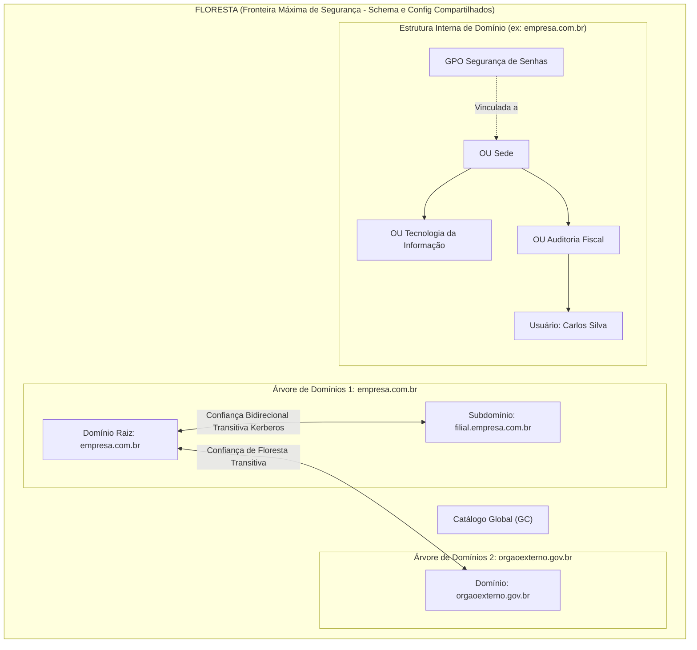
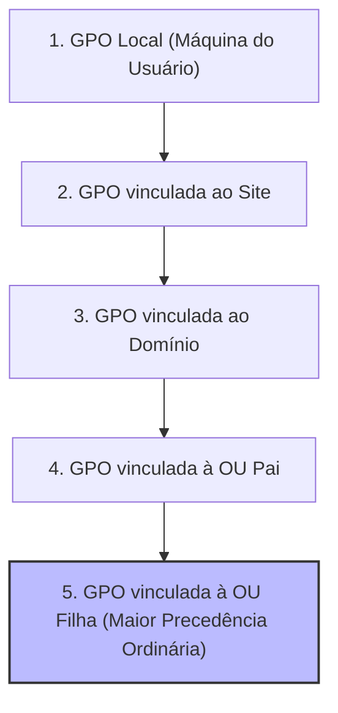

# 02 - Serviços de Diretório: Active Directory e LDAP

> **Matéria:** Sistemas Operacionais, Redes e Computação em Nuvem  
> **Cargo:** B02 – Técnico de Controle Externo – Especialidade: Tecnologia da Informação  
> **Arquivo:** `02_servicos_de_diretorio_active_directory_e_ldap.md`  

---

## 📌 Ementa / Itens do Edital
- Conceitos e fundamentos de Serviços de Diretório
- Protocolo LDAP (Lightweight Directory Access Protocol)
- Arquitetura do Microsoft Active Directory Domain Services (AD DS)
- Estrutura lógica e física do Active Directory
- Objetos, Contas de Usuário, Grupos e Unidades Organizacionais (OUs)
- Políticas de Grupo (GPO - Group Policy Objects)
- Autenticação Kerberos e funções FSMO

---

## 🌳 Classificação Hierárquica

```text
2. Serviços de Diretório Corporativo, LDAP e Microsoft Active Directory
├── 2.1 Fundamentos de Serviços de Diretório e Protocolo LDAP
│   ├── 2.1.1 O que é um Serviço de Diretório: Banco de dados hierárquico e especializado, otimizado para altíssima frequência de LEITURAS e buscas rápidas, em detrimento de escritas
│   ├── 2.1.2 Padrão X.500 vs. Protocolo LDAP (RFC 4510 / RFC 4511):
│   │   ├── LDAP como versão simplificada e leve do X.500 sobre a pilha TCP/IP
│   │   ├── Portas padrão de rede: Porta 389 (LDAP / StartTLS) e Porta 636 (LDAPS sobre SSL/TLS)
│   │   └── Portas do Catálogo Global: Porta 3268 (GC LDAP) e Porta 3269 (GC LDAPS)
│   ├── 2.1.3 Estrutura da Árvore de Diretórios (DIT - Directory Information Tree):
│   │   ├── Entradas (Entries) compostas por atributos e classes de objetos (objectClass)
│   │   ├── Esquema do Diretório (Schema): Definições de atributos obrigatórios (MUST) e opcionais (MAY)
│   │   └── Formato de Nomenclatura X.500 / LDAP:
│   │       ├── DN (Distinguished Name): Caminho completo e único de um objeto (ex.: `CN=Carlos Silva,OU=TI,DC=tce,DC=go,DC=gov,DC=br`)
│   │       ├── RDN (Relative Distinguished Name): O identificador relativo no nível atual (`CN=Carlos Silva`)
│   │       └── Atributos Comuns: `CN` (Common Name), `OU` (Organizational Unit), `DC` (Domain Component), `O` (Organization), `C` (Country)
│   └── 2.1.4 Operações LDAP Fundamentais: Bind (autenticação), Search (escopos Base, One-Level, Subtree), Add, Modify, Delete, Unbind
├── 2.2 Estrutura Lógica do Microsoft Active Directory (AD DS)
│   ├── 2.2.1 Objetos e Contêineres Básicos:
│   │   ├── Contas de Usuários e Contas de Computador
│   │   ├── Unidades Organizacionais (OUs): A menor unidade administrativa na qual se pode vincular e aplicar uma GPO ou delegar controle administrativo
│   │   └── Grupos do Active Directory:
│   │       ├── Tipos: Grupos de Segurança (atribuição de permissões ACL) vs. Grupos de Distribuição (listas de e-mail)
│   │       ├── Escopos de Grupo: Locais de Domínio (Domain Local), Globais (Global) e Universais (Universal)
│   │       └── Estratégia AGDLP / AGUDLP (Accounts -> Global -> Domain Local -> Permissions)
│   ├── 2.2.2 Domínio (Domain): A unidade lógica central de segurança, fronteira administrativa e replicação
│   ├── 2.2.3 Árvore de Domínios (Tree): Conjunto de domínios que compartilham um namespace DNS contíguo e relação de confiança bidirecional transitiva
│   ├── 2.2.4 Floresta (Forest): A fronteira máxima de segurança do AD; coleção de árvores que compartilham o mesmo Esquema (Schema), Configuração e Catálogo Global (Global Catalog)
│   └── 2.2.5 Relações de Confiança (Trusts): Unidirecionais, bidirecionais, transitivas e não-transitivas entre domínios e florestas
├── 2.3 Estrutura Física e Serviços de Infraestrutura do AD DS
│   ├── 2.3.1 Controladores de Domínio (DC - Domain Controllers): Servidores que executam o AD DS e armazenam a réplica do banco `ntds.dit` e compartilhamento SYSVOL
│   ├── 2.3.2 Controlador de Domínio Somente Leitura (RODC - Read-Only Domain Controller): Para filiais com baixa segurança física
│   ├── 2.3.3 Sites e Sub-redes (Sites and Subnets): Mapeamento da topologia física de rede para otimizar tráfego de replicação entre filiais e logon no DC local
│   ├── 2.3.4 Catálogo Global (GC - Global Catalog): Armazena réplica parcial somente-leitura de todos os objetos de todos os domínios da floresta
│   └── 2.3.5 Funções Mestres de Operação Única (FSMO - Flexible Single Master Operations):
│       ├── No nível de Floresta: Schema Master e Domain Naming Master
│       └── No nível de Domínio: PDC Emulator, RID Master e Infrastructure Master
└── 2.4 Políticas de Grupo (GPOs) e Autenticação Kerberos
    ├── 2.4.1 Group Policy Objects (GPOs): Configurações centralizadas de segurança e ambiente para usuários e computadores
    ├── 2.4.2 Ordem de Processamento e Precedência de GPOs (Mnemônico LSDOU):
    │   ├── 1. Local (política da máquina local)
    │   ├── 2. Site (política do site físico)
    │   ├── 3. Domínio (Domain - política aplicada ao domínio)
    │   └── 4. Unidade Organizacional (OU - da raiz até a OU folha)
    │   └── Modificadores: Bloqueio de Herança (Block Inheritance) vs. Imposição (Enforced)
    └── 2.4.3 Protocolo Kerberos v5 no Active Directory:
        ├── Componentes: KDC (Key Distribution Center) integrado ao DC, AS (Authentication Server), TGS (Ticket Granting Server)
        ├── Bilhetes: TGT (Ticket Granting Ticket) e Ticket de Serviço (Service Ticket)
        └── Tolerância temporal (Clock Skew) e papel do NTP (Network Time Protocol)
```

---

## 📖 Resumo Teórico & Conceitos Fundamentais

### 2.1 Fundamentos de Serviços de Diretório e Protocolo LDAP

Um **Serviço de Diretório** é uma base de dados especializada, estruturada hierarquicamente em formato de árvore, projetada para gerenciar e localizar recursos de rede (usuários, grupos, computadores, impressoras e servidores).

#### Diferenças Essenciais: Serviço de Diretório vs. Banco de Dados Relacional (RDBMS)

| Característica | Serviço de Diretório (LDAP / AD DS) | Banco de Dados Relacional (RDBMS / SQL) |
| :--- | :--- | :--- |
| **Proporção Leitura / Escrita** | **Altíssima leitura (95%+)** e baixa escrita. Otimizado para buscas quase instantâneas. | Equilibrado entre leituras e escritas frequentes (transações OLTP complexas). |
| **Estrutura de Dados** | Hierárquica em árvore (DIT - *Directory Information Tree*). | Tabelas bidimensionais relacionais normalizadas com chaves primárias e estrangeiras. |
| **Mecanismo de Consulta** | Protocolo LDAP com filtros de busca (ex.: `(&(objectCategory=person)(sAMAccountName=jsilva))`). | Linguagem declarativa SQL com junções relacionais complexas (`JOIN`). |
| **Transacionalidade / ACID** | Suporte transacional limitado; prioriza replicação eventual entre réplicas. | Suporte rigoroso às propriedades ACID (Atomicidade, Consistência, Isolamento, Durabilidade). |
| **Padrão Normativo** | Baseado nas normas ITU-T X.500 e RFCs IETF (RFC 4511). | Padrão ANSI/ISO SQL. |

#### O Protocolo LDAP (Lightweight Directory Access Protocol)
Criado para simplificar o pesado protocolo DAP (*Directory Access Protocol*) do modelo X.500, o LDAP roda diretamente sobre a pilha de transporte TCP/IP:
- **Porta TCP/UDP 389:** LDAP em texto plano ou com elevação para TLS usando o comando `StartTLS`.
- **Porta TCP 636:** LDAPS (LDAP sobre SSL/TLS encapsulado desde o início da conexão).
- **Porta TCP 3268:** Consulta LDAP direcionada ao Catálogo Global (GC) do Active Directory.
- **Porta TCP 3269:** Consulta LDAPS segura direcionada ao Catálogo Global (GC).

#### Formato de Nomenclatura X.500 / LDAP
Cada objeto no diretório possui um caminho exclusivo global denominado **Distinguished Name (DN)**, composto por uma sequência de **Relative Distinguished Names (RDNs)**:
- Exemplo de DN:  
  `CN=Thiago Ramos,OU=Auditores,OU=Fiscalizacao,DC=tce,DC=go,DC=gov,DC=br`
  - `CN` (*Common Name*): Nome do objeto folha (`CN=Thiago Ramos`).
  - `OU` (*Organizational Unit*): Contêineres administrativos hierárquicos (`OU=Auditores`, filha de `OU=Fiscalizacao`).
  - `DC` (*Domain Component*): Fragmentos que compõem o domínio DNS (`DC=tce`, `DC=go`, `DC=gov`, `DC=br`).

---

### 2.2 Arquitetura Lógica do Microsoft Active Directory (AD DS)

A estrutura lógica do Active Directory organiza os objetos corporativos independentemente da disposição física dos cabos e roteadores.



#### Níveis Hierárquicos Lógicos:
1. **Unidade Organizacional (OU):**
   - É o menor contêiner administrativo do Active Directory no qual se pode:
     - **Vincular um Objeto de Política de Grupo (GPO)**;
     - **Delegar autoridade administrativa** (ex.: permitir que o suporte local redefina senhas apenas dos usuários de sua respectiva OU).
   - OUs podem ser aninhadas hierarquicamente (OUs pai e filhas).
2. **Domínio (*Domain*):**
   - Fronteira lógica de gerenciamento administrativo, segurança de contas e replicação de dados.
   - Todos os controladores de domínio de um mesmo domínio compartilham e replicam a totalidade dos objetos daquele domínio.
3. **Árvore de Domínios (*Domain Tree*):**
   - Coleção de um ou mais domínios que compartilham um **namespace DNS contíguo** (ex.: `tce.go.gov.br` e `sistemas.tce.go.gov.br`).
   - Estabelecem automaticamente relações de confiança bidirecionais e transitivas entre domínios pai e filho.
4. **Floresta (*Forest*):**
   - É a **fronteira máxima de segurança** da infraestrutura Active Directory.
   - Coleção de uma ou mais árvores de domínios que não precisam compartilhar o mesmo namespace DNS, mas obrigatoriamente compartilham:
     - Uma única partição de **Esquema (*Schema*)**;
     - Uma única partição de **Configuração (*Configuration*)**;
     - O **Catálogo Global (*Global Catalog*)**.

> 🚨 **ALERTA DE PROVA / PEGADINHA FCC:**  
> A FCC frequentemente tenta afirmar que o *Domínio* é a fronteira máxima de segurança no AD DS. **Errado!** A Microsoft e o modelo de arquitetura definem expressamente a **Floresta** como o limite máximo de segurança (*Security Boundary*), pois um administrador do domínio raiz da floresta (*Enterprise Admins*) possui privilégios de controle sobre todos os outros domínios da floresta. O Domínio é uma fronteira administrativa (*Administrative Boundary*).

#### Tipos e Escopos de Grupos no AD DS
- **Tipos de Grupo:**
  - **Grupos de Segurança (*Security Groups*):** Utilizados para concessão de permissões de acesso em listas de controle de acesso (ACLs) em arquivos, impressoras e recursos, além de poderem ser usados para listas de e-mail.
  - **Grupos de Distribuição (*Distribution Groups*):** Utilizados exclusivamente para envio de correio eletrônico (ex.: Exchange Server). Não possuem identificador de segurança (SID) e **não podem receber permissões** em ACLs de recursos.

#### Escopos de Grupos e Estratégia AGDLP / AGUDLP

| Escopo do Grupo | Membros Permitidos | Pode ser colocado em... | Onde pode receber permissões (ACL)? |
| :--- | :--- | :--- | :--- |
| **Global (G)** | Usuários e computadores **do mesmo domínio**. Outros grupos globais do mesmo domínio. | Grupos Globais e Grupos Locais de Domínio de qualquer domínio. Grupos Universais. | Em **qualquer domínio** da floresta (ou florestas confiáveis). |
| **Local de Domínio (DL)** | Usuários, computadores, Grupos Globais e Universais de **qualquer domínio confiável**. | Apenas em outros Grupos Locais **do mesmo domínio**. | Apenas em recursos **dentro do mesmo domínio**. |
| **Universal (U)** | Contas de usuário, computadores e outros Grupos Globais/Universais de **qualquer domínio da floresta**. | Grupos Locais de Domínio ou Grupos Universais de qualquer domínio. | Em **qualquer domínio** de toda a floresta. |

> ⭐ **IMPORTANTE / REGRA DE OURO - A ESTRATÉGIA AGDLP:**  
> A recomendação oficial de boas práticas da Microsoft para concessão de permissões em florestas multi-domínio segue a regra **AGDLP**:
> - **A**ccounts (Contas de usuários) são adicionadas a...
> - **G**lobal groups (Grupos Globais, que agrupam funções corporativas, ex.: `GG_Auditores`), que entram em...
> - **D**omain **L**ocal groups (Grupos Locais de Domínio, que representam a permissão do recurso, ex.: `DL_PastaAuditoria_Leitura`), onde se aplicam as...
> - **P**ermissions (Permissões de leitura/escrita nas ACLs das pastas).  
> Em florestas gigantescas com múltiplos domínios, utiliza-se **AGUDLP**, inserindo Grupos Universais (**U**) no meio.

---

### 2.3 Estrutura Física e Funções FSMO

A estrutura física do AD DS reflete o cabeamento, latência e localização geográfica dos data centers e filiais:
1. **Controladores de Domínio (DC):** Servidores Windows que mantêm o banco de dados `ntds.dit` e efetuam autenticação de usuários.
2. **Sites e Sub-redes:** Um *Site* representa um agrupamento físico de uma ou mais sub-redes IP interligadas por conexões confiáveis e de alta velocidade (LAN). Serve para:
   - Direcionar as estações de trabalho para logarem no DC do seu próprio prédio/cidade (menor latência);
   - Otimizar e comprimir o tráfego de replicação entre filiais geograficamente dispersas (*Inter-site replication*).
3. **Catálogo Global (GC):** Servidor DC que armazena réplica parcial de leitura de todos os objetos de todos os domínios da floresta, permitindo que usuários façam buscas globais e logon por nome principal de usuário (UPN: `usuario@orgao.gov.br`).

#### As 5 Funções FSMO (*Flexible Single Master Operations*)
Embora o Active Directory opere predominantemente em replicação multimesmo (*multi-master*), certas operações críticas exigem autoridade centralizada única para evitar conflitos concorrentes:

| Escopo FSMO | Função FSMO | Responsabilidade Crítica | Impacto de Falha / Indisponibilidade |
| :--- | :--- | :--- | :--- |
| **Nível de Floresta** (Apenas 1 por Floresta) | **Schema Master** (Mestre de Esquema) | Responsável por todas as alterações e extensões na estrutura do Esquema do AD (criação de novas classes e atributos). | Não impede logons nem rotinas diárias; impede apenas a instalação de softwares que alteram o schema (ex.: Exchange, SCCM). |
| **Nível de Floresta** (Apenas 1 por Floresta) | **Domain Naming Master** (Mestre de Nomenclatura de Domínio) | Controla a adição, remoção e renomeação de domínios ou partições na floresta. | Impede unicamente criar novos domínios ou excluir domínios existentes. |
| **Nível de Domínio** (1 por Domínio) | **PDC Emulator** (Emulador de PDC) | **A mais ativa e crítica das funções:** atua como servidor de sincronização de horário primário (NTP da floresta), processa alterações e falhas de senha prioritariamente, gerencia bloqueio de contas e alterações em GPOs. | Falhas provocam atraso na propagação de alterações de senha, erros de logon de senhas recém-trocadas e desvio de horário Kerberos. |
| **Nível de Domínio** (1 por Domínio) | **RID Master** (Mestre de RID) | Aloca blocos/pools de RIDs (*Relative Identifiers*) para os outros DCs do domínio. Cada objeto criado recebe um SID composto pelo SID do domínio + RID único. | Se o pool de RIDs de um DC esgotar enquanto o RID Master estiver offline, aquele DC não conseguirá criar novas contas ou objetos. |
| **Nível de Domínio** (1 por Domínio) | **Infrastructure Master** (Mestre de Infraestrutura) | Mantém atualizadas as referências cruzadas entre objetos do seu domínio e objetos de outros domínios da floresta (fantasmas). | Em domínio único não tem impacto. Em multi-domínio sem GC conjunto, nomes de usuários externos podem não se resolver corretamente nas ACLs. |

---

### 2.4 Políticas de Grupo (GPO) e Autenticação Kerberos v5

#### Precedência de Processamento de GPO: Ordem LSDOU
As diretivas de grupo são processadas em sequência pelo cliente Windows. Se houver configurações em conflito direto, **a última diretiva aplicada sobrescreve as anteriores**:

$$\text{1. Local} \longrightarrow \text{2. Site} \longrightarrow \text{3. Domain} \longrightarrow \text{4. Organizational Unit (OU)}$$

- Se houver OUs aninhadas, as diretivas são processadas da **OU raiz** em direção às **OUs filhas / folhas**. Consequentemente, a OU mais próxima do computador ou usuário tem maior precedência!



#### Modificadores Especiais de GPO:
1. **Bloquear Herança (*Block Inheritance*):** Configurado em uma OU específica. Faz com que essa OU recuse e ignore as diretivas que seriam herdadas dos níveis superiores (Site, Domínio e OUs pai).
2. **Imposição / Não Substituir (*Enforced*):** Configurado na GPO vinculada a um nível superior (ex.: vinculada ao Domínio). **Sobrepõe qualquer Bloqueio de Herança!** A GPO marcada como *Enforced* tem precedência absoluta sobre todas as outras e não pode ser bloqueada pelas OUs filhas.

#### Protocolo de Autenticação Kerberos v5
O Kerberos v5 (RFC 4120) é o mecanismo padrão de autenticação do Active Directory, proporcionando autenticação mútua e *Single Sign-On* (SSO) sem transmissão de senhas em texto claro na rede.

```mermaid
sequenceDiagram
    autonumber
    participant C as "Cliente (Estação de Trabalho)"
    participant AS as "Authentication Server (AS / KDC no DC)"
    participant TGS as "Ticket Granting Server (TGS / KDC)"
    participant S as "Servidor de Arquivos / Aplicação"

    C->>AS: 1. KRB_AS_REQ (Solicitação com carimbo de tempo cifrado pela senha do usuário)
    AS-->>C: 2. KRB_AS_REP (Retorna TGT cifrado pela chave do KDC + Sessão KDC)
    Note over C: Usuário agora possui um TGT (Ticket Granting Ticket)
    C->>TGS: 3. KRB_TGS_REQ (Apresenta TGT solicitando acesso ao serviço CIFS/HTTP)
    TGS-->>C: 4. KRB_TGS_REP (Retorna Ticket de Serviço cifrado com a chave do servidor)
    C->>S: 5. KRB_AP_REQ (Apresenta o Ticket de Serviço diretamente ao servidor de recursos)
    S-->>C: 6. KRB_AP_REP (Autenticação mútua confirmada; acesso liberado)
```

> 🚨 **ALERTA DE PROVA / PEGADINHA FCC:**  
> O Kerberos depende criticamente do **carimbo de tempo (*timestamp*)** das mensagens para prevenir ataques de repetição (*replay attacks*). Por padrão no Active Directory, o limite máximo de dessincronização de relógio tolerado entre o cliente e o KDC (*Clock Skew*) é de **5 minutos**. Se os relógios divergirem em mais de 5 minutos, a autenticação Kerberos falhará com erro de autenticação! Por isso, o mestre FSMO **PDC Emulator** atua compulsoriamente como servidor NTP da floresta.

---

## 🌐 Fontes Recomendadas na Internet

- [Microsoft Learn - Visão Geral do Active Directory Domain Services (AD DS)](https://learn.microsoft.com/pt-br/windows-server/identity/ad-ds/active-directory-domain-services)
  - Documentação arquitetural oficial cobrindo florestas, domínios, OUs, catálogo global e replicação multimesmo.
- [IETF RFC 4511 - Lightweight Directory Access Protocol (LDAPv3)](https://datatracker.ietf.org/doc/html/rfc4511)
  - Especificação padrão do IETF que formaliza a sintaxe de buscas, filtros booleanos e operações de protocolo LDAP.
- [Microsoft Learn - Ordem de Processamento e Precedência de Políticas de Grupo (GPO)](https://learn.microsoft.com/pt-br/previous-versions/windows/it-pro/windows-server-2012-r2-and-2012/dn789197(v=ws.11))
  - Guia técnico descrevendo a regra LSDOU, resolução de conflitos, herança de diretivas e comportamentos de *Enforced* e *Block Inheritance*.
- [Microsoft Learn - Funções Mestres de Operação Única (FSMO) no AD](https://learn.microsoft.com/pt-br/troubleshoot/windows-server/active-directory/fsmo-roles)
  - Documentação canônica que detalha as cinco funções FSMO, suas regras de transferência e impactos de indisponibilidade.
- [IETF RFC 4120 - The Kerberos Network Authentication Service (V5)](https://datatracker.ietf.org/doc/html/rfc4120)
  - Padrão oficial do protocolo Kerberos v5, detalhando as mensagens de troca de bilhetes (AS, TGS, TGT) e criptografia simétrica.

---

## 📝 Questões Comentadas & Exemplos (Padrão FCC)

### Questão 1 (FCC - Adaptada / Analista de TI - Infraestrutura e Redes)
Considere uma floresta corporativa do Microsoft Active Directory Domain Services (AD DS) composta por um único domínio denominado `tce.go.gov.br`. Um computador do setor de compras está localizado na Unidade Organizacional (OU) `Licitacoes`, que por sua vez é uma subunidade contida no interior da OU `Administrativo`. 

Existem quatro Políticas de Grupo (GPOs) com configurações conflitantes vinculadas aos seguintes níveis:
1. GPO "Diretiva-Local" configurada nas políticas da máquina local;
2. GPO "Diretiva-Site" vinculada ao Site físico do Active Directory;
3. GPO "Diretiva-Dominio" vinculada à raiz do Domínio `tce.go.gov.br`;
4. GPO "Diretiva-Admin" vinculada à OU pai `Administrativo`;
5. GPO "Diretiva-Licitacoes" vinculada à OU folha `Licitacoes`.

Sabendo que a OU `Licitacoes` possui a opção de "Bloquear Herança" (*Block Inheritance*) explicitamente habilitada, mas a GPO "Diretiva-Dominio" foi configurada pelo Administrador Corporativo com a opção de "Imposição" (*Enforced* / Não Substituir), assinale a alternativa que indica a política que terá a maior precedência final para definir o parâmetro conflitante na referida estação de trabalho:

A) GPO "Diretiva-Local", em razão de as configurações físicas na estação de trabalho sempre prevalecerem sobre diretivas de rede.  
B) GPO "Diretiva-Site", pois diretivas de site físico são imunes a bloqueios de herança configurados em OUs.  
C) GPO "Diretiva-Admin", que é herdada compulsoriamente por ser a Unidade Organizacional hierarquicamente superior direta.  
D) GPO "Diretiva-Licitacoes", pois o bloqueio de herança impede a aplicação de qualquer diretiva originada fora da referida OU.  
E) GPO "Diretiva-Dominio", pois a opção de Imposição (*Enforced*) ignora e sobrepõe qualquer bloqueio de herança definido nas Unidades Organizacionais descendentes.  

> **Gabarito: E**  
> **Comentário Analítico Passo a Passo:**  
> - **Regra Geral LSDOU:** Na ordem padrão, as GPOs são processadas em: Local $\rightarrow$ Site $\rightarrow$ Domínio $\rightarrow$ OU Pai (`Administrativo`) $\rightarrow$ OU Filha (`Licitacoes`). Em condições normais, a última política aplicada (a da OU folha `Licitacoes`) prevaleceria.
> - **Efeito do Bloqueio de Herança (*Block Inheritance*):** Quando habilitado na OU `Licitacoes`, ele impediria que as políticas herdadas de Site, Domínio e da OU Pai fossem aplicadas à estação.
> - **A Regra Suprema do *Enforced* (Imposição):** A opção *Enforced* (antigamente chamada de "Não Substituir") foi projetada pela Microsoft exatamente para garantir que políticas de conformidade global e segurança corporativa do Domínio não possam ser burladas por administradores locais de OUs. Uma GPO configurada como *Enforced* tem sua aplicação garantida compulsoriamente e **vence qualquer bloqueio de herança**, passando a ter a maior precedência de todas.
> - **Análise Detalhada das Alternativas:**
>   - **A (Incorreta):** A diretiva Local é a primeira a ser processada na cadeia e possui a menor precedência em relação às diretivas de domínio.
>   - **B (Incorreta):** As diretivas de Site são ordinariamente bloqueadas pela opção de Bloqueio de Herança caso não estejam marcadas como Enforced.
>   - **C (Incorreta):** A GPO da OU `Administrativo` foi devidamente bloqueada pelo *Block Inheritance* da OU filha e não possui a flag *Enforced*.
>   - **D (Incorreta):** O Bloqueio de Herança bloqueia diretivas comuns, mas é expressamente sobreposto pela configuração de Imposição (*Enforced*) da Diretiva de Domínio.
>   - **E (Correta):** Sintetiza com absoluta exatidão o funcionamento hierárquico do Active Directory.

---

### Questão 2 (FCC - Adaptada / Tribunal de Contas - Especialidade Tecnologia da Informação)
No contexto de serviços de diretório baseados nas normas X.500 e no protocolo LDAP (RFC 4511), a localização precisa de um objeto no interior da Árvore de Informações de Diretório (DIT) é expressa por meio de seu Nome Distinto (*Distinguished Name* - DN).

Considere que um analista precisa cadastrar a conta de usuário do servidor "Julio Cesar", lotado no setor de "AuditoriaTributaria", pertencente à subunidade de "Fiscalizacao", dentro do domínio governamental `sefaz.go.gov.br`. 

De acordo com o padrão LDAP, assinale a alternativa que apresenta a sintaxe canônica e estruturalmente válida para o *Distinguished Name* (DN) desse objeto:

A) `CN=Julio Cesar,OU=AuditoriaTributaria,OU=Fiscalizacao,DC=sefaz,DC=go,DC=gov,DC=br`  
B) `DN=Julio Cesar/OU=Fiscalizacao/OU=AuditoriaTributaria/DC=sefaz.go.gov.br`  
C) `USER=Julio Cesar,DEPT=AuditoriaTributaria,SECTOR=Fiscalizacao,DOMAIN=sefaz.go.gov.br`  
D) `DC=br,DC=gov,DC=go,DC=sefaz,OU=Fiscalizacao,OU=AuditoriaTributaria,CN=Julio Cesar`  
E) `CN=Julio Cesar.OU=AuditoriaTributaria.OU=Fiscalizacao.DC=sefaz.go.gov.br`  

> **Gabarito: A**  
> **Comentário Analítico Passo a Passo:**  
> - **Estrutura Canônica de um DN:** O Distinguished Name no padrão LDAP/X.500 é composto por uma sequência ordenada de atributos RDN (*Relative Distinguished Names*) separados por **vírgulas**, iniciando obrigatoriamente pelo nó folha mais específico (o objeto usuário) e navegando recursivamente até os componentes de domínio raiz:
>   - `CN=Julio Cesar`: Identificador relativo do objeto final (*Common Name*);
>   - `OU=AuditoriaTributaria`: Primeira Unidade Organizacional contêiner imediata;
>   - `OU=Fiscalizacao`: Unidade Organizacional de nível superior;
>   - `DC=sefaz,DC=go,DC=gov,DC=br`: Componentes de domínio (*Domain Component*) individualizados para cada rótulo DNS.
> - **Análise Detalhada das Alternativas:**
>   - **A (Correta):** Representa com perfeição a ordem folha $\rightarrow$ raiz e a sintaxe padrão RFC 4511 com separação por vírgulas e tags `CN`, `OU`, `DC`.
>   - **B (Incorreta):** Utiliza delimitador de barras (`/`), inverteria a hierarquia e agrupa o domínio com pontos em desacordo com as regras de atributos individuais `DC`.
>   - **C (Incorreta):** Inventa atributos arbitrários (`USER`, `DEPT`, `SECTOR`, `DOMAIN`) que não existem na definição padronizada do Esquema LDAP.
>   - **D (Incorreta):** Apresenta a ordem inversa (da raiz para a folha), quando a especificação canônica do DN exige que o nó folha seja o primeiro componente da esquerda.
>   - **E (Incorreta):** Utiliza pontos (`.`) como delimitador entre os RDNs em vez de vírgulas (`.`), gerando erro de sintaxe nos parsers LDAP.

---

### Questão 3 (FCC - Adaptada / Analista de Sistemas - Suporte a Servidores)
Em uma floresta multi-domínio do Microsoft Active Directory Domain Services (AD DS), a arquitetura do sistema delega certas operações a servidores específicos por meio das funções Mestres de Operação Única Flexível (*Flexible Single Master Operations* - FSMO). 

Sobre as atribuições e o escopo dessas funções, é correto afirmar:

A) A função de *Schema Master* possui escopo restrito a cada domínio individual da floresta, permitindo que cada domínio configure seus próprios atributos de usuário de maneira independente e isolada.  
B) A função de *PDC Emulator* (Emulador de Controlador de Domínio Primário) atua no nível de domínio e é a principal responsável por atuar como autoridade de referência de sincronização de horário (servidor NTP), além de processar com prioridade as alterações e bloqueios de senhas de usuários.  
C) A função de *RID Master* opera no nível de floresta e atua exclusivamente na validação de nomes de novos domínios que solicitam ingresso na estrutura hierárquica do AD.  
D) As cinco funções FSMO operam compulsoriamente no mesmo e único Controlador de Domínio raiz, sendo tecnicamente impossível transferi-las individualmente entre diferentes servidores da rede.  
E) A função de *Domain Naming Master* tem escopo de domínio e é responsável por atribuir identificadores relativos (RIDs) a cada novo objeto criado pelos controladores de domínio locais.  

> **Gabarito: B**  
> **Comentário Analítico Passo a Passo:**  
> - **Divisão de Escopos das Funções FSMO:**
>   - **Nível de Floresta (Apenas 1 titular em toda a floresta):**
>     1. *Schema Master*: Controla as modificações no esquema unificado de toda a floresta.
>     2. *Domain Naming Master*: Gerencia a criação e exclusão de domínios na floresta.
>   - **Nível de Domínio (1 titular por domínio existente):**
>     3. *PDC Emulator*: Sincronização horária (NTP), reconciliação preferencial de senhas e compatibilidade.
>     4. *RID Master*: Alocação de blocos de identificadores relativos para criação de objetos.
>     5. *Infrastructure Master*: Atualização de referências a objetos externos (fantasmas).
> - **Análise Detalhada das Alternativas:**
>   - **A (Incorreta):** O *Schema Master* opera em **nível de floresta**. Toda a floresta do AD DS compartilha compulsoriamente um único Esquema.
>   - **B (Correta):** O *PDC Emulator* é a função FSMO de maior atividade transacional no domínio: serve de referência mestra de tempo NTP (essencial para o Kerberos) e recebe as tentativas de validação de credenciais quando outros DCs falham com erro de senha incorreta.
>   - **C (Incorreta):** O *RID Master* opera no **nível de domínio** e gerencia identificadores relativos para compor os SIDs dos objetos. A validação de novos domínios é papel do *Domain Naming Master*.
>   - **D (Incorreta):** As funções FSMO são flexíveis (*Flexible*) exatamente porque podem ser distribuídas e transferidas (*transfer*) ou assumidas forçadamente (*seize*) entre diferentes Controladores de Domínio.
>   - **E (Incorreta):** O *Domain Naming Master* opera no nível de floresta (não de domínio) e cuida da nomenclatura da floresta, e não de RIDs de objetos.

---

### Questão 4 (FCC - Adaptada / Analista de Tecnologia da Informação - Segurança da Informação)
No protocolo de autenticação Kerberos v5, implementado nativamente pelo Active Directory Domain Services para prover autenticação mútua e *Single Sign-On* (SSO) no ambiente de rede corporativo:

A) As senhas dos usuários são transmitidas em texto claro durante a etapa inicial de negociação com o Authentication Server (AS), dependendo de túneis VPN para garantir a confidencialidade do tráfego.  
B) O serviço Ticket Granting Server (TGS) emite o bilhete inicial de concessão de bilhetes (*Ticket Granting Ticket* - TGT) imediatamente antes de validar as credenciais biométricas do usuário na máquina cliente.  
C) A tolerância temporal de dessincronização de relógio (*clock skew*) entre os clientes e o KDC é irrelevante para a segurança do protocolo, pois o Kerberos utiliza exclusivamente desafios e respostas baseados em números aleatórios (*nonces*).  
D) O cliente obtém inicialmente um TGT junto ao serviço de autenticação (AS) e posteriormente apresenta esse TGT ao servidor de concessão de bilhetes (TGS) para solicitar bilhetes de serviço específicos para acessar recursos de rede.  
E) O protocolo prescinde do uso de criptografia simétrica, utilizando certificados digitais de chave pública assimetricamente em todas as interações de solicitação de arquivos.  

> **Gabarito: D**  
> **Comentário Analítico Passo a Passo:**  
> - **Fluxo da Arquitetura Kerberos v5:**
>   1. O cliente inicia a comunicação enviando uma requisição `KRB_AS_REQ` para o KDC (serviço AS) contendo seu nome de usuário e um timestamp cifrado com o hash de sua própria senha.
>   2. O AS valida o timestamp e retorna uma resposta `KRB_AS_REP` contendo uma chave de sessão e o **Ticket Granting Ticket (TGT)**, que é cifrado com a chave secreta exclusiva do KDC (o hash da conta `krbtgt`).
>   3. Quando o usuário precisa acessar uma pasta compartilhada ou banco de dados, ele envia uma solicitação `KRB_TGS_REQ` ao serviço TGS apresentando o TGT.
>   4. O TGS descriptografa o TGT e emite um **Ticket de Serviço (*Service Ticket*)**, que o cliente entrega diretamente ao servidor final na mensagem `KRB_AP_REQ`.
> - **Análise Detalhada das Alternativas:**
>   - **A (Incorreta):** A senha do usuário **nunca** trafega pela rede, nem em texto claro nem cifrada.
>   - **B (Incorreta):** Quem emite o TGT inicial é o **Authentication Server (AS)**, e não o TGS.
>   - **C (Incorreta):** A precisão do relógio é crucial no Kerberos para evitar ataques de repetição (*replay attack*). Se a diferença de horário (*clock skew*) for superior à tolerância padrão (5 minutos), o Kerberos recusa a autenticação.
>   - **D (Correta):** Resume perfeitamente o ciclo de obtenção e apresentação do TGT ao TGS para emissão de tickets de serviço específicos.
>   - **E (Incorreta):** O Kerberos baseia-se fundamentalmente em **criptografia de chaves simétricas** e segredos compartilhados, utilizando chaves derivadas das senhas das contas e da conta do serviço.

---

### Questão 5 (FCC - Adaptada / Analista de Redes e Sistemas)
Em uma organização pública que utiliza o Active Directory, um administrador necessita conceder permissões de leitura e modificação a uma pasta compartilhada no servidor de arquivos para os colaboradores do departamento financeiro. A organização segue rigorosamente a metodologia recomendada de desenho de segurança de identidades baseada na estratégia AGDLP.

Para cumprir esse padrão, a sequência correta de estruturação de contas, escopos de grupo e permissões de acesso é:

A) As contas de usuários (**A**) são adicionadas diretamente à lista de controle de acesso (ACL) da pasta compartilhada, dispensando o uso de grupos intermediários.  
B) As contas de usuários (**A**) são inseridas em Grupos Locais de Domínio (**DL**), os quais são atribuídos a Grupos Globais (**G**), que por sua vez recebem as Permissões (**P**) na pasta.  
C) As contas de usuários (**A**) são inseridas em Grupos Globais (**G**), estes Grupos Globais são adicionados a Grupos Locais de Domínio (**DL**), e as Permissões (**P**) na pasta são atribuídas aos Grupos Locais de Domínio.  
D) As contas de usuários (**A**) são inseridas em Grupos de Distribuição, que são convertidos em Grupos de Segurança para receberem Permissões (**P**) no nível de Site.  
E) As contas de usuários (**A**) são associadas diretamente a uma Unidade Organizacional (**OU**), onde as permissões NTFS (**P**) de pastas são vinculadas via GPO.  

> **Gabarito: C**  
> **Comentário Analítico Passo a Passo:**  
> - **Significado do Mnemônico AGDLP:**
>   - **A** (*Accounts*): Contas de usuários individuais;
>   - **G** (*Global groups*): Grupos Globais organizados por função corporativa (ex.: `GG_Financeiro`);
>   - **DL** (*Domain Local groups*): Grupos Locais de Domínio que representam direitos sobre recursos do domínio (ex.: `DL_PastaFinancas_Modificar`);
>   - **P** (*Permissions*): Permissões de controle de acesso (ACLs) aplicadas ao recurso.
> - **Mecânica Operacional:** As contas de usuário do setor financeiro entram no Grupo Global `GG_Financeiro`. Esse grupo global é aninhado dentro do Grupo Local de Domínio `DL_PastaFinancas_Modificar`. É a este último grupo que o administrador concede a permissão NTFS na pasta do servidor de arquivos.
> - **Análise Detalhada das Alternativas:**
>   - **A (Incorreta):** Atribuir permissões diretamente a contas de usuários na ACL é expressamente desaconselhado pelas boas práticas, tornando a auditoria ingovernável.
>   - **B (Incorreta):** Inverte a ordem do aninhamento: no AGDLP, os Grupos Globais entram nos Grupos Locais de Domínio, e não o inverso.
>   - **C (Correta):** Descreve com fidelidade a sequência canônica da estratégia AGDLP.
>   - **D (Incorreta):** Grupos de Distribuição não possuem SID e não são utilizados para atribuir permissões em sistemas de arquivos corporativos.
>   - **E (Incorreta):** Unidades Organizacionais (OUs) são contêineres do AD para vinculação de GPOs e delegação administrativa; elas não são entidades de segurança (*security principals*) e não podem constar nas ACLs NTFS de pastas.
