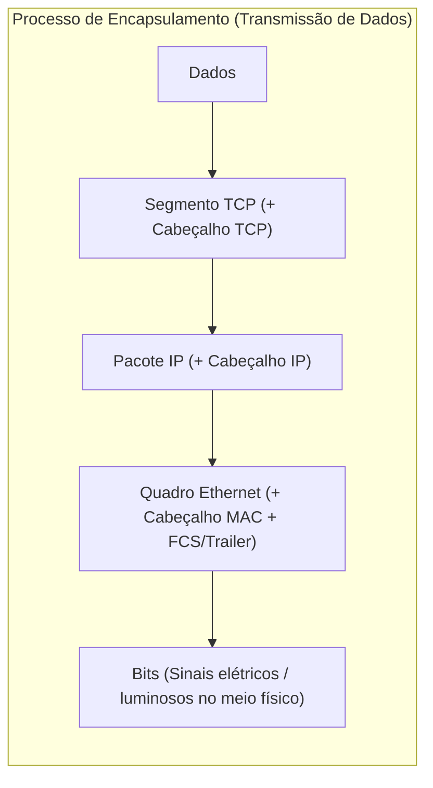
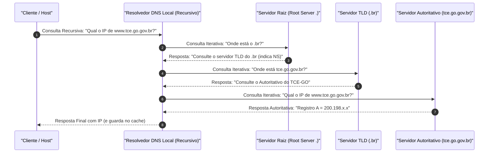
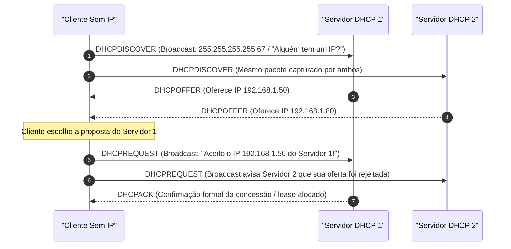

# 03 - Redes TCP/IP, Endereçamento IPv4/IPv6, DNS e DHCP

> **Matéria:** Sistemas Operacionais, Redes e Computação em Nuvem  
> **Cargo:** B02 – Técnico de Controle Externo – Especialidade: Tecnologia da Informação  
> **Arquivo:** `03_redes_tcp_ip_enderecamento_ipv4_ipv6_dns_dhcp.md`  

---

## 📌 Ementa / Itens do Edital
- Arquitetura de redes TCP/IP e comparação com o Modelo OSI
- Endereçamento IPv4: Classes, máscaras de rede, notação CIDR, sub-redes e RFC 1918 (IPs privados)
- Endereçamento IPv6: Estrutura, tipos de endereçamento e mecanismos de transição
- Protocolo de Resolução de Nomes: DNS (Domain Name System)
- Protocolo de Configuração Dinâmica de Hosts: DHCP (Dynamic Host Configuration Protocol)

---

## 🧭 Sumário
- [1. Modelos de Referência: OSI vs. TCP/IP](#1-modelos-de-referencia-osi-vs-tcpip)
    - [1.1 Estrutura em Camadas do Modelo OSI (7 Níveis)](#11-estrutura-em-camadas-do-modelo-osi-7-niveis)
    - [1.2 Arquitetura em Camadas da Pilha TCP/IP (4 Níveis)](#12-arquitetura-em-camadas-da-pilha-tcpip-4-niveis)
    - [1.3 Unidades de Dados de Protocolo (PDU) e Encapsulamento](#13-unidades-de-dados-de-protocolo-pdu-e-encapsulamento)
- [2. Endereçamento e Sub-redes IPv4](#2-enderecamento-e-sub-redes-ipv4)
    - [2.1 Classes Históricas de Endereços (Classes A a E)](#21-classes-historicas-de-enderecos-classes-a-a-e)
    - [2.2 Espaço de Endereçamento Privado (RFC 1918) e NAT/PAT](#22-espaco-de-enderecamento-privado-rfc-1918-e-natpat)
    - [2.3 Roteamento Interdomínio Sem Classe (CIDR) e VLSM](#23-roteamento-interdominio-sem-classe-cidr-e-vlsm)
    - [2.4 Mecânica de Cálculo de Sub-redes, Hosts Úteis e Tabela de Conversão](#24-mecanica-de-calculo-de-sub-redes-hosts-uteis-e-tabela-de-conversao)
- [3. Endereçamento IPv6](#3-enderecamento-ipv6)
    - [3.1 Estrutura de 128 Bits e Regras de Compactação Oficial (RFC 5952)](#31-estrutura-de-128-bits-e-regras-de-compactacao-oficial-rfc-5952)
    - [3.2 Tipos de Transmissão no IPv6: Unicast, Anycast e Multicast (Extinção do Broadcast)](#32-tipos-de-transmissao-no-ipv6-unicast-anycast-e-multicast-extincao-do-broadcast)
    - [3.3 Faixas Notáveis de Endereços IPv6 (Loopback, Link-Local, ULA, GUA)](#33-faixas-notaveis-de-enderecos-ipv6-loopback-link-local-ula-gua)
    - [3.4 Autoconfiguração (SLAAC) e Mecanismos de Transição (Dual-Stack, Túneis, NAT64)](#34-autoconfiguracao-slaac-e-mecanismos-de-transicao-dual-stack-tuneis-nat64)
- [4. Protocolo DNS (Domain Name System)](#4-protocolo-dns-domain-name-system)
    - [4.1 Finalidade, Arquitetura Hierárquica e Portas UDP/TCP 53](#41-finalidade-arquitetura-hierarquica-e-portas-udptcp-53)
    - [4.2 Consultas Recursivas vs. Consultas Iterativas](#42-consultas-recursivas-vs-consultas-iterativas)
    - [4.3 Registros de Recursos (A, AAAA, CNAME, MX, NS, PTR, SOA, TXT)](#43-registros-de-recursos-a-aaaa-cname-mx-ns-ptr-soa-txt)
- [5. Protocolo DHCP (Dynamic Host Configuration Protocol)](#5-protocolo-dhcp-dynamic-host-configuration-protocol)
    - [5.1 Finalidade e Portas de Transporte UDP 67/68](#51-finalidade-e-portas-de-transporte-udp-6768)
    - [5.2 O Ciclo DORA em 4 Etapas (Discover, Offer, Request, Acknowledge)](#52-o-ciclo-dora-em-4-etapas-discover-offer-request-acknowledge)
    - [5.3 Timers de Renovação de Concessão (T1 e T2)](#53-timers-de-renovacao-de-concessao-t1-e-t2)
    - [5.4 Agente de Retransmissão DHCP (DHCP Relay Agent)](#54-agente-de-retransmissao-dhcp-dhcp-relay-agent)
- [6. Fontes Recomendadas na Internet](#6-fontes-recomendadas-na-internet)

---

## 1. Modelos de Referência: OSI vs. TCP/IP

### 1.1 Estrutura em Camadas do Modelo OSI (7 Níveis)

O modelo **OSI (*Open Systems Interconnection*)**, padronizado pela ISO (norma ISO/IEC 7498-1), é a estrutura conceitual de referência para comunicação entre redes de computadores, decompondo as funções de rede em sete camadas lógicas:

1. **Física (Camada 1):** Transmissão de bits brutos não estruturados através de meios físicos guiados (cabos de par trançado de cobre, fibras ópticas) ou não guiados (ondas de rádio). Define propriedades elétricas, ópticas e mecânicas (voltagens, conectores RJ-45).
2. **Enlace de Dados (Camada 2):** Agrupa os bits em unidades estruturadas chamadas **Quadros (*Frames*)**. Responsável pelo endereçamento físico local (**Endereço MAC**), controle de acesso ao meio físico (subcamada MAC), sincronismo de quadro e detecção básica de erros na transmissão via checksum (CRC/FCS). Opera com switches de camada 2.
3. **Rede (Camada 3):** Responsável pelo **endereçamento lógico global (endereços IP)**, roteamento de pacotes através de múltiplos enlaces intermediários e fragmentação quando a MTU do meio é ultrapassada. Opera com roteadores e switches de camada 3.
4. **Transporte (Camada 4):** Provê comunicação ponta a ponta (*host-to-host*) confiável ou não confiável entre processos de aplicação, utilizando multiplexação de portas (TCP e UDP), controle de fluxo e sequenciamento de pacotes.
5. **Sessão (Camada 5):** Estabelece, gerencia, sincroniza e encerra sessões de diálogo entre aplicações em nós distintos (ex.: checkpoints para recuperação de falhas).
6. **Apresentação (Camada 6):** Cuida da sintaxe, representação e semântica dos dados transmitidos: conversão de conjuntos de caracteres (ASCII/Unicode/EBCDIC), compressão de dados (gzip) e criptografia/descriptografia (TLS/SSL).
7. **Aplicação (Camada 7):** Interface direta entre os programas finais do usuário e os serviços de rede (HTTP, DNS, SMTP, FTP, SSH).

---

### 1.2 Arquitetura em Camadas da Pilha TCP/IP (4 Níveis)

Em contraposição ao modelo teórico OSI, a arquitetura prática dominante da Internet é a **Pilha TCP/IP** (formalizada em RFCs como RFC 1122), estruturada em 4 camadas funcionais:

| Camada OSI (7 Níveis) | Camada TCP/IP (4 Níveis) | PDU (*Protocol Data Unit*) | Principais Protocolos e Tecnologias |
|---|---|---|---|
| **7. Aplicação** | **Aplicação** | **Dados** | HTTP, HTTPS, DNS, DHCP, SSH, FTP, SMTP, IMAP, SNMP |
| **6. Apresentação** | *(incorporada na Aplicação)* | **Dados** | Criptografia TLS/SSL, compressão gzip, codificações ASCII/JPEG |
| **5. Sessão** | *(incorporada na Aplicação)* | **Dados** | RPC, gerenciamento de diálogo e pontos de sincronismo (checkpoints) |
| **4. Transporte** | **Transporte** | **Segmento** (TCP) / **Datagrama** (UDP) | TCP (orientado à conexão, confiável) e UDP (não orientado à conexão, sem garantia) |
| **3. Rede** | **Internet** | **Pacote** | IPv4, IPv6, ICMP, ICMPv6, IGMP, OSPF, BGP, IPsec |
| **2. Enlace** | **Acesso à Rede** | **Quadro (*Frame*)** | Ethernet (802.3), Wi-Fi (802.11), PPP, Switch L2, ARP, MAC Address |
| **1. Física** | **Acesso à Rede** | **Bit** | Cabos de par trançado (Cat6), fibra óptica, conectores RJ-45, Hub |

---

### Questão 01 (FCC - Adaptada / Analista de Tecnologia da Informação - Suporte de Redes)
No contexto das camadas do modelo de referência OSI e da arquitetura de protocolos da Internet (pilha TCP/IP), assinale a afirmativa correta:

* **A)** A camada de Transporte do modelo OSI é responsável pelo endereçamento lógico global de pacotes e pela determinação de rotas ao longo dos sistemas autônomos da Internet.
* **B)** A Unidade de Dados de Protocolo (PDU) associada à camada de Enlace de dados recebe tecnicamente a denominação de Quadro (*Frame*).
* **C)** O protocolo ARP (*Address Resolution Protocol*) opera no nível da camada de Transporte, sendo o responsável por mapear endereços de portas TCP em números de soquetes da aplicação.
* **D)** Os endereços IPv4 `10.50.100.1`, `172.35.10.2` e `192.168.1.254` são todos classificados pelas normas da RFC 1918 como endereços estritamente privados e não roteáveis publicamente.
* **E)** O protocolo TCP é classificado como não orientado à conexão e não provê garantias formais de entrega de dados, características estas que são exclusivas do protocolo UDP.

> **Comentário Detalhado:**
>
> - **A)** Incorreta. O endereçamento lógico e o roteamento global constituem funções privativas da **Camada de Rede** (Camada 3).
> - **B)** Correta. A Unidade de Dados de Protocolo (PDU) da camada de enlace de dados é denominada Quadro (*Frame*).
> - **C)** Incorreta. O protocolo ARP opera na camada de enlace/rede mapeando endereços IPv4 em endereços físicos MAC, não possuindo vínculo com portas de transporte.
> - **D)** Incorreta. O endereço `172.35.10.2` é um IP público mundial, pois a faixa privada de Classe B da RFC 1918 estende-se apenas até `172.31.255.255`.
> - **E)** Incorreta. O protocolo TCP é estritamente orientado à conexão com controle de fluxo e garantia de entrega, ao passo que o UDP opera sob o paradigma de melhor esforço sem conexão.
> 
> **Gabarito: B**

---


### 1.3 Unidades de Dados de Protocolo (PDU) e Encapsulamento

O envio de dados por uma rede baseia-se no processo sequencial de **Encapsulamento** (durante a transmissão) e **Desencapsulamento** (na recepção):



> ⭐ **REGRA DE OURO PARA CONCURSOS (FCC):**  
> A Unidade de Dados de Protocolo (PDU) possui denominações canônicas exclusivas em cada nível:  
>
> - Camada de Aplicação: **Dados / Mensagem**  
> - Camada de Transporte: **Segmento** (no protocolo TCP) ou **Datagrama** (no protocolo UDP)  
> - Camada de Rede: **Pacote**  
> - Camada de Enlace: **Quadro (*Frame*)**  
> - Camada Física: **Bit**

---

## 2. Endereçamento e Sub-redes IPv4

### 2.1 Classes Históricas de Endereços (Classes A a E)

O protocolo **IPv4** opera com endereços de **32 bits**, estruturados em 4 octetos decimais delimitados por pontos. Originalmente (RFC 791), os endereços foram agrupados em classes de acordo com a configuração de seus primeiros bits:

| Classe | Prefixo Binário Inicial | Faixa Decimal do 1º Octeto | Máscara Padrão | Finalidade e Dimensão |
|---|---|---|---|---|
| **Classe A** | `0xxxxxxx` | $1$ a $126$ *(o 127 é reservado para loopback)* | `255.0.0.0` (/8) | Redes gigantescas: suporta até 16.777.214 hosts por rede. |
| **Classe B** | `10xxxxxx` | $128$ a $191$ | `255.255.0.0` (/16) | Redes de médio porte: suporta até 65.534 hosts por rede. |
| **Classe C** | `110xxxxx` | $192$ a $223$ | `255.255.255.0` (/24) | Redes locais pequenas: suporta até 254 hosts por rede. |
| **Classe D** | `1110xxxx` | $224$ a $239$ | Não aplicável | Reservada compulsoriamente para tráfego **Multicast**. |
| **Classe E** | `1111xxxx` | $240$ a $255$ | Não aplicável | Reservada para pesquisas científicas e experimentos futuros. |

---

### 2.2 Espaço de Endereçamento Privado (RFC 1918) e NAT/PAT

Para conter o rápido esgotamento dos endereços públicos IPv4 na década de 1990, a norma **RFC 1918** reservou três faixas exclusivas para uso interno em redes corporativas e residenciais, as quais são **terminantemente descartadas pelos roteadores da Internet pública**:

- **Classe A Privada:** `10.0.0.0/8` (intervalo de `10.0.0.0` a `10.255.255.255`) $\implies$ Bloco único que comporta mais de 16 milhões de endereços.
- **Classe B Privada:** `172.16.0.0/12` (intervalo de `172.16.0.0` a `172.31.255.255`) $\implies$ Conjunto de 16 blocos contíguos de tamanho `/16`, totalizando cerca de 1 milhão de endereços.
- **Classe C Privada:** `192.168.0.0/16` (intervalo de `192.168.0.0` a `192.168.255.255`) $\implies$ Conjunto de 256 blocos contíguos de tamanho `/24`, totalizando 65.536 endereços.

> 🚨 **ALERTA DE PROVA / PEGADINHA FCC:**  
> Muita atenção à faixa da Classe B Privada: ela termina rigorosamente em `172.31.255.255`! Se a questão de concurso apresentar um endereço como `172.32.10.1` ou `172.35.10.2`, esse endereço **NÃO é privado**. Ele é um IP público mundial roteável na Internet!

#### Mecanismos de Tradução NAT e NAPT/PAT:
Como os endereços privados da RFC 1918 não navegam na Internet, o roteador de borda utiliza a **Tradução de Endereços de Rede (NAT - *Network Address Translation*)**:

- **NAT Estático:** Mapeamento 1:1 fixo entre um IP privado e um IP público.
- **NAT Dinâmico:** Mapeamento temporário 1:1 retirado de um pool de IPs públicos disponíveis.
- **NAPT / PAT (*Port Address Translation* / NAT Overload):** Mapeamento $N:1$, no qual centenas ou milhares de computadores privados da rede interna navegam simultaneamente na Internet utilizando **um único endereço IP público**. O roteador diferencia as conexões mapeando portas TCP/UDP de origem aleatórias.

---

### 2.3 Roteamento Interdomínio Sem Classe (CIDR) e VLSM

Para eliminar o desperdício colossal do sistema de classes, a IETF introduziu o **CIDR (*Classless Inter-Domain Routing* - RFC 1519)** e o **VLSM (*Variable Length Subnet Mask*)**:

- A divisão entre porção de rede e porção de host deixa de ser fixada nos limites rígidos de 8, 16 ou 24 bits.
- A máscara é expressa em formato prefixal `/n`, onde $n$ indica a quantidade exata de bits contíguos ligados em "1" que representam a rede (ex.: `/27` indica 27 bits para rede e $32 - 27 = 5$ bits para hosts).

---

### 2.4 Mecânica de Cálculo de Sub-redes, Hosts Úteis e Tabela de Conversão

O cálculo sistemático de qualquer sub-rede IPv4 parte de fórmulas matemáticas elementares:

1. **Bits de Rede ($n$):** Definidos pelo prefixo CIDR `/$n$`.
2. **Bits de Host ($h$):** Calculados por:
   $$h = 32 - n$$
3. **Total Bruto de Endereços:** $2^h$.
4. **Total de Hosts Úteis (Utilizáveis por máquinas):**
   $$\text{Hosts Úteis} = 2^h - 2$$
   *(Subtraem-se compulsoriamente 2 endereços: o primeiro com todos os bits de host zerados, que representa o **Endereço de Rede**, e o último com todos os bits de host ligados em 1, que representa o **Endereço de Broadcast** daquela sub-rede).*

#### Tabela Rápida de Conversão de Sub-redes (/24 a /30)

| Notação CIDR | Máscara Decimal | Bits de Host ($h$) | Tamanho do Bloco ($2^h$) | Hosts Úteis ($2^h - 2$) | Aplicações Típicas |
|---|---|---|---|---|---|
| **/24** | `255.255.255.0` | $8$ | $256$ | $254$ | Redes departamentais convencionais |
| **/25** | `255.255.255.128` | $7$ | $128$ | $126$ | Divisão de um /24 ao meio |
| **/26** | `255.255.255.192` | $6$ | $64$ | $62$ | Sub-redes de até 60 computadores |
| **/27** | `255.255.255.224` | $5$ | $32$ | $30$ | Sub-redes de até 28 a 30 estações |
| **/28** | `255.255.255.240` | $4$ | $16$ | $14$ | Sub-redes pequenas de servidores |
| **/29** | `255.255.255.248` | $3$ | $8$ | $6$ | DMZ compacta |
| **/30** | `255.255.255.252` | $2$ | $4$ | $2$ | Enlaces ponto a ponto entre roteadores |

---

### Questão 02 (FCC - Adaptada / Analista de Tecnologia da Informação - Redes)
Um analista de infraestrutura de redes recebeu a incumbência de particionar o bloco IPv4 privado `192.168.10.0/24` para atender a 4 sub-redes destinadas a diferentes setores de uma secretaria estadual. O setor mais numeroso exige suporte a um máximo de 26 computadores conectados simultaneamente com IPs úteis. O analista deseja utilizar uma máscara de sub-rede idêntica em todas as novas sub-redes, garantindo a menor quantidade possível de endereços desperdiçados e reservando o maior número possível de novas sub-redes para futuras expansões.

Assinale a alternativa que apresenta, correta e respectivamente, a máscara de sub-rede em notação CIDR adotada, o número máximo de sub-redes que podem ser obtidas a partir do bloco original e o número de endereços IP úteis disponíveis em cada sub-rede:

* **A)** `/27`, 8 sub-redes e 30 hosts úteis
* **B)** `/26`, 4 sub-redes e 62 hosts úteis
* **C)** `/28`, 16 sub-redes e 14 hosts úteis
* **D)** `/27`, 4 sub-redes e 32 hosts úteis
* **E)** `/25`, 2 sub-redes e 126 hosts úteis

> **Comentário Detalhado:**
>
> - **A)** Correta. A demanda exige suporte a 26 computadores. Pela fórmula de hosts úteis ($2^h - 2 \ge 26$), encontramos $h = 5$ bits de host ($2^5 - 2 = 30$ hosts úteis). A máscara CIDR resultante é $32 - 5 = /27$. Como o bloco original era `/24`, foram emprestados $27 - 24 = 3$ bits, permitindo criar $2^3 = 8$ sub-redes idênticas.
> - **B)** Incorreta. A máscara `/26` aloca 6 bits para hosts, fornecendo 62 hosts úteis e gerando o dobro de desperdício em relação ao `/27`, além de disponibilizar apenas 4 sub-redes.
> - **C)** Incorreta. A máscara `/28` fornece apenas 14 hosts utilizáveis ($2^4 - 2 = 14$), incapaz de atender aos 26 computadores do setor.
> - **D)** Incorreta. O bloco `/24` dividido em `/27` produz 8 sub-redes (e não 4) e cada uma suporta 30 hosts úteis (pois 2 endereços são reservados para rede e broadcast).
> - **E)** Incorreta. A máscara `/25` geraria apenas 2 sub-redes, inviabilizando atender às 4 sub-redes demandadas.
> 
> **Gabarito: A**

---


## 3. Endereçamento IPv6

### 3.1 Estrutura de 128 Bits e Regras de Compactação Oficial (RFC 5952)

O protocolo **IPv6** (RFC 8200) foi desenhado para sanar de forma definitiva a escassez de endereços, fornecendo **128 bits** de espaço ($2^{128} \approx 3,4 \times 10^{38}$ endereços). É representado por 8 grupos de 4 dígitos hexadecimais (hextetos) separados por dois-pontos:

```text
2001:0db8:0000:0000:0000:ff00:0042:8329
```

#### Regras Oficiais de Simplificação e Compactação:
1. **Omissão Obrigatória de Zeros à Esquerda:** Em qualquer hexteto, os zeros posicionados à esquerda são descartados:  
   `0db8` vira `db8`; `0000` vira `0`; `0042` vira `42`.  
   Endereço resultante: `2001:db8:0:0:0:ff00:42:8329`.
2. **Compressão Máxima por Duplo Dois-Pontos (`::`):** A sequência contígua mais longa formada unicamente por hextetos zerados pode ser substituída por `::`.  
   Endereço resultante: `2001:db8::ff00:42:8329`.  
   > 🚨 **REGRA DE OURO:** O símbolo de compressão `::` só pode ser utilizado **uma única vez** no endereço. Se fosse utilizado duas vezes, seria matematicamente impossível deduzir quantos blocos de zeros foram omitidos em cada lado.

---

### 3.2 Tipos de Transmissão no IPv6: Unicast, Anycast e Multicast (Extinção do Broadcast)

No IPv6, os métodos de transmissão de pacotes operam sob três paradigmas formais:

- **Unicast:** Tráfego ponto a ponto de uma interface remetente para uma interface de destino exclusiva.
- **Anycast:** O mesmo endereço é atribuído a múltiplas interfaces distribuídas pela rede. O pacote é entregue pelos roteadores para a interface que estiver **topologicamente mais próxima** (menor métrica de roteamento).
- **Multicast:** O pacote é entregue a todas as interfaces que participam de um grupo de difusão seletiva específico (prefixo `ff00::/8`).
- **NÃO EXISTE TRANSMISSÃO EM BROADCAST NO IPv6!** O broadcast causava tempestades de interrupção desnecessárias na CPU de todos os hosts da LAN no IPv4. No IPv6, tarefas de descoberta e resolução de endereços (antigo ARP) foram migradas para o **NDP (*Neighbor Discovery Protocol*)**, baseado em mensagens Multicast estruturadas.

---

### 3.3 Faixas Notáveis de Endereços IPv6 (Loopback, Link-Local, ULA, GUA)

| Prefixo IPv6 | Classificação Técnica | Abrangência / Escopo | Equivalente no IPv4 |
|---|---|---|---|
| `::1/128` | **Loopback** | Comunicação interna do host consigo mesmo | `127.0.0.1` |
| `::/128` | **Endereço Não Especificado** | Indica ausência provisória de endereço durante a inicialização | `0.0.0.0` |
| `fe80::/10` | **Link-Local Unicast** | Válido estritamente no enlace físico local. Não é roteável entre roteadores. Gerado compulsoriamente em toda placa de rede ativa. | `169.254.0.0/16` (APIPA) |
| `fc00::/7` | **Unique Local (ULA)** | Roteável em toda a rede interna da organização; não roteável na Internet pública. | IPs Privados da RFC 1918 (ex.: `10.0.0.0/8`) |
| `2000::/3` | **Global Unicast (GUA)** | Endereço público mundial plenamente roteável na Internet. | IPs Públicos IPv4 |
| `ff00::/8` | **Multicast** | Difusão para grupos específicos de hosts (ex.: `ff02::1` alcança todos os nós locais). | Classe D (`224.0.0.0/4`) |

---

### 3.4 Autoconfiguração (SLAAC) e Mecanismos de Transição (Dual-Stack, Túneis, NAT64)

- **SLAAC (*Stateless Address Autoconfiguration* - RFC 4862):** Permite que uma estação configure seu endereço IPv6 global automaticamente sem intervenção de servidor DHCP. O roteador anuncia periodicamente o prefixo da rede através de mensagens ICMPv6 *Router Advertisement* (RA). O host combina esse prefixo de 64 bits com os seus 64 bits de interface (obtidos aleatoriamente ou via padrão EUI-64 a partir do endereço MAC).
- **Mecanismos de Transição IPv4 / IPv6:**
    1. **Pilha Dupla (*Dual-Stack*):** Roteadores e hosts executam simultaneamente os dois protocolos em suas interfaces, operando com IPv4 e IPv6 nativos em paralelo. É a solução mais recomendada.
    2. **Tunelamento (Tunnels):** Encapsula pacotes IPv6 dentro de pacotes IPv4 para atravessar trechos da Internet que ainda só suportam IPv4 (ex.: protocolos 6to4, Teredo).
    3. **Tradução (NAT64 / DNS64):** Traduz o cabeçalho de pacotes entre nós que operam exclusivamente com IPv6 e servidores legados que operam unicamente em IPv4.

---

## 4. Protocolo DNS (Domain Name System)

### 4.1 Finalidade, Arquitetura Hierárquica e Portas UDP/TCP 53

O **DNS** é um sistema distribuído e hierárquico que traduz nomes alfanuméricos amigáveis de domínio (como `www.tce.go.gov.br`) em endereços IP compreendidos pelos roteadores.

#### Funcionamento das Portas de Transporte:
- **Porta UDP 53:** Utilizada para consultas ordinárias e respostas ágeis de resolução de nomes entre clientes e resolvedores, onde o payload não excede 512 bytes.
- **Porta TCP 53:** Utilizada para transferências completas de zona (*Zone Transfer* - AXFR/IXFR) entre servidores autoritativos primários e secundários, e em respostas complexas que excedem os limites dimensionais de datagramas UDP (como respostas volumosas sob **DNSSEC** sem suporte a EDNS0).

---

### 4.2 Consultas Recursivas vs. Consultas Iterativas



1. **Consulta Recursiva:** O cliente solicita a resolução ao seu resolvedor DNS local e delega a ele o encargo integral de percorrer a árvore da Internet e retornar com a resposta final ou com um erro de resolução.
2. **Consulta Iterativa:** O resolvedor DNS local consulta sucessivamente os servidores hierárquicos. O servidor consultado não resolve a resposta por si só, mas devolve a melhor pista que possui no momento (um encaminhamento para os servidores de nomes autoritativos do próximo nível).

---

### 4.3 Registros de Recursos (A, AAAA, CNAME, MX, NS, PTR, SOA, TXT)

- **`A`:** Mapeia um nome de domínio para um endereço **IPv4** de 32 bits.
- **`AAAA` (*Quad-A*):** Mapeia um nome de domínio para um endereço **IPv6** de 128 bits.
- **`CNAME` (*Canonical Name*):** Cria um **pseudônimo / apelido (alias)** apontando estritamente para outro nome canônico de domínio (ex.: `intranet.tce.go.gov.br CNAME servidor1.tce.go.gov.br`).  
  > 🚨 **ALERTA DE PROVA FCC:** Um registro CNAME **NUNCA aponta para um endereço IP numérico**! Apontar para IP é função dos registros `A` ou `AAAA`.
- **`MX` (*Mail Exchange*):** Define os servidores receptores de correio eletrônico associados a uma métrica de prioridade (números menores têm precedência).
- **`NS` (*Name Server*):** Delega a autoridade da zona para um servidor DNS específico.
- **`PTR` (*Pointer*):** Implementa a **resolução reversa** (converte um endereço IP numérico de volta para o seu nome FQDN), utilizando os domínios especiais `in-addr.arpa` (no IPv4) e `ip6.arpa` (no IPv6).
- **`SOA` (*Start of Authority*):** Define parâmetros de governança da zona (servidor autoritativo primário, e-mail do mantenedor, serial de versão para replicação e timers de expiração).
- **`TXT`:** Armazena texto legível genérico, utilizado fundamentalmente para mecanismos de combate a spam e falsificação de e-mails via **SPF**, **DKIM** e **DMARC**.

---

### Questão 03 (FCC - Adaptada / Analista de Sistemas - Suporte e Infraestrutura)
Considere as seguintes assertivas a respeito da arquitetura do protocolo IPv6, comparativamente ao legado IPv4:

I. O protocolo IPv6 aboliu o conceito de transmissão em difusão geral (*broadcast*); mensagens destinadas a múltiplos dispositivos utilizam mecanismos e endereços de *multicast*.  

II. O endereço `fe80::/10` pertence à faixa de endereços *Link-Local Unicast*, sendo atribuído compulsoriamente a qualquer interface com IPv6 habilitado e possuindo validade restrita ao enlace local de comunicação.  

III. No protocolo DNS, a resolução de nomes de domínio diretamente para endereços IPv6 é implementada por meio de registros de recursos do tipo `A`, ao passo que registros do tipo `AAAA` são reservados para mapeamento de servidores de e-mail.  

Está correto o que se afirma em:

* **A)** I e II, apenas.
* **B)** II e III, apenas.
* **C)** I e III, apenas.
* **D)** I, II e III.
* **E)** I, apenas.

> **Comentário Detalhado:**
>
> - **A)** Correta. O Item I é verdadeiro porque o broadcast foi formalmente extinto no IPv6, sendo substituído por multicast estruturado e anycast. O Item II é verdadeiro porque `fe80::/10` é a faixa Link-Local gerada automaticamente em qualquer interface IPv6 para operação no enlace local. O Item III é falso porque a resolução de nomes para IPv6 utiliza o registro `AAAA` (*Quad-A*), e servidores de e-mail são mapeados por registros `MX`.
> - **B)** Incorreta. Omite a veracidade do Item I e inclui o Item III que contém grave incorreção técnica.
> - **C)** Incorreta. Inclui o Item III que confunde registros `AAAA` com registros `MX`.
> - **D)** Incorreta. Julga verdadeiros todos os itens, desconsiderando o erro do Item III.
> - **E)** Incorreta. Omite a correção inequívoca do Item II.
> 
> **Gabarito: A**

---

### Questão 04 (FCC - Adaptada / Analista de Sistemas - Infraestrutura de Redes)
Considere os conceitos de resolução de nomes, delegação e estrutura de registros de recursos do protocolo DNS (*Domain Name System*).

Sobre os tipos de registros DNS e a mecânica de funcionamento desse serviço, é correto afirmar:

* **A)** O registro de recurso do tipo `CNAME` (*Canonical Name*) permite que um administrador configure um pseudônimo (alias) apontando diretamente para um endereço IP numérico de destino, acelerando a resolução de páginas web.
* **B)** O protocolo DNS opera primariamente sobre o protocolo de transporte UDP na porta 53, recorrendo ao protocolo TCP na mesma porta prioritariamente para operações de transferência de zona (*zone transfer*) entre servidores primários e secundários ou quando a resposta ultrapassa os limites dimensionais suportados.
* **C)** O processo de resolução iterativa exige que o primeiro servidor DNS consultado assuma o encargo de percorrer toda a árvore hierárquica mundial da Internet até devolver a resposta final resolvida ao cliente requisitante.
* **D)** O registro do tipo `PTR` é utilizado nos servidores DNS autoritativos para definir os nós balanceadores de carga responsáveis por redirecionar requisições HTTP para instâncias de contêineres.
* **E)** A consulta reversa de DNS para endereços da arquitetura IPv4 utiliza o domínio de topo especial denominado `ip6.arpa`.

> **Comentário Detalhado:**
>
> - **A)** Incorreta. O registro `CNAME` vincula um alias estritamente a outro nome de domínio canônico, nunca apontando diretamente para um IP numérico.
> - **B)** Correta. O DNS utiliza UDP 53 para consultas ágeis de baixa latência e recorre a TCP 53 para transferências completas de zona (AXFR/IXFR) ou respostas que excedam os limites de tamanho do pacote UDP.
> - **C)** Incorreta. O processo descrito corresponde à consulta **Recursiva**. Na consulta **Iterativa**, o servidor responde fornecendo a indicação do próximo servidor de nomes a ser consultado.
> - **D)** Incorreta. O registro `PTR` (*Pointer*) destina-se exclusivamente à **resolução reversa** de endereços IP para nomes de domínio.
> - **E)** Incorreta. A resolução reversa do IPv4 opera sob o domínio especial `in-addr.arpa`, sendo `ip6.arpa` privativo do IPv6.
> 
> **Gabarito: B**

---


## 5. Protocolo DHCP (Dynamic Host Configuration Protocol)

### 5.1 Finalidade e Portas de Transporte UDP 67/68

O **DHCP** (RFC 2131) opera no modelo cliente-servidor para automatizar a distribuição de parâmetros de rede TCP/IP: endereço IP dinâmico, máscara de sub-rede, gateway padrão (*Default Gateway*) e servidores DNS.

#### Portas UDP:
- **Porta UDP 67:** Porta de escuta do **Servidor DHCP**;
- **Porta UDP 68:** Porta de escuta do **Cliente DHCP**.

---

### 5.2 O Ciclo DORA em 4 Etapas (Discover, Offer, Request, Acknowledge)

O processo de obtenção de endereço IP dinâmico segue quatro fases consecutivas conhecidas pelo acrônimo **DORA**:



1. **DHCP Discover:** O cliente recém-conectado, desprovido de endereço IP configurado, envia um pacote em **Broadcast** (origem `0.0.0.0`, destino `255.255.255.255`) na porta 67 perguntando se há algum servidor DHCP ativo.
2. **DHCP Offer:** Os servidores DHCP que capturam a mensagem respondem com ofertas contendo um IP disponível, máscara, gateway, DNS e tempo de concessão (*lease*).
3. **DHCP Request:** O cliente seleciona uma das propostas recebidas e transmite uma mensagem em **Broadcast**.  
   *Por que em broadcast?* Para formalizar a aceitação perante o servidor escolhido e, simultaneamente, avisar a todos os outros servidores DHCP da rede local que suas ofertas foram recusadas, permitindo que devolvam os IPs aos seus pools de endereços livres.
4. **DHCP Acknowledge (DHCPACK):** O servidor escolhido grava a concessão no banco de dados e envia a confirmação final ao cliente.

---

### Questão 05 (FCC - Adaptada / Analista de Tecnologia da Informação - Suporte Técnico)
Em uma rede local corporativa onde as estações de trabalho obtêm suas configurações lógicas dinamicamente por meio do protocolo DHCP, um analista observou a troca de pacotes entre um cliente recém-conectado e o servidor de rede. 

A respeito do ciclo operacional de quatro etapas do DHCP (processo DORA), assinale a afirmativa correta:

* **A)** A mensagem `DHCPDISCOVER` é enviada em Unicast pelo cliente diretamente ao endereço IP estático previamente gravado no seu firmware.
* **B)** A mensagem `DHCPREQUEST` emitida pelo cliente após receber uma ou mais propostas é enviada em Broadcast, permitindo que os demais servidores DHCP que enviaram ofertas concorrentes saibam que suas propostas foram recusadas e liberem os endereços ofertados.
* **C)** O protocolo DHCP utiliza o protocolo de transporte TCP na porta 67 para garantir a entrega ordenada e retransmissão de todas as mensagens de negociação de endereços.
* **D)** O tempo de concessão (*lease time*) de um endereço IP atribuído pelo DHCP é perene e imutável, não permitindo renovação até que a máquina cliente seja fisicamente desligada da tomada.
* **E)** Quando o cliente e o servidor DHCP estão localizados em redes lógicas distintas separadas por um roteador, o ciclo DORA opera naturalmente sem a necessidade de nenhum recurso intermediário de retransmissão.

> **Comentário Detalhado:**
>
> - **A)** Incorreta. O cliente em estado inicial não tem IP nem conhece os servidores, emitindo o `DHCPDISCOVER` obrigatoriamente em Broadcast.
> - **B)** Correta. A mensagem `DHCPREQUEST` é transmitida intencionalmente em Broadcast para notificar formalmente a aceitação da proposta escolhida e, simultaneamente, avisar aos demais servidores DHCP da rede que suas ofertas foram declinadas, permitindo-lhes devolver os endereços aos seus pools livres.
> - **C)** Incorreta. O DHCP opera sobre o protocolo de transporte UDP (portas 67 no servidor e 68 no cliente), pois uma máquina sem IP configurado não pode negociar conexões TCP.
> - **D)** Incorreta. O tempo de concessão é dinâmico e renovável por meio dos temporizadores T1 (50% do lease) e T2 (87,5% do lease).
> - **E)** Incorreta. Como os roteadores bloqueiam transmissões em broadcast, redes separadas exigem compulsoriamente a presença de um Agente de Retransmissão DHCP (*DHCP Relay Agent*).
> 
> **Gabarito: B**

---


### 5.3 Timers de Renovação de Concessão (T1 e T2)

A concessão de IP possui prazo de validade determinado (**Lease Time**):

- **Temporizador T1 (50% do Lease):** Ao atingir a metade do tempo de concessão, o cliente envia uma mensagem `DHCPREQUEST` em **Unicast** diretamente ao servidor que concedeu o IP original solicitando a renovação do prazo. Se o servidor responder com `DHCPACK`, o cronômetro é reiniciado para 100%.
- **Temporizador T2 (87,5% do Lease):** Se o servidor original não responder e o tempo atingir 87,5%, o cliente entra em estado de contingência e dispara um `DHCPREQUEST` em **Broadcast** para qualquer servidor DHCP disponível na rede. Se o tempo chegar a 100% sem resposta, o cliente perde o IP e reinicia o ciclo DORA do zero.

---

### 5.4 Agente de Retransmissão DHCP (DHCP Relay Agent)

Pacotes em *broadcast* gerados pelos clientes na fase de Discover não atravessam roteadores de rede.

Para evitar a necessidade de instalar um servidor DHCP físico em cada sala ou filial, ativa-se o **DHCP Relay Agent** (habilitado nas interfaces dos roteadores ou switches L3 via comando `ip helper-address`):

- O agente intercepta os broadcasts locais dos clientes na porta UDP 67;
- Converte os pacotes em transmissões **Unicast**;
- Encaminha-os diretamente ao IP do servidor DHCP centralizado localizado em outro segmento ou datacenter corporativo.

---

## 6. Fontes Recomendadas na Internet

* [IETF RFC 791 - Internet Protocol (IPv4)](https://datatracker.ietf.org/doc/html/rfc791) - Especificação formal da arquitetura de pacotes, fragmentação e endereçamento IPv4.
* [IETF RFC 8200 - Internet Protocol, Version 6 (IPv6) Specification](https://datatracker.ietf.org/doc/html/rfc8200) - Norma padrão atual da IETF para o cabeçalho e roteamento do IPv6.
* [IETF RFC 1035 - Domain Names - Implementation and Specification](https://datatracker.ietf.org/doc/html/rfc1035) - Especificação técnica do sistema de nomes de domínio (DNS) e tipos de registros de recursos.
* [IETF RFC 2131 - Dynamic Host Configuration Protocol (DHCP)](https://datatracker.ietf.org/doc/html/rfc2131) - Funcionamento oficial do protocolo DHCP e alocação dinâmica de parâmetros de rede IP.
* [IETF RFC 793 - Transmission Control Protocol (TCP)](https://datatracker.ietf.org/doc/html/rfc793) - Especificação técnica do protocolo orientado à conexão TCP, controle de fluxo e three-way handshake.
* KUROSE, James F.; ROSS, Keith W. **Redes de Computadores e a Internet: Uma Abordagem Top-Down**. 7. ed. São Paulo: Pearson Education do Brasil, 2017. (Cap. 3 - Camada de Transporte; Cap. 4 - A Camada de Rede: Plano de Dados; Cap. 5 - A Camada de Rede: Plano de Controle).
* TANENBAUM, Andrew S.; WETHERALL, David. **Redes de Computadores**. 5. ed. São Paulo: Pearson, 2011. (Cap. 5 - Camada de Rede: Roteamento, IPv4 e IPv6; Cap. 6 - Camada de Transporte).
* STEVENS, W. Richard; FALL, Kevin R. **TCP/IP Illustrated, Volume 1: The Protocols**. 2. ed. Boston: Addison-Wesley, 2011. (Cap. 1 a 6 - Arquitetura TCP/IP, IP, DNS e DHCP).
